# Udemy - Data Analysis with Polars and Python：part1 p74：按多列排序 II 📊


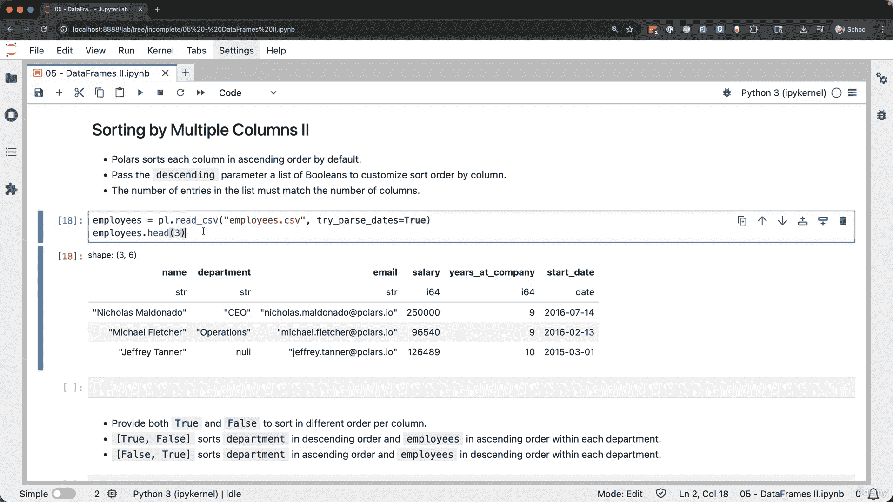

在本节课中，我们将要学习在 Polars 中如何使用 `descending` 参数对多列进行自定义排序，掌握如何为每一列单独指定升序或降序的排列逻辑。


上一节我们介绍了如何传入多个列名给 `sort` 方法进行排序，本节中我们来看看如何通过 `descending` 参数精细控制每一列的排序方向。


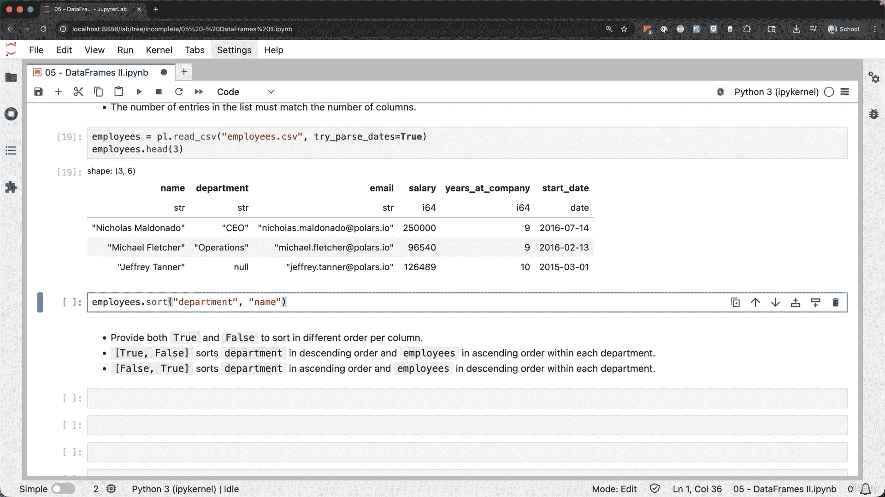

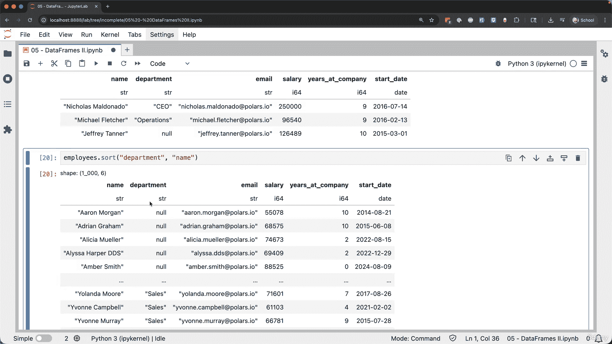

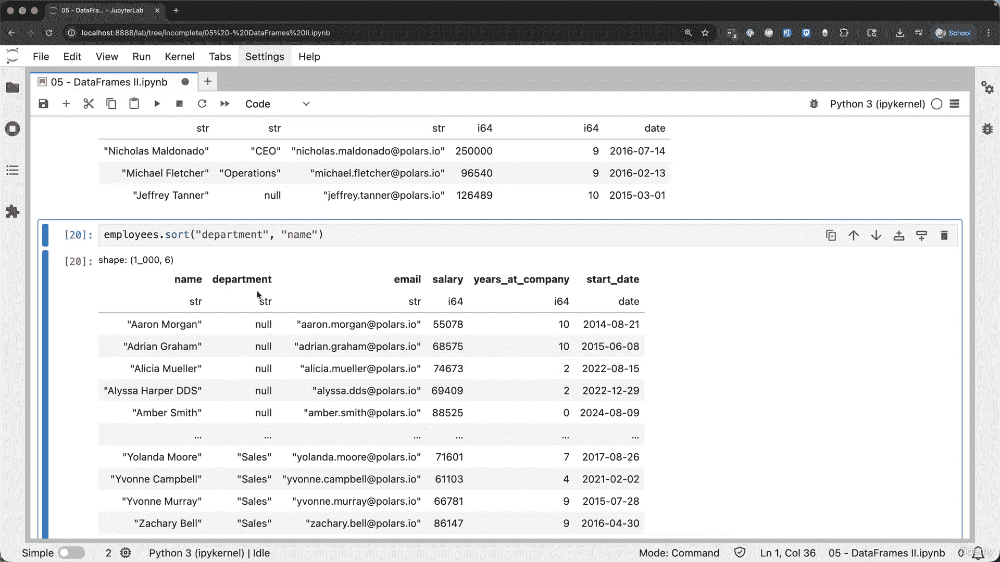

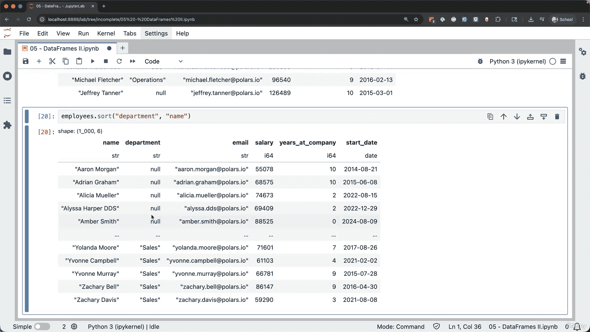

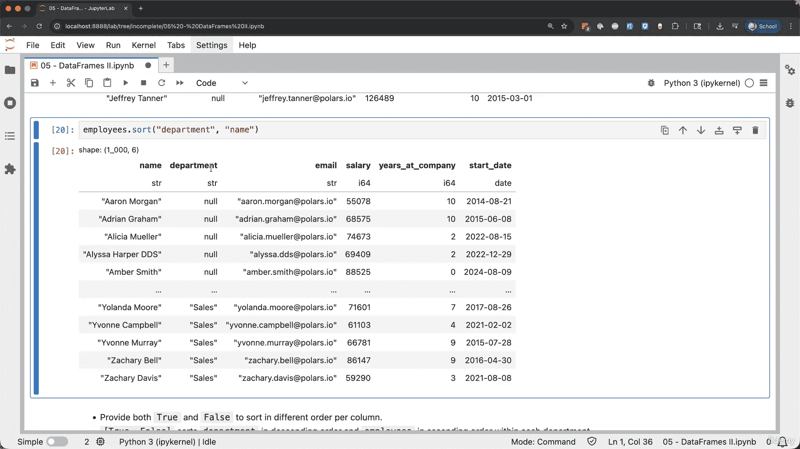

无论我们向 `sort` 方法传递一个参数还是多个参数，Polars 默认都会对所有指定的列按升序进行排序。我们其实可以通过 `descending` 参数来自定义这个默认行为。和往常一样，我们先重新执行一下导入代码，做好准备工作。


在上一课中，我们调用了 `sort` 方法并传入了 `department` 和 `name` 两个列名。这两列都是字符串类型，我们观察到 Polars 对这两列都采用了升序排列，对于字符串来说就是字母顺序。当然，当时我们没有使用 `nulls_last` 参数，所以 `department` 列的空值会排在最前面，随后是从 A 到 Z 的字母顺序。对于每一个重复出现的部门名称，其内部的 `name` 列也同样按升序即字母顺序进行了排列。


那么，我们该如何自定义这种行为呢？答案是使用一个名为 `descending` 的特殊参数。


当我们提供多个排序列时，`descending` 参数期望接收一个列表。之所以需要列表这种数据结构，是因为我们需要一个容器来装载多个值，从而为每一列单独指定排序顺序。在这个列表中，我们需要提供布尔值，并且布尔值的数量必须严格等于我们要排序的列的数量。因为本例中我们按两列排序，所以必须在列表中提供两个布尔值。列表中的每一个布尔值都会根据传入列名的顺序，一一对应到具体的列上。由于 `department` 是我们指定的第一个排序键，所以列表中的第一个布尔值将决定 `department` 列如何排序。


如果我在第一个位置指定 `false`，我的意思就是：不要对 `department` 列进行降序排列，也就是要按升序排列。紧接着，列表中的第二个布尔值对应第二列 `name`。我再次提供 `false`，这实际上会给我们呈现完全相同的默认排序结果，因为两个 `false` 代表两列均为升序，这正是默认行为。但既然我们有了自定义的能力，显然可以传入不同的值来改变结果。


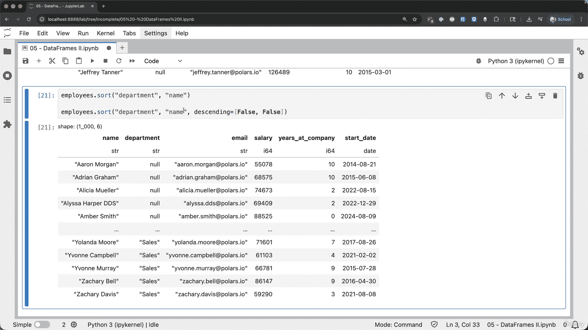

以下是几个核心代码示例，展示了不同参数组合下的排序效果：


```python
# 默认行为：两列均升序
df.sort("department", "name")
# 等价于显式指定 descending=[False, False]
df.sort("department", "name", descending=[False, False])
```


如果我复制这行代码并将两个布尔值都改为 `true` 会怎样？


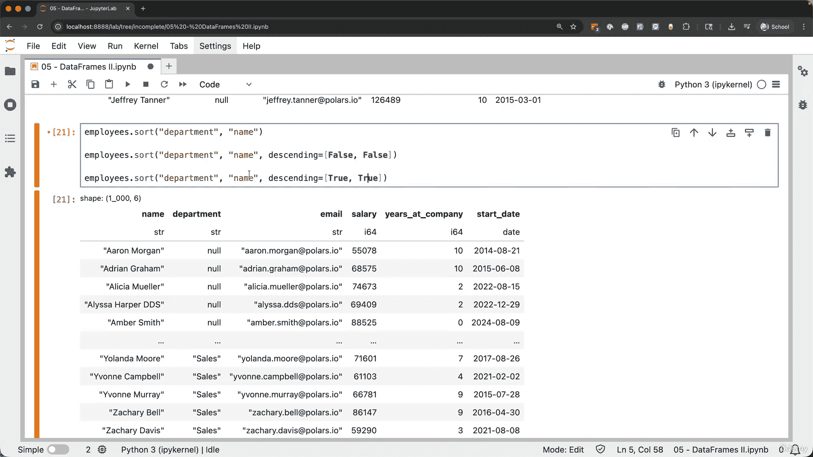

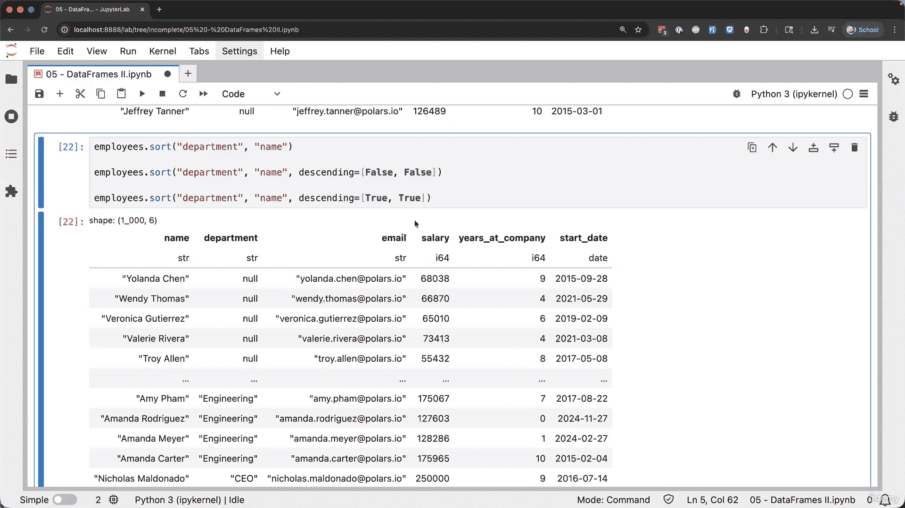

```python
# 两列均降序
df.sort("department", "name", descending=[True, True])
```


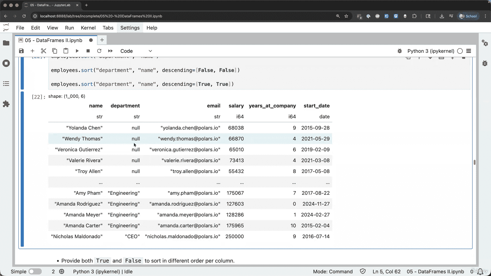

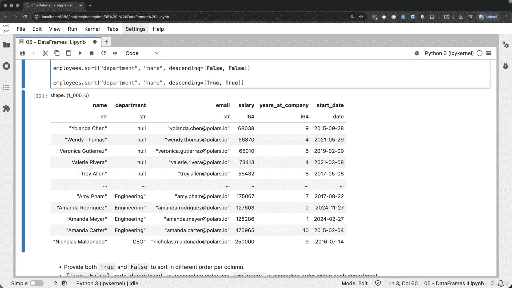

现在我指定了对 `department` 列进行降序排列，这意味着逆字母顺序；同时也指定对 `name` 列进行降序排列。这两列现在都将按逆字母顺序排序。空值依然会先出现在 `department` 列顶部，但随后 Polars 会从字母表末尾向开头遍历，即从 Z 到 A。在这个逆序的部门分组内部，名字也会按逆字母顺序排列。比如在 Engineering 部门下，Amanda Carter 在字母表上本该排在 Amanda Meyer 前面，但因为是降序，所以顺序会反过来。


在前面的例子里，我们保持了两列排序顺序一致，但我们并不强制要求这样做，完全可以混合搭配。


让我们看看混合排序的两个具体案例。我再次在数据框上调用 `sort` 方法，指定先按 `department` 排序，然后在每个重复的部门值内部按 `name` 排序。如果我想自定义排序顺序使其不全为升序，就需要传入 `descending` 参数，且必须是一个列表。我在 pandas 里可能可以偷懒传单个布尔值来统一所有列的顺序，但 Polars 严格得多，它强制要求列表长度必须与排序列数量一致。


例如，我传入 `[True, False]`。第一个 `True` 表示：是的，我要对 `department` 进行降序排列，即逆字母顺序；第二个 `False` 表示：不，我不要对 `name` 进行降序排列，所以 `name` 列按升序即字母顺序排列。这将产生一个这样的数据框：`department` 列按降序排列（空值在前，然后 Z 到 A），但在每个重复的部门值内部，`name` 列按升序排列（A 到 Z）。比如 Todd Bates 排在 Timothy Williams 后面，这些名字都在 Engineering 部门内部按字母顺序排好序了。这就是针对不同指定列应用不同排序顺序的效果。


再来看反向的混合情况，我指定列表为 `[False, True]`。


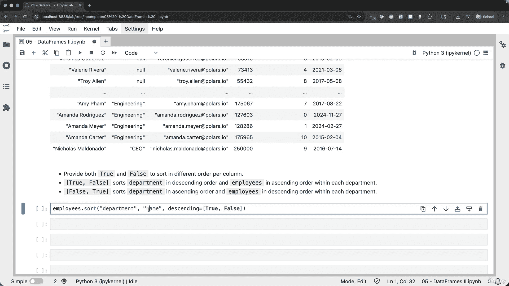

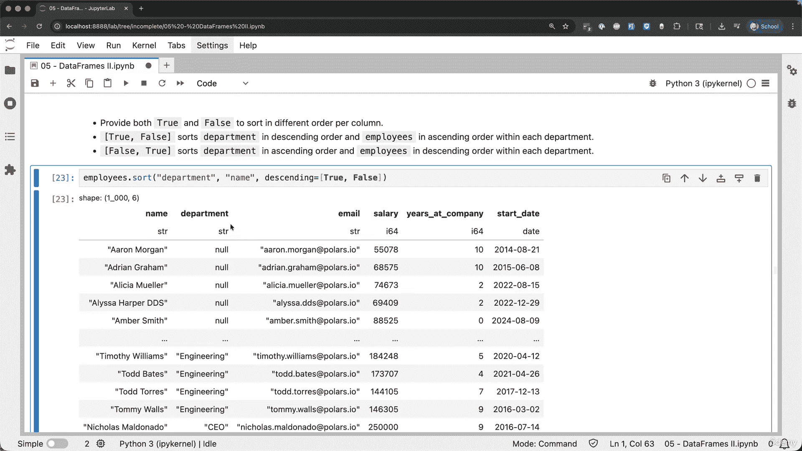

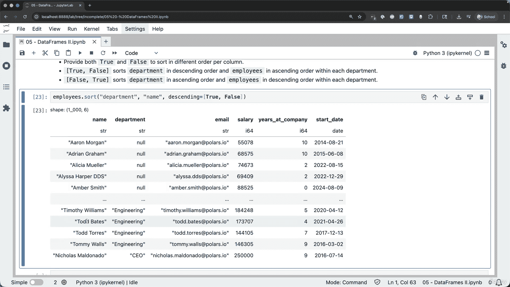

```python
# 第一列升序，第二列降序
df.sort("department", "name", descending=[False, True])
```


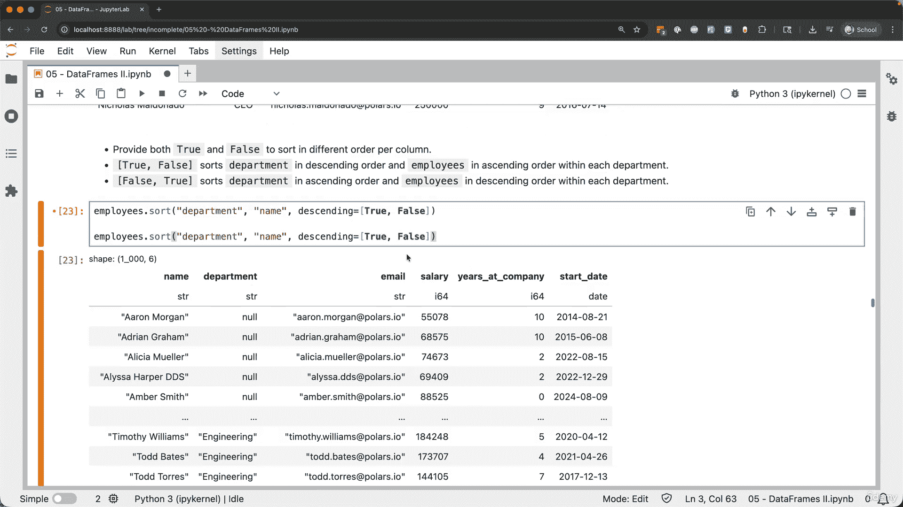

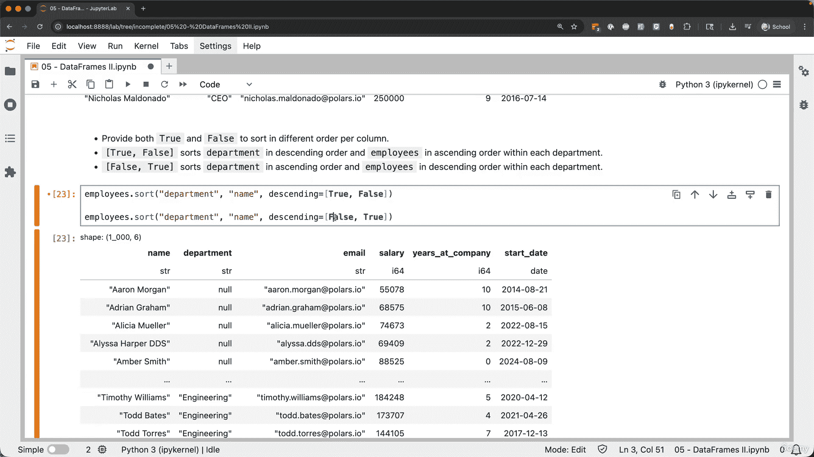

第一个 `False` 代表 `department` 列不降序，即升序排列；第二个 `True` 代表 `name` 列要降序排列。现在结果反过来了：先是空值，然后 `department` 从 A 到 Z 升序排列，但在每个重复的部门值内部，`name` 列按逆字母顺序降序排列。比如在 Sales 部门下，Aaron King 作为字母顺序最靠前的名字，因为是降序，反而排在了该分组的最前面。


以上例子都基于两个字符串列，但你可以随意尝试像 `department` 和 `salary` 这样不同数据类型的组合。无论列的数据类型是什么，Polars 都会应用完全相同的逻辑处理。


总结一下核心规则，以下是必须牢记的要点：


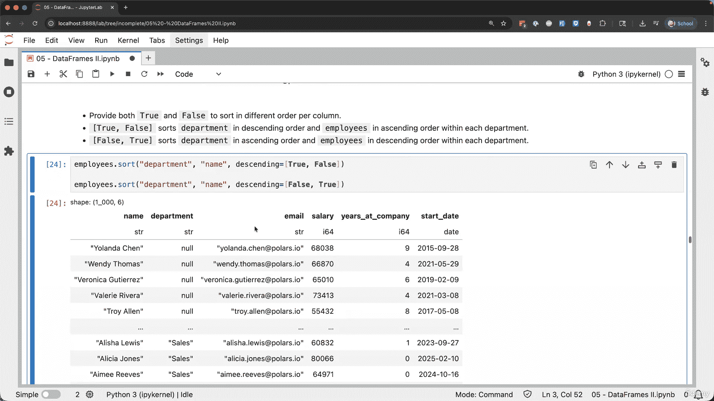

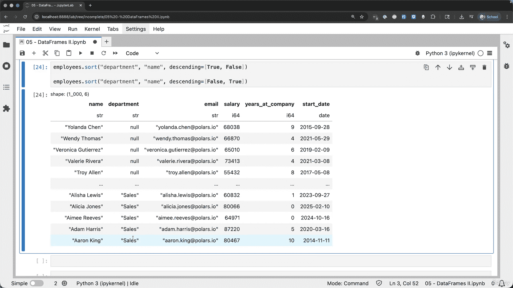

*   **默认行为**：如果不提供 `descending` 参数，Polars 会对所有传入 `sort` 方法的列按升序排序。
*   **自定义顺序**：若要自定义顺序（无论是全部反转还是仅反转其中一列），必须提供 `descending` 参数。
*   **参数格式**：`descending` 参数必须是一个列表。
*   **列表内容**：列表中存放布尔值，元素个数必须与待排序的列数量完全一致。
*   **对应关系**：列表中的布尔值按顺序一一对应每一个排序键，指定该列的具体排序逻辑。


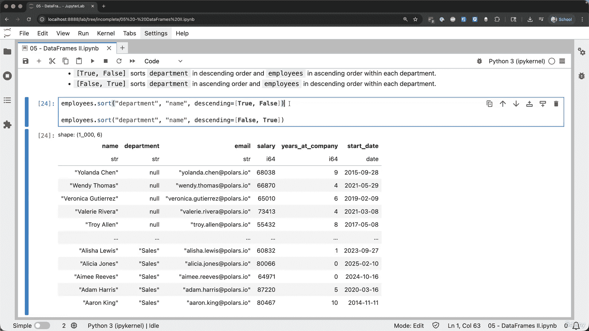

本节课中我们一起学习了如何在 Polars 中使用 `descending` 参数配合列表，实现对多列排序顺序的精细控制，包括全升序、全降序以及混合排序等场景，希望这些内容能帮助你更灵活地处理数据排序需求，我们下节课见。
