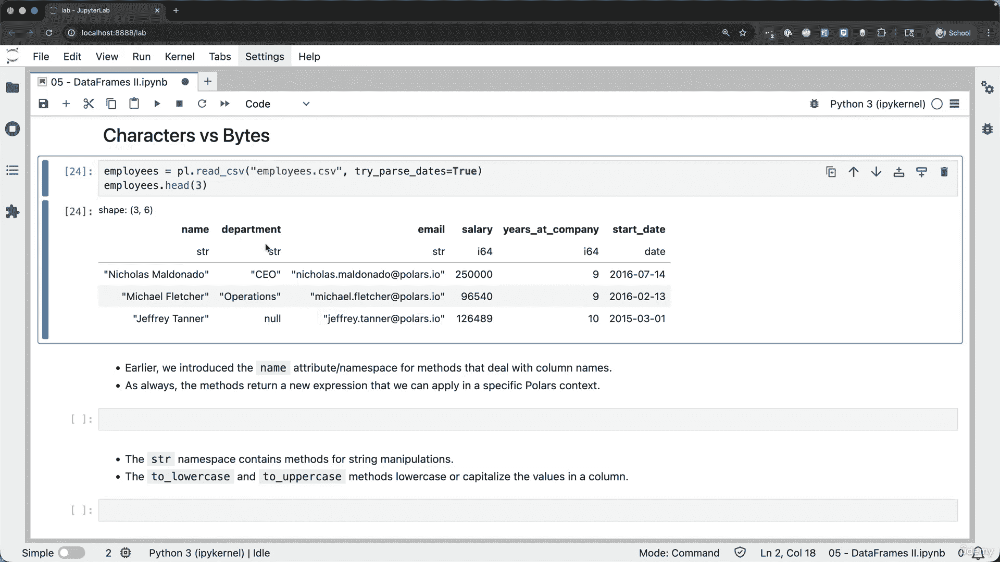

# Data Analysis with Polars and Python：75：字符与字节 🔤

在本节课中，我们将学习 Polars 中用于字符串处理的 STR 命名空间，以及字符长度与字节长度之间的区别。这两个看似简单的概念在实际处理数据时非常重要，尤其是当你的数据包含非英文字符或表情符号时。请大家跟着我一步步操作，不要跳过任何一行代码，这样能更好地掌握其中的细节。

首先，我们回顾一下 Polars 表达式上的属性与命名空间概念，以便更好地理解后续内容。在 Polars 中，表达式不仅可以调用方法，还可以访问属性。属性和方法的区别在于，属性不需要括号，它更像是一个入口，让你进入另一个功能区域。理解这一点有助于你在后面的学习中快速找到所需的功能。

以下是使用 name 属性的示例代码：

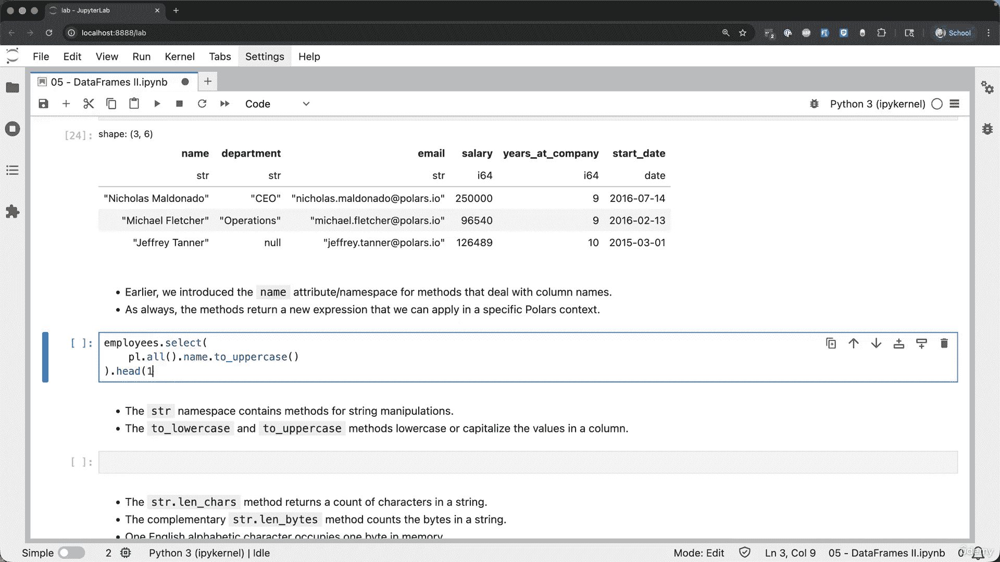

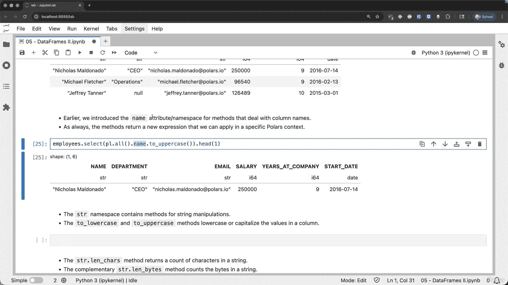

```python
import polars as pl

df = pl.DataFrame({"name": ["Alice", "Bob"]})
df = df.select(pl.all().name.to_uppercase())

print(df)
```

这段代码的意思是，先选中数据框中的所有列，然后使用 name 属性下的 to_uppercase 方法，把所有列名转换为大写。这里的 name 属性就像是一个文件夹，里面装着所有与列名相关的操作。当你访问 name 属性后，再加一个点，就能看到属于这个文件夹下的所有方法，它们都会返回一个新的表达式，也就是修改后的指令。

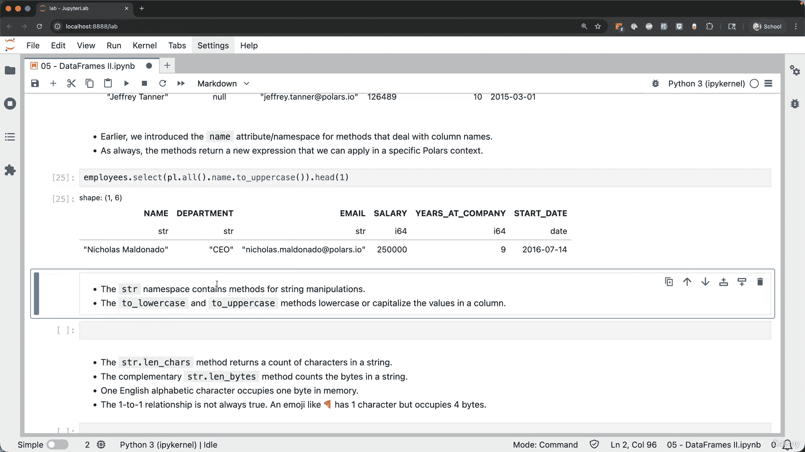

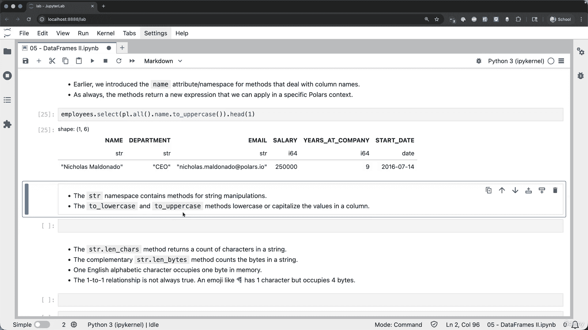

有了属性和命名空间的基础，我们可以正式引入 STR 命名空间。STR 是 strings 的缩写，专门用于处理字符串列中的值。和 name 属性一样，STR 也是一个容器或包装器，里面装着一堆跟字符串操作有关的方法。你可以把它想象成一个工具箱，专门放各种字符串处理的工具。

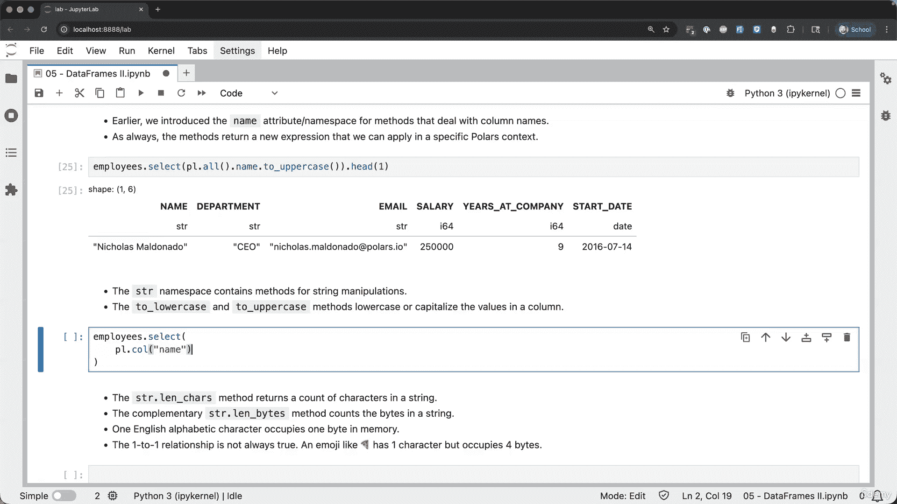

以下是 STR 命名空间中常用的字符串处理方法：

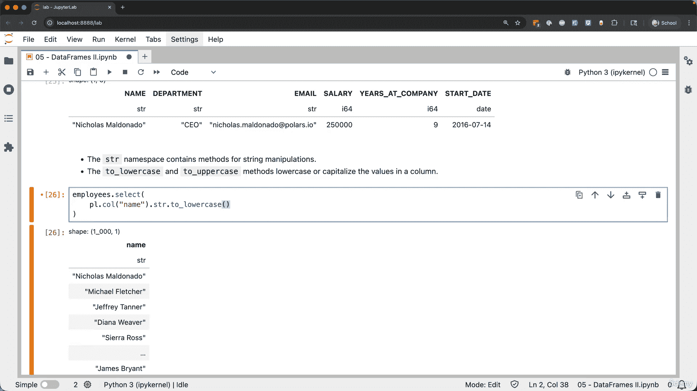

- to_lowercase：把字符串列中的所有值转换为小写。
- to_uppercase：把字符串列中的所有值转换为大写。

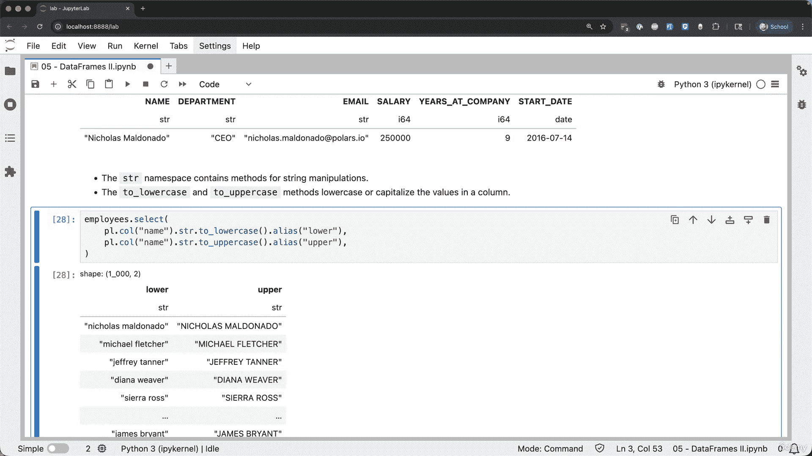

下面我们来看一个具体的例子。假设我们有一个员工数据框，其中包含一个名为 name 的列，列里的值目前是小写。我们想把这列的值分别转成小写和大写，并生成两列新数据。

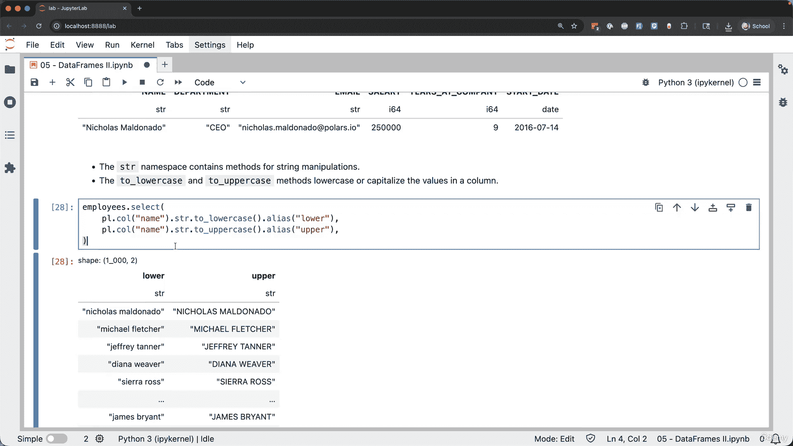

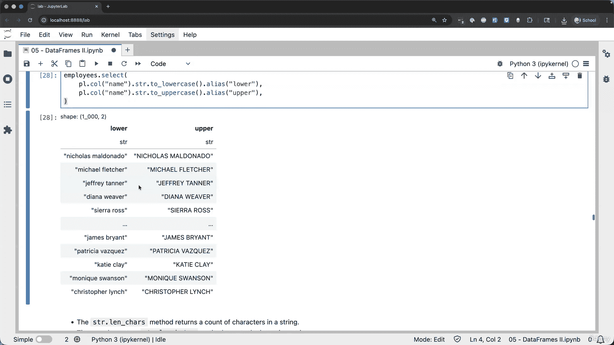

以下是完整的代码示例：

```python
import polars as pl

employees = pl.DataFrame({
    "name": ["Alice", "Bob", "Charlie"]
})

result = employees.select([
    pl.col("name").str.to_lowercase().alias("lower"),
    pl.col("name").str.to_uppercase().alias("upper")
])

print(result)
```

运行这段代码后，你会得到一个新数据框，其中包含 lower 和 upper 两列。lower 列里全是小写的名字，upper 列里全是大写的名字。关键点是，str 在这里只是一个命名空间，它本身不做具体操作，而是把所有和字符串相关的方法归纳在一起，方便你调用。

接下来，我们来讨论字符串长度这个话题。在 Polars 中，字符串长度是一个稍微有点绕的概念，因为长度可以有不同的理解方式。一种理解是数你看到的视觉字符有多少个，另一种理解是这个字符串在电脑内存中实际占用多少字节。对于初学者来说，这两个概念很容易混淆，所以我们需要分开来看。

为了演示字符与字节的区别，我们先构造一个包含普通文本和表情符号的数据框。这样能更直观地展示为什么字符数和字节数有时不一样。

以下是完整的代码示例：

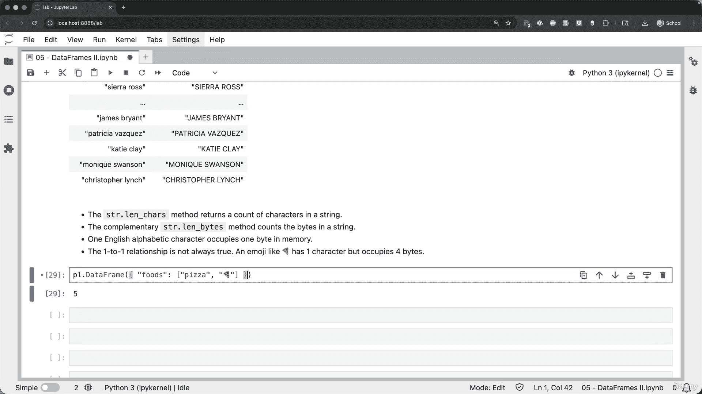

```python
import polars as pl

df = pl.DataFrame({
    "foods": ["pizza", "🍕"]
})

result = df.with_columns([
    pl.col("foods").str.len_chars().alias("length_chars"),
    pl.col("foods").str.len_bytes().alias("length_bytes")
])

print(result)
```

这段代码创建了一个 foods 列，第一行是普通的英文单词 pizza，第二行是披萨表情符号。然后我们使用 with_columns 方法，计算每个字符串的字符长度和字节长度，分别存入 length_chars 和 length_bytes 两列。

运行上述代码后，我们得到如下结果：

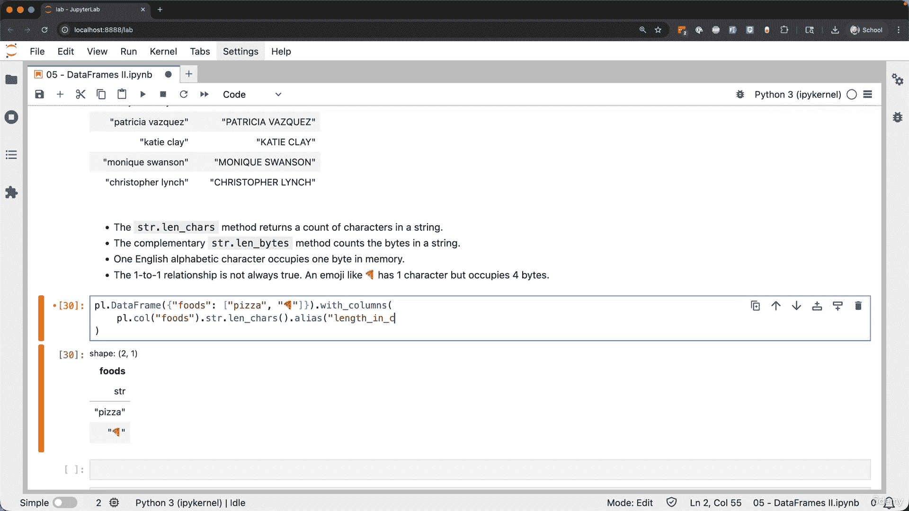

| foods   | length_chars | length_bytes |
|---------|--------------|--------------|
| pizza   | 5            | 5            |
| 🍕      | 1            | 4            |

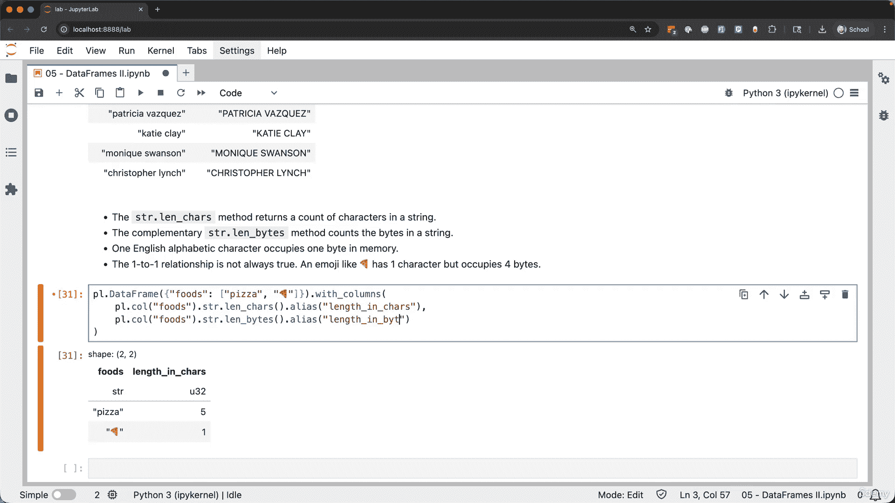

这里的核心区别可以用下面的公式来描述：

英文字符：1 个字符 = 1 个字节  
表情符号：1 个字符 ≠ 1 个字节（例如 🍕 占用 4 个字节）

也就是说，当你处理英文字母、空格或常见标点符号时，字符数和字节数通常是相等的。但当你处理表情符号或非英文字符时，一个你看到的字符可能在内存中占用多个字节。这就是为什么 Polars 要求你明确指定是想要字符长度还是字节长度，而不是提供一个含糊的 len 方法。

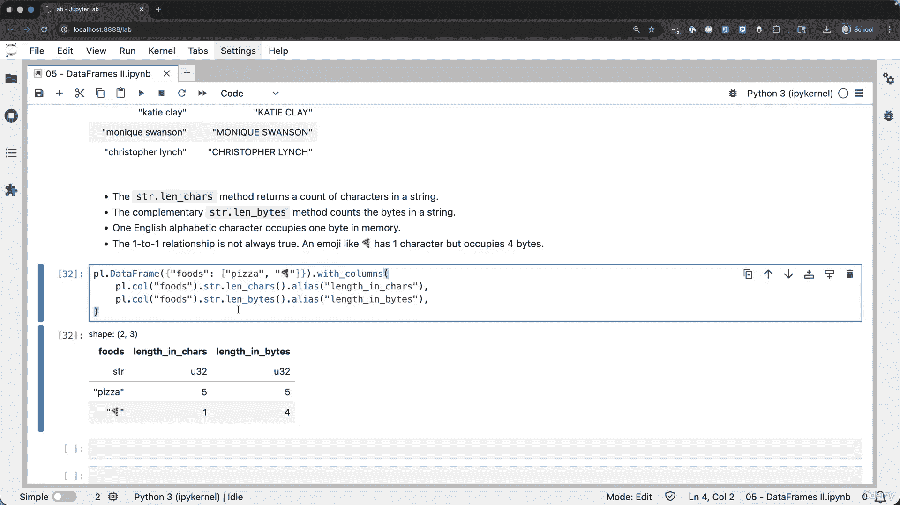

最后，我们总结一下本节学习的重点内容。我们介绍了 Polars 表达式上的属性和命名空间，重点讲解了 STR 命名空间及其常用的字符串处理方法，如 to_lowercase 和 to_uppercase。随后，我们讨论了字符串长度的两种衡量方式，分别对应 str.len_chars() 和 str.len_bytes()，并通过披萨和表情符号的例子展示了字符数与字节数在处理特殊字符时的差异。在下一节课，我们将学习如何使用表达式对列进行排序。

