使用Polars和Python进行数据分析：76：基于表达式的排序 📊

在本节课中，我们将学习如何在Polars数据框里，不仅可以使用已经存在的列来排序，还可以直接把一个表达式当作排序依据。这个功能非常实用，因为它允许我们先对数据做一些计算，然后再根据计算出来的结果来对整个数据框进行排序。接下来，我们会用大白话把每一个步骤都讲清楚，让刚接触Polars的朋友也能看懂。

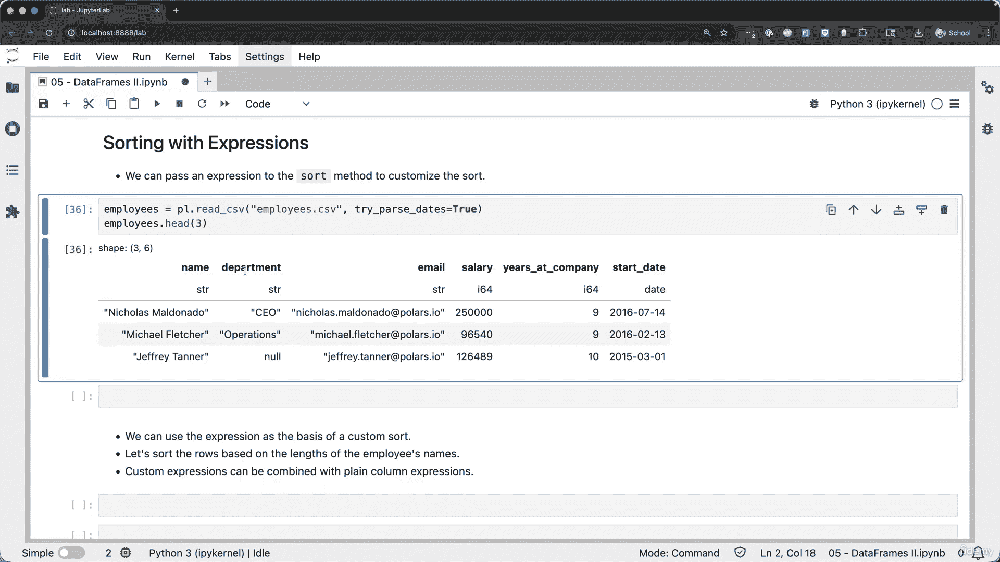

上一节课我们介绍了如何按一个或多个列的值对Polars数据框进行排序，本节中我们来看看sort方法还能接受什么样的参数。

sort方法除了可以接收列名之外，还可以接收一个Polars表达式。如果这个表达式能够生成一个新列，那么这个新列就可以作为排序的基础。我们可以直接把这个表达式传递给sort方法。

sort方法的作用方式，和select方法或者with_columns方法非常相似，它们都充当了一个上下文环境，让惰性表达式能够在这个环境里执行。为了让你更好地理解，我来举一个具体的使用场景。

让我们先重新运行一下代码，下面是我的员工数据框。

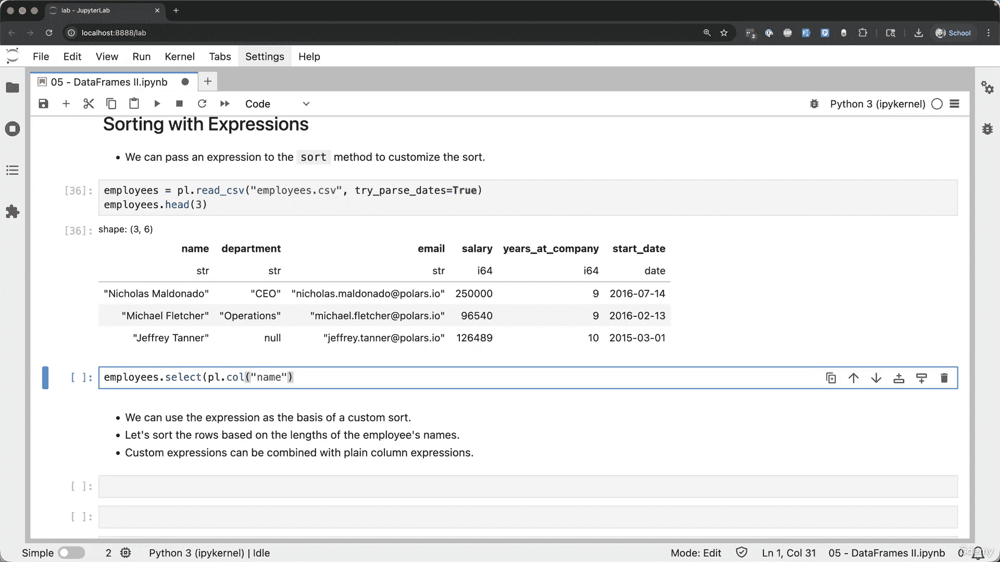

以下是员工数据框中的姓名列，我打算在select方法的调用中针对这一列进行操作。

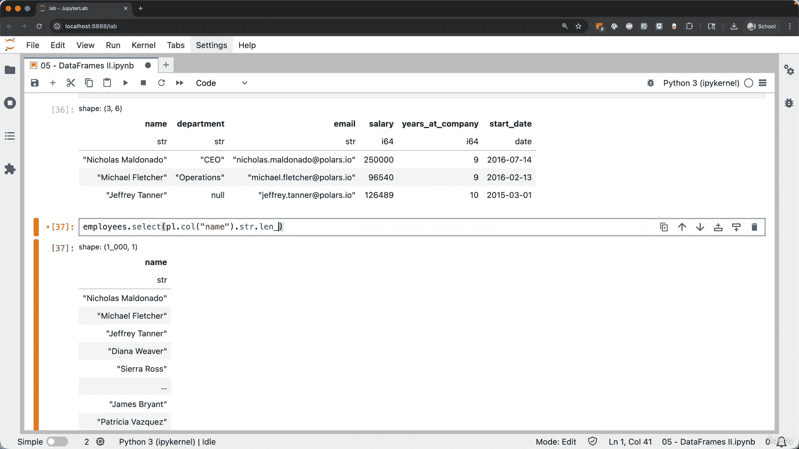

当然，我们完全可以按姓名列里的字符串值来排序，这会对字符串进行字母顺序排列。

假设我现在不想按这些字符串本身来排序，而是想按字符串的长度来排序。换句话说，我希望字符数最少、长度最短的字符串在排序结果中最先出现，然后按升序逐渐增加，直到出现字符数最多、长度最长的员工姓名。换句话说，我不是想基于这里现有的具体数据来排序，而是想基于这些数据经过计算后得到的结果来排序，具体来说，我想先得到这些字符串的长度，得到一个整数列，然后用这个整数列作为排序的依据。

下面就是具体的实现方法，和上一节课看到的一样，我们在表达式上使用.str属性，这个属性下面有很多和字符串相关的方法。如果我们想获取字符数或者长度，可以使用str.lengths方法，它会返回一列整数，存储每个字符串的长度。

```python
pl.col("name").str.lengths()
```

举例来说，Nicholas Maldonado的长度是18，意味着这个名字总共有18个字符。需要记住，字符数会包含任何字符或符号，包括英文字母，也包括空格、问号、美元符号、点号、逗号等等。这就是我们想要用来排序的数据集或列。

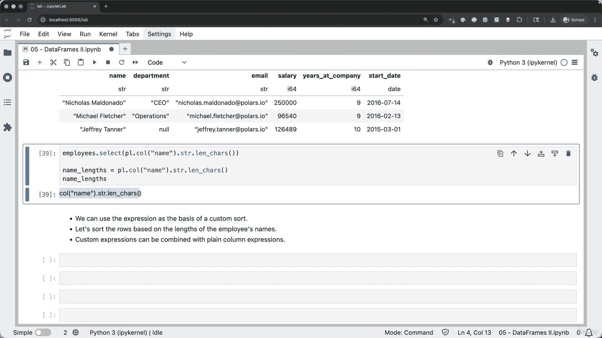

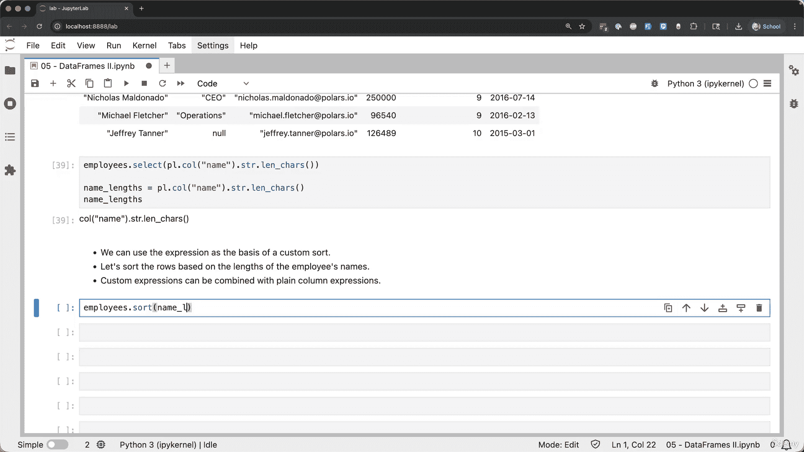

我接下来要做的是，把刚才那个表达式单独赋值给一个变量。需要记住，Polars的表达式本身就是一个独立的有效对象，它不需要了解任何具体的数据框，完全独立存在，是一个单独的、独立的基础构建块，相当于还没有烹饪的食谱。

```python
name_length = pl.col("name").str.lengths()
```

我要把这个表达式赋值给name_length变量，这个表达式的意思是：选中name列，计算其中每个字符串值的字符长度。

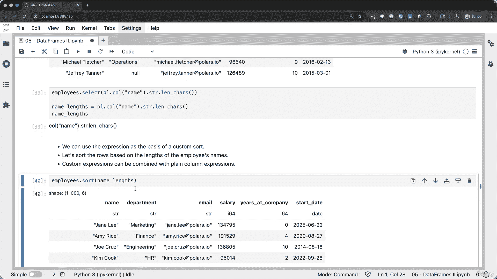

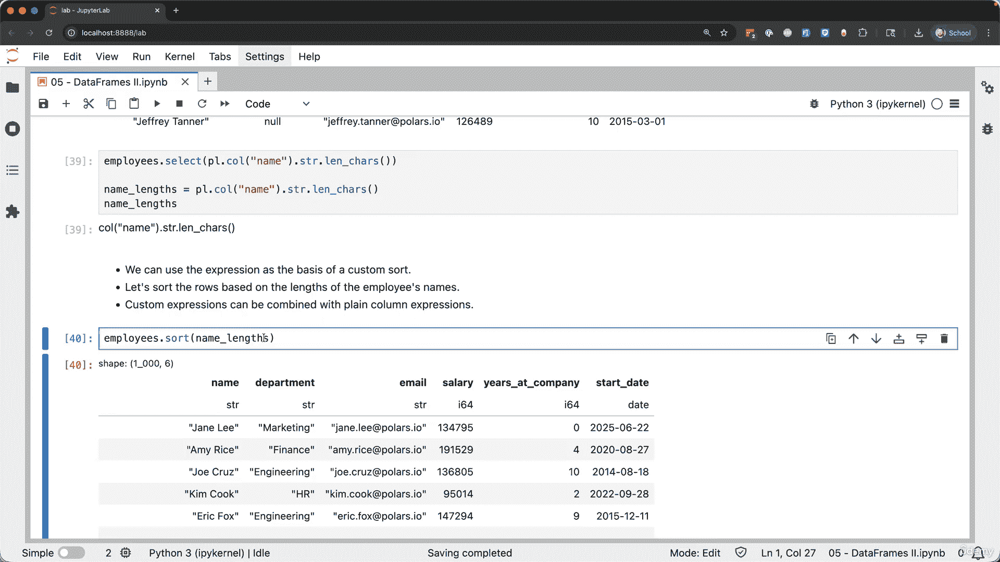

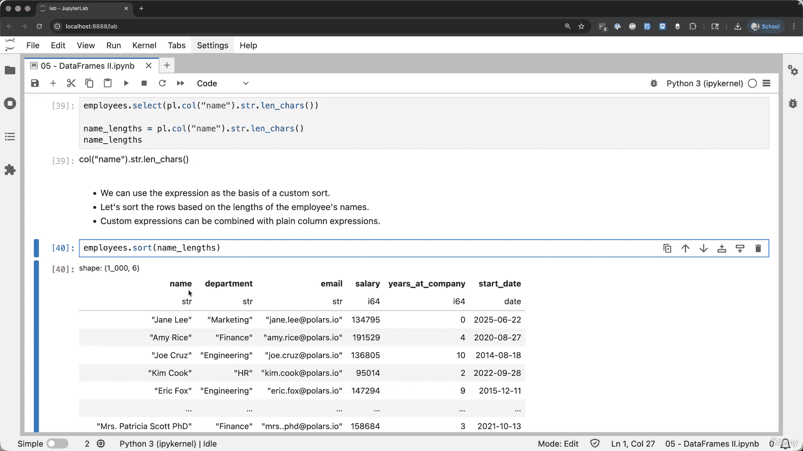

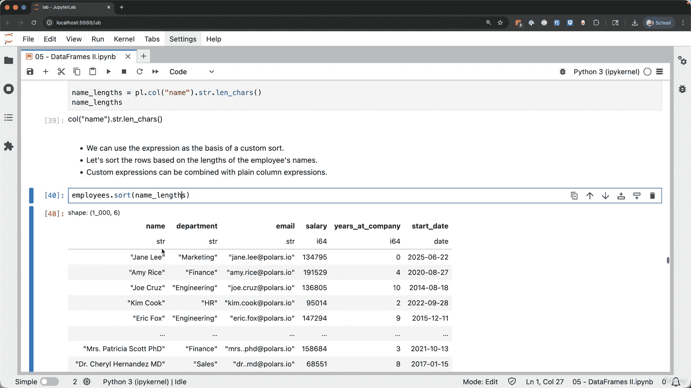

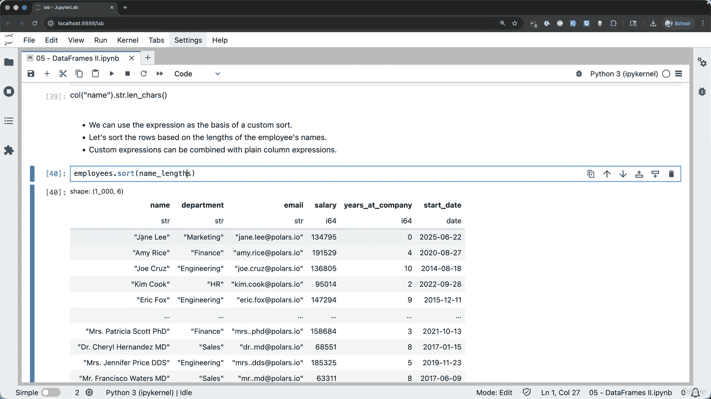

下面是表达式的字符串表示形式。

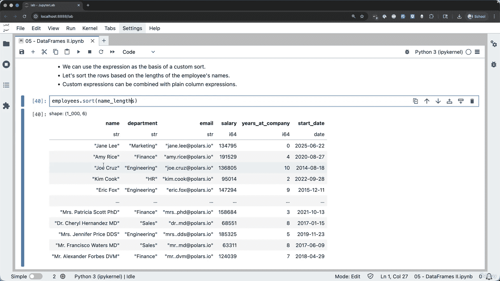

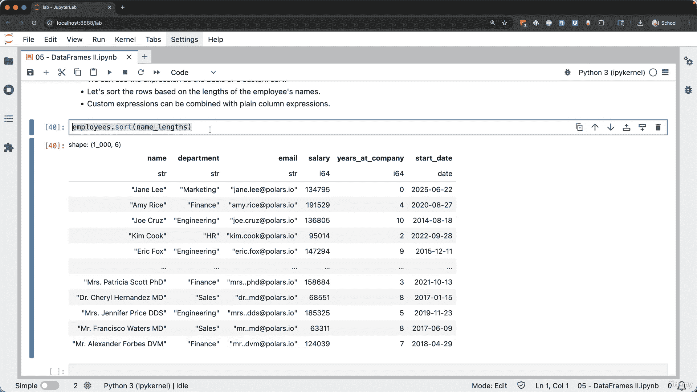

接下来，我要对employees数据框调用sort方法。但这次，我不再是针对一个已经存在的列，而是把刚才定义的name_length表达式传进去。

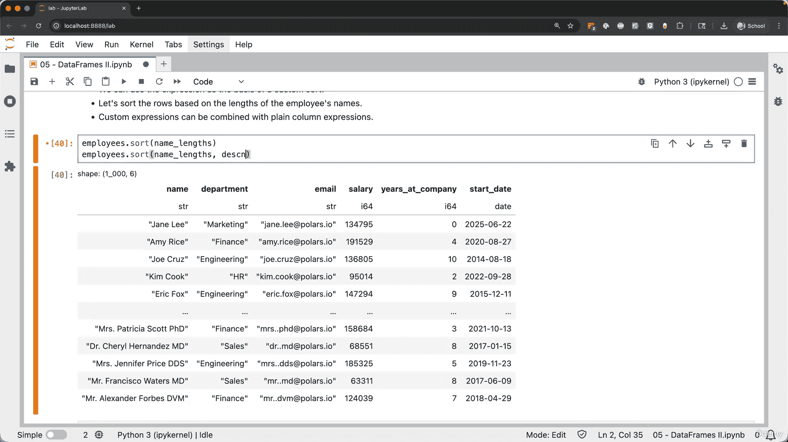

```python
employees.sort(by=name_length)
```

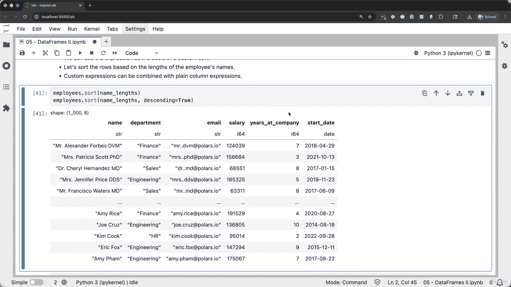

接下来会发生的事情，大概就是你所预期的那样。Polars会使用生成的表达式，产生一列整数，也就是字符串长度列，作为排序name列的依据。默认情况下是升序排序，也就是标准行为，所以你会看到字符数最短的名字排在最前面，随着数据框向后推移，字符数会越来越多，直到出现字符数最多的名字。

和往常一样，我们可以使用之前见过的相同参数。比如，可以使用descending参数，它默认被设置为false。

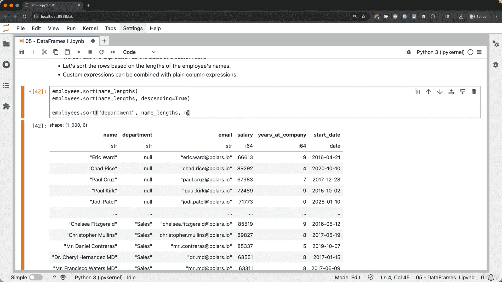

```python
descending = False
```

我们可以把它设置为true。这样一来，就会得到相反的结果：字符数最多、长度最长的名字会最先出现，然后往下排，直到字符数最少的名字。

实际上，Polars更强大更灵活的地方在于，我们可以混合使用列排序和表达式排序。比如，我可以这样做。

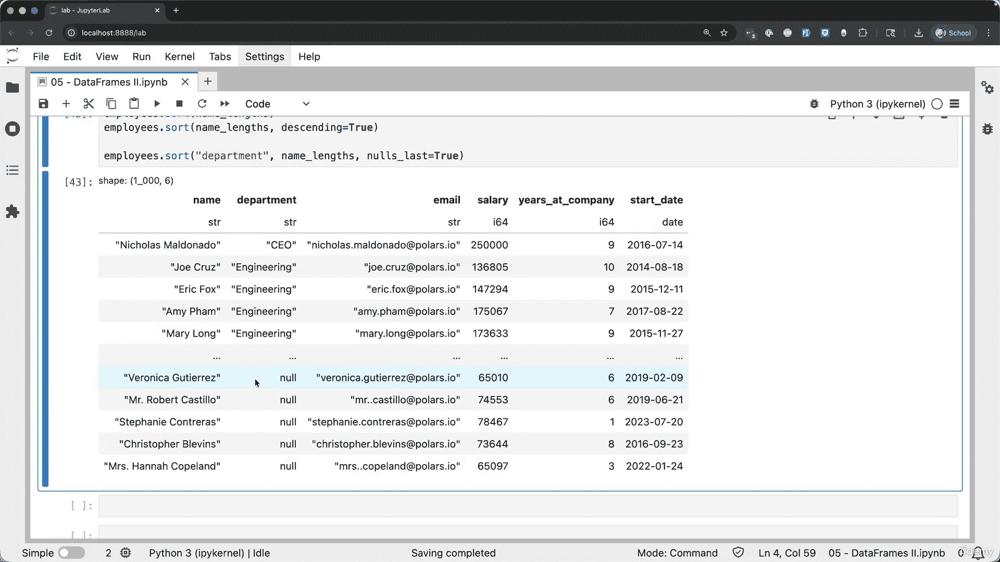

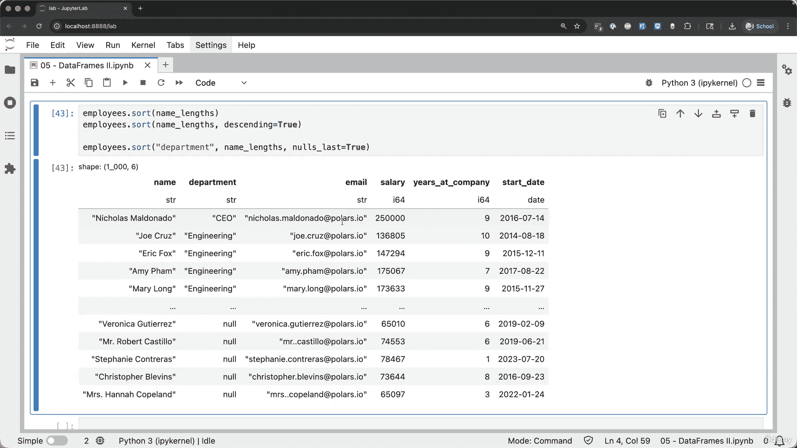

首先，按department列排序，这是我们之前见过的常规排序，基于department列中的字符串值。然后，对于每个重复出现的department，我再按name_length来排序。

让我们看看会得到什么结果。另外，我们再把空值移到最后，方便理解，所以我设置nulls_last为true。

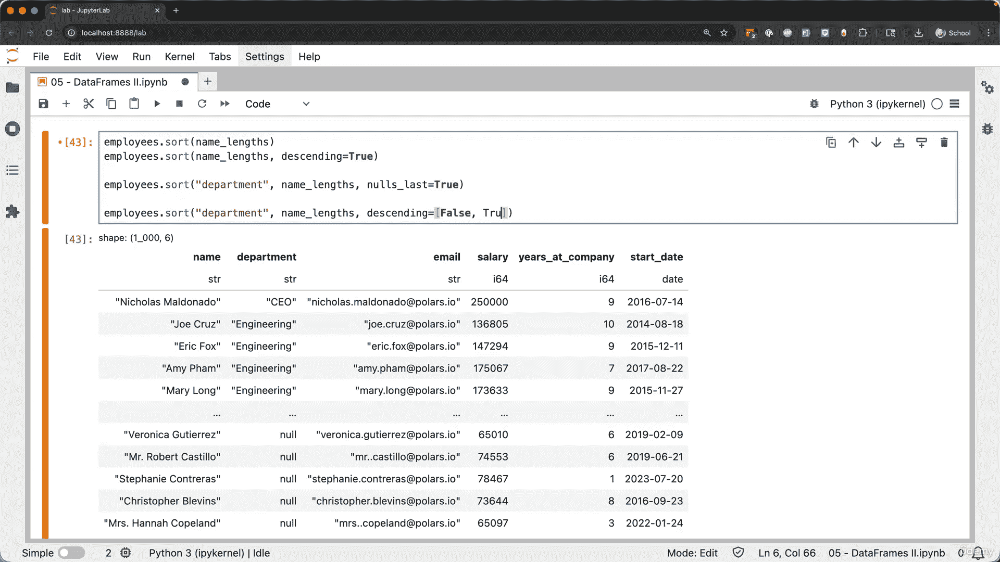

每当department重复出现时，我们就会查看姓名，并不是根据姓名本身的值来排序，也不是按字母顺序，而是根据每个字符串的字符数长度来排序。比如，Joe Cruise是engineering部门里字符数最短的姓名，随着engineering值的重复出现，姓名长度会越来越长，同样的逻辑也适用于所有重复的department，包括空值或缺失值，这真是很强大的功能，而且我们可以混合运用之前介绍的很多思想。

我把上面的例子复制过来，但这次我要再次引入descending参数。这一次，我们传入的不是一个，而是两个排序依据：一个是列的值，另一个是派生列的值。不过，我仍然可以在这里自定义降序排序的逻辑。例如，我可以要求department列按升序排序，也就是字母顺序，但对name_length按降序排序。

```python
employees.sort(
    by=[pl.col("department"), name_length],
    descending=[False, True],
    nulls_last=True
)
```

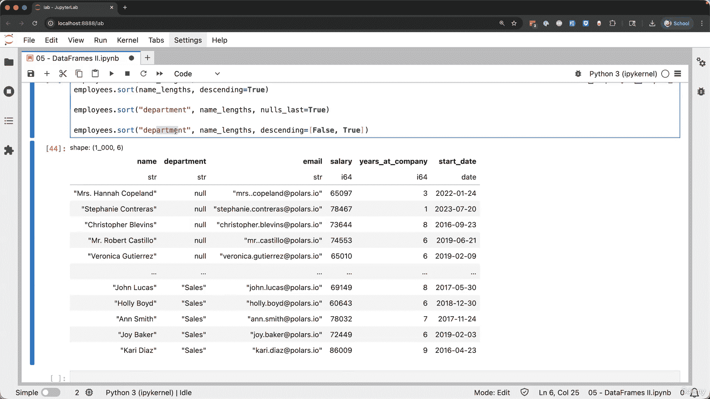

这样一来，从空值开始，我们会看到缺失值，然后是department列的字符串按字母顺序排列，sales会靠近字母表的末尾。接着，对于每个重复出现的department，我们会按name列的字符串长度进行降序排序，也就是从最长到最短。所以在遍历一个department时，字符串长度会越来越短。这就是我们在为每个值自定义排序顺序。

现在传递给sort方法的参数，是字符串值和表达式计算值的组合，我们可以混合使用多个列、多个表达式，以及列和表达式的混合。希望你能看出，Polars这个设计非常精妙，这些被称为表达式的小基础构建块，让我们能够构建很多复杂的逻辑。我们只需要拿到这些可复用的惰性食谱，在不同场景下应用，Polars就能明白我们想要先按department列的值排序，再按name_length排序，并且对每个排序依据应用完全不同的排序方式，就像这样一行代码就能解决，真是非常强大。

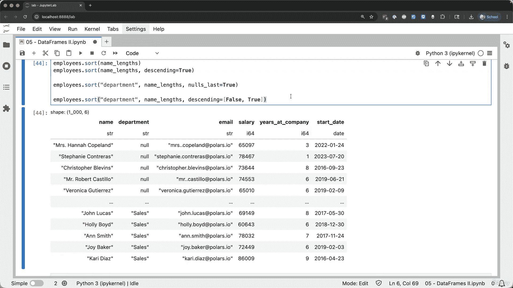

本节课中，我们一起学习了如何在Polars中使用表达式作为排序依据，包括按字符串长度排序、使用descending参数控制升降序、将空值移到最后、混合使用列和表达式进行多条件排序，以及为不同的排序依据设置不同的排序方向。
