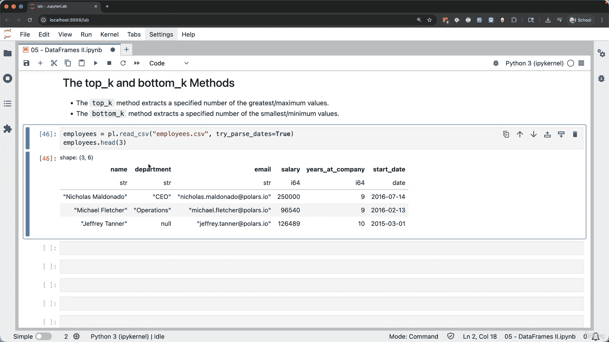
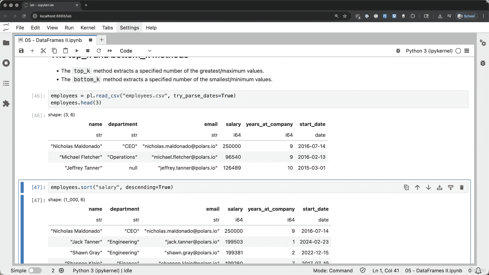
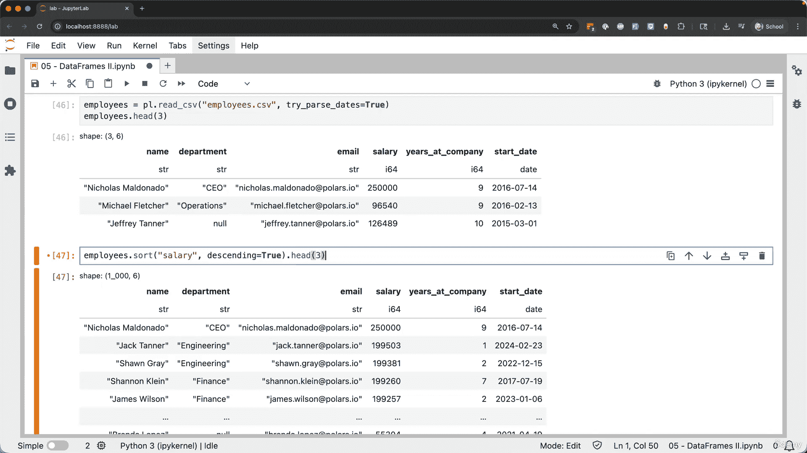
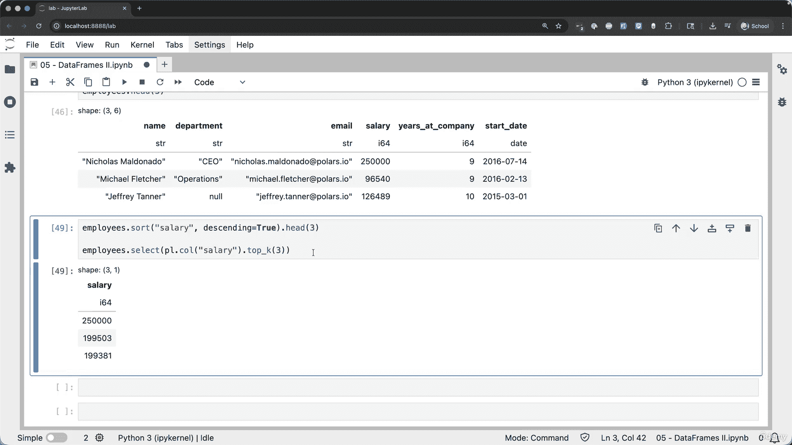
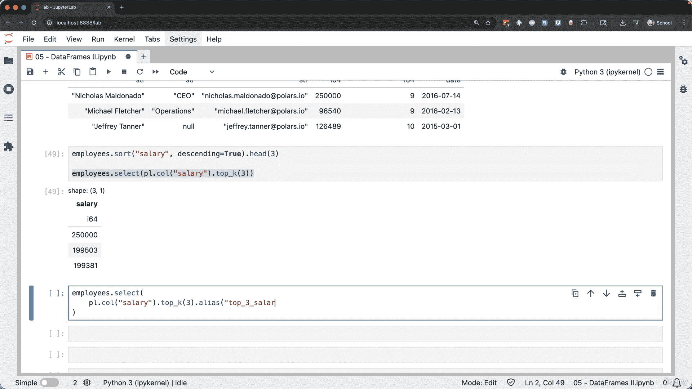
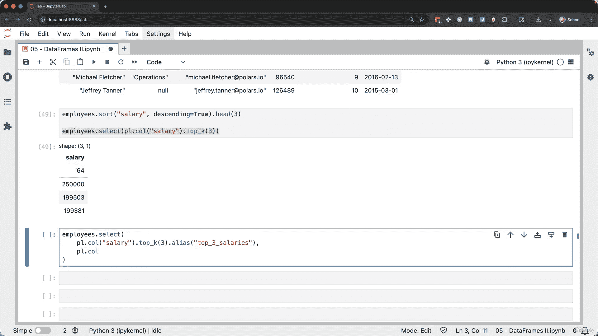
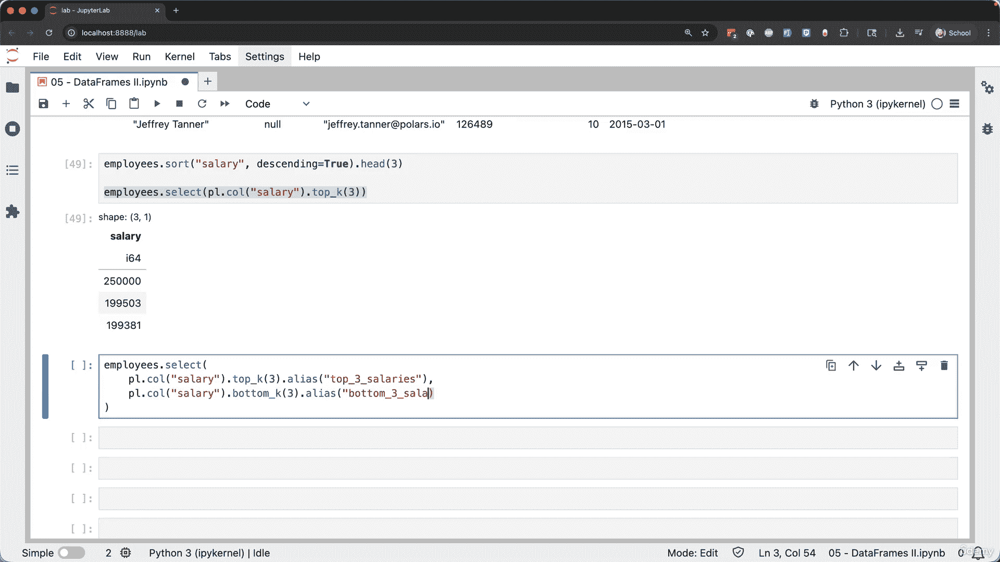
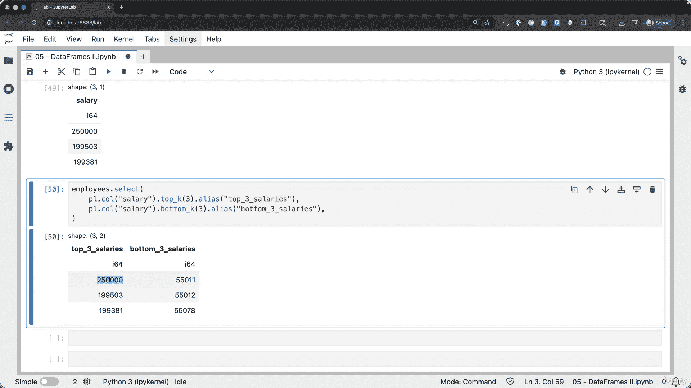

# Udemy - Data Analysis with Polars and Python：77：top_k 和 bottom_k 方法 📊




在本节课中，我们将要学习 Polars 中两个非常实用的方法，分别是 top_k 和 bottom_k。这两个方法的作用是帮我们从一列数据里快速挑出数值最大或最小的几个记录。我们会先回顾用排序配合取前几行的传统做法，然后再介绍更直接的替代方案。最后还会看看这些方法在文字列上的表现，让你对数据提取有更全面的了解。


接下来我们先来看看不使用 top_k 时，大家通常会怎么写代码。假设我们现在面对的是一个员工数据表，里面包含每个人的薪水信息。如果老板要求我们找出薪水最高的三位员工，最直观的思路就是先对薪水列进行降序排列，让数值最大的排在最前面，然后再把前三行取出来。在 Polars 中，这通常需要先调用 sort 方法，指定按 salary 列排序，并把 descending 参数设置为 True，这样就能让薪水从高到低排列。排好序之后，我们再调用 head 方法并传入参数 3，只保留前三行。这样一来，返回的结果就是完整的员工记录，每一行都包含该员工的所有信息，只是顺序已经按照薪水从高到低重新排列过了。如果你确实需要每位员工的完整资料，这种做法非常合适，因为它不仅告诉你薪水是多少，还把对应的姓名、部门等其他列都一并带出来了。


以下是传统方法的代码示例：





```python
employees.sort(by="salary", descending=True).head(3)
```

上述代码的意思是：先对 employees 数据框按 salary 列进行降序排序，然后取出前三行数据。运行完之后，你会看到三位薪水最高的员工及其完整信息出现在结果里。


刚才我们介绍了排序加限制行数的传统做法，本节中我们来看看如果只想要薪水数值本身，应该怎么操作更简单。有时候我们并不需要知道哪三位员工拿了最高薪水，只想知道这三笔薪水分别是多少钱。在这种情况下，把整张员工表排序再取前三行显得有点浪费，因为我们其实只关心 salary 这一列里的数值，而不关心每一行的其他内容。这时候 Polars 提供了一个更直接的办法，那就是使用 select 方法配合 top_k。top_k 方法的全称里的 K 并没有特殊含义，它只是一个占位符，代表你想要几个最大值。比如你想拿三个最大的薪水，就传入数字 3。调用方式是先用 pl.col 指定 salary 列，然后紧跟着调用 top_k(3)。这样 Polars 会直接从薪水列里挑出三个最大的数值，只返回这一列，而不会把整张员工表的所有列都带出来。结果会更加精简，只包含你真正需要的那三个数字。


以下是 top_k 方法的代码示例：

```python
employees.select(pl.col("salary").top_k(3).alias("top three salaries"))
```

这段代码会从 salary 列中提取出三个最大值，并把结果列重命名为 top three salaries。你会发现输出只有这一列数据，没有员工姓名或其他信息，正好对应只想要数值本身的需求。


学会了获取最大值之后，本节中我们来看看如何获取最小值。Polars 为 top_k 准备了一个互补的方法，叫做 bottom_k。顾名思义，bottom 指的是排在最底部的值，也就是最小的值，而 K 同样只是一个代表数量的任意数字。使用 bottom_k 的逻辑和 top_k 完全一样，你还是先用 pl.col 指定 salary 列，然后调用 bottom_k 并传入想要的数量。如果你想要三个最小的薪水，就传入 3。同样地，你可以给结果列起个别名，比如 bottom three salaries，这样结果更容易阅读。通过这种方式，你既能拿到三个最大的薪水，也能拿到三个最小的薪水，而且不需要对整张表进行排序，代码更加简洁明了。




以下是 bottom_k 方法的代码示例：

```python
pl.col("salary").bottom_k(3).alias("bottom three salaries")
```

上面这行表达式会从 salary 列里挑出三个最小的数值，并将结果列命名为 bottom three salaries。




刚才我们分别看了 top_k 和 bottom_k 的单独用法，本节中我们来看看把它们放在一起对比，能发现什么不同之处。当我们使用传统的排序加 head 方法时，得到的是完整的员工行，而且这些行是按照薪水从高到低排列的，也就是降序排列。而如果使用 top_k 方法，返回的只有 salary 列，里面的三个数值也是从大到小排列的。相比之下，bottom_k 返回的三个数值则是从小到大排列的，也就是升序排列。也就是说，top_k 给出的第一个数字是该列里最大的薪水，而 bottom_k 给出的第一个数字是该列里最小的薪水。这种排序方向的差异很重要，因为它决定了你在读取结果时，第一行看到的是最高薪水还是最低薪水。




以下是两种方法结果特点的对比列表：

- 传统排序加 head：返回完整员工行，按薪水从高到低排列
- top_k 方法：只返回 salary 列，三个数值按从大到小排序
- bottom_k 方法：只返回 salary 列，三个数值按从小到大排序

通过这个列表可以清晰地看出，三种方式在返回内容和排序顺序上都有明显区别，你可以根据实际需求选择合适的一种。


前面我们都在数值列上演示，本节中我们来看看这些方法在文字数据上的表现。其实 top_k 和 bottom_k 并不仅限于数字列，它们在字符串列上也能正常工作。如果你把它们应用到一个包含人名或城市名的文字列上，Polars 会按照字母顺序来决定哪些值算是“最大”或“最小”。对于字母来说，top_k 会返回靠近字母表开头的值，比如以 A 或 B 开头的单词会被排在前面；而 bottom_k 会返回靠近字母表末尾的值，比如以 Y 或 Z 开头的单词会被选出来。这意味着即使没有数字大小可比，这些方法依然能帮你快速定位字母顺序靠前或靠后的记录，使用起来和数值列没有本质区别。






到这里，这节课的内容就讲完了。本节课中我们一起学习了如何在 Polars 中使用 top_k 和 bottom_k 方法。我们先回顾了用排序配合 head 来获取最大值的传统写法，然后掌握了更简洁的 select 加 top_k 写法，也了解了与之互补的 bottom_k 方法。最后我们还看到，这两个方法不仅适用于薪水这样的数值列，也可以用于字母排序的文字列。希望你能动手试一下，在自己的数据集上练习找出最大值和最小值，下节课见。

