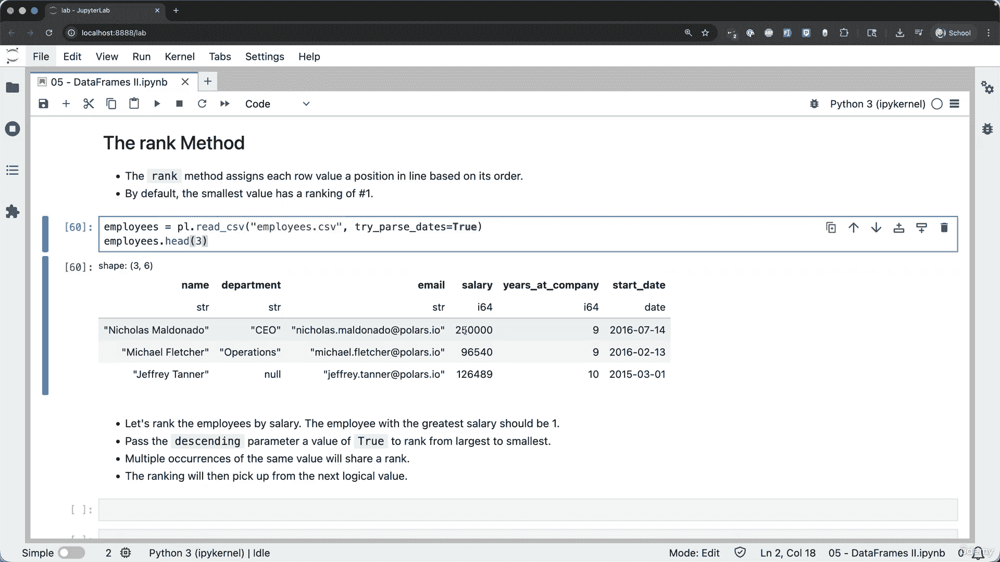
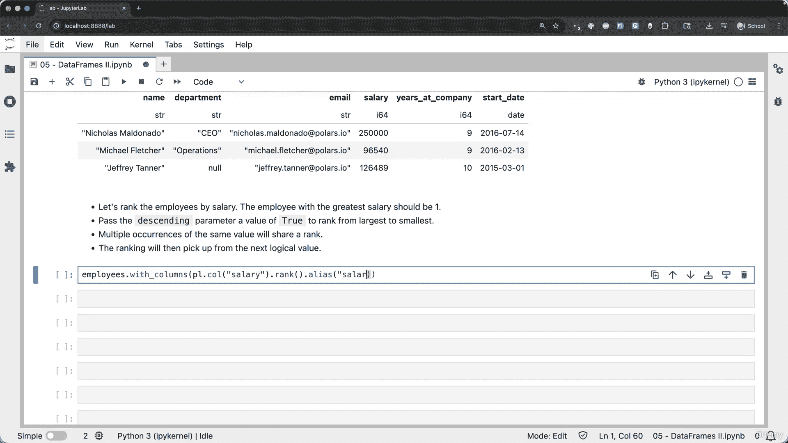
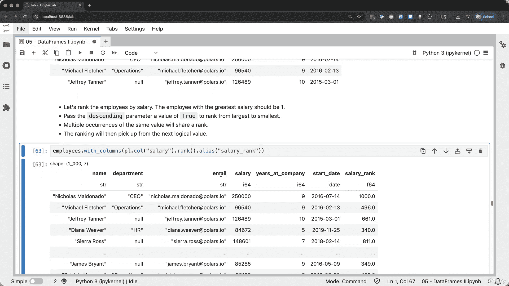
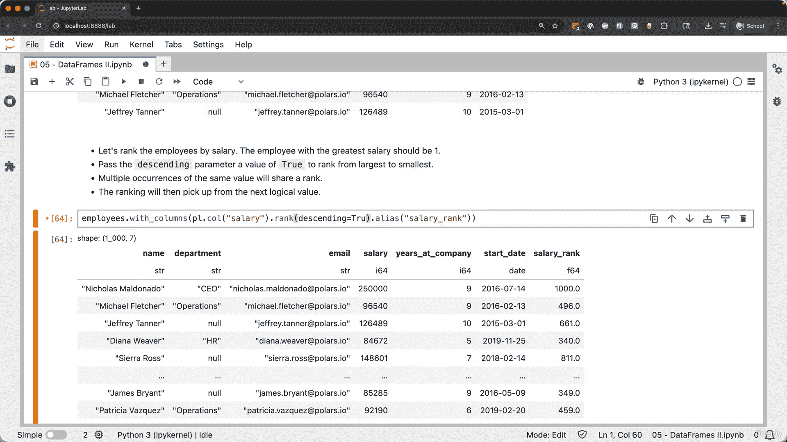
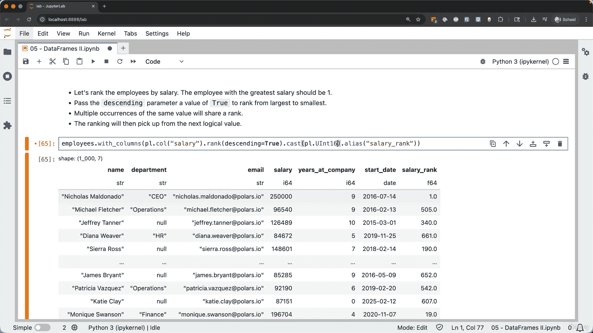
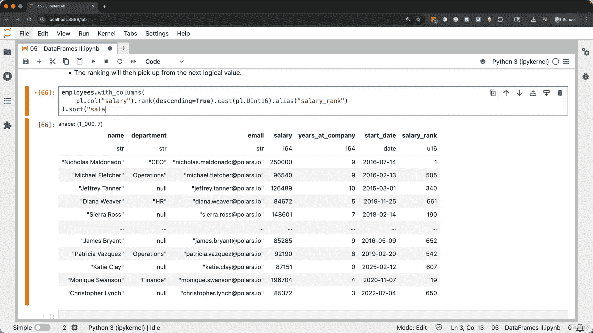
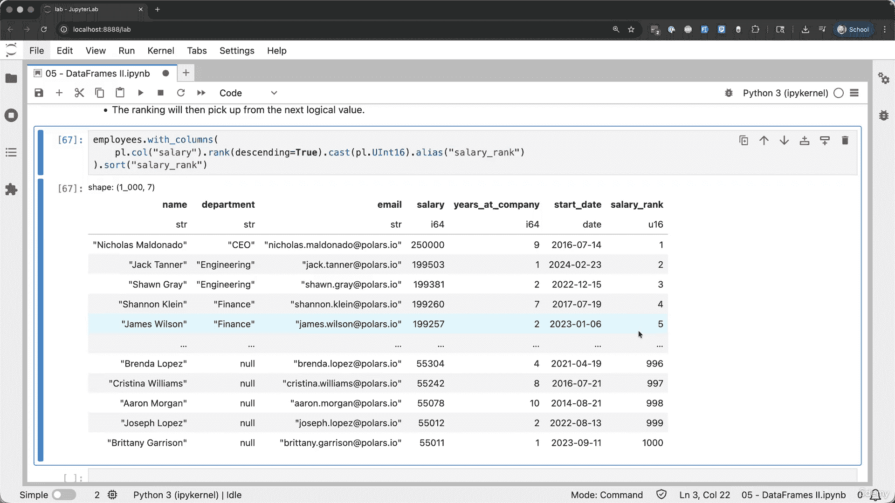

Polars数据分析与Python: 78: rank 方法 📊

在本节课中，我们将一起学习 Polars 库中的 rank 方法。rank 方法的核心作用是根据一列数值在有序集合中的顺序或位置，为每个数值分配一个排名。为了让你更容易理解，我们会以员工薪资数据作为实际案例，看看如何给每个员工根据薪资高低打上名次。学习过程中，我们还会探讨默认的排序方向、如何反转排名、重复值该如何处理，以及把排名列从浮点数转换成整数的方法。本节课的目标是让你掌握 rank 方法的基本用法，并能够在真实的数据分析任务中灵活运用它。

## 什么是 rank 方法

rank 方法的思想其实非常直白，就是给列里的每个数排个队。假设我们有一列员工薪资，想要知道哪个员工拿得最多，哪个员工拿得最少，那么就可以使用 rank 方法，根据薪资的大小顺序，为每个员工分配一个名次。

下面是 rank 方法的基本计算公式：



```
排名 = 数值在有序集合中的位置
```

换句话说，rank 方法会先把列里的所有数值排好队，然后按照它们在队列中的位置，依次打上从 1 开始的数字。数值越靠前，排名数字就越小；数值越靠后，排名数字就越大。

## 如何编写排名代码

下面是使用 rank 方法的具体代码步骤。我们先加载员工数据表，然后使用 with_columns 方法对薪资列进行排名。

```python
import polars as pl

# 加载员工数据表
employees_df = pl.read_csv("employees.csv")

# 保留原有列，并新增薪资排名列
result_df = employees_df.with_columns(
    pl.col("salary").rank().alias("salary_rank")
)
```

这里有几点需要特别说明。首先，with_columns 方法会保留数据表中所有原有的列，不会把原来的 salary 列删除或覆盖。其次，我们对 salary 列调用了 rank 方法，并给新生成的列起了一个别名，叫做 salary_rank。这样做的目的是为了避免覆盖原始的薪资列，这样我们就可以同时保留原始薪资数据和计算出来的排名数据，方便后续对比和检查。



## 默认的排名方向



默认情况下，Polars 的 rank 方法会把列里最小的数值排在第一位，也就是给最小的数值分配排名 1。随着数值变大，排名数字也会依次增加，直到最大的数值获得最后一个排名。在我们的员工数据表中总共有 1000 行，所以薪资最高的员工会得到排名 1000。

这个行为和 Polars 中排序方法的逻辑是完全一致的。排序方法默认也是升序排列，也就是从最小的数值开始，一直到最大的数值结束。因此排名逻辑也遵循同样的规则：数值越小，排名越靠前，数值越小的员工就会获得更小的排名数字。

下面是默认情况下的排名示例：
- 薪资最低的员工：排名 1
- 薪资处于中间水平的员工：排名大约 500
- 薪资最高的员工：排名 1000

在我们的案例中，公司首席执行官 Nicholas Maldonado 出现在数据表的第一行，他的薪资是全公司最高的，达到了二十五万美元。但在默认的升序排名下，他的排名却是 1000。这看起来可能有些反直觉，但正是因为 Polars 默认采用的是从小到大的升序排列方式。

## 如何反转排名顺序

如果我们希望让薪资最高的员工排在第一位，那么就需要调整 rank 方法中的 descending 参数。这个参数的含义和排序方法中的 descending 完全一致，用来控制是否采用降序排列。

下面是 descending 参数的具体作用：
- descending = false（默认值）：采用升序排名，最小数值获得排名 1
- descending = true：采用降序排名，最大数值获得排名 1



对应的代码示例如下：

```python
result_df = employees_df.with_columns(
    pl.col("salary").rank(descending=True).alias("salary_rank")
)
```

当 descending 参数设置为 true 时，排名逻辑就会被完整反转。这时候薪资最高的员工会得到排名 1，而薪资最低的员工则会得到排名 1000。这样一来，首席执行官 Nicholas Maldonado 就变成了排名第一，这更符合我们通常对“高薪优先”的直觉认识。

## 重复值的处理方式

在实际数据中，经常会出现多个员工拥有完全相同薪资的情况。rank 方法也考虑到了这种情形，当出现重复数值时，Polars 会给这些相同的数值分配完全相同的排名，然后跳过中间被占用的名次，直接进入下一个顺序排名。

下面是重复值排名的具体示例：
- 员工 A 的薪资是公司第二高，排名 2
- 员工 B 的薪资也是公司第二高，排名 2
- 下一个较低的薪资会被分配排名 4，而非排名 3

这种排名方式同样可以通过 rank 方法的参数进行自定义，以适应不同的业务场景和分析需求。

## 将排名列转换为整数类型

你可能会观察到，新生成的 salary_rank 列默认是以浮点数形式存储的。如果你希望把它转换成整数，可以使用表达式中的 cast 方法。cast 方法的作用非常简单，就是把列中的数值转换为另一种数据类型。

对应的代码示例如下：

```python
from polars import UInt16

result_df = employees_df.with_columns(
    pl.col("salary").rank().cast(UInt16).alias("salary_rank")
)
```



之所以在这里选择无符号整数类型，是因为排名的数值永远是正数，起始值是 1，最大值不会超过数据表的总行数。在这种场景下，使用 16 位无符号整数 UInt16 已经足够容纳所有的排名数值了。转换完成之后，salary_rank 列就会变成整数列，语义上也更加符合排名的特征。



## 验证结果与实际应用

转换完成后，我们可以对 salary_rank 列进行升序排序，来验证结果是否符合预期。当排名按照从小到大的顺序排列时，对应的薪资实际上是从高到低排列的。也就是说，排名靠前的员工薪资更高，排名靠后的员工薪资更低。

rank 方法在实际工作中有很多用处。比如，你可以用它来找出哪些员工的薪资最高，对公司的人力成本影响最大；也可以用它来找出薪资最低的员工，从而考虑为他们调整薪资。无论是哪种场景，rank 方法都能基于数值在有序集合中的位置，给你一套清晰的排序结果。

## 本节总结



本节课中，我们一起学习了 Polars 中的 rank 方法。我们了解了 rank 方法如何根据数值在有序集合中的顺序为每个值分配排名，掌握了默认升序和设置 descending=true 后的降序排名，学习了重复值会如何被分配相同排名并跳过中间名次，还学会了如何使用 cast 方法将浮点数排名列转换为无符号整数类型，最后探讨了在薪资分析等实际场景中的应用。希望这些内容能帮助你更好地使用 Polars 进行数据分析。
