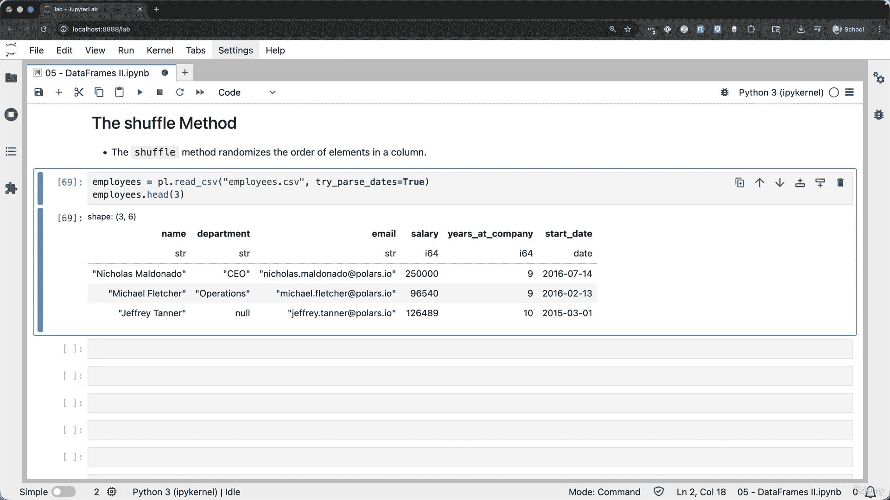
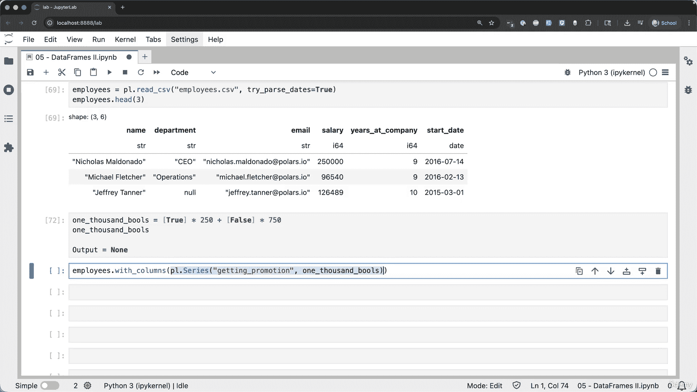
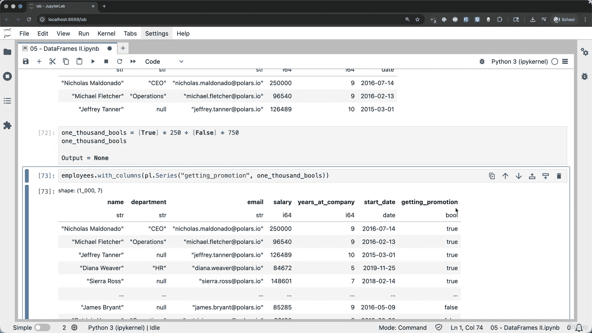
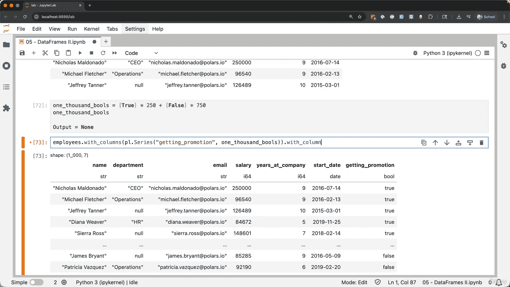
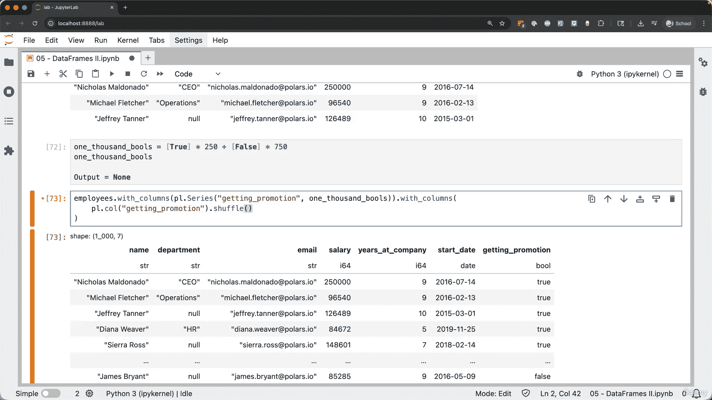
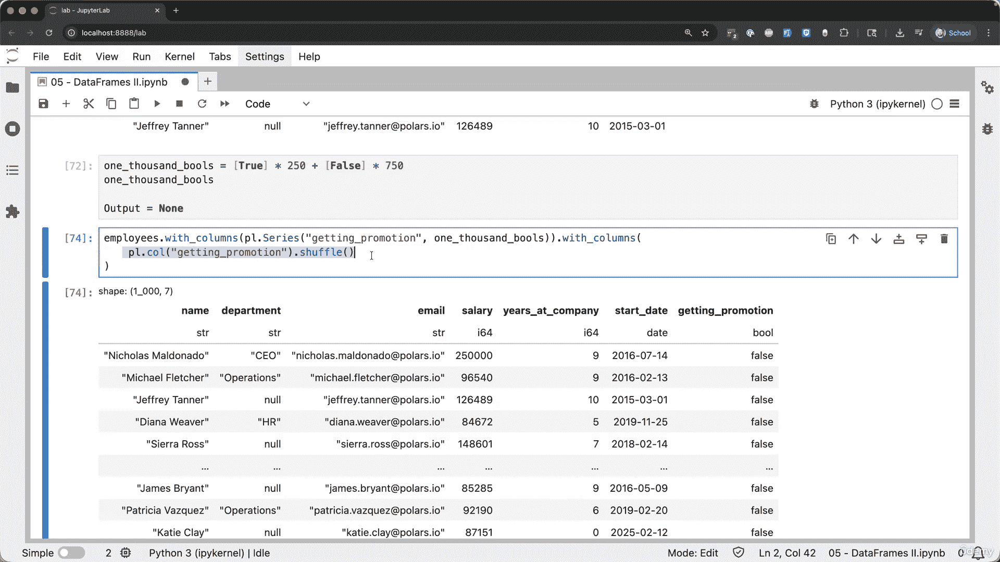
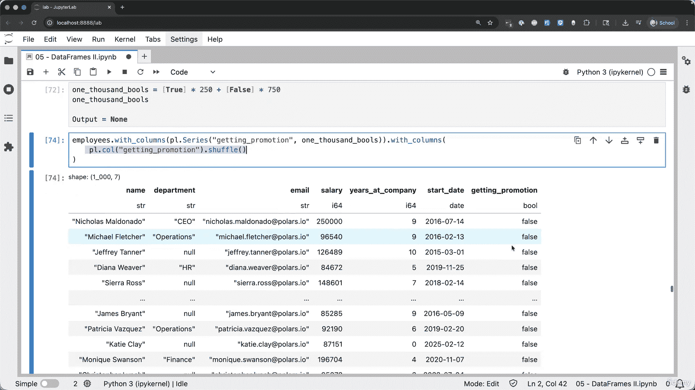
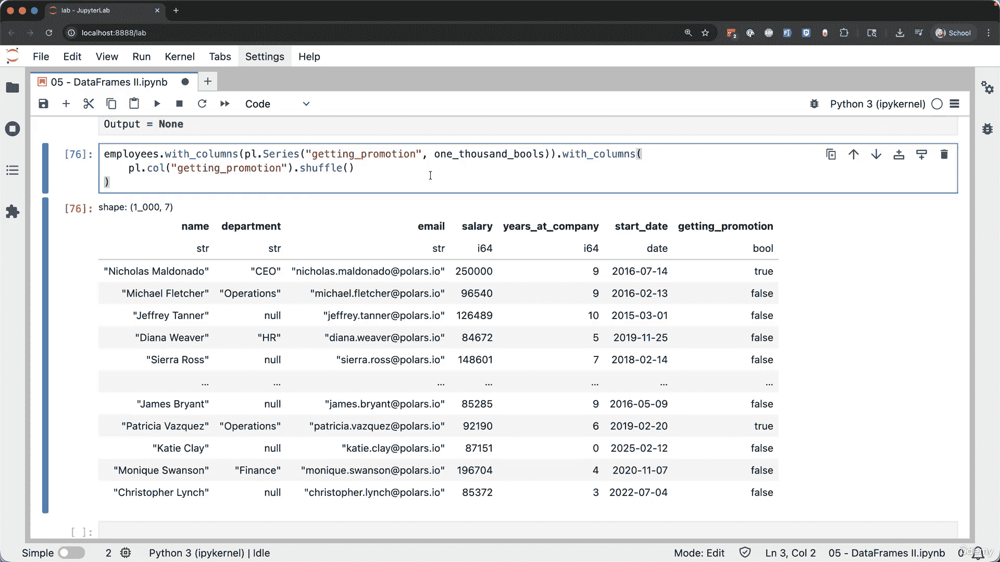

# 数据分析与 Polars 和 Python：第 79 节：shuffle 方法 🔀


在本节课中，我们将学习 Polars 中的 shuffle 方法。这个方法用于在表达式中随机打乱某一列里元素的顺序。如果你想要把数据打乱顺序，换句话说就是把东西重新排列，那么 shuffle 方法就是你需要的工具。我们将通过一个有趣的例子来学习，这个例子基于我们的员工数据框。在开始之前，先简单回顾一下我们要处理的数据场景，这样可以让你更容易理解后面的操作步骤。


## 一、shuffle 方法的基本概念


shuffle 方法的作用非常直接，就是把一个列里面的元素重新排序。你可以把它理解成洗牌，原来顺序整齐的扑克牌被打乱后，每张牌出现的位置都变得不可预测。在 Polars 里，这个操作是作用在表达式上的，也就是说你先选中某一列，然后告诉 Polars 把这一列里面的值随机重新排列，最后再把打乱后的结果放回数据框。



核心代码如下：

```python
df.with_columns(pl.col("列名").shuffle())
```

上面这段代码的意思是，取出指定列，把里面的元素随机打乱，然后生成一个新的数据框。原始的行与值之间的对应关系会被打破，所以使用这个方法时要注意数据可能会丢失原来的关联信息。


## 二、准备员工数据与晋升计划


假设我们想要随机给公司四分之一的员工晋升。在我们的员工数据框中，总共有 1000 行数据，每一行代表一名员工。现在目标是从这 1000 名员工中随机选出 250 名进行晋升。为了实现这个目标，我们需要先构造一个包含 true 和 false 的列表，其中 true 表示被选中晋升，false 表示未被选中。

以下是具体的操作思路：

- 首先生成 250 个 true 值组成的列表。
- 然后生成 750 个 false 值组成的列表。
- 把这两个列表合并，得到一个包含 1000 个布尔值的列表。


## 三、使用 Python 创建布尔值列表


接下来我们进入代码实现部分。首先我们需要一点 Python 技巧，来生成一个包含 1000 个布尔值的列表。在这里，我会声明一个变量，用来存放这 1000 个布尔值。

我会使用一些比较花哨的语法，但这些都属于普通的 Python 代码，不需要特殊的库。第一步是创建一个只存储一个 true 值的列表。然后我们可以利用 Python 列表上的乘法运算符，来填充或者重复这些值。换句话说，如果我在这里设置 250，我的意思是生成一个连续存储 250 个 true 值的列表。

我会把结果输出到下方，这样你可以看到，现在这个列表里面只有 250 个元素，而不是 1000 个。下面展示的是连续 250 个 true 值组成的列表。至此，第一个列表已经创建完成。

除此之外，我还可以使用加号运算符把两个列表合并在一起。这里我将把刚才生成的列表中的元素，与我在加号右边生成的另一个列表中的元素相加。在这里，我将创建一个存放 false 值的列表，也就是创建一个只有一个 false 的列表，并要求把这个值重复 750 次。

下面是 250 个 true 的列表，下面是 750 个 false 的列表。我将把它们合并在一起，得到一个包含 1000 个布尔值的完整列表。好了，这是合并后的列表。如果你向下滚动，经过一段时间，就会看到 750 个 false 值出现。

现在这些值还没有被随机化，也没有被打乱，但这完全没问题，因为我们将让 Polars 来帮我们完成打乱操作。所以我将向上滚动回到代码单元格。在 Jupyter Notebook 中，我可以在这里写 output equals none，然后执行这一行。这样单元格的内容仍然会被执行，只是不会把列表的值打印出来。事实上，我们甚至可以完全去掉输出语句，只是声明列表而不显示它。无论如何，我们在程序中已经拥有一个有效的列表了。


## 四、将列表添加为新列


下面我们来处理员工数据框，并调用 with columns 方法。作为提醒，在这里我们可以传入一个表达式，也可以传入一个有效的 Polars 系列。传入系列之后，Polars 会创建一个新列，并把这个新系列连接到现有 employees 数据框的末尾。这里我将使用系列构造函数。

我们把这个系列命名为 Getting promotion。系列构造函数的第二个参数是构成系列数值的数据集。我将传入刚才创建的 1000 个布尔值组成的列表。我正在使用这个包含一千个元素的列表，作为创建系列的基础，然后把这个系列传给 with columns 方法。这样一来，我们就得到了一个新的数据框，其中包含一个新的 Getting promotion 列，里面存储的是布尔值。



再次说明，这时候数据框里有 250 行 true，然后是 750 行 false，它们目前是按照顺序排列的，还没有被打乱。






## 五、使用 shuffle 方法随机打乱晋升列


但是，正如我刚才提到的，我想要随机化晋升名单。当然，这在实际业务中是个糟糕的决策，但仅为了教学演示。让我们假设这就是我们想要做的。那么我要做的是，取这个列中的数值，把它们打乱顺序，让这些 true 和 false 以随机的方式分布。



现在既然我已经有了这个数据框，我可以再次调用 with columns 方法。在这里，我将用表达式来定位我新创建的名为 Getting promotion 的列。然后我将要求打乱该列中的元素，让它们以随机顺序排列。

这样一来，我们就会得到一个和原来完全相同的数据框，只是里面的元素现在被随机打乱了。我们不会保留这些数值与原始行之间的映射关系。也就是说，我们只是把这 1000 个布尔值的列以随机顺序打乱，然后把打乱后的结果添加回数据框。

当然，这时候我们会得到比 true 多得多的 false。事实上，我们几乎看不到任何 true，这是因为每一个 true 对应三个 false，比例是 1:3。但如果我重新执行一次这段代码，你就能看到这里出现了一个 true，那里也出现了一个 true。






## 六、shuffle 方法总结


基本上，shuffle 方法的作用就是取一个列，随机打乱其中元素的顺序，然后把打乱后的结果添加回数据框。这就是 shuffle 方法的全部内容，在处理需要随机性的场景时特别有用。




本节课中，我们一起学习了 Polars 中 shuffle 方法的基本概念，以及如何使用 Python 创建布尔值列表、将列表添加为数据框的新列，最后如何调用 shuffle 方法随机打乱列中的元素。希望这篇教程能帮助你掌握 shuffle 方法的使用方式。


