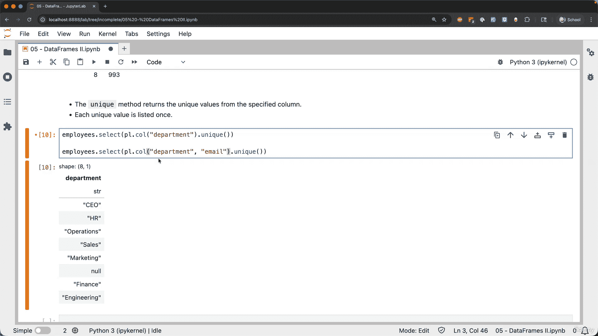
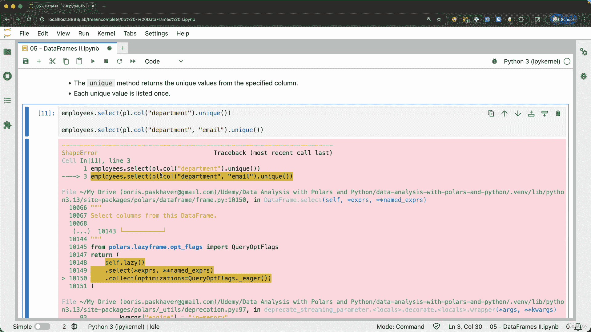
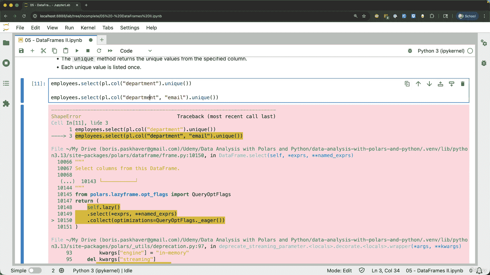

Data Analysis with Polars and Python：80：计算并提取唯一值 📊


在本节课中，我们将学习如何在 Polars 里面统计一列里有多少个不同的值，以及怎么把这些不同的值提取出来。我们会继续使用员工数据集，从最简单的单列计数开始，慢慢过渡到多列的情况，最后还会讲到如果不需要精确数字、只想要快速结果时该怎么办。内容比较基础，适合刚接触 Polars 的朋友，大家跟着敲一遍代码就能理解。


让我们先回到起点，把员工数据集重新导入进来，这是后面所有示例的基础。数据准备好之后，我们就可以开始写代码了。第一步是调用 select 方法，然后定义一个表达式，告诉 Polars 我们想要处理哪一列。在这个例子里，我们选部门列，也就是 department 列。之所以选这一列，是因为里面大部分值都是重复的，每个部门都会出现好几次，这样拿来演示计算唯一值非常合适。我们要调用的方法叫做 n_unique，它是 number of unique 的缩写。运行之后，会得到一个数据框，里面只有部门这一列，以及这一列里面不同值的数量。根据数据，department 列一共有 8 个唯一条目。这里有个重要的细节，Polars 在计算的时候会把 null 也算作这 8 个值之一。具体来说，CEO 算一个，operations 算一个，meello 算一个，剩下还有五个其他唯一值。下面是对应的代码写法：


```python
import polars as pl

df = pl.read_csv("employees.csv")

df.select(
    pl.col("department").n_unique()
)
```


上一节我们介绍了怎么针对单列计算唯一值个数，本节我们来看看如果想一次性处理多列该怎么办。假设我们不只关心部门，还想看看电子邮件列。我们可以把表达式扩展，同时指定 department 和 email 两列。email 列的情况比较特殊，因为每个人的邮箱通常都不一样，所以里面重复的值会少得多。运行结果会显示，email 列里面有 989 个唯一值。如果你希望快速得到数据框里每一列的唯一值数量，而不想一个一个写列名，有一个简单的办法，就是使用顶层的 all 函数。all 表达式会直接作用于每一列，这样就不需要显式地列出所有列的名字。下面是可以直接运行的代码示例：


```python
df.select(
    pl.col("department").n_unique(),
    pl.col("email").n_unique()
)

# 或者使用 all 函数一次性处理所有列
df.select(
    pl.all().n_unique()
)
```


刚才我们讲了在表达式里使用 n_unique 方法，其实在 Polars 的最顶层也有一个同名的 n_unique 函数，功能是一样的。也就是说，除了把它当成列表达式的方法来调用，你也可以直接调用顶层函数，传入一个或多个列名作为字符串。比如为了复现刚才 department 和 email 的例子，直接传入这两个字符串就行，最终得到的结果会完全一样。所以在实际写代码时，你可以根据自己的习惯，选择用方法版本还是函数版本。下面是顶层函数的代码示例：


```python
pl.n_unique("department", "email")
```


前面几节我们一直在讲精确计数，但有时候我们并不需要完全精确的数字，只需要一个大概的估计，而且希望计算得更快。这时候就轮到 approx_n_unique 方法登场了，这里的 a 是 approximate 的缩写，意思是近似。这个方法的特点是，结果不保证百分之百准确，可能会稍微偏差一点，尤其是当数据集里的行数非常多的时候。不过它的优点也很明显，通常来说运行速度会更快。如果你在某些环境下使用 Polars，需要快速拿到计算结果，想把脚本运行的时间压得更低，那么用这个方法来做一种精度和效率的权衡是非常合理的。下面我们来看具体的语法和示例：


```python
df.select(
    pl.col("department").approx_n_unique(),
    pl.col("email").approx_n_unique()
)

# 顶层函数版本
pl.approx_n_unique("department", "email")
```

运行之后你会看到，department 列的近似结果和精确结果一样，还是 8。email 列的精确计数是 989，而近似计数稍微高一点，是 993。虽然两者不完全相同，但已经很接近了。所以如果你觉得误差在可接受范围内，用 approx_n_unique 可以节省时间。同样的，顶层 Polars 也提供了 approx_n_unique 函数，用法和前面的 n_unique 函数差不多，把前面例子里的函数名换一下就可以了，得到的数据框也会是一样的。


刚才我们花了不少时间讨论怎么数唯一值的个数，但有时候你可能并不想要一个数字，而是想要具体的值本身。比如你想要一个集合，里面列中的每个值都只出现一次。这时候就需要用到互补的 unique 方法了。我们还是拿 department 列来举例，调用 select 方法，创建针对这一列的表达式，然后直接调用 unique 方法，注意这次前面不再加 n_unique 这个前缀。运行结果会给你一个只有一列的数据框，里面有 8 行，这正好和前面 n_unique 返回的数量对应。这 8 行就是 department 列里的 8 个唯一条目，null 同样会被包含进来。下面是对应的代码：


```python
df.select(
    pl.col("department").unique()
)
```

不过这里有一点需要特别注意，和 n_unique 方法不同的是，n_unique 方法永远只返回一行，里面只是一个计数值；而 unique 方法返回的列长度是动态的，因为一列可能有 8 个唯一值，也可能有 50 个或者 100 个。所以如果你试图在同一个表达式里针对多列使用 unique 方法，就要小心了。比如说，如果你把 email 也加进去，试图一次性生成所有唯一值的列表，email 列的唯一值有九百多个，远多于 department 列的 8 个，这样就会出现形状不匹配的问题，数据框里的一列有 8 行，另一列却有 900 多行，没法拼在一起。因此用 unique 方法的时候，建议把每一列的表达式分开写。相比之下，常规的 n_unique 方法就没这个烦恼，因为它永远只给你返回一行，只包含计数结果。下面是多列独占处理的示例：


```python
# 不推荐：多列 unique 可能会导致形状不匹配
# df.select(
#     pl.col("department").unique(),
#     pl.col("email").unique()
# )

# 推荐：分开处理
df.select(pl.col("department").unique())
df.select(pl.col("email").unique())
```








本节课中我们一起学习了怎么在 Polars 里面统计和提取唯一值。我们先介绍了 n_unique 方法和顶层的 n_unique 函数，用来精确计算每一列不同值的数量，并且提醒大家 null 会被算作一个唯一值。接着我们讲到了 approx_n_unique 方法和函数，适合需要快速估算、可以接受小误差的场景。最后我们介绍了 unique 方法，用来直接提取唯一值本身，并说明了在处理多列时需要注意形状不匹配的问题。希望大家通过这些例子，能够熟练地在自己的数据分析工作中应用这些技巧。

