# Data Analysis with Polars and Python：Part 1 第81节：value_counts 方法 📊

## 课程概述

本节课我们将学习 Polars 库中的一个核心方法，也就是 `value_counts` 方法。这个方法的作用非常直白，就是统计某一列中每个不同值出现的次数。如果你在上一节课中学习过如何从列中提取所有唯一值，那么本节课会进一步教你如何计算这些值在整列中重复了多少次。我们不仅会运行代码看结果，还会深入探究 Polars 返回的特殊数据类型，并学习如何把复杂的结构拆分成普通的列，方便我们查看和分析。

## 1. value_counts 的基本用法 🔍

上一节课我们介绍了如何从列中提取唯一值，本节课我们来看看怎么统计这些值各自出现了多少次。

假设我们手头有一个名为 `employees` 的 DataFrame，并且我们想知道 `department` 列里每个不同部门各自出现了多少次。最简单的方式就是调用 `select` 方法，然后对 `department` 列使用 `value_counts` 方法。下面这段代码展示了完整的操作流程：

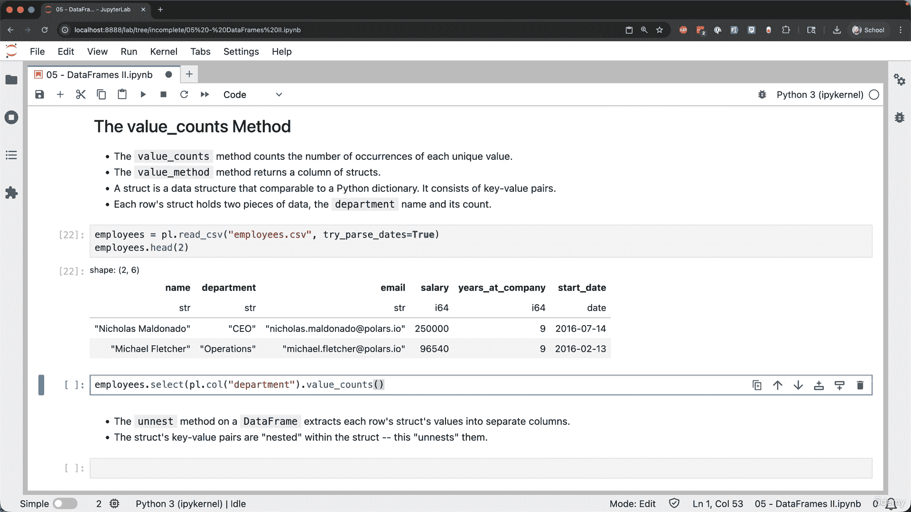

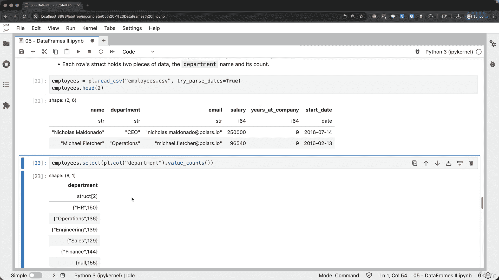

```python
df.select(pl.col("department").value_counts())
```

执行完这段代码之后，Polars 会给我们返回一个只有一列的 DataFrame。乍一看，这似乎和我们预期的结果不太一样，因为输出里并不是直接显示部门名称和对应的次数，而是一种比较特殊的结构。我们接下来会详细说说这个结构到底是什么。

## 2. Polars 返回的 struct 类型 📦

刚才我们运行了 `value_counts`，得到了一个只有一列的 DataFrame，但这一列里存放的不是普通文本或数字，而是一种叫 struct 的特殊类型。

这里需要说明 Polars 库的一个设计原则：针对单一列的表达式，始终会返回单一列作为结果。这就带来了一个挑战，Polars 团队想在同一列里同时记录两个信息，第一个是每个部门的名称，比如 `operations` 或 `HR`，第二个是该部门在列中出现的次数。既然一列只能返回一种数据结构，那怎么把两个信息塞进去呢？Polars 团队的解决方案就是返回一个由 struct 组成的列。

我们可以把 struct 看作一个容器，内部存储键值对。这个概念和 Python 里的字典非常像，每个键都有一个对应的值。在 `value_counts` 返回的结果中，每一行实际上存储的是一个 struct 对象，而这个 struct 内部包含两个键值对。其中一个键对应部门名称，另一个键对应出现次数。

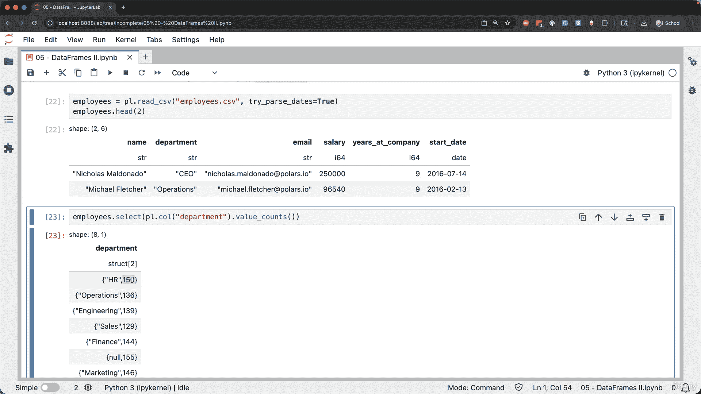

用伪代码表示，每一行的 struct 大致长这样：

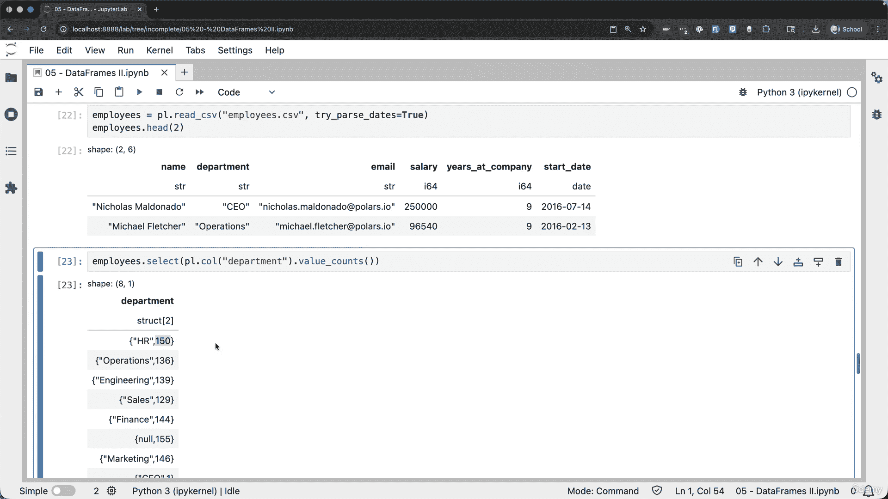

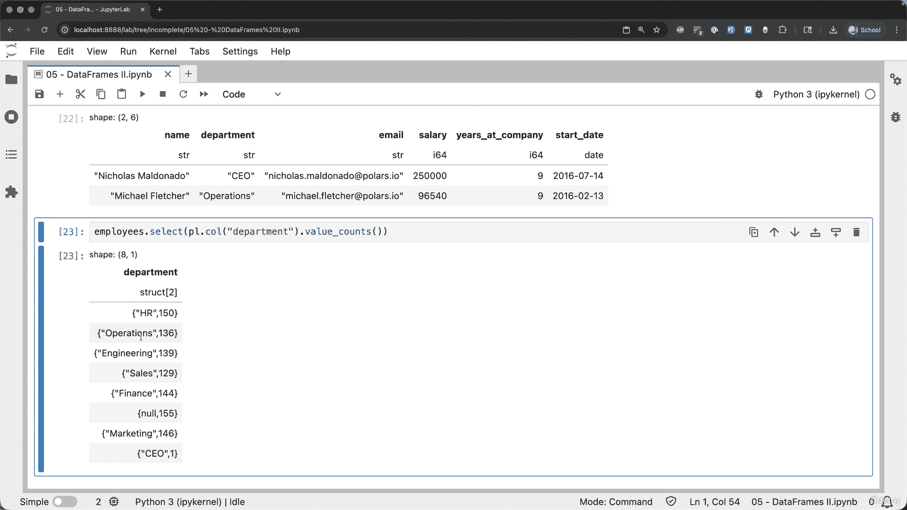

```text
struct { department: "HR", count: 150 }
```

这里有两个键，分别是 `department` 和 `count`，对应的值则是 `"HR"` 和 `150`。这意味着 HR 部门在 `department` 列中出现了 150 次，同理 operations 部门出现了 136 次。

## 3. 如何用 unnest 拆开 struct 🧩

虽然 struct 把两个数据打包在了一起，但我们通常想要把它们拆成独立的列来查看，这样更方便阅读和后续处理。

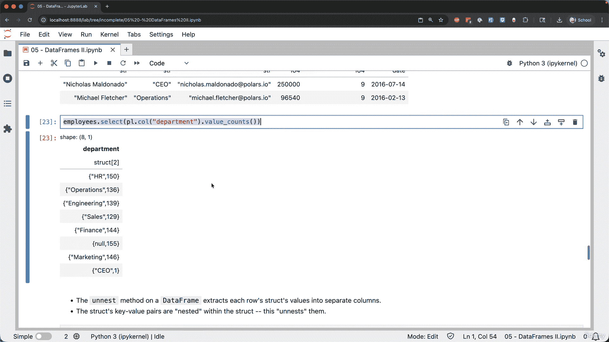

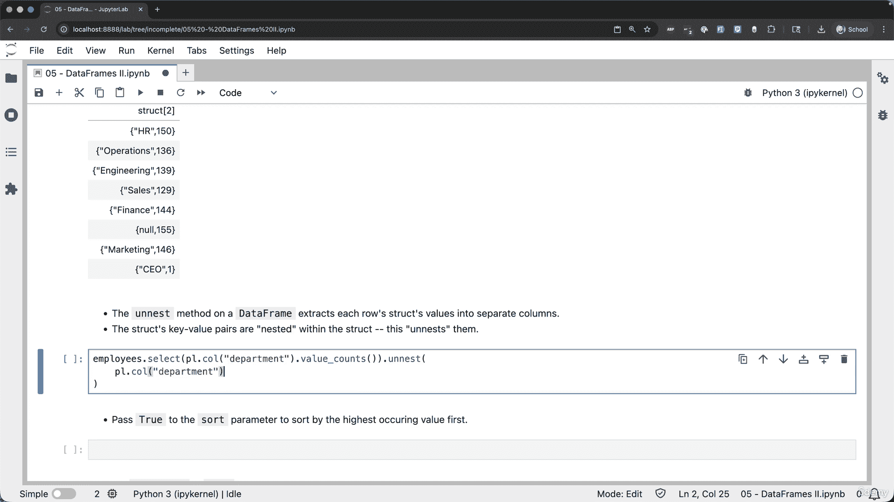

这时候就要用到 Polars 提供的 `unnest` 方法了。这个方法的名字来源于“嵌套”的概念，我们可以把 struct 想象成把键值对嵌套在单元格里面，而 `unnest` 的作用就是把这些键值对拽出来，分别放到各自的列中。

具体操作非常简单，我们在上面得到的结果 DataFrame 上调用 `unnest`，并传入一个针对存储 struct 的列的表达式。目前这个 DataFrame 只有一列，就是 `department`，所以我们只需要把 `department` 列传给 `unnest` 方法即可。下面是示例代码：

```python
df.select(pl.col("department").value_counts()).unnest("department")
```

执行之后，原来只有一列的 struct DataFrame 就会变成一个包含两列的新 DataFrame。每个 struct 中的键会变成列标题，对应的值则变成每一行里的具体内容。在之前的例子中，struct 内部的键是 `department` 和 `count`，所以展开之后我们就能直接看到部门名称和代表性的计数了。比如某一行里 `department` 键的值是 `marketing`，而 `count` 键对应的值是 `146`，这样我们就清楚地看到了 marketing 部门出现了 146 次。

## 4. sort 和 normalize 参数 ⚙️

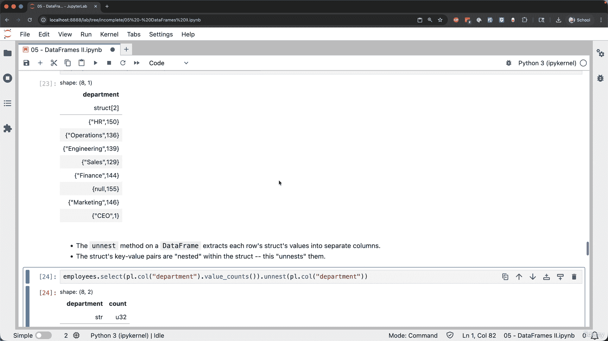

除了基础的计数功能，`value_counts` 还提供一些有用的参数，让我们可以对结果进行排序，或者直接查看每个值所占的比例。

以下是 `value_counts` 方法中常用的两个参数：

- `sort=True`：按出现频率从高到低对结果进行排序。
- `normalize=True`：返回相对比例（百分比），而不是原始计数。

默认情况下，`value_counts` 返回的结果并没有任何特定的顺序。你可能会发现出现次数较多的部门并不一定排在最前面。如果我们希望最频繁的值排在第一位，就可以传入 `sort=True`。比如排序之后，你会发现缺失值（null）出现得最多，总共有 155 次，而 CEO 这个职位只出现了一次，排在最后面。

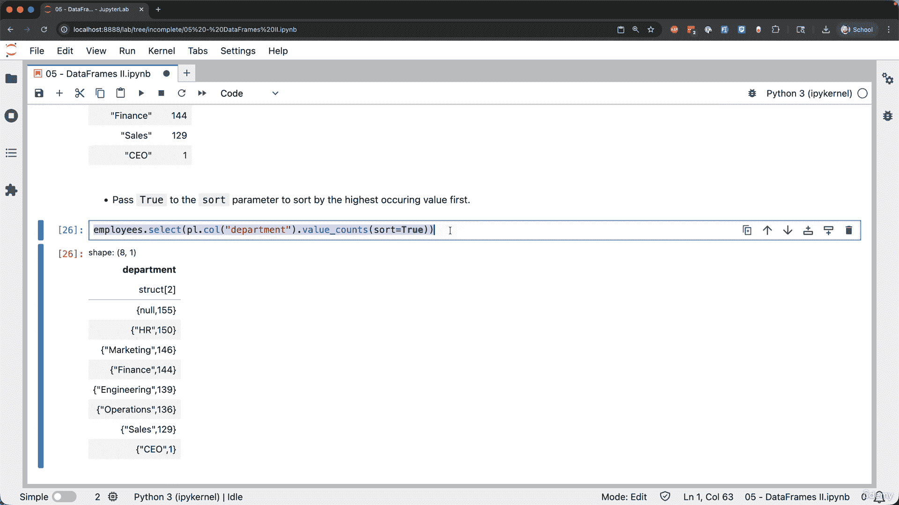

如果你不想看到具体的计数，而是想知道每个值占总行数的比例，那么就可以使用 `normalize` 参数。下面这段代码同时展示了这两个参数的用法：

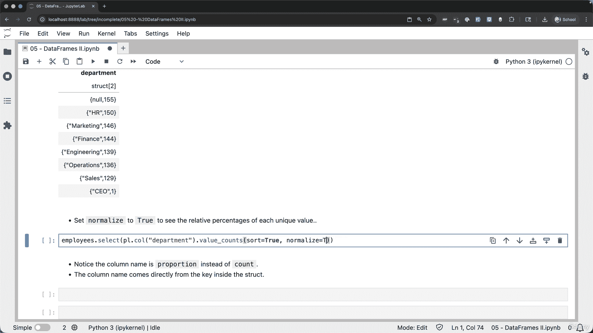

```python
df.select(pl.col("department").value_counts(sort=True, normalize=True))
```

当 `normalize=True` 时，输出不再是整数计数，而是小数形式的相对比例。比如最常见的值（即缺失值）出现的比例是 0.155，也就是说有 15.5% 的时间出现了缺失值。另一种理解是，department 列中大约 15% 的值是 HR，14.6% 是 marketing，以此类推。

## 5. 对归一化结果再次使用 unnest 🔄

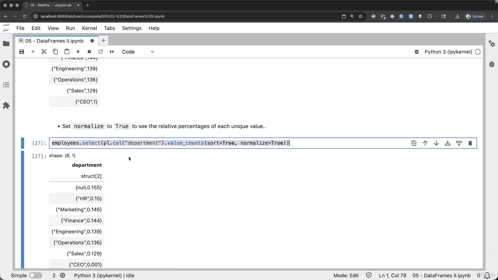

如果我们对已经归一化后的结果再次使用 `unnest` 方法，你会发现列名发生了变化，这一点也值得特别留意。

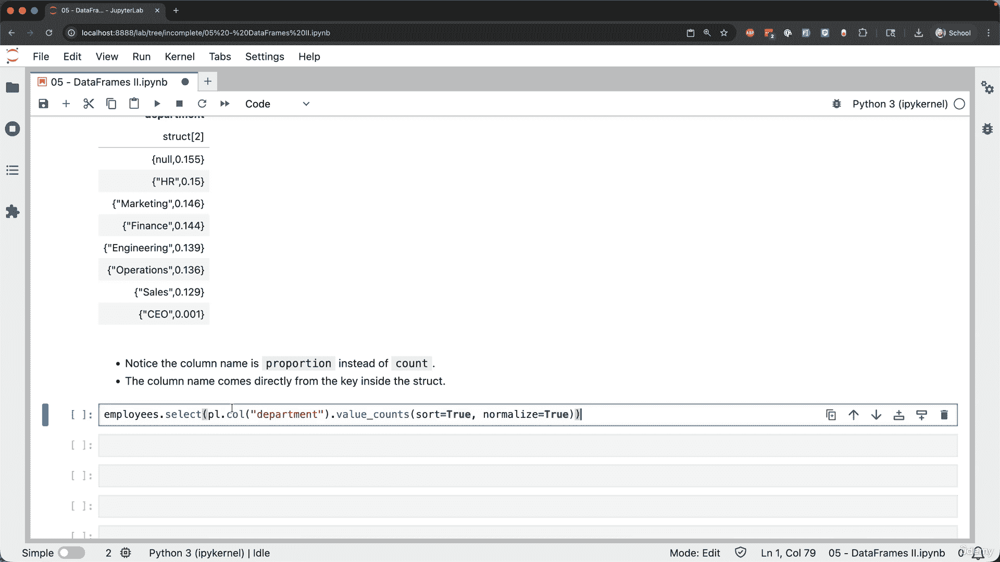

下面这段代码会在归一化后的结果上再次调用 `unnest`：

```python
df.select(pl.col("department").value_counts(normalize=True)).unnest("department")
```

你会发现第一列的名称依然是 `department`，这与之前的 `unnest` 示例保持一致。但是第二列的名称不再是 `count`，而是变成了 `proportion`。如果你向上滚动查看之前的例子，可以看到当时对应的列名是 `count`。这说明，从 struct 内部的键到调用 `unnest` 后生成的列名，这些名称实际上都是由 Polars 团队预先决定的。

这里有一点需要区分：`department` 是我们自己选择要处理的列，但 `proportion` 作为每行 struct 内部的实际键名，则是 Polars 团队做出的决定。无论如何，通过这种方式，我们现在可以清晰地看到每个部门或每个不同值在原始数据集中出现的相对比例。

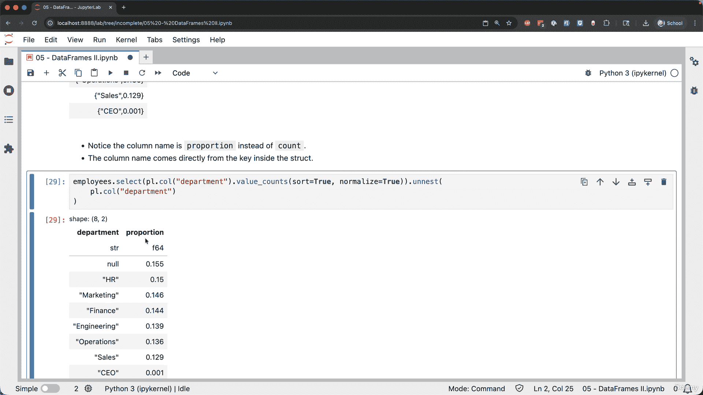

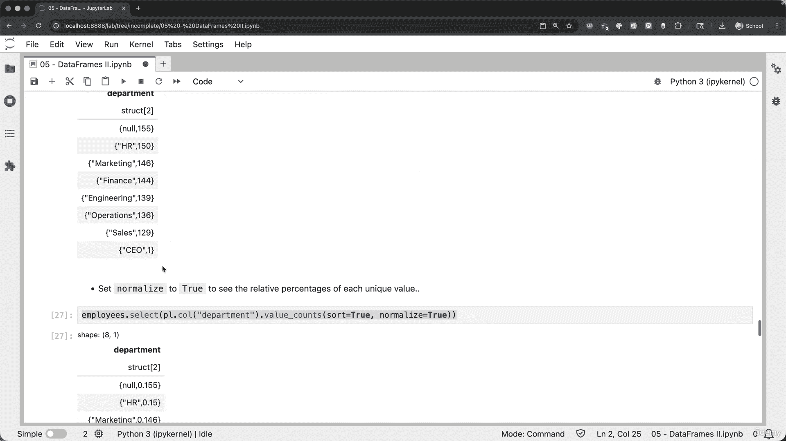

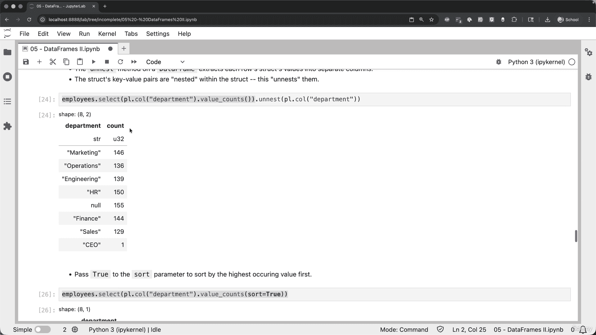

## 本节总结

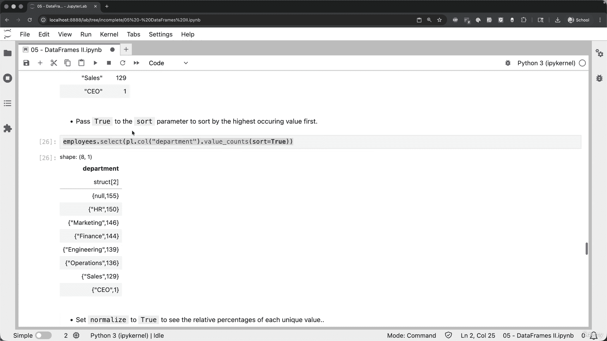

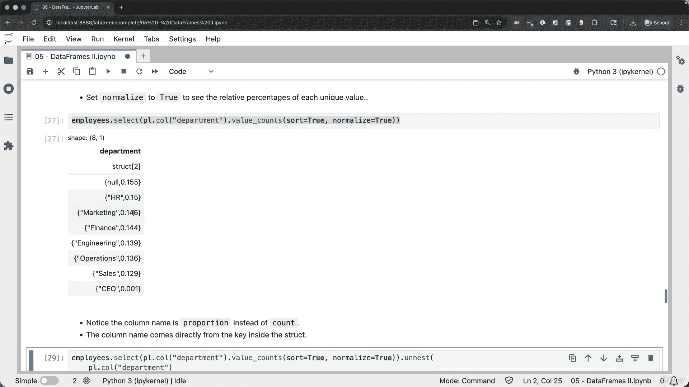

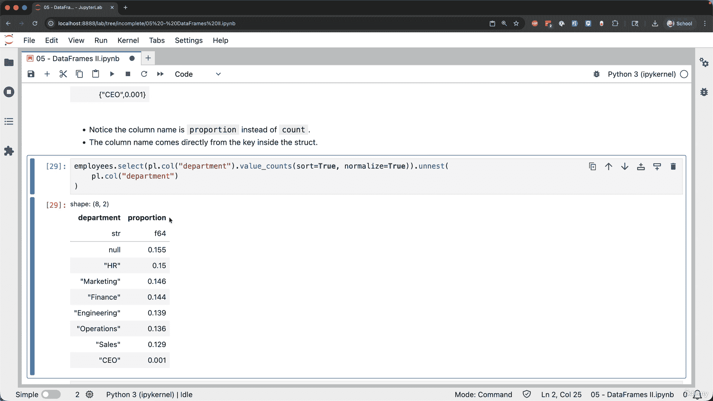

本节课我们一起学习了 Polars 中的 `value_counts` 方法。我们了解到这个方法可以统计列中每个不同值出现的次数，返回的结果是一个包含 struct 的单列 DataFrame。每个 struct 内部存储两个键值对，分别代表值本身和对应的计数。通过 `unnest` 方法，我们可以把 struct 展开成两列，方便查看部门名称和出现次数。此外，`sort` 参数可以让结果按频率排序，`normalize` 参数则可以查看每个值所占的相对比例。希望这些内容能帮助你更好地掌握 Polars 的数据分析功能，在实际工作中灵活运用 `value_counts` 方法。

