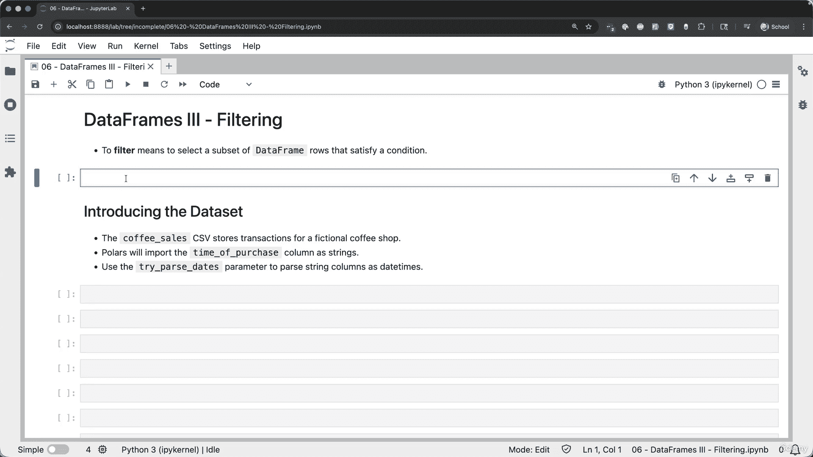
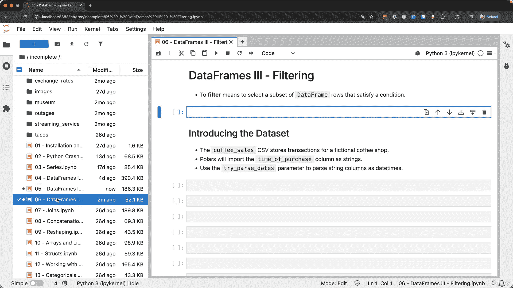
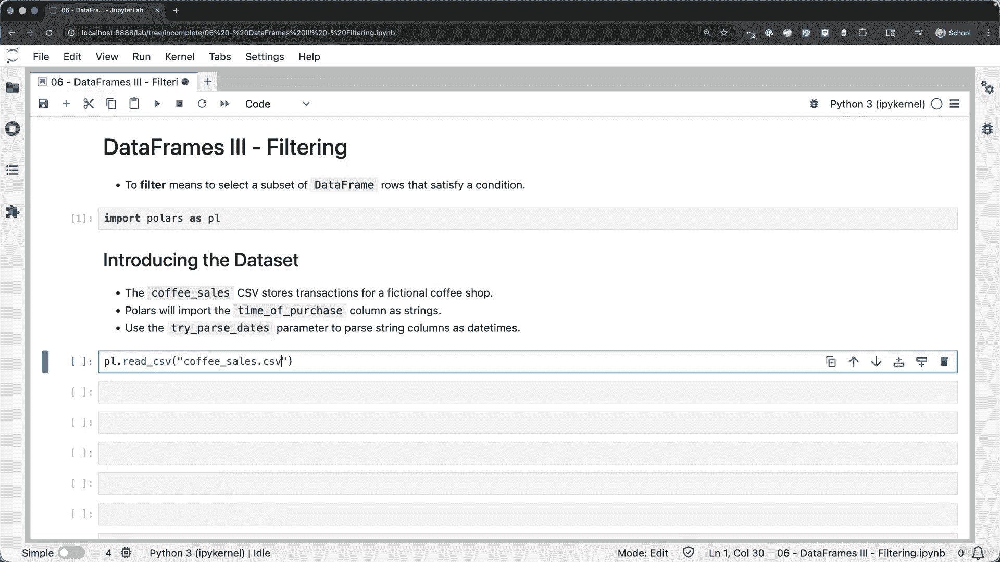
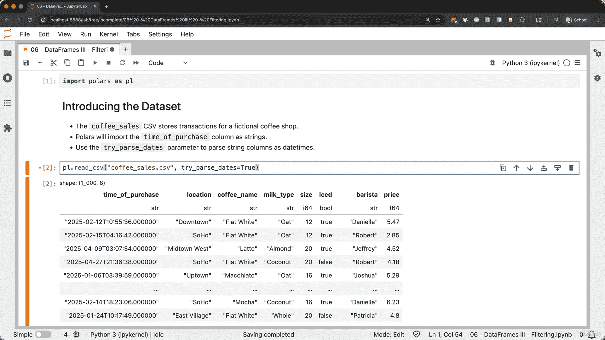
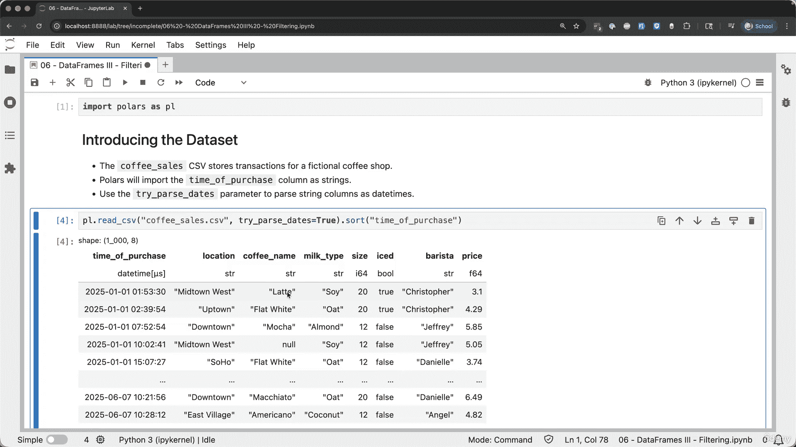
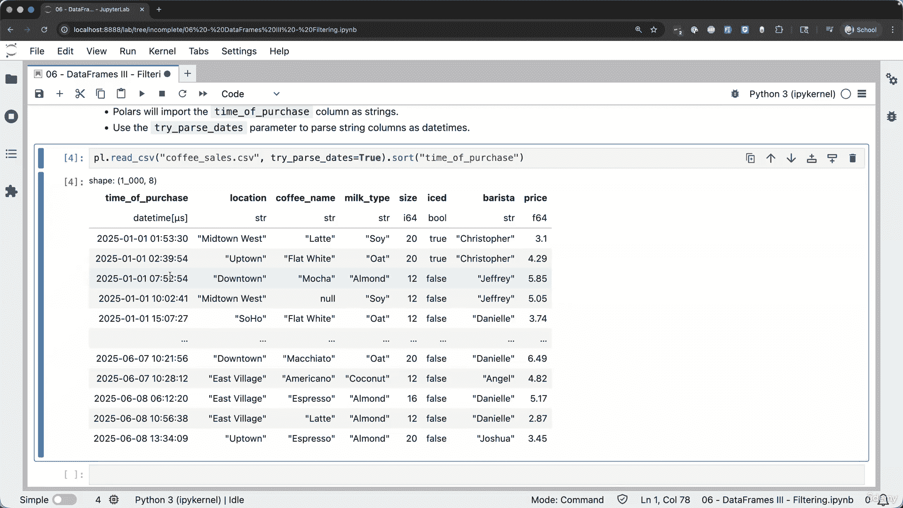
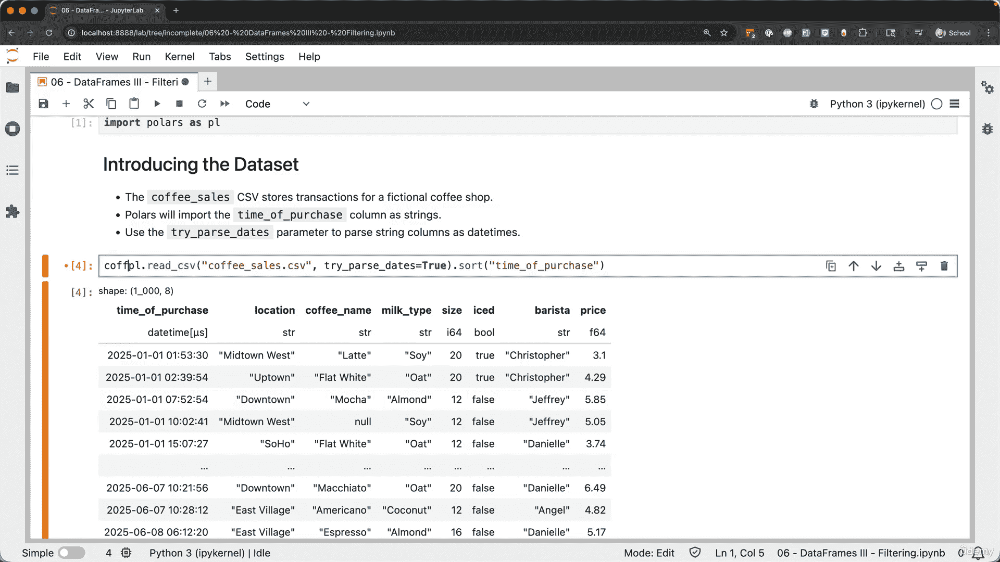
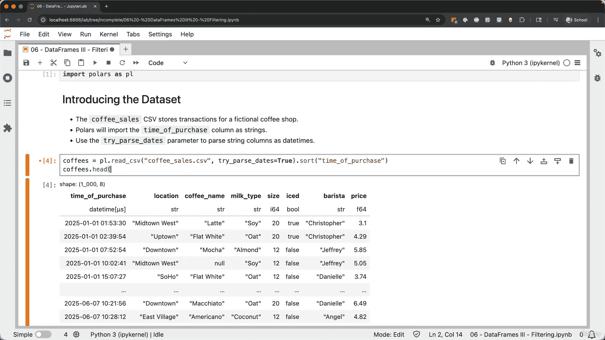
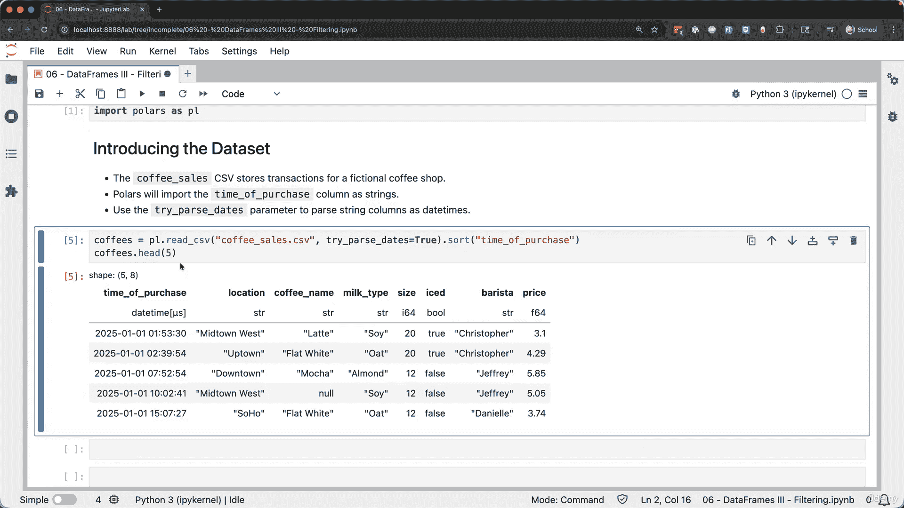

# Polars与Python数据分析：第82课：介绍数据集 📊

## 本节概述

在本节课中，我们将学习数据框过滤的基础知识，并了解如何使用Polars库来处理咖啡销售数据集。我们会先导入必要的库，然后查看数据集的具体内容，接着学习如何解析日期时间列，最后对数据进行排序并查看前几行数据。

过滤的核心意思是，从一个较大的数据框中选出满足特定条件的子集。这相当于根据一定的筛选规则，只保留我们感兴趣的那些行，而舍弃其余的行。我们可以用简单的公式来表达这个思想：

筛选后的数据框 = 原始数据框[满足条件的行]

## 什么是数据框过滤



在数据分析中，过滤是指根据设定的条件，从较大的数据框中挑出更小的行集合。只有满足条件的行才会被保留下来，不满足条件的行则会被排除。这种操作在日常数据分析中非常常见，比如我们只想查看某个时间段内的交易记录，或者只想看某个特定门店的销售数据。

以下是常见的过滤场景示例：

- 找出特定列中包含空值的所有行
- 找出包含唯一值的所有行
- 找出某列中等于指定值的所有行
- 找出某列中大于指定值的所有行

我们还可以组合复杂的逻辑条件来进行筛选。例如，可以使用“与”逻辑，表示两个条件必须同时满足；也可以使用“或”逻辑，表示两个条件中任意一个满足即可。这种灵活的组合方式让我们能够精确地提取目标数据行，代码逻辑可以表示为：



(条件A 且 条件B) 或 (条件C 或 条件D)

## 导入Polars库

掌握了过滤的概念后，我们需要先准备好编程环境。本节课将使用一个全新的笔记本，名称为06 data frames 3，专门用于数据框过滤练习。在开始之前，我们需要先导入Polars库，并为其设置别名，方便后续代码编写。

以下是导入Polars库的代码示例：

```python
import polars as pl
```

上面这段代码的作用是将polars库导入当前环境，并使用`pl`作为简写别名。这样在后续调用Polars的各种函数时，不需要每次都输入完整的库名，只需输入`pl`即可，代码会更加简洁易读。我们会在每一节课的开始部分都使用这段导入代码，以保持环境的一致性。

## 查看咖啡销售数据集

环境准备就绪之后，接下来我们来看看本节课将使用的数据集。本节课将使用一个全新的数据集，文件名为coffee_sales.csv。注意文件名中间有一个下划线，连接coffee和sales两个单词。

以下是该数据集包含的各个字段说明：



- 购买时间：记录每笔交易发生的具体时间
- 店铺位置：记录咖啡店的所在地，假设我们是一个在城市中拥有多家门店的咖啡品牌
- 咖啡名称：记录顾客点购的具体咖啡品名
- 牛奶类型：记录咖啡中使用的牛奶种类
- 咖啡尺寸：以整数表示，单位是盎司
- 是否冰咖啡：布尔值，true表示冰咖啡，false表示热咖啡
- 制作咖啡的调酒师：记录负责制作的员工姓名
- 价格：记录每笔交易的金额

这个数据集包含多种不同的数据类型，包括字符串、整数、布尔值和浮点数，非常适合用来练习数据处理和过滤操作。每一行数据代表一次咖啡购买交易，包含了从下单时间到最终价格的完整信息。



## 解析日期时间列

查看完数据集的基本结构后，我们需要处理其中的日期时间列。默认情况下，购买时间这一列会作为字符串列读入数据框。为了能够方便地进行日期时间运算，我们需要告诉Polars尝试从该列中提取日期时间信息。

以下是使用`try_parse_dates`参数的代码示例：

```python
pl.read_csv("coffee_sales.csv", try_parse_dates=True)
```

将`try_parse_dates`参数设置为`True`后，Polars会自动尝试识别并转换日期时间格式。因为本数据集中的时间格式比较规范，Polars能够成功提取出一个标准的日期时间列。与普通的字符串列相比，日期时间列提供了更多功能，例如可以进行时间排序、时间差计算等操作，而且在打印输出时也更加直观易读，方便我们后续进行分析。

## 对数据框进行排序

日期时间列解析完成后，就可以对数据框进行排序了。我们希望按照购买时间对数据进行排序，这样可以从最早的交易一直看到最晚的交易，形成一份按时间顺序排列的销售记录。

以下是对数据框进行排序的代码示例：

```python
df = pl.read_csv("coffee_sales.csv", try_parse_dates=True)
df = df.sort("time of purchase")
```



这里使用了之前章节介绍过的`sort`方法，并指定要排序的列名为`time of purchase`。默认情况下，排序是升序排列，也就是从早到晚。对于日期时间列来说，这意味着最早的交易会排在最前面，一直到2025年6月的最新交易排在最后面。排序不仅会按日期排列，还会按一天中的具体时间排列，最终得到一份完整的按时间顺序排列的业务销售记录。排序完成后，我们将这个数据框赋值给变量`coffees`，以便在后续课程中继续使用。



## 查看前五行数据

排序完成后，为了方便查看数据，我们可以只显示前几行。为了让输出内容更加简洁，方便查看数据的基本情况，我们可以使用`head`方法只显示前几行数据。默认情况下，`head`方法会显示前五行。

以下是查看前五行数据的代码示例：

```python
coffees.head(5)
```

执行这段代码后，我们就能看到咖啡销售数据集的前五行内容。这有助于我们快速了解数据的整体结构，确认列名和数据类型是否符合预期，为后续的过滤操作打下基础。



## 本节总结





至此，本节课的主要内容已经讲解完毕。本节课中我们一起学习了数据框过滤的基本概念，导入了Polars库，查看了咖啡销售数据集的内容和字段说明，学习了如何使用`try_parse_dates`参数解析日期时间列，掌握了如何按购买时间对数据框进行排序，并且使用`head`方法查看了前五行数据。在接下来的课程中，我们将继续探索如何基于不同条件对这个咖啡销售数据集进行过滤和缩小范围，敬请期待。

