Polars数据分析入门：083：filter 方法基础 🔍


在本节课中我们将要学习 Polars 中的 filter 方法。filter 方法的作用是从一个数据框里提取满足特定条件的行子集。简单来说，就是根据你设定的规则，把不想要的行去掉，只留下符合条件的那部分数据。我们会从最容易理解的条件入手，也就是判断某个值是否等于另一个值。你会看到，filter 方法需要一个布尔表达式，也就是说，这个表达式算出来的结果必须是一列 true 或者 false。为了保证万无一失，我们会先用 select 方法来验证这个表达式是否真的生成了布尔列，只有确认没问题之后，再把它交给 filter 使用。整节课我们会通过一个关于咖啡的数据集，一步步演示如何写出筛选条件，如何把条件交给 filter，以及如何把表达式复用到不同的地方。在动手写代码之前，先重新执行一遍导入代码，确保环境里已经加载了 polars 库和咖啡数据集。如果你准备好了，那我们现在就开始正式内容。


## 1. 什么是 filter 方法

在开始写代码之前，我们先搞清楚 filter 方法到底是干什么用的，这样后面学起来才不会觉得突兀。

filter 方法就是 Polars 里用来“挑行”的工具。假设你面前摆着一张大表格，里面有成百上千行数据，而你只想留下其中满足某个条件的部分，这时候就可以用 filter。它接收一个 Polars 表达式，这个表达式会对每一行进行检查，如果检查结果是 true，那这一行就会被保留下来；如果结果是 false，那这一行就会被丢弃。不过这里有一个非常关键的点，就是你传给 filter 的表达式必须是布尔表达式，也就是说，算出来的结果必须是一列布尔值，不能是字符串，也不能是普通的数字，必须是 true 或 false 这样的逻辑值。如果你不确定自己写的表达式是不是布尔表达式，可以先用 select 方法跑一遍，看看输出是不是一列 true/false，这样就能提前验证，避免后面报错。


## 2. 用相等运算符比较字符串

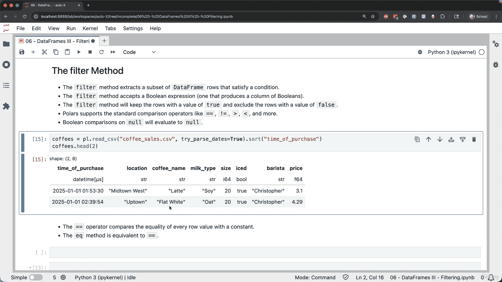

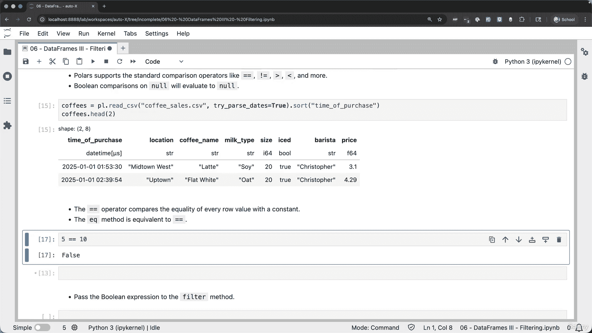

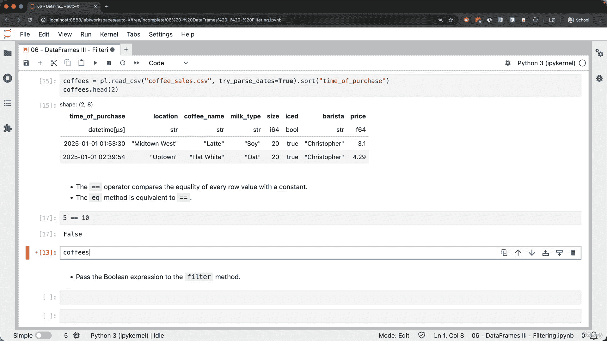

了解了 filter 的基本原理之后，我们来看最简单的筛选条件，就是判断两个字符串是否相等，这也是初学者最容易上手的起点。

在 Python 里，判断两个值是否相等，使用的是双等号，也就是 `==`。这个运算符的左右两边分别放置两个操作数，也就是你想要比较的两个值。比如 `5 == 5`，结果就是 true，因为这两个数确实相等；再比如 `5 == 10`，结果就是 false，因为它们不相等，是两个完全不同的数。在 Polars 里，同样的道理，我们可以把每一行的值和一个固定的字符串进行比较，只要两边的字符串完全一样，结果就是 true，否则就是 false。下面是一个简单的示例，帮助你直观感受一下相等运算符的作用。

以下是相等运算符的基本用法：
- `5 == 5`，结果为 `True`
- `5 == 10`，结果为 `False`


```python
5 == 5  # 结果为 True
5 == 10  # 结果为 False
```


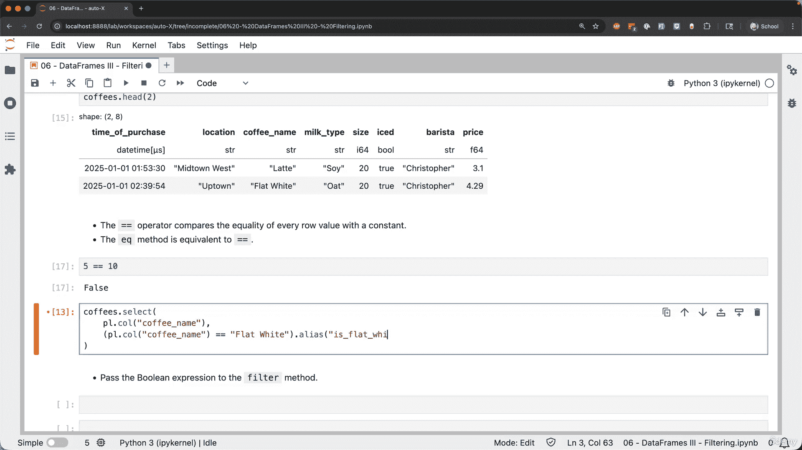

## 3. 用 select 方法验证布尔表达式

在把条件交给 filter 之前，建议先用 select 方法把表达式跑一遍，确认它确实产生了一列布尔值，这样才能放心地继续下一步。

具体操作是这样的。我们先加载咖啡数据集，然后用 select 方法只提取咖啡名称这一列。这时候我们得到的是一列字符串，里面装的是各种咖啡的名字，比如拿铁、美式等等。接下来，我们在同样的列上应用相等比较，把每一行的咖啡名称和字符串 `flat white` 做对比。这一步会产生一列布尔值，每一行如果是 `flat white` 就标记为 true，否则标记为 false。为了方便识别，我们可以用 alias 方法给这列起个新名字，叫做 `is_flat_white`，并且记得把整个比较表达式用括号包起来，这样 Polars 才能把它当成一个完整的表达式来处理。

以下是验证布尔表达式的代码示例：

```python
import polars as pl

# 假设 coffees 数据框已经加载
coffees.select(
    (pl.col("coffee_name") == "flat white").alias("is_flat_white")
)
```

运行上面的代码，你会看到原始的咖啡名称值，而且每当咖啡名是 `flat white` 的时候，对应位置就是 true，说明这一行确实等于我们指定的字符串；只要是其他名字，比如 `latte`，对应位置就是 false。这里有个小陷阱需要注意，如果某一行的值是 null，也就是缺失值，那么比较的结果也会是 null，而不是 true 或 false，所以 null 这一行会被排除，不会出现在最终结果里。我们在这里做的本质上就是拿字符串去和 `flat white` 做等值比较，生成一张 true/false 的对照表。


## 4. 使用 EQ 方法实现相同效果

除了直接写双等号，Polars 还提供了一个名为 EQ 的方法，可以完成完全一样的字符串相等比较，这给了我们更多写代码的选择。

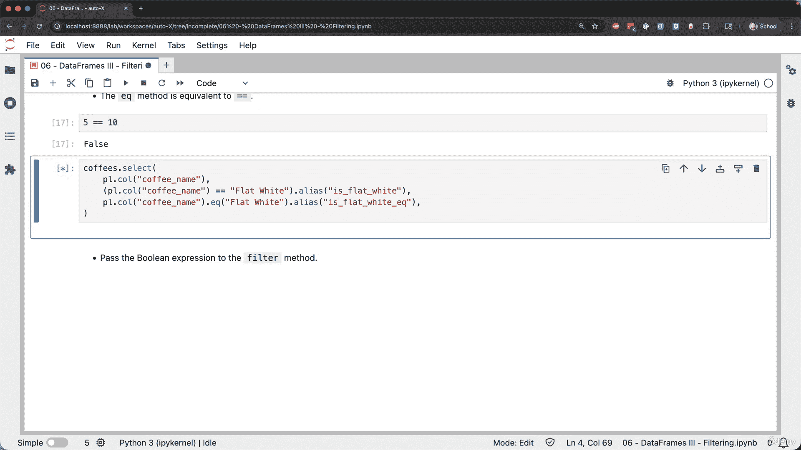

原理上没有区别，只是写法不同。我们还是先定位到咖啡名称列，然后调用 EQ 方法，把要比较的字符串 `flat white` 作为参数传进去。这样生成的列和用双等号写出来的列是完全一样的，所有 `flat white` 的位置都是 true，其他位置都是 false。为了区分，我们可以把这一列命名为 `is_flat_white_eq`。这也再次证明了 select 方法的作用，就是让我们在正式用 filter 之前，先确认表达式确实输出了一列布尔值，因为 filter 方法要求传入的表达式必须求值为布尔列，不能马虎。

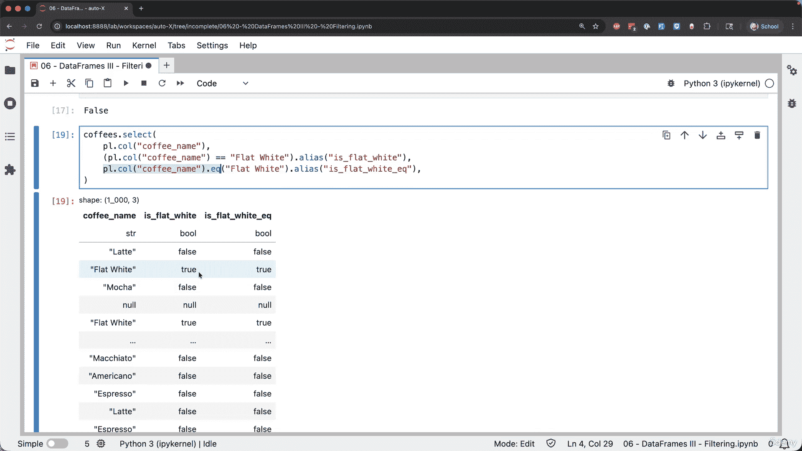

以下是使用 EQ 方法的示例：

```python
coffees.select(
    pl.col("coffee_name").eq("flat white").alias("is_flat_white_eq")
)
```


## 5. 将布尔表达式传给 filter 方法

验证完表达式能产生布尔列之后，就可以把这个表达式交给 filter 方法，真正地把符合条件的行筛选出来，这才是 filter 方法最核心的用途。

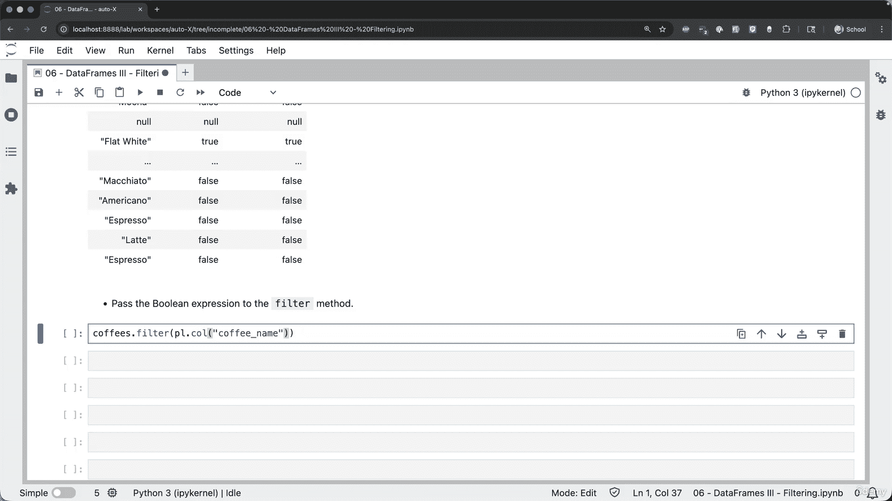

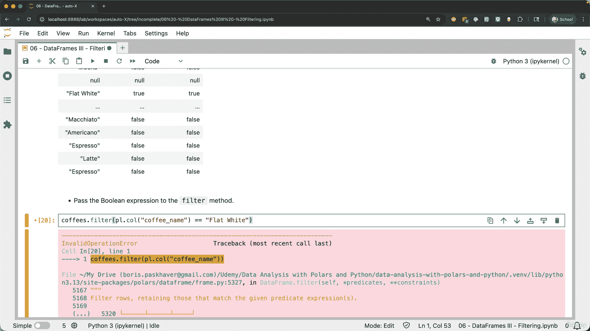

filter 方法的工作原理很简单。对于数据框里的每一行，它都会查看布尔表达式在该行的值。如果是 true，就保留这一行；如果是 false，就把这一行从最终结果中剔除。所以，只要我们传入一个检查“咖啡名称是否等于 flat white”的布尔表达式，filter 就会帮我们把所有咖啡名为 `flat white` 的行从原始数据框里提出来，其他行全部丢弃。

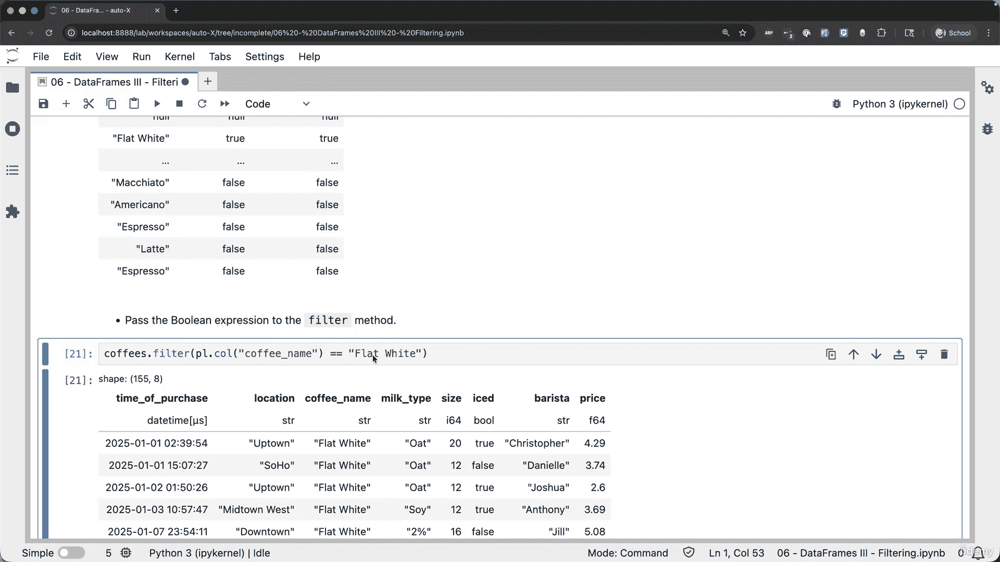

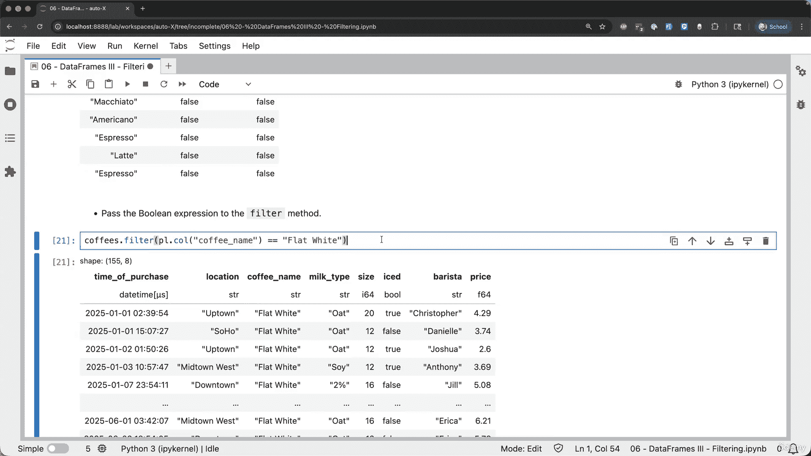

注意一点，如果你只写 `pl.col("coffee_name")` 而不加比较，那是不行的，因为这产生的是字符串列，不是布尔列，不符合 filter 的要求。必须加上 `== "flat white"` 或者 `.eq("flat white")`，才能得到布尔列，filter 才能正常工作。

以下是将布尔表达式传入 filter 的示例：

```python
coffees.filter(
    pl.col("coffee_name") == "flat white"
)

# 或者使用 EQ 方法
coffees.filter(
    pl.col("coffee_name").eq("flat white")
)
```

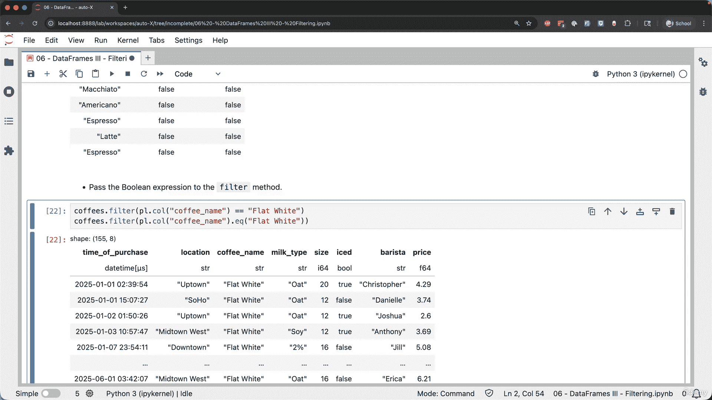

这两种写法得到的输出是完全一样的。另外，Polars 的表达式对象有一个很好的特性，它是独立于数据框的，本身就是一个合法的 Python 对象。这意味着你可以把表达式赋值给一个变量，然后在程序里反复使用。比如，你可以先在 select 里验证这个表达式是否生成布尔列，确认没问题之后，把这一整行代码赋值给变量 `is_flat_white`，记得去掉末尾的逗号。这时候 `is_flat_white` 就是一个表示布尔列的有效 Polars 表达式了。之后调用 filter 时，你可以直接把这个变量传进去，也可以像刚才那样直接在 filter 里内联写表达式，结果都一样，两种方式都可以。


## 6. 表达式的复用与 alias 方法

表达式可以复用这一点非常实用，我们来详细看看怎么操作，以及 alias 方法在这个场景里是否必要。

从技术角度讲，在 filter 里调用 alias 方法其实不是必须的，因为 filter 并不是在生成新列，而是用生成的布尔表达式来决定提取哪些现有行。所以 alias 基本上在这里没什么实际作用，Polars 只会逐行查看布尔值，决定从咖啡数据框里提取或筛选什么。不过这不影响代码运行，即使你加了 alias，代码也能照样跑。更棒的是，同一个表达式可以在很多不同的场景里复用，你可以在 select 里用它，也可以在 filter 里用它，甚至可以在 Polars 生态系统里的其他方法里继续用，写一次，到处都能用，这大大减少了重复编写相同逻辑的工作量。


## 7. 筛选位置为 Soho 的行

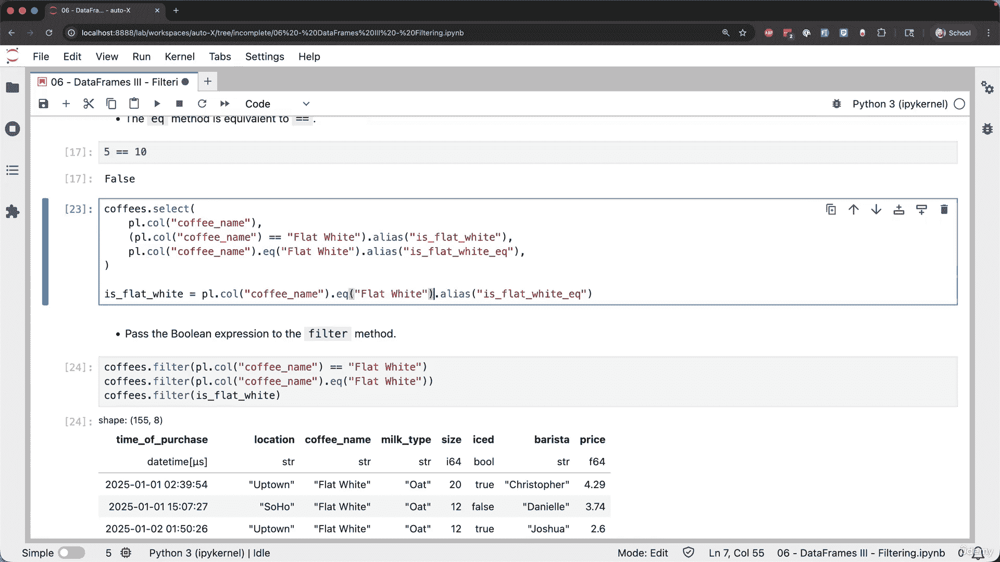

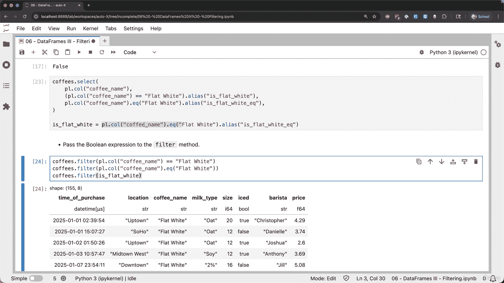

为了让你对 filter 的语法更熟悉，我们再练习一个例子，这次筛选位置为 Soho 的行，巩固一下刚才学到的内容。

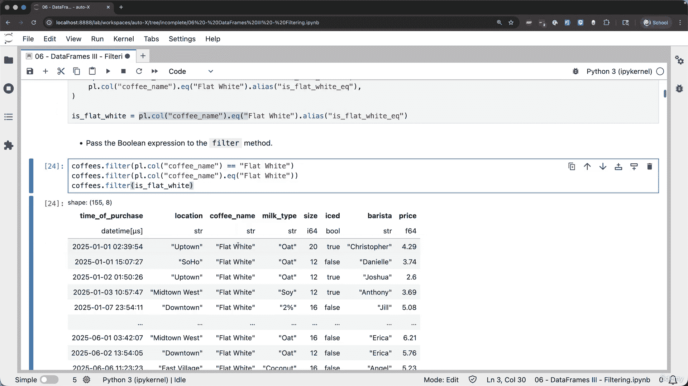

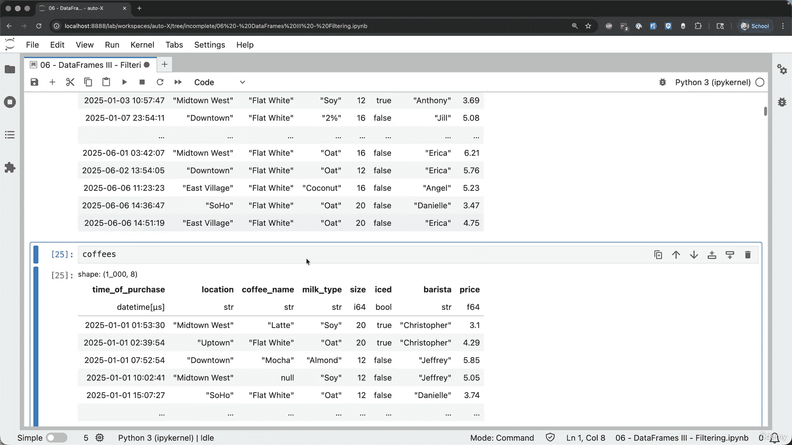

思路和刚才完全一样，我们依然要调用 filter 方法，并且必须提供一个产生布尔列的表达式。只不过这次我们要针对的列换成了 `location`，也就是位置列。我们再次使用相等运算符，把位置列里每一行的值和字符串 `Soho` 进行比较。这样就能把所有位置是 Soho 的行都筛选出来。如果你喜欢，也可以把双等号换成 EQ 方法，效果是一模一样的，两种语法你可以任选自己顺手的那个，没有强制规定必须用哪一种。

以下是筛选位置为 Soho 的示例代码：

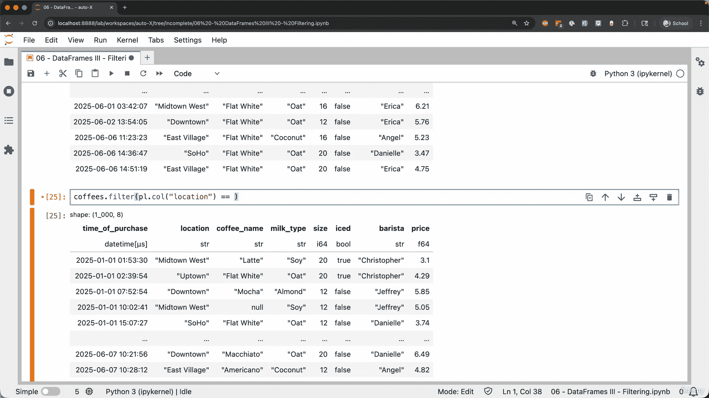

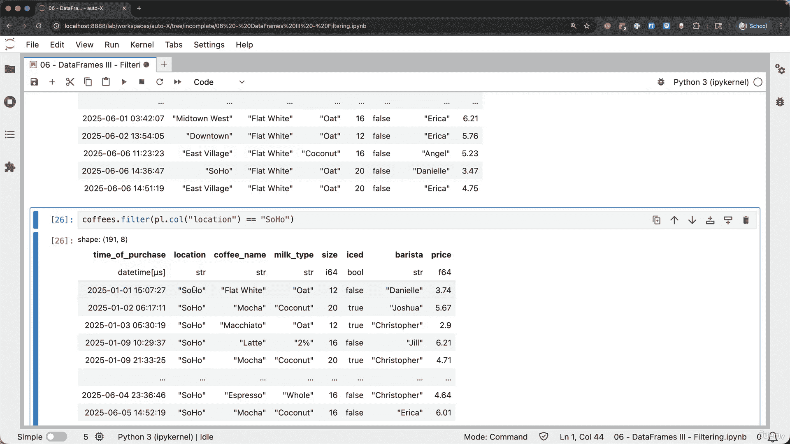

```python
coffees.filter(
    pl.col("location") == "Soho"
)

# 或者
coffees.filter(
    pl.col("location").eq("Soho")
)
```


## 8. 注意大小写和空白字符

在用字符串做等值比较时，有两个细节需要格外小心，否则很容易筛选出空结果，浪费时间排查问题。

以下是需要注意的两个要点：
- 第一是大小写敏感。数据集里的 `Soho` 是大写 S 和大写 H 拼写的。如果你不小心写成了小写 `soho` 或者混合大小写，Polars 会认为它们不相等，因为字符串比较会区分大小写。这时候没有任何一行能满足条件，filter 就会返回一个空数据框。
- 第二是空白字符。比如你在 `Soho` 后面多加了一个空格，数据集里也没有任何一行的位置值是带尾随空格的 `Soho `，所以同样会得到空结果。

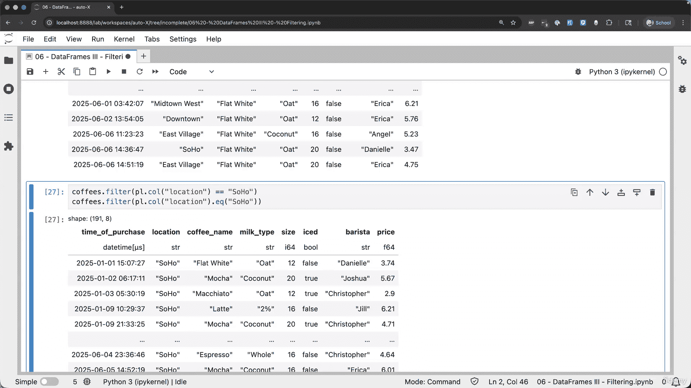

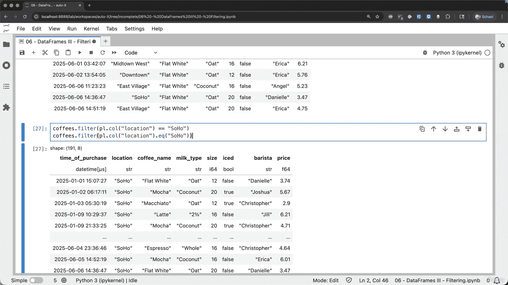

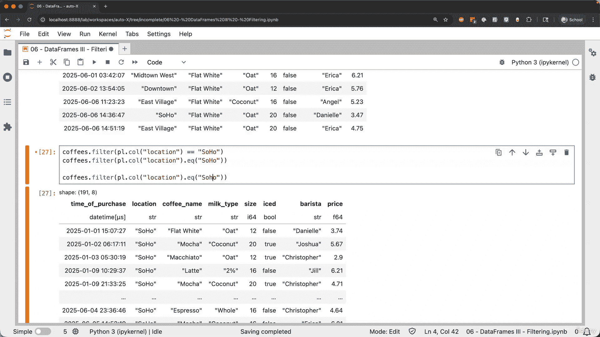

为了避免这种情况，你可以先用 select 方法看看生成的布尔列长什么样，确认比较逻辑是对的，再放心地交给 filter 使用。养成这个习惯能让你在处理真实数据集时少走很多弯路。


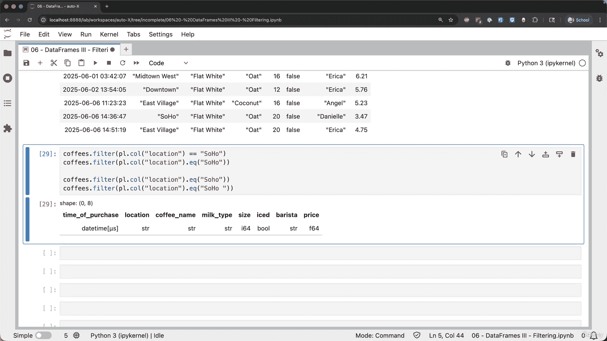

在本节课中我们一起学习了 Polars 的 filter 方法。我们了解到，filter 用于从数据框中提取满足条件的行子集，传入的表达式必须是布尔表达式，也就是产生 true/false 列的表达式。我们通过 `select` 方法验证了表达式的输出，学会了用双等号 `==` 和 `eq()` 方法对字符串做等值比较，并把布尔表达式传给 `filter` 来筛选出咖啡名为 `flat white` 或位置为 `Soho` 的行。此外，我们还了解到 Polars 的表达式可以独立于数据框存在，可以赋值给变量并在多个地方复用。最后提醒大家，字符串比较要注意大小写和空白字符，避免筛选出空结果。下节课我们将继续深入 filter 方法的更多用法。
