Polars 与 Python 数据分析：085：过滤缺失值 🔍


在本节课中我们将要学习如何在 Polars 中处理缺失值过滤。我们会先重新导入数据，查看哪些列里包含空值，然后学习如何保留或剔除这些空值，最后掌握更简洁、更推荐的方法来完成同样的任务。无论你是想分析咖啡店的营收，还是处理其他业务数据，掌握缺失值的过滤逻辑都是很重要的一步。


## 重新导入数据并检查缺失值

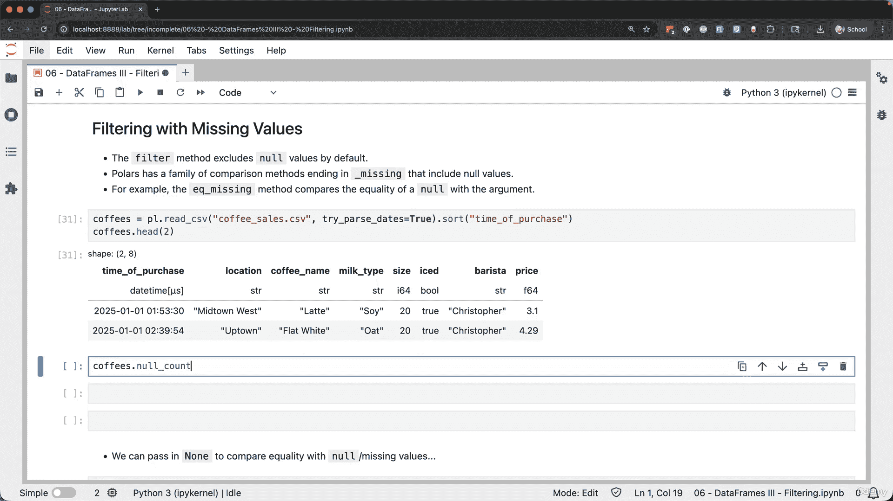

在开始之前，我们需要先重新执行导入代码，拿到我们的咖啡数据集。这样才能确保后面的过滤操作是在正确的数据框上进行。接下来我们要做的第一件事，就是对数据框调用一个专门的方法，叫做 null_count。这个方法会统计数据框中每一列里缺失值或者空值的数量。

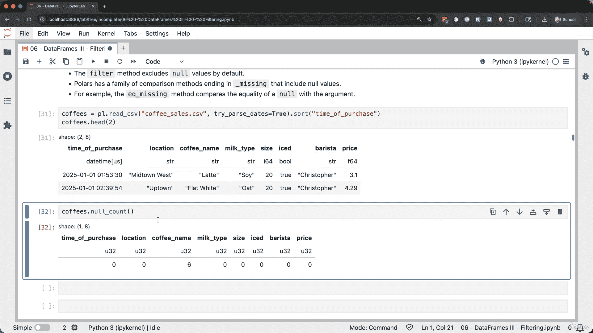

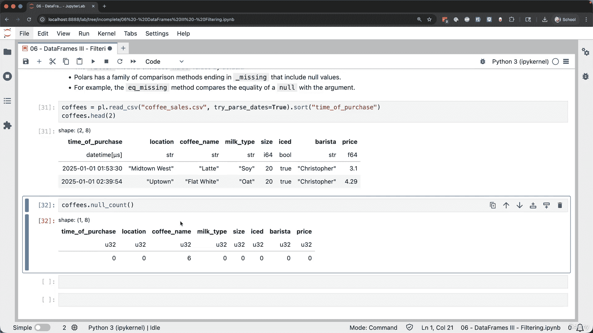

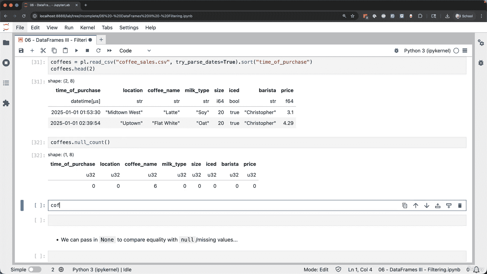

运行之后你会发现，在这个数据集里，只有 coffee_name 这一列包含缺失值，其他列都没有。这一点很有用，因为它告诉我们后续只需要关注这一列就可以了。

以下是核心代码示例：

```python
df.null_count()
```

上面这行代码会返回一个结果，显示每一列里缺失值的具体数量。在这个例子中，只有 coffee_name 列有非零的计数，其余列全是零。


## 默认行为：排除缺失值的过滤

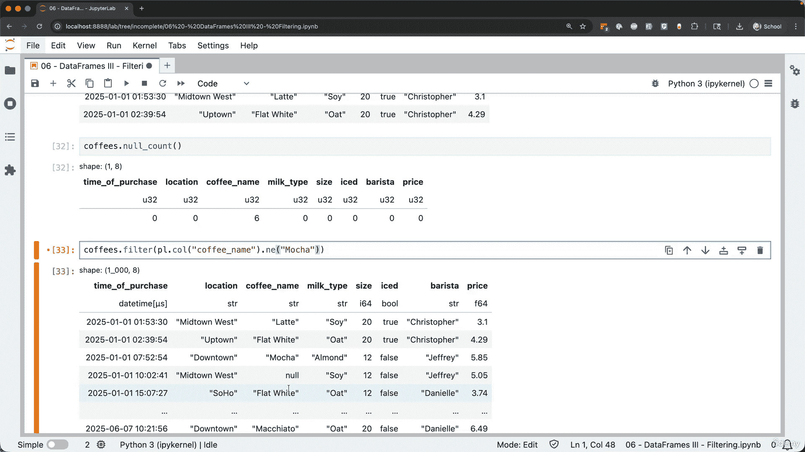

接下来我们来看两种方法并排对比，看看它们在处理缺失值时有什么不同。假设我们现在的数据框里，前面几行预览如下，其中第四行的 coffee_name 列就是缺失或空缺的。

现在假设我们要对这个数据框进行过滤，表达式的目标列是 coffee_name。我们想要筛选出所有不等于 "Mocha" 的行。换句话说，只要一行里的咖啡名不是 Mocha，我们就把它保留下来。

按照这个逻辑，前面几行分别会被保留、保留、排除，直到遇到那个缺失值那一行。这时候 Polars 默认会怎么做呢？根据之前的介绍，Polars 会直接把这一整行从任何评估中排除，不会把它计入结果。

最终得到的数据框里，我们会看到 latte、flat white、flat white，也就是说，那个完整的缺失值行被跳过了。

核心代码如下：

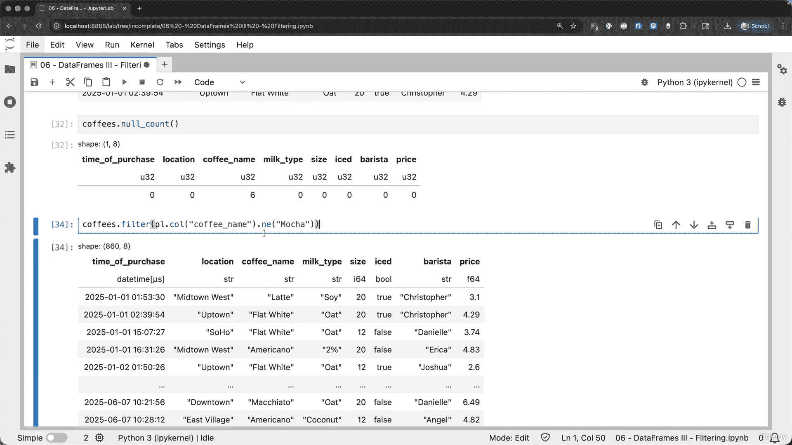

```python
df.filter(pl.col("coffee_name") != "Mocha")
```

这里有一个值得思考的问题：缺失值到底算不算不等于 Mocha？这其实取决于你怎么想，也取决于你的业务问题。比如，如果你在分析咖啡店营收，想看除了 Mocha 之外所有咖啡的营收，一个缺失的条目究竟是代表某个你想要统计的咖啡类别，还是仅仅是一条你想忽略的缺失数据？

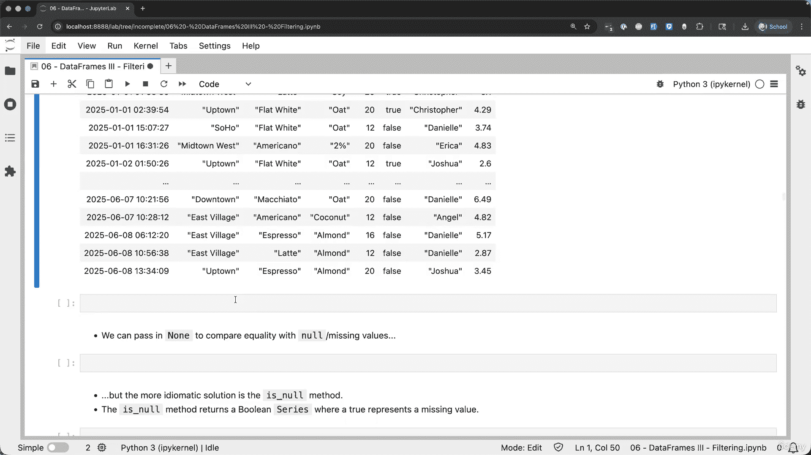

不同的业务场景答案不同，但 Polars 的默认行为是：当我们使用不等于方法，或者说不等号运算符时，会直接把缺失值完全排除，不参与后续的计算。


## NE missing：将缺失值纳入比较

除了默认行为之外，Polars 还提供一个互补的方法，叫做 ne_missing。这个方法会在计算中把缺失值纳入考虑。换句话说，它会告诉 Polars 把 null 或者缺失值也放到比较里面去。

我们再次调用 filter 方法，构造一个产生布尔列的表达式，依然针对 coffee_name 列。和刚才的例子唯一的区别在于，这里我们调用 ne_missing 方法，并继续和 "Mocha" 进行比较。

换句话说，我们要筛选出那些咖啡名不等于 Mocha 的行，同时还要把缺失值也纳入评估。根据同样的原则，不等于 Mocha 的行会被保留，等于 Mocha 的行会被排除。而 Polars 会这样处理缺失值：从严格意义上说，缺失值并不严格等于 Mocha，所以它会把这一行也纳入过滤后的数据框里。

最终结果就是，我们保留了那些在 coffee_name 列里有缺失值的行，因为从技术角度看，缺失值不等于 Mocha。不过要注意，这种行为只会出现在使用 ne_missing 方法的情况下，因为这个方法会把缺失值纳入计算。

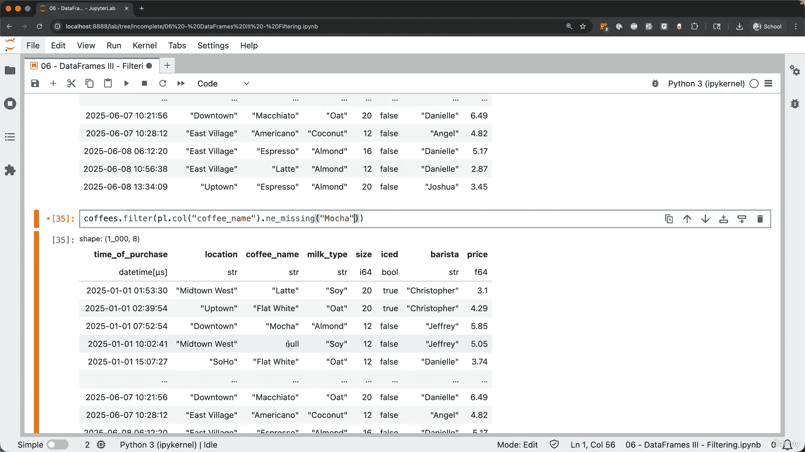

核心代码如下：

```python
df.filter(pl.col("coffee_name").ne_missing("Mocha"))
```


## 反向问题：筛选仅包含缺失值的行

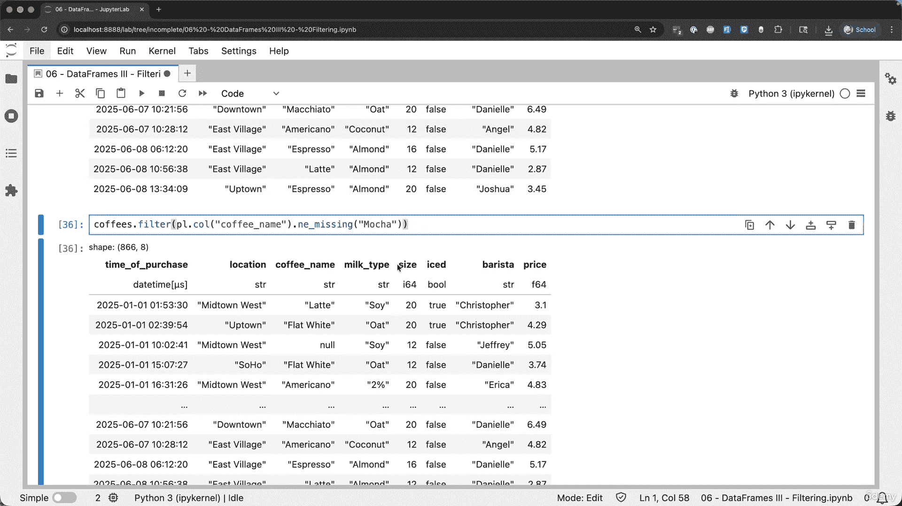

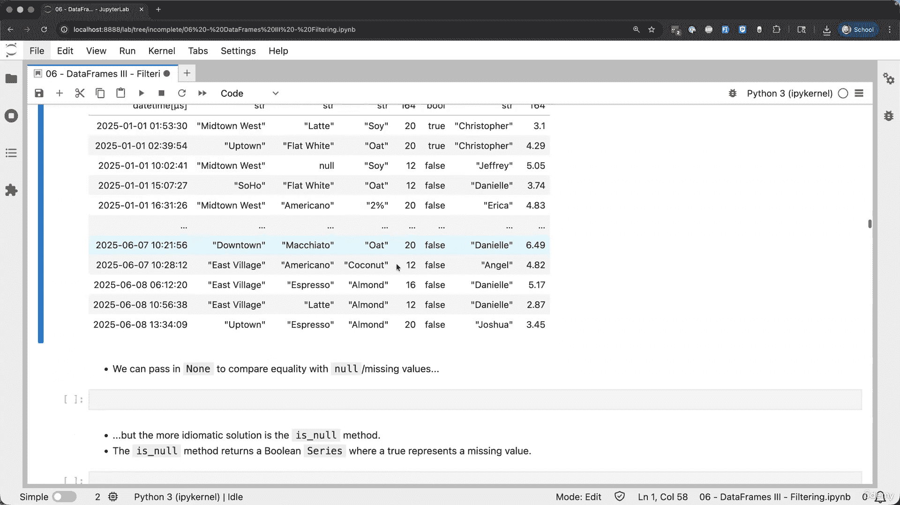

接下来我们反过来思考一个问题：如果我只想提取出那些在某一列里包含缺失值的行，该怎么做呢？方法有很多种，但有一种推荐的做法。不过我先要从一种不太正确的做法开始说起，主要是为了让你了解 Polars 会在这时候发出什么样的警告。

首先，我们依然从 coffee_name 列开始，因为它是唯一包含缺失值的列。我们可以尝试使用等于方法，也就是 EQ 方法，把列和 None 进行比较。但是要记住，默认情况下，等于和不等于方法会完全忽略缺失值。

也就是说，不管你在这里传入什么值，Polars 都会直接把所有包含 null 值的行排除掉。结果就是，这种写法会得到一个完全为空的数据框，什么都筛不出来。

错误示例如下：

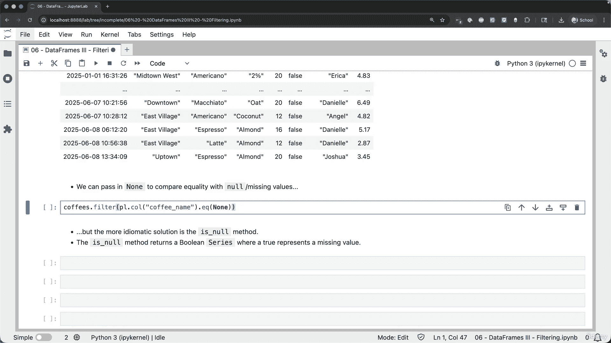

```python
df.filter(pl.col("coffee_name") == None)
```

如果我们确实想要在计算中把缺失值纳入考虑，那么有一个配套的方法叫做 eq_missing。它和之前介绍的方法使用了同样的后缀，意思是：是的，我要和 None 进行不等比较，同时也要把缺失值或空值拿出来和 None 比较。

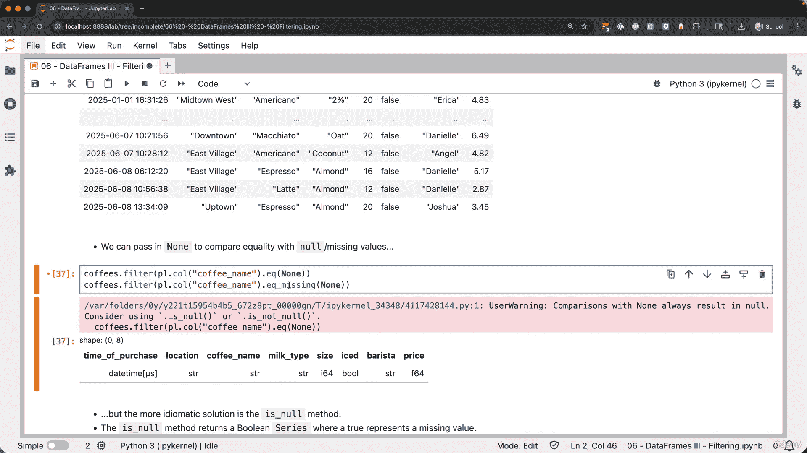

这样一来，确实就能筛选出那些包含缺失值的行了。你可以把 Python 的 None 对象看作是代表缺失值的等价对象。不过这里有个小警告，Polars 团队建议不要用这种和 None 进行比较的方法，因为和 None 比较的结果始终是 null，虽然这可能是你想要的，但也可能不是。

推荐的替代方案是使用 is_null 和 is_not_null 方法，后面会详细介绍。

eq_missing 的代码示例如下：

```python
df.filter(pl.col("coffee_name").eq_missing(None))
```

上面这行代码会筛选出 coffee_name 列里等于缺失值的行，也就是只保留那些原本数据缺失的记录。


## 推荐方法：is_null 与 is_not_null

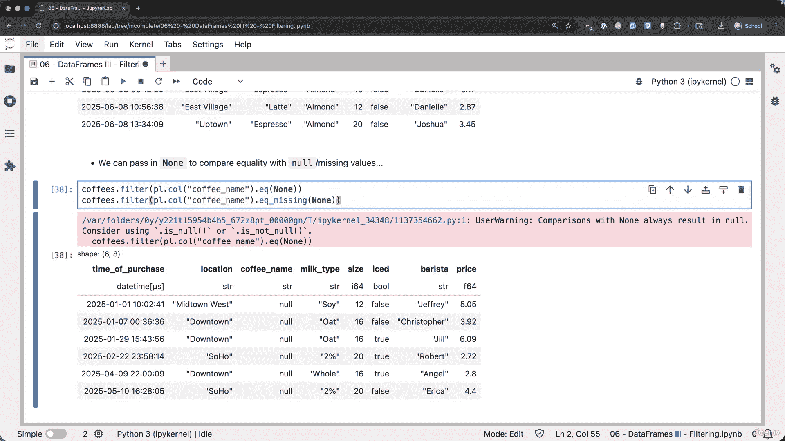

除了上面那些方法，Polars 还提供了更声明式、更简洁的辅助方法，也就是 is_null 和 is_not_null。之所以更推荐这两个方法，是因为它们不用传入 None，也不需要担心传入什么特定的参数。

None 本身是 Python 之外的一个构造概念，而这两个方法直接帮我们锁定要么是缺失值，要么是存在的值。语法依然一样，我们依然调用 filter 方法，依然构造针对 coffee_name 列的表达式。不同的是，表达式上有一个非常方便的方法叫做 is_null。

is_null 会创建一个布尔列，其中 True 表示 coffee_name 列里对应的行有缺失值或空值。这样一来，我们就能专门筛选出那些 coffee_name 里有缺失值的行。

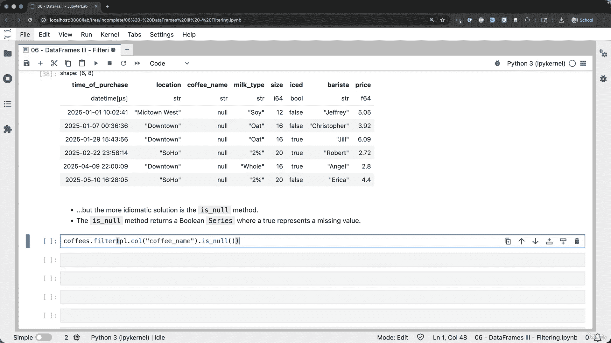

以下是本节涉及的几个核心方法及其作用：

- null_count：统计每一列里缺失值的数量。
- ne_missing：在不等比较中把缺失值也纳入计算。
- eq_missing：在等于比较中把缺失值也纳入计算，但不推荐使用。
- is_null：专门筛选出包含缺失值的行。
- is_not_null：专门筛选出包含实际值的行。

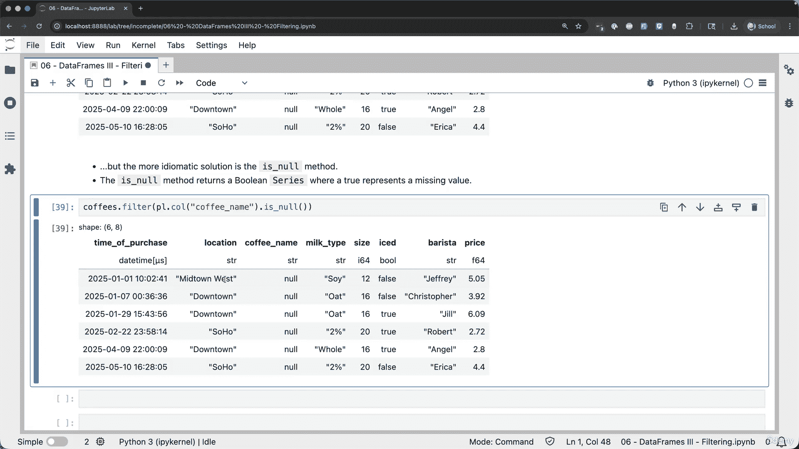

is_null 的代码示例如下：

```python
df.filter(pl.col("coffee_name").is_null())
```

同样的规则反过来也适用。比如，如果我们想要做相反的事情，把那些有实际值、也就是非空的行筛选出来，把包含空值的行排除掉，可以用下面这种不太完美的写法。

我们可以说，要对 coffee_name 列进行过滤，使用 ne_missing 来确保把空值也纳入比较，然后筛选出那些不等于 null、或者不等于 None 的行。也就是说，筛选出那些不等于缺失值的行，从而锁定那些有实际值的行。

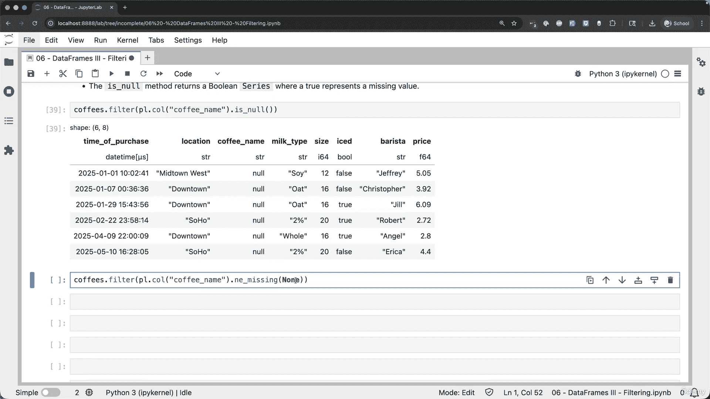

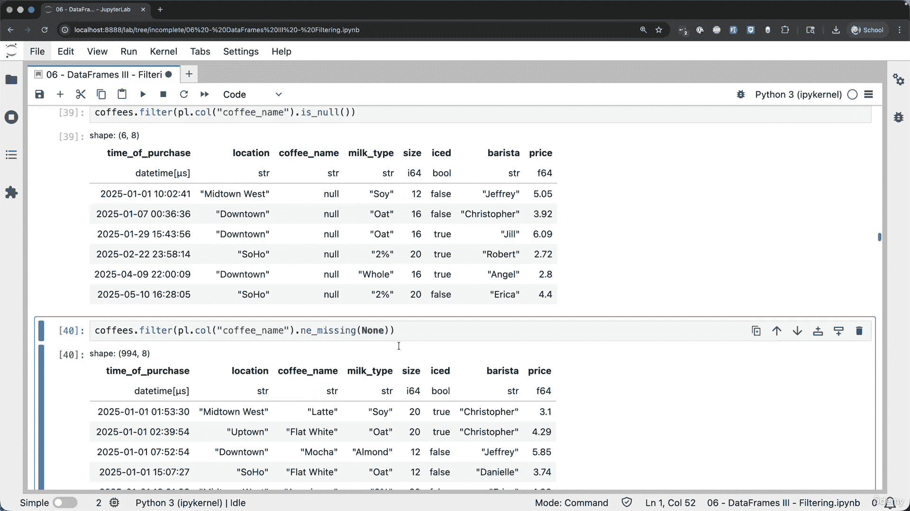

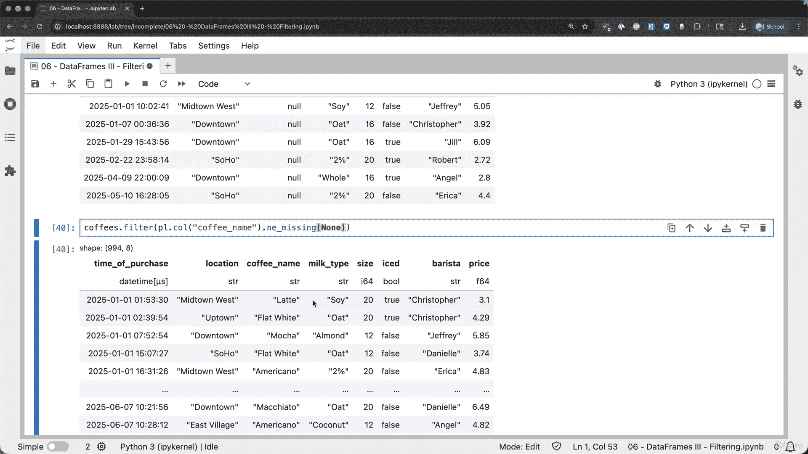

不过你马上就能感觉到，这种描述方式本身有点绕，因为里面包含了大量跟“非值”进行不等比较的逻辑。虽然确实能得到我们想要的结果，但对于这个问题，有一个更优雅的解决方案，那就是使用互补的 is_not_null 方法。这个方法读起来更清爽，逻辑也更直接。

我们依然对数据框里的 coffee_name 列进行过滤，筛选出那些行的值不是 null 的。这样一来，我们就锁定了所有包含有效字符串值的行，把空值全都排除了。

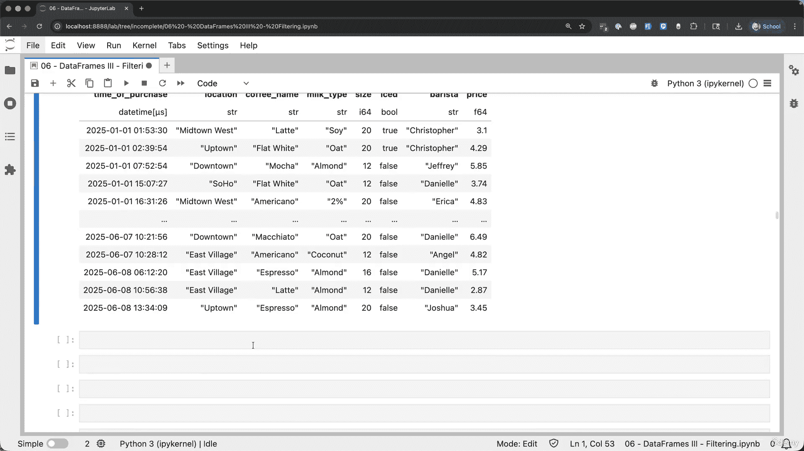

代码示例如下：

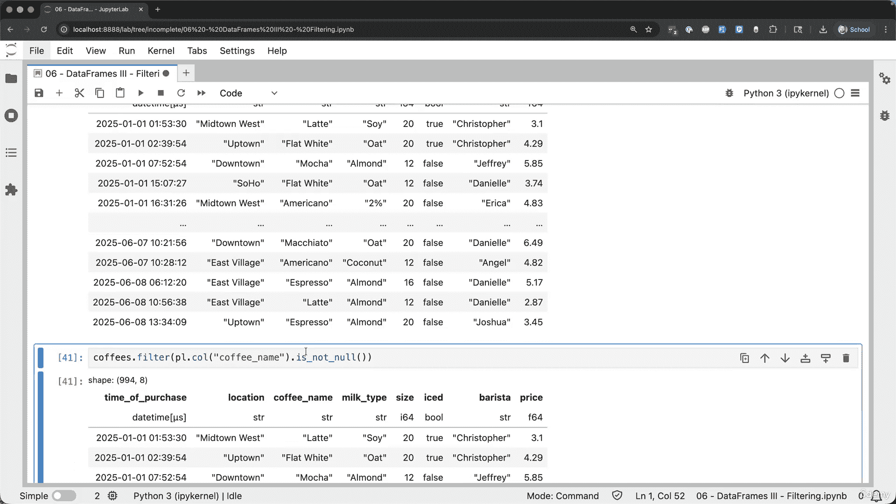

```python
df.filter(pl.col("coffee_name").is_not_null())
```


## 本节总结

本节课中我们一起学习了如何在 Polars 中过滤缺失值。我们先用 null_count 检查哪些列包含空值，然后学习了默认情况下如何排除缺失值，接着了解了 ne_missing 如何把缺失值纳入比较，最后掌握了 is_null 和 is_not_null 这两个更推荐的方法。

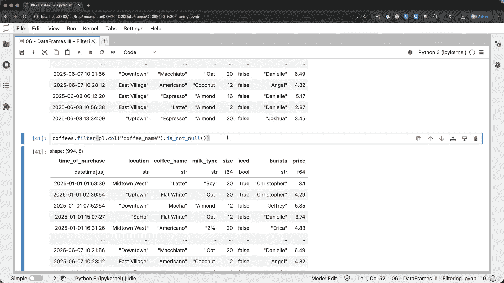

通常来说，完成你想要的操作都有对应的方法，通常不需要引入像 None 这样的原生 Python 构造。幸运的是，Polars 团队在文档和弃用警告方面做得非常好，能够指导我们使用更优化的方式来执行这些操作。以上就是如何在数据框中同时处理包含和排除 null 或缺失值的完整流程。

