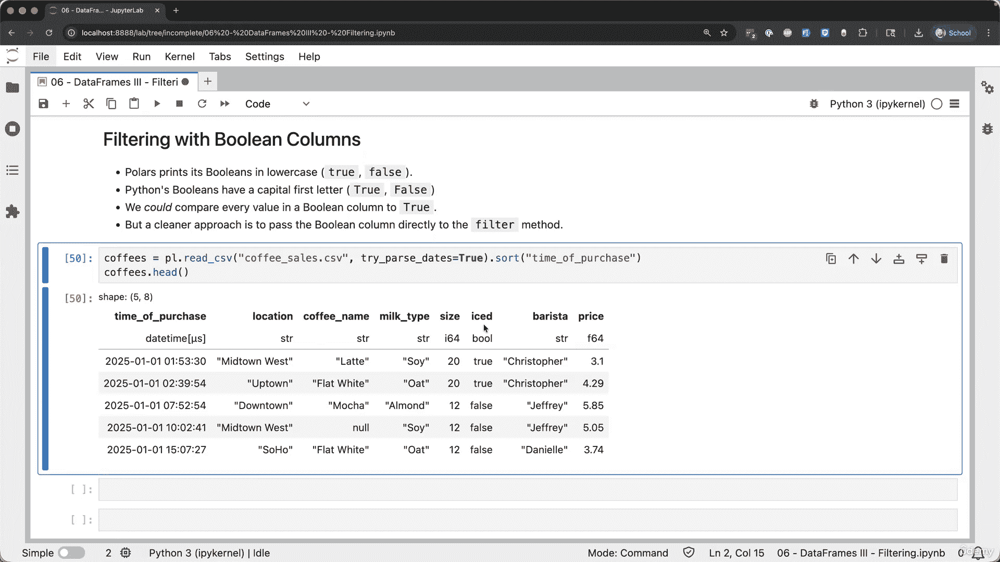
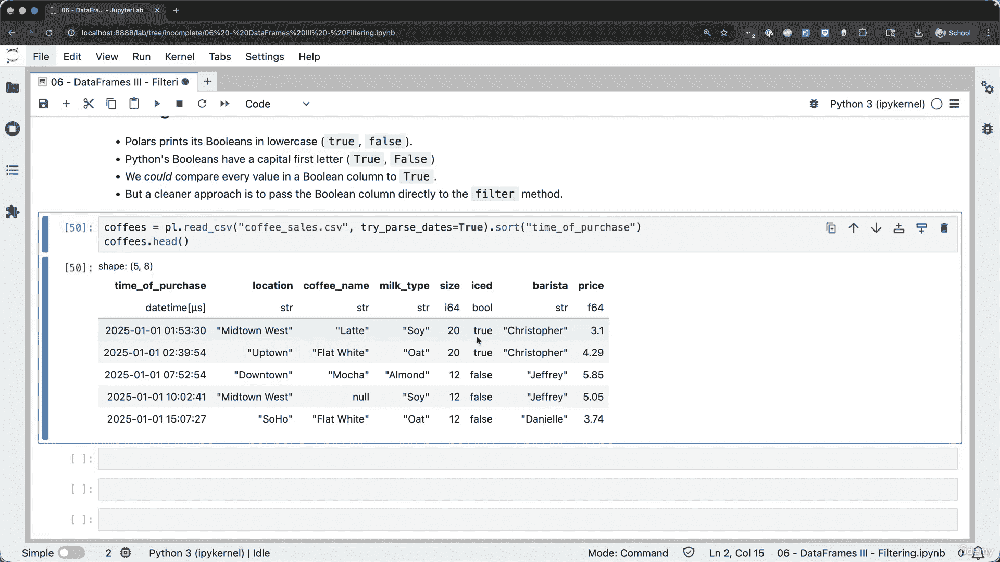
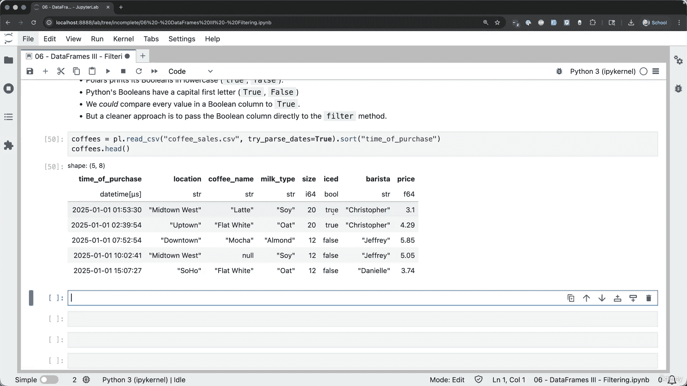
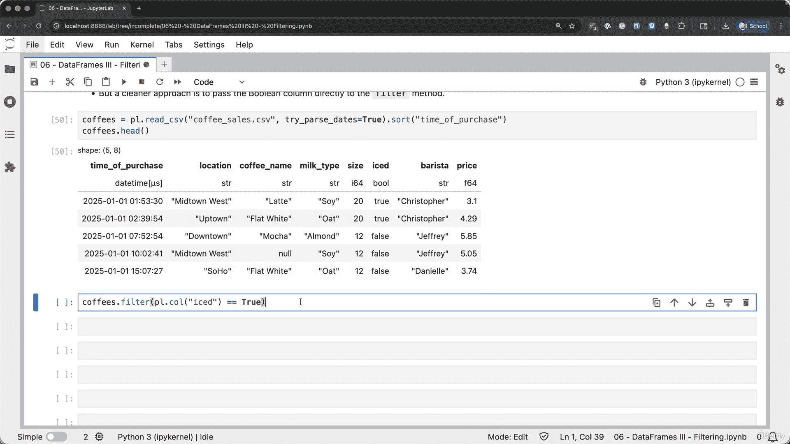
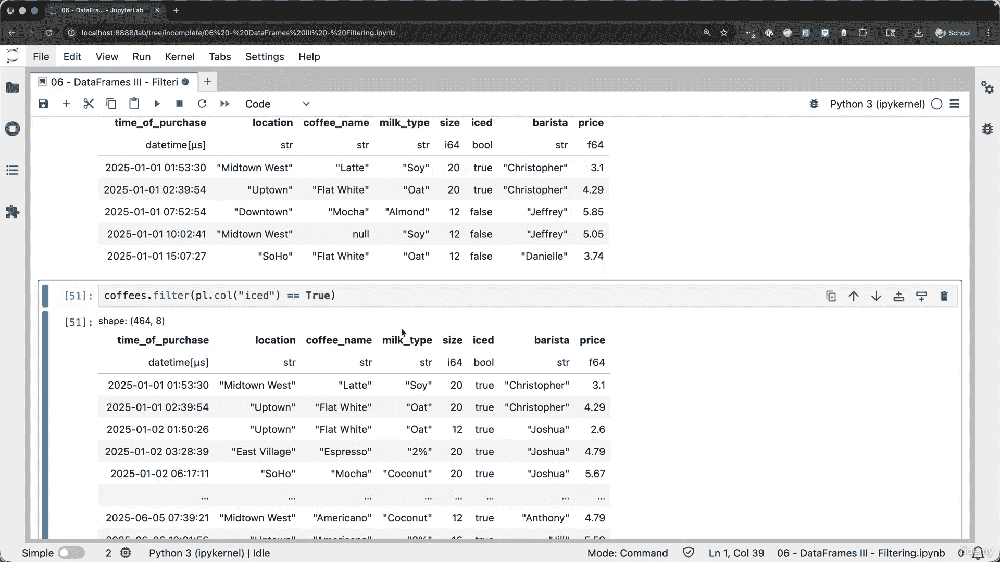
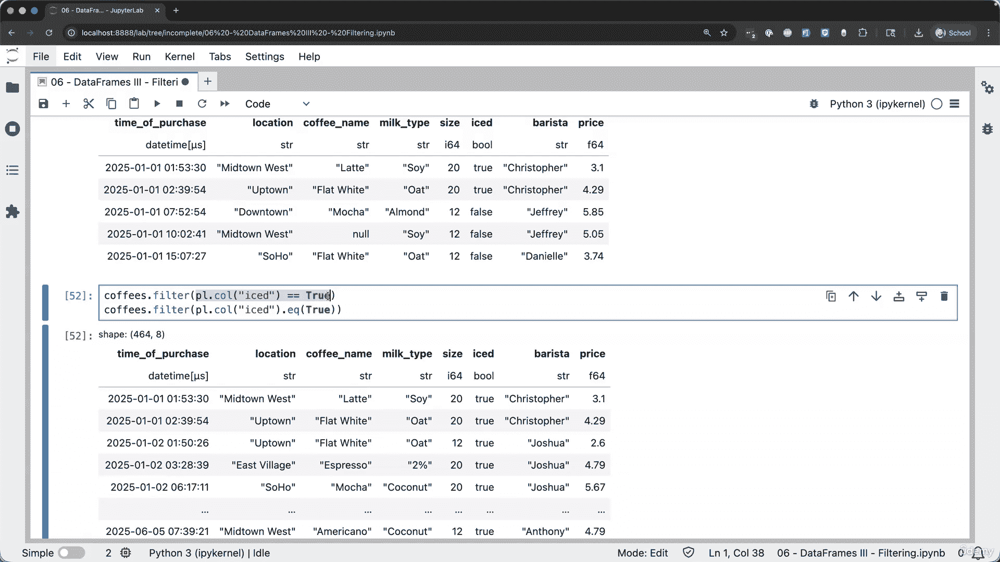
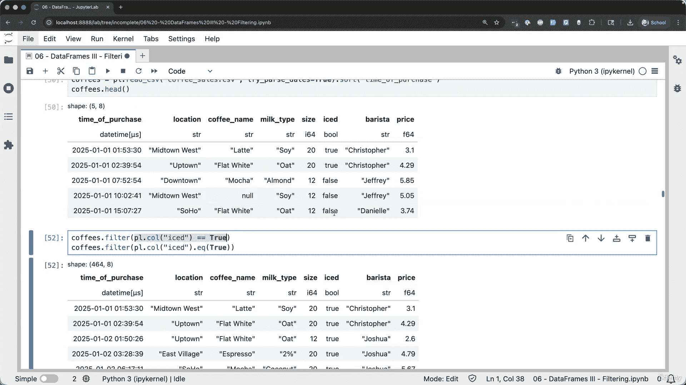
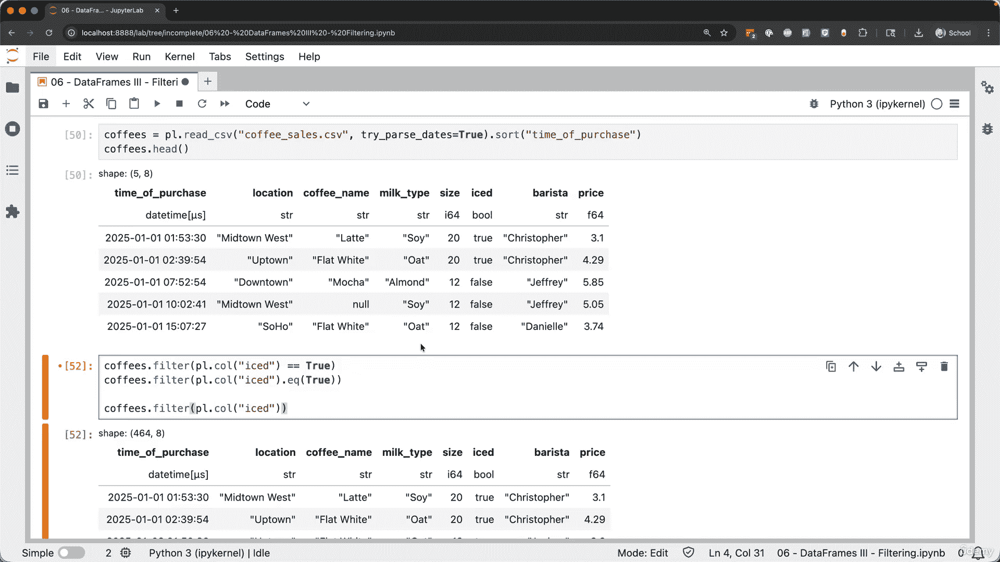
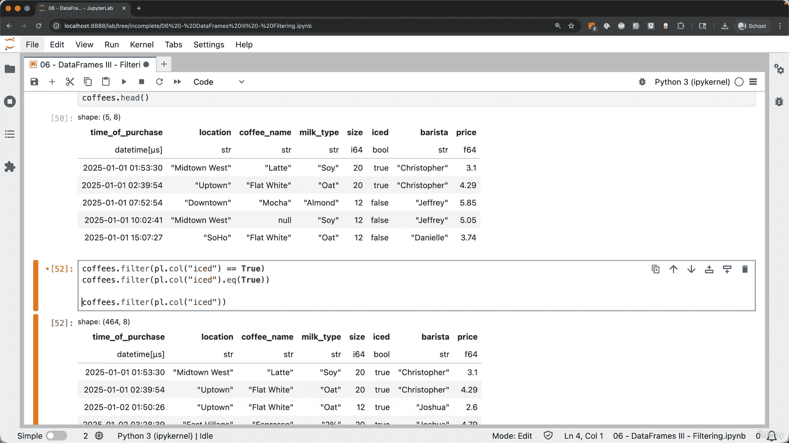
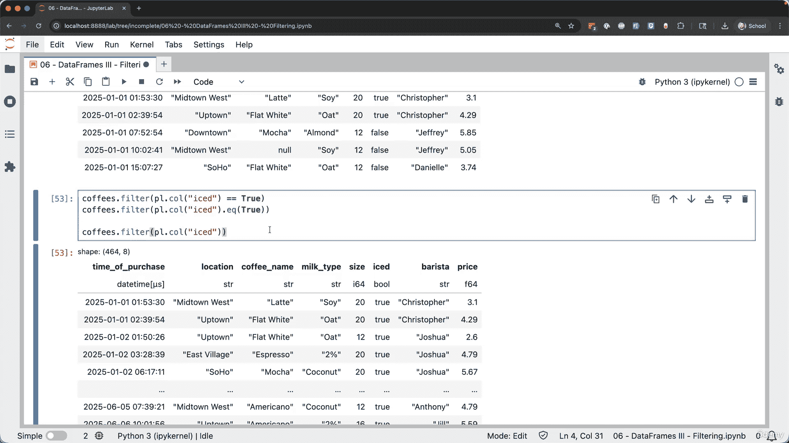

# Polars数据分析入门：第86节：布尔列过滤 📊

在本节课中我们将要学习如何在Polars中使用布尔列进行数据过滤。我们会先认识咖啡数据集中的布尔列，然后了解Polars与Python在布尔值写法上的关键区别，最后掌握三种不同的过滤写法，并找出其中最简洁优雅的一种。

## 认识咖啡数据中的布尔列

在开始之前，我们先来看看今天要用的数据。这里有一张关于咖啡销售的数据表，数据框的名字叫做coffees。这张表里包含很多列，其中有一列专门记录顾客购买的是否为冰咖啡，这一列的名字就是iced。从数据类型来看，iced是一个布尔列，也就是说这一列里面的每一个单元格只能有两种可能的取值，要么是真，要么是假。

布尔列在数据分析中非常常见，它通常用来表示某种“是”或“否”的情况。比如在本例中，如果某一行的iced列是真，就代表这位顾客买了冰咖啡；如果是假，就代表这位顾客没有买冰咖啡。理解了这一点，我们就能开始思考如何根据这一列来筛选数据了。



上一节我们简单认识了数据框的基本结构，本节中我们来看看iced这一列的具体情况：



- 列名为iced
- 数据类型为布尔类型
- 每个值只能是真或者假

## Polars与Python的布尔值写法区别

接下来我们要讨论一个非常重要的细节，那就是Polars和Python在布尔值拼写上的不同。这是很多初学者容易混淆的地方，所以特别需要留意。



在Polars中，布尔值全部使用小写字母。也就是说，真写作true，假写作false。当你在Polars的数据框里查看iced列时，会看到所有的值都是小写的true和false。这种写法并不是随意规定的，而是有深层原因的。Polars是基于Rust语言构建的，而在Rust语言中，布尔值的命名习惯就是使用小写。因为Polars底层继承了Rust的特性，所以它的布尔值也沿用了小写的风格。

相比之下，原生的Python语言使用大写字母开头来表示布尔值，即True和False。如果你在Python代码里写true或False，Python会报错，因为它只认首字母大写的形式。这两种写法看起来很像，但大小写不同，在实际编程时如果搞混了，可能会导致过滤条件不生效或者直接报错。

上一节我们介绍了咖啡数据中的布尔列，本节中我们来看看Polars和Python在布尔值写法上的不同：

- Polars中：true / false
- Python中：True / False

记住这个区别，能帮你在后续编写Polars代码时避免不必要的错误。



## 三种布尔列过滤的方法



有了上面的基础知识，我们现在来看看如何筛选数据。假设我们想从coffees数据框中提取所有购买了冰咖啡的顾客行，也就是iced列的值为真的那些行。这里一共有三种方法可以实现这个目标。

上一节我们了解了布尔值的写法区别，本节中我们来看看如何利用这些知识进行实际的数据过滤。

以下是三种具体的过滤写法：





1. 使用相等运算符显式比较

   第一种方法是使用Python的相等运算符`==`，将iced列的每个值与Python的True进行比较。代码如下：

   ```python
   coffees.filter(pl.col("iced") == True)
   ```

   这种写法的意思是：对于每一行，检查iced列的值是否等于True。如果是true，那么`true == True`的结果为真，这一行会被保留；如果是false，那么`false == True`的结果为假，这一行会被剔除。最终我们得到一个新的布尔列，用来指示哪些行应该保留。

   不过这种方法有一个问题，就是有点多余。因为iced列本来就是布尔列，我们还专门拿它去和True比较一遍，其实绕了一圈。

2. 使用eq方法进行比较

   第二种方法是调用Polars提供的eq方法，效果和第一种几乎一样。代码如下：

   ```python
   coffees.filter(pl.col("iced").eq(True))
   ```

   这种写法也是完全合法的，能够正确地筛选出iced列为真的所有行。它和第一种方法在本质上没有区别，依然是在做一次不必要的相等比较，只是语法形式稍有不同。

3. 直接传入布尔列本身

   第三种方法是最优雅、最聪明的解决方案。我们可以意识到，上面两种方法的计算过程其实是冗余的。因为iced列本身已经是一个布尔列，里面的值就是我们想要的真或假，不需要再额外跟True比较。

   请记住，Polars的filter方法只有一个要求：传入的表达式求值后必须得到一个布尔列。而iced列这一列本身，就已经是一个布尔表达式，其中的真值表示这一行应该被保留，假值表示这一行应该被排除。

   因此，我们可以完全避免任何相等比较，直接把针对iced列的表达式传进去即可：

   ```python
   coffees.filter(pl.col("iced"))
   ```

   这种写法的语法最简洁，代码量最少，逻辑也最清晰。Polars会直接利用布尔列中的true和false作为指示器，决定哪些行保留、哪些行丢弃。

## 核心要点与记忆公式

学完这三种方法后，你可能会问，它们到底有什么区别？事实上，上述三种方法最终都会产生完全一样的结果数据框，筛选出的行是一模一样的。区别仅在于代码的简洁程度和表达方式。

如果你希望代码更简洁、更优雅，建议直接使用第三种方法，即直接传入布尔列本身。这样不仅省去了写`== True`或`.eq(True)`的麻烦，也让代码的意图更加明显。

上一节我们学习了三种具体的过滤写法，本节中我们来总结一下核心要点和记忆公式。

为了帮助你更好地记忆，可以用下面这个公式来概括Polars的布尔过滤：

```
过滤结果 = 数据框.filter(布尔列表达式)
```

只要传入的表达式求值结果是一个布尔列，Polars就能根据其中的真假值来决定每一行的去留。这里的布尔列表达式可以是直接引用的布尔列，也可以是经过比较运算得到的布尔列。



## 总结





本节课中我们一起学习了如何在Polars中对布尔列进行过滤。首先，我们认识了咖啡数据集中的iced布尔列，了解到它用来记录顾客是否购买了冰咖啡。接着，我们学习了Polars与Python在布尔值写法上的区别：Polars使用小写的true和false，这是因为它基于Rust语言构建；而Python使用大写的True和False。最后，我们介绍了三种过滤方式：使用相等运算符`== True`、使用eq方法，以及直接传入布尔列本身。其中第三种方法语法最简洁、最优雅，因为布尔列已经包含了我们需要的全部信息，不需要再做额外的相等比较。希望这节课能帮助你更好地理解Polars的布尔过滤机制，并在实际数据分析中灵活运用。

