# Polars 数据分析：87：使用 AND 逻辑筛选多个条件 🧩

在本节课中，我们将学习如何在 Polars 的 filter 方法中使用 AND 逻辑，从而筛选出同时满足多个条件的数据行。我们会从最基本的与号运算符写法开始，逐步讲解括号的作用，再介绍几种不需要括号的替代方案，最后总结所有可选写法的优缺点。


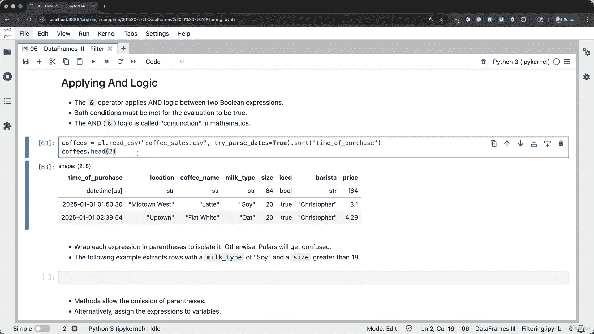

## 1. 什么是 AND 逻辑筛选

上一节我们介绍了如何使用 filter 方法根据单个条件筛选数据，本节我们来看看当需要同时满足两个或更多条件时该怎么操作。AND 逻辑的意思很简单，就是“且”的关系，只有所有条件都成立，这一行才会被保留下来。

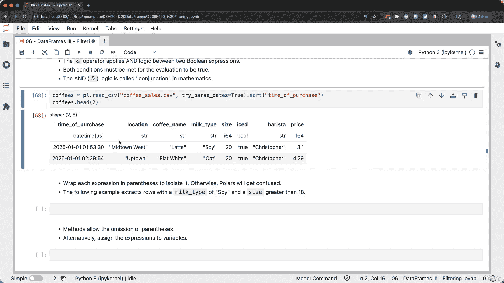

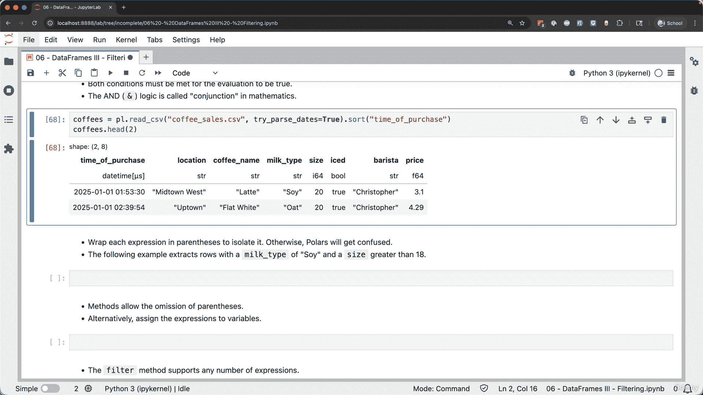

比如说，你有一张咖啡销售表，你想找出所有“牛奶类型是豆浆”且“容量大于 18”的记录。这里就涉及两个完全独立的判断，一个是判断字符串是否相等，另一个是判断数值是否大于某个阈值。

以下是核心逻辑的表达方式：

```python
(condition_1) & (condition_2)
```

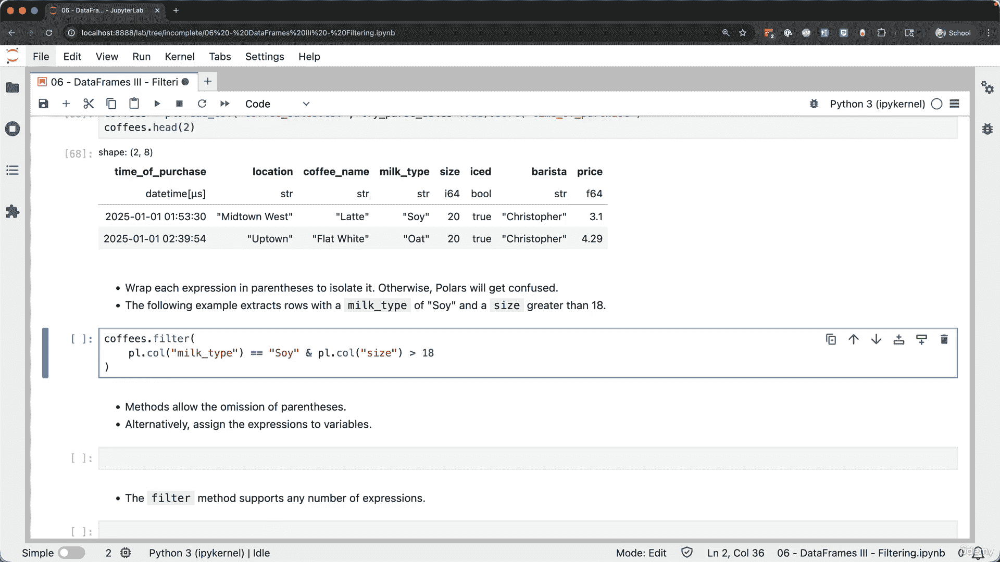

这个公式表示，第一个条件必须为真，并且第二个条件也必须为真，Polars 才会把这一行留在结果里。如果任意一个条件不成立，这一行就会被过滤掉。这就像过筛子一样，只有同时通过所有关卡的数据行才能留下来。


## 2. 使用与号 (&) 组合两个独立条件

在 Polars 中，执行 AND 逻辑最直接的方式是使用与号符号，也就是键盘上的 Shift + 7，我们把它叫做 and 运算符。你需要把两个独立的布尔表达式用这个符号连接起来，Polars 就会把它们合并成一个新的表达式，同时针对这两个条件进行筛选。

首先，我们来执行导入代码，准备好数据环境：

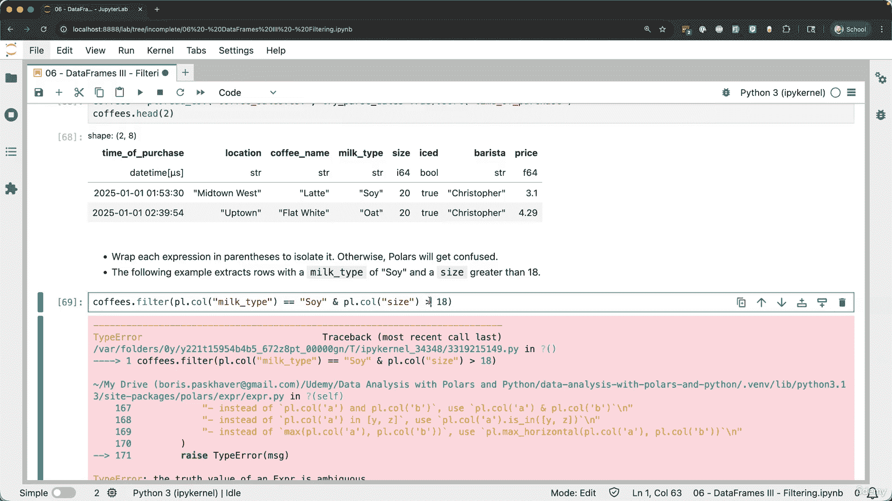

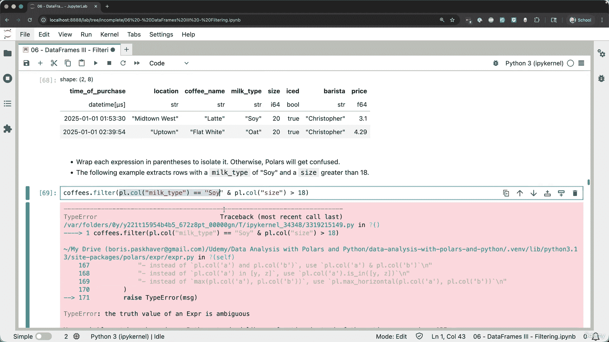

```python
import polars as pl
```

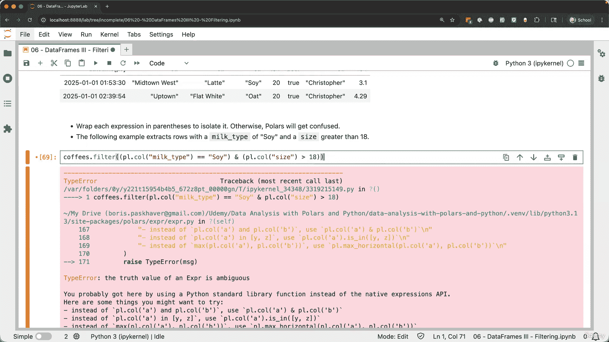

假设我们想筛选出满足以下两个标准的行：

- 牛奶类型列的值必须是 "soy"
- 容量列的数值必须大于 18

这两个条件是完全独立的表达式，我们先用 filter 方法逐个写出来。

第一个表达式是拿到牛奶类型列，用等号运算符把每一行的值和字符串 "soy" 做比较。

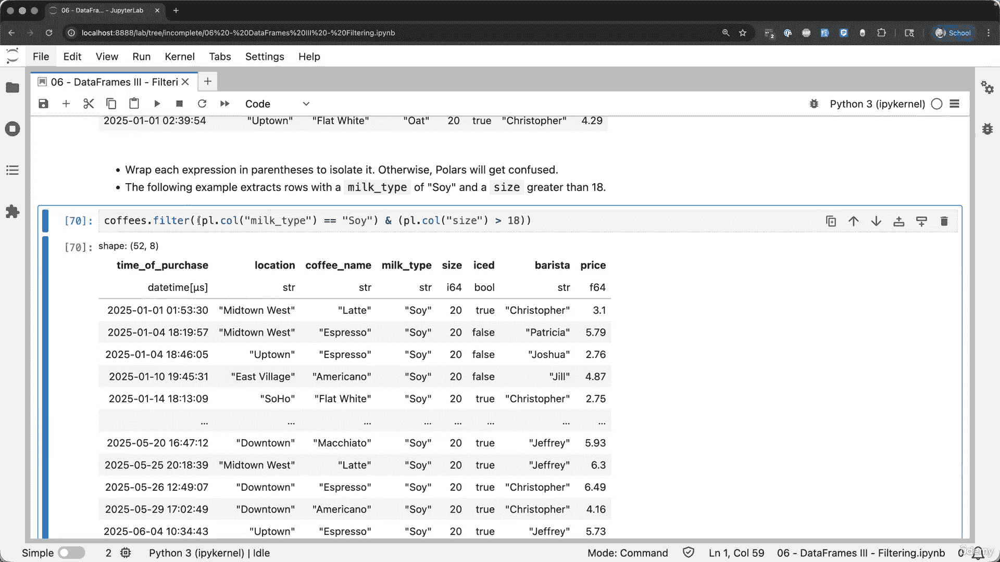

第二个表达式独立存在，针对容量列，用大于符号判断数值是否大于 18。

单独把这两个表达式中的任意一个传给 filter 方法都可以工作，但我们想要把它们组合起来，只保留同时满足这两个条件的行。

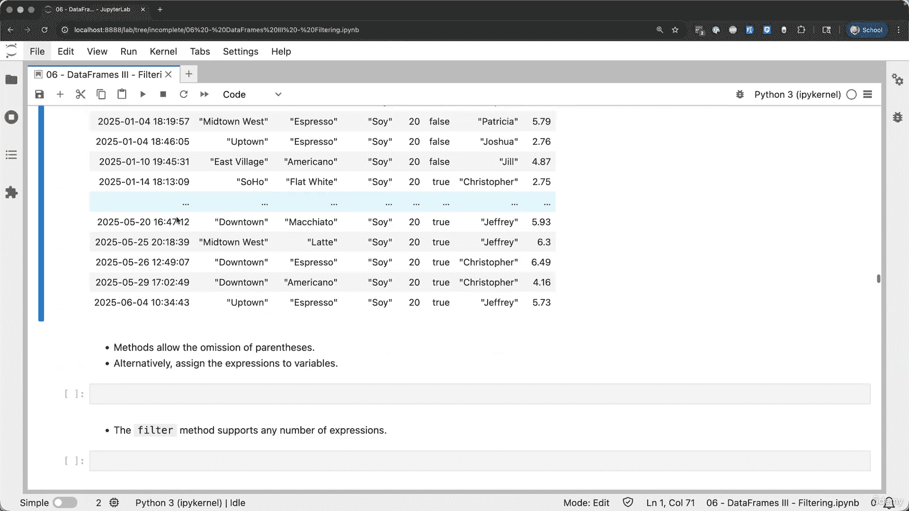

这时候，我们按照之前提到的方法，使用与号符号把这两个表达式连接起来。不幸的是，直接这样写会导致报错。

这个问题之前在几节课中也提到过。Polars 和 Python 在把等号运算符、与号符号和大于符号这些符号组合在一起时，会搞不清楚一个表达式到底从哪里开始，到哪里结束。你会看到错误提示说“表达式的真值不明确”，意思是 Python 没有按照我们想要的方式来解析代码。

就像我们之前在调用表达式的 alias 方法时遇到的情况一样，解决办法是把完整的表达式用括号包起来。括号能让 Python 很容易理解结构的起始位置和结束位置。

具体做法是，给第一个完整表达式加上一对左括号和右括号，第二个表达式也用同样的方法处理。执行之后，我们就会得到想要的数据框：牛奶类型列的值是 "soy"，并且容量列的数值全部大于 18。

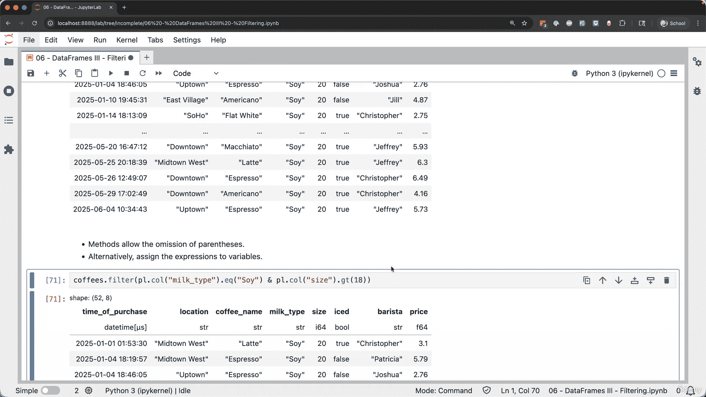

再重申一遍，这两个条件必须同时成立，行才会被筛选出来。如果牛奶类型是 "soy"，但容量不大于 18，这一行会被排除；反过来，如果容量大于 18，但牛奶类型不是 "soy"，这一行也会被排除。两个独立的标准都必须满足。


## 3. 使用方法等价物避免括号

如果你觉得这些括号让人头疼或者容易混淆，不用担心，还有几种方法可以实现完全相同的逻辑，而且不需要使用括号。

一种方案是，不再使用等号运算符和大于运算符这样的符号，而是改用它们对应的方法形式。我们依然需要与号运算符来连接条件，但不再需要括号了。

具体操作如下：去掉第一个表达式两边的括号，第二个表达式也去掉括号，然后把等号运算符改为调用 eq 方法，也就是 equal 方法的简写。把字符串包裹在方法调用里，这依然是一个完整的表达式。

```python
pl.col("milk_type").eq("soy") & pl.col("size").gt(18)
```

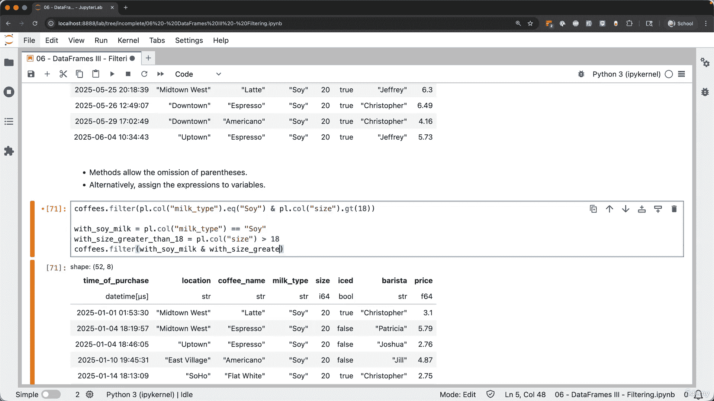

这样写对 Python 来说更容易解析，因为它只是一连串的方法调用，中间没有空格和各种符号。同样的道理，把大于号改为 gt 方法并调用它。记得调用实际的方法，并且为 filter 方法的调用加上右侧的括号。执行之后，你会得到和上面完全一样的数据框。


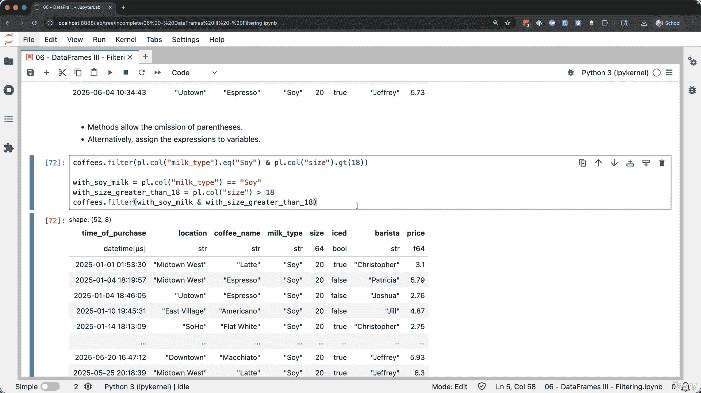

## 4. 将表达式提取为独立变量

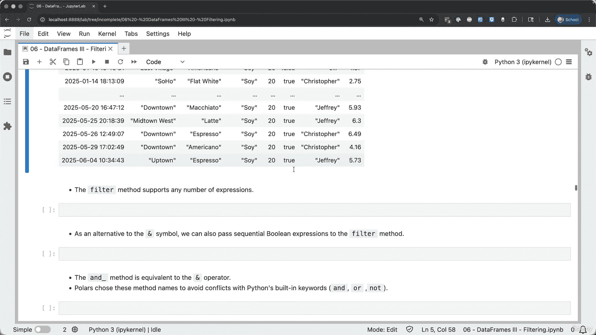

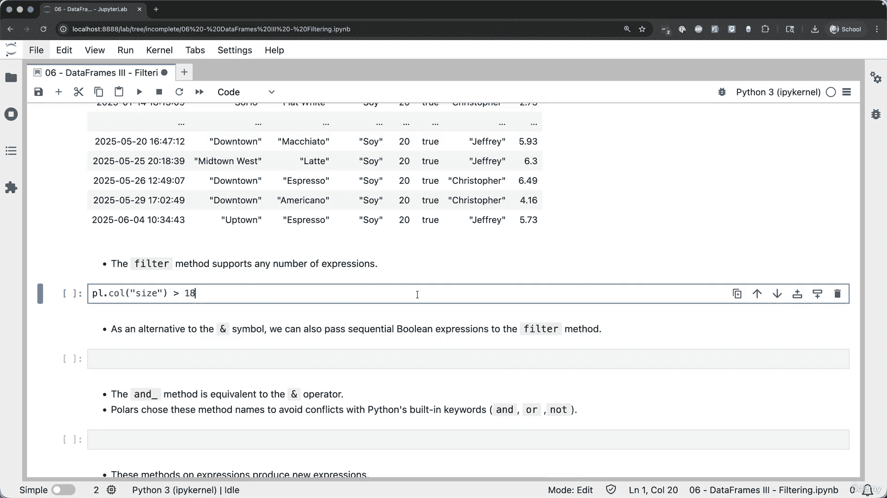

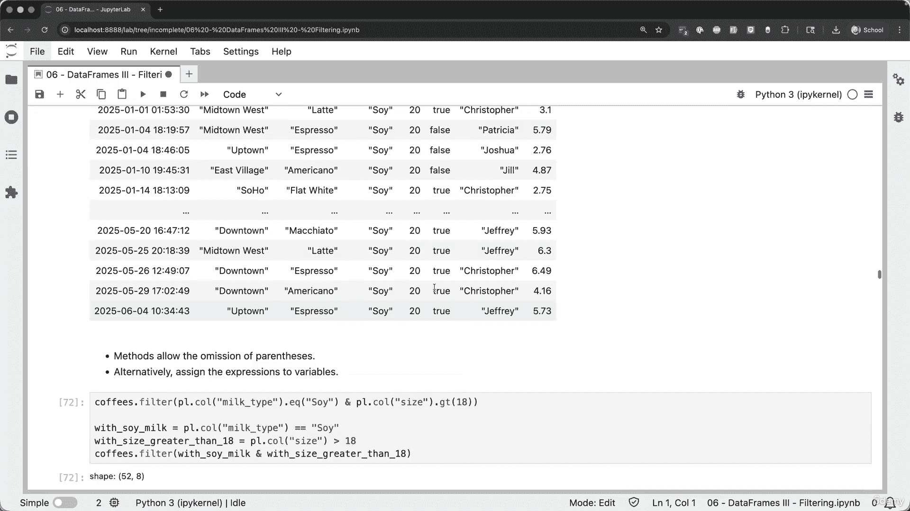

另一种解决方案是，把你的表达式提取到独立的变量里。如果你使用变量，就不会有任何混淆问题。

你可以这样做，定义一个变量叫 with_soy_milk，然后把之前的完整声明复制过来，记得不要加括号。这样就创建了一个独立的 Polars 表达式。

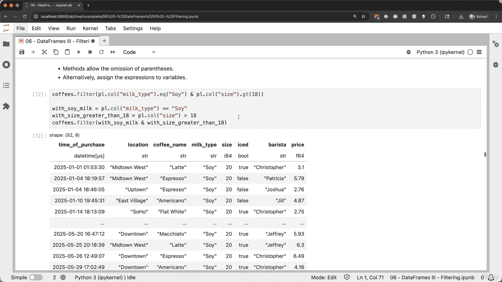

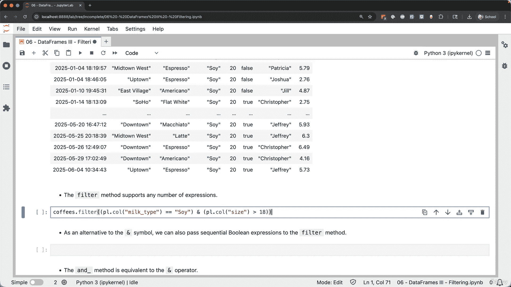

这个设计的一个美妙之处在于，因为你有了变量赋值，就可以在多个 filter 方法调用中重复使用这些表达式。这些表达式完全独立于它们将被使用的数据框，也独立于它们将被使用的 filter 方法调用。

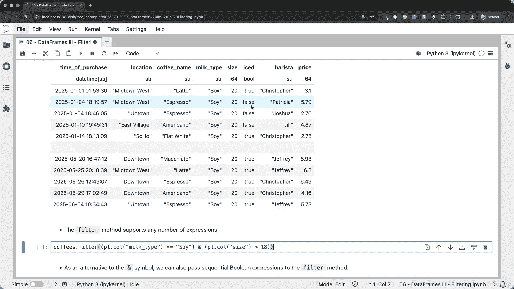

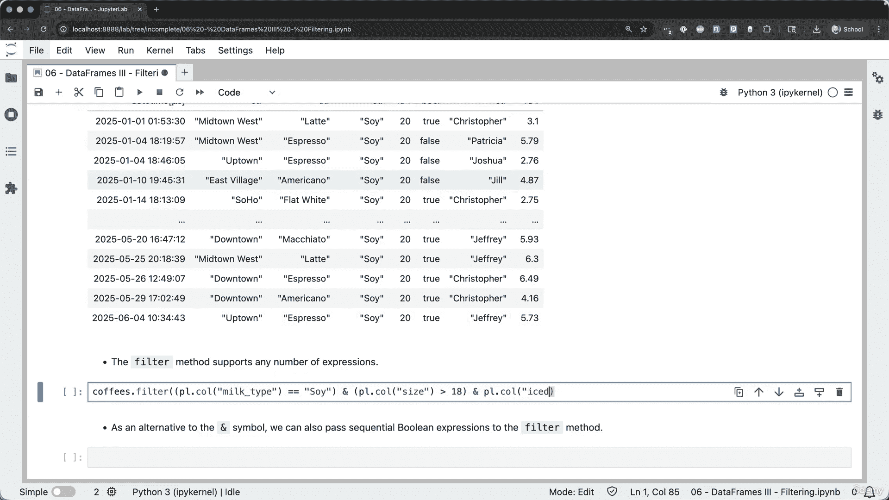

换句话说，内联写法完全没问题，但表达式本身是独立存在的。如果你想做另一个筛选，查找牛奶类型为 "soy" 的行，你就不需要再把它输入一遍，而是可以直接复用这个变量。这是这种方法的一个优势。

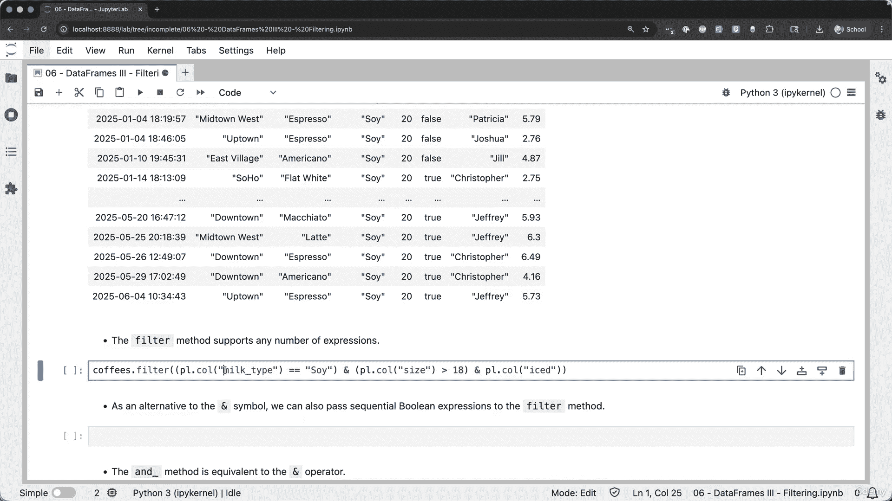

这里是第二个变量声明，我会把它命名为 with_size_greater_than_18，再复制一遍这个表达式，同样不要括号。然后在 filter 方法中，把这两个布尔表达式都提供出来，每个表达式由各自独立的变量表示。我会在中间加上与号运算符，也就是与号符号，第二个条件就是这个变量。这样应该会给我们同样的数据框：牛奶类型列的每个值都是 "soy"，容量列的每个值都大于 18。


## 5. 组合三个或更多布尔表达式

我们不局限于两个布尔表达式，可以组合任意多个条件。

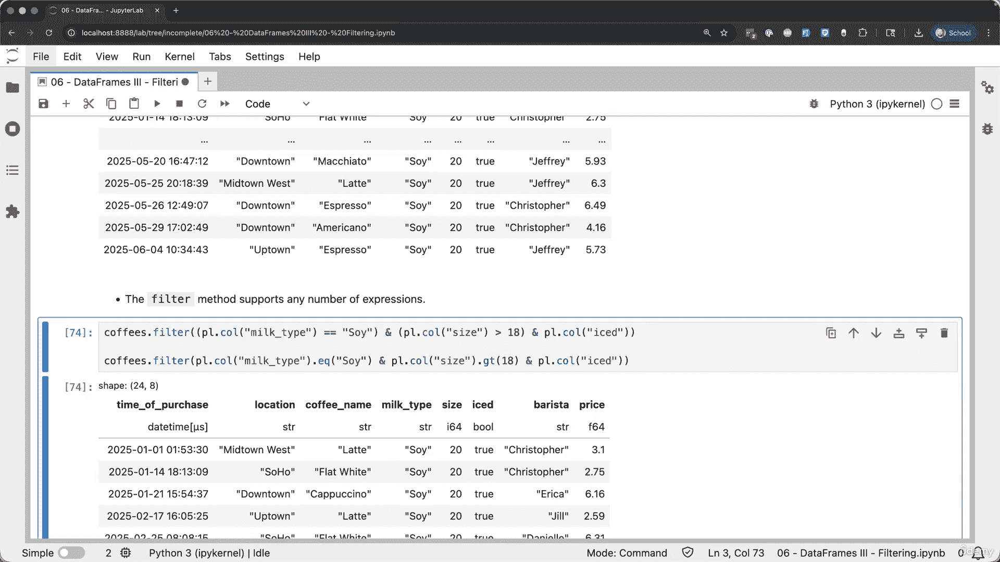

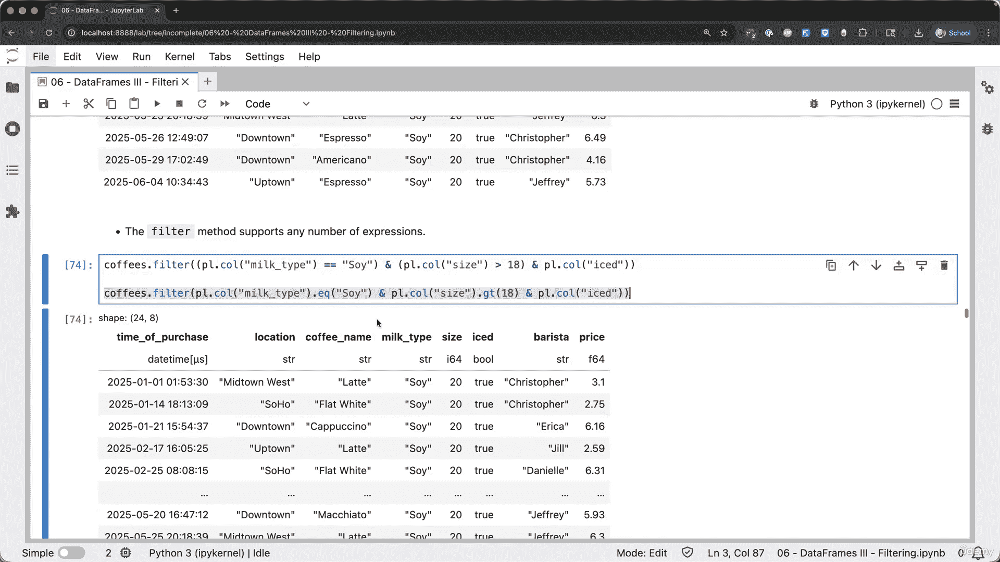

继续往下看，我们试着添加三个独立的标准。比如，除了原来的两个条件之外，我想再加上一个新表达式：冰色列的值必须是 True。这也是一个布尔列，所以不需要任何额外的语法，直接针对冰色列即可。

现在我们有三个独立的表达式：

- 牛奶类型必须是 "soy"
- 容量必须大于 18
- 冰色列的值必须是 True

注意，我用与号符号把每个表达式都分隔开。第一个必须为真，第二个必须为真，第三个也必须为真。如果你想用等价的方法形式来重写，大概长这样：

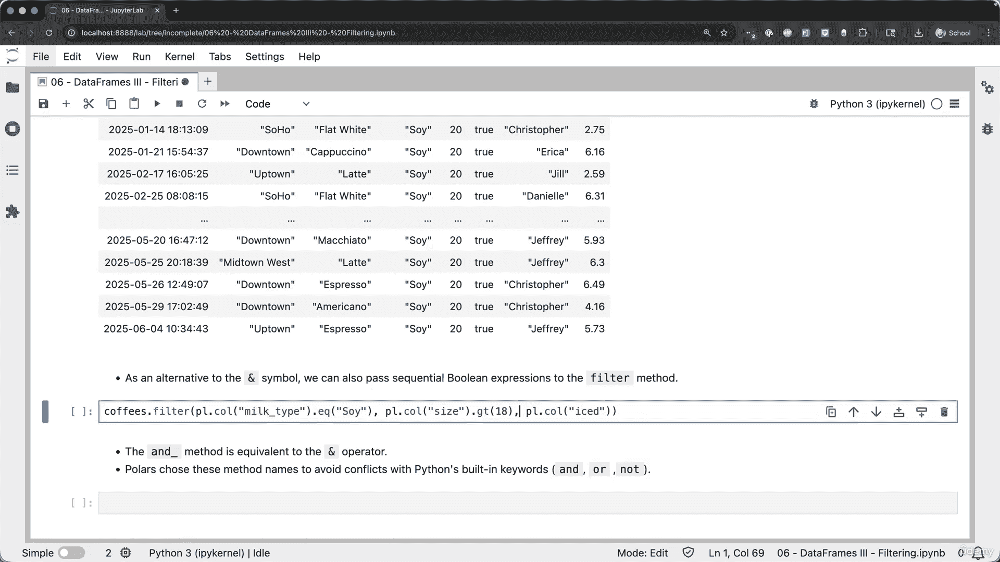

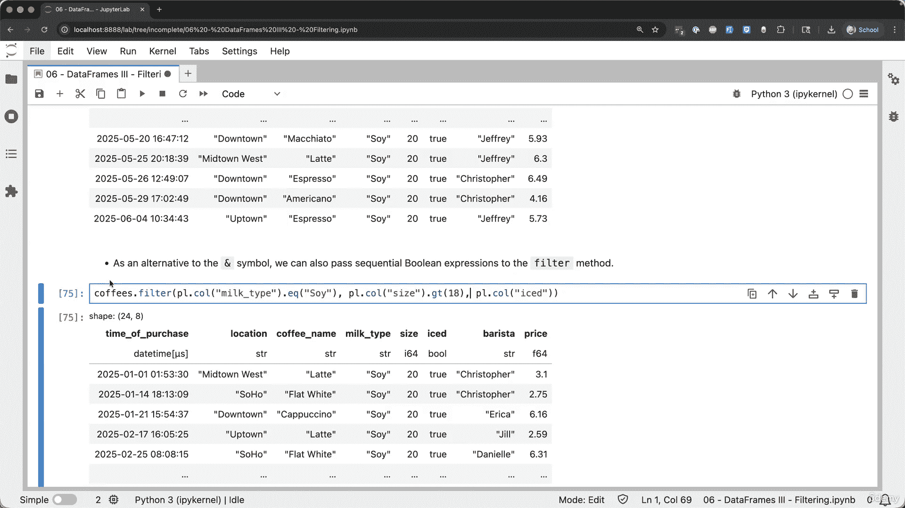

```python
pl.col("milk_type").eq("soy") & pl.col("size").gt(18) & pl.col("iced").eq(True)
```

去掉括号，调用 eq 方法，保留与号，稍后我们会再回来讨论这个符号，因为相信或者不相信，这里其实也有对应的方法可以使用。接着调用 gt 方法，再处理 iced 列。这样就能得到完全相同的结果。


## 6. 将布尔表达式作为参数顺序传递给 filter

这个功能还可以更强大。如果你不喜欢用与号符号来做 AND 逻辑，其实可以把布尔表达式作为顺序参数直接传给 filter 方法本身。

具体做法是，不用与号连接，而是在 filter 方法里用逗号分隔，把三个独立的布尔表达式作为三个顺序参数传进去。这里的默认逻辑就是 AND 逻辑，所以会返回完全一样的数据框。Polars 会筛选出咖啡数据框中同时满足这三个独立标准的所有行。


## 7. 使用 and_ 方法

最后，还有另一种替代与号符号的方法，那就是我之前暗示过的 and 方法。有趣的是，这个方法名以下划线结尾。Polars 团队做这个开发决定，是为了避免与 Python 内置关键字冲突，Python 语言本身有 and 关键字用来执行 AND 逻辑。

为了避免混淆和技术问题，这个方法就叫 and，后面跟一个下划线。下划线只是一个合法字符，是方法名的常规部分，语法有点特别，但功能非常强大。

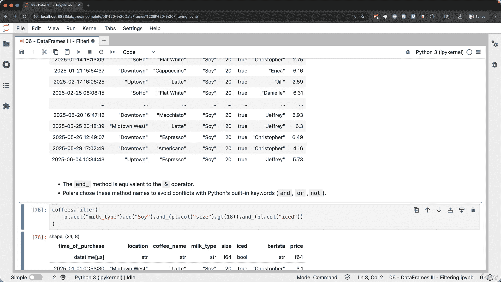

and 方法是怎么工作的呢？我们把刚才的代码贴过来。不用与号运算符，也不用把表达式作为顺序参数传给 filter 方法，这两种方式都完全有效。取而代之的是，我要链式调用一个 and 方法，方法名里包含那个下划线。然后传给 and 方法的参数，就是下一个表达式。

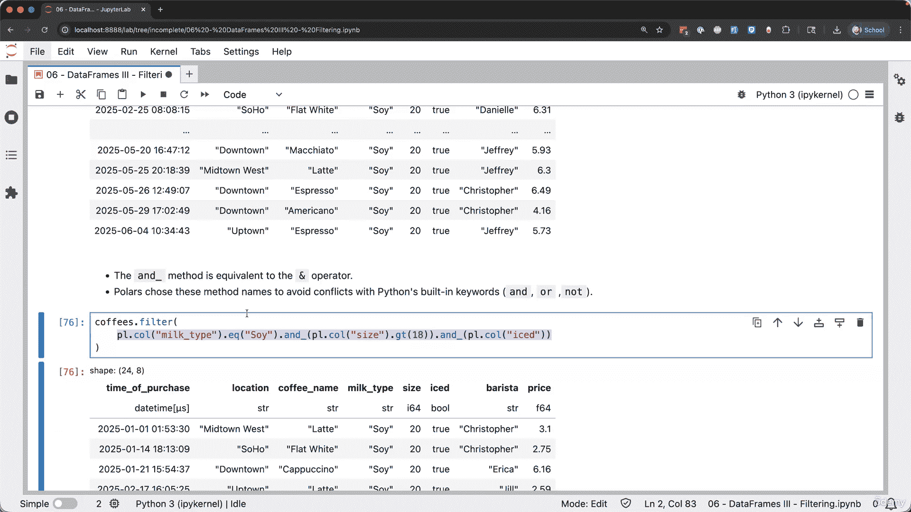

这样实际上会创建一个全新的表达式。整个 Polars 都建立在同样的理念之上：我们在构建一个表达式，也许把它和第二个表达式组合，然后得到第三个表达式。我们只是在构建这些独立的积木块，然后可以把它们合并或合并在一起，创造出新的积木块。

所以这是一个有效的表达式。然后对每个表达式，我都会再加一个 and 方法。我会链式调用这个方法，然后传入我的第三个表达式。现在我构建了一个非常复杂的表达式，filter 方法会把这个单一表达式拿进去，给我和上面完全一样的结果。

为了向你证明这一切，我把传给 filter 方法的所有内容都复制下来，粘贴到下面的单元格里。输出时你会看到，这是一个 Polars 表达式。我甚至可以把整行传给 Python 内置的 type 函数，它会告诉我们这是一个 Polars 表达式。

也就是说，一切都是积木块，一切都是表达式，我们把两个表达式组合在一起，传入某个上下文，也就是某个强制执行它们的方法，比如 select、with_columns，或者像这里这样的 filter，这就是真正执行表达式并得到结果的方式。


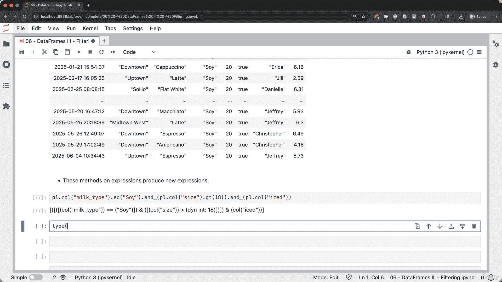

## 8. 总结与建议

到目前为止，我们学习了多种不同的方式来执行 AND 逻辑，把多个独立的条件或标准组合起来，从数据框中提取目标行。我们可以使用与号运算符，可以使用 and_ 方法，也可以把这些值作为顺序参数传给 filter 方法。除此之外，构建布尔表达式的实际方式也有各自的变体，你可以使用等号运算符和大于号运算符这样的符号，也可以使用 eq 和 gt 这样的等价方法。

找到对你来说最不 confusing、最享受的语法，然后坚持使用就好。所有这些都是有效、强大的选项，在 Polars 中运行速度和效率完全一样。Polars 只是给我们提供了很多不同、强大且灵活的方式来执行完全相同的逻辑。

最后提醒一下，如果你选择基于运算符的方法，为了隔离表达式，清楚地告诉 Python 表达式从哪里开始、到哪里结束，请务必把表达式用括号包起来。如果忘记了也没关系，输出中通常会看到错误，提示你只需要把表达式包在括号里，或者切换到不需要括号的替代语法方式。

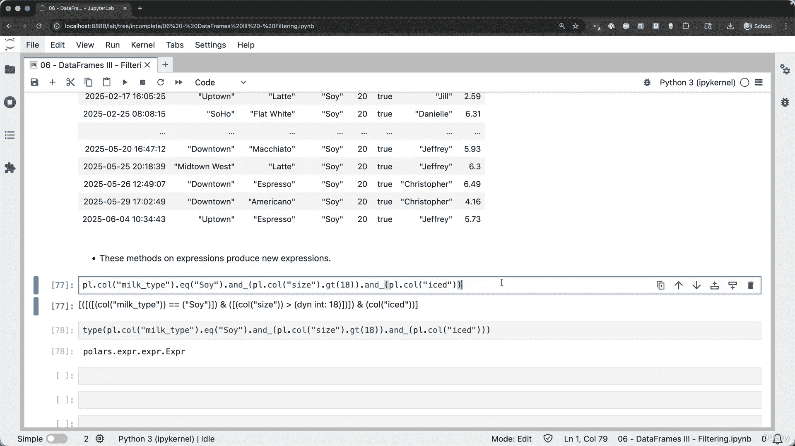

本节课中我们一起学习了如何在 Polars 中使用 AND 逻辑筛选多个条件，包括与号运算符、括号的必要性、方法等价物、独立变量、多条件组合、顺序参数传递以及 and_ 方法等多种写法。希望这些内容能帮助你更灵活地处理数据筛选任务，我们下节课见。

