Polars 数据分析与 Python 入门教程：P88：关键字参数过滤 🔍


在本节课中，我们将学习如何使用 Polars 库的过滤方法中的另一种写法，也就是通过关键字参数来过滤数据。我们会先看看这种方法的基本语法，然后对比它和常用表达式写法之间的区别，接着学习如何一次设置多个过滤条件，最后了解在处理布尔列时需要注意的细节。虽然 Polars 官方团队并不推荐这种写法，但在阅读他人代码时你依然可能会遇到，因此了解它的语法是非常必要的。接下来我们就从基础概念开始，逐步拆解这个功能的使用方式。


什么是关键字参数过滤


在 Polars 中，过滤数据最常用的方式是编写表达式，但 filter 方法还支持一种更直接的替代写法。你可以把想要过滤的列名当作关键字参数，把想要匹配的值当作该关键字参数的值，两者之间用等号连接。这种方式本质上是把列名和目标值配对传给 filter 方法，让 Polars 自动执行相等比较，只保留满足条件的行。

以下是关键字参数过滤的基本代码结构：

```python
df.filter(列名 = 值)
```

上面的代码中，列名代表你要过滤的那一列，值代表你希望该列中保留的内容。调用 filter 方法后，Polars 会逐行检查，仅保留该列值等于指定值的行，其余行会被丢弃。这种写法看起来非常直观，不需要写复杂的判断表达式，直接指定列名和目标值即可完成过滤。


单列过滤示例


上一节我们介绍了如何用表达式来过滤数据，本节我们来看看用关键字参数怎么做。假设你有一个咖啡购买记录的数据框，其中包含 location 列，你想只保留地点为 uptown 的所有行。这时可以把 location 作为关键字参数，把 uptown 作为它的值传给 filter 方法。

以下是具体的代码写法：

```python
df.filter(location = "uptown")
```

运行这段代码后，你会得到一个新的数据框，里面所有行的 location 列值都是 uptown。这种写法看起来非常简洁，不需要写复杂的表达式，直接指定列名和目标值即可完成过滤。对于初学者来说，这种语法更容易理解，因为它和日常设置参数的习惯比较接近。


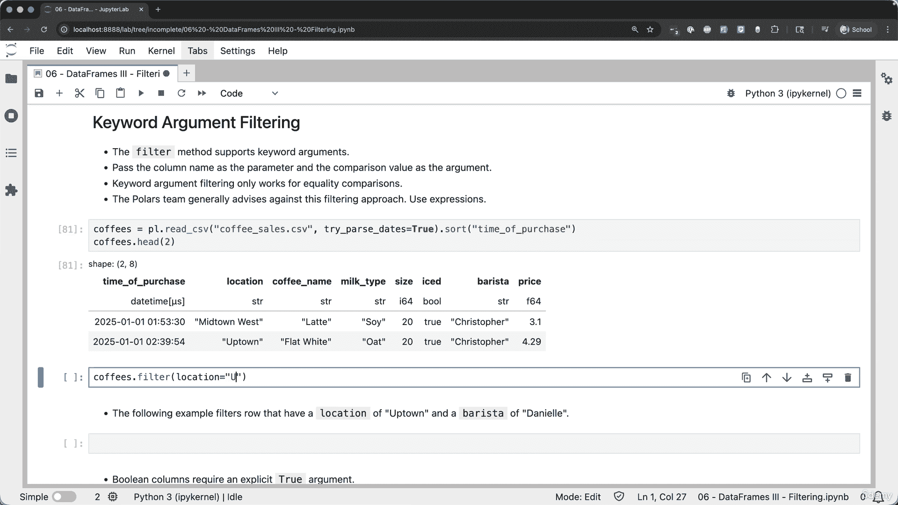

表达式写法的对比


刚才展示的关键字参数写法虽然简单，但 Polars 团队通常不建议大家在日常工作中使用它。他们更推荐始终使用表达式，因为表达式可以重复使用，也更容易根据需要进行自定义修改。不过，为了让你在看到他人代码时能看懂，我们还是需要了解这种语法，避免在实际项目中产生困惑。

同样的过滤需求，如果使用更符合 Polars 惯例的表达式写法，代码会是这样：

```python
df.filter(pl.col("location") == "uptown")
```

这两种写法的结果是一样的，都会筛选出 location 列等于 uptown 的行。不过表达式写法稍微长一点，看起来不够简洁，但它的灵活性更高，方便之后加入更多判断条件。相比之下，关键字参数写法虽然代量较少，但可扩展性较差，不适合处理复杂的过滤逻辑。


多条件过滤示例


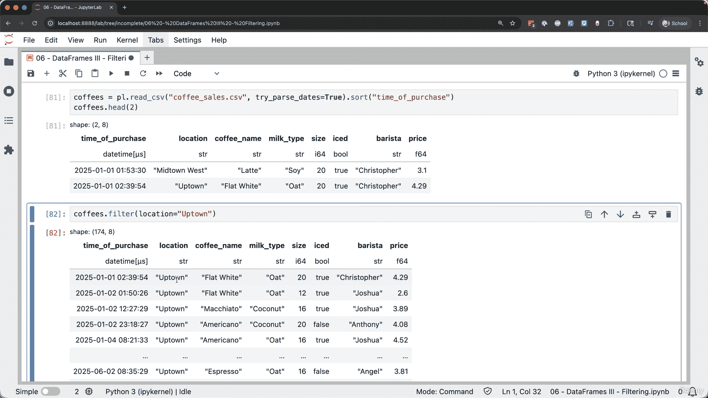

除了过滤单个条件，你也可以一次传入多个关键字参数给 filter 方法。当你提供多个关键字参数时，Polars 会对这些条件应用与逻辑，也就是说，只有同时满足所有条件的行才会被保留。比如你想筛选出地点为 uptown 且咖啡师为 Danielle 的记录，就可以同时传入这两个关键字参数，Polars 会自动帮你完成多条件的组合判断。

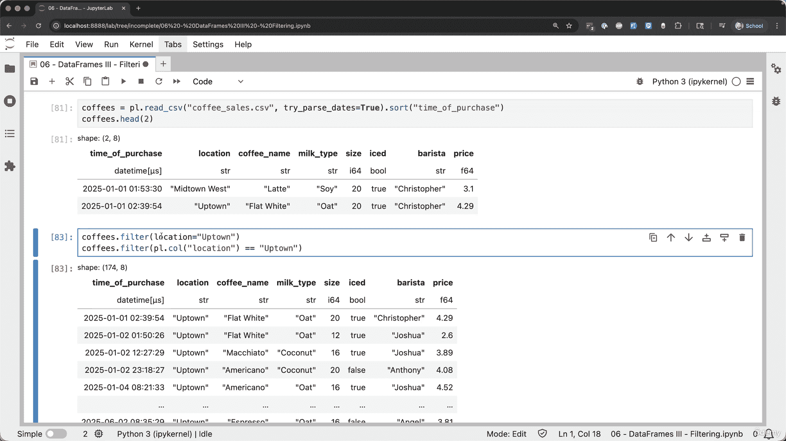

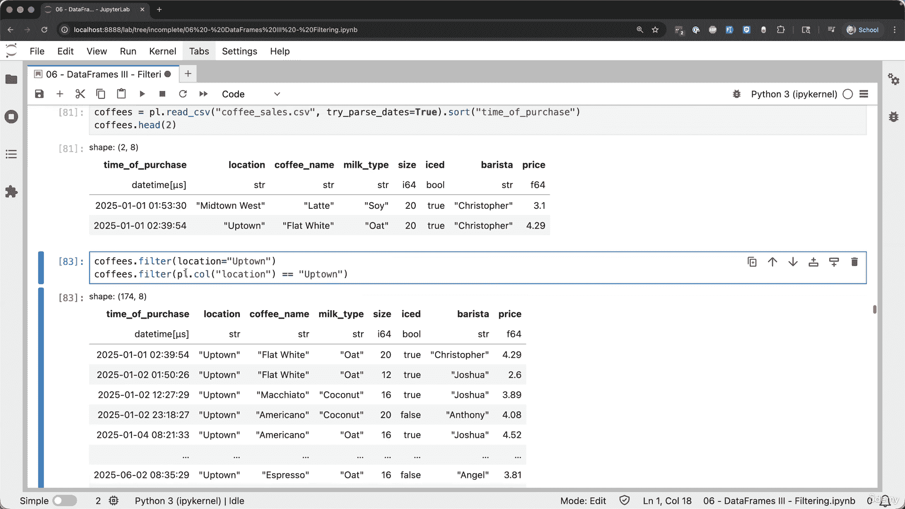

以下是多条件过滤的代码示例：

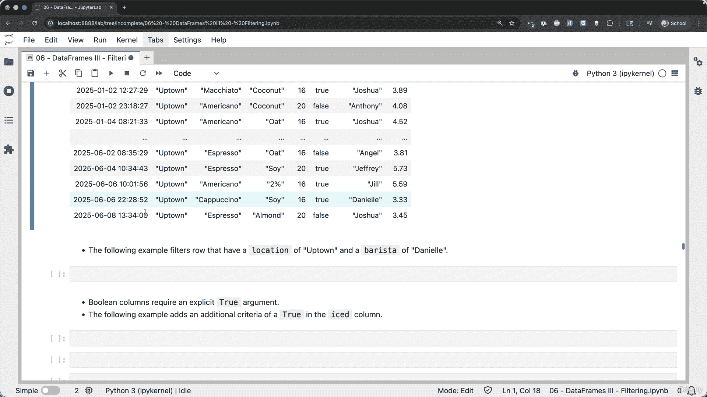

```python
df.filter(location = "uptown", barista = "Danielle")
```

执行这段代码后，得到的数据框中只会包含那些既在 uptown 地点、又由 Danielle 制作的购买记录。这里的两个条件之间默认是与关系，你不需要额外写 and 关键字，也不需要手动组合表达式，代码看起来非常整洁。


关键字参数过滤的限制


使用关键字参数过滤时有一个重要限制，那就是它只支持严格的相等比较。你不能用它来做不等于、小于、大于，或者包含某个子串之类的判断。也就是说，你只能检查列值是否完全等于某个固定值，不能做更复杂的比较。如果你尝试传入其他运算符，程序会报错或无法按预期工作。

以下是不支持的比较操作示例：

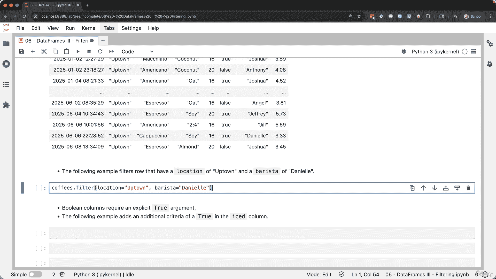

- 不等于比较，例如检查地点不是 downtown
- 大于比较，例如检查价格大于 10
- 小于比较，例如检查年龄小于 30
- 包含判断，例如检查名字是否包含 John

因为这种语法本质上就是 Python 的关键字参数传递，它只能处理键值对形式的等值匹配，无法表达范围判断或模糊匹配等需求。如果你需要这些功能，必须回到表达式写法。


布尔列的特殊处理


最后还有一点需要注意，如果你要过滤的是布尔列，比如 iced 列，你必须同时提供完整的列名和具体的布尔值，不能只写列名。这是因为关键字参数本质上是参数名和参数值的配对，单纯传一个列名不足以告诉 Polars 你想匹配哪个值，系统无法推断你要找的是 True 还是 False。

以下是布尔列过滤的正确写法：

```python
df.filter(location = "uptown", barista = "Danielle", iced = True)
```

这里的 iced = True 表示只保留 iced 列值为真（即 True）的行。如果你只写 iced，Polars 会报错，因为它不知道你想找的是 True 还是 False。相比之下，如果使用表达式写法，直接传入针对 iced 列的表达式即可自动生成布尔条件，但在这种基于 Python 原生参数传递的写法里，你必须明确写出等号和具体的 True 值。


最终结果示例


把前面的内容串联起来，当你同时指定 location 为 uptown、barista 为 Danielle、iced 为 True 时，Polars 会返回所有在 uptown 地点、由 Danielle 制作、并且是冰饮的交易记录。这三个条件之间都是与逻辑，只有三者同时满足的行才会出现在最终结果中，帮你快速锁定符合特定场景的数据。

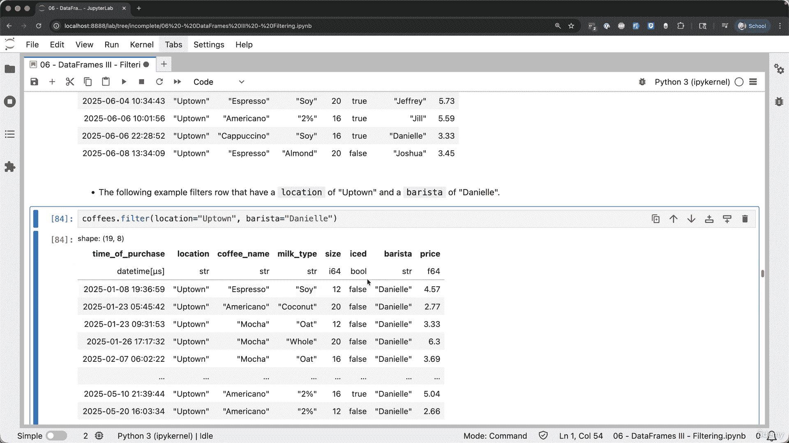

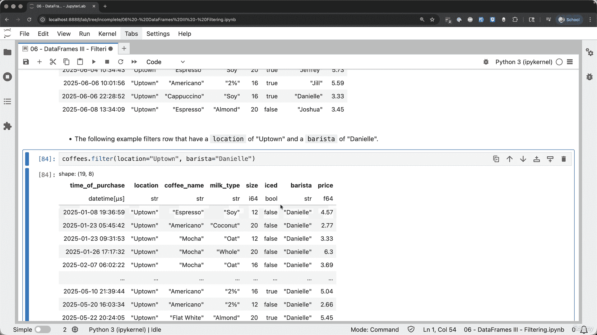

以下是完整的代码示例：

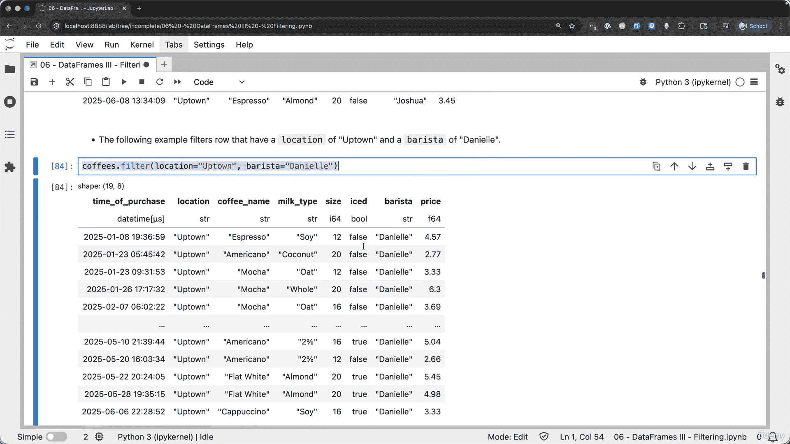

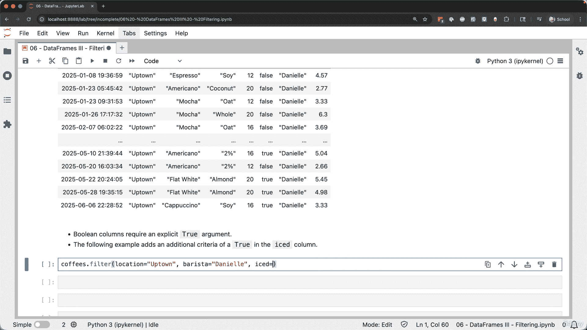

```python
df.filter(location = "uptown", barista = "Danielle", iced = True)
```

运行后，你会得到一张精简后的数据框，里面每一行都同时满足这三个条件。这就是使用关键字参数进行过滤的完整过程，从单列过滤到多条件组合，再到布尔列的特殊处理，都在上面的代码中体现出来了。


本节总结


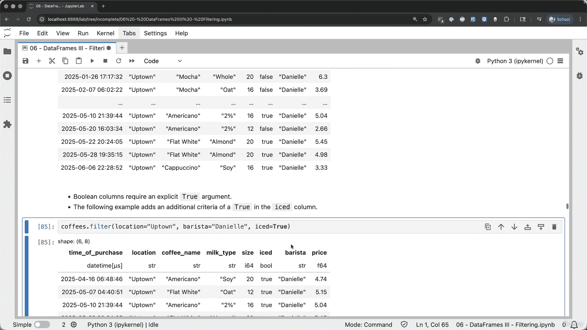

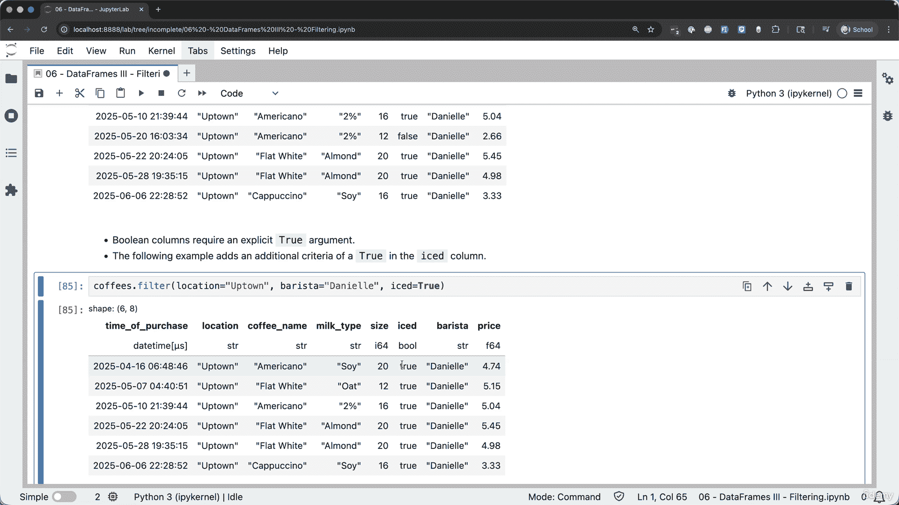

在本节课中，我们一起学习了 Polars 中使用关键字参数过滤数据的方法。首先介绍了通过 filter 方法传入列名和值来实现等值过滤的基本写法，然后展示了等价的表达式写法并说明了两者的区别，接着讲解了如何一次传入多个关键字参数来实现与逻辑的多条件过滤，最后特别指出了布尔列需要明确指定 True 或 False 值的细节。虽然 Polars 团队更推荐使用表达式，但掌握这种语法可以帮助你更好地阅读和理解他人的代码，在实际工作中遇到类似写法时也不会感到陌生。
