# Data Analysis with Polars and Python：89：🔀 应用 Or 逻辑

## 课程概述

在本节课中我们将要学习如何在 Polars 中应用 Or 逻辑，用来筛选满足多个条件中的任意一个条件的数据行。上一节课中我们介绍了多种应用 And 逻辑的方式，也就是要求所有条件都必须成立的情况。本节中我们来看看 Or 逻辑，它的要求会宽松一些，只需要满足其中一个条件即可。接下来我们会先解释 Or 逻辑的基本含义，然后通过实际代码示例展示如何在 Polars 中写出这样的筛选条件，最后介绍几种不同的写法，包括符号写法、方法写法和变量写法，让你可以根据自己的喜好选择最合适的方式。

## 什么是 Or 逻辑

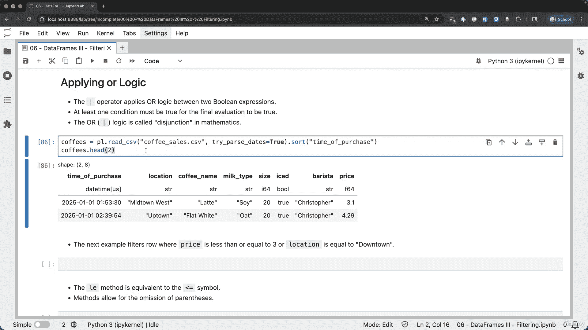

Or 逻辑指的是 either-or 逻辑，也就是说要么满足这个条件，要么满足那个条件，但不一定非要两个条件同时都满足。和之前学过的 And 逻辑相比，Or 逻辑是一种不那么严格的筛选方式，它允许我们选出这一组符合条件的行，或者另一组符合条件的行。在 Polars 当中，只要某一行满足至少一个条件，它就会被保留下来，并且 Polars 会把所有满足条件的行合并在一起。在这一节中我们要使用的符号是竖线符号 `|`，这就是 Or 操作符，用来连接两个不同的筛选条件。

以下是 Or 逻辑的核心含义：

- 满足条件 A 即可保留该行。
- 满足条件 B 即可保留该行。
- 条件 A 和条件 B 同时满足也可以保留该行。

换句话说，只要有一个条件成立，这一行就会进入最终的结果集，这和 And 逻辑要求所有条件都必须成立有明显的区别。

## 重新执行导入代码

在开始写具体的筛选代码之前，我们先把之前用过的导入代码重新运行一遍。这一步是为了确保运行环境中已经加载了 Polars 库，并且我们要分析的数据集，也就是咖啡数据集，已经准备就绪，后面才能顺利地进行筛选操作。

```python
import polars as pl

# 假设 coffee 是已经加载好的 DataFrame
# coffee = pl.read_csv("coffee.csv")
```

## 使用竖线符号编写 Or 条件

假设我们想要筛选出那些满足以下任意一个条件的行：价格小于等于 3，或者地点等于 downtown。这里依然会使用 filter 方法，这是 Polars DataFrame 上最常用的筛选工具。

我们先写第一个表达式，针对 price 列，使用小于等于运算符，把它和数值 3 进行比较。然后我们想要在这里应用 Or 操作符，就像 And 操作符使用单个与号 `&` 连接不同表达式一样，Or 操作符也是在两个不同表达式之间放一个单独的竖线符号。在竖线符号的右边，我们再加上第二个表达式，即判断 location 列的值是否等于 downtown，这里使用相等运算符。

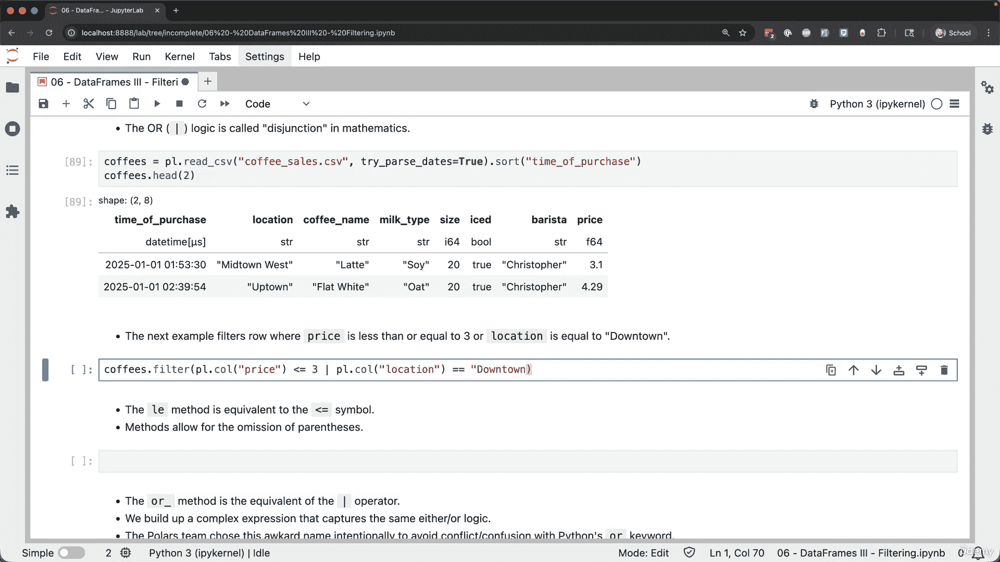

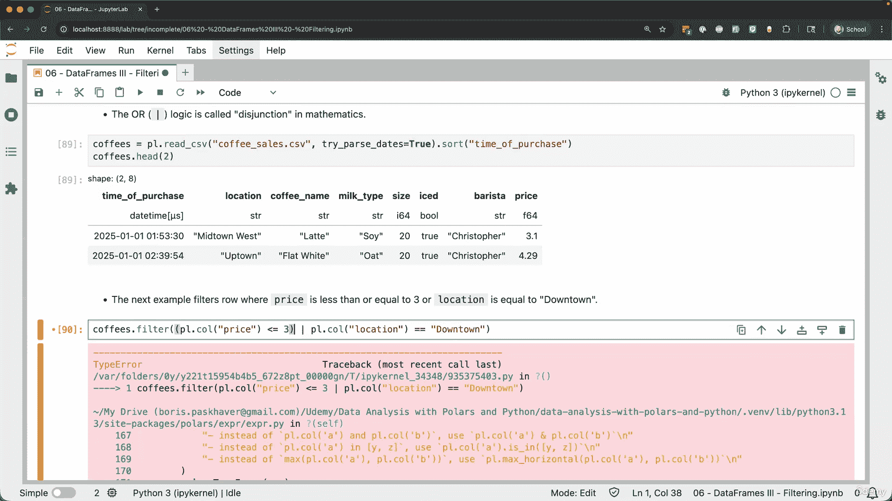

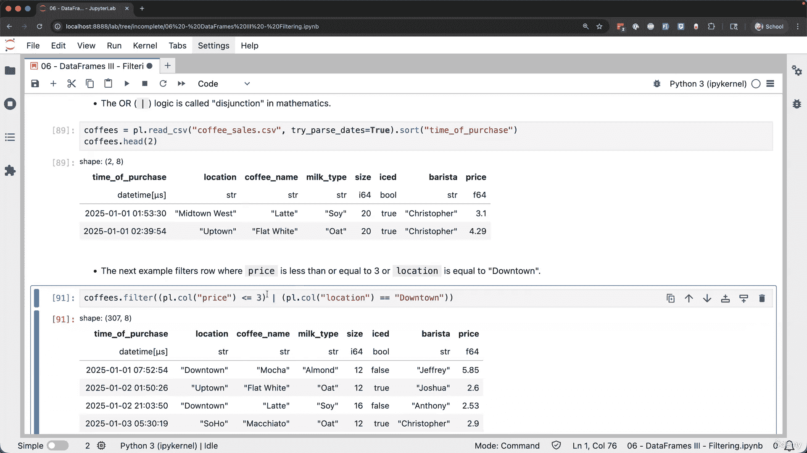

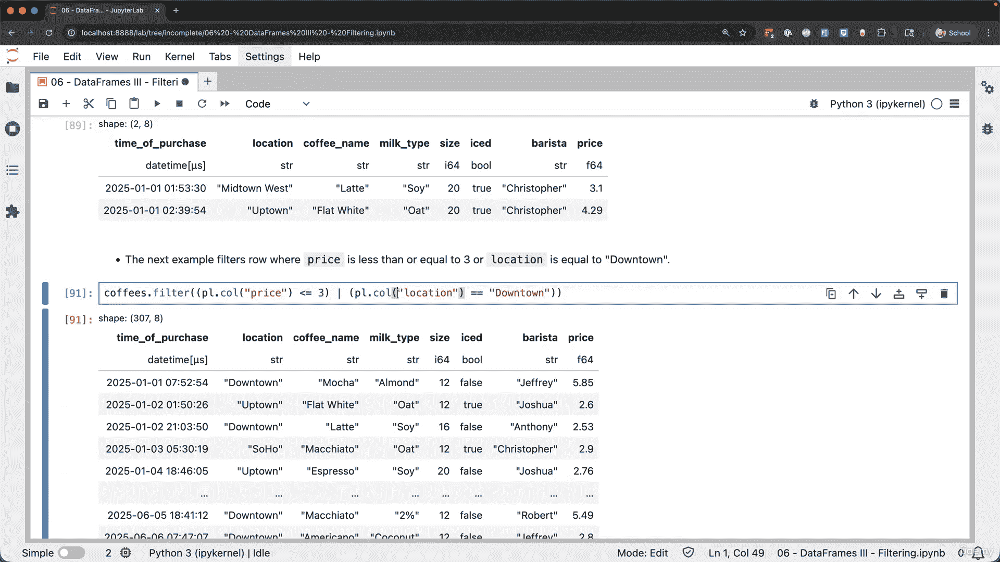

如果我们直接尝试运行这段代码，大概率会运行出错，而且 Polars 会提示它无法搞清楚这里面到底在发生什么，也分辨不出每个表达式从哪里开始、到哪里结束。解决这个语法问题的方法很简单，就是给每个表达式各自加上一对圆括号，把它们包起来。加上括号之后，我们确实筛选出了任何满足这两个条件之一或两者都满足的行。

下面是带括号的完整写法：

```python
# 符号写法，每个表达式都用括号包裹
result = coffee.filter(
    (pl.col("price") <= 3) | (pl.col("location") == "downtown")
)
```

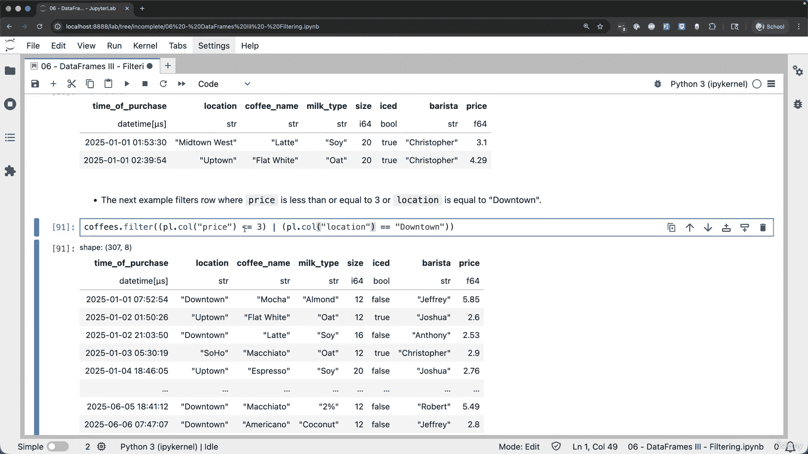

筛选出来的结果可能包含价格不小于等于 3，但地点是 downtown 的行；同样也可能包含地点不是 downtown，但价格小于等于 3 的行；最后还会包含两个条件都同时满足的行。但请注意，两个条件同时满足并不是一个严格的要求，我们只需要这两个条件中的任何一个成立就可以了。

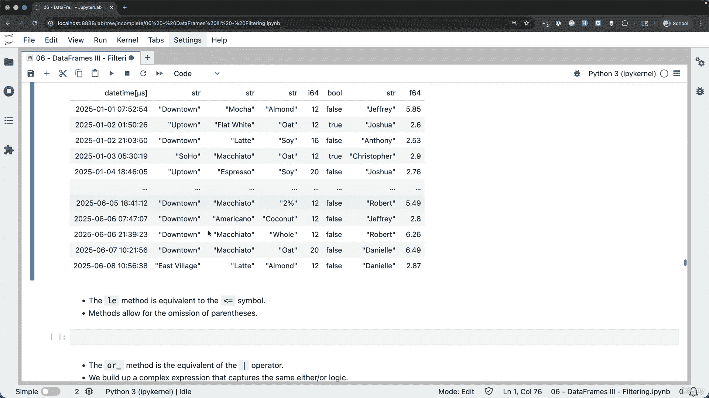

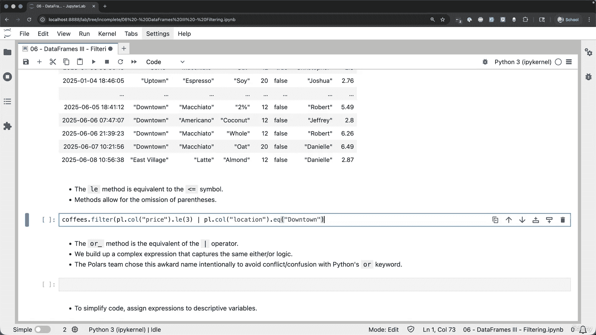

## 使用方法式写法简化代码

如果你愿意，也可以把代码简化为使用方法式的方法，也就是方法调用的写法。方法式写法的一个好处是可以省略掉圆括号，让代码看起来更简洁一些。

具体做法是，把刚才代码里的圆括号去掉，然后把小于等于的比较替换成方法调用。小于等于对应的方法名是 `le`，所以我们可以写成 `le(3)`。竖线符号保留不变，然后把第二个部分更新成 `eq` 方法，`eq` 就是 equality 的缩写，表示相等。最后要确保 `eq` 方法有一个右括号，外面的 `filter` 方法也要有一个右括号。

下面是简化后的方法式写法：

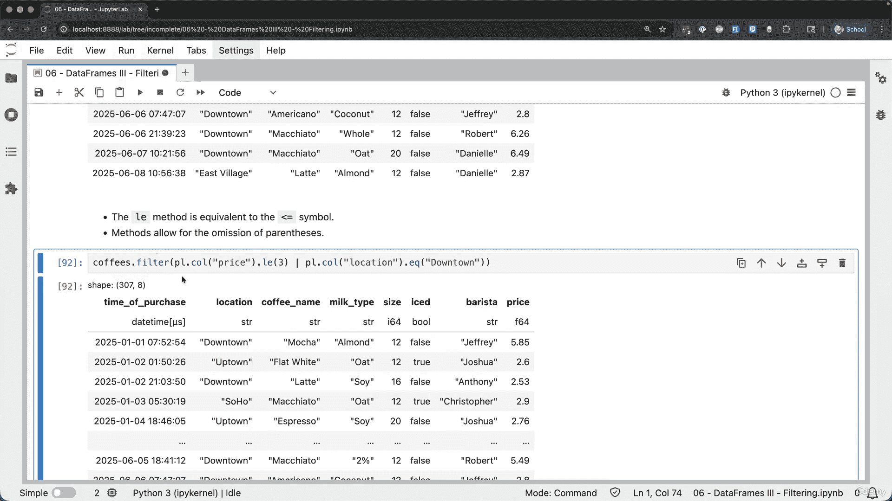

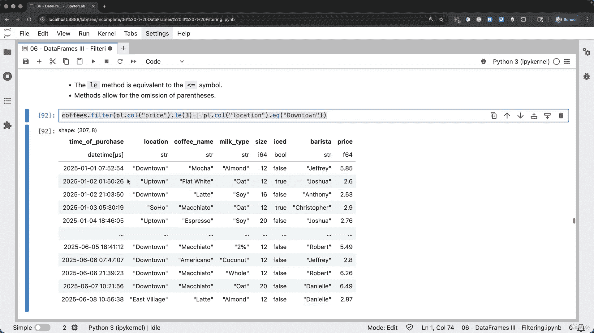

```python
# 方法式写法，无需额外括号
result = coffee.filter(pl.col("price").le(3) | pl.col("location").eq("downtown"))
```

这段代码会产生和上面带括号的写法完全一样的结果集。

## 使用 or_ 方法

在更早之前，我们见过一种用来应用 And 逻辑的方法式写法，那就是 `and_` 方法，它接受一个表达式作为参数，沿着这条思路一步步构建出更复杂的表达式。这里有一个互补的 `or_` 方法，如果你更偏好完全方法式的写法，可以用它来替换竖线符号。

我们先复制刚才写过的那行代码。如果你想采用完全方法式的写法，可以先构建一个表达式，也就是左边这部分完整的内容，在 Polars 中这整个东西就是一个 Polars 表达式。然后在这个表达式上调用一个叫作 `or_` 的方法。这里的下划线再次强调，它是方法名称的一部分，Polars 团队这么命名是因为 Python 原生就有一个 `or` 关键字，这样做是为了避免混淆，同时也能避免可能出现的技术问题。

调用 `or_` 方法之后，把右边的另一个表达式作为参数传进去，这时候还需要再补一个右括号来关闭方法调用。整体来看，这行代码做的事情是从一个表达式开始，使用 Or 修饰符，接受另一个表达式作为参数，最终构建出第三个表达式，用来表示价格小于等于 3 或者地点等于 downtown。

```python
# or_ 方法写法
result = coffee.filter(
    pl.col("price").le(3).or_(pl.col("location").eq("downtown"))
)
```

运行之后，我们会得到和之前提到过的完全一样的数据框。

## 将筛选条件赋值给变量

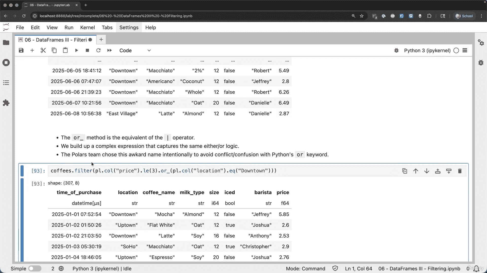

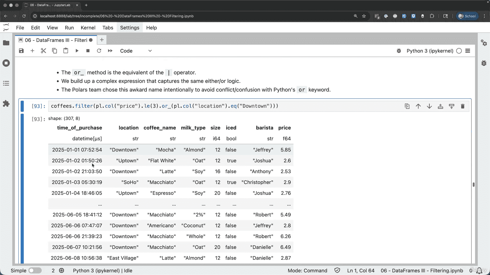

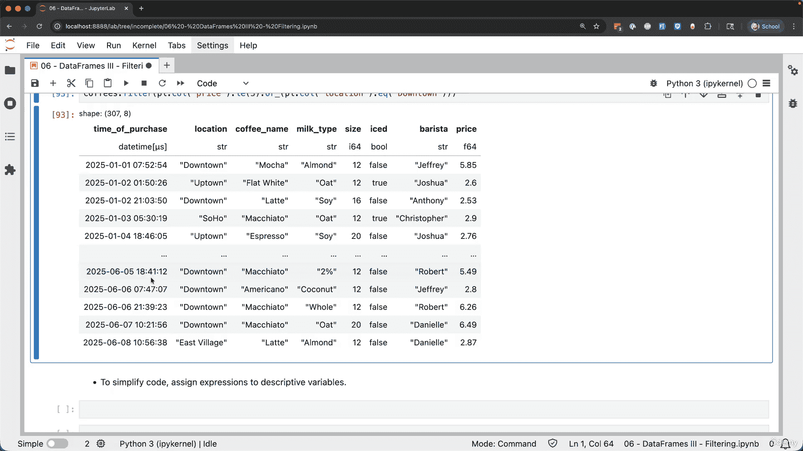

如果你想让筛选逻辑更简单，并且方便在多个地方复用，我推荐的做法是把所有的逻辑表达式，换句话说就是所有的筛选条件，赋值给描述性的变量名。比如，我们可以把之前的代码重新写一遍，只不过这次把每个表达式分别赋值给一个变量，第一个变量可以叫作 `cheap_coffee`。

```python
cheap_coffee = pl.col("price").le(3)
```

把表达式赋值给变量之后，我们就不需要再担心括号的问题了，因为表达式本身已经完整声明，并且赋值给了变量，Polars 在后续使用竖线符号放到 `filter` 方法里面时，能够清楚地分辨出每个表达式的边界。同样地，我们再定义一个变量 `in_downtown`，针对 location 列，使用相等运算符把它和 `"downtown"` 进行比较。

```python
in_downtown = pl.col("location").eq("downtown")
```

现在我们可以在 `coffee` 数据框里筛选出任何满足 `cheap_coffee` 表达式或者 `in_downtown` 表达式的行，结果会和之前完全一样。

```python
# 变量写法
result = coffee.filter(cheap_coffee | in_downtown)
```

当然，你也可以混合使用自己偏好的语法。比如这里 `cheap_coffee` 变量本身就是一个有效的表达式对象，所以我们可以在这个变量上调用 `or_` 方法，再传入另一个表达式，最后关闭 `filter` 方法。

```python
# 混合写法
result = coffee.filter(cheap_coffee.or_(in_downtown))
```

## 课程总结

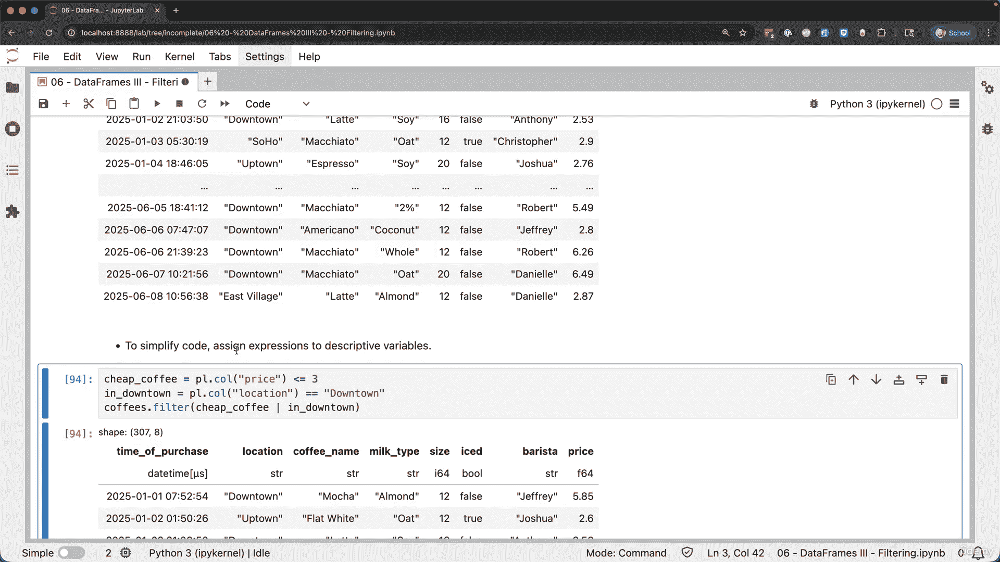

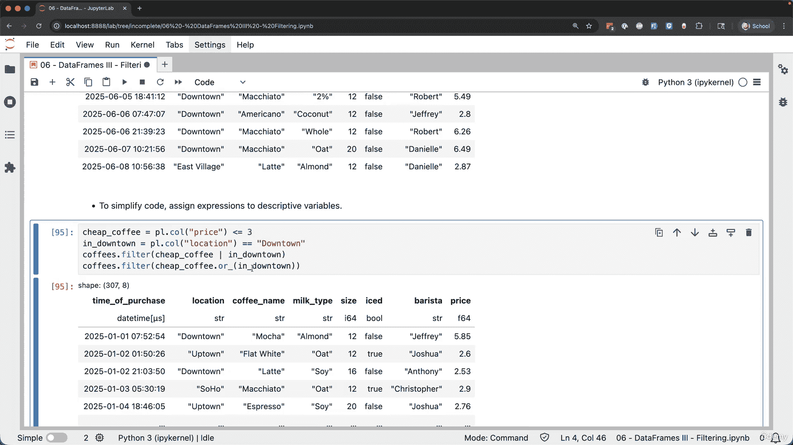

本节课中我们一起学习了在 Polars 中如何应用 Or 逻辑。Polars 里有很多不同的方式可以实现完全相同的筛选逻辑，但这一课始终如一的关键点是引入了 Or 操作符，也就是竖线符号 `|`，或者配套的 `or_` 方法。有了这些工具，我们就能够执行 either-or 逻辑，选出那些满足这个条件或者那个条件的行，而不需要两个条件都必须成立。本节内容就讲到这里，我们下一节课再见。

