Polars 数据分析：090：运算符优先级 🧮

在本节课中，我们将学习 Polars 中的运算符优先级问题。具体来说，我们会探讨当你在同一个过滤条件里同时使用“与”运算符和“或”运算符时，Polars 是如何决定先计算哪一部分的。你将看到一个实际的代码例子，理解为什么默认行为可能和你预想的不一样，并且学会如何使用括号来明确控制计算顺序。这对初学者来说非常重要，因为如果不清楚优先级，过滤数据时很容易得到错误的结果，甚至分析出错误的结论。

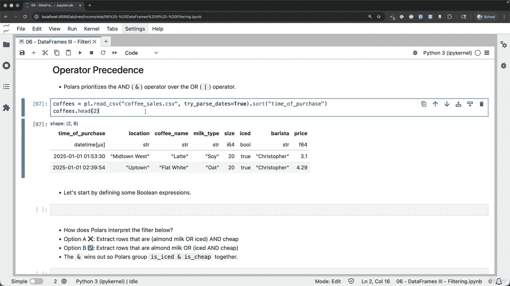

### 运算符优先级的基本规则

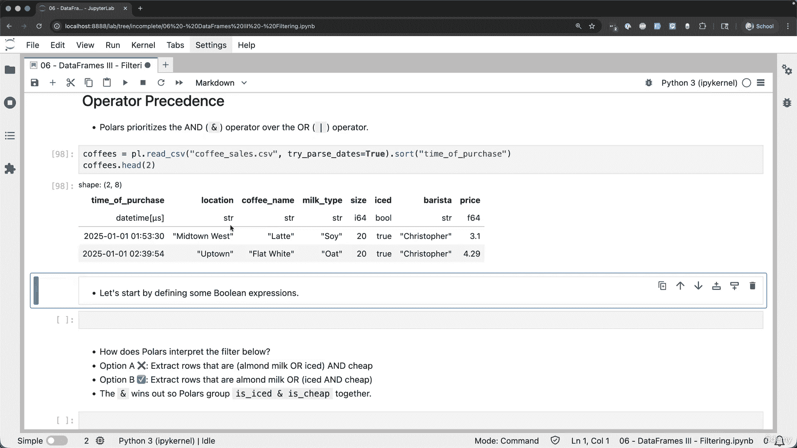

首先，我们来看看 Polars 处理逻辑运算符时的核心原则。

Polars 有一个非常明确的优先级规则。当表达式中同时出现 and 运算符和 or 运算符，而你又没有使用括号来说明顺序时，Polars 会优先处理 and 运算符。在代码中，and 运算符用符号 & 表示，而 or 运算符用符号 | 表示。这意味着，如果你写的是 A | B & C，Polars 会先计算 B & C，然后再把结果和 A 用 or 连接起来。这种设计是为了消除歧义，但如果你不了解这一点，很容易写出逻辑错误的代码，导致筛选出的数据与预期不符。

### 准备工作与变量定义

上一节我们介绍了 Polars 的优先级基本规则，本节中我们来看看如何通过代码来演示这个问题。

在开始之前，我们需要先运行导入代码，准备好数据分析所需的环境。导入完成后，我们定义三个变量，每个变量都保存一个 Polars 表达式。这三个变量分别用来检查牛奶类型、是否为冰饮，以及价格是否便宜。

以下是我们将要定义的三个表达式变量：

- `is_almond_milk`：检查“牛奶类型”列是否等于“杏仁奶”。可以使用 eq 方法，也可以直接用双等号 `==`，两者效果一样。
- `is_iced`：直接检查“冰饮”列，因为这一列本身已经是布尔值，不需要额外的方法。
- `is_cheap`：检查“价格”列，在调用中使用小于等于方法，判断价格是否小于等于 4。

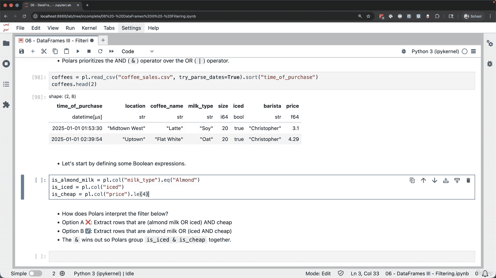

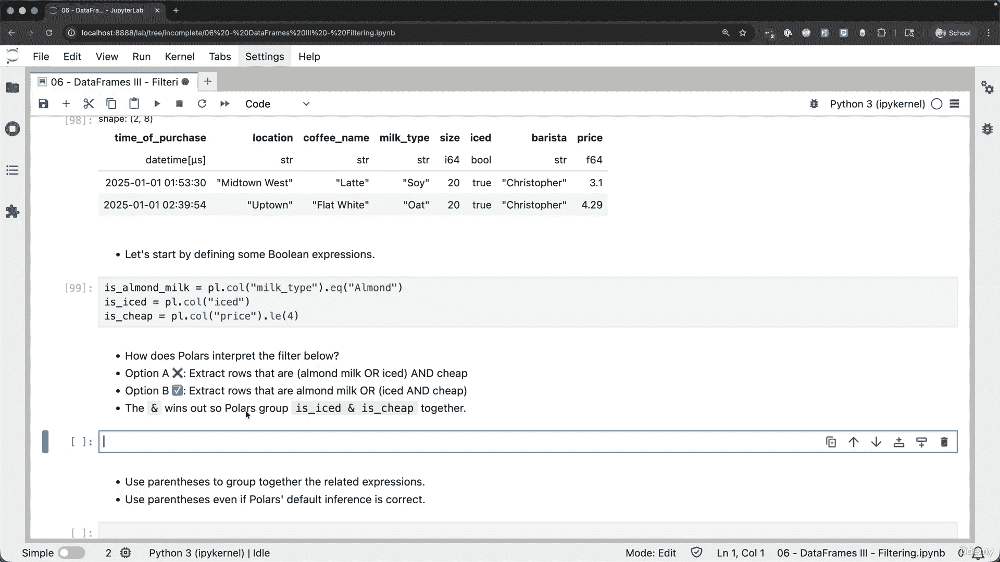

注意，这三个表达式是任意选取的，只是为了演示优先级问题，并不代表实际业务中的固定逻辑。

### 过滤数据时的歧义示例

定义好变量之后，我们来看看当把这些表达式组合在一起使用时，会出现什么样的理解困难。

假设我们对数据框调用 filter 方法，并写下这样一行代码：`is_almond_milk | is_iced & is_cheap`。作为人类，我们可能会有两种不同的理解方式。第一种理解是：要么是杏仁奶，要么是冰饮，而且选出来的还要便宜。也就是说，先把“或”连接的两个条件合并在一起，再和“便宜”这个条件用“与”结合。第二种理解则是：要么是杏仁奶，要么既是冰饮又便宜。也就是说，先把“冰饮”和“便宜”合并在一起，再用“或”连接到“杏仁奶”。

以下是两种可能的逻辑解释：

1. 解释 A：`(杏仁奶 或 冰饮) 且 便宜`。即先计算 or，再计算 and。
2. 解释 B：`杏仁奶 或 (冰饮 且 便宜)`。即先计算 and，再计算 or。

这两种解释会得到完全不同的结果，所以必须明确哪一种才是 Polars 实际执行的逻辑。

### Polars 的实际处理方式

在了解了可能的歧义之后，本节中我们来看看 Polars 到底会怎么做。

根据前面介绍的规则，Polars 会在出现歧义时优先处理 & 符号，也就是 and 运算符。因此，在表达式 `is_almond_milk | is_iced & is_cheap` 中，Polars 会先把 `is_iced & is_cheap` 当作一个整体来计算，意思是“既是冰饮又便宜”。然后再用 | 把这个结果和 `is_almond_milk` 连接起来。最终的筛选结果是：要么是杏仁奶（价格不限），要么是既冰又便宜的饮料。

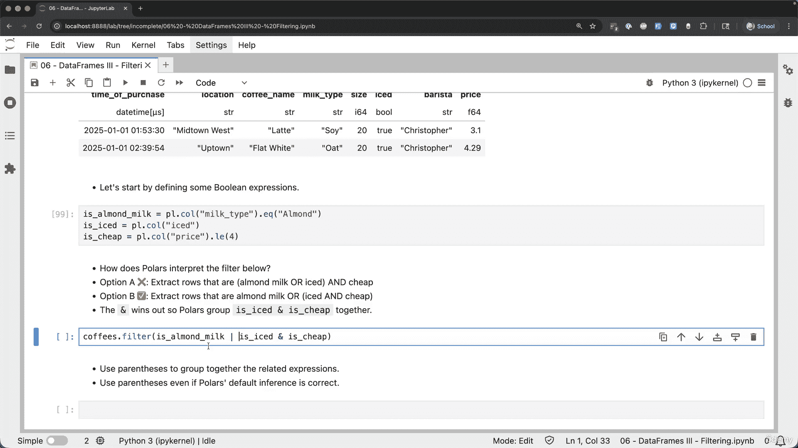

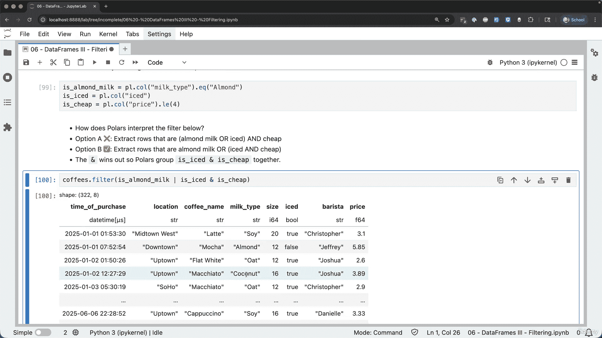

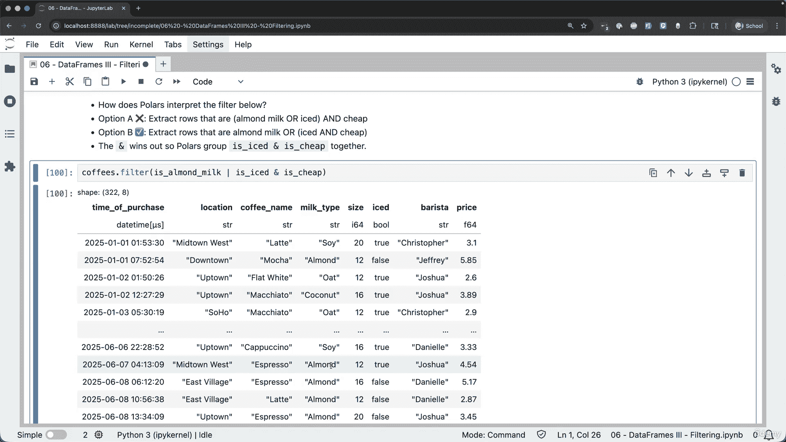

用公式表示 Polars 的默认行为如下：

`is_almond_milk | (is_iced & is_cheap)`

你可以看到，括号围绕的是 `is_iced` 和 `is_cheap`，说明这两个条件会被先绑定在一起。

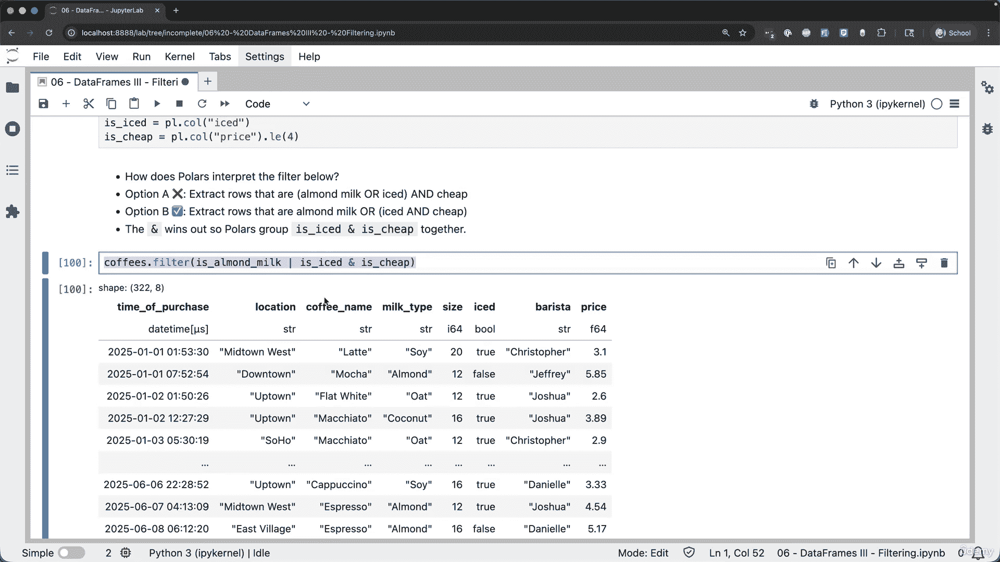

### 使用括号自定义计算顺序

上一节我们介绍了 Polars 的默认推断逻辑，本节中我们来看看如何通过括号来改变这个行为。

如果你想避免歧义，或者让代码更容易被其他人阅读，最好的办法就是给想要连接在一起的表达式加上括号。括号的作用就像数学里的括号一样，它创建了一个容器，强制让括号内的代码先被计算。如果我们想模拟 Polars 刚才的默认推断，可以显式地写出 `is_almond_milk | (is_iced & is_cheap)`。这样写和 Polars 隐式处理的效果是一样的。

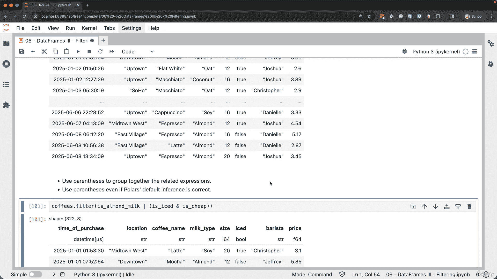

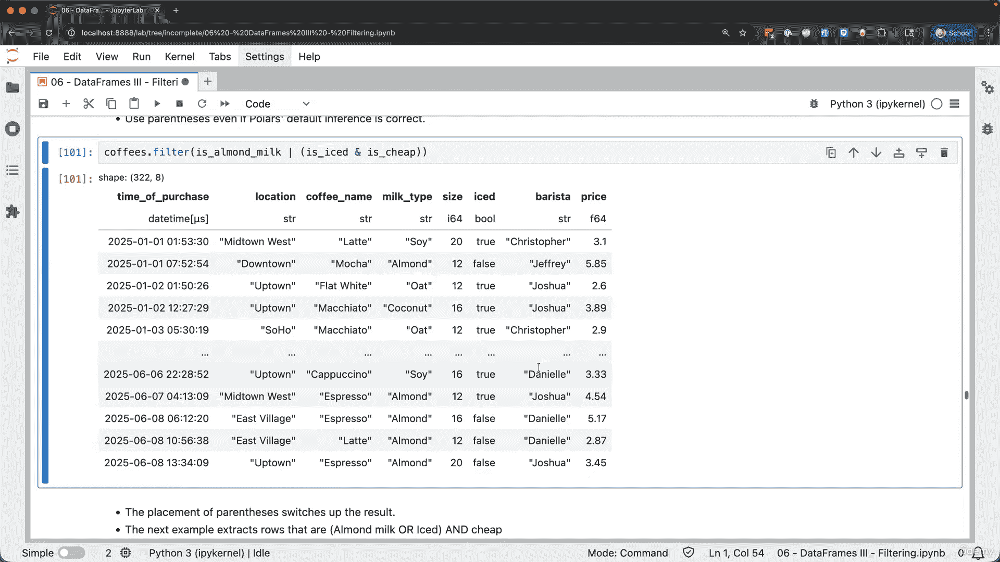

括号真正的强大之处在于，它们允许我们跳过默认行为，自定义逻辑。比如，如果我们想要表达的是“要么是杏仁奶，要么是冰饮，而且无论哪一种都要便宜”，就需要把 `is_almond_milk | is_iced` 用括号包起来。

代码示例如下：

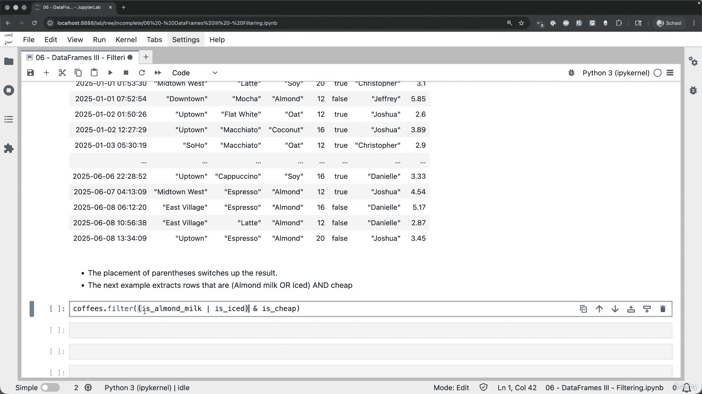

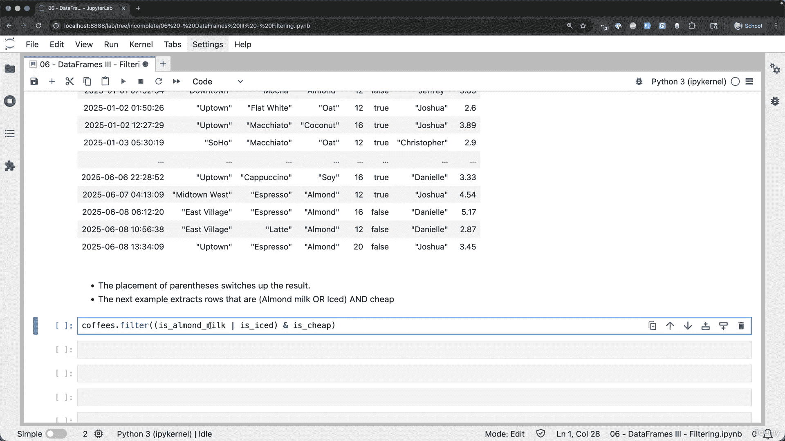

```python
df.filter((is_almond_milk | is_iced) & is_cheap)
```

这时候，Polars 会先计算括号内的 or 操作，判断每一行是否是杏仁奶或冰饮，然后再把结果和 `is_cheap` 用 and 结合。这意味着最终结果里的每一行，都必须满足“便宜”这个条件，并且要么是杏仁奶，要么是冰饮。

### 最佳实践建议

学习完如何使用括号之后，本节中我们来看看在实际编码中应该注意什么。

我的建议是，只要存在任何可能引起混淆的地方，就不要依赖 Polars 的默认推断。为了你自己，也为了将来阅读你代码的其他人，请把成对出现的表达式用括号包起来。这不仅能避免逻辑错误，还能让你的代码意图一目了然。当然，如果你愿意，也完全可以在一个 filter 方法调用中同时使用 or 运算符和 and 运算符，只要记得加好括号即可。

### 本节总结

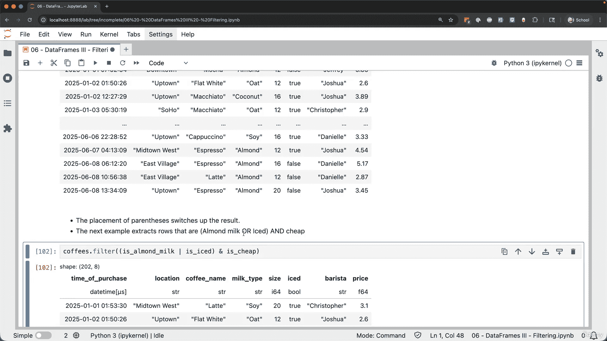

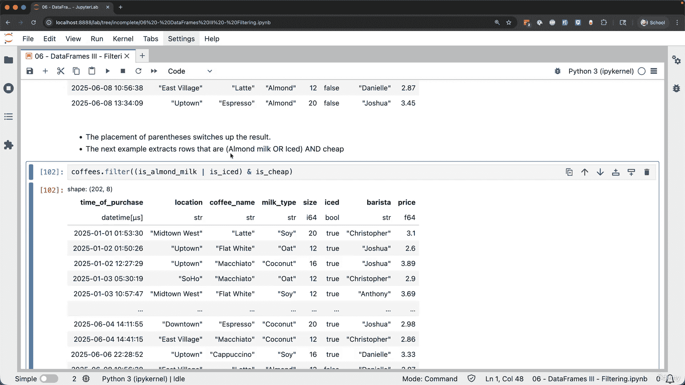

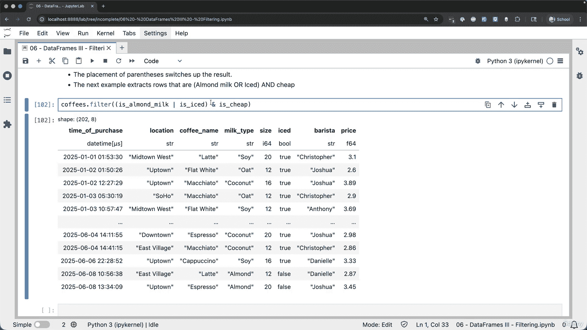

在本节课中，我们一起学习了 Polars 中的运算符优先级。我们知道了 & 运算符的优先级高于 | 运算符，当两者同时出现且没有括号时，Polars 会优先计算 and 逻辑。我们通过三个表达式变量演示了这种歧义，并展示了如何使用括号来控制计算顺序。希望你在之后编写 Polars 代码时，养成使用括号明确逻辑的习惯，从而避免不必要的错误。
