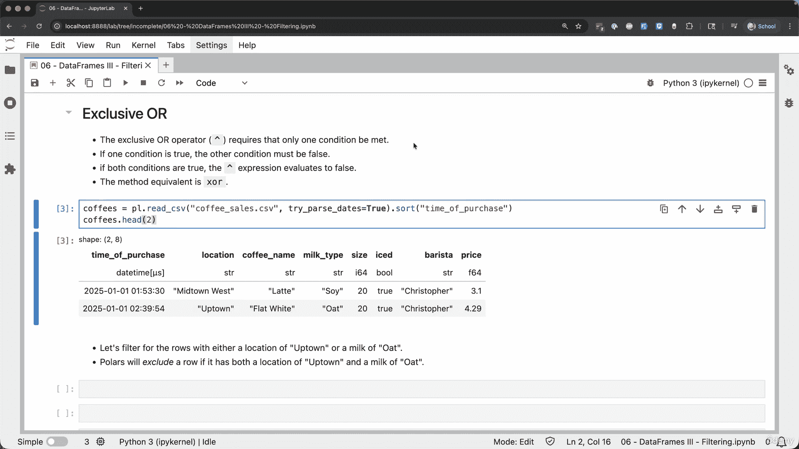
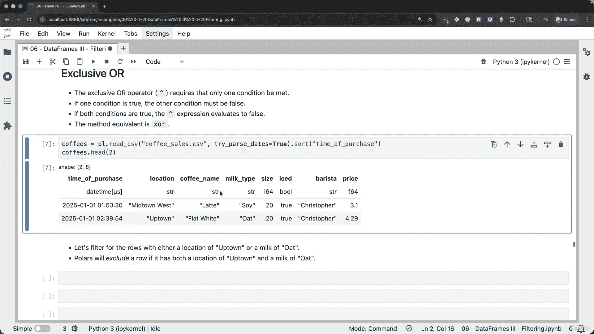
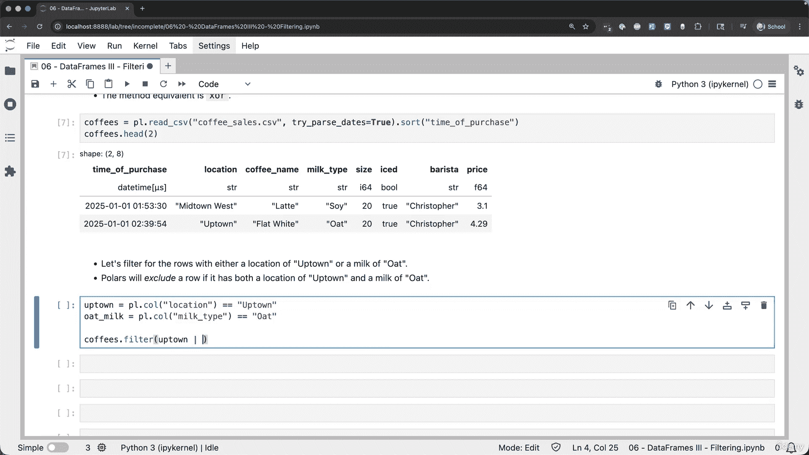
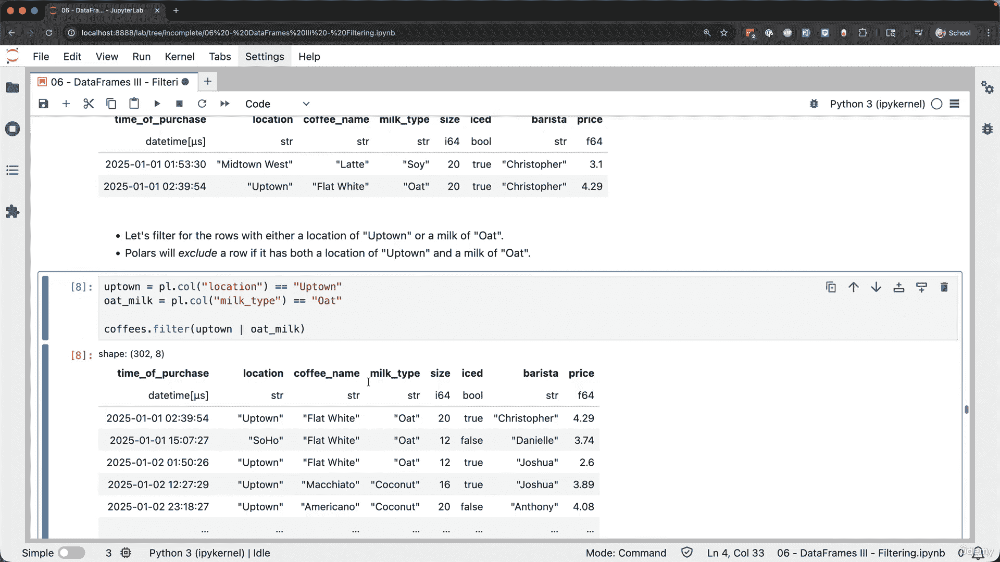
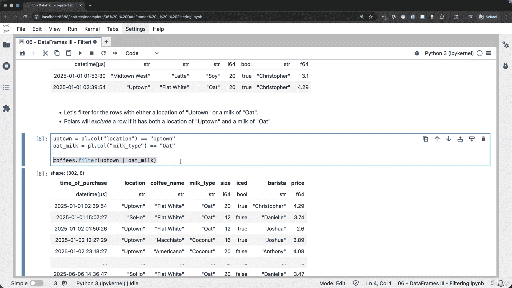
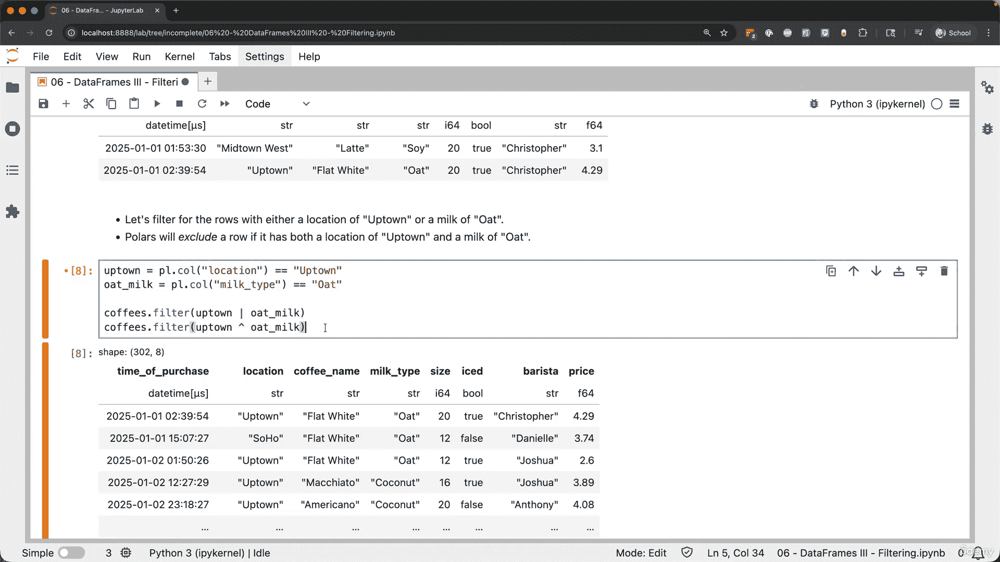
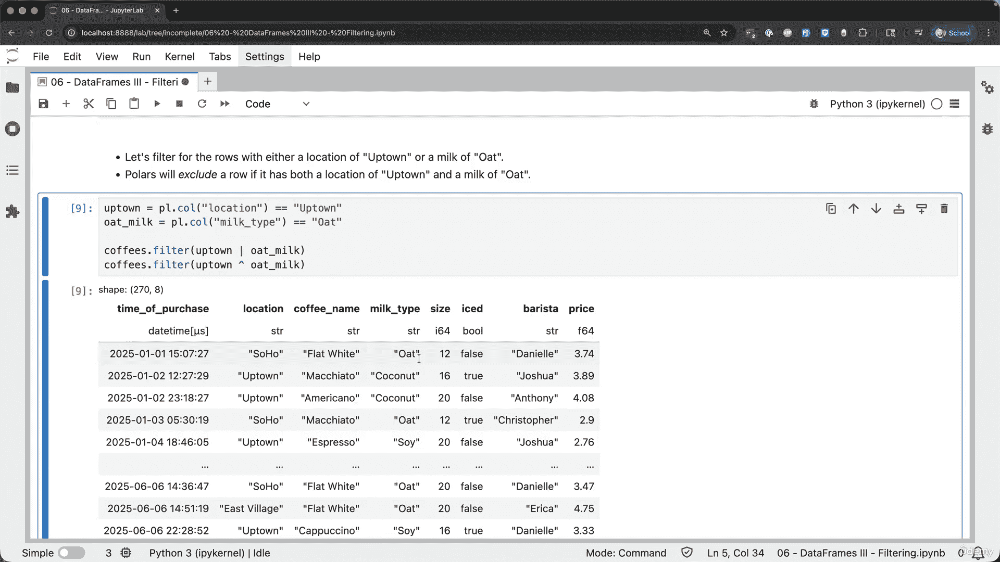
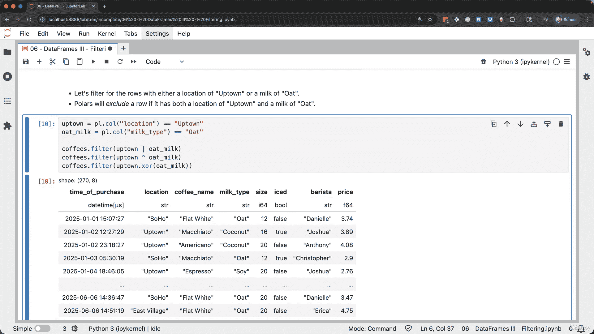

Polars 数据分析教程：第91课：应用排他或（XOR）逻辑 🔍


在本节课中我们将要学习 Polars 中的排他或（XOR）逻辑。这节课的内容主要是介绍一个在过滤数据时可能会派上用场的额外运算符。我们会先解释这个运算符长什么样，再说明它在筛选行时需要满足什么条件，最后通过实际代码示例对比普通或运算符和排他或运算符的不同效果。


### 什么是排他或运算符 🔢


首先，我们来认识一下排他或运算符，它有时也被简称为 XOR。这个运算符的符号是一个向上的尖括号符号，也就是 `^`。它的核心规则非常简单：在过滤数据时，只有当两个条件中恰好有一个条件成立时，才会选中这一行。换句话说，如果两个条件都成立，或者两个条件都不成立，这一行都不会被选中。

以下是这个规则的公式描述：

```text
XOR 结果 = 仅当条件 A 或条件 B 中恰好一个为真时为真
```

换句话说，排他或要求“只能有一个条件为真，不能两个同时为真”。这和我们平时使用的普通或运算符有明显的区别，下面我们会详细对比。


### 普通或运算符回顾 🔄


为了更好地理解排他或，我们先回顾一下普通的或运算符。普通或运算符的符号是竖线符号 `|`。当我们使用它来过滤数据时，只要满足以下任一情况，行就会被选中：第一个条件成立，或者第二个条件成立，或者两个条件同时成立。



换句话说，普通或运算符的逻辑是“只要有一个条件为真就选中，甚至两个都为真也可以”。



以下是普通或的公式描述：

```text
普通或 结果 = 只要条件 A 或条件 B 中至少一个为真即为真
```

理解了普通或的行为之后，我们再来看排他或是如何改变这一逻辑的。


### 定义过滤表达式 📝


接下来我们开始编写代码，先定义两个过滤表达式。我们将使用一个关于咖啡销售的数据框作为示例，这个数据框中包含地点和牛奶类型等列。

以下是需要定义的两个表达式：

```python
uptown = pl.col("location") == "uptown"
oat_milk = pl.col("milk_type") == "oat"
```

第一个表达式 `uptown` 针对 location 列，使用相等运算符将每一行的值与字符串 "uptown" 进行比较。第二个表达式 `oat_milk` 针对 milk_type 列，将每一行的值与字符串 "oat" 进行比较。定义好这两个表达式之后，我们就可以把它们组合起来用于数据过滤了。


### 使用普通或运算符过滤 📊




有了这两个表达式之后，我们先来看看普通或运算符在过滤时的效果。我们在数据框上调用 filter 方法，并把两个表达式用竖线符号 `|` 连接起来。

以下是使用普通或运算符的代码：

```python
df.filter(uptown | oat_milk)
```

执行这段代码后，我们会得到所有满足以下条件的行：地点是 uptown，或者牛奶类型是 oat，或者两者同时满足。也就是说，只要其中一个条件成立，或者两个条件都成立，这一行都会出现在结果中。


### 使用排他或运算符过滤 ⚡


接下来我们把普通或运算符换成排他或运算符，看看过滤结果会有什么不同。我们依然使用同样的两个表达式，但这次把中间的竖线符号 `|` 替换成向上尖括号符号 `^`。

以下是使用排他或运算符的代码：

```python
df.filter(uptown ^ oat_milk)
```

执行这段代码后，我们会得到所有满足以下条件的行：地点是 uptown，或者牛奶类型是 oat。但是，如果某一行同时满足这两个条件，也就是地点是 uptown 且牛奶类型也是 oat，那么这一行会被排除在结果之外。

换句话说，排他或运算符要求“只能有一个条件为真，不能两个同时为真”。因此，与普通或运算符相比，这里包含的行会更少，因为我们移除了那些同时拥有 oat 牛奶类型和 uptown 地点的那部分行。这就是普通或与排他或之间的核心区别。




### 排他或的方法等价写法 🛠️






除了使用符号写法之外，Polars 还提供了对应的方法形式，效果是完全一样的。这个方法叫做 `xor`，可以直接在第一个表达式上调用，并把第二个表达式作为参数传入。



以下是使用方法等价写法的代码：

```python
df.filter(uptown.xor(oat_milk))
```

这段代码会生成与上面使用 `^` 符号完全相同的数据框。也就是说，无论你是使用符号 `^` 还是调用 `xor` 方法，得到的过滤结果都是一致的。


### 总结 📚




本节课中我们一起学习了 Polars 中的排他或（XOR）逻辑。我们了解了 `^` 符号的含义，即只允许一个条件为真，两个条件不能同时为真。我们也对比了普通或运算符 `|` 与排他或运算符 `^` 在过滤数据时的区别，并学习了如何使用符号和方法两种方式实现排他或过滤。希望这些内容能帮助你在实际的数据分析工作中更灵活地组合过滤条件。


