# 📊 用 Polars 和 Python 进行数据分析：第92课：过滤唯一值和重复值

在本节课中我们将要学习如何在 Polars 中过滤唯一值和重复值。数据分析工作中，经常需要根据某一列的值是否唯一来筛选数据行，或者根据某一列的值是否重复来筛选数据行。Polars 提供了几个非常方便的方法来完成这类任务，本节课会逐一介绍这些方法，并通过咖啡数据集的实际例子来演示每个方法的具体用法。


## 🔍 什么是唯一值和重复值

首先我们来了解一下唯一值和重复值的基本概念。在一个数据框的某一列中，如果某个值只出现了一次，我们就说这个值是唯一值；如果某个值出现了多次，我们就说这个值是重复值。这两个概念是互补的，掌握它们可以帮助我们快速定位数据中的特殊行，为后续的数据清洗和分析打下基础。

以下是唯一值和重复值的定义：

- 唯一值：该列中只出现一次的值
- 重复值：该列中出现多次的值

在 Polars 中，我们可以通过表达式配合过滤方法来生成布尔列，从而完成筛选操作。


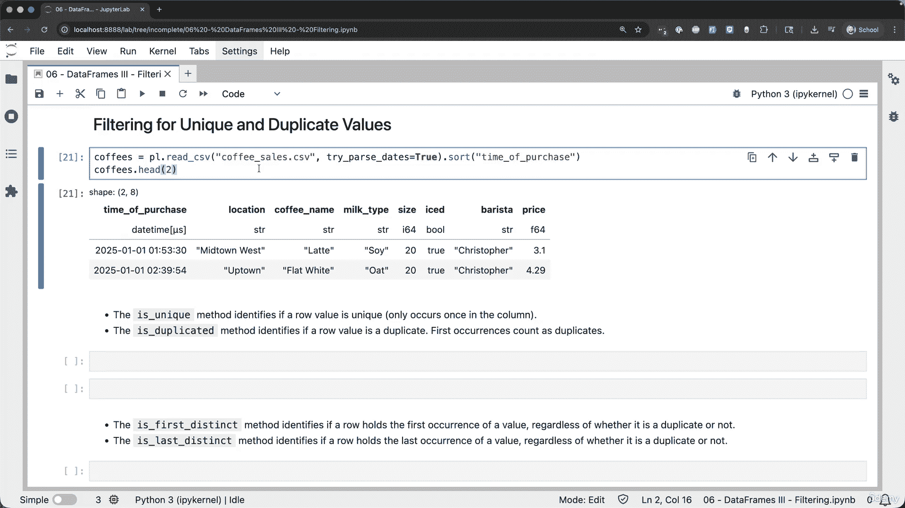

## 🎯 使用 is_unique 筛选唯一值

上一节我们介绍了 Polars 的基本过滤操作，本节中我们来看看如何筛选唯一值。假设我们有一个咖啡数据框，其中包含一列咖啡名称。我们想要找出那些在咖啡名称列中只出现一次的行，也就是那些值在整列中只出现一次且恰好出现一次的行。

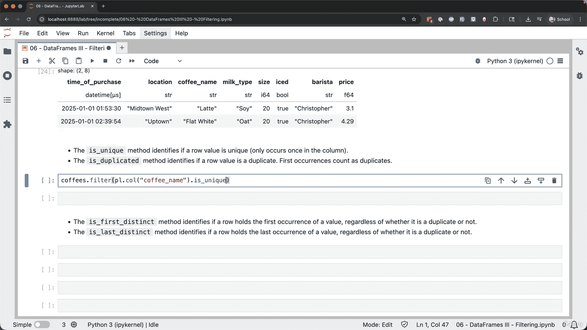

以下是具体的操作步骤：

1. 对咖啡数据框调用 filter 方法
2. 在表达式中指定咖啡名称列
3. 调用 is_unique 方法

代码示例如下：

```python
coffees.filter(pl.col("coffee_name").is_unique())
```

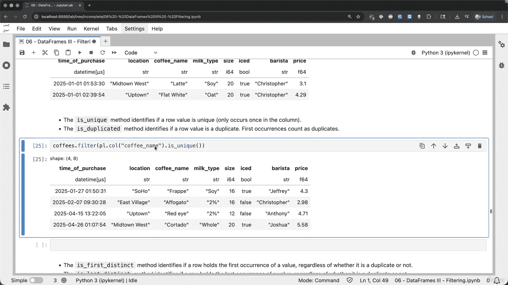

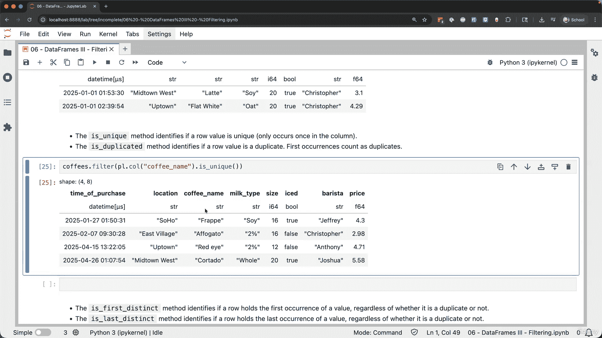

这里的 `is_unique()` 方法会检查每个值是否在整列中只出现了一次。如果是，则返回 True，否则返回 False。filter 方法会保留那些返回 True 的行，从而筛选出所有唯一值对应的数据行。

在咖啡名称列中，大约有四个咖啡名称是唯一的，比如 fpe、afagado、redey 和 cortado，它们在原始数据框中各只出现一次。


## 🔢 使用 value_counts 验证唯一性

刚才我们介绍了如何使用 is_unique 筛选唯一值，本节中我们来看看如何验证这些值真的只出现了一次。为了证明 is_unique 方法的结果是正确的，我们可以统计每个咖啡名称出现的次数，然后查看哪些值的计数为 1。

以下是验证步骤：

1. 对咖啡数据框调用 select 方法
2. 创建指向咖啡名称列的表达式
3. 调用 value_counts 方法
4. 设置 sort 参数为 True，按出现次数降序排列

代码示例如下：

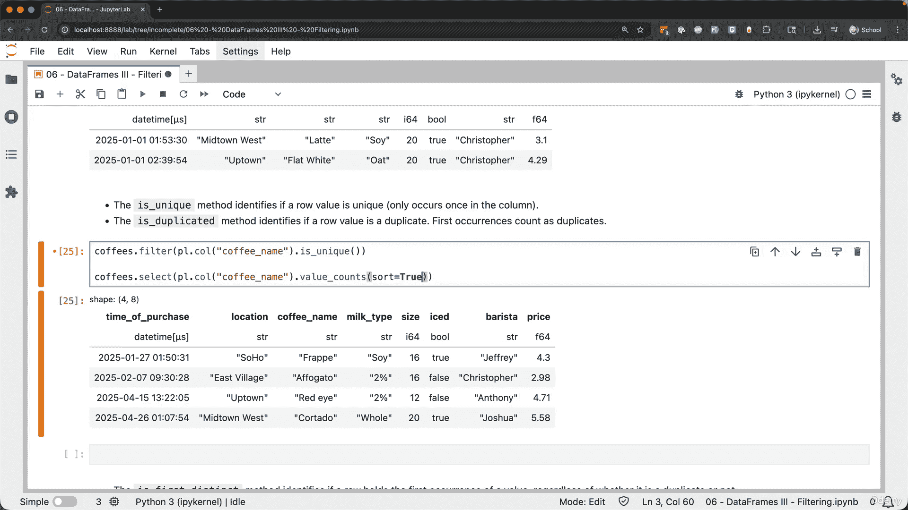

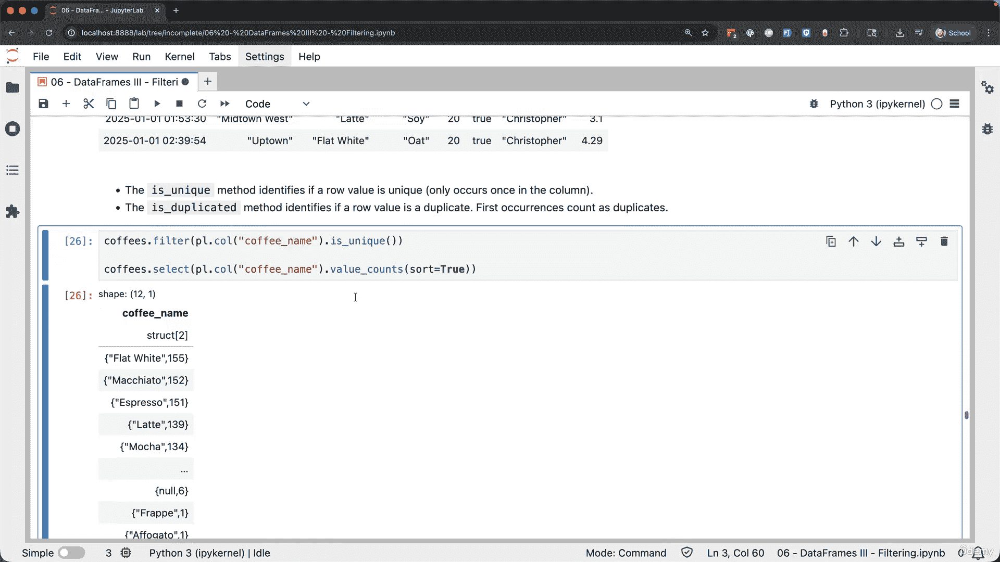

```python
coffees.select(
    pl.col("coffee_name").value_counts(sort=True)
)
```

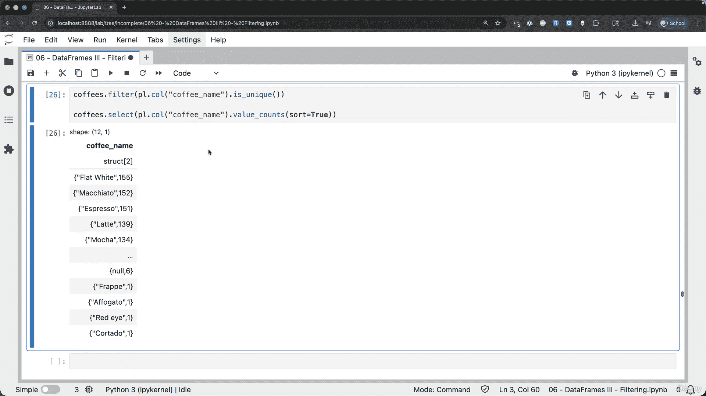

`value_counts()` 方法会生成一个只有一列的数据框，每一行存储一个值及其出现次数。通过查看结果，我们可以看到大多数咖啡名称出现了很多次，而在列表的最底部，正好有四个咖啡名称各只出现了一次。这些就是 is_unique 方法筛选出来的唯一值。另外，重复值对应的行数加上唯一值对应的四行，总和正好等于原始数据框的总行数 1000 行。


## 🔄 使用 is_duplicated 筛选重复值

刚才我们介绍了如何筛选唯一值，本节中我们来看看它的互补操作，即筛选重复值。如果我们想要找出那些在咖啡名称列中出现多次的行，可以使用 is_duplicated 方法。

以下是具体的操作步骤：

1. 对咖啡数据框调用 filter 方法
2. 在表达式中指定咖啡名称列
3. 调用 is_duplicated 方法

代码示例如下：

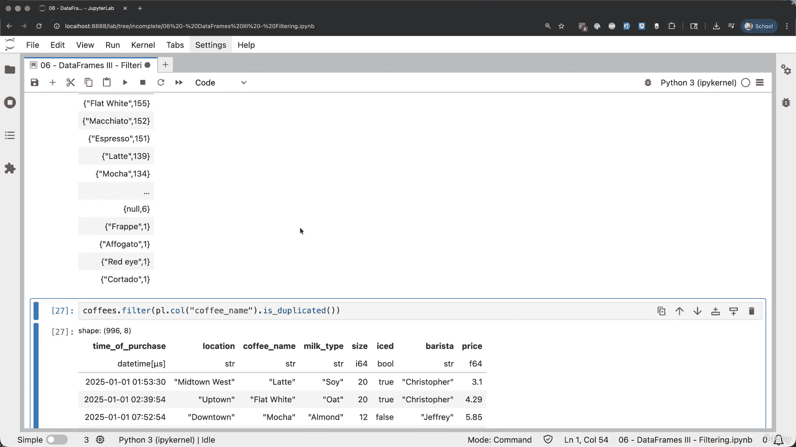

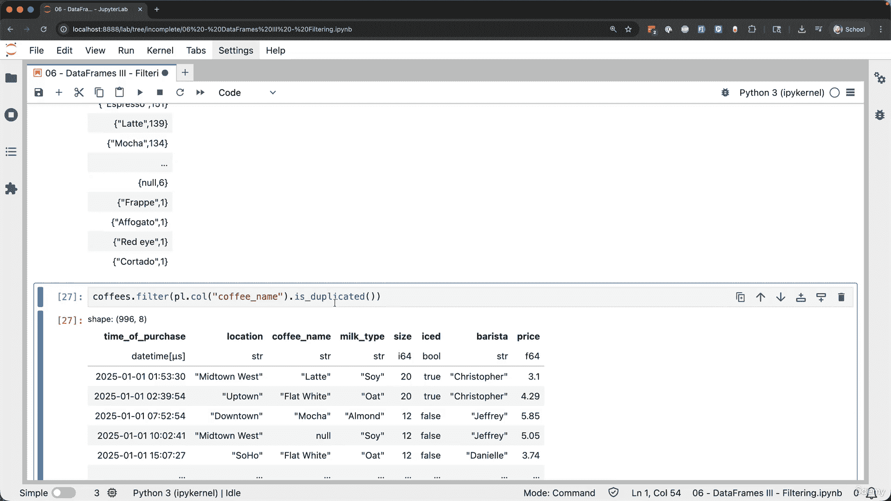

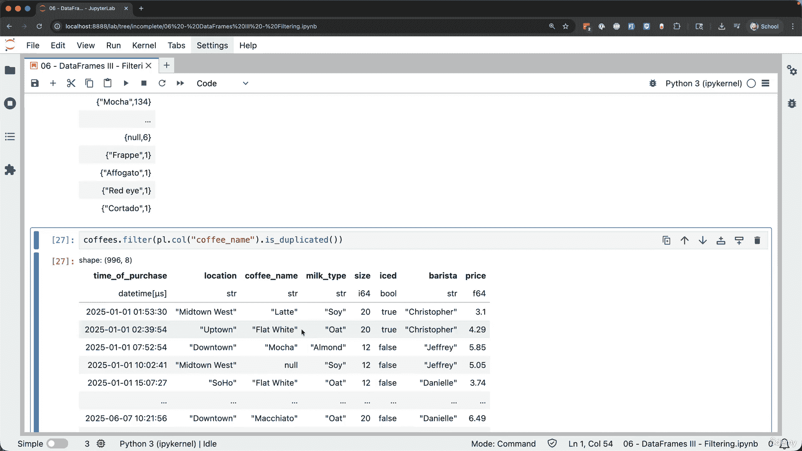

```python
coffees.filter(pl.col("coffee_name").is_duplicated())
```

`is_duplicated()` 方法会筛选出所有值出现多次的行。不管该值出现两次、三次还是五百次，只要不是唯一值，就会被保留。而且该值的每一次出现都会被保留在结果中，不会只保留其中一行。


## 📊 空值处理规则

在处理唯一值和重复值时，需要注意空值的行为。Polars 对待 null 的方式与普通值一致，不会特殊跳过或忽略。

以下是空值的处理规则：

- 如果 null 在列中只出现一次，is_unique 会将其视为唯一值
- 如果 null 在列中出现多次，is_duplicated 会将其视为重复值
- 两个方法都不会自动排除空值

这意味着在进行唯一性检查之前，你需要先明确数据中是否包含空值，并根据业务需求决定如何处理它们，避免得到不符合预期的筛选结果。


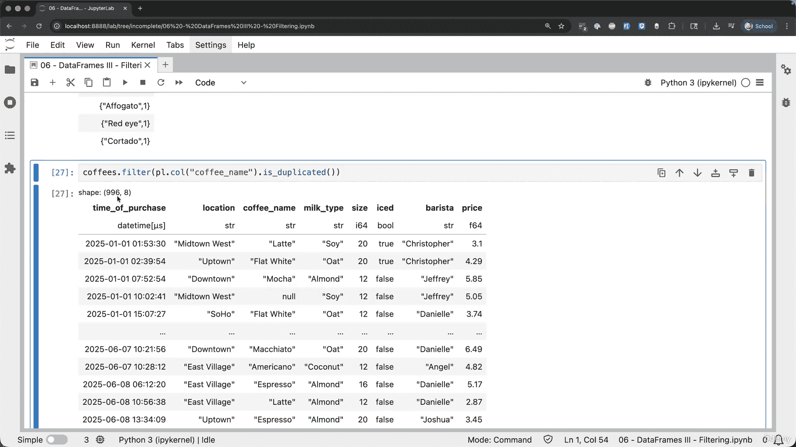

## ⏰ 使用 is_first_distinct 获取首次出现

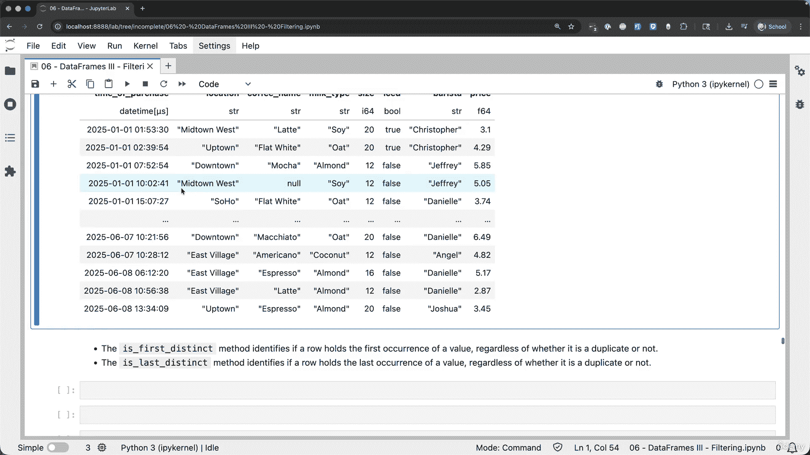

刚才我们介绍了唯一值和重复值的筛选，本节中我们来看看另外两个有用的方法，即 is_first_distinct 和 is_last_distinct。is_first_distinct 方法会找出每个不同值在数据框中第一次出现的那一行。

不管该值是唯一的还是重复的，is_first_distinct 方法只会提取它的第一次出现。在咖啡名称列中总共有 12 个不同的值，因此使用 is_first_distinct 方法会得到一个包含 12 行的数据框，每一行代表某个咖啡名称的第一次出现。

以下是具体的操作步骤：

1. 对咖啡数据框调用 filter 方法
2. 在表达式中指定咖啡名称列
3. 调用 is_first_distinct 方法

代码示例如下：

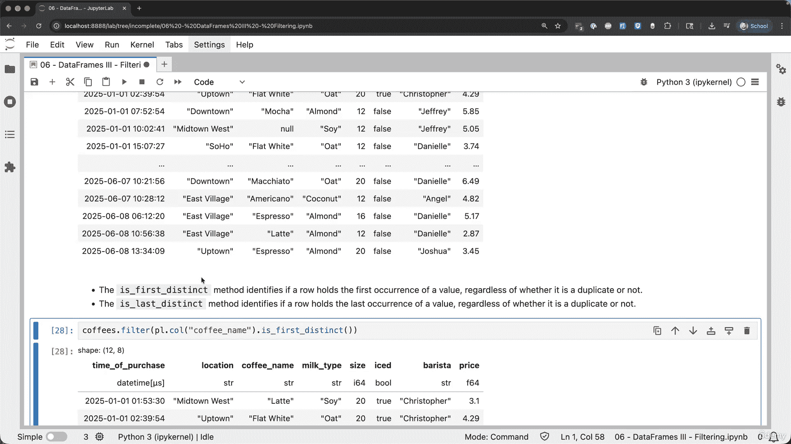

```python
coffees.filter(pl.col("coffee_name").is_first_distinct())
```

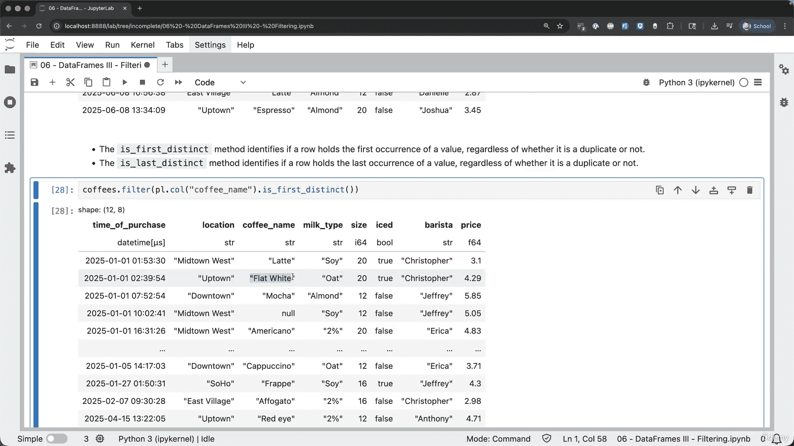

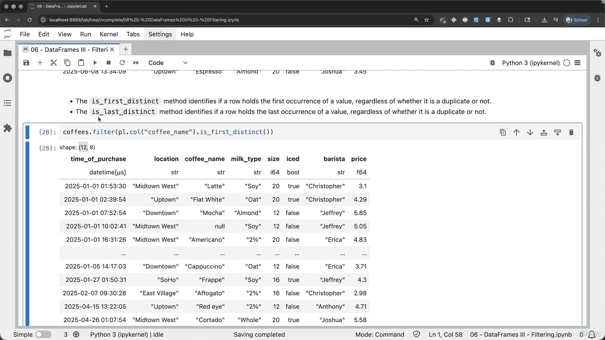

例如，结果会告诉我们哪一行是 latte 在原始数据框中第一次出现，哪一行是 flat white 第一次出现，以此类推，直到覆盖所有 12 个可能的咖啡名称。


## 🕒 使用 is_last_distinct 获取最后出现

刚才我们介绍了如何获取每个值的首次出现，本节中我们来看看如何获取每个值的最后出现。is_last_distinct 方法与 is_first_distinct 正好相反，它会提取每个值在数据框中最后一次出现的那一行。

以下是具体的操作步骤：

1. 对咖啡数据框调用 filter 方法
2. 在表达式中指定咖啡名称列
3. 调用 is_last_distinct 方法

代码示例如下：

```python
coffees.filter(pl.col("coffee_name").is_last_distinct())
```

同样，结果也会包含 12 行，因为每个不同的值只贡献一行。区别在于，这次提取的是每个值的最后一次出现。比如 cappuccino 和 macchiato 如果出现多次，Polars 会一直向后查找直到找到最后一次出现，这些行通常位于数据框的后部。


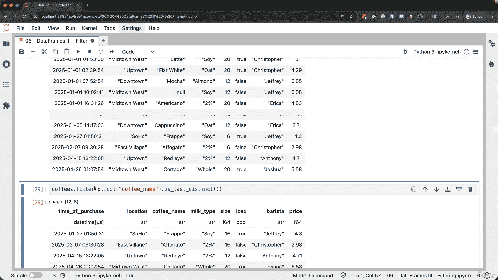

## 📝 本节总结

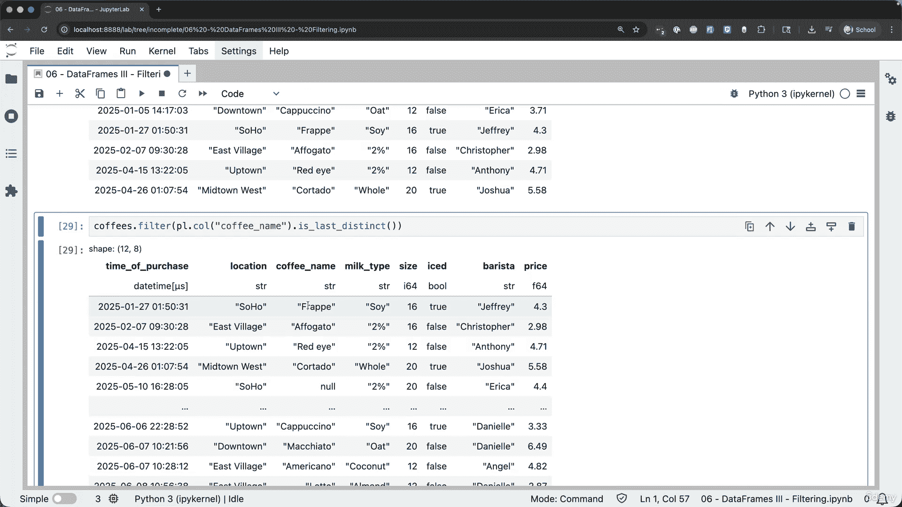

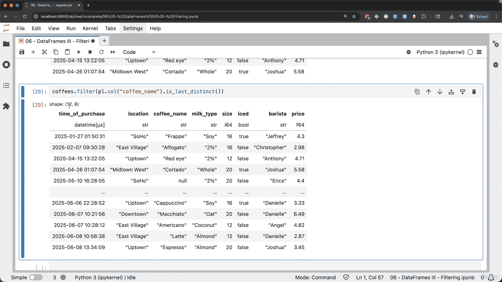

本节课中我们一起学习了如何在 Polars 中过滤唯一值和重复值，以及如何获取每个值的首次和最后出现。我们介绍了 is_unique、is_duplicated、is_first_distinct 和 is_last_distinct 这四个核心方法，并通过咖啡数据集展示了它们的使用方式。希望这些内容能帮助你在实际的数据分析工作中更灵活地处理重复性问题。

