# 数据分析与 Polars 和 Python：93：使用日期时间进行筛选 📅

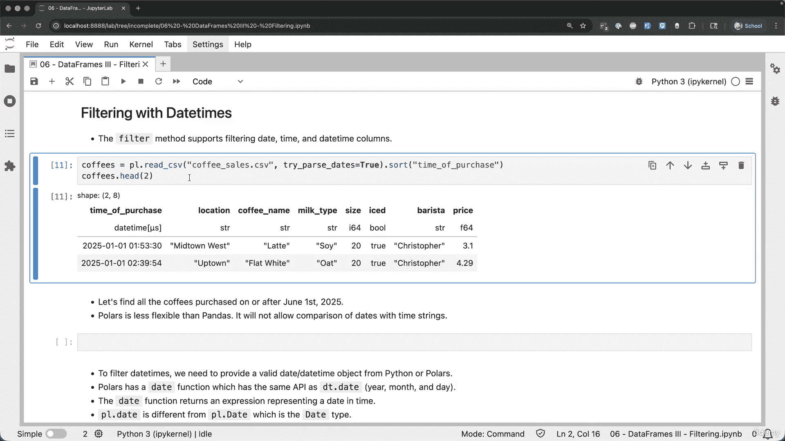

在本节课中，我们将学习如何在 Polars 里对包含日期和时间信息的列进行筛选，搞清楚哪些写法可以直接使用，哪些写法会报错，以及如何用 Python 自带的工具或者 Polars 自身的函数来构造比较对象。

上一节课我们介绍了针对字符串、整数和浮点数的筛选方法，那些数据类型处理起来比较直接。不过到目前为止，我们还没有聊过日期时间这种数据类型，这一节就来补上这块内容。

这里有一个示例的日期时间列，叫作购买时间。它里面同时包含日期和对应的时间点，换句话说，这就像是一个时间戳，记录的是这笔交易发生的具体时刻。所以在这节课里，我想跟大家探讨一下，怎么用日期时间数值来做筛选。

开始之前，我们先把导入代码重新执行一遍，确保环境准备好，数据表也加载进来，这样接下来的示例才能跑通。

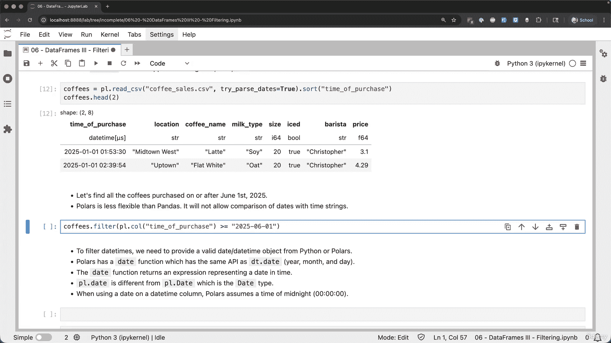

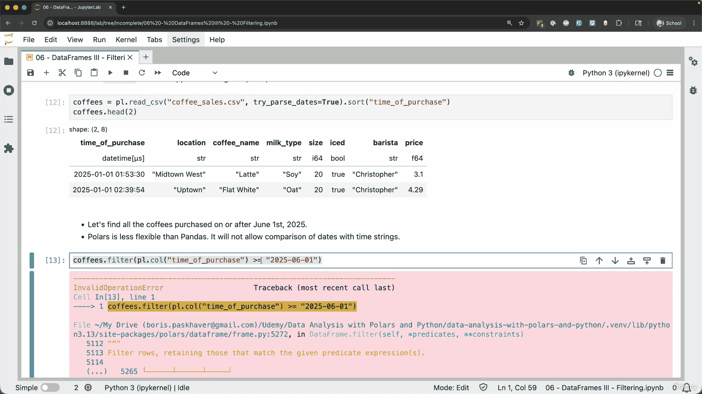

在 Polars 里，不管筛选什么数据，所有操作都会从 filter 方法开始。也就是说，我们会先拿到 coffees 表，然后调用它的 filter 方法，接着给这个方法传入一个针对购买时间这一列的表达式，用来决定哪些行保留下来。

这里有个好消息，就是在处理日期和时间的时候，你可以直接用常见的数学运算符，这些运算符对日期时间也是适用的。

以下是日期时间筛选中常用的比较运算符：
- 等于（==）
- 大于等于（>=）
- 小于等于（<=）
- 不等于（!=）
- 大于（>）
- 小于（<）

如果你之前用过 pandas 库，可能知道在那个库里，你可以直接传一个简单的日期字符串进去。也就是说，一个普通的文本字符串，用来表示某一天。比如说，你可能会觉得下面这段代码是合法的，因为我们要找的是六月一日之后购买的咖啡，于是写上大于等于号，再创建一个表示 2025 年 6 月 1 日的日期字符串，格式写成 2025-06-01。在 pandas 里，这种写法是被支持的。

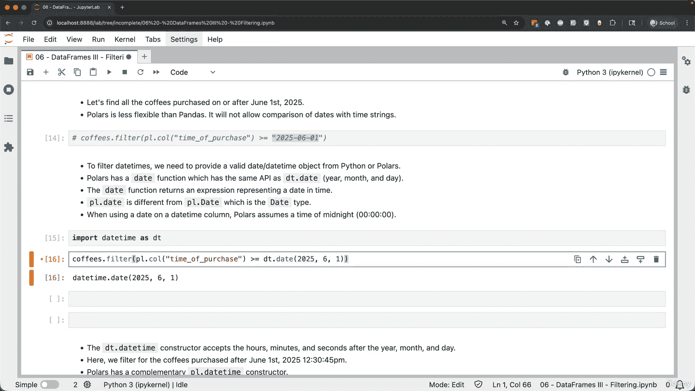

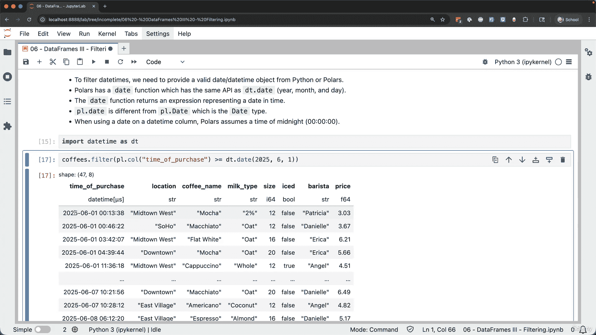

不过不幸的是，Polars 对这点要严格得多，上面那种直接用字符串的写法，在 Polars 里是跑不通的。所以这里的关键点是，如果你要筛选一个日期时间列，就必须使用一个真正的日期对象，不能光靠一段普通文本来糊弄。

用来做比较的那个日期对象，其实可以来自两个地方：一个是 Polars 自身，另一个是 Python 原生的 datetime 模块。这个模块我们在 Python 基础课里介绍过，下面我把两种写法都演示一遍，你看看哪个更顺手。

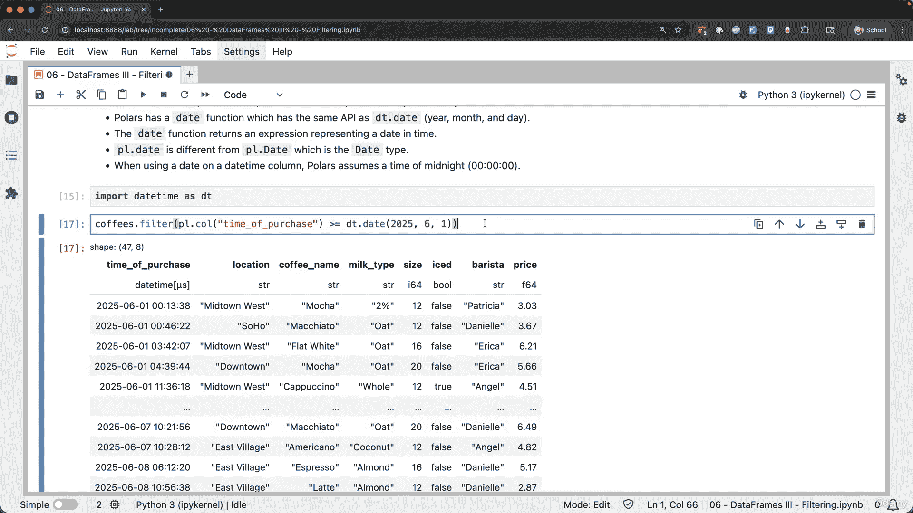

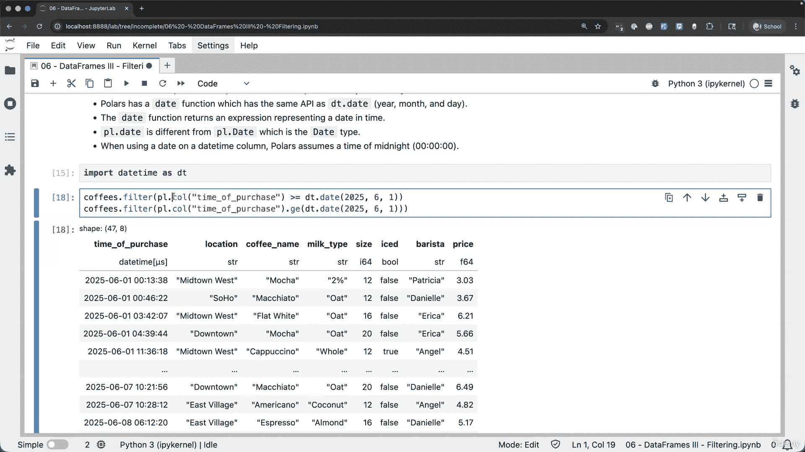

下面我们先看看怎么用 Python 自带的 datetime 模块。首先，我们要导入 datetime 模块，它不是 Polars 的一部分，而是 Python 标准库里原本就有的模块。为了方便调用，我给它起个别名，叫做 dt。简单回顾一下，datetime 模块里面包含几个类，分别用来处理日期、时间和日期时间组合。在这一节里，我要用到的是 date 类。这个类的构造函数接受三个参数，全都是数字，分别代表年份、月份和日期。所以如果我想表示 6 月 1 日，我就传入 2025、6 和 1，这就得到了一个合法的 Python 日期对象。

```python
import datetime as dt
purchase_date = dt.date(2025, 6, 1)
```

接下来，我把刚才复制的那行代码粘贴过来，把原来放日期字符串的位置，替换成这个日期对象。需要注意的是，这个日期对象并不是从 Polars 里来的，而是普通的 Python 对象。尽管如此，这个示例依然能正常运行。你会看到，我们筛选出了所有交易，购买时间列里的每个数值，都发生在 6 月 1 日或者更晚。顺便说一句，虽然我们这里的列是日期时间列，但传入的是一个普通日期对象，这个对象本身不包含具体的时刻信息。在这种情况下，Polars 会默认把时间设为午夜，也就是一天里零点零分零秒。

除了直接使用符号，Polars 也提供了等价的方法来做同样的事。比如说，我可以把刚才那行代码再复制一遍，如果你不想用大于等于符号，可以改用 ge 方法，也就是大于等于方法。只要多加一对括号，就能得到完全一样的结果。

如果你想走 Polars 原生的路线，写法也非常类似。唯一的区别是，不再使用 dt，也就是 datetime 模块，而是直接使用 Polars 库。Polars 库里其实自带一个 date 函数，这个函数返回一个表达式，用来模拟某个具体日期。date 函数的构造方式，和 datetime 模块里 date 类的写法完全一致，Polars 团队的目的就是保持一致性，让你可以在两种写法之间自由切换。两者接受的参数完全一样，就是年份、月份和日期这三个数字，所以返回的结果也完全一样。

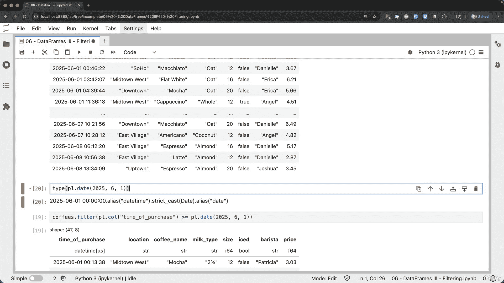

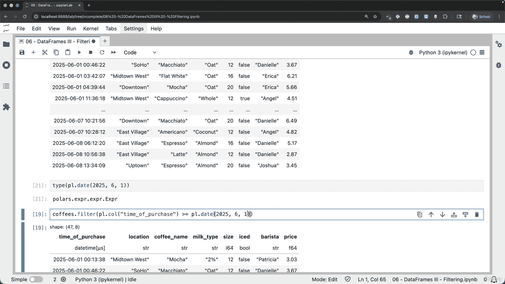

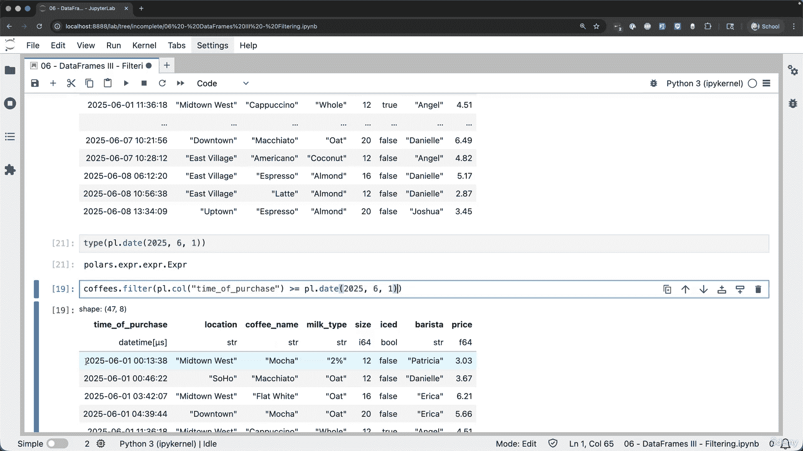

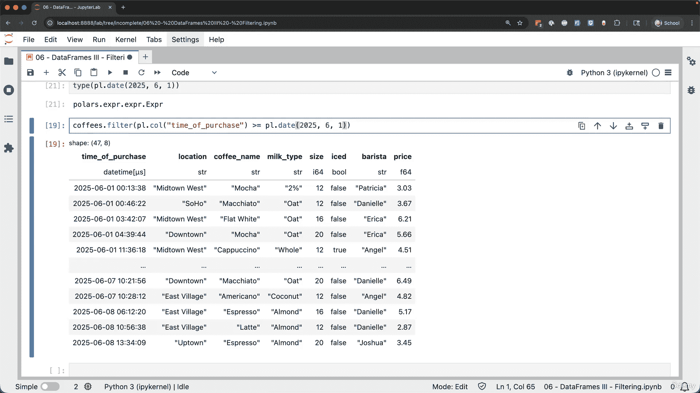

```python
import polars as pl
purchase_date = pl.date(2025, 6, 1)
```

我个人比较喜欢 Polars 的写法，原因很简单，就是不需要额外导入 datetime 模块，代码更干净。为了让你更清楚，我把上面那行代码复制到另一个单元格里。这实际上是一个合法的 Polars 表达式，这里显示的只是它的字符串形式。但如果把它传给 Python 的 type 函数，你会发现它是一个普通的 Polars 表达式。在 Polars 分析这段代码时，它会识别出这是一个表达式，然后在后台偷偷调用方法来修改这个表达式，接受另一个表达式，把它们组合成一个更复杂的表达式，让这个表达式知道要筛选出那些购买时间在该时刻或之后的行。同样的原理依然适用，我们会假设时分秒的值都为 0。所以你会看到，从 2025 年 6 月 1 日午夜过后开始，一直提取到最后一行，只要那一行发生在这个时刻之后就行。

这里还有一点需要你格外小心，一定要避免使用大写的等价物。Polars 库里也有一个叫作 P date 的东西，也就是 date 类型。比如，如果你想调用 cast 方法，把一列字符串转换成日期，可能会用到这个日期类型来指定转换的目标。但这和小写的 date 函数是完全不同的东西。如果在这里用了大写的 D，你会得到一个错误。所以请务必坚持使用小写的 date 函数，这样才能按预期工作。

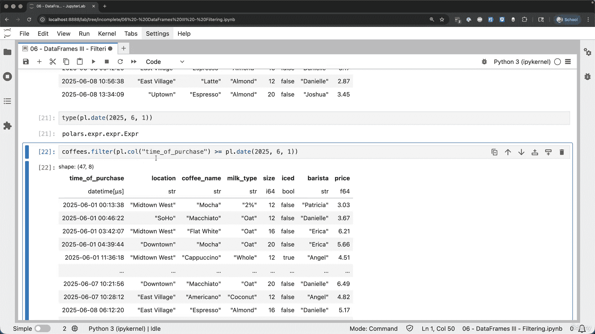

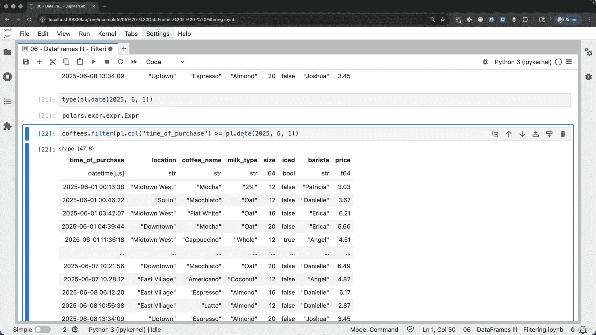

好了，类似于 Polars 和 datetime 模块都有 date 函数（在 datetime 模块里从技术上讲是一个类，但语法上是一样的），也有互补的 datetime 对象。datetime 表示的不仅仅是日期，而是具体的某个时刻，它把小时、分钟和秒都考虑进去了。不过原则还是一样的。我可以调用 datetime 构造函数，来自 datetime 模块，创建一个 datetime 实例。

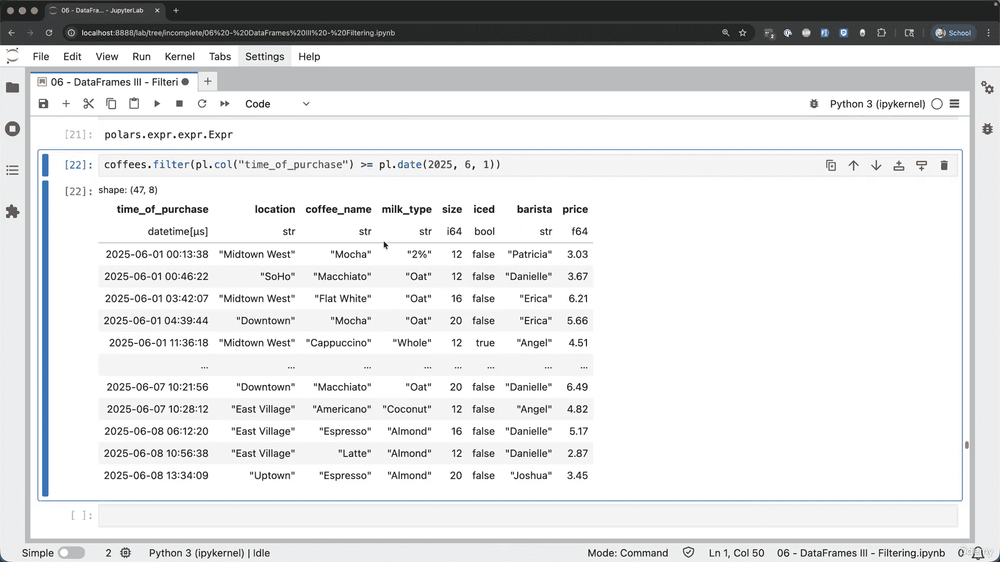

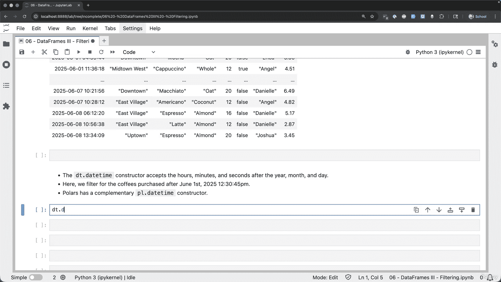

比如说，我们要模拟 6 月 1 日，前三个参数就是年月日，datetime 构造函数后面的参数是数字，分别表示当天里的小时、分钟和秒。假设我想模拟下午 12 点 30 分 45 秒，那我就直接提供 12、30 和 45 这三个值。这样我们就得到了 datetime 模块的 datetime 对象，表示那个具体的日期和时间。

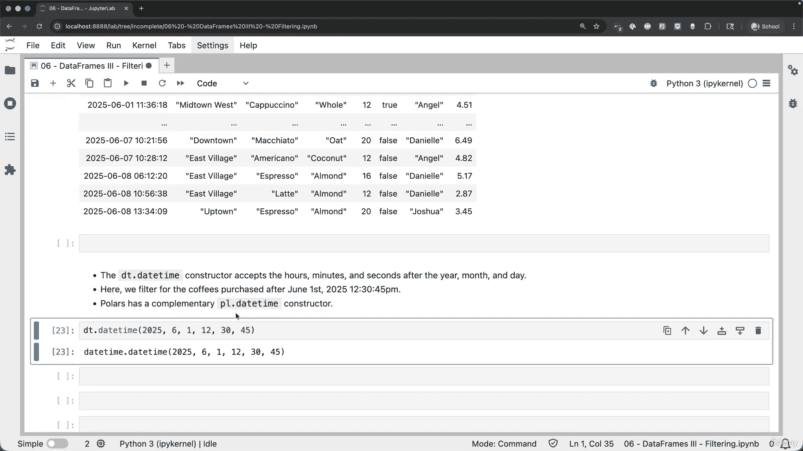

```python
import datetime as dt
purchase_datetime = dt.datetime(2025, 6, 1, 12, 30, 45)
```

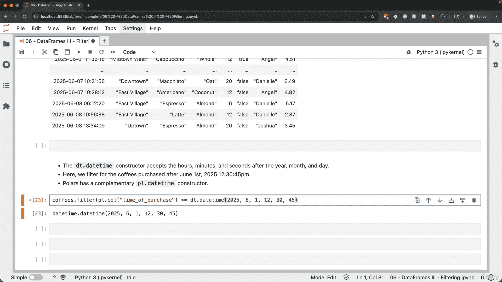

拿到这个对象之后，我可以再次使用 filter 方法，拿它来做任何比较。我会创建一个针对购买时间列的表达式，然后再次使用大于等于符号。你也可以用等于、不等于、小于，想怎么比都可以，都是合法的。

现在我们对时间的控制更精确了。请注意，之前因为库默认假设是午夜，所以会包含像一天第 13 分钟这样的行。但现在我们更加具体，只取 6 月 1 日下午 12 点 30 分之后的行，你可以看到结果开始得晚了一点。这里展示的是第一个符合条件的行，也就是在这个时刻或之后的第一笔交易。

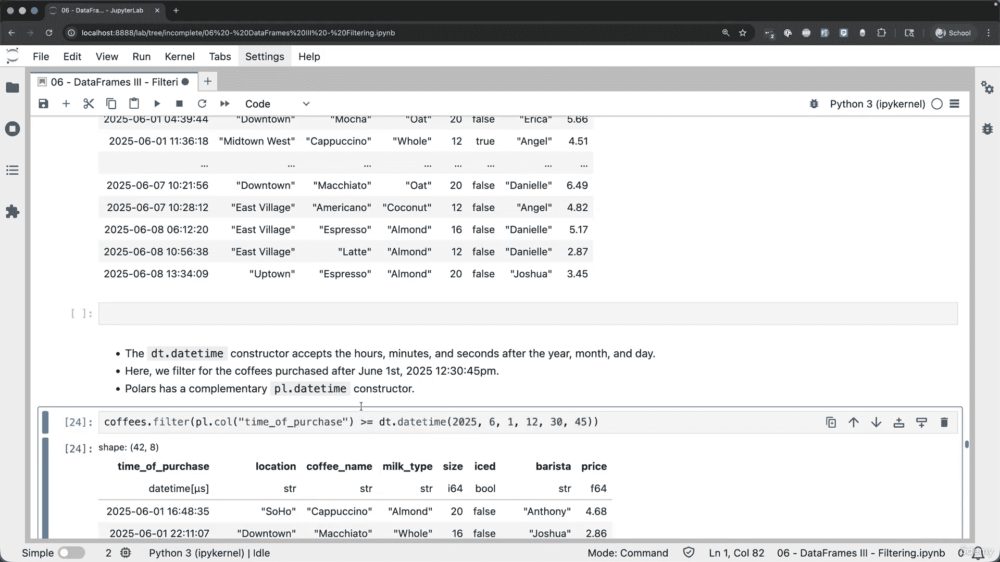

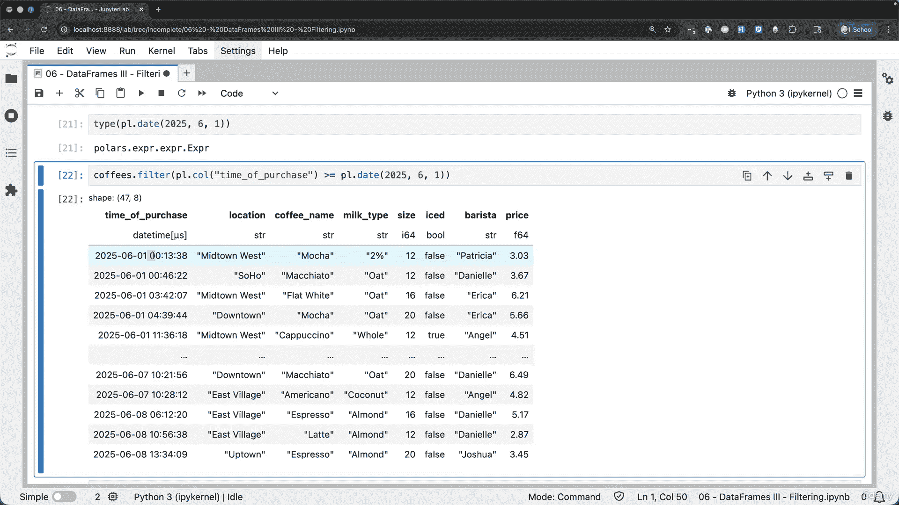

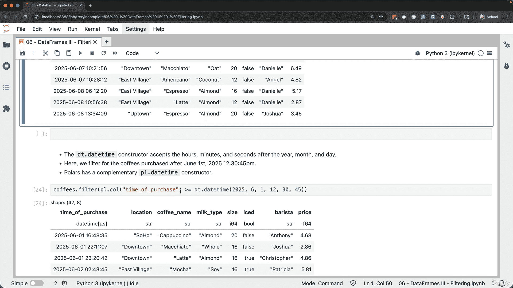

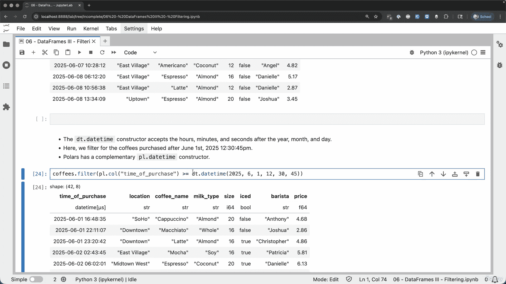

你可能猜到了，Polars 库也会有对应的 datetime 函数。我可以往下滚动，复制粘贴那一段代码。原理完全一样，只不过不是从 datetime 库创建 datetime 类，而是直接调用 Polars 的 datetime 函数。这个函数会创建一个表示单一日期时间的表达式，也就是一个具体的时刻，结果完全一样，而且你不需要导入 Python 的 datetime 模块。

```python
import polars as pl
purchase_datetime = pl.datetime(2025, 6, 1, 12, 30, 45)
```

无论你选择哪种方式，这一节讲的原则都是通用的。我们会使用 filter 方法，创建一个针对存储日期、时间或日期时间列的表达式，然后创建比较对象。有了这个比较对象之后，你可以做等于、不等于、小于、大于，跟处理其他数值一样。但你需要先创建那个日期比较对象，它可以来自 datetime 模块及其导出的类，也可以使用 Polars 里的 date 或 datetime 函数，来创建模拟同样内容的表达式。这取决于你自己，用哪种语法更顺手，哪种更合理就用哪种。

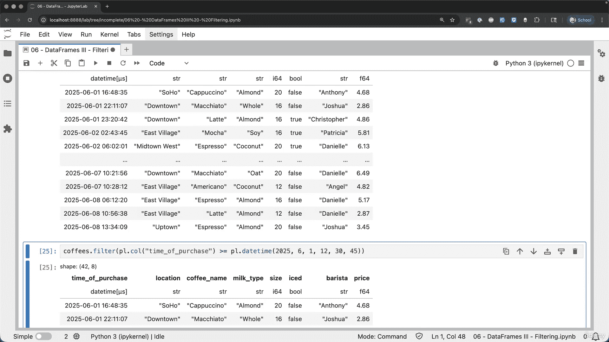

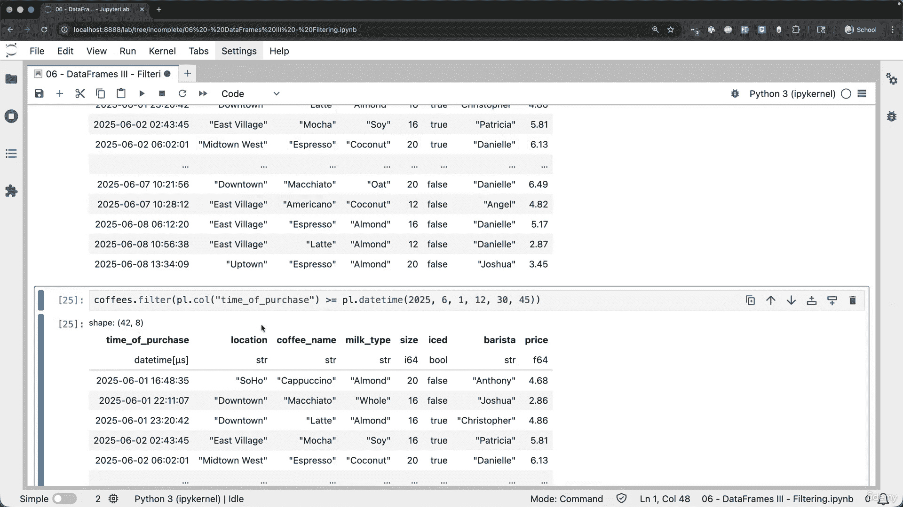

本节课就讲到这里，下一节课见。
