# 数据分析与 Polars 和 Python：94：is_between 方法 📊

在本节课中，我们将学习 Polars 库中一个非常实用的方法，叫做 is_between。这个方法的作用是筛选出那些数值落在指定范围内的行。无论你处理的是价格、尺寸还是日期时间，只要你想找出介于两个边界之间的数据，is_between 都能帮你快速完成。我们会先看看怎么用最基本的方法实现同样的效果，再展示 is_between 怎么让代码变得更简洁。最后，我们还会讨论在处理日期时间列时需要特别注意的细节，确保你不会掉进常见的陷阱里。

首先我们需要重新运行导入代码，确保 Polars 环境已经准备就绪，随后才能开始后面的筛选操作。

## 什么是 is_between 方法

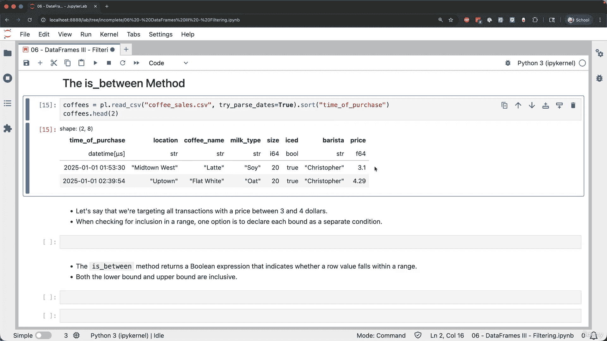

is_between 是 Polars 提供的一个过滤方法，专门用来捕获落在某个区间内的数据行。你需要给出一个下边界和一个上边界，方法会把所有介于这两个边界之间的值全部选出来。这个逻辑非常直观，适用于价格、尺寸、日期等多种场景。

以下是这个方法的核心逻辑描述：

```text
结果 = 数据行 where 下边界 <= 数值 <= 上边界
```

两个端点默认都是包含在内的。也就是说，如果数值恰好等于下边界或上边界，那一行也会被保留下来。

## 传统方法：组合两个独立表达式

在学习 is_between 之前，我们先回顾一下怎么用 Polars 已经掌握的基本工具解决同样的问题。假设我们想筛选出价格列中介于 3 美元到 4 美元之间（包含 3 和 4）的所有交易记录。

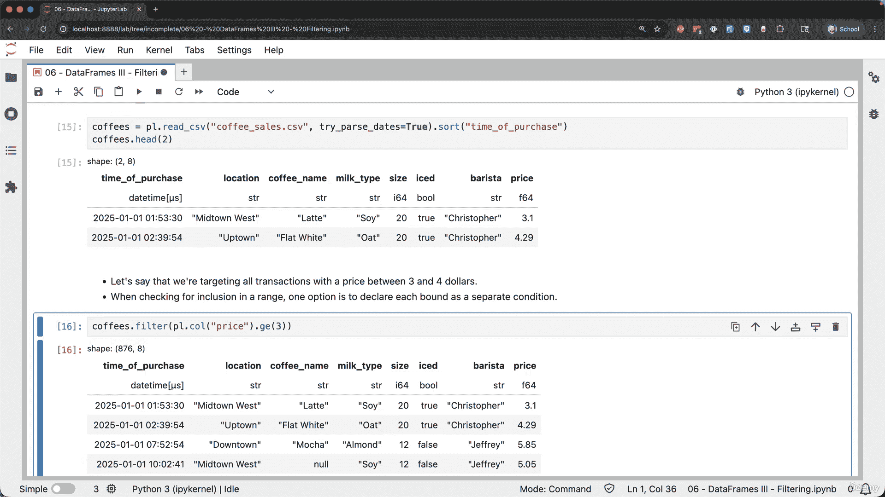

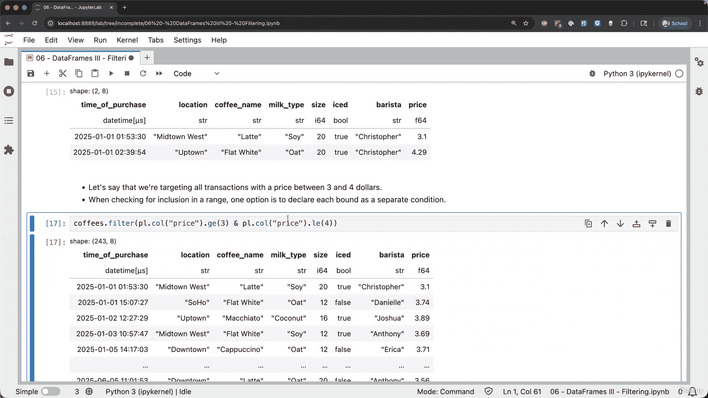

以下是传统解决方案的步骤：

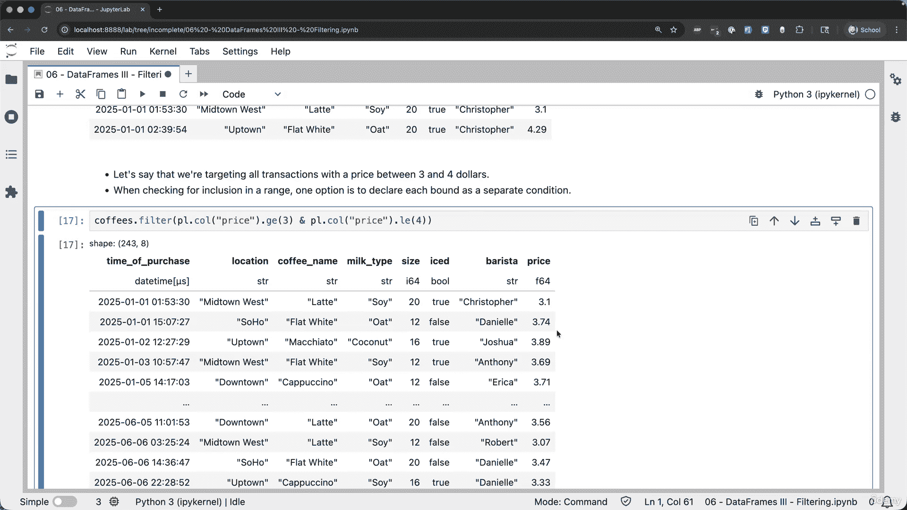

1. 创建第一个表达式，针对价格列，使用大于等于 3 的条件。
2. 创建第二个表达式，针对价格列，使用小于等于 4 的条件。
3. 用 and 运算符把这两个表达式组合起来。
4. 把组合后的逻辑传给 filter 方法。

对应的代码大致如下：

```python
import polars as pl

# 假设 df 已经加载好数据
df.filter(
    (pl.col("price") >= 3) & (pl.col("price") <= 4)
)
```

这里我们先对价格列调用大于等于方法，缩写为 ge，传入数值 3。这样第一个表达式就会选中所有价格大于等于 3 的行。接着用和运算符（&）连接第二个表达式，同样针对价格列，这次用小于等于方法，缩写为 le，传入数值 4。当两个条件同时满足时，也就是价格既大于等于 3 又小于等于 4，我们就能拿到落在该区间内的所有行。

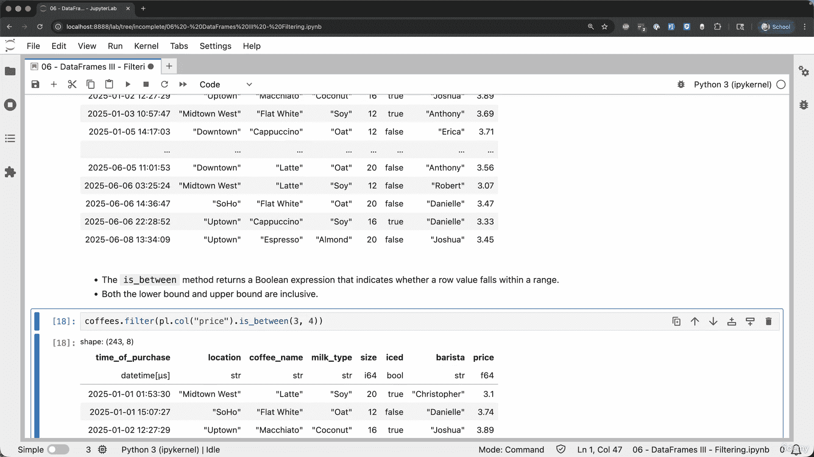

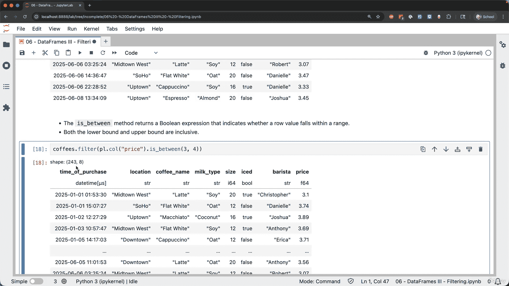

通过这个例子可以看到，仅凭你已经掌握的 Polars 基础模块，完全可以写出一个可行的解决方案。不过，随着你对库的熟悉程度加深，会发现有些方法可以帮你用更少的代码达到完全相同的结果。

## 使用 is_between 方法

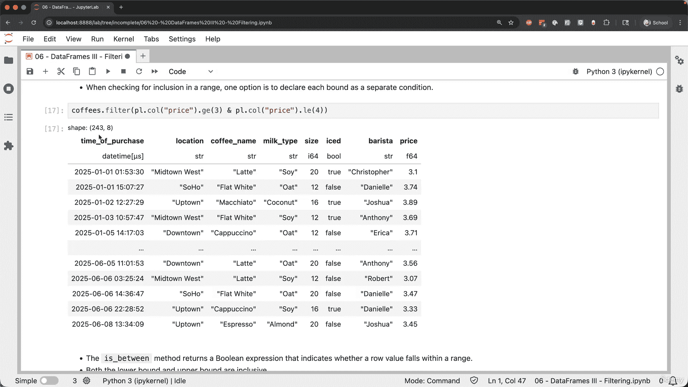

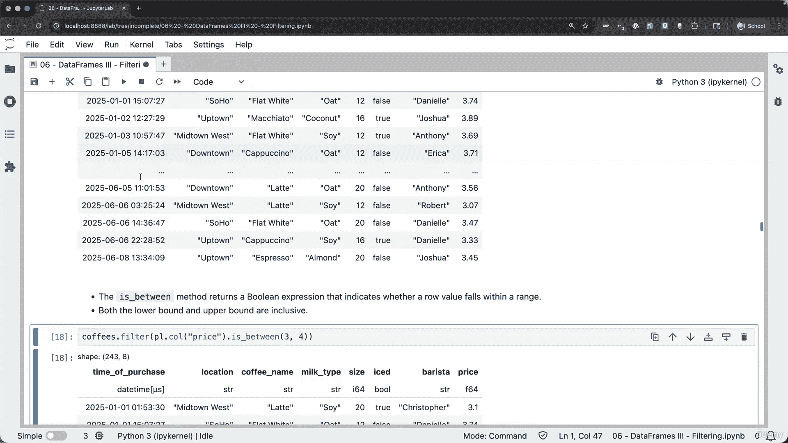

is_between 方法正是为了简化上面那种写法而设计的。它允许我们用一次方法调用、一个表达式就得到和之前完全一样的数据框。

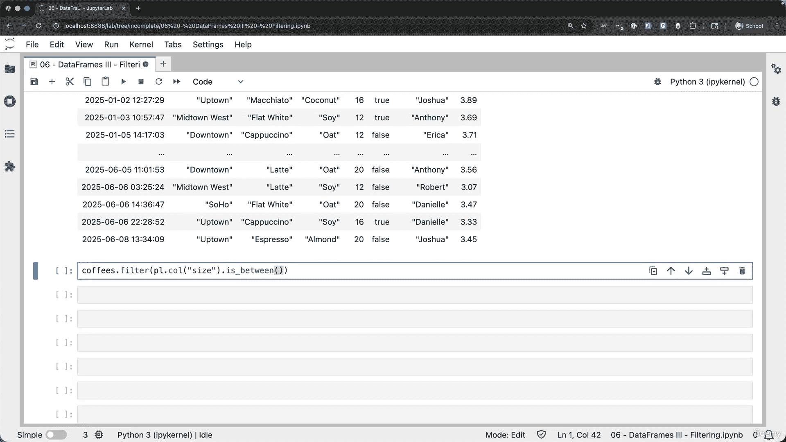

以下是使用 is_between 的具体写法：

```python
df.filter(
    pl.col("price").is_between(3, 4)
)
```

我们仍然先调用 filter 方法，然后针对价格列创建表达式。这一次，不需要拆分成两个条件，直接调用 is_between 方法。这个方法接收两个参数，分别代表下边界和上边界，换句话说，就是起始点和结束点。在这里我们传入 3 和 4。

这两个端点都是包含在内的。如果有价格恰好等于 3 或者恰好等于 4，它们也会被包含在结果里。运行这段代码会生成和上面传统方法完全一样的数据框。你会看到所有价格都在 3 到 4 美元之间，总共有 243 行数据，数据框的宽度也完全一致。

## 数字列的另一个示例

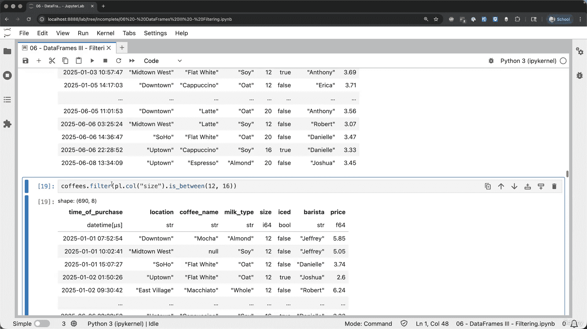

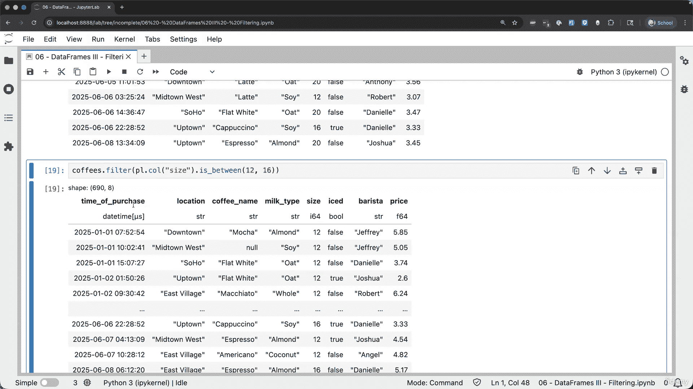

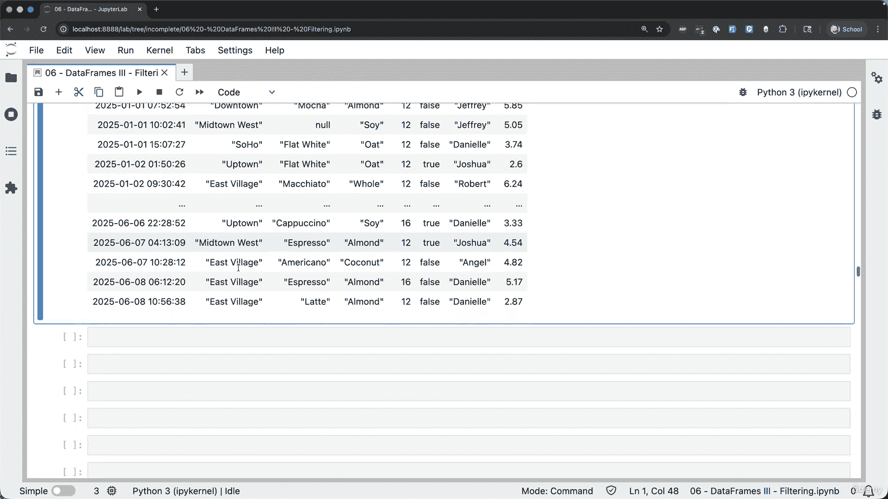

is_between 不仅适用于价格这种浮点数列，也同样适用于整数列。为了进一步说明这一点，我们来看一个使用咖啡数据集的例子，这次筛选目标列是 size。

以下是筛选尺寸在 12 到 16 之间的代码：

```python
df.filter(
    pl.col("size").is_between(12, 16)
)
```

我们调用 filter 方法，针对 size 列使用 is_between，传入 12 和 16。这样就能把所有尺寸值介于 12 和 16 之间的行全部提取出来。

举这个例子的目的，是为了让你直观看到端点的包含行为。在结果中，你会发现有一行尺寸正好是 12，还有一行尺寸正好是 16。这就证明了两个端点都被包含了。只要数值与边界完全匹配，那一行就会进入最终结果集。

## 日期时间列的应用

除了普通的数字列，is_between 方法也可以用于日期时间列。在我们的数据集中有一个名为 time_of_purchase 的列，记录了购买的具体时间。我们可以用 is_between 把落在某个日期范围内的行都筛选出来。

假设我们想提取出二月份的所有交易记录。以下是调用 filter 方法的代码：

```python
df.filter(
    pl.col("time_of_purchase").is_between(
        pl.date(2025, 2, 1),
        pl.date(2025, 3, 1)
    )
)
```

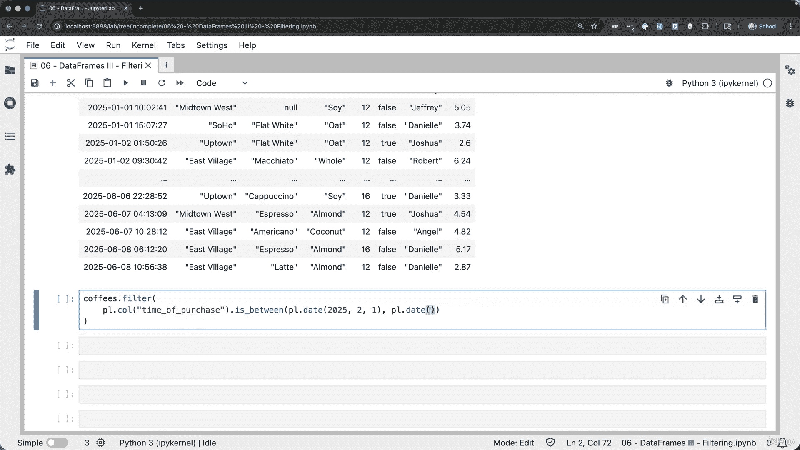

这里有一个非常重要的细节。在 Polars 里处理日期时间时，不能直接用字符串，必须创建合法的 datetime 对象。你可以使用 Python 自身的 datetime 模块，也可以使用 Polars 提供的表达式函数，比如 date 和 datetime。我们这里采用 Polars 的方式，从顶层命名空间 pl 调用 date 函数。

因为我们需要指定起始点和结束点，所以要调用两次 date 函数。二月份的开始是 2025 年 2 月 1 日。至于结束点，必须非常小心。如果我们想拿到整个二月份的所有行，截止日期应该设置为 2025 年 3 月 1 日。原因在于，Polars 在处理日期时，时分秒默认都会设为 0。也就是说，3 月 1 日的 0 时 0 分 0 秒，也就是午夜，会把这个时刻之前的所有数据都包含进来。

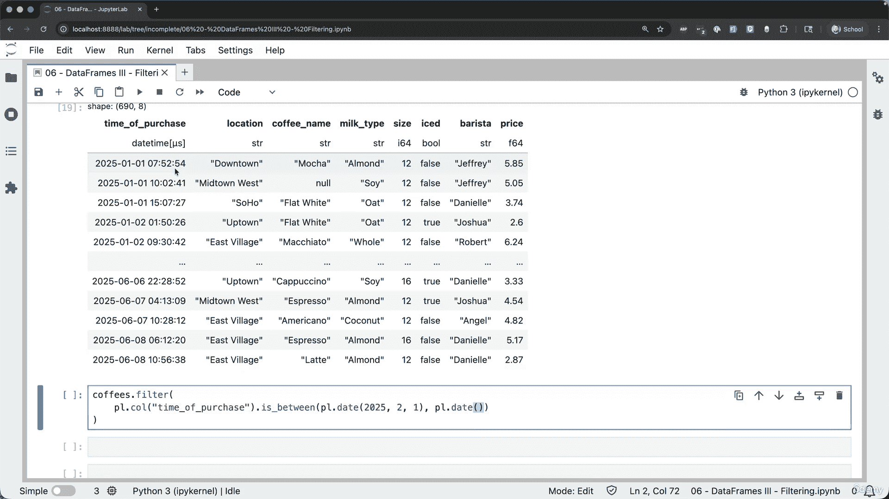

由于我们的 time_of_purchase 列是一个带有时间部分的日期时间列，我们希望一直取到那个时间点。从技术上讲，这样做可能会把恰好在 3 月 1 日午夜发生的购买记录也包含进去，但暂时这不是大问题。如果你想更精确，也可以把结束点设为 2 月 28 日的 23 时 59 分 59 秒。或者另一种写法，直接使用 2025 年 2 月 28 日。

不过这里有个陷阱。如果你把结束点直接设为 2 月 28 日，Polars 会默认把它理解为 2 月 28 日午夜，也就是 0 时 0 分 0 秒。这样一来，任何在 2 月 28 日午夜之后发生的交易都会被排除。也就是说，你其实只取到了 2 月 28 日午夜之前的数据，而漏掉了当天之后的所有记录。

现在来看正确的做法。我们把结束边界设为 3 月 1 日午夜。这样就能把从 2 月 1 日开始，一直到 2 月 28 日最后一条记录之前的所有行都提取出来。请注意，如果你把结束点指定为 2 月 28 日，那些时间在午夜之后的行就会被漏掉，因为日期默认被当作午夜处理。所以你必须小心，两个端点虽然是包含的，但面对日期时间列和普通日期列时，需要留意 Polars 的这种小特性。这里我们使用的是 date 表达式来过滤一个日期时间列，正因为如此，才会出现这种边界情况和边缘案例。

## 注意事项与边界情况

在使用 is_between 处理日期时间数据时，有几点需要牢记。首先，端点是包含的，但 Polars 对日期的默认时间是午夜。其次，当你过滤一个带有时间部分的日期时间列，却又传入一个不带时间的日期对象时，要注意时间部分会被当作 00:00:00 处理。这可能导致你原本以为包含的某一天，实际上只包含了那一天的第一秒，而漏掉了之后的所有数据。

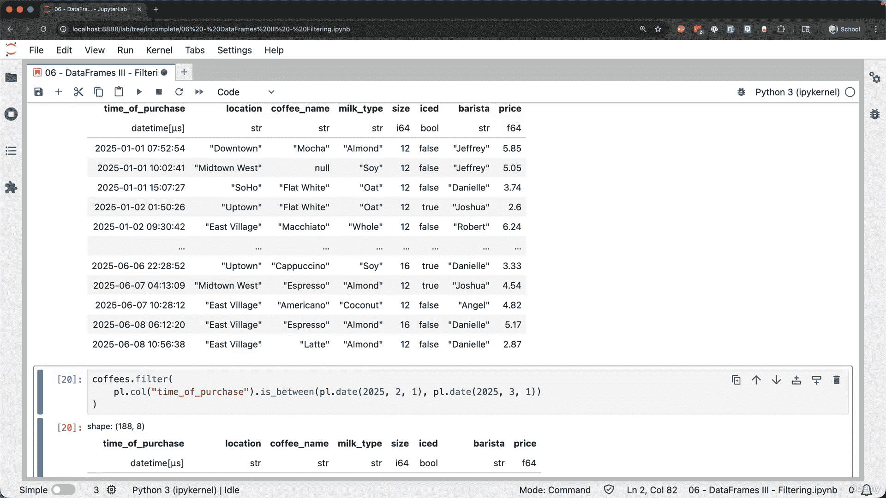

以下是避免问题的检查清单：

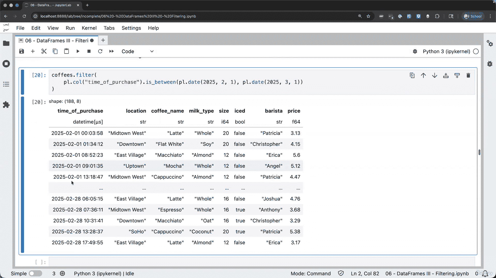

- 确认你的列类型是日期还是日期时间。
- 如果是日期时间列，结束边界最好设为下一天的午夜，以确保覆盖整个目标日期。
- 不要直接传入字符串，要用 pl.date 或 pl.datetime 构造合法对象。
- 记住两个端点都会被包含，但时间默认是 00:00:00。

## 本节总结

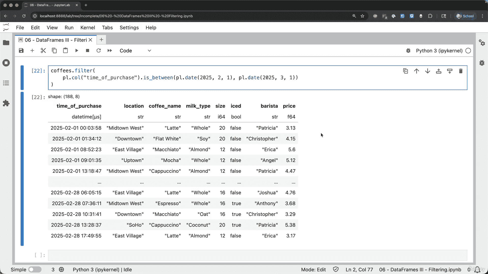

在本节课中，我们一起学习了 is_between 方法的基本用法。首先介绍了它的作用，即筛选出落在指定范围内的数据行。接着展示了传统方法，通过两个独立表达式和 and 运算符来实现区间筛选。然后重点讲解了 is_between 方法，说明它只需要一个方法调用就能得到相同结果，并支持价格、尺寸等数字列。最后我们讨论了在日期时间列上使用该方法时的注意事项，特别是关于端点包含和默认午夜时间的处理。希望这节课能帮助你更熟练地在 Polars 中进行区间过滤，下节课见。

