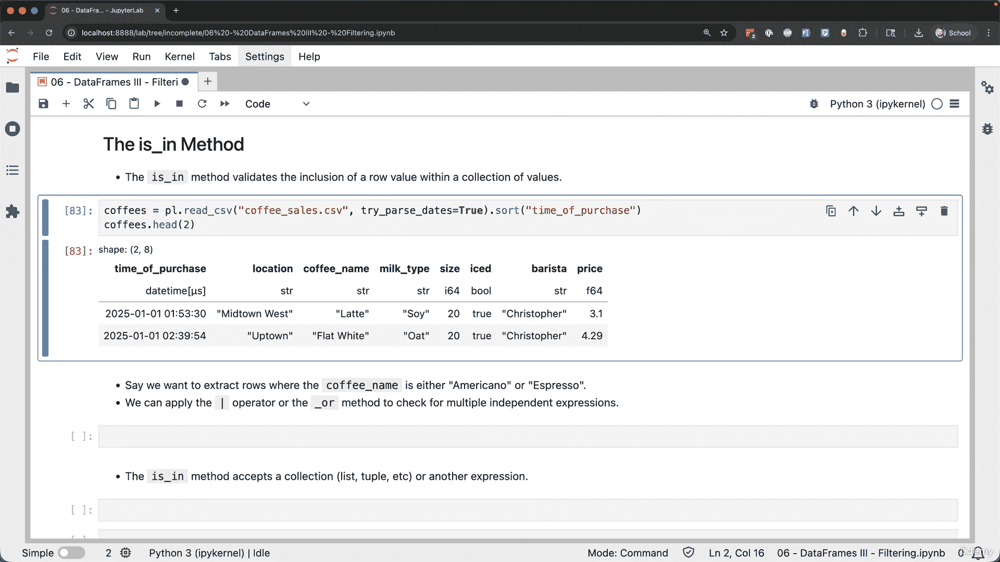
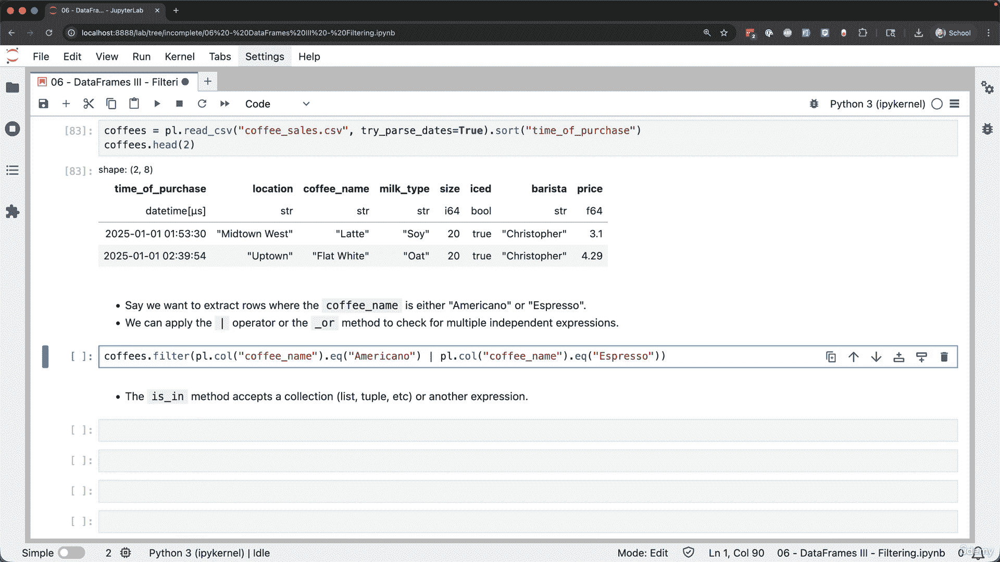
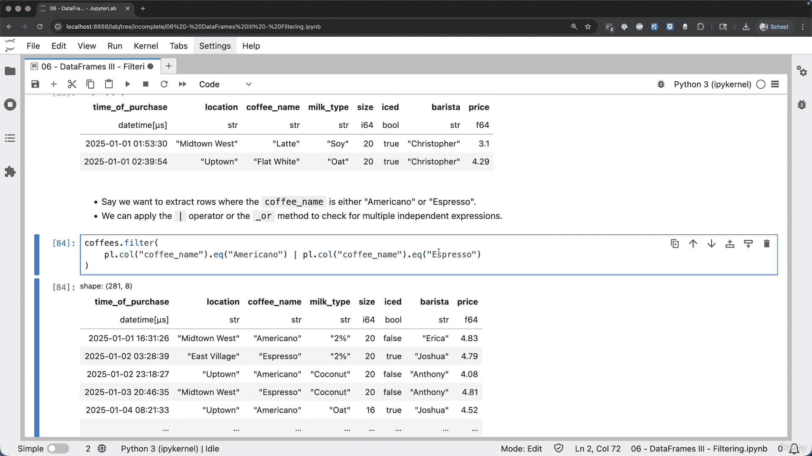
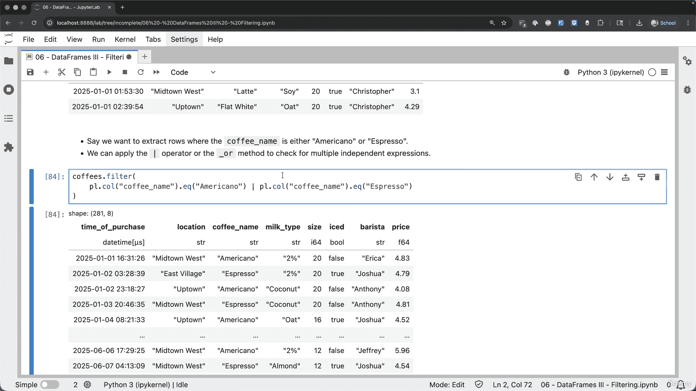
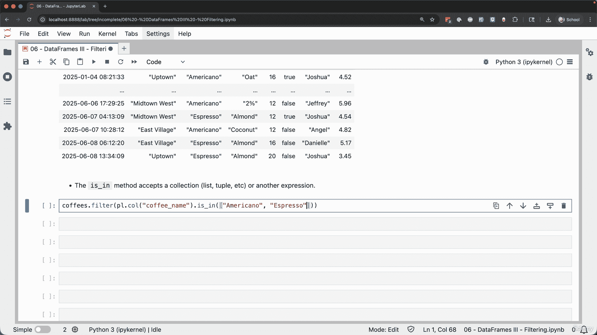
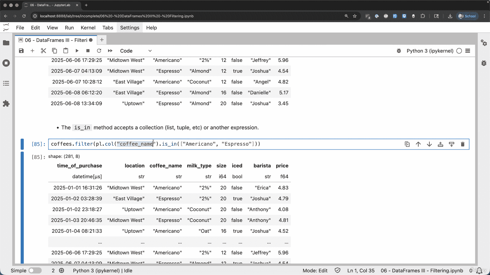
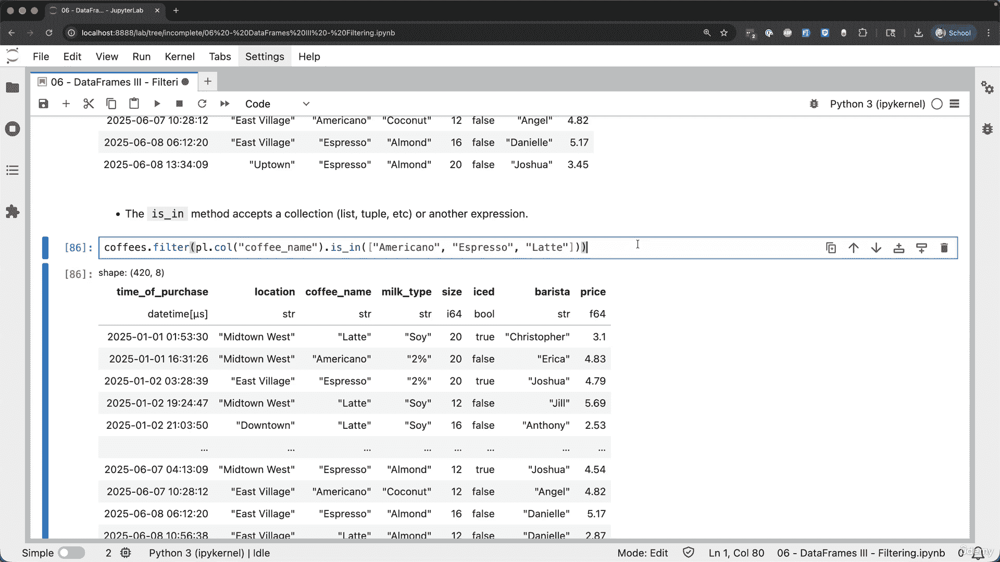

# Data Analysis with Polars and Python：95：is_in 方法 🔍

在本节课中我们将要学习 Polars 库中一个非常实用的方法，叫做 is_in。这个方法的主要作用是帮助我们判断某一行的值，是否出现在我们指定的一组可能值之中。在实际的数据分析工作里，我们经常需要根据某个列的内容来筛选数据，比如只想要某几个特定类别的行。这时候，如果只用传统的相等判断，代码可能会变得很长且难以维护。is_in 方法正是为了解决这类问题而设计的，它能让我们用更简洁的方式完成筛选操作。下面我们就一起看看这个方法具体是怎么工作的，以及它在什么情况下能帮我们节省时间和精力。




在正式讲解之前，我们先回顾一下前面课程中已经学习过的基础内容。上一节我们介绍了如何使用 filter 方法来对数据框进行过滤，以及如何结合相等运算符来匹配特定的字符串值。本节中我们来看看，当我们需要匹配多个可能的值时，有没有比一个个写等号更好的办法。了解 is_in 方法之后，你会发现处理这类需求会变得更加直接，也不容易写出冗长的代码。


接下来，我们先设定一个具体的场景，方便大家理解这个方法解决的问题。假设我们有一张包含咖啡订单信息的数据表，其中有一列叫做 coffee_name，记录每一杯咖啡的名称。现在我们的目标是从这张表中提取或筛选出所有符合条件的行，条件就是 coffee_name 这一列的值必须是 Americano 或者 espresso 这两者之一。这是一个很常见的需求，比如我们想要统计只卖这两种咖啡的订单数量，或者想要只看这两种咖啡的销售数据。为了完成这个任务，我们需要告诉 Polars，哪些行应该被保留，哪些行应该被剔除。


解决这个问题的一种方式，是使用 or 运算符，也就是竖线符号。以下是具体的操作步骤：

- 首先调用 filter 方法，传入一个表达式。
- 在这个表达式中，我们针对 coffee_name 列使用 EQ 方法，也就是相等判断，检查值是否等于 Americano。
- 接着使用竖线符号创建另一个条件，表示或者。
- 然后把刚才的表达式复制一遍，把字符串从 Americano 改成 espresso，组成第二个独立的判断。
- 最后把两个判断用 or 运算符连接起来，传给 filter 方法。

这种写法在逻辑上是完全正确的，代码运行的结果也和我们预期的一样，能够准确筛选出 coffee_name 为 Americano 或 espresso 的所有行。不过，这种方法有一个明显的不足之处。如果我们明天想要把 latte 也加入筛选名单，就必须再写一个完全独立的表达式，并且再添加一个竖线符号。这样一来，随着我们想要检查的值越来越多，代码就会变得非常啰嗦，难以阅读和维护。


从本质上来说，我们真正想做的事情，是检查 coffee_name 列中的每个值，是否出现在一个由多个可能值组成的集合里。针对这种情况，Polars 提供了 is_in 方法，可以让代码变得更加整洁。is_in 方法的核心逻辑可以用下面这个简单的公式来描述：







```text
is_in(列值, 允许值的集合) = 如果列值在集合中则返回真，否则返回假
```

以下是使用 is_in 方法的步骤：

- 同样以 filter 方法作为起点。
- 针对 coffee_name 列创建表达式，但这次不再使用 EQ 方法。
- 调用 is_in 方法，注意方法名中间带有下划线。
- 为 is_in 方法提供一个集合，这个集合可以是列表、元组，甚至可以是同一个数据框中另一列的表达式。
- 在这个例子中，我们直接提供一个列表，里面包含我们想要检查的所有字符串，也就是 Americano 和 espresso。

下面是一段可以直接运行的代码示例，展示如何使用 is_in 方法完成同样的筛选任务：

```python
import polars as pl

# 假设 df 是我们的数据框，包含 coffee_name 列
df = pl.DataFrame({
    "coffee_name": ["Americano", "espresso", "latte", "cappuccino", "Americano"],
    "price": [30, 25, 35, 32, 30]
})

# 使用 is_in 方法筛选 coffee_name 为 Americano 或 espresso 的行
result = df.filter(pl.col("coffee_name").is_in(["Americano", "espresso"]))

print(result)
```

执行这段代码之后，得到的结果和刚才使用 or 运算符时完全一样。所有保留下来的行，它们的 coffee_name 列要么是 Americano，要么是 espresso。你可以直接看到输出结果里只包含这两种咖啡，其他行都被过滤掉了。


使用 is_in 方法最大的好处在于灵活性。如果明天我们想要在筛选条件里再加入 latte，不需要新建第三个表达式，也不需要再加一个竖线符号，只需要把 latte 作为第三个元素添加到同一个列表里就可以了。比如把列表改成 ["Americano", "espresso", "latte"]，代码就能立刻生效，得到包含这三种咖啡的所有行。这样一来，我们就完成了和之前完全相同的筛选结果，却避免了重复写表达式和连接运算符的麻烦。总体来说，is_in 方法的写法比刚才看到的 or 方案更加简洁，也更容易扩展。








本节课中我们一起学习了 Polars 中的 is_in 方法。我们首先回顾了使用 or 运算符和多个 EQ 表达式来筛选多个可能值的传统做法，并指出了这种方法在需要频繁添加新值时会变得冗长的问题。接着我们介绍了 is_in 方法的基本用法，展示了如何传入一个列表来一次性指定多个允许的值，并通过代码示例验证了它能够得到和传统方法完全一致的筛选结果。最后我们说明了 is_in 方法在动态扩展筛选条件时更具优势，只需在列表中添加新元素即可，无需修改表达式结构。希望这节课能帮助你掌握这个实用的方法，在未来的数据分析工作中写出更简洁、更易维护的 Polars 代码。

