# 📊 Data Analysis with Polars and Python：96：remove 方法

在本节课中，我们将一起学习 Polars 库中的 remove 方法。在之前的章节里，我们已经多次接触到 filter 方法，它是从数据框中提取行的主要工具。本节课我们要认识 filter 方法的“孪生兄弟”——remove 方法。简单来说，filter 用来选出满足条件的行并保留，而 remove 用来找出满足条件的行并把它们扔掉。这两个方法正好相反，掌握 remove 之后，你在处理数据时会多一种更灵活的选择方式。

上一节我们介绍了 filter 方法，它接受一个或多个表达式，并返回只包含满足这些表达式的行的新数据框。换句话说，只要表达式的结果为真，那一行就会被留下来。

而 remove 方法正是 filter 的互补方法，它的逻辑正好相反。remove 同样接受一个或多个表达式，但它返回的数据框会排除掉所有满足表达式的行。也就是说，我们不是选中符合条件的行，而是把符合条件的行剔除出去。

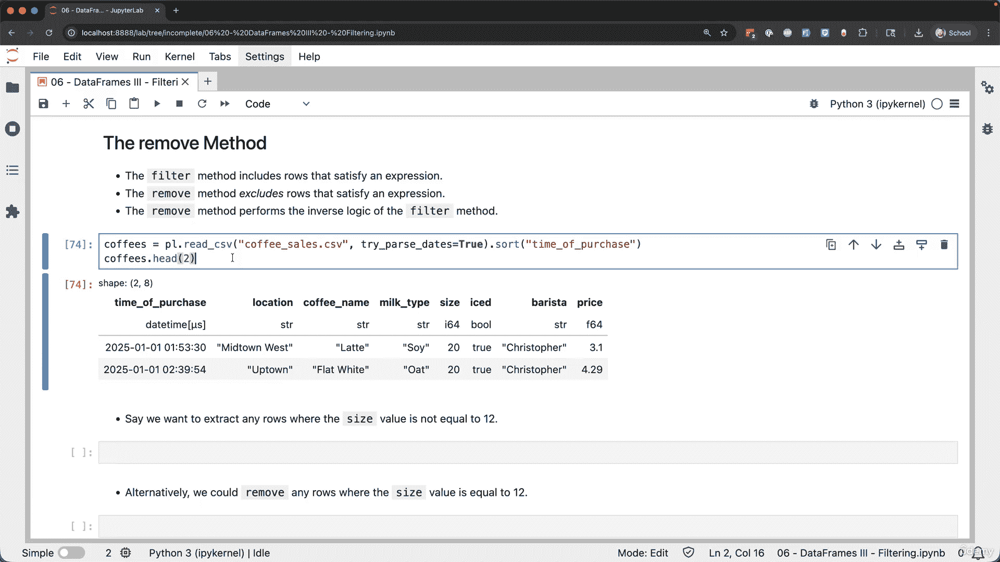

核心概念可以用下面这个公式来理解：

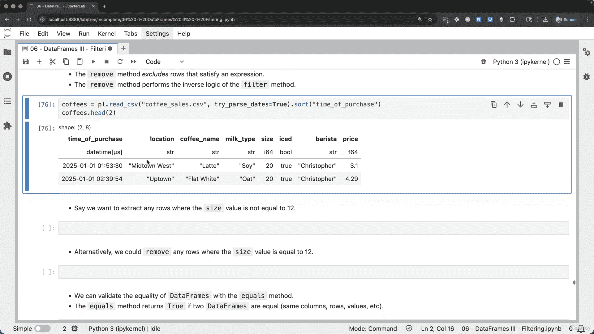

```
filter(表达式)  →  只保留 表达式 为真 的行
remove(表达式)  →  把 表达式 为真 的行全部删除
```

或者用代码来表示这个对比关系：

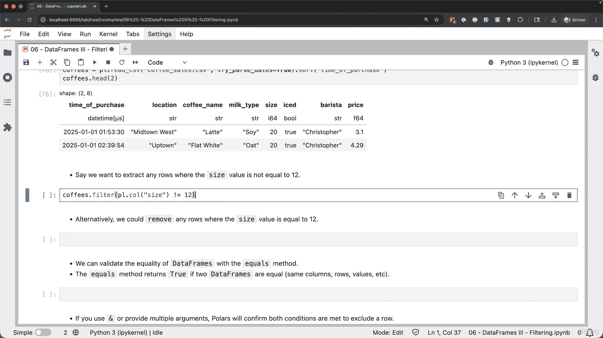

```python
# filter：保留 size 不等于 12 的行
df.filter(pl.col("size") != 12)

# remove：删除 size 等于 12 的行
df.remove(pl.col("size") == 12)
```

接下来我们看一个具体的例子，帮助你更直观地理解 remove 方法是如何工作的。

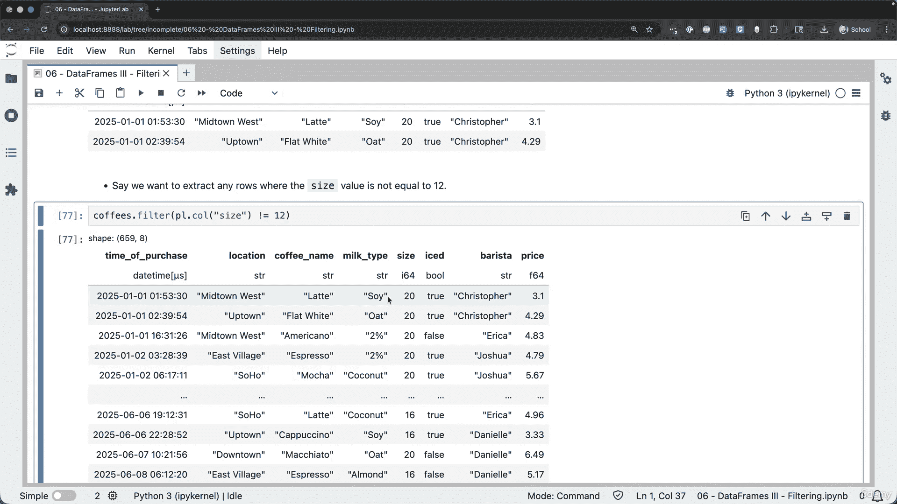

假设我们有一个名为 coffees 的数据框，里面记录了很多咖啡订单的信息。现在我们想要解决一个问题：从 coffees 中提取所有 size 列的值不等于 12 的行。

第一种解决办法是使用 filter 方法。下面是具体的操作思路：

- 针对 size 列创建一个表达式
- 使用不等号运算符（也可以写成 ne 方法）
- 筛选出 size 不等于 12 的行

最终我们会得到一个包含 659 行的数据框，并且 size 列里的每一个值都不等于 12。

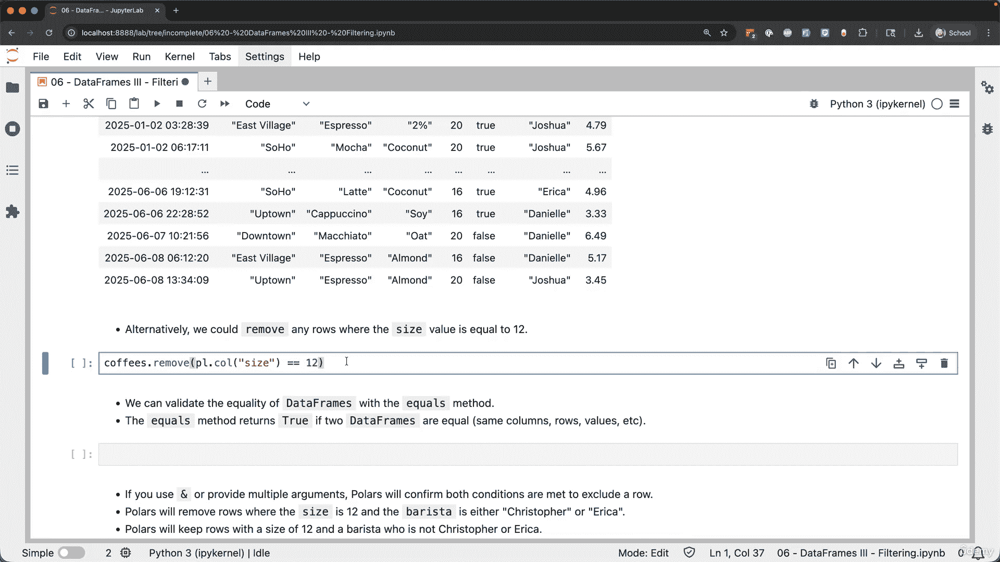

下面是用 filter 实现的代码示例：

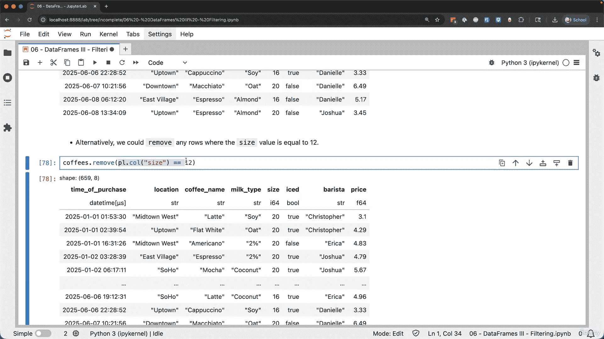

```python
df.filter(pl.col("size") != 12)
```

另一种思路是直接交给 Polars，让它从 coffees 开始，把所有 size 等于 12 的行统统移除。因为只要把 size 等于 12 的行删掉，剩下的结果集就会和上面用 filter 得到的完全一样。

这时候我们就可以调用 remove 方法了。remove 也是作用在数据框上的方法，和 filter 一样，它接受一个或多个表达式。不同之处在于，filter 是把符合条件的行选出来，而 remove 是把符合条件的行省略或排除掉。

在这个例子中，我们要告诉 Polars：请移除所有满足以下条件的行，也就是 size 列的值等于 12 的行。

```python
df.remove(pl.col("size") == 12)
```

执行之后，返回的数据框里每一行的 size 值都不会是 12，因为那些 size 等于 12 的行已经被移除了。你也可以把 remove 理解为：选中那些让表达式结果为假的行，然后只保留这些行。

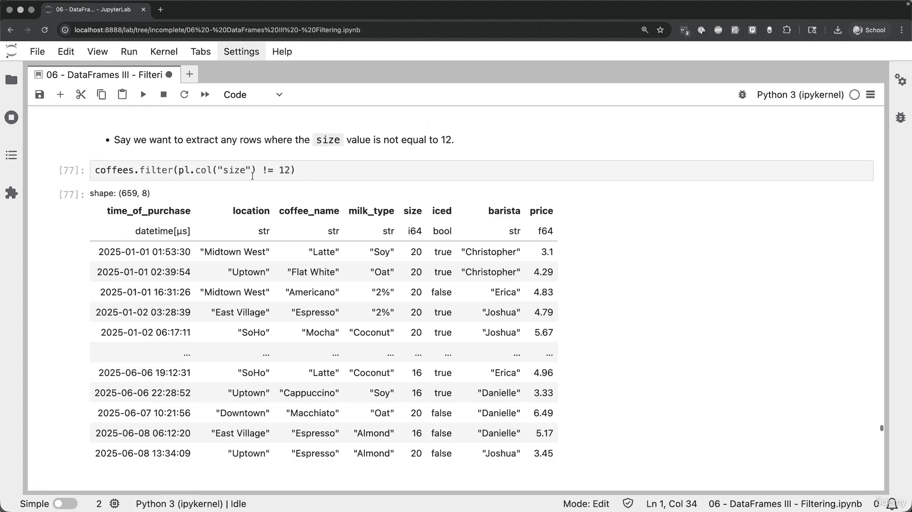

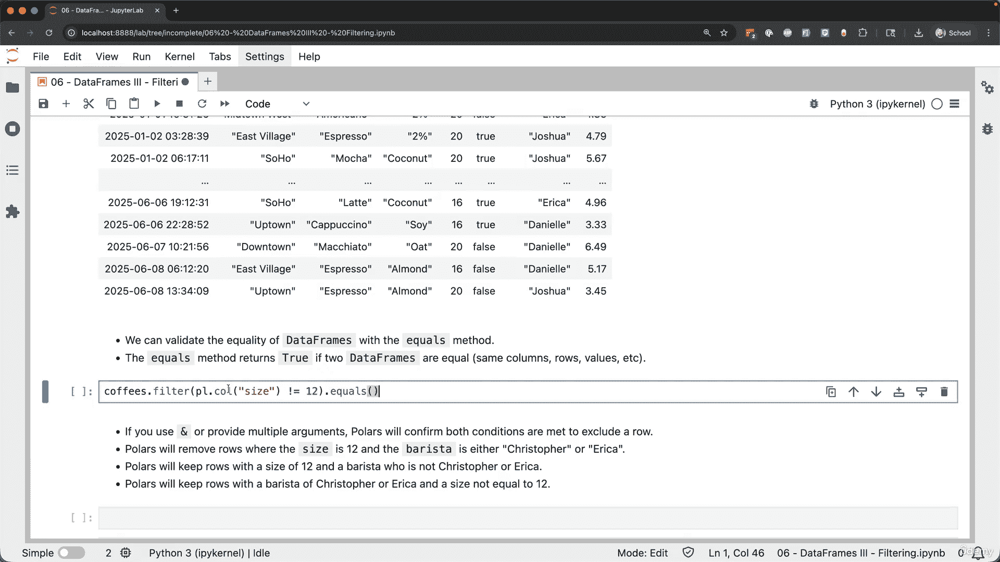

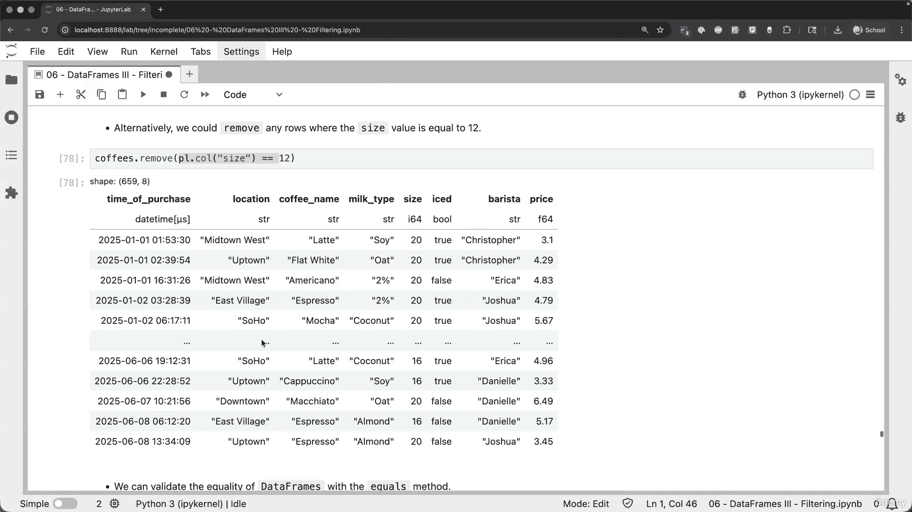

两种方法得到的结果是否完全一致呢？Polars 提供了一个 equals 方法，可以用来判断两个数据框是否完全相同。equals 方法可以作用在任意数据框上，传入另一个数据框作为参数，如果两者完全一致，就会返回 true。所谓完全一致，就是列数相同、行数相同，而且每一个单元格的值都必须完全一样。

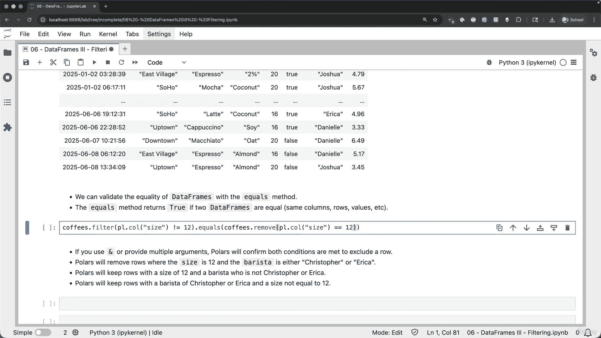

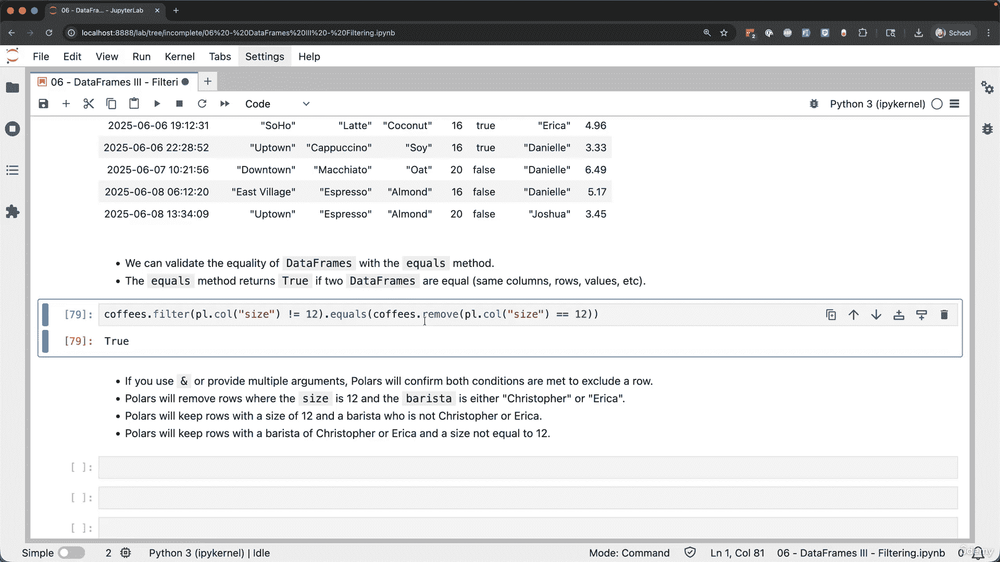

我们可以把用 remove 方法生成的数据框复制过来，然后和用 filter 生成的那个数据框做比较。你会发现它们确实是完全相等的。

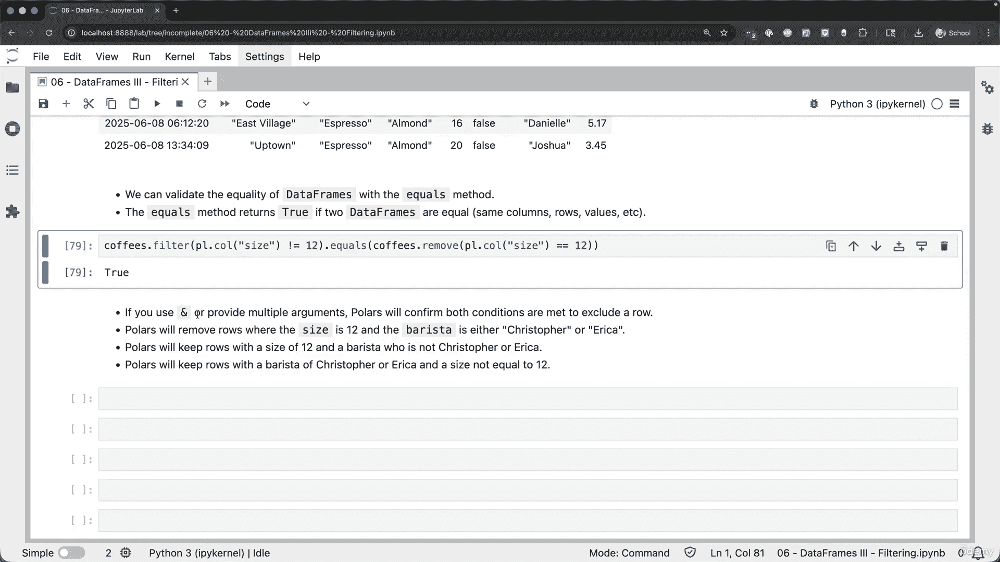

在课程前面部分，我们提到过 filter 方法可以接受多个表达式，并且可以使用 and 运算符或 or 运算符把它们组合起来。另外，你也可以直接传入多个依次排列的表达式作为参数。remove 方法的 API 非常相似，支持所有这些用法，效果也和你预期的一样。

以下是几种常见的组合方式：

第一种方式是使用 and 运算符。比如，我们想要移除同时满足两个条件的行。注意，如果两个表达式中只有一个被满足，那这一行是不会被移除的。只有两个条件都成立时，那一行才会被删掉。

具体操作时，我们要先从咖啡数据框开始，然后调用 remove 方法。首先提供第一个表达式，针对 size 列，要求值等于 12。接着加上 and 运算符。如果你想使用 and 运算符，记得要把表达式用括号包裹起来。

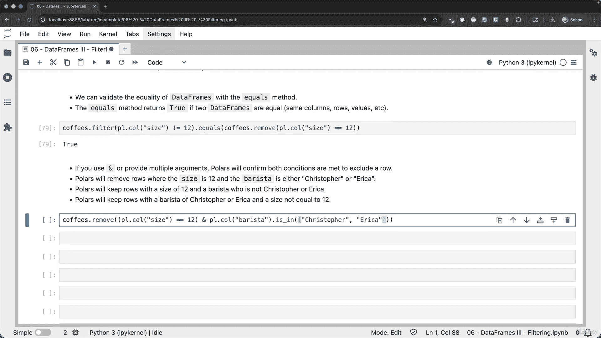

第二个条件可以针对 barista 列，使用我们之前学过的 is_in 方法，假设允许的名单里有 Christopher 和 Erica 两个人。

也就是说，我们要移除那些同时满足以下两个条件的行：size 等于 12，并且 barista 是 Christopher 或 Erica。

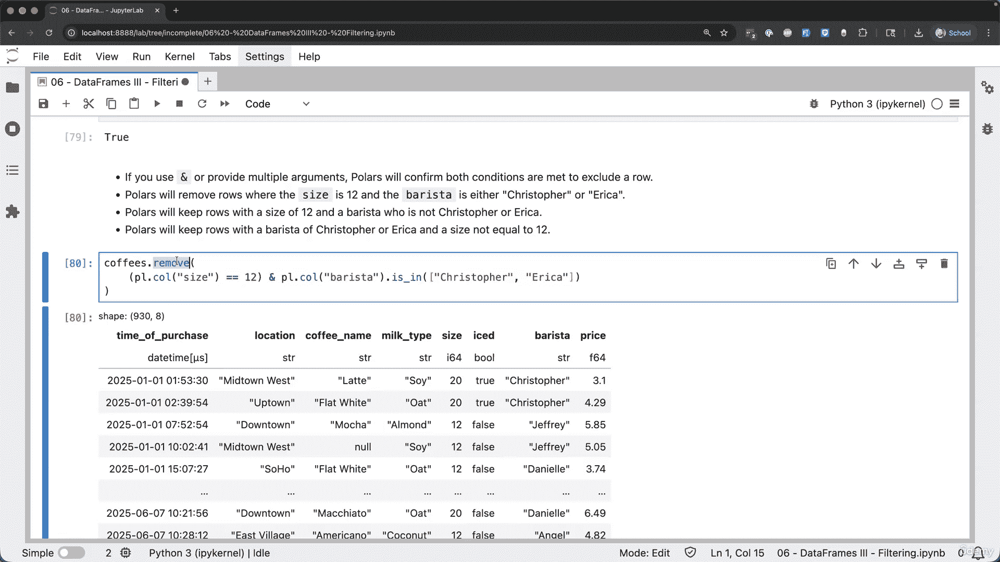

```python
df.remove(
    (pl.col("size") == 12) & 
    (pl.col("barista").is_in(["Christopher", "Erica"]))
)
```

执行之后，你会发现数据框里依然会有一些 size 等于 12 的行，只要它们的 barista 不是 Christopher 或 Erica。同样，也会有一些 barista 是 Christopher 或 Erica 的行，只要它们的 size 不等于 12。只有当这两个条件同时满足时，那一行才会被移除。

除了使用 and 运算符，还有另一种语法我们之前用得比较少。当你调用 filter 并想要应用 and 逻辑时，除了用 and 运算符，还可以把多个表达式直接作为参数传给 filter 方法。remove 方法也适用完全相同的逻辑。

也就是说，你可以把上面的例子改写成传入两个依次排列的表达式：

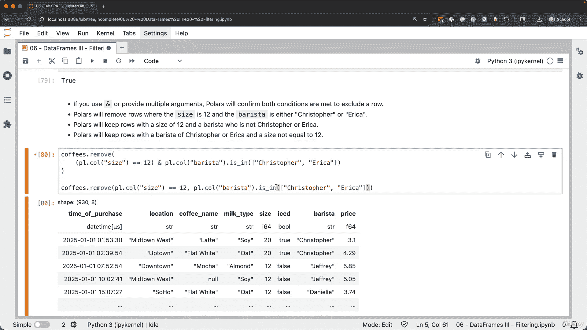

```python
df.remove(
    pl.col("size") == 12,
    pl.col("barista").is_in(["Christopher", "Erica"])
)
```

记得要为 remove 方法以及 is_in 方法都正确关闭括号。这样写出来的结果数据框，和上面使用 and 运算符的版本完全一样，执行的逻辑也是一模一样的：移除那些同时满足 size 等于 12 以及 barista 在名单里这两个条件的行。

最后，我们还可以使用 or 运算符。把上面的 and 符号换成 or 符号（也就是竖线 |），意思就变成了：移除所有 size 等于 12，或者 barista 是 Christopher 或 Erica 的行。

```python
df.remove(
    (pl.col("size") == 12) | 
    (pl.col("barista").is_in(["Christopher", "Erica"]))
)
```

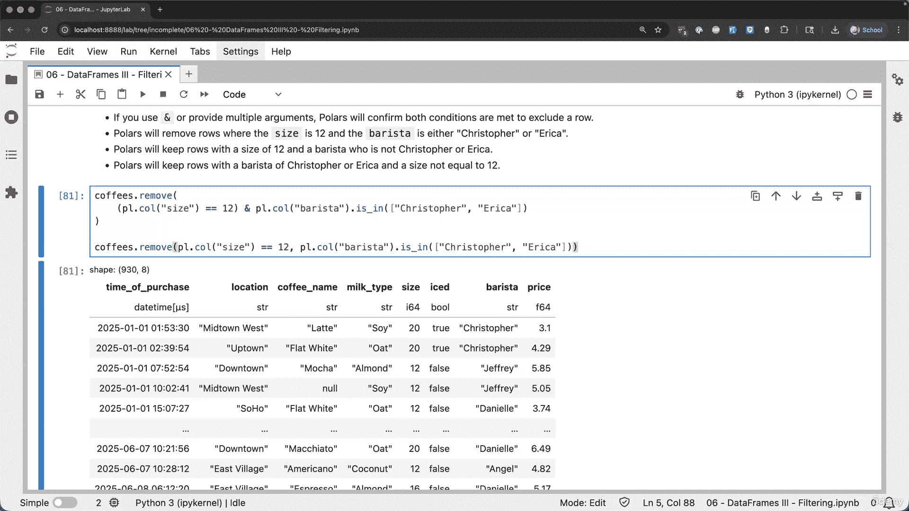

这样一来，我们会得到一个更小的数据集，因为只要满足这两个条件中的任意一个，那一行就会被移除。

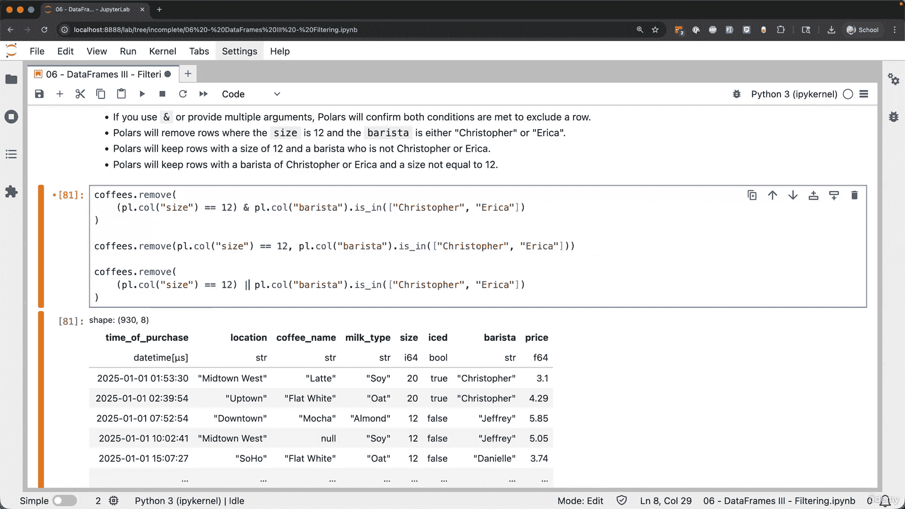

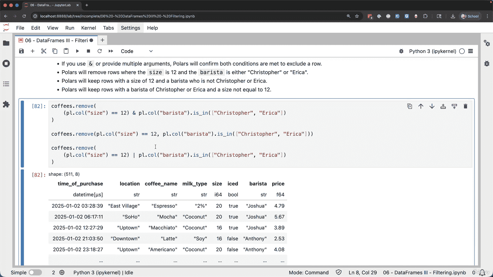

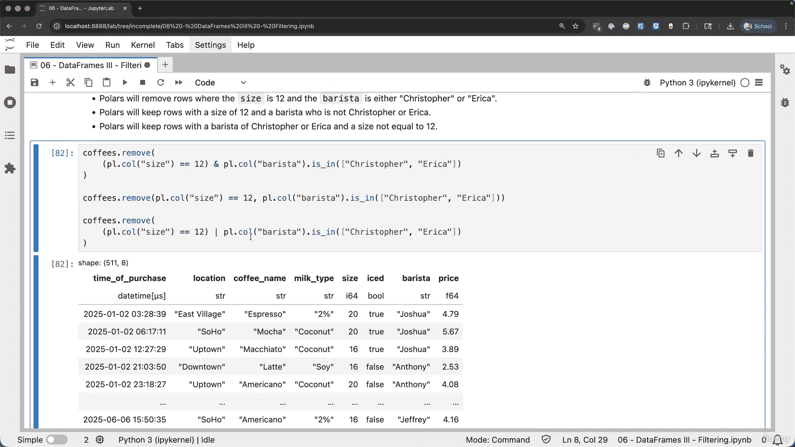

本节课中我们一起学习了 Polars 中的 remove 方法。它是 filter 方法的反向操作：filter 用来选中并保留满足条件的行，而 remove 用来剔除并排除满足条件的行。我们通过咖啡数据集的例子，演示了如何用 remove 替代 filter 来得到相同的结果，也学习了如何使用 equals 方法验证两个数据框是否完全相等。此外，remove 方法还支持多表达式组合，包括使用 and 运算符、or 运算符，以及直接传入多个顺序表达式作为参数。掌握 remove 之后，你在做数据筛选时会多一种更简洁的思路。
