# Polars 数据分析：097：波浪号非运算符 🚫

## 本节概述

在本节课中我们将要学习 Polars 中一个非常特殊的符号，叫做波浪号，英文是 Tilde。这个符号在大多数键盘上通常位于数字键 1 的左侧，使用时需要配合 Shift 键，长得像一条波浪线。它的核心作用是对布尔值进行取反操作，也就是把真变成假，把假变成真。我们会先从一个简单的例子开始，看看它具体是如何工作的，然后再看看它在实际筛选数据时能发挥什么作用。接下来还会介绍一个和它功能完全一样的方法，叫做非方法，写作 not_。最后我们会教你如何用变量把复杂的表达式拆分开，让代码更容易阅读和维护。


## 波浪号符号的基本含义

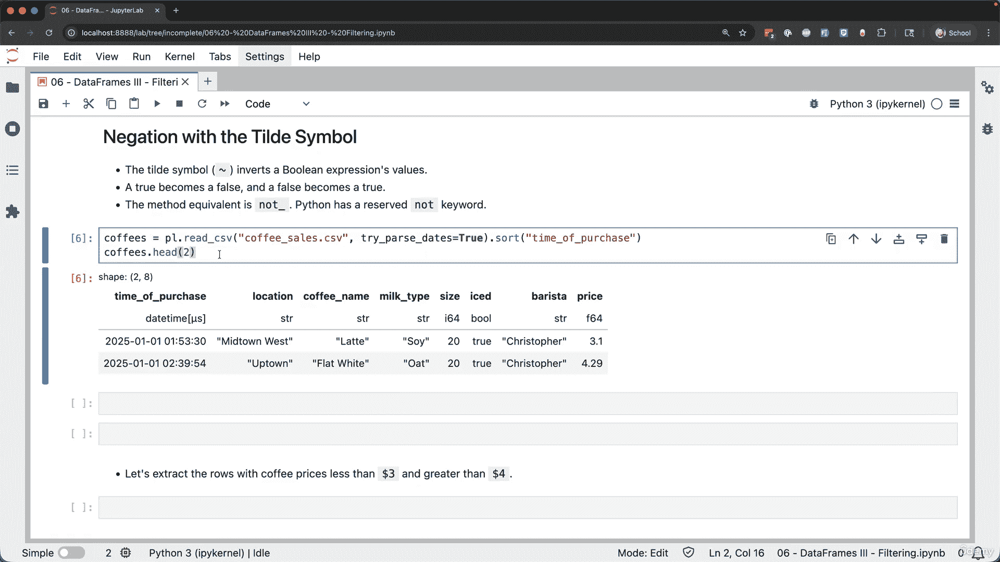

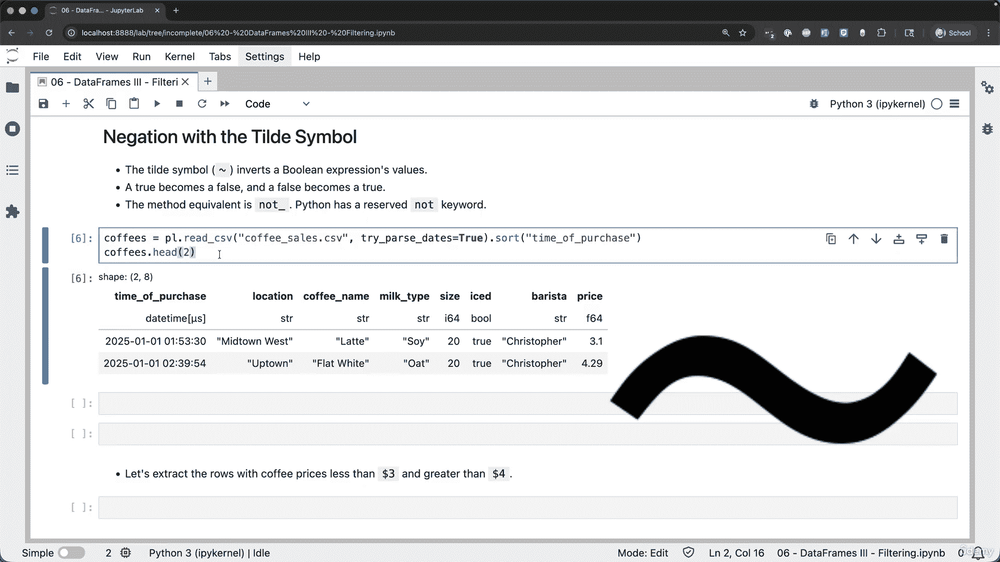

非运算的意思是对某个值取相反。在布尔列中，非运算会把所有的 true 变成 false，把所有的 false 变成 true。换句话说，就是把当前的值完全颠倒过来。

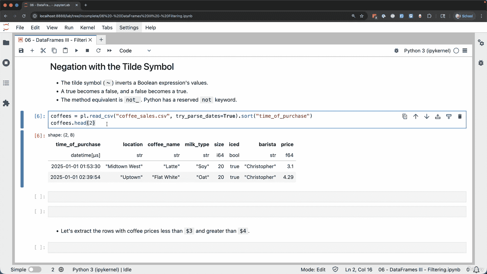

以下是非运算的行为描述：

```
原始值：true  ->  取反后：false
原始值：false ->  取反后：true
```

接下来我们来看一个具体的代码示例。首先我们需要重新执行导入代码，然后调用咖啡数据框的 select 方法。我们只选取 barista 这一列，这一列里存储的是咖啡师的名字字符串。

以下是基础代码结构：

```python
df.select("barista")
```

然后我们要把 barista 列里的每个值都和名字 Chris 进行比较。这里使用等于方法 EQ，当然你也可以使用双等号这个等价运算符。我们把每个值都和 Christopher 这个名字做比较，然后调用 alias 方法，把新列命名为 is Chris。

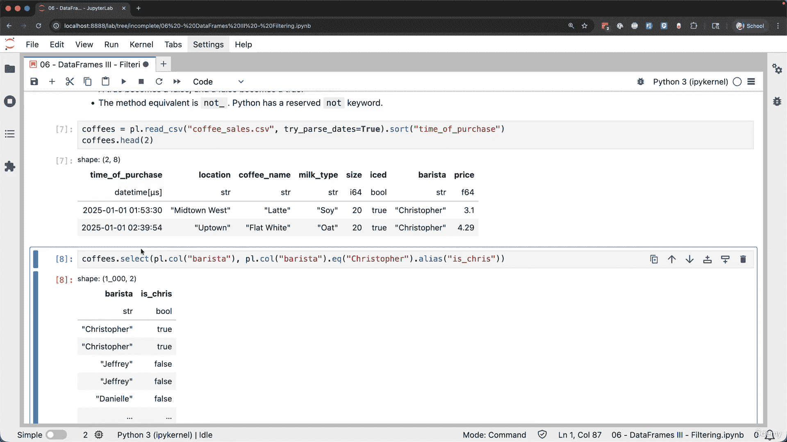

以下是完整的表达式：

```python
df.select(
    pl.col("barista").eq("Christopher").alias("is Chris")
)
```

执行之后，会得到一个布尔列。在名字是 Christopher 的地方，结果是 true；在其他所有地方，结果是 false。


## 在表达式前加上波浪号

接下来我们要对刚才的表达式做一个小改动。我们把完整的第二个表达式复制下来，保持原样不变，只是在最前面加上波浪号符号。这个符号会把后面跟着的布尔表达式完全颠倒过来。也就是说，原来是 true 的地方变成 false，原来是 false 的地方变成 true。

我们还要把列名改成 is not Chris，这样更容易理解。下面是修改后的代码：

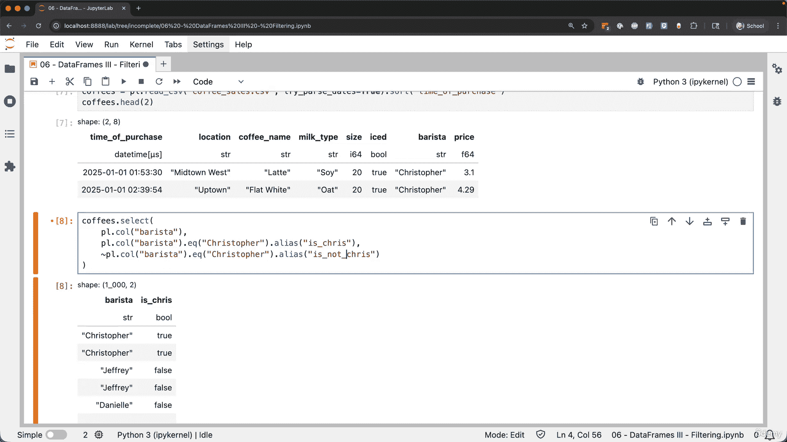

```python
df.select(
    ~pl.col("barista").eq("Christopher").alias("is not Chris")
)
```

运行之后，你会看到这一列里的每个值都和原来正好相反。这就是波浪号符号的核心作用，也就是做取反操作。


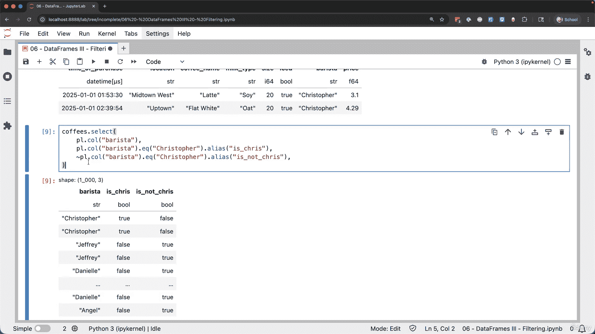

## 非方法的等价用法

波浪号有一个功能完全等价的方法，叫做非方法，也就是 not 方法。我们可以把刚才的代码复制下来，去掉波浪号，然后直接在原来的表达式上调用 not 方法。

需要注意的是，方法名里有一个下划线，写作 not_。这个下划线并没有什么特殊含义，只是方法名里允许使用的一个普通字符。Polars 团队之所以这么做，是因为 Python 语言本身有一个原生的 not 关键字，开发者想要避免和这个技术关键字产生任何冲突。

以下是使用非方法的代码：

```python
df.select(
    pl.col("barista").eq("Christopher").not_().alias("is not Chris")
)
```

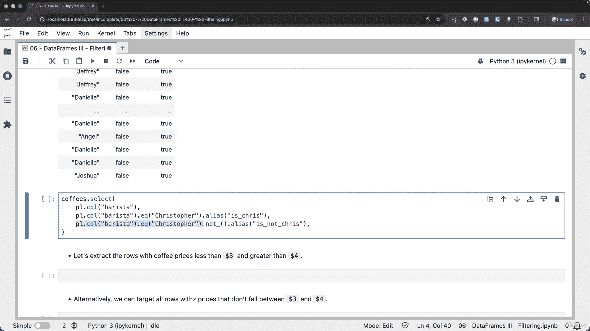

这个方法的效果和波浪号符号完全一样，它会把布尔表达式产生的值全部颠倒过来。原来是 true 的地方变成 false，原来是 false 的地方变成 true。


## 实际应用场景：筛选价格范围之外的数据

现在我们来看一个波浪号非常有用的实际问题。假设我们想从咖啡数据里筛选出价格小于 3 美元或者大于 4 美元的所有行。

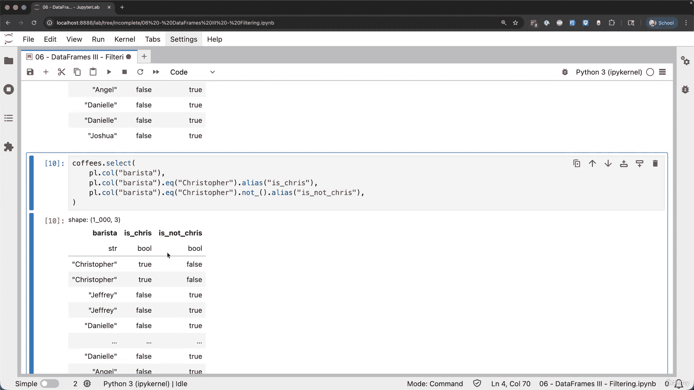

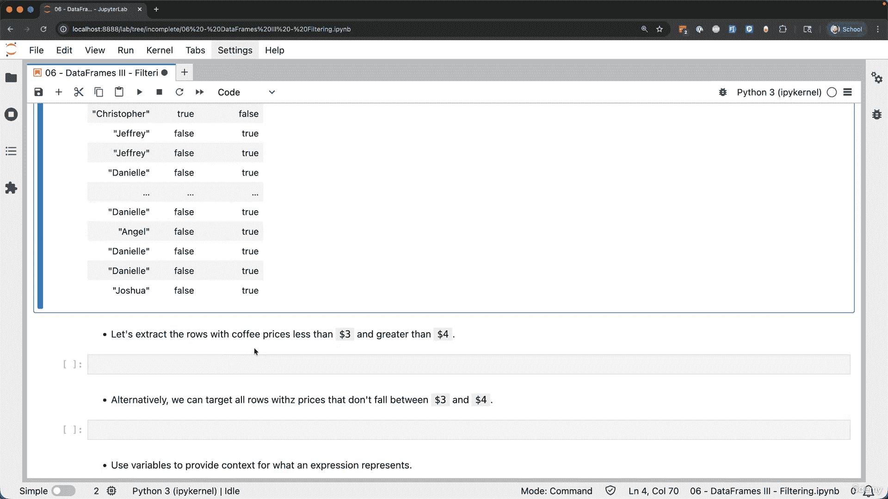

以下是使用或运算符的解决思路：

一种解决办法是使用或运算符。我们先调用 filter 方法，针对 price 列建立表达式。我们需要覆盖不等式的两个方向。首先是所有价格小于 3 美元的咖啡，可以使用 Lt 方法，传入参数 3。然后还要覆盖另一边，也就是所有价格大于 4 美元的咖啡，使用 GT 方法，传入参数 4。最后用 or 运算符把这两个条件组合起来。

以下是这种写法：

```python
df.filter(
    (pl.col("price").lt(3)) | (pl.col("price").gt(4))
)
```

这种写法需要两个独立的表达式，中间还要加一个或运算符。代码稍微有点啰嗦。


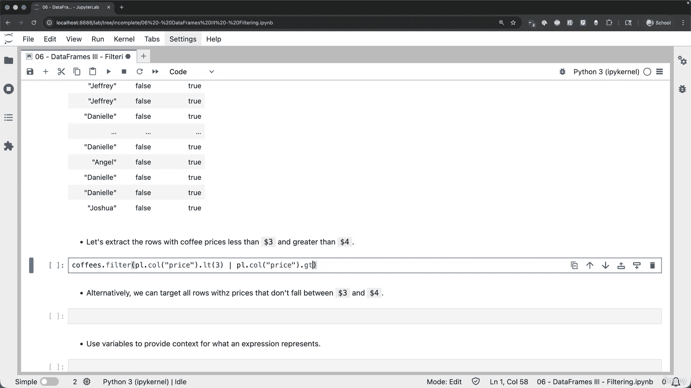

## 使用 is_between 方法配合波浪号

还有一种思路会更简洁，代码也更少。之前我们介绍过 is_between 方法，这个方法会在某个值落在指定范围内时返回 true。我们针对 price 列调用 is_between 方法，要求价格在 3 到 4 之间。

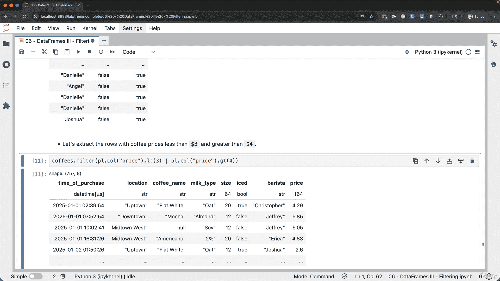

以下是基础表达式：

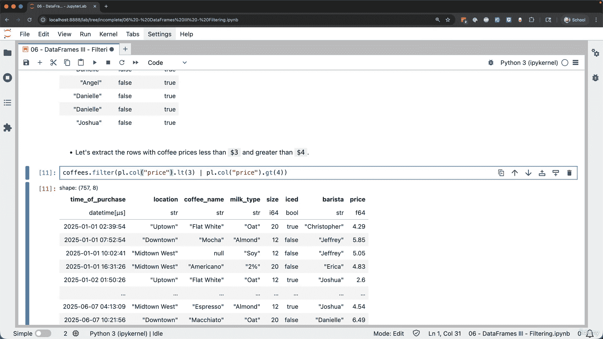

```python
pl.col("price").is_between(3, 4)
```

这个表达式会给出所有在范围内的行，也就是 true 的行。但是我们想要的正好相反，我们想要所有不在这个范围内的行。这时候就可以用波浪号把整个布尔结果翻转过来。

以下是最终代码：

```python
df.filter(
    ~(pl.col("price").is_between(3, 4))
)
```

运行之后，我们会得到和上面完全一样的数据框，一共有 757 行。这些行里的价格从技术上讲都不在 3 到 4 之间。这是一种把问题思路反转过来的优雅方式。


## 使用非方法替代波浪号

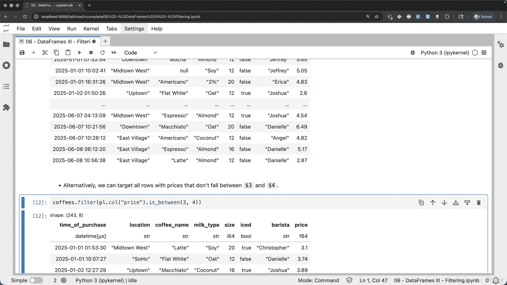

当然，你也可以保留原来的 is_between 表达式，在最后加上非方法来达到同样的效果。非方法会修改那个表达式，产生完全一样的结果。

以下是代码示例：

```python
df.filter(
    pl.col("price").is_between(3, 4).not_()
)
```


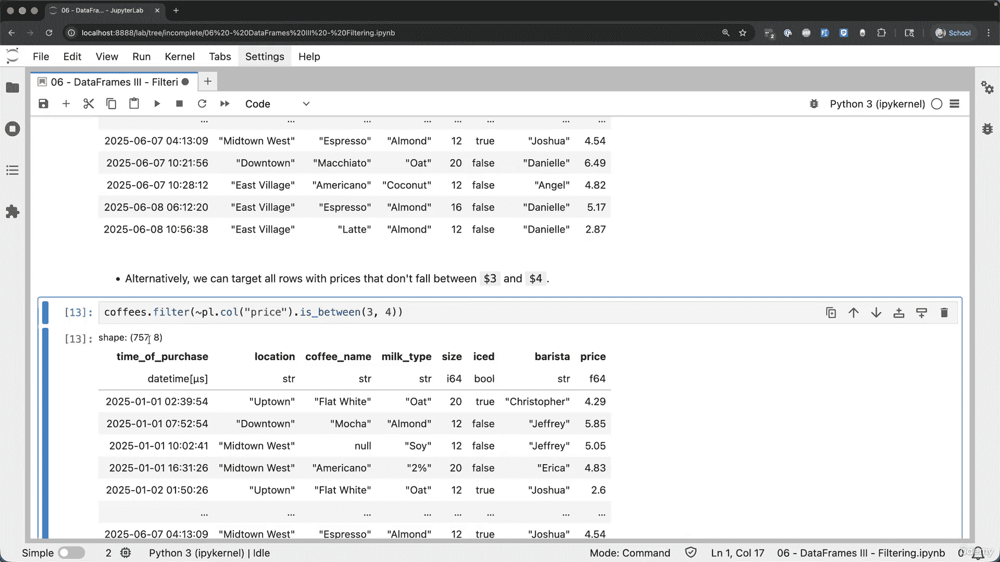

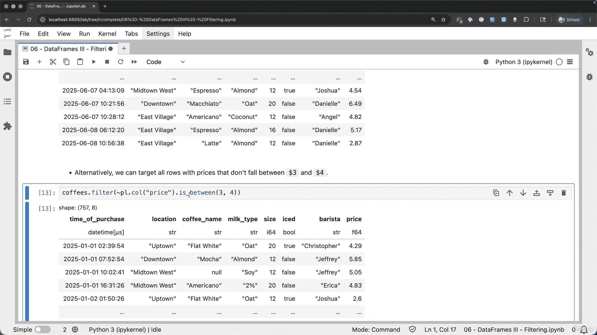

## 用变量拆分复杂表达式

如果波浪号、方法调用和非方法这些特殊符号让你觉得困惑，有一个很简单的办法可以把事情拆开来处理。你可以把表达式赋值给描述性的变量，这样代码会更容易理解。

以下是变量定义示例：

比如下面，我们先声明一个变量叫做 price_between_3_and_4，把价格在 3 到 4 之间的表达式赋给它。然后再声明另一个变量叫做 other_priced_coffees，用来表示其他价格的咖啡。

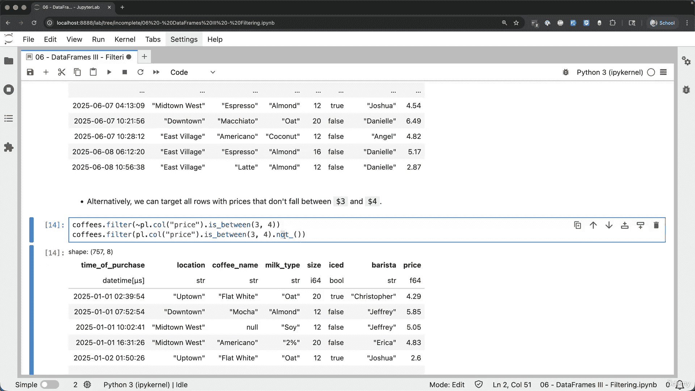

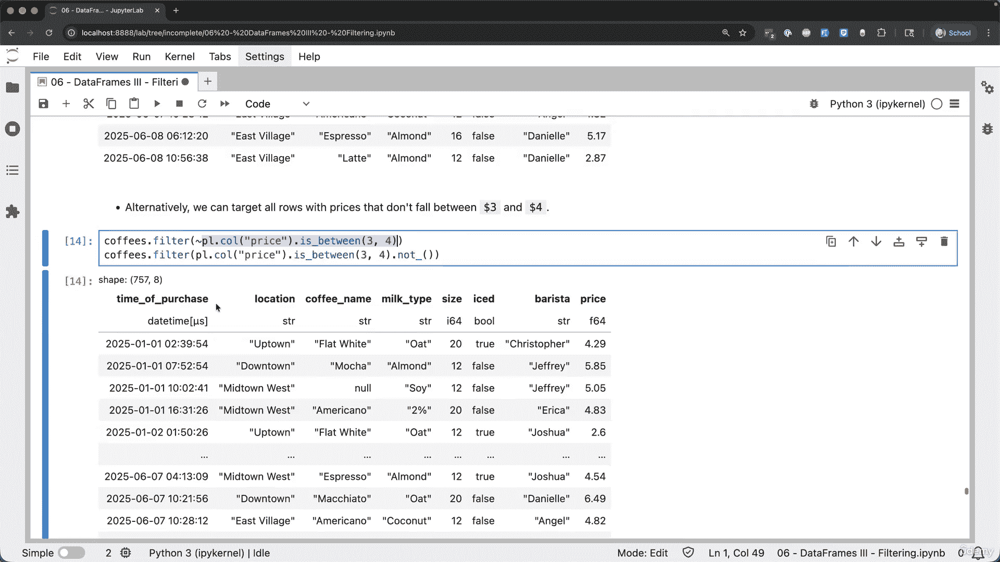

```python
price_between_3_and_4 = pl.col("price").is_between(3, 4)
other_priced_coffees = ~price_between_3_and_4
```

或者你也可以把上面的表达式调用非方法：

```python
other_priced_coffees = price_between_3_and_4.not_()
```

无论哪一种方式，结果都是一样的。现在我们就可以在 filter 方法里直接使用这些已经构建好的表达式，而不需要在实际的 filter 调用里去担心具体的方法调用或者波浪号符号。

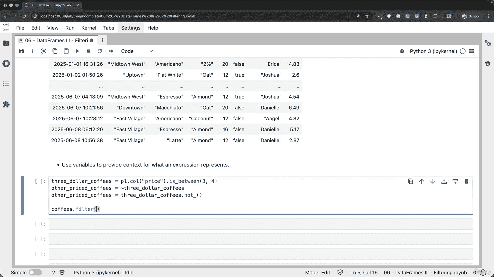

比如我们可以筛选所有 3 美元左右的咖啡，也可以反过来筛选所有其他价格的咖啡：

```python
df.filter(price_between_3_and_4)
df.filter(other_priced_coffees)
```

这样我们还可以把这些小的构建模块和其它表达式组合起来，在需要的地方进一步使用。


## 本节总结

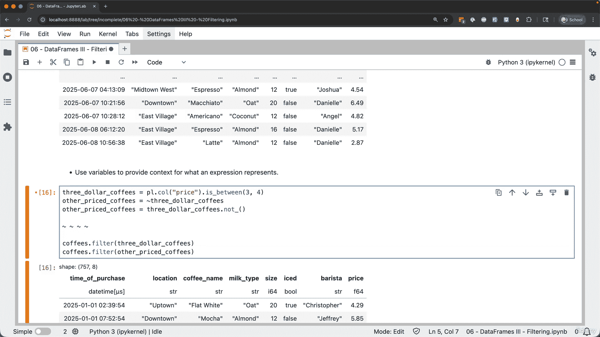

本节课中我们一起学习了波浪号符号，也就是键盘上那个波浪线。它的作用是执行非运算，把布尔列里的值全部颠倒过来。我们也介绍了和它功能完全一样的非方法，写作 not_。接着我们看了一个实际案例，用波浪号配合 is_between 方法筛选出价格不在指定范围内的咖啡。最后我们学习了如何用变量把复杂表达式拆分开，让筛选代码更加清晰好懂。希望这些内容能帮助你更好地掌握 Polars 中的布尔取反操作。

