# Data Analysis with Polars and Python：98：When Then Otherwise 条件表达式 🔀


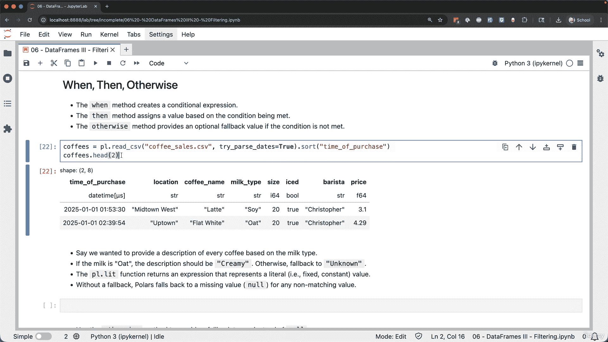

在本节课中，我们将要学习 Polars 中一个非常实用的功能，也就是如何使用 when 方法来创建条件表达式。简单说，这其实就是让你在 Polars 里写出类似于 Python if 语句的逻辑，只不过不是直接写 if 关键字，而是通过一系列方法和表达式来完成。我们会拿一个咖啡数据集做例子，给它新增一列描述信息，根据牛奶类型自动生成文字。内容会从最基础的单条件开始，慢慢过渡到多条件链式判断，适合初学者跟着一步步操作。不用担心之前没有接触过这类写法，我们会把每一个环节都讲清楚，确保你能听懂每一行代码的意思。


首先，我们先来聊聊什么是条件表达式。在编程里，条件表达式的核心思想就是“只要满足某个标准，就去做某件事”。在 Python 这类语言中，最经典的条件语句就是 if 语句。当条件为真时，程序会走一条逻辑路径；否则，可能会走另一条路径。在 Polars 里，我们也可以构建出这种条件逻辑，但实现方式不同，不是靠 if 关键字，而是靠方法组合和表达式。你可以把它理解成一种更“数据化”的条件判断方式，适合处理整列数据。


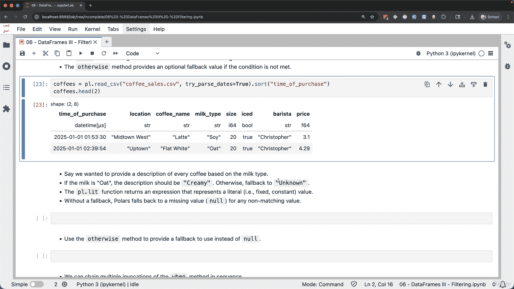

```python
if condition:
    result = value_if_true
else:
    result = value_if_false
```


了解了基本概念之后，我们进入实际操作部分。假设我们已经把代码重新执行了一遍，手头有一个名为 coffees 的 DataFrame。接下来，我想在 DataFrame 的末尾添加一个新列，列名叫做 description。这一列的作用是，根据每一行咖啡的牛奶类型，提供一段对应的文字描述。为了先把思路理顺，我们暂时只定义一条简单规则：如果牛奶类型是 oat，也就是燕麦奶，那么 description 列里的值就应该是 creamy，也就是顺滑。稍后我们会再补充其他规则，比如不是燕麦奶时 fallback 到一个通用字符串 unknown。不过现在，我们先专注于眼前的这一部分，不要想太多，先把第一步走对。


接下来，看看怎么把这条规则翻译成 Polars 代码。我会先调用 with_columns 方法，之所以选择它，是因为我想保留所有原有的列，同时在末尾追加一个新列。在 with_columns 里面，我会用到一个之前还没见过的新函数，叫做 when。这个 when 函数位于 Polars 的顶层命名空间下，直接调用即可。这个方法是后面所有条件逻辑的入口，所以理解它很重要。


那么，when 方法到底需要什么样的输入呢？when 接受一个表达式作为参数。这个表达式决定了在什么条件下应该执行后续操作，换句话说，我们在规定触发条件。关键点在于，这个表达式必须产生一个布尔列，也就是真假值列。在这里，我会提供一个针对 milk type 列的表达式。你可以使用等号运算符，也可以使用 EQ 方法，我这里选择用运算符，把牛奶类型和字符串 "oat" 进行比较。这一步的目的就是让 Polars 知道，我们要检查的是哪一行的牛奶类型等于燕麦奶。


```python
pl.col("milk type") == "oat"
```


但是，只写 when 还是不够的。如果只声明“什么时候”做某事，而不说“条件满足后到底做什么”，Polars 会报错。所以，我们需要在 when 表达式的末尾，再追加一个方法，叫做 then。then 的作用就是回答：当条件为真时，我们要产生什么样的值？在这里，我们希望得到一个固定、不变的值，也就是 "creamy"。这样 Polars 才知道，一旦检测到燕麦奶，就应该在 description 列里填入这个固定文字。


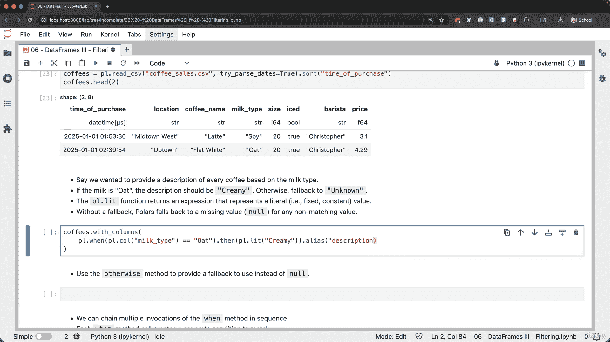

这里有一个小陷阱，需要特别注意。你不能直接把一个普通字符串传给 then，因为在 Polars 里，所有的操作都是基于表达式的。如果想指定一个常量、固定不变的值，必须使用顶层函数 lit，也就是 literal 的缩写。lit 的作用就是告诉 Polars：这里代表一个固定的、不随行变化的字面量值。所以我们会写 lit("creamy")，表示一个不变的字符串 "creamy"。你可以把 lit 想象成给普通字符串加了一个“Polars 表达式”的外壳，让它能和其他表达式一起工作。


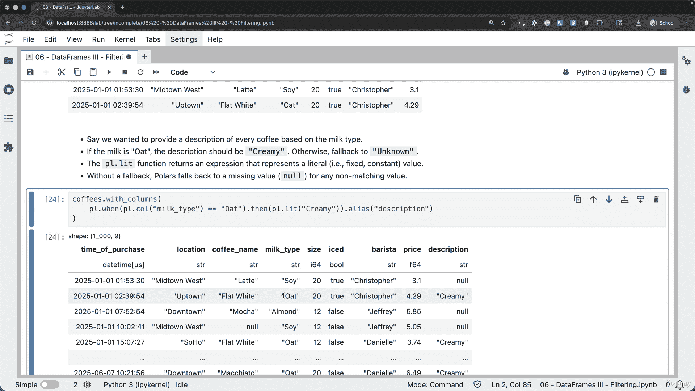

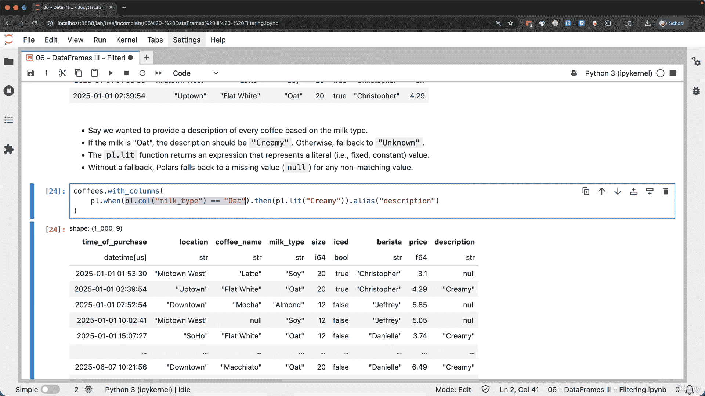

```python
pl.lit("creamy")
```


写好 when 和 then 之后，我们来看看运行结果会是什么样。这样一来，只要 milk type 是 oat，description 列里就会固定显示 "creamy"。但是，在其他所有条件不成立的地方，也就是 milk type 不是 oat 的行，Polars 默认会填充 null。这是因为我们还没有提供 fallback 值，也就是说，没有告诉 Polars“否则填什么”。这时候 description 列里，除了燕麦奶对应的行是 creamy，其他行全都是空值，显然不是我们想要的最终效果。


要解决这个 null 问题，我们需要用到 otherwise 方法。我们可以在 then 之后，继续链式调用 otherwise 方法。读起来 almost 像英语：when this is true, then populate this literal value of creamy, otherwise ...。这有点像编程里的 if 语句：如果条件不满足，otherwise 就填什么。同样地，我们需要再次使用 lit 函数来指定兜底值。原本可能会选 unknown，但为了效果更好，我们这里选 delicious。这样一来，不是燕麦奶的行就会看到 delicious，而不是空值。


```python
pl.when(pl.col("milk type") == "oat").then(pl.lit("creamy")).otherwise(pl.lit("delicious"))
```


Polars 的这个语法还有一个很酷的地方，就是不限于只用一次 when。我们可以把多个 when 和 then 方法连续链接起来，构建多个判断条件。这几乎就像 Python 里的 else if，或者某些语言里的 switch case。为了演示，我会把刚才的代码复制一遍，在调用 otherwise 之前，再插入一个 when。这一次，这个 when 是在之前表达式产生的结果上调用的方法，而不是顶层函数，但语法完全一样。你不需要记太多新东西，只是把同样的模式重复使用即可。


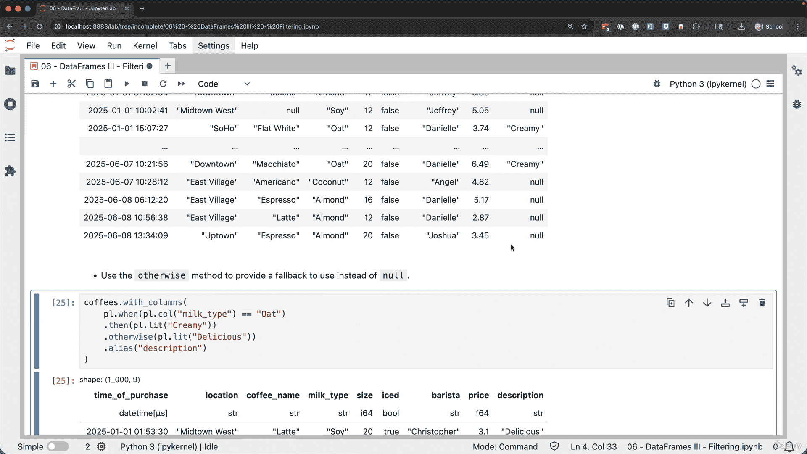

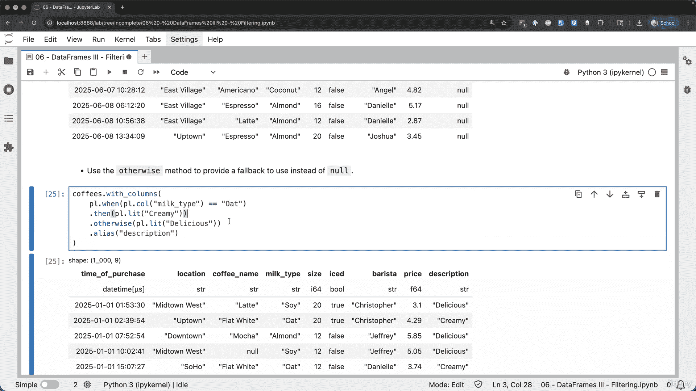

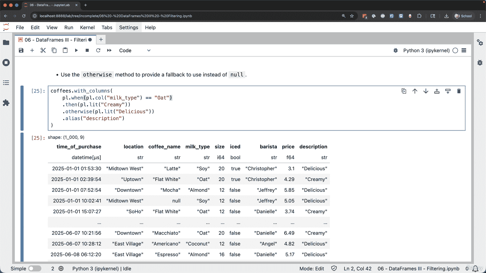

下面来看具体怎么加第二个条件。这里我可以提供另一个条件，作为 milk type 是 oat 之外的备选。比如说，当 milk type 列的值不是 oat，或者是 almond，也就是杏仁奶时。你可以把这个想像成 Python 代码块里的 else if。我会再追加一个 then 方法，用来指定当 milk type 值为 almond 时，description 列里应该产生什么内容。我会再次使用 lit 或 literal 函数来生成值。具体选什么完全由我们决定，我打算选 watery，因为我个人不喜欢杏仁奶，觉得它喝起来比较淡。


现在我们把所有部分串起来，看看最终效果。这实际上相当于写了一个 if，接着是一个 else if，最后是一个兜底 fallback。具体结果是这样的：如果牛奶类型是 oat，description 就是 creamy；如果是 almond，description 就是 watery；对于其他所有可能的值，都会 fallback 到 delicious。这样，我们就用一组方法的组合，构建出了动态的条件列，而不需要写传统的 if 语句。这段代码看起来有点长，但逻辑非常清晰，每一步都对应一个明确的分支。


```python
pl.when(pl.col("milk type") == "oat").then(pl.lit("creamy")).when(pl.col("milk type") == "almond").then(pl.lit("watery")).otherwise(pl.lit("delicious"))
```


好了，上面的内容就是 Polars 中条件表达式的核心用法。我们是通过方法的组合来构建条件表达式和逻辑表达式的，而不是依赖传统的 if 语句。这种写法在处理大型数据集时非常高效，因为 Polars 会对整列数据进行向量化操作，而不是逐行判断。


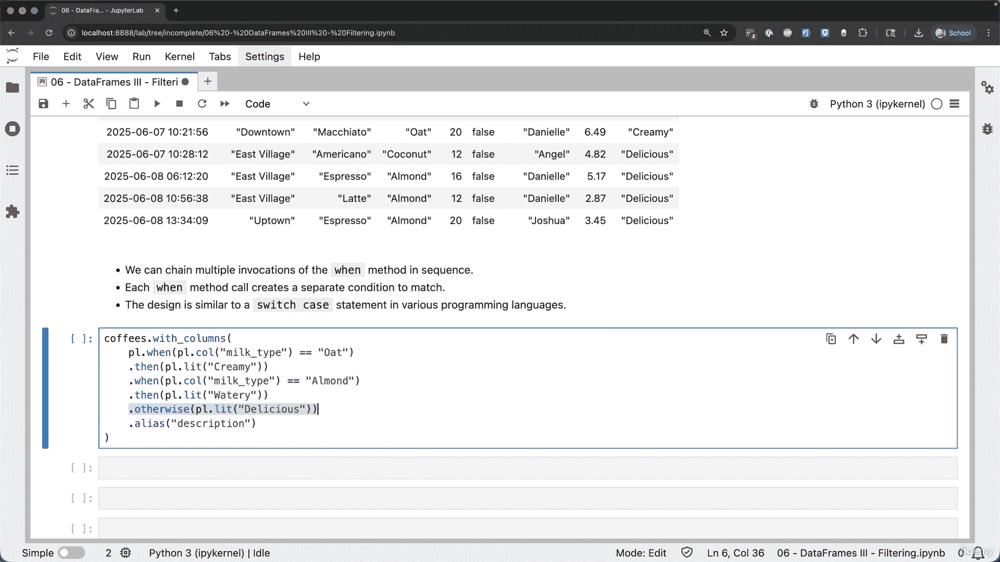

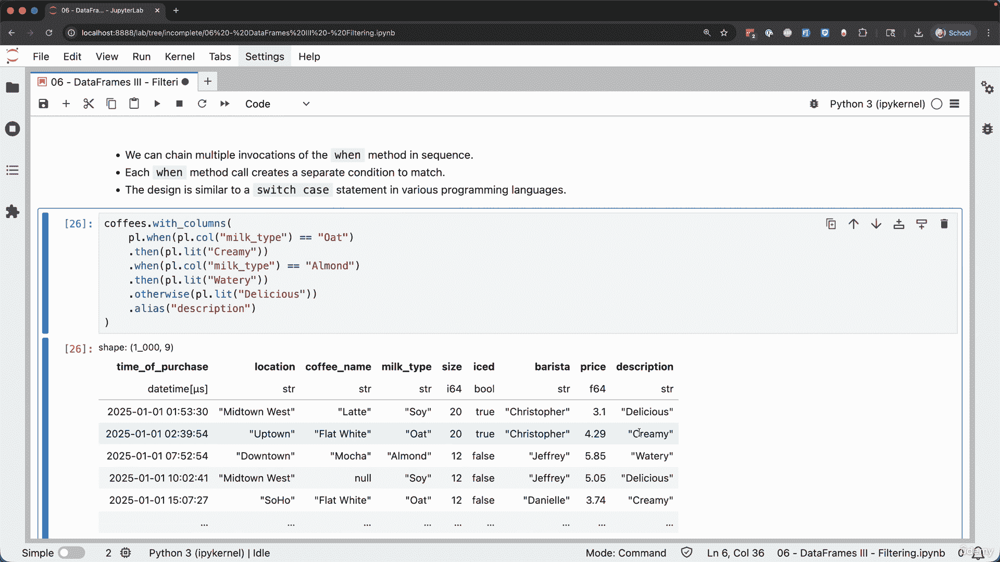

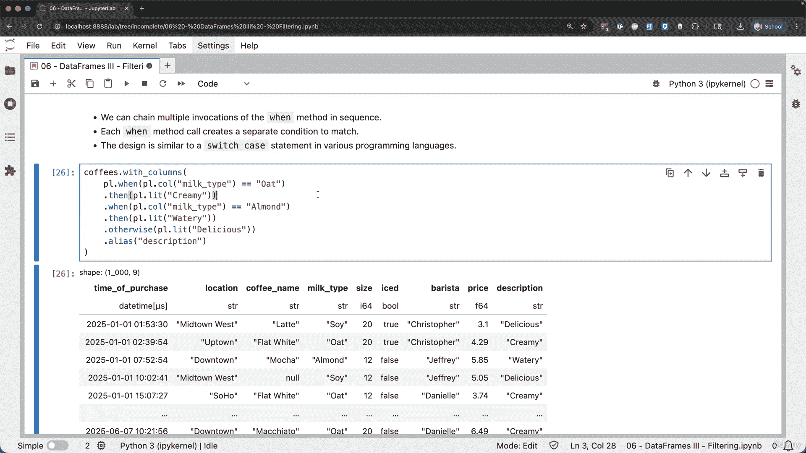

在本节课中，我们一起学习了如何在 Polars 中使用 when、then 和 otherwise 来构建条件表达式。我们知道了 when 用来指定判断条件，then 用来指定条件成立时要产生的值，otherwise 则用来提供兜底值，而且这些方法都可以链式调用来处理多个分支。通过 lit 函数，我们可以在表达式里嵌入固定的常量值。希望这篇教程能帮你掌握 Polars 里的条件逻辑写法。
