📊 Polars 数据分析：099：对 DataFrame 进行分区

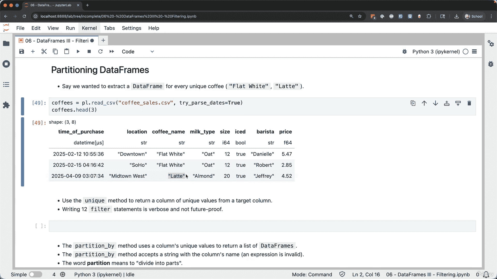

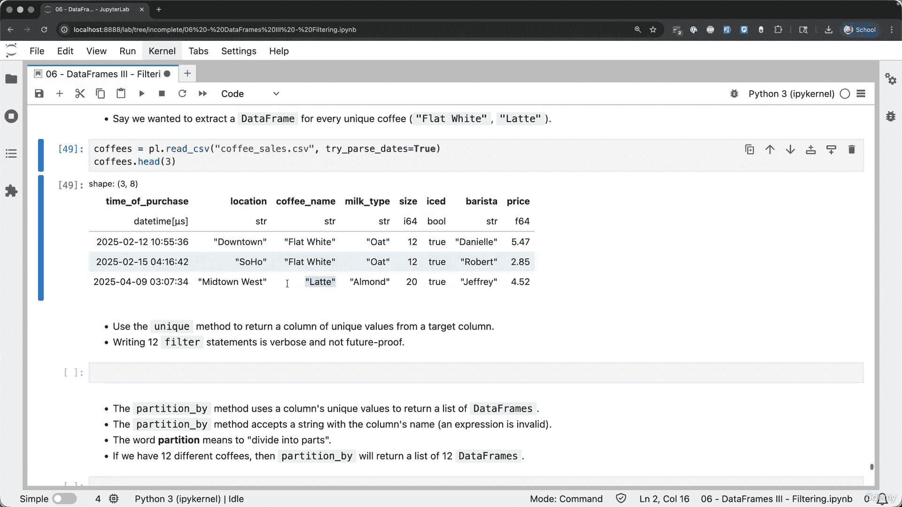

在本节课中我们将要学习 Polars 库中的 partition_by 方法。这个方法的作用是根据某一列里所有不同的值，把一个大的数据表拆分成很多个独立的小数据表。我们会先看看最简单的拆分方式，然后发现直接得到的列表不太好用，接着学习如何把结果变成字典方便查找，最后还会看到怎么一次按好几列来拆分数据。这节课的内容比较实用，能帮你避免写大量重复的筛选代码。

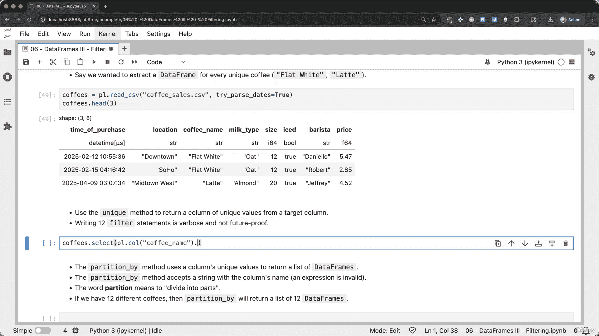

上一节我们介绍了如何用 filter 方法筛选数据，本节中我们来看看当数据里有很多种不同类别时，怎么高效地把它们分开。假设我们有一张咖啡数据表，里面有一列叫做咖啡名称，里面包含了各种各样的咖啡，比如拿铁、美式、摩卡等等。如果我们想要把所有属于 flat white 的行单独拿出来放成一个数据表，同时也想对其他类型做同样的事情，然后把咖啡名称列里出现的每一个不同值都这样处理一遍，那我们就需要针对每一种咖啡都写一次筛选代码。

为了知道一共有多少种不同的咖啡，我们可以先用 select 方法选中咖啡名称列，然后调用 unique 方法。下面是具体代码：

```python
df.select("coffee_name").unique()
```

执行这段代码之后会得到一个包含 12 行的数据框，说明在咖啡名称这一列里一共有 12 个不重复的咖啡名称。

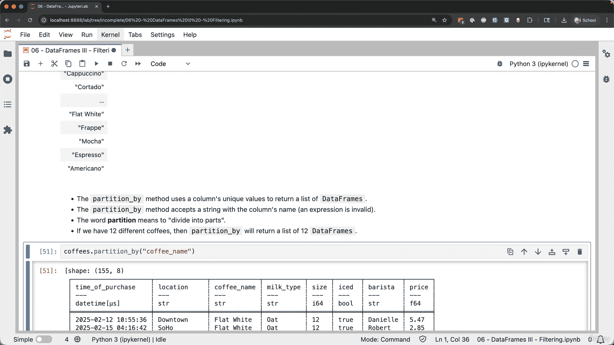

这就意味着，如果我们用最笨的办法，就得写 12 次 filter 方法调用，每次针对一种咖啡。这种写法非常啰嗦，也很容易让人厌烦。更麻烦的是，这种方式没有未来兼容性。万一明天数据里又增加了第 13 种或者第 14 种咖啡，我们就得回去代码里加新的筛选语句，才能把新出现的咖啡也处理掉。显然没人愿意为了每一种新咖啡都去手动添加一段筛选代码。

为了解决上面这个问题，Polars 提供了一个非常方便的方法叫做 partition by。顾名思义，partition 就是把东西分成几个部分的意思。下面我们来看看怎么使用它：

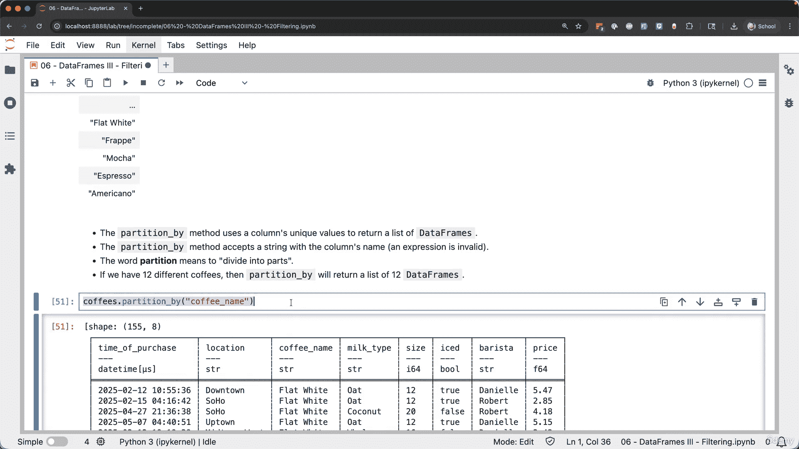

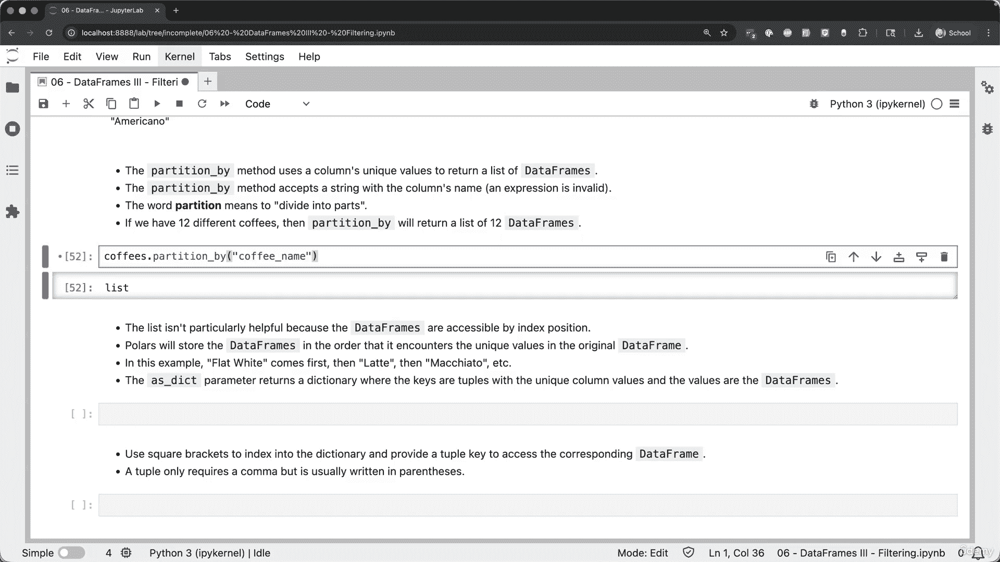

```python
df.partition_by("coffee_name")
```

这个方法要求传入一个字符串，指明要按照哪一列的唯一值来拆分数据。需要注意的是，partition_by 不接受表达式，它只接受字符串形式的列名。这里我们传入 "coffee_name"，就表示要按照咖啡名称里的每个不同值来拆分原表。

partition_by 方法执行完之后会返回一个 Python 列表，下面是这个列表的几个特点：
- 列表里存放的每个元素都是一个独立的数据框
- 列表里的数据框数量，正好等于咖啡名称列中唯一值的数量
- 如果有 12 种咖啡，就会得到 12 个数据框
- 每个数据框里只包含对应那种咖啡的所有行

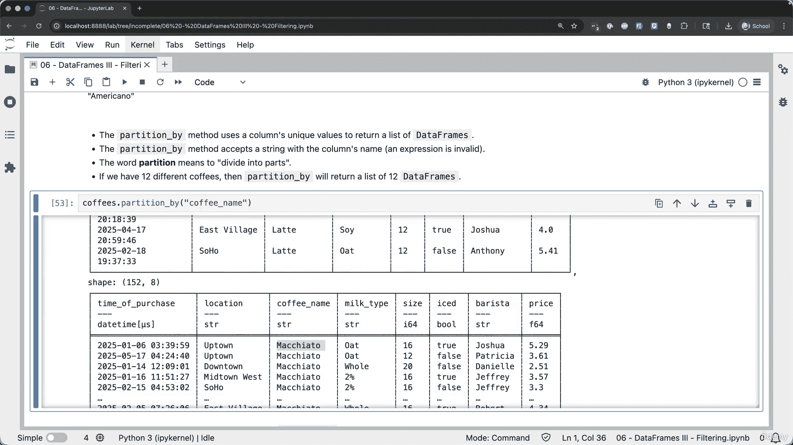

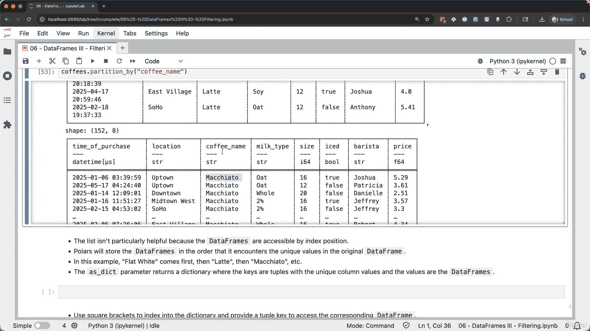

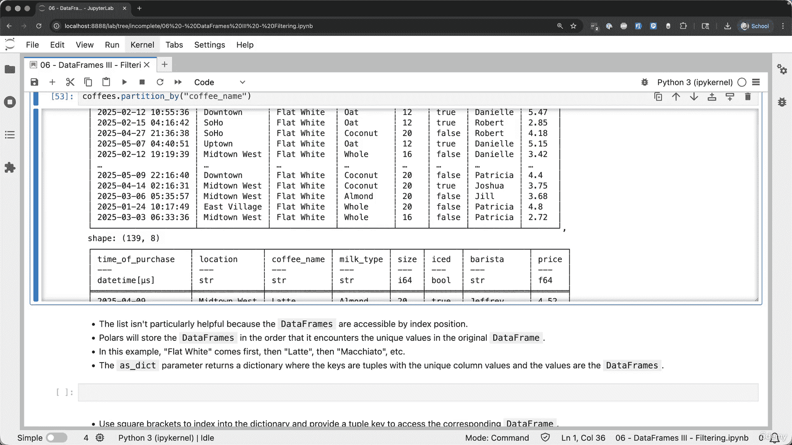

不过这个列表并不特别有用，因为数据框是按照索引位置来存储的，而 Polars 的做法是把原表里第一个出现的咖啡类型放在列表的第一个位置，第二个出现的放在第二个位置，依此类推。由于这种排序完全取决于每种咖啡在原表里第一次出现的顺序，我们并不知道列表里哪个位置放的是哪种咖啡，这让查找变得很不方便。

为了让结果更容易使用，我们可以给 partition_by 传入一个额外的参数叫做 as dict，也就是 as_dict，并把它的值设为 True。下面是代码：

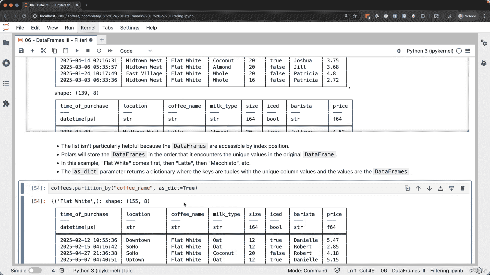

```python
df.partition_by("coffee_name", as_dict=True)
```

这样调用之后，方法返回的不再是列表，而是一个 Python 字典。

在这个字典里，每个 key 是一个元组，里面包含对应的唯一值。比如对于 flat white 这种咖啡，它的 key 是一个只有一个元素的元组，写作 ("flat white",)，而对应的 value 就是包含所有 flat white 行的数据框。

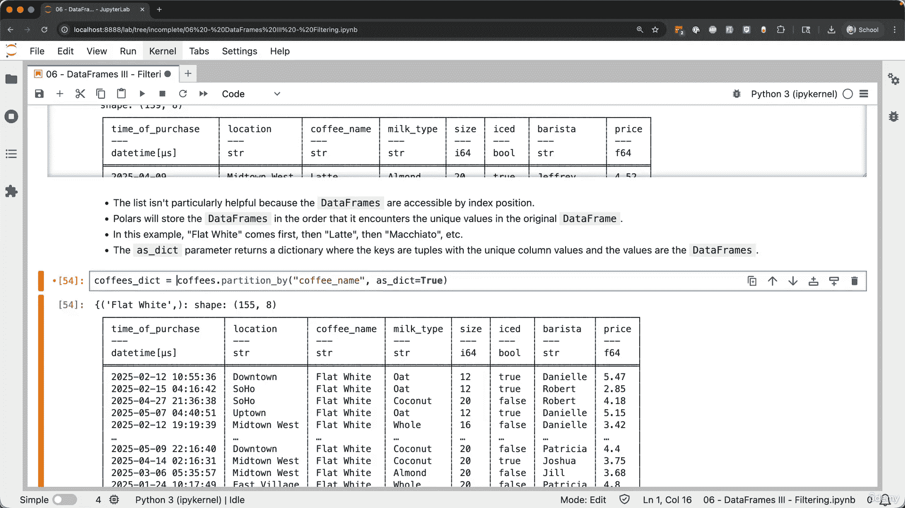

这里需要特别注意，key 不是字符串 "flat white"，而是一个一元素元组。这一点非常重要，因为当我们用方括号从字典里取值的时候，必须提供完全正确的 key。如果你给的是字符串，而字典里存的是元组，程序就会报索引错误。

在 Python 里声明一个元组有几种常见写法，下面是主要介绍：
- 在值后面加逗号，Python 就会把它识别成元组
- 更常见的社区写法是用括号包裹元素，比如 ("mocha",)
- 括号里的逗号是必须的，没有逗号的话括号只会被当成普通的数学括号

下面是一个完整的例子，展示怎么把分区结果存在变量里，再按咖啡名称取出对应的数据框：

```python
coffees_dict = df.partition_by("coffee_name", as_dict=True)
coffees_dict[("mocha",)]
```

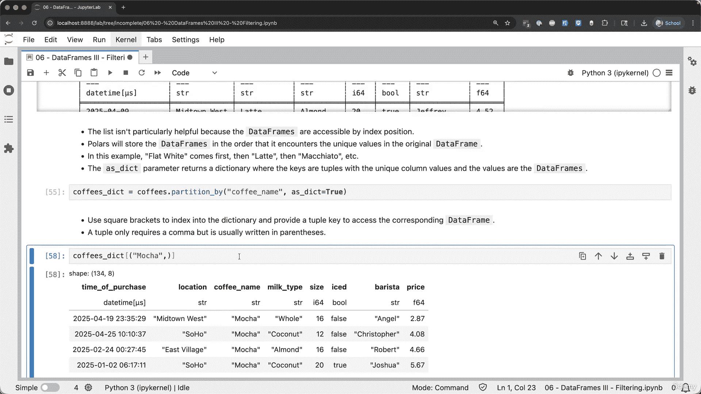

执行这段代码之后，会得到一个只包含摩卡咖啡行的数据框。因为字典里总共有 12 个键值对，分别对应咖啡名称列中出现的 12 个不同值。

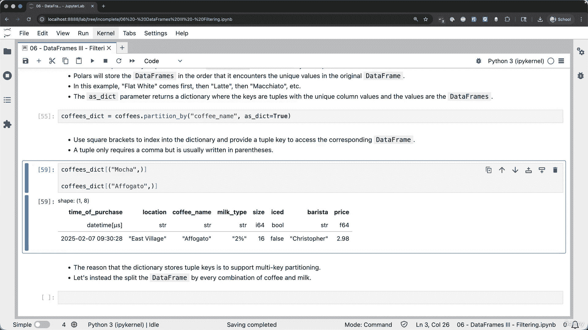

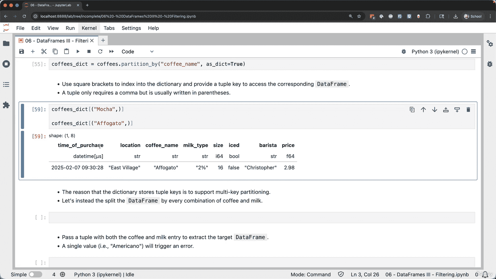

再看一个例子，假设我们要找咖啡名称为 alphagado 的那一行。我们同样需要用方括号索引字典，然后提供一个包含该字符串的元组，记得要加上逗号来声明元组。下面是代码：

```python
coffees_dict[("alphagado",)]
```

这样就能从原来的数据表里，把咖啡名称是 alphagado 的那一行单独取出来。

前面我们提到过元组 key 的设计原因，现在可以揭晓了。Polars 团队这么设计是为了支持多键分区，也就是说，我们可以一次按照多列来拆分数据。下面是代码：

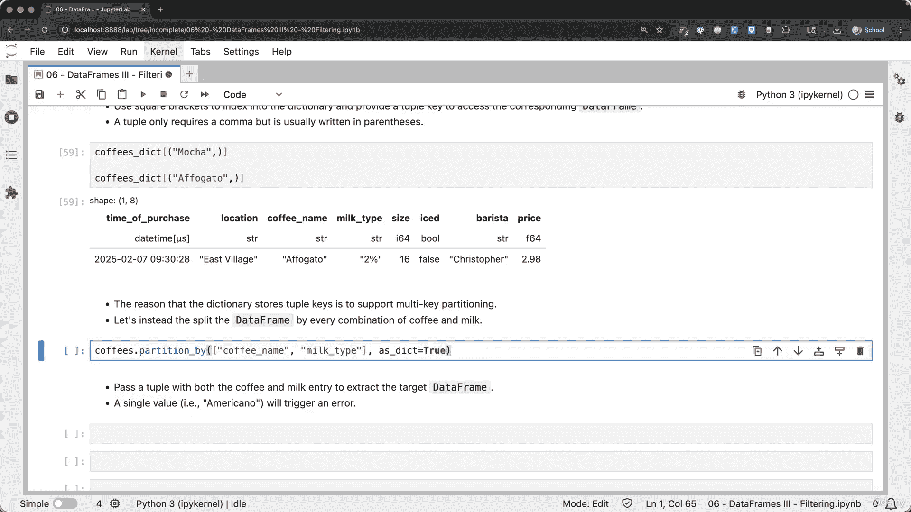

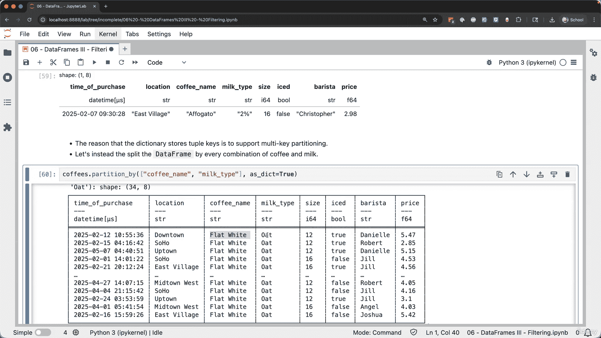

```python
df.partition_by(["coffee_name", "milk_type"], as_dict=True)
```

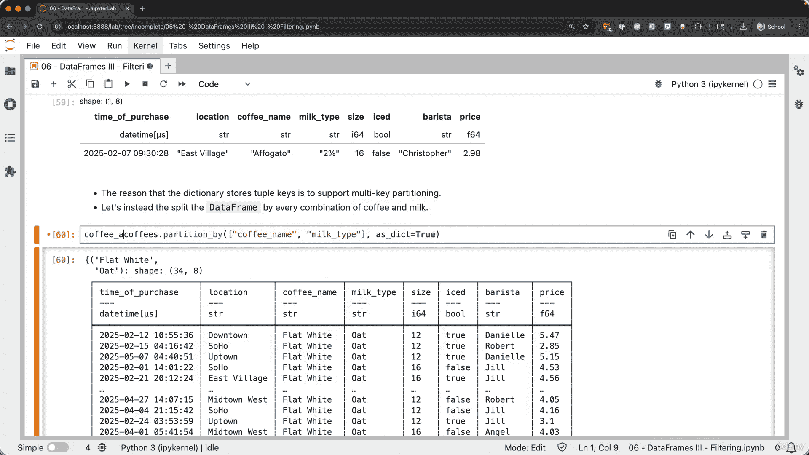

这次传入的不是单个字符串，而是一个包含多个列名的列表。我们先按咖啡名称分组，再加上牛奶类型这一列。这样一来，字典里的 key 就变成了两个元素的元组，第一个元素是咖啡名称，第二个元素是牛奶类型，每个 key 对应一种特定的组合。

多列分区之后，字典的 key 有以下几个特点：
- 每个 key 是一个两个元素的元组
- 第一个元素代表唯一的咖啡名称
- 第二个元素代表与之搭配的牛奶类型
- 比如 ("flat white", "oat") 表示所有咖啡名为 flat white 且牛奶类型为 oat 的行

有了多键元组之后，我们就可以精准地取出特定组合的数据框。下面是完整代码：

```python
coffee_and_milk = df.partition_by(["coffee_name", "milk_type"], as_dict=True)
coffee_and_milk[("Americano", "soy")]
```

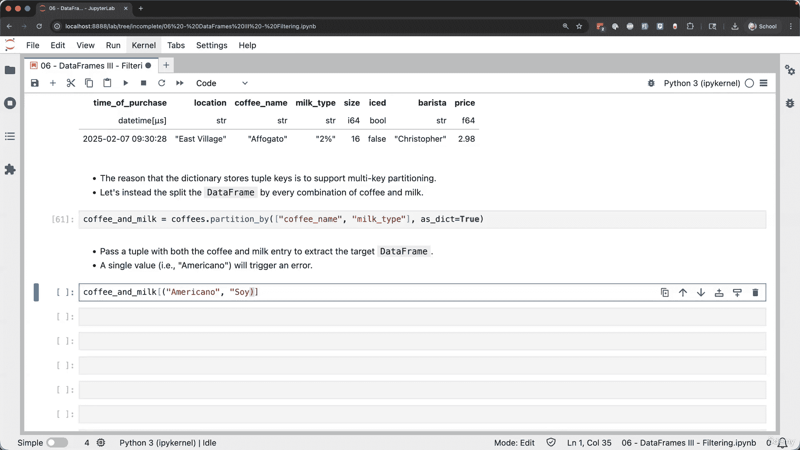

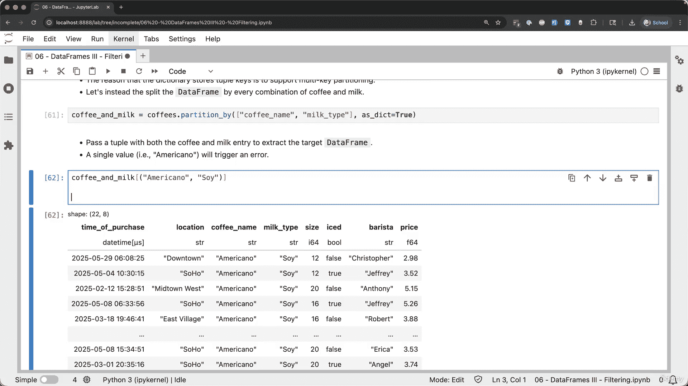

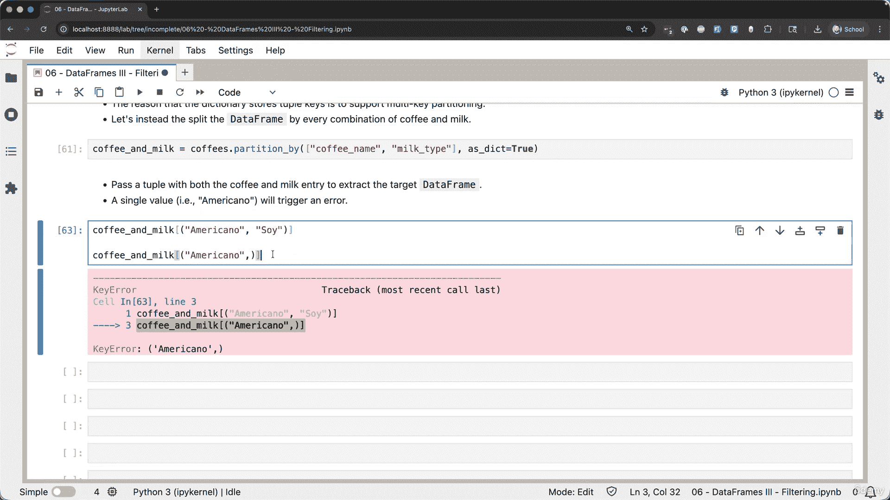

这段代码会取出咖啡名称是美式且牛奶类型是豆奶的所有行。这里非常关键的一点是，必须同时提供两个元素。如果你只提供一个元素，比如只写 ("Americano",)，程序就会报错，因为字典的 key 必须是一个完整的两元素元组，不支持部分索引。

不管怎么用，partition_by 都帮我们完成了一件很强大的事情：它把原本巨大的数据表，按照咖啡名称和牛奶类型的每一种组合，都拆分成了独立的小数据框，字典的 key 就是这些组合的标识符，value 就是对应的行数据。后续课程里我们还会学到 group by 方法，可以对每个分组做聚合运算，但 partition by 已经是一个非常简单好用的起点，它能让我们不用写一大堆独立的 filter 调用，就把大数据表拆成很多个小数据表。

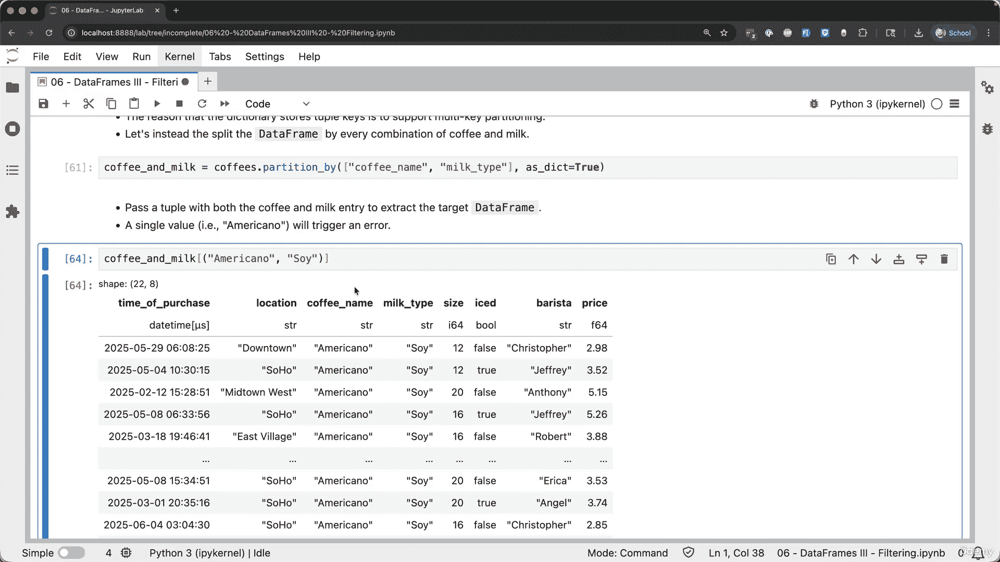

本节课中我们一起学习了 Polars 的 partition_by 方法。我们先了解了怎么按单列把数据拆成列表，然后发现列表不方便查找，接着学习了用 as_dict=True 把结果变成字典，并掌握了 key 是元组的索引方式，最后还学会了如何同时按多列拆分来处理组合数据。希望这些内容能帮你更高效地整理和分析数据。

