# 📊 使用Polars和Python进行数据分析（第二部分）：P01：🔗 101. 内连接（Inner Joins）

在本节课中，我们将学习Polars中的第一种连接类型——内连接（Inner Join）。我们不仅会弄清楚内连接的概念和工作原理，还会通过一个实际例子来演示如何在代码中使用它。为了让大家跟上思路，我们会先执行代码，把五个数据帧加载进来，然后一步步拆解join方法的参数。学完这节课，你就能理解内连接能解决什么问题，以及如何用Polars代码实现两个表的合并。

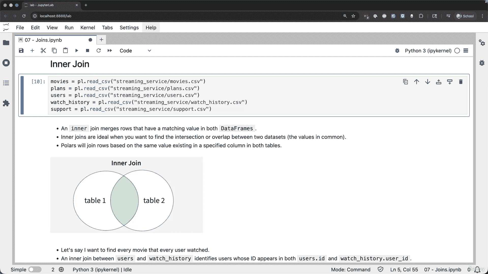

## 什么是内连接？

在正式写代码之前，我们先把内连接的技术细节搞清楚。只有理解了底层逻辑，写出来的代码才不会是死记硬背。下面这张示意图可以很好地展示内连接的行为：它会把两个数据帧中，在我们指定的列上具有匹配值的行合并到一起。用大白话说，内连接就是根据某一列（或几列）的相同值，把两个表“拼”起来。如果两个数据集中存在相同的值，那么这些值对应的行就会合在一起。

我们可以把内连接的概念用公式表示得更严谨一点。假设左表是 L，右表是 R，我们指定的连接键是 k，那么内连接的结果可以写成：

\[
\text{InnerJoin}(L, R) = \{ (l, r) \mid l \in L, r \in R, l[k] = r[k] \}
\]

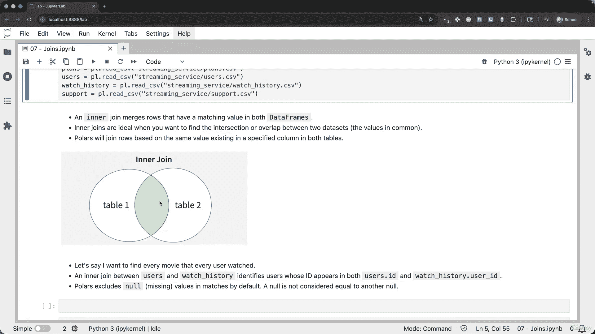

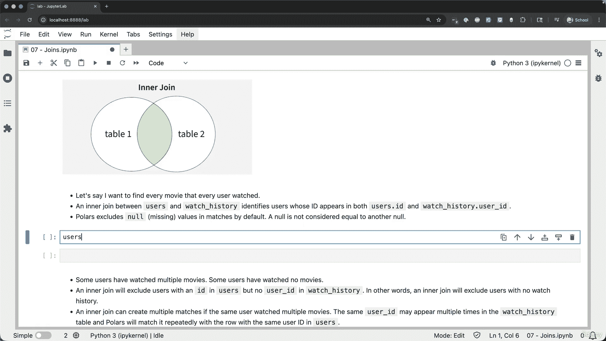

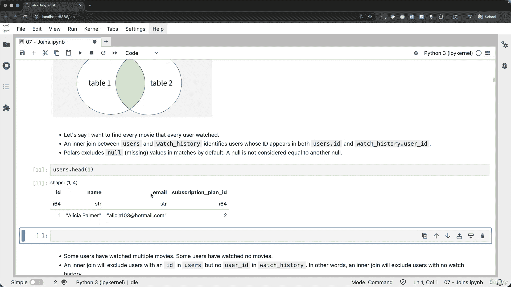

这个公式的意思是，从左边和右边分别取一行，只要这两行在键 k 上的取值相等，就把它们组成一对，放进最终的结果里。

## 维恩图与连接逻辑

如果你觉得公式有点抽象，没关系，我们还可以借助维恩图来理解。把左表想象成左边那个圆，把右表想象成右边那个圆，内连接取的就是两个圆中间重叠的那块区域。换句话说，内连接专门用来寻找两个数据集之间的交集、重叠部分或者共同点。我们做内连接，就是想找出那些基于某个共享值而共同出现的行，然后把它们合并到一起。正因为它瞄准的是正中间这个交集，所以才叫“内连接”。

这里有两个很重要的特点，值得你记一下：

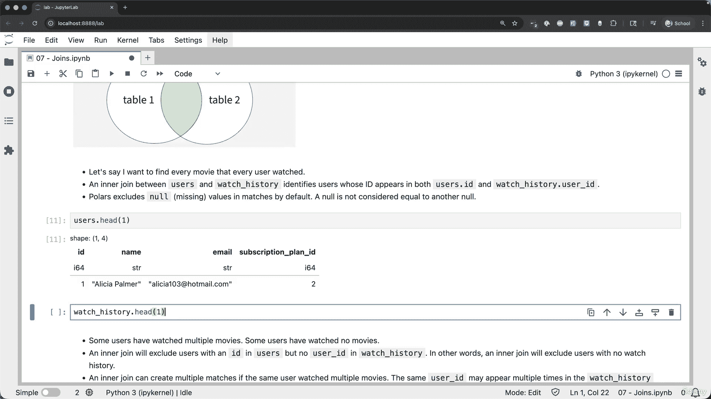

- 如果左表有一行，它的连接值在右表中完全找不到，那么这一行会被排除。
- 如果右表有一行，它的连接值在左表中找不到，那么这一行同样会被排除。

说白了，只有那些在另一张表中能找到“对应值”的行，才有资格留下来参与合并。中间这部分，就是内连接会提取出来的内容。

## 实际例子：用户表与观看历史表

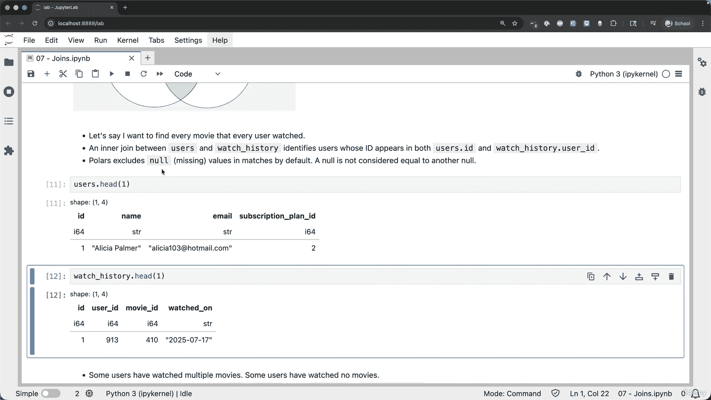

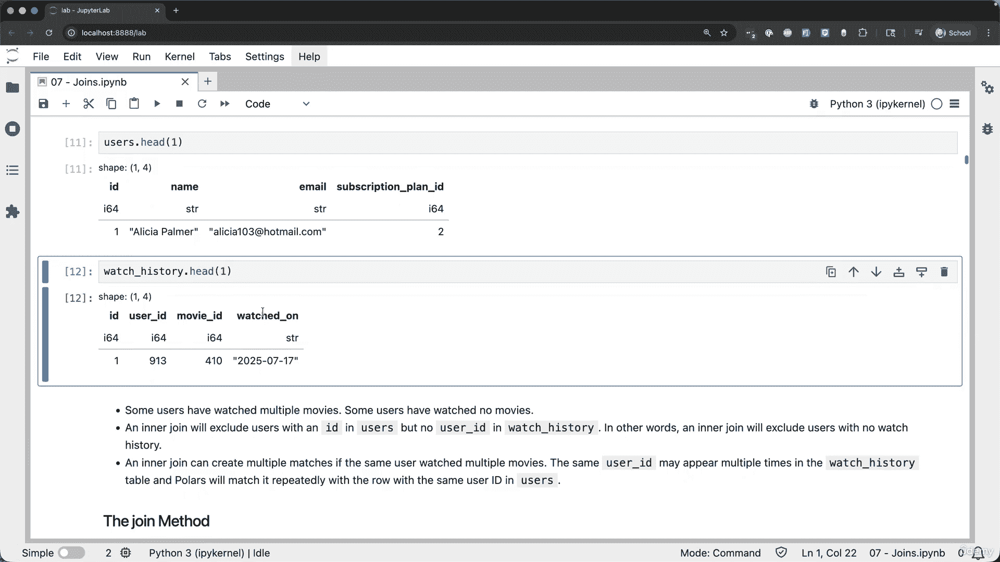

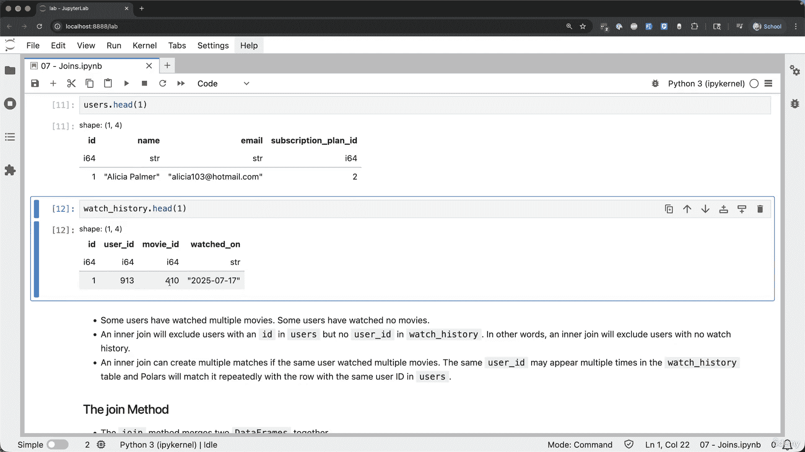

了解了概念之后，我们来看一个实际例子，这样你就知道内连接能用在什么场景里。假设我们有一个用户表（users）。用head方法预览一下，可以看到这个表的结构。用户表为每个用户记录了一个ID，以及用户名、邮箱和订阅计划。除了用户表，我们还有一个观看历史表（watch_history）。

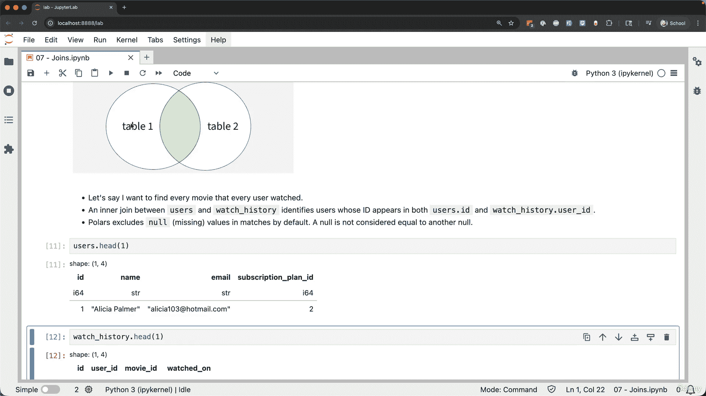

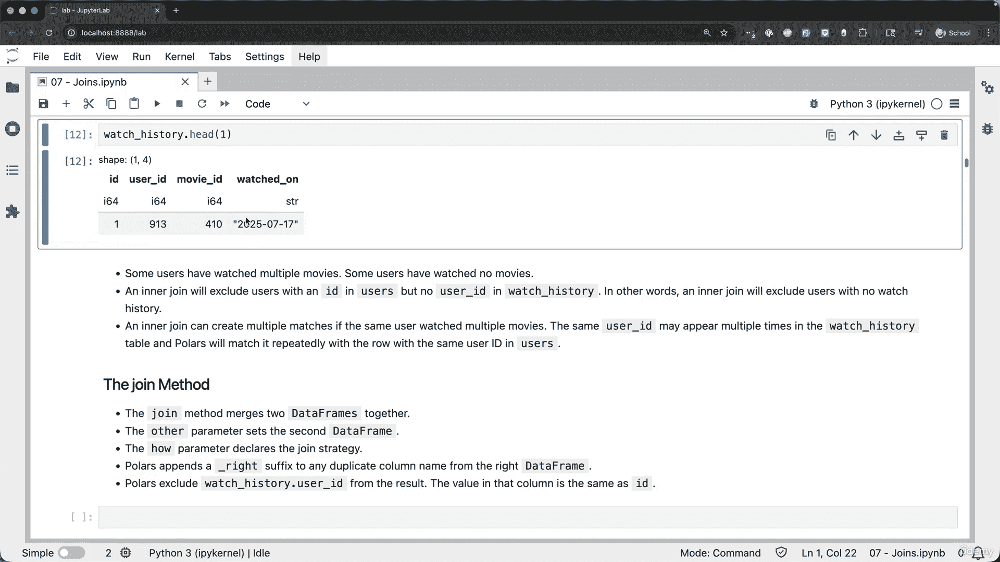

观看历史表是一个集合，它记录了每个用户看过的每一部电影。这个表存储数据的方式是：它有一个自己的ID，这个ID只是一个纯数字记录；但更重要的是，它把用户ID与用户看过的电影ID关联在了一起。也就是说，每一行都表示某个用户看了某部电影。

现在，如果我们想找出每个用户在平台上看过的所有电影，该怎么做？思路很直接：拿用户表ID列中的值，去和观看历史表中user_id列的值做匹配。每次我们在两边找到一个匹配的ID，就把这两行合并成一行。这样得到的新数据帧，就是内连接之后的结果。

## 内连接的几个重要细节

在实际操作之前，有几个关于内连接的细节需要特别留意。这些细节会影响最终结果的行数，所以非常重要。下面把这些细节一条一条列出来：

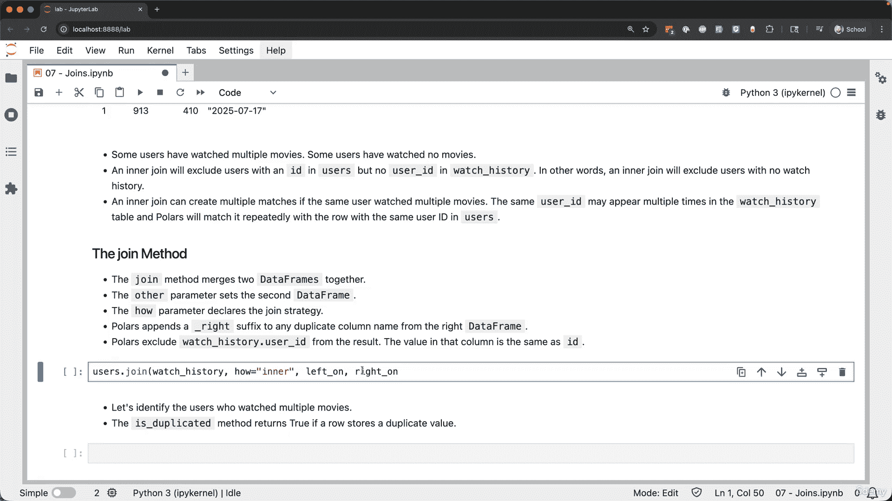

- 同一个用户ID可能在观看历史表中出现多次。比如用户913看了10部不同的电影，那么观看历史表中会有10行，它们的user_id都是913，但movie_id各不相同。在这种情况下，Polars会找出所有这些行的组合。每一次匹配都会生成一条记录，所以用户913在结果中会出现10次。换句话说，观看历史表中user_id的每一次出现，都会与用户表中相同ID的一次出现连接一次。
- Polars在匹配时会自动排除空值或缺失值。它不会把左表的空值看成与右表的空值相等，它要求严格匹配，也就是说ID必须真实相等。
- 有的用户可能看了多部电影，也有的用户可能一部都没看。如果一个用户（比如ID为50）在观看历史表中没有任何记录，那么他就没有东西可以连接，最终这个用户会被排除。

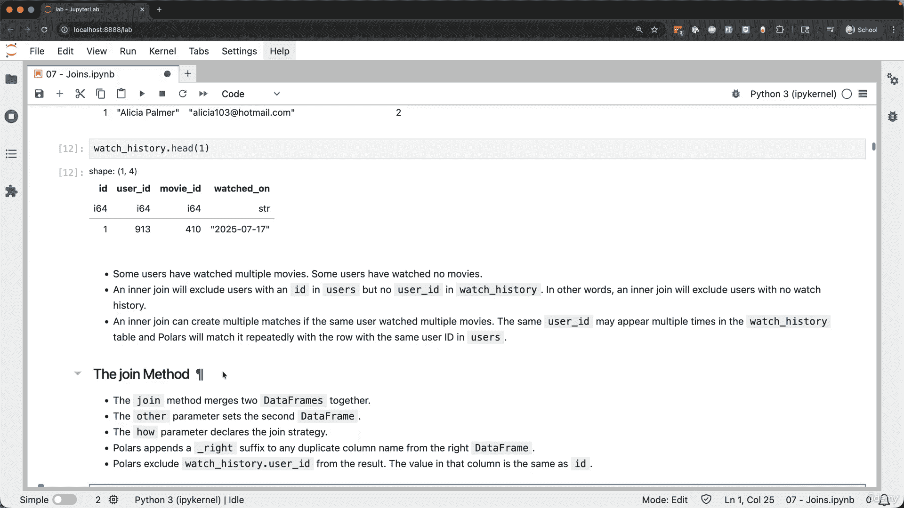

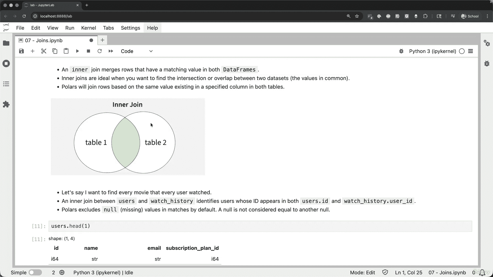

以上这些细节都指向同一个核心思想：内连接找的是两个表的交集，ID必须同时出现在左右两表中，否则就不在最终结果里。

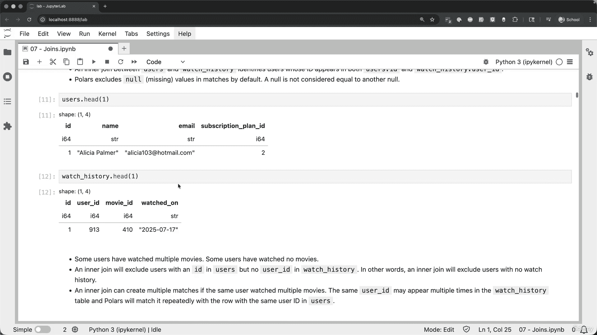

## 用Polars实现内连接

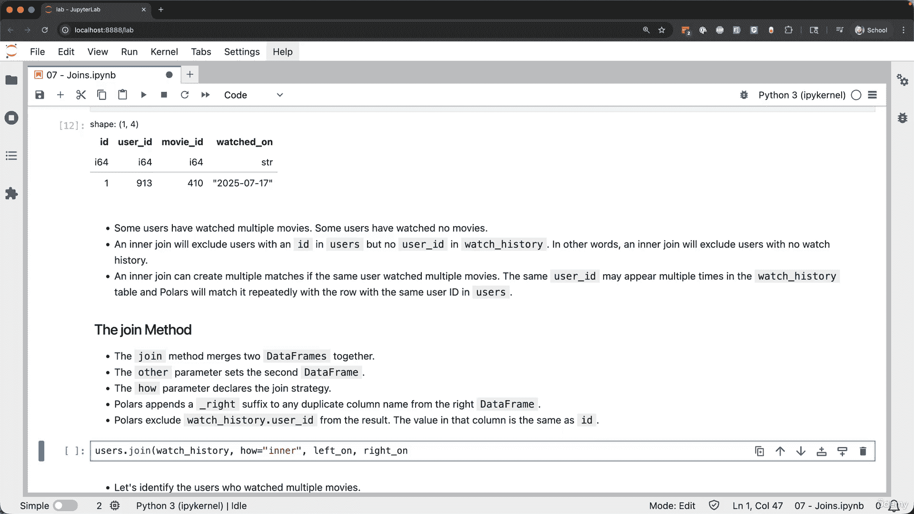

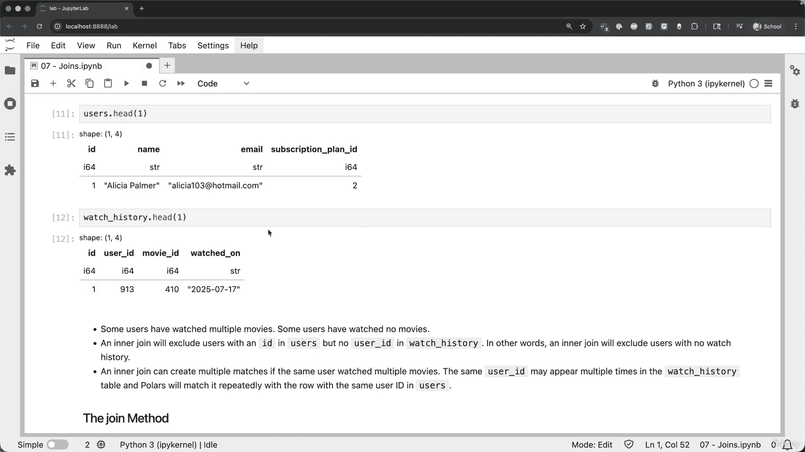

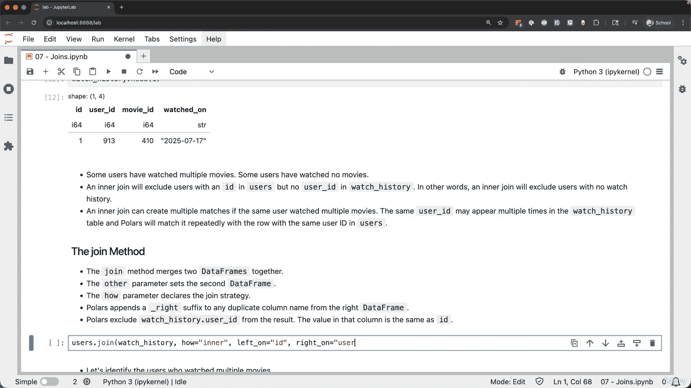

理论部分说完了，现在来看看怎么写代码。我们会使用Polars的join方法。首先，我们把第一个数据帧拿过来，也就是users。然后在它上面调用join方法，第一个参数是另一个数据帧，也就是作为对照的那个数据帧，这里我们传入watch_history。

接下来一个很重要的参数是how。how参数用来声明连接策略，我们传入一个字符串"inner"，因为我们想要的就是内连接。通过how参数，我们可以自定义合并两个数据帧的方式。

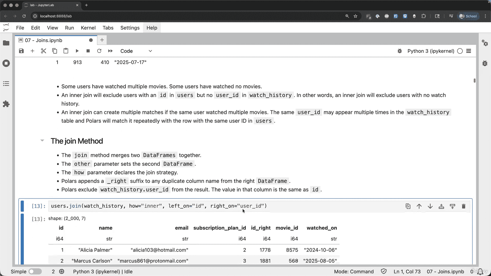

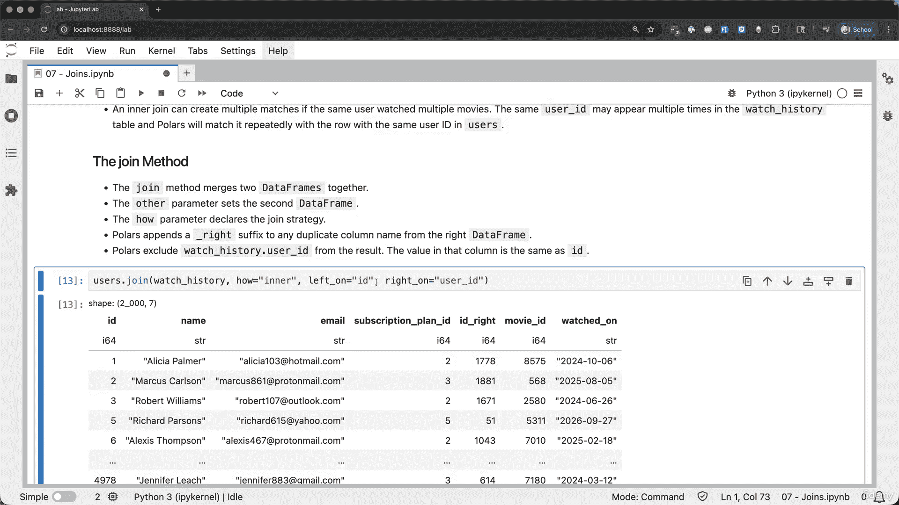

再接下来两个参数是left_on和right_on。解释一下这两个名字的含义：left（左）指的是调用join方法的数据帧，所以在这个例子中，左数据帧是users；right（右）指的是作为参数传入的数据帧，所以右数据帧是watch_history。这个命名来自我们前面看到的示意图：两个表并排，一个在左一个在右，我们把右边的合并到左边。本质上，left_on和right_on接收的是两个表中用于匹配的列名。

具体到我们的例子，用户表里的列名是ID，所以设置left_on="ID"，指定这一列作为查找ID的基础。我们要把这些ID与右边watch_history数据帧中的user_id列的值进行匹配，所以right_on="user_id"。

下面是最简单的内连接代码：

```python
joined_df = users.join(
    watch_history,
    how="inner",
    left_on="ID",
    right_on="user_id"
)
```

运行这段代码，我们会得到一个2000行的数据帧。Polars每次在两边找到ID匹配时，会把两个数据帧相应行的内容合并成一行。比如，结果中有一个ID为1的用户，这意味着观看历史表里有一条记录的user_id是1，这一行被取出来，与用户表中ID为1的那一行合并了。

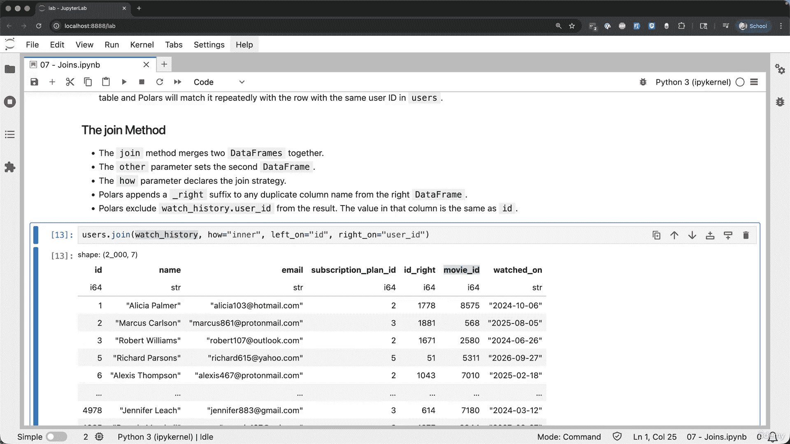

## 理解连接结果

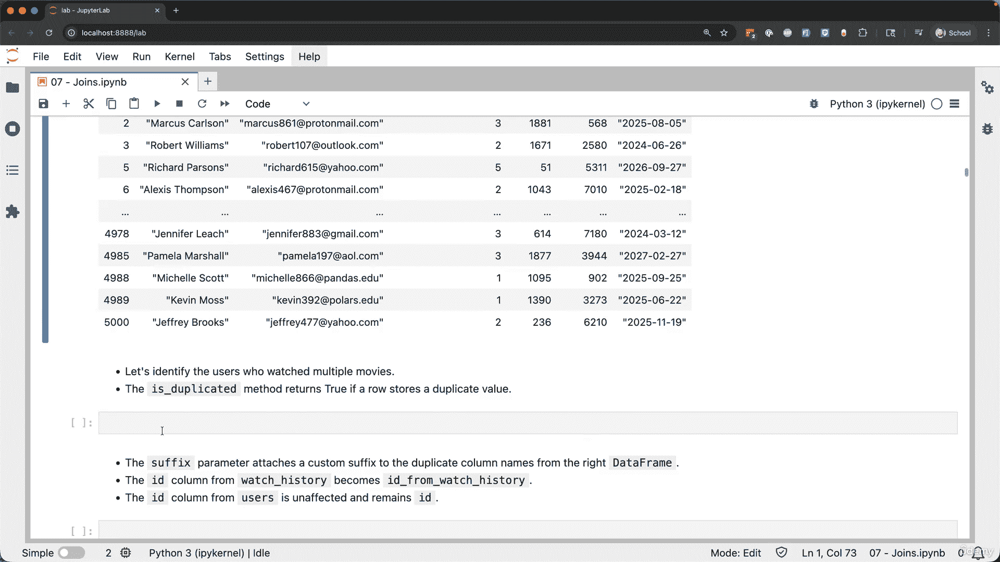

合并之后，结果里都有哪些列？我们看一下实际输出：这里有用户表的四列，也就是ID、用户名、邮箱和订阅计划；接着是观看历史表的三列。不过你可能会注意到，user_id列其实没有出现在结果里。这是Polars的默认行为。

为什么Polars内连接默认会排除user_id列？原因是这一列的值将与用户表中的ID列完全相同。比如说，匹配到ID为1的用户，其user_id就是1。所以如果保留这个user_id列，它的值会和用户表的ID列一模一样。Polars团队认为这种重复没有意义，于是默认把它省略了。稍后我们会看到如何把它加回来。

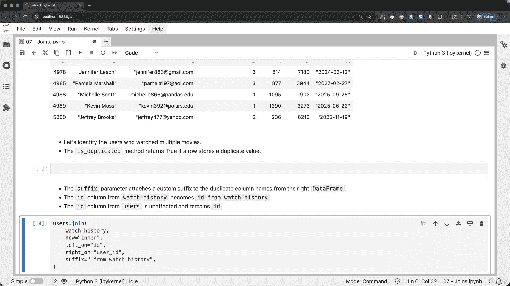

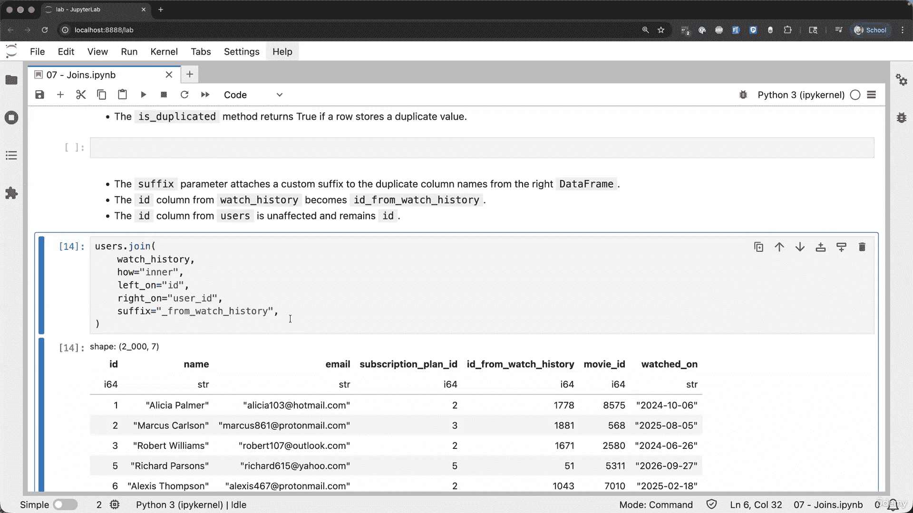

另外，你还会注意到，来自观看历史表的ID列被加了一个“_right”后缀。这是因为Polars数据帧不支持重复的列名，而我们两个数据帧都有一列叫ID。所以Polars会给所有重复的列名加上后缀“_right”，表示它来自右边的watch_history数据帧。那么，同样是来自观看历史表的movie_id或watch_done等列，为什么没有加后缀？因为这些列名在左表中不存在，并不重复。只有遇到重名列时，Polars才会给第二个数据帧的列追加“_right”后缀。

## 自定义重复列的后缀

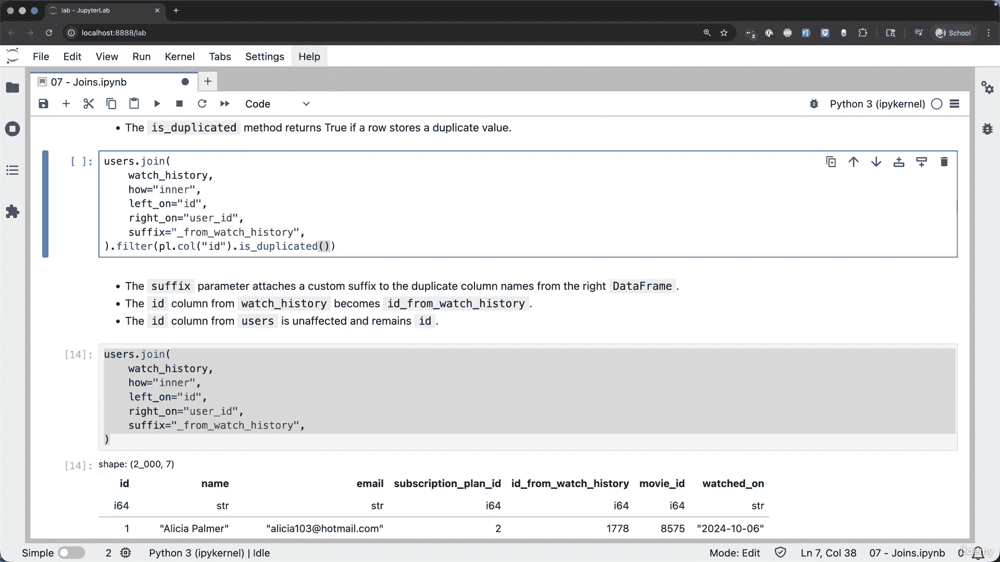

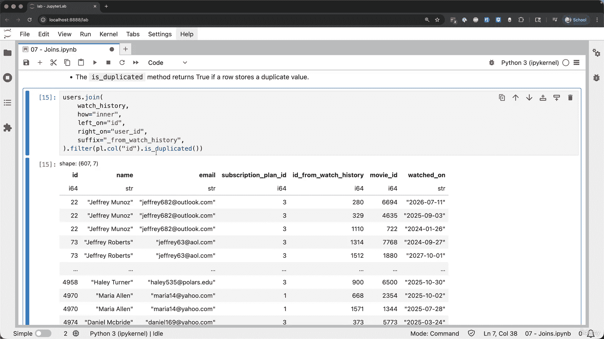

如果你不喜欢默认的“_right”后缀，完全可以自己改。在join方法里有一个suffix参数，我们可以指定重复列名结尾应该是什么。比如，我们给ID列加上“_from_watch_history”后缀。

```python
joined_df = users.join(
    watch_history,
    how="inner",
    left_on="ID",
    right_on="user_id",
    suffix="_from_watch_history"
)
```

你会看到，结果数据帧和之前基本一样，但来自观看历史表的ID列在保留原名ID的同时，后面多了一个“from_watch_history”后缀。这样一来，我们就不会被默认的“_right”弄糊涂了。

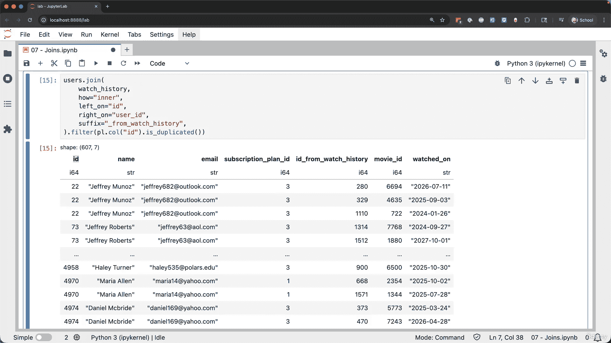

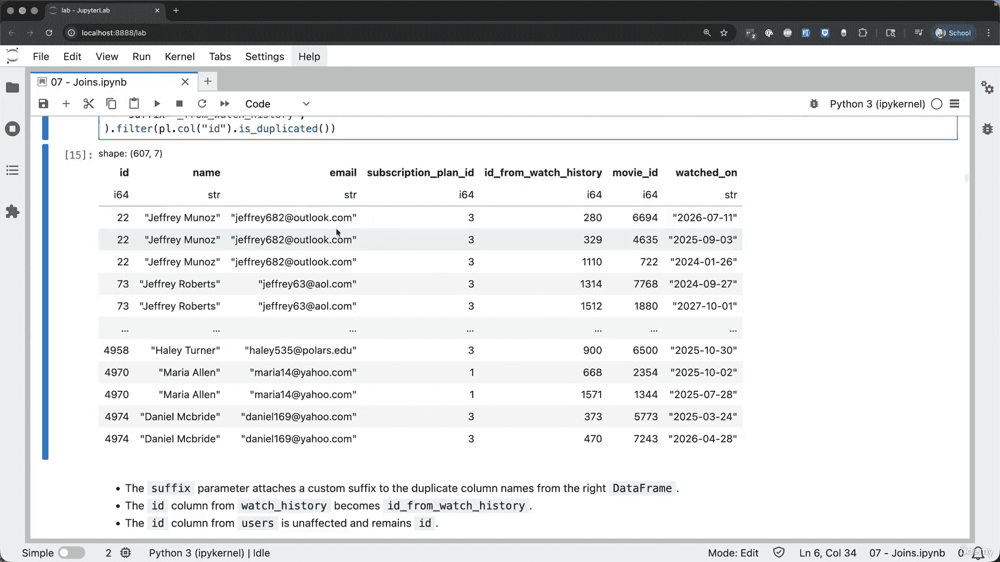

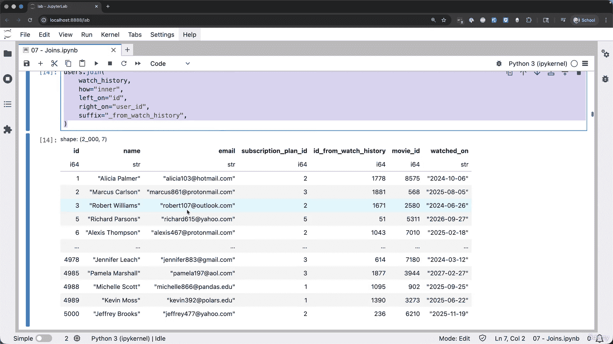

## 处理一对多匹配

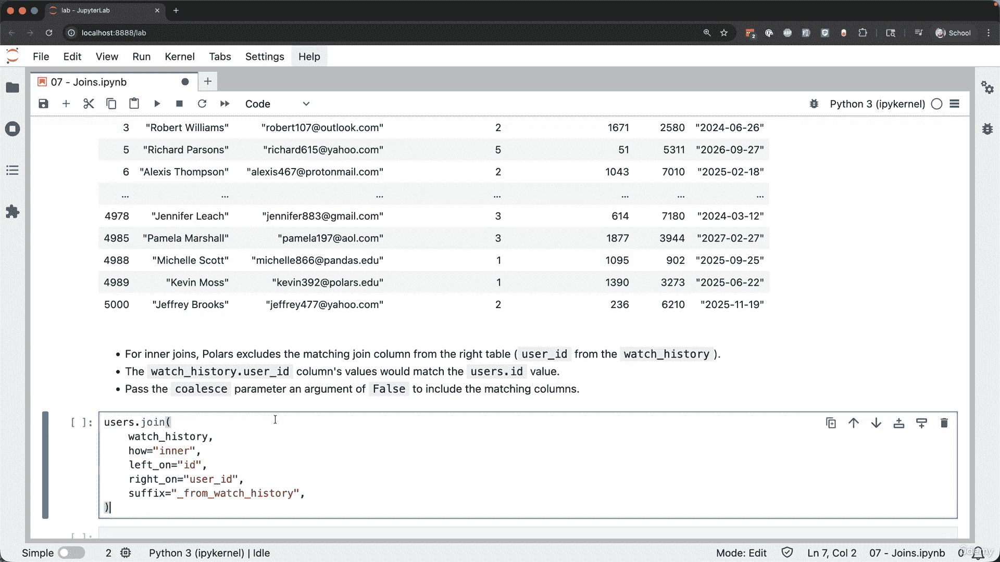

前面我们提到，一个用户可能有多条观看历史记录。我们不妨用一个例子来证明这一点。我们可以对刚才的内连接结果进行过滤，只保留那些ID重复出现的行。Polars里有一个很方便的方法叫做is_duplicated，它可以标记那些在数据帧中出现超过一次的ID。

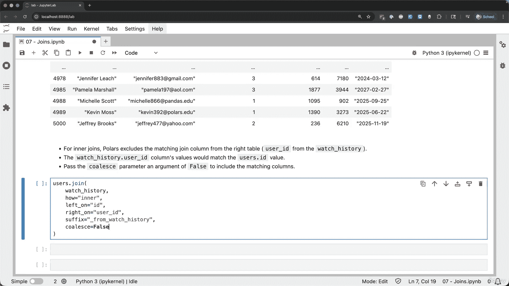

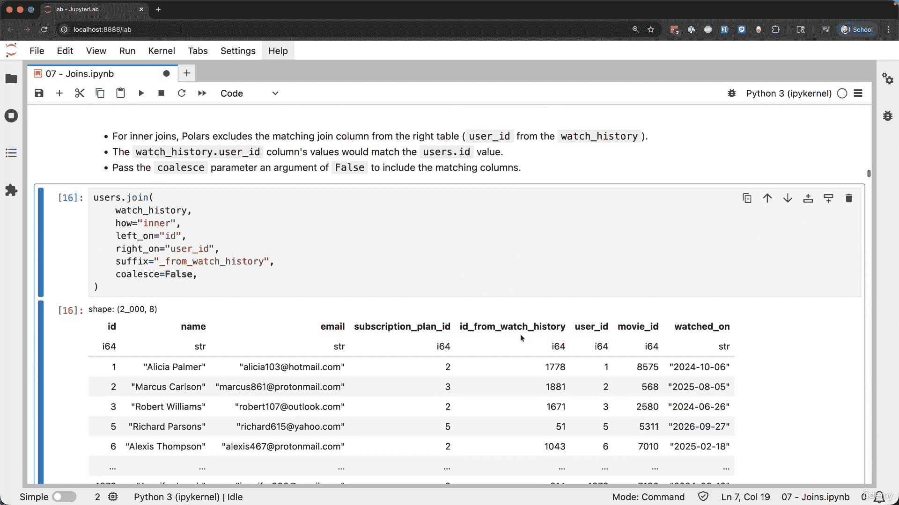

我们可以用这个方法来筛选出重复ID。你会发现，有些用户确实会出现多行。比如用户Gerey，他的ID是22，但结果中有三行。这说明在观看历史表中，这个用户一定有三条记录。你可以看到这三行里分别是他看过的三部电影。

因此，对于users表中匹配的user_id与watch_history表中匹配的user_id的每一种组合，对应的行都会被合并到一起。如果users表中同一个ID也出现多次，那么理论上也会生成所有可能的组合。不过在我们的用户表里，每个ID只出现一次，所以没有这个问题。总的来说，内连接的结果实际上就是左表ID与右表user_id列之间每一对匹配值的交集成品。

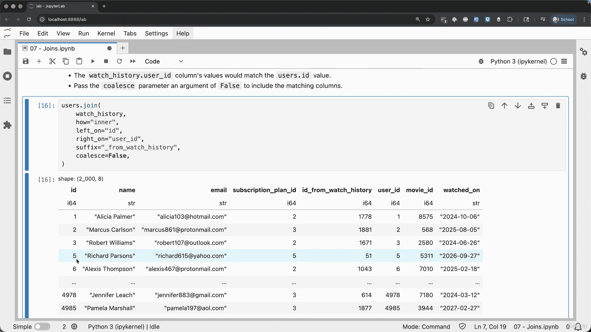

## 用coalesce保留重复列

最后，我们来看一个叫做coalesce的参数。这个单词的意思是“把东西连接在一起形成一个整体”，听起来有点学术，它的作用其实很直接：它可以让我们看到那个默认被Polars省略掉的user_id列。

如果我们给coalesce传入False，那么来自watch_history表的重复列，也就是user_id列，就会被保留下来。代码写法如下：

```python
joined_df = users.join(
    watch_history,
    how="inner",
    left_on="ID",
    right_on="user_id",
    coalesce=False
)
```

这时我们会同时看到ID列和user_id列，而且user_id的值与ID列值完全一样。例如ID是3，user_id也是3；ID是5，user_id也是5。这正好印证了前面的说法：正是因为这两个值相等，才产生了这条连接记录。Polars团队默认省略这一列，就是因为它注定是一列重复数据。但如果你希望结果中保留右数据帧的所有列，以便提醒自己内连接确实把右边所有列都带过来了，那就可以把coalesce参数设为False。

## 总结

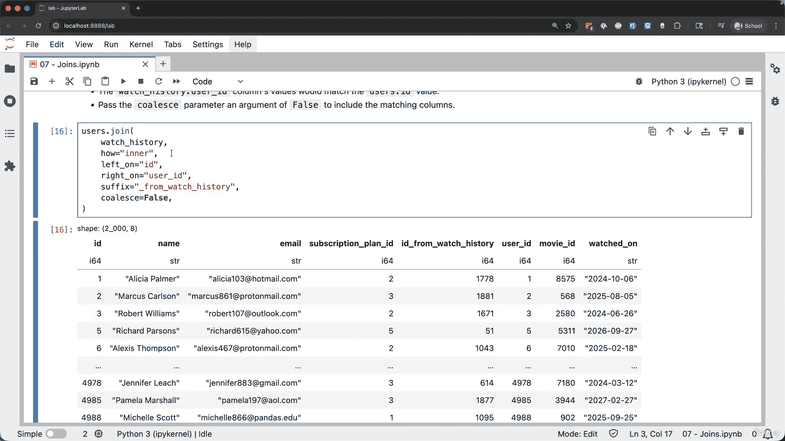

本节课我们一起学习了Polars中的内连接（Inner Join）。内连接是合并两个表或数据帧的一种方式，它只保留键值匹配的行。我们调用了join方法，把调用它的表称为左表，把作为参数传入的表称为右表；用left_on和right_on参数指定两边的匹配列，用how="inner"指定连接策略。我们还发现，内连接其实就是在寻找两个表之间的交集和共同点，所以没有匹配值的行会被排除。另外，我们还介绍了suffix参数，它用来自定义右表重复列的后缀，默认是“_right”；以及coalesce参数，它可以设为False来保留右表中那个与左表匹配列值相同的重复列。虽然本节课的内容有点多，不过好消息是，随着课程的推进，后面每节课真正变化的只是合并策略。也就是说，你只需要掌握这些代码框架，剩下的就是理解不同合并逻辑的区别。本节课的内容就是这些，我们下一节课再见。
