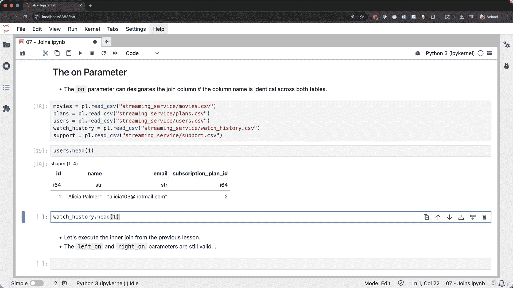
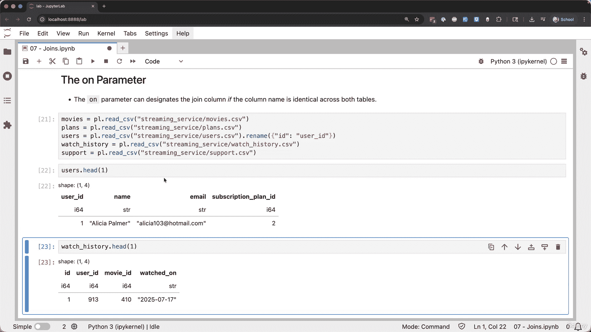
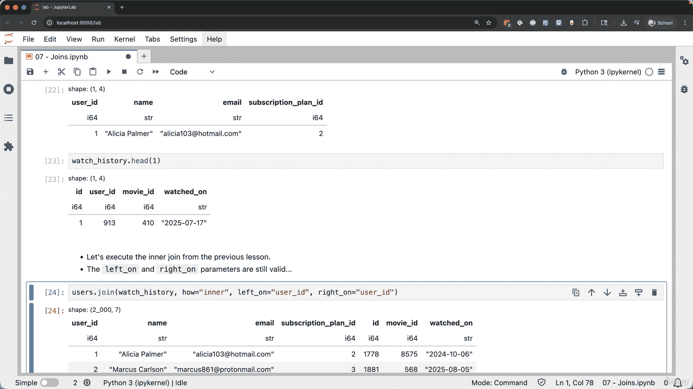
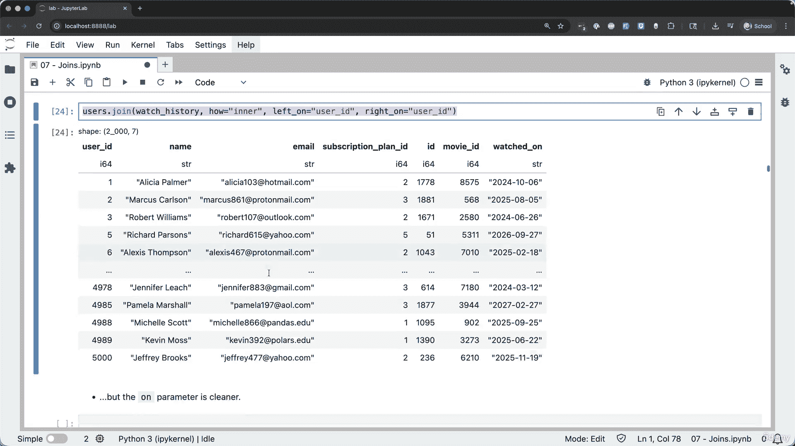
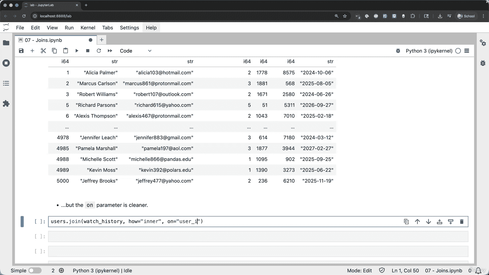
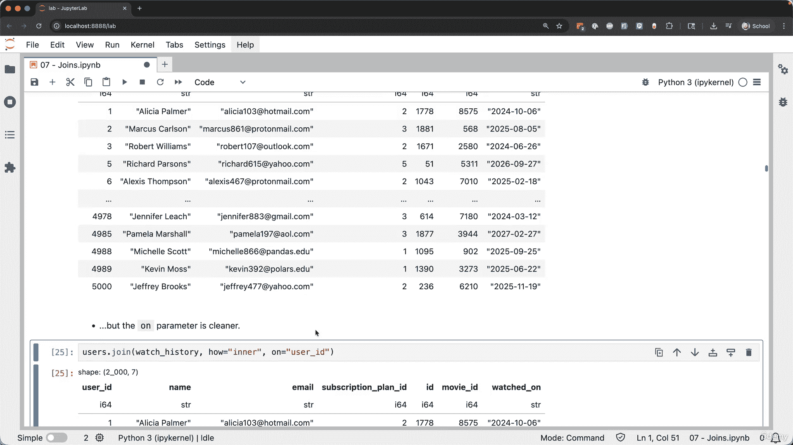
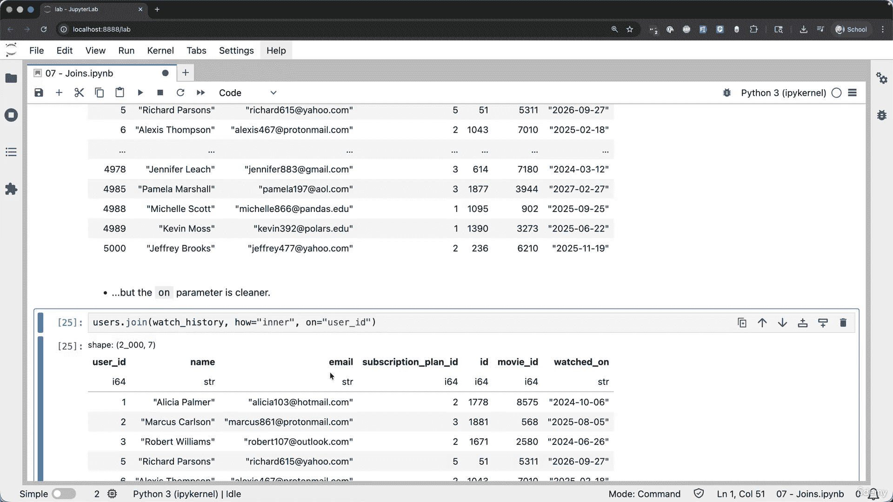

# 📊 Polars 与 Python 数据分析：102：on 参数

## 📌 Polars 与 Python 数据分析：102.1：课程概述

在本节课中我们将要学习 Polars 中 `on` 参数的用法。上一节我们介绍了使用 `join` 方法合并两个数据框时，如何通过 `left_on` 和 `right_on` 参数分别指定左右两个数据框中用于匹配值的列名。本节中我们来看看，当两个数据框中用于匹配的列名完全相同时，怎样用更简洁的 `on` 参数完成同样的合并操作。理解这个参数可以让代码更短、更直观，也能帮助初学者分清列名不同和列名相同这两种常见情况。

为了让后面的内容更容易理解，我们会先回顾 `left_on` 与 `right_on` 的分工，再通过 `rename` 方法把两个表的列名改成一致，最后演示 `on` 参数如何替代 `left_on` 和 `right_on`。整个过程中，我们还会说明 `on` 参数的使用前提，避免在列名不一致时误用。

## 🧩 Polars 与 Python 数据分析：102.2：回顾 left_on 与 right_on

上一节我们介绍了 `join` 方法的基本合并流程，本节先回顾一下 `left_on` 和 `right_on` 这两个参数的作用。在上一课中，我们使用 `join` 方法把两个数据框合并在一起时，指定了 `left_on` 和 `right_on` 参数，用来分别表示左侧数据框和右侧数据框中需要匹配值的列名。也就是说，这两个参数让我们可以明确告诉 Polars：左表用哪一列、右表用哪一列来对齐数据。

以下是这两个参数的基本分工：

- `left_on`：指定左侧数据框中用于匹配的列名。
- `right_on`：指定右侧数据框中用于匹配的列名。
- 使用场景：两个数据框中用于匹配的列名不完全相同时，用它们分别指定列名。

可以用一个简单公式表示这种匹配关系：

$$
\text{left\_on 指定的列值} = \text{right\_on 指定的列值}
$$

回顾完这个基础用法后，接下来看看两个表当前的实际列名情况，以及为什么之前必须分别指定左右列名。

## 🔍 Polars 与 Python 数据分析：102.3：查看两个表的列名差异



现在我们先预览 `users` 和 `watch_history` 这两个数据框的第一行，看看它们当前的状态。`users` 当前的样子如下，`watch_history` 当前的样子如下。通过查看第一行，我们可以直观看到两个表中用于匹配的列名并不一样。

以下是当前两个表在匹配列上的差异：

- `users` 表中用于匹配的列名是 `ID`。
- `watch_history` 表中用于匹配的列名是 `user_id`，原文中显示为 `user I`，按上下文应理解为 `user_id`。
- 正因为两个列名不同，之前才需要使用 `left_on` 和 `right_on` 分别指定左右两侧的列名。

这里的关键点在于，`left_on` 和 `right_on` 解决的是“列名不一样”的问题。如果两个表用于匹配的列名完全相同，就可以考虑使用更简洁的 `on` 参数。接下来我们通过修改列名，制造出列名相同的情况。

## ✏️ Polars 与 Python 数据分析：102.4：用 rename 统一列名

上一节我们看到了两个表列名不同的问题，本节中我们来看看怎样用 `rename` 方法把 `users` 表中的 `ID` 列改成 `user_id`。现在假设 `users` 表中的 `ID` 列也刚好叫 `user_id`。例如在导入数据时，数据框由 `read_csv` 函数返回，我们可以调用 `rename` 方法来修改列名。

这里提醒一下，`rename` 方法接受的是一个字典。字典中的键是现有的列名，值是想替换成的新列名。比如我们把现有的 `ID` 列作为键，把 `user_id` 作为值，就能把 `ID` 列重命名为 `user_id`。代码如下：

```python
users = users.rename({"ID": "user_id"})
```



需要强调的是，`rename` 方法严格来说只用于修改列名，不负责修改列中的数据内容。重新执行这个单元格后，我们会注意到 `users` 和 `watch_history` 现在都有 `user_id` 列。两个表用于匹配的列名一致后，就可以使用 `on` 参数了。

## 🔗 Polars 与 Python 数据分析：102.5：使用 on 参数简化 join

上一节我们把两个表的列名统一成了 `user_id`，本节中我们来看看 `on` 参数如何简化 `join` 代码。当两个数据框中用于匹配的列名完全相同时，可以使用普通的 `on` 参数作为快捷方式。需要指出的是，`left_on` 和 `right_on` 参数仍然可以正常工作，并不会因为有了 `on` 参数就失效。

例如，我们取出 `users` 数据框，调用 `join` 方法，把 `watch_history` 作为右侧数据框传入，使用 `how="inner"` 做内连接，同时使用 `left_on` 和 `right_on` 参数。由于现在 `users` 中的列名是 `user_id`，`watch_history` 中的列名也是 `user_id`，所以我们可以给这两个参数提供完全相同的列名。Polars 很灵活，会允许这种写法，而且这种写法完全有效。对应代码如下：

```python
users.join(
    watch_history,
    how="inner",
    left_on="user_id",
    right_on="user_id"
)
```

如果一时忘记简化，这段代码仍然会给出你想要的准确结果。不过，如果代码写成这样，就可以把 `left_on` 和 `right_on` 都删除，只使用 `on` 参数来简化代码。此时 `on` 参数指定的是两个表共享的列名，代码如下：

```python
users.join(
    watch_history,
    how="inner",
    on="user_id"
)
```

这段代码的意思是：按照 `users` 表和 `watch_history` 表中 `user_id` 列的值进行合并。换句话说，匹配条件可以写成下面的公式：

$$
\text{users.user\_id} = \text{watch\_history.user\_id}
$$

因此，只有两个数据框中用于匹配的列名完全相同时，才能使用 `on` 参数。这个前提很重要，如果列名不同，仍然需要使用 `left_on` 和 `right_on` 分别指定。





## 🧠 Polars 与 Python 数据分析：102.6：本节总结





本节课中我们一起学习了 Polars 中 `on` 参数的用法。我们回顾了 `left_on` 和 `right_on` 在列名不同时的作用，查看了 `users` 与 `watch_history` 两个表中 `ID` 和 `user_id` 的列名差异，并通过 `rename` 方法把 `users` 的 `ID` 列改成了 `user_id`。当两个表用于匹配的列名完全一致后，就可以用 `on` 参数替代 `left_on` 和 `right_on`，让 `join` 代码更加简洁。



最后再总结一下关键点：`left_on` 和 `right_on` 适合列名不同的情况；`on` 适合两个表中用于匹配的列名完全相同的情况；`on` 参数的核心含义就是指定两个表共享的匹配列名。掌握这些区别后，在写数据合并代码时就可以根据列名是否一致来选择更合适的写法。

