## 📘 Polars与Python数据分析：103.0：课程概述

在本节课中我们将要学习 Polars 中的全连接（Full Join），可以把它理解为上一节内连接（Inner Join）的扩展版本。上一节我们关注的是两张表的重叠部分，本节我们来看看如何在内连接的基础上，把左表和右表中没有匹配到的记录也保留下来。全连接在查找“孤儿记录”时特别有用，所谓孤儿记录，就是一张表里有、但另一张表里找不到对应匹配项的记录。为了让初学者更容易理解，本教程会从概念、数据准备、代码执行、正向和反向筛选几个方面展开，并保留原文每一句话的核心含义，同时用大白话解释关键逻辑。下面我们先从全连接的基本概念开始。

## 🧩 Polars与Python数据分析：103.1：全连接的基本概念

上一节介绍了内连接，本节我们来看看全连接。内连接的目标是两张数据框的交集，也就是重叠部分。全连接不仅包含重叠部分，还包含左表和右表中没有在另一张表里找到互补匹配值的行。Polars 仍然会匹配那些值相同的行，也就是中间重叠的部分，并把左右两边对应行的内容合并成结果数据框中的一行。但是，对于左表或右表中没有匹配的任何一行，全连接仍然会保留这些行，只是把另一张表对应的列填充为 null 值。可以用一个公式概括这种关系：

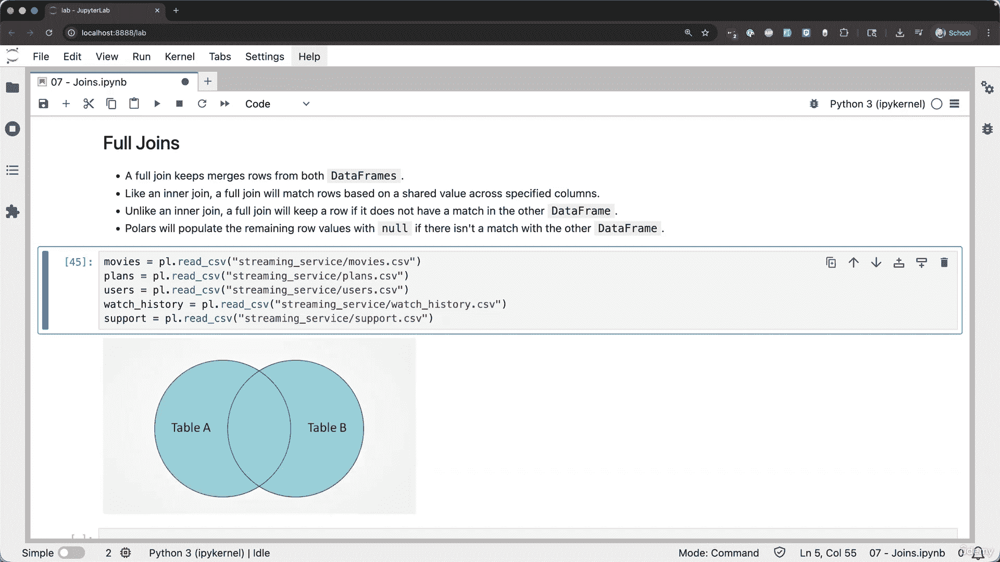

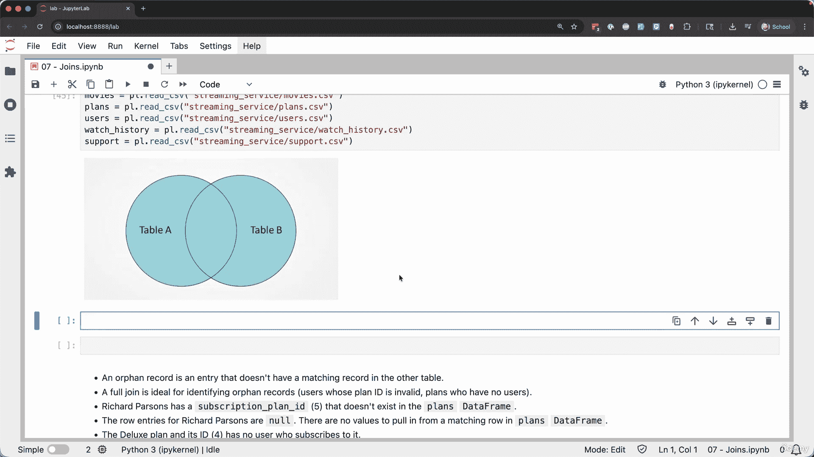

\[
\text{Full Join} = \text{Inner Join} + \text{左表独有记录} + \text{右表独有记录}
\]

也可以直观理解为：全连接等于内连接，加上左表没有匹配的部分，再加上右表没有匹配的部分。这样理解以后，后续代码里的 `how="full"` 就更容易看懂了。下面我们先把示例数据准备好，看看用户表和套餐表长什么样。

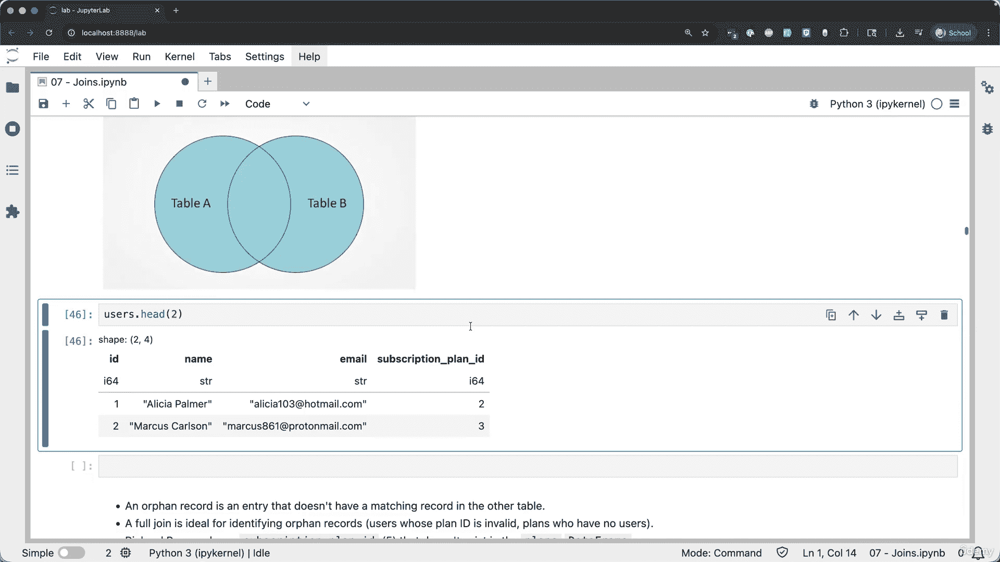

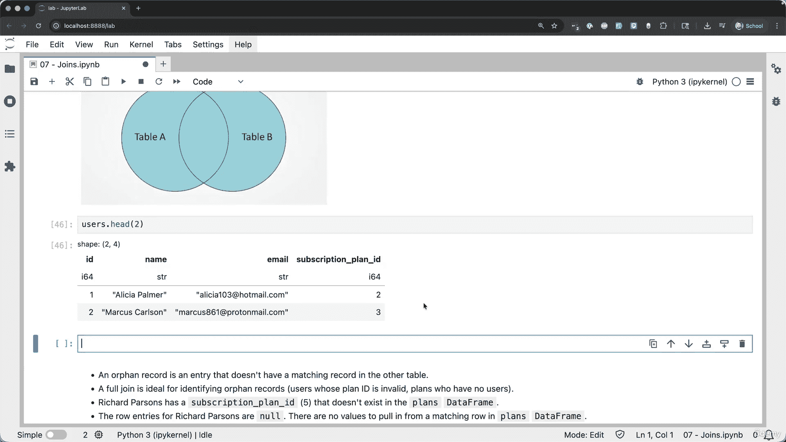

## 🗂️ Polars与Python数据分析：103.2：准备用户表与套餐表

在理解概念之后，本节我们来看看示例数据。原文首先重新执行代码，并再次展示用户表，用 `head` 方法传入参数 2，预览前两行。每个用户都有一个订阅套餐 ID，这个 ID 是用户在服务中订阅的套餐的数字标识。套餐表很短，可以把整张表输出出来。每个套餐都有自己的唯一 ID、名称和价格，例如 Alicia Palmer 订阅的是套餐 2，所以她使用的是标准套餐。以下是准备数据时需要关注的几个点：

- 用户表通过 `head(2)` 预览前两行，便于观察字段结构。

- 用户表中的 `subscription_plan_id` 表示用户订阅套餐的数字 ID。

- 套餐表比较短，可以直接完整输出。

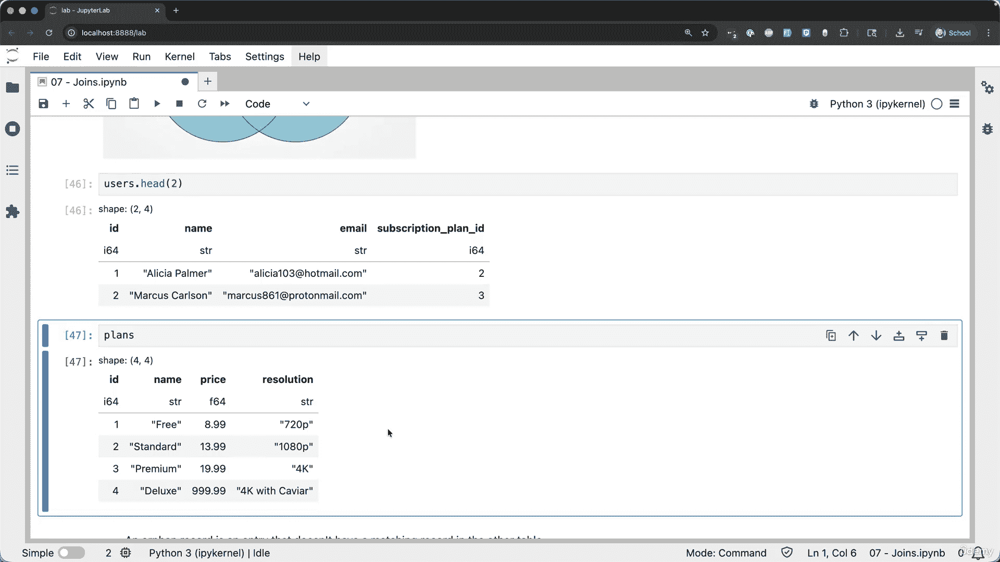

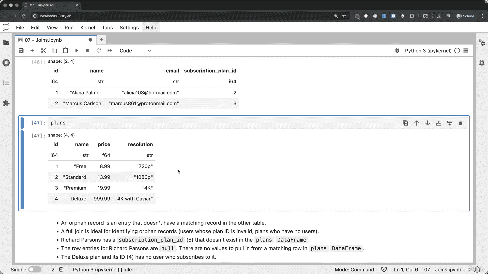

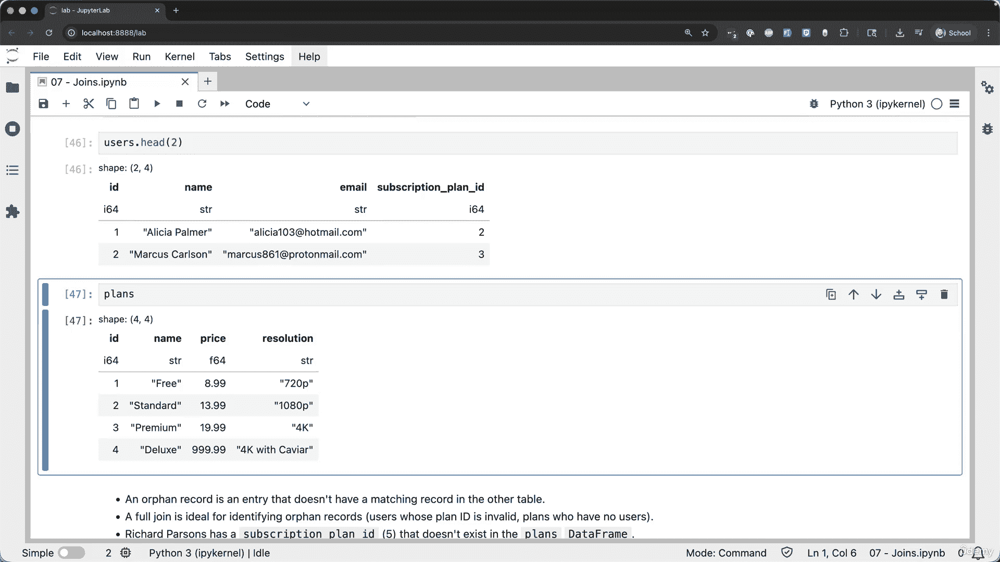

- 套餐表包含唯一 ID、套餐名称和价格。

- Alicia Palmer 订阅套餐 2，对应标准套餐。

这些数据看起来简单，但正好能说明全连接的作用。接下来我们会执行全连接，并观察匹配行与不匹配行在结果中的表现。

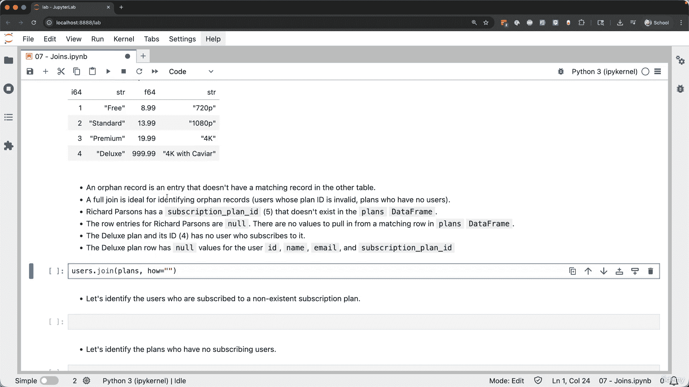

## 🔗 Polars与Python数据分析：103.3：执行全连接

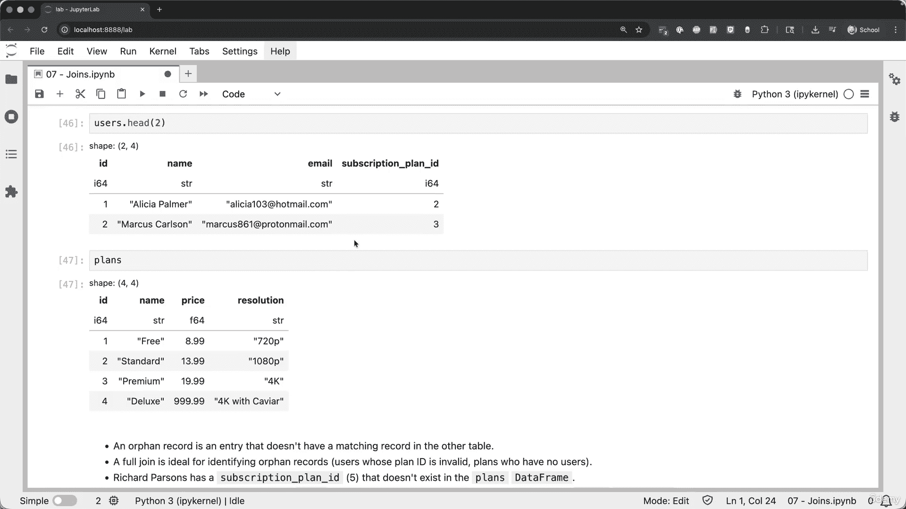

上一节准备好了用户表和套餐表，本节我们来看看如何执行全连接。全连接非常适合识别所谓的孤儿记录，也就是一张表里的条目在另一张表里没有匹配记录。举例来说，假设很多年前服务里还有很多其他套餐，可能有 ID 为 5、6、7 的套餐，后来某些套餐被废弃了；但用户表中可能仍有用户在这一列里保留着这些套餐 ID。也就是说，用户表的这一列里存在一些值，在套餐表的 ID 列里并不存在。我们可能想找出这些行，看看哪些已废弃套餐仍然被用户误订阅。全连接可以帮助完成这件事。以下是执行全连接的主要步骤：

- 从用户数据框开始，调用 `join` 方法。

- 第一个参数传入右数据框，本节中是 `plans`。

- 指定 `how` 参数，这里不使用内连接，而是使用 `"full"`。

- 仍然需要提供 `on`，或者 `left_on` 与 `right_on` 参数，用来指定比较列。

- 使用 `left_on` 指定用户表的 `subscription_plan_id` 列，注意这里使用下划线。

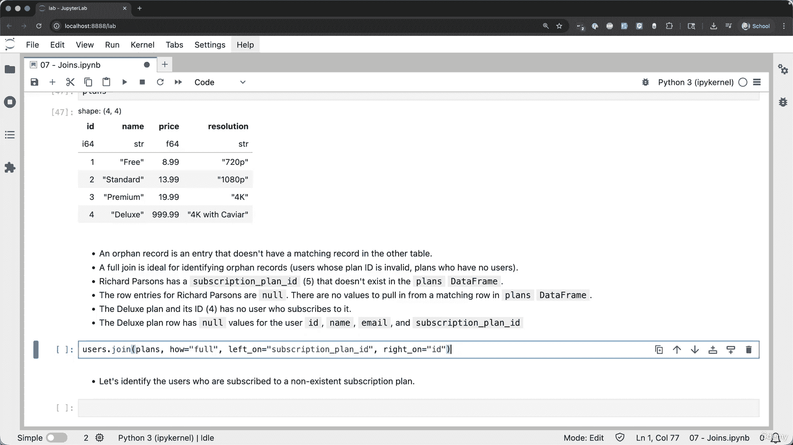

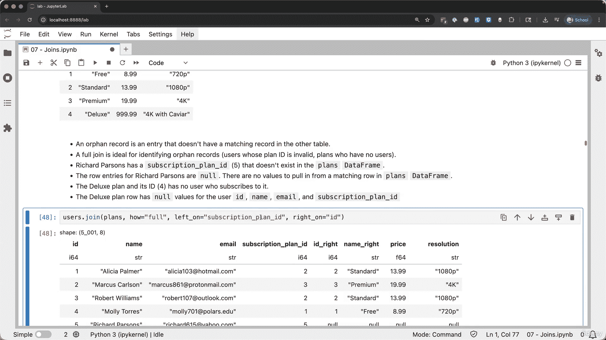

- 使用 `right_on` 指定套餐表的 `ID` 列。

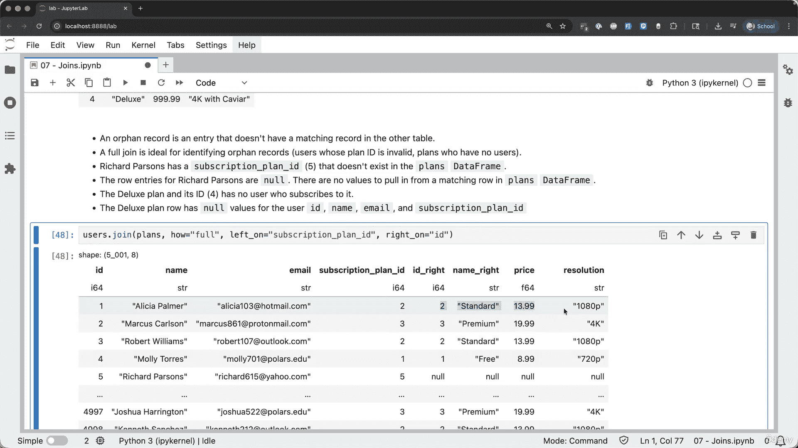

- 可选使用 `suffix` 参数，为重复列添加后缀。

对应代码可以写成下面这样：

```python
joined = users.join(
    plans,
    how="full",
    left_on="subscription_plan_id",
    right_on="ID",
    suffix="_from_plans"
)
```

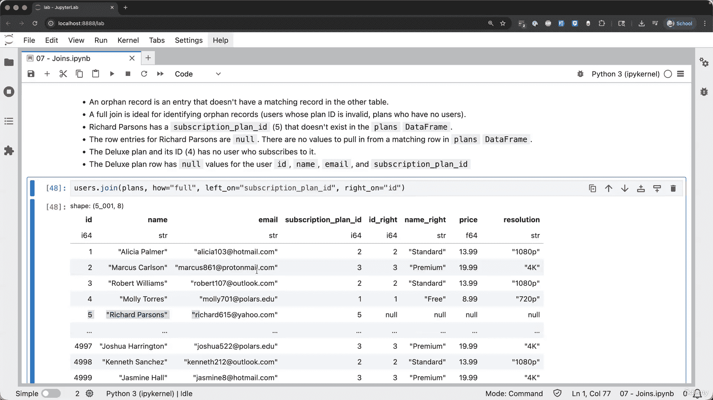

执行后要留意全连接与上一节内连接的差异。例如，结果中有一行来自用户表，保留了用户表的四列，并且因为 `subscription_plan_id` 为 2，匹配到了套餐表 ID 为 2 的行，所以套餐表的匹配内容被拉到了结果中。结果中这些列来自套餐表。但也可以看到，用户 Richard Parsons 订阅的是套餐 5，而套餐表中没有 ID 为 5 的套餐，因此这一行来自用户表的数据仍然保留，只是从套餐表拉过来的列值全部为 null。换句话说，套餐表中没有互补行可以匹配 Richard Parsons。这个例子说明：内连接会排除这种行，而全连接会包含这种行。同样的逻辑也会反向适用。结果下方还会看到套餐表中 ID 为 4 的套餐，但用户表中没有哪个用户的 `subscription_plan_id` 是 4，所以这也是一个没有匹配的情况。全连接结果本身可能很大，原文提到它是 51 行，不过只要加上一些过滤条件，就能做很有用的分析。接下来我们看看重复列后缀和列名变化。

## 🏷️ Polars与Python数据分析：103.4：重复列与后缀参数

上一节执行了全连接并观察了结果，本节我们来看看重复列和后缀参数。`suffix` 参数在这里仍然可用，它用来定制重复列的后缀。结果中会看到 `ID` 这样的右表列，这是一个例子。回忆内连接时，这一列曾被排除，除非把 `coalesce` 参数设置为 `false`。原因是内连接中这个值总是等于左表匹配列的值。但现在使用全连接，会出现两个值不匹配的场景：即使套餐表没有匹配行，用户表的行仍然会被保留，因此两张表对应列的值可能不同，Polars 团队不希望直接排除 `ID` 列，所以这一列会保留下来。以下是理解重复列时需要记住的要点：

- `suffix` 参数可以定制重复列的列名后缀。

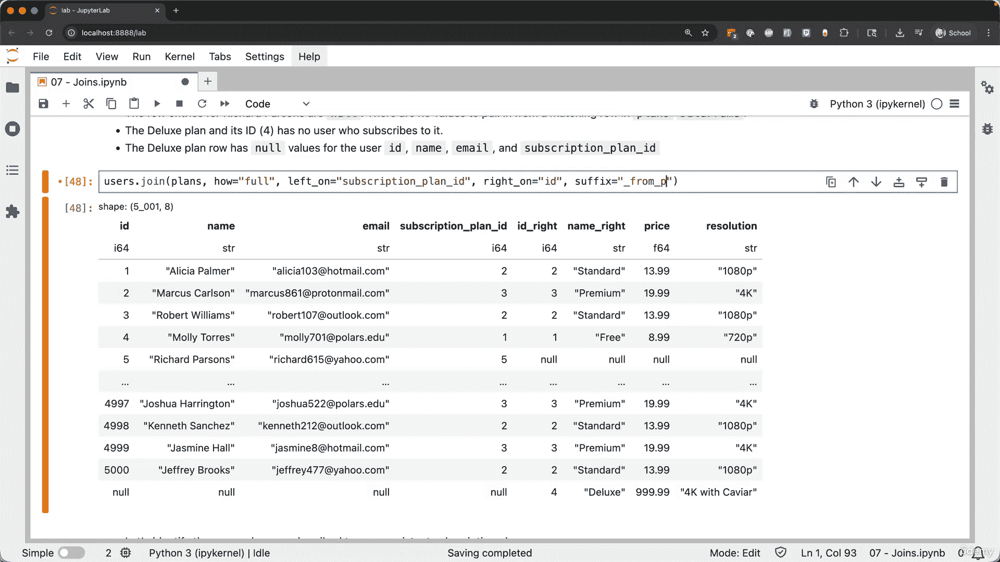

- 全连接中 `ID` 列可能来自右表，也可能有独立含义。

- 内连接中如果值总是相等，重复列可能被合并或排除。

- 全连接中存在无匹配行，所以重复列不能简单排除。

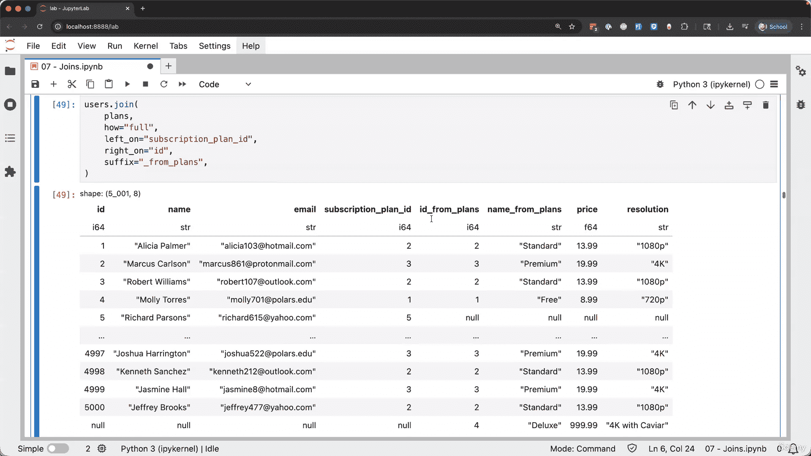

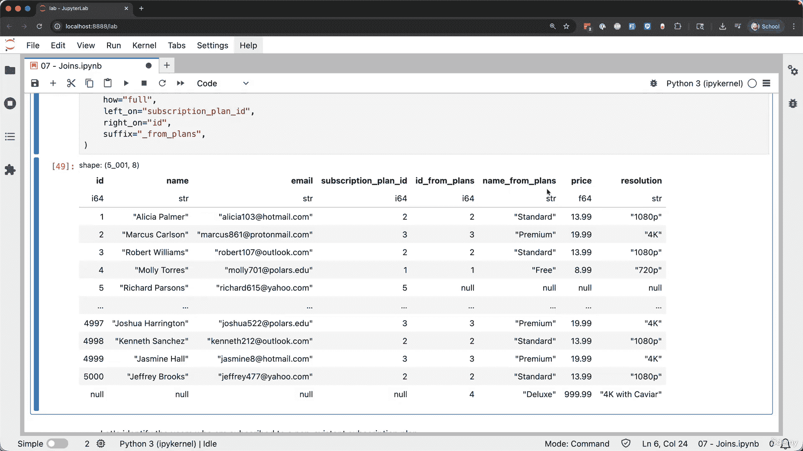

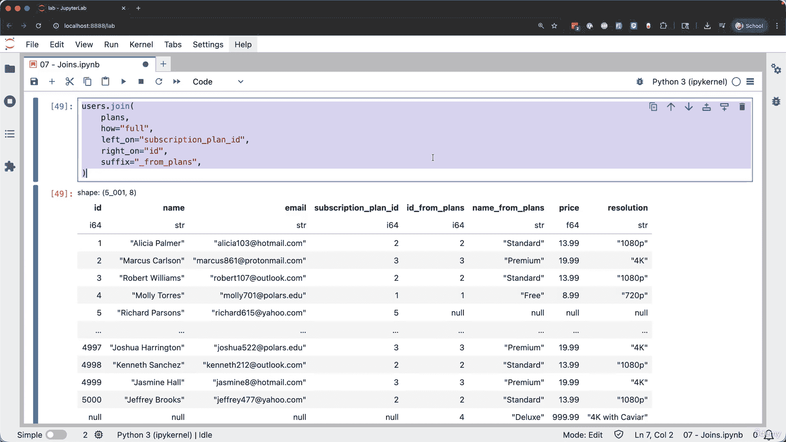

- 给后缀命名为 `_from_plans`，可以提醒我们重复列来自套餐表。

添加 `suffix="_from_plans"` 后，结果中的 `ID` 列可以明确理解为来自套餐表的 ID；用户表中的 `name` 保持不变；套餐表中的套餐名称也会保留对应列名。这样一来，就更容易分辨每一列到底来自哪张表。理解列来源后，就可以回到过滤操作，用全连接查找孤儿记录。

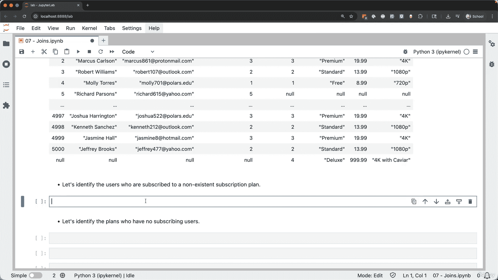

## 🔍 Polars与Python数据分析：103.5：用过滤查找孤儿记录

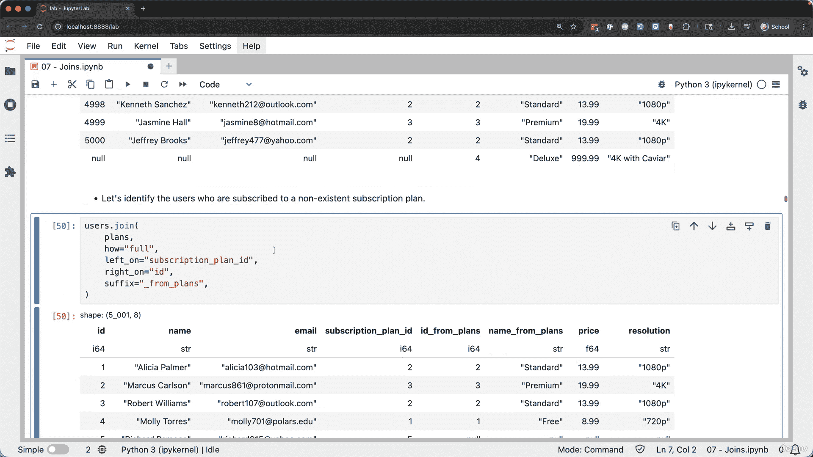

上一节弄清楚了重复列和后缀，本节我们来看看如何通过过滤找出孤儿记录。首先可以复制前面的全连接代码，然后在结果上筛选“订阅了不存在套餐”的用户。判断条件是：来自套餐表的 `ID_from_plans` 列为 null，这意味着用户表中的这个 ID 没有对应的套餐记录，是一个孤儿记录，套餐表中没有 ID 为 5 的互补套餐可以拉过来。可以使用 `filter` 方法，配合方便的 `is_null` 方法。以下是正向查找用户侧孤儿记录的步骤：

- 对全连接结果调用 `filter` 方法。

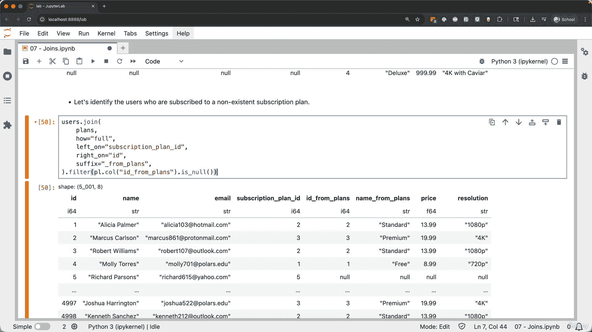

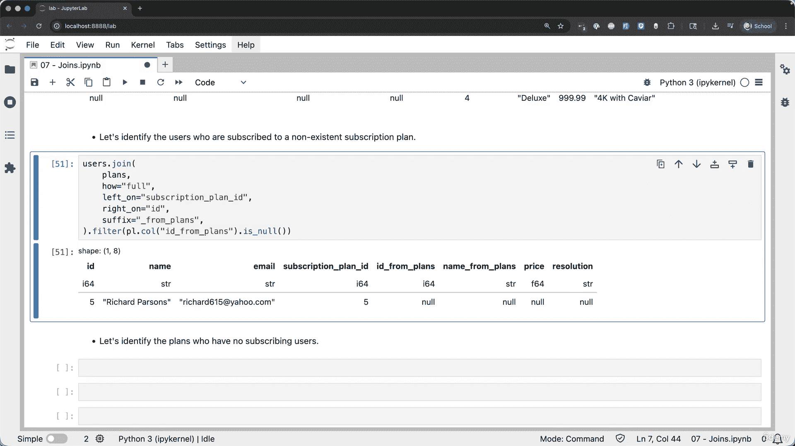

- 目标列选择新生成的 `ID_from_plans` 列。

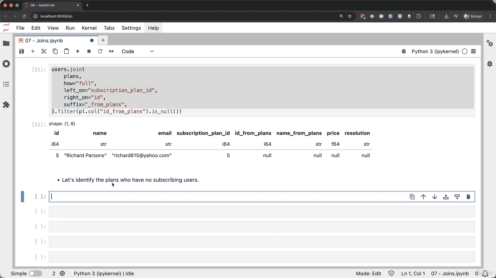

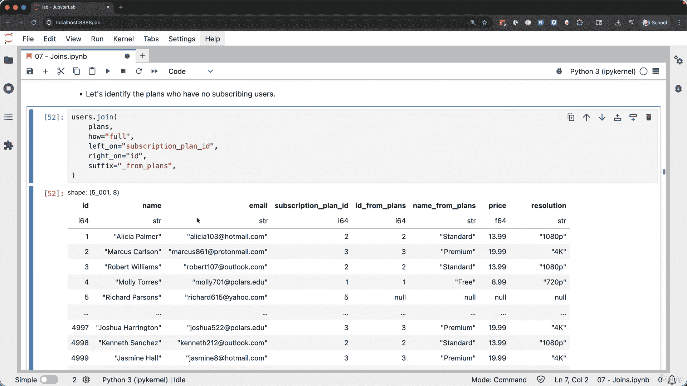

- 使用 `is_null()` 判断该列是否为空。

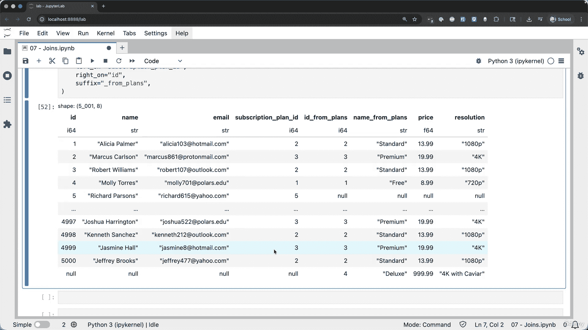

- 结果会保留那些在套餐表中找不到匹配套餐的用户行。

对应代码类似下面这样：

```python
orphan_users = joined.filter(
    pl.col("ID_from_plans").is_null()
)
```

原文示例中只有一个这样的例子，通过这个过滤就能从用户表里提取出没有匹配套餐的孤儿记录。反过来也可以做同样的逻辑。再次展示全连接表后，如果想找出套餐表中没有匹配用户 ID 的行，也就是没有任何订阅者的套餐，可以再次调用 `filter` 方法。这次目标列选择最初来自用户表的 `ID` 列，并检查它是否为 null。只要 `ID` 为 null，就说明这一行是从右侧套餐表合并过来的，并且没有从用户表拉到互补的 ID。这样会得到数据框末尾的那一行，也就是套餐表中 ID 为 4、但在用户表的 `subscription_plan_id` 中没有对应值的行，因此用户表相关列显示为 null。这个结果告诉我们，服务中没有人订阅 ID 为 4 的套餐；原文还提到，这大概也合理，因为这是非常昂贵的套餐，每月 1000 美元，提供 4K 流媒体和鱼子酱。关键结论是：全连接非常适合识别孤儿记录，也就是一张表中有、另一张表中没有互补匹配的记录，而且可以双向查找。对应反向过滤代码类似：

```python
orphan_plans = joined.filter(
    pl.col("ID").is_null()
)
```

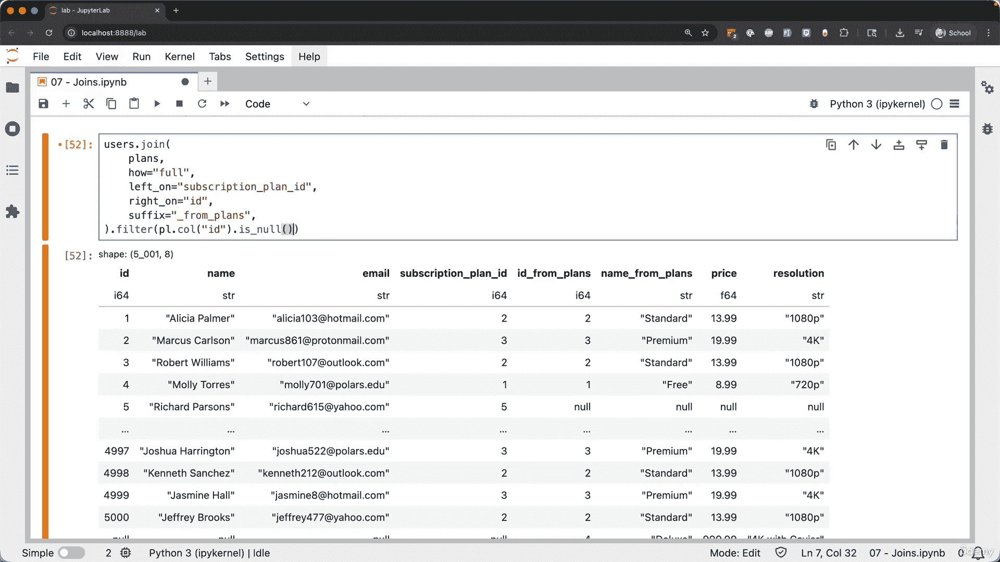

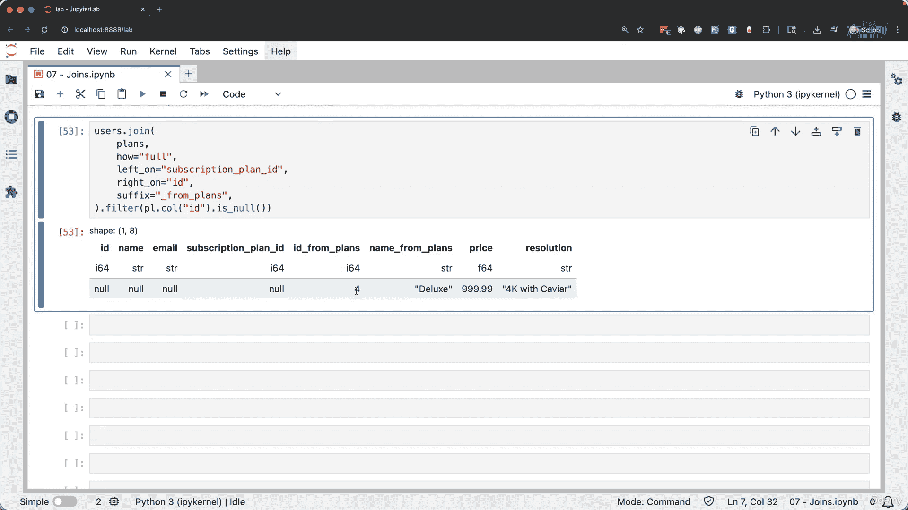

到这里，我们已经分别从用户侧和套餐侧找出了没有匹配的记录，下面做个总结。

## ✅ Polars与Python数据分析：103.6：本节总结

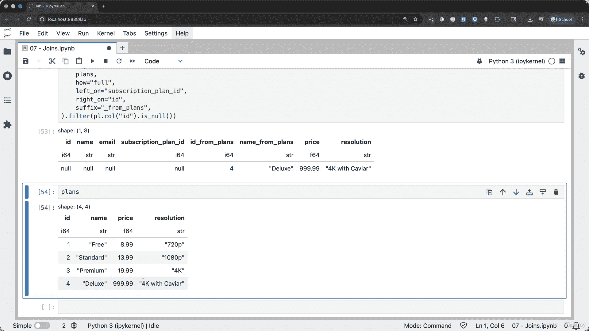

本节课中我们一起学习了 Polars 中的全连接。全连接会保留两张表的匹配部分，也会保留左表和右表中没有匹配的部分；匹配部分仍然会合并成一行，不匹配部分则把另一张表的列填为 null。我们用代码和公式说明了全连接与内连接的关系，也看到了 `suffix` 参数如何处理重复列，以及如何通过 `is_null()` 过滤找出用户侧和套餐侧的孤儿记录。如果两张表存在匹配，全连接仍然会把它们匹配在一起，所以可以把它想成内连接加上两张表各自没有匹配的部分。掌握这些内容后，就可以在实际数据分析中判断哪些记录缺失对应关系，并为后续清洗和核对数据打下基础。
