# 🧩 Polars与Python数据分析：104：左连接与右连接


在本节课中，我们将要学习 Polars 中的左连接和右连接。左连接和右连接是数据处理中非常常见的两种连接方式，理解它们的核心在于弄清楚“哪张表是主表”。我们会先讲左连接的基本概念，再通过 support 表和 users 表的例子看代码怎么写，然后说明匹配成功和不匹配时结果分别是什么样。最后我们会看右连接，它本质上是把左右两张表的位置倒过来看同一个问题。整个教程会尽量用大白话解释，让初学者也能跟上思路。


## 🧭 Polars与Python数据分析：104.1：左连接的基本概念


接下来要介绍的连接类型是左连接。在左连接中，我们会建立一张表，也就是左边的表，把它作为主要关注点。我们会保留左表中的所有行，并且在可能的情况下，把右表中匹配的数据行合并进来。也就是说，左表是主焦点，左连接的名字也正来自这里。


在前面，我们已经探索过内连接的概念，内连接关注的是两张表重叠的那一部分。我们也探索过全连接的概念，全连接关注的是两张表里的全部内容。现在再对比一下，左连接看起来是这样的：我们聚焦左表，只在存在匹配时从右表拉取数据。理解了左连接的基本定位后，本节中我们来看看示例数据以及连接目标。


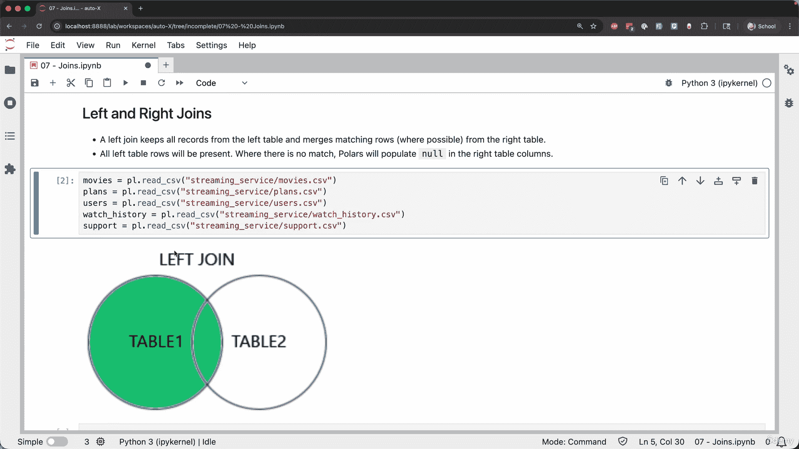

## 🧭 Polars与Python数据分析：104.2：示例数据与连接目标


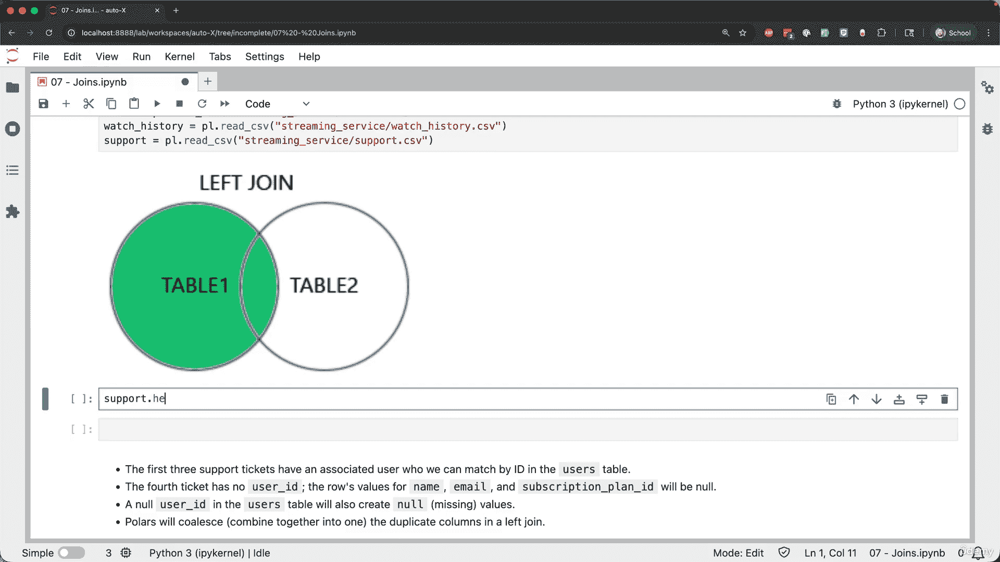

我们先重新执行导入代码。数据集中有一张表叫 support，我会用 head 方法预览前四行，像这样。每一条 support 工单都有一个可选的 user ID，这个 user ID 对应 users 表中的 ID。因此这里我也可以预览 users 表的前几行。


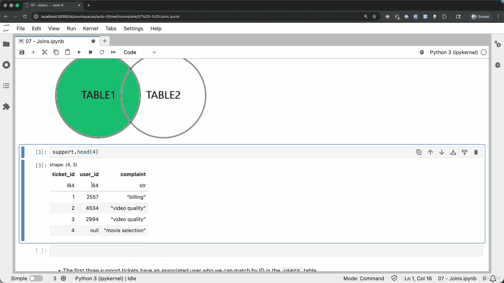

假设我想把 support 表设为主要关注点，对于每一行或每一条记录，只要它有 user ID，我就想从 users 表中拉取对应的数据行。比如这里，我想从 users 表中拉取 user ID 为 2557 的那一行。再强调一次，我不关心 users 表中的 ID 是否必须同时出现在两张表里，也不关心它只出现在某一边；我只关心 support 表里的 user ID，也就是即将成为左表的那张表里的 ID。如果有匹配，我就把 users 中的数据带过来；如果没有匹配，我就没有数据可以带过来，因此从 users 拉过来的对应列会得到 null 值。


下面把这一步的目标要点集中列出来，方便初学者对照理解。


- 把 support 表作为主表，也就是左表。

- 对于 support 表中的每一行，用它的 user ID 去 users 表里找对应记录。

- 如果 user ID 在 users 表中能找到匹配，就把 users 表中对应的 name、email、subscription plan 等数据带过来。

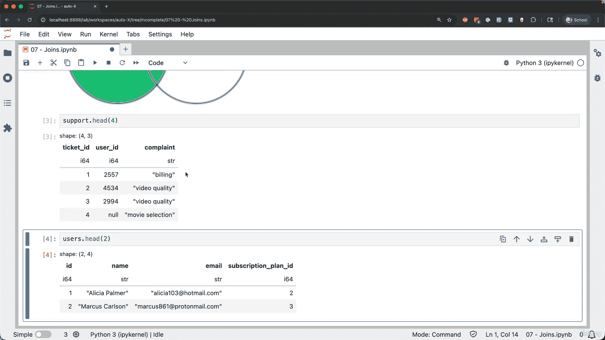

- 如果 user ID 是空值，或者是一个有效数字但在 users 表中找不到，那么从 users 表带过来的列就填 null。

- users 表中存在、但 support 表中不存在的 ID，不会进入这次连接结果，因为主焦点是 support 表。


有了上面的目标以后，接下来我们看看左连接具体怎么写，以及结果为什么行数不变。


## 🧭 Polars与Python数据分析：104.3：左连接代码与结果


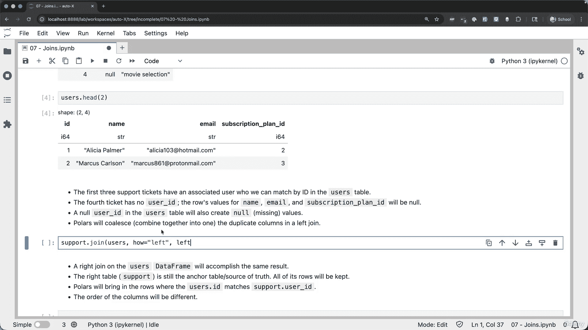

在下面，我们取 support 表，这张表会成为左表，因为我们在它上面调用方法。这里我会调用 join 方法，把 users 作为右表传进去，并且给 how 参数提供一个字符串参数 left，表示执行左连接。support 左表成为主要关注点，在这张 support 表中，我想作为连接基础的列是 user ID，所以在 left_on 中提供 user_id。对于右表 users，我会给 right_on 参数设置目标列为 ID。这样，只要 user_id 和 id 之间存在匹配，我们就会把右边 users 表的行拉到左边 support 表中。


```python
result = support.join(
    users,
    how="left",
    left_on="user_id",
    right_on="id"
)
```


使用左连接时，你会得到与左表完全相同的行数。原来的 support 表有 500 行，因此这里连接后的 DataFrame 也会得到 500 行。只要存在匹配，比如这里有一处匹配，我们就会把 users 表中的数据拉过来，包括 name 列、email 列和 subscription plan ID 列，并把它与 support 表中的原始数据合并在一起。只要不存在匹配，比如这里有一个 null 值，那就没有东西可以带过来；或者这里有一个有效的数字 user ID，但它在 users 表中找不到，那么我们同样会为来自右表 users 的所有列生成 null 值，因为没有匹配，也就没有数据可以带过来。


再用大白话说一遍，users 表中存在但 support 表中不存在的 ID，基本上会被排除掉。这是左连接，因为这里的主要焦点是左表，也就是 support 表。左连接的核心关系可以用下面这个公式来理解：


```text
left_join(左表, 右表) = 左表全部行 + 右表匹配字段（无匹配补 null）
len(left_join_result) == len(left_table)
```


提醒一下，这里还有一个 coalesce 参数。我可以在这里传入参数 false，这样就会得到右手边 users 表中互补的 ID 列。你可以看到，这一列的值会与 support 表中 user_id 列的值完全一致。这个列可以用来确认两张表、两个连接列之间是否能够匹配上。下面把左连接的关键规则集中列出来。


- 左连接保留左表的全部行，结果行数与左表一致。

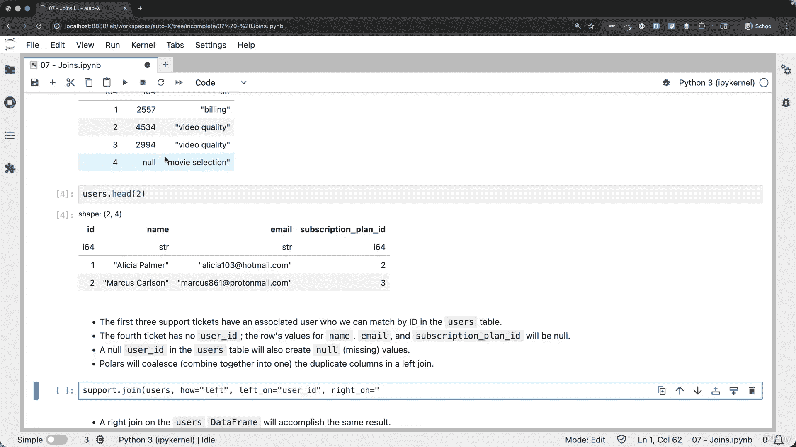

- 只有在 user_id 与 id 匹配时，才把右表 users 的列合并进来。

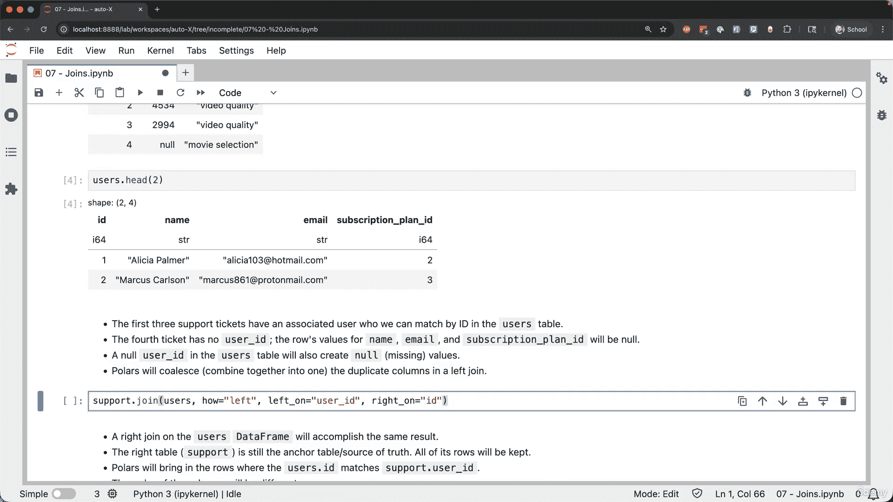

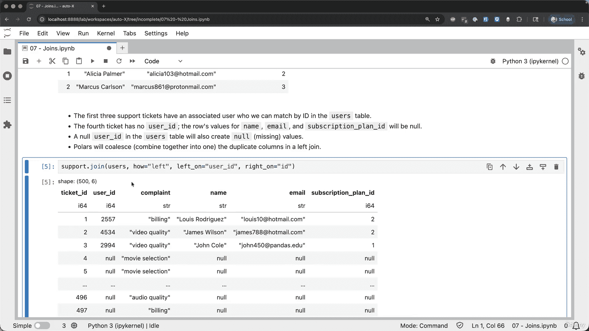

- 匹配成功时，name、email、subscription plan ID 等列会有对应值。

- 匹配失败时，右表带来的列会显示 null。

- 设置 `coalesce=False` 时，可以看到右表用于匹配的 ID 列，便于核对连接条件。

- users 表中存在但 support 表中不存在的 ID 不会出现在结果里。


左连接讲完后，本节中我们来看看右连接，它其实是从另一边看同一个问题。


## 🧭 Polars与Python数据分析：104.4：右连接与替代写法


右连接实际上是左连接过程的倒置版本。你会把右表建立为连接的基础或主要关注点，并且在存在匹配时把左表的行合并进来。通常我不太经常做右连接，因为我更喜欢把主要表想成左连接中的左表；右连接有点像把视角倒过来，但完成的是完全相同的事情。不过我还是想展示一种替代方式，让你可以用右连接完成同样的合并。


在下面，我会把 DataFrame 的位置倒过来，也就是取 users 作为表，并在它上面调用 join 方法，把 support 传进去。这样在这个场景里，support 在视觉上就是右表。对于 how 参数，我会指定 right，表示右连接。我仍然会提供 left_on 和 right_on 参数，但要确保 left_on 指定的是 users 表中的列名，也就是 ID；right_on 指定的是 support 表中的列名，也就是 user_id。


```python
result_right = users.join(
    support,
    how="right",
    left_on="id",
    right_on="user_id"
)
```


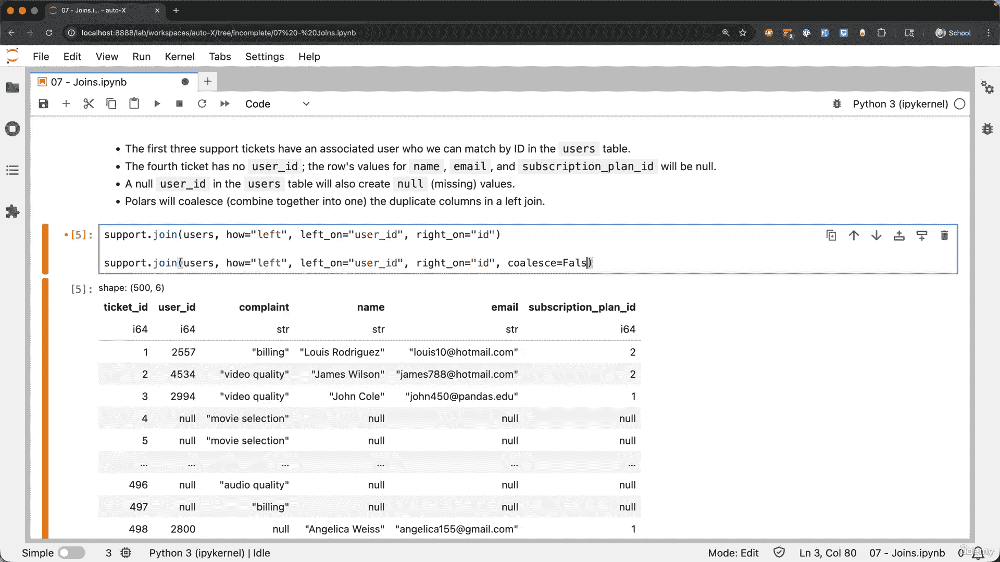

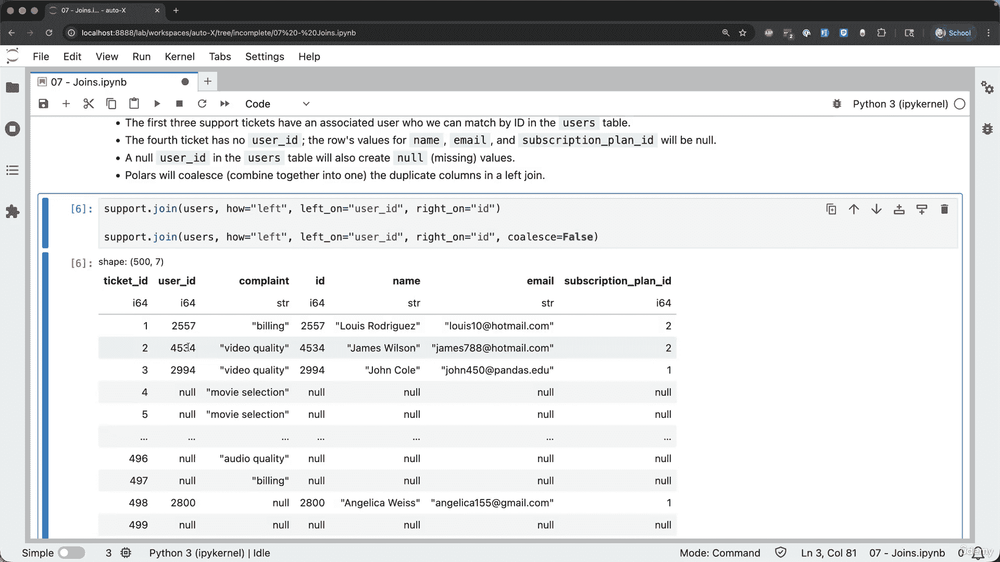

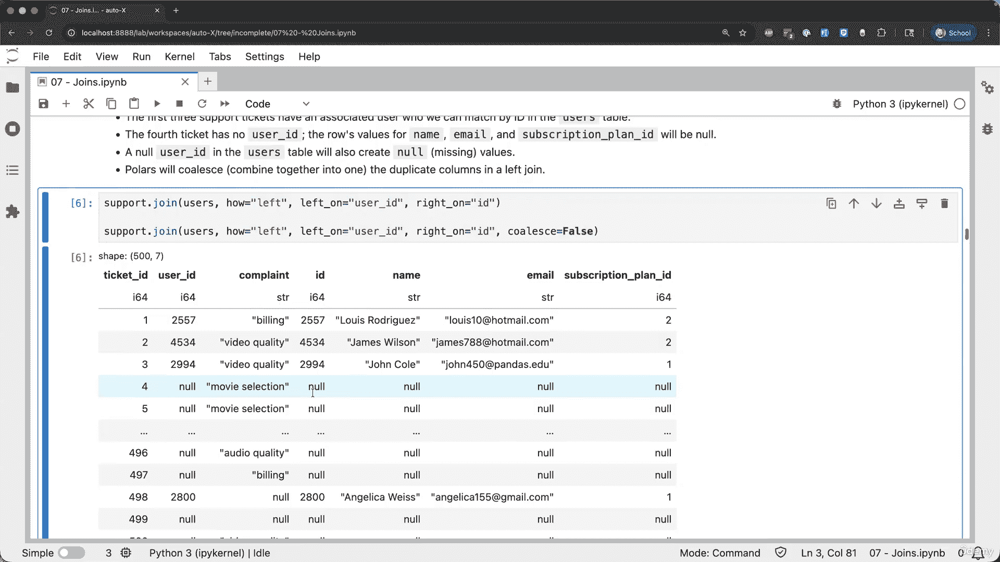

这样我们会得到一张效果与上面相同的表，主要区别在于列的排列顺序。现在因为 support 是我们合并进来的右手边表，所以这里是 support 的列：ticket ID、user ID 和 complaint；然后是从 users 带进来的互补列，也就是 name、email 和 subscription plan ID，它们来自 users 表。再强调一次，只要 user_id 列与 users 中用于匹配的 ID 列存在匹配，我们就会把数据带过来并合并；只要不存在匹配，来自 users 表的列就会是 null 值。我们翻转的只是每张表相对于连接的位置，而这会影响 Polars 在连接后的 DataFrame 中放置结果列的位置。下面把右连接替代写法的关键点集中列出来。


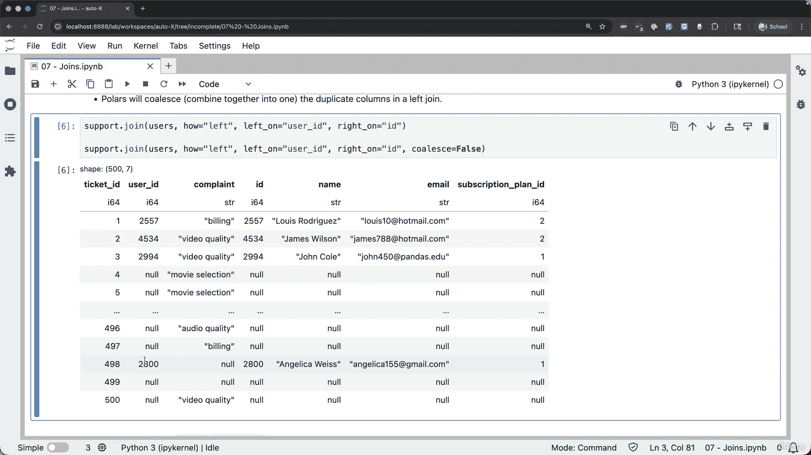

- 右连接把右表作为主要关注点，并保留右表的全部行。

- 这里用 users 调用 join，把 support 作为右表传入。

- `how="right"` 表示执行右连接。

- `left_on="id"` 对应 users 表的 ID，`right_on="user_id"` 对应 support 表的 user_id。

- 结果数据效果与左连接示例相同，但列的顺序会变化。

- support 的列会排在前面，users 的列会排在后面。

- 匹配成功时合并 users 数据，匹配失败时 users 相关列为 null。


可以用下面的公式理解右连接与左连接的关系：


```text
right_join(左表, 右表) = 右表全部行 + 左表匹配字段（无匹配补 null）
right_join(users, support) ≈ left_join(support, users)（数据效果相近，列顺序不同）
```


## 🧭 Polars与Python数据分析：104.5：总结


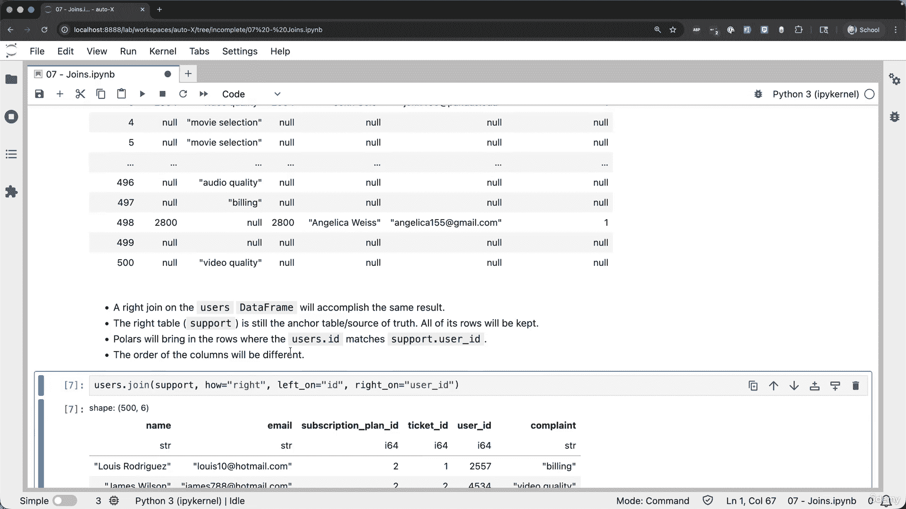

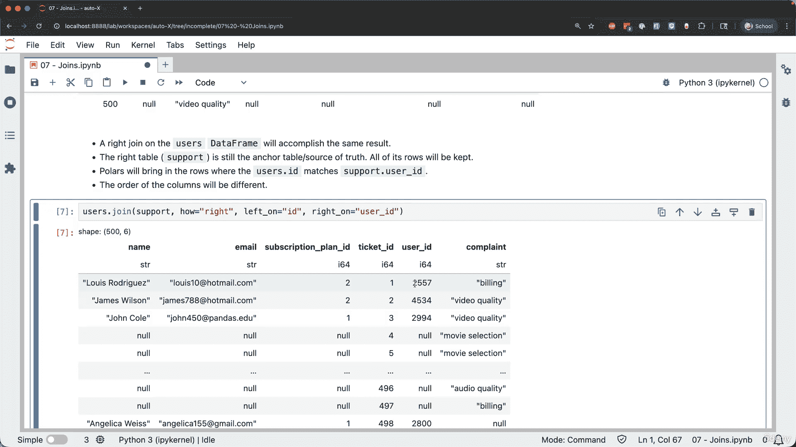

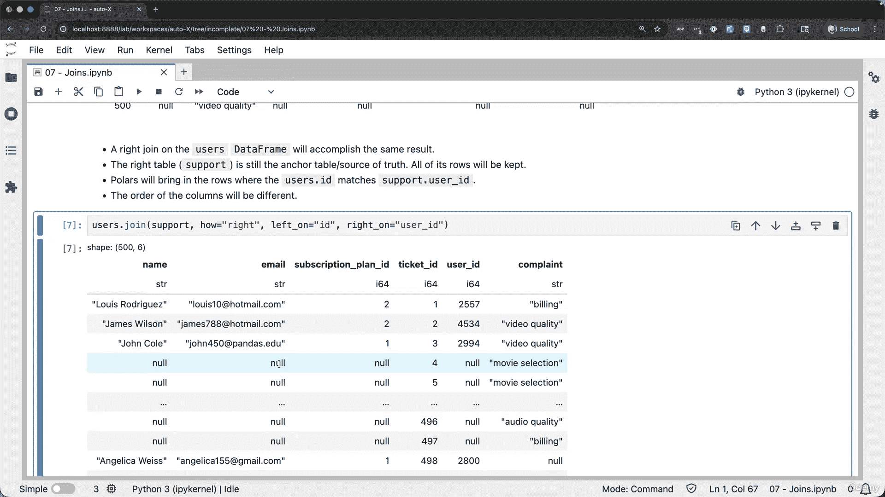

本节课中我们一起学习了 Polars 中的左连接和右连接。左连接把左表作为主要关注点，保留左表的全部行，只在存在匹配时从右表合并数据；没有匹配时，右表带来的列会填 null。右连接则是把右表作为主要关注点，可以看成左连接视角的倒置；它的数据效果可以和左连接对应起来，但结果列的排列顺序会因为表的位置不同而变化。我们还通过 support 表和 users 表的例子看到，左连接结果的行数与原 support 表的 500 行保持一致，也看到了 coalesce 参数和右连接替代写法的用途。掌握这两种连接后，就可以根据“谁做主表”来选择更顺手的写法。

