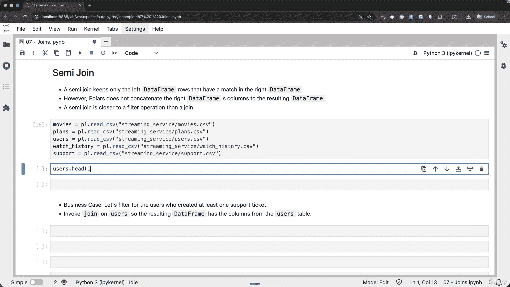
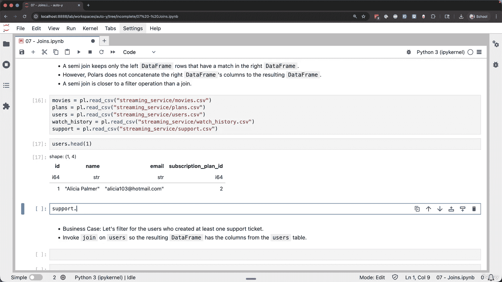
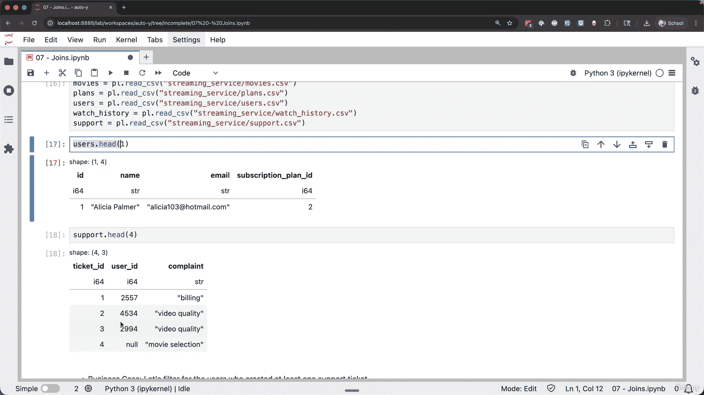
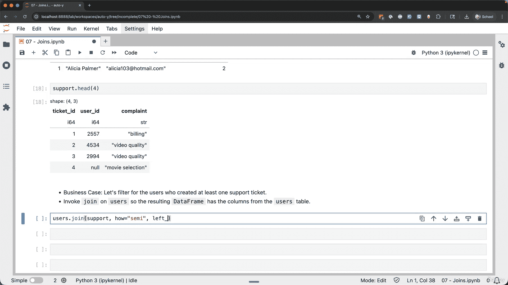
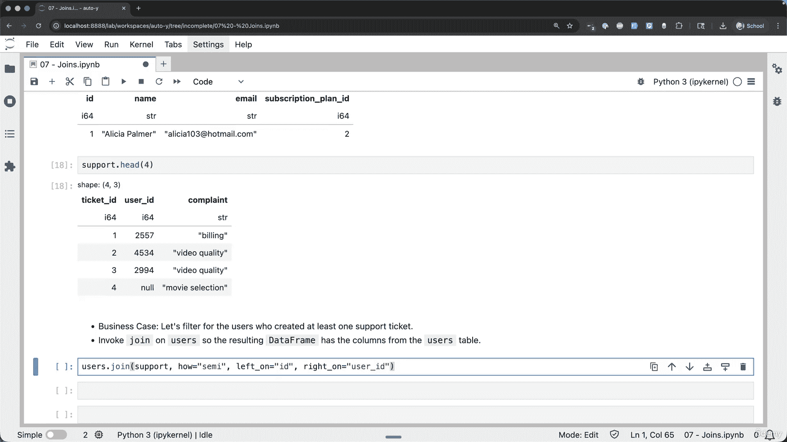
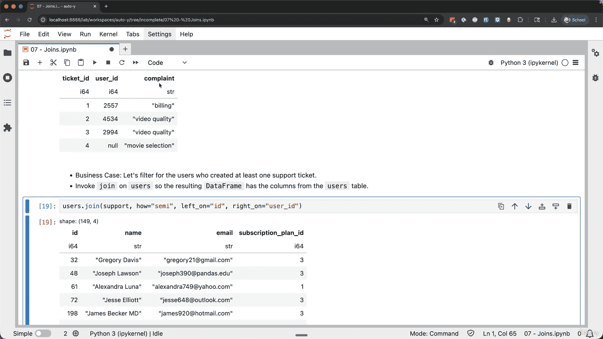
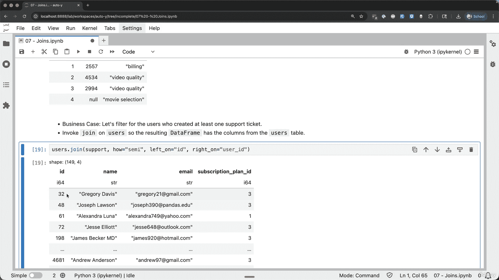

# 📘 数据分析与Polars Python实战（第二部分）：p05 105：半连接（Semi Join）

在本节课中，我们将要学习半连接（Semi Join）。半连接是Polars里一种非常有用的特殊连接方式，虽然它的名字里带着“连接”二字，但它的行为更像过滤。我们会先讲清楚半连接的基本概念，再通过一个用户表与支持工单表的具体例子，演示如何在Polars中使用半连接。学完这节课，你会对半连接有一个清晰的认识，也知道什么时候该用它。

## 🔍 一、什么是半连接？

在这节课里，我们就来好好聊一聊半连接。半连接有一个非常有趣的特点：它不会把右侧数据帧（DataFrame）的列带过来，也不会把左右两个数据帧拼接在一起。也就是说，它并不是我们通常理解的“合表”操作。很多初学者容易把半连接和普通的内连接混在一起，但实际上它们的输出差别很大。

我们仍然会调用数据帧的 `join` 方法，仍然会提供一个用于比较的数据帧。Polars 也依然会基于两个数据帧中的共享值去匹配行。但最后保留的结果，只有左侧数据帧中能在右侧数据帧找到匹配的那些行。右侧数据帧的其他内容一概不会出现在结果里。

用数学公式来表达半连接，可以写成下面这样：

$$
\text{result} = \{ r \in \text{left} \mid r.\text{key} \in \text{right}.\text{key} \}
$$

其中，`left` 是左侧数据帧，`right` 是右侧数据帧，`key` 是两个表用来匹配的列。这个公式的意思是：从 `left` 表中选出那些 `key` 值在 `right` 表的 `key` 列里出现过的行。



换句话说，右侧数据帧在整场操作里扮演的角色，并不是提供新的数据列，而是仅仅作为一个参考点，用来检查左侧数据帧中的值是否包含在某个列里。所以，从某种角度说，半连接其实更接近过滤操作，而不是真正的连接。我们是在利用第二个数据帧来缩小范围或过滤第一个数据帧的内容。

为了让你快速抓住半连接的特点，这里拉一个清单：

- 它不会把右侧数据帧的列拼接过来；
- 它只保留左侧数据帧中有匹配的行；
- 右侧数据帧完全充当“过滤器”的角色。

有了这些特点，你就能理解为什么我们把它看作是过滤操作了。



## 💻 二、实际演示：筛选创建了支持工单的用户



概念上我们已经清楚了半连接是怎么回事，接下来我们用一个实际例子把它跑起来看看。光说概念可能还不够直观。我们先重新执行一下导入代码，把需要用到的数据加载进来。这里当然就是我们的 `users` 表，下面是第一行的预览；同时旁边还有 `support` 表。

提醒一下，`support` 表中有好几行数据，里面包含 `user ID`；但也有一些行并没有 `user ID`。这种情况在真实数据里很常见，比如某些工单可能没有关联到具体用户。接下来，假设我想从 `user` 表开始，提取出那些创建过支持工单的用户子集。也就是说，我只想从 `users` 中取出那些 `ID` 出现在 `support` 表的 `user ID` 列中的行。我其实并不关心工单本身，只想用 `user ID` 这一列作为过滤 `users` 表行的依据。

所以，接下来看下面的操作。我会从 `users` 数据帧开始，然后再次调用它的 `join` 方法。可能你会觉得奇怪，因为严格来说，我并不是在做连接或合并数据，我只是把另一个数据帧拿来做参照，并把它作为第一个参数传进去。但没关系，调用逻辑和普通连接是一样的。下面的代码演示了如何在 Polars 中执行半连接：

```python
# Polars 半连接示例
result = users.join(
    support,
    left_on='ID',       # users 表中的 ID 列
    right_on='user_id', # support 表中的 user_id 列
    how='semi'          # 半连接
)
```



我来一步步解释这段代码。首先，`join` 的第一个参数是 `support`，也就是我们的右侧数据帧。然后，在 `how` 参数中，我们把连接类型声明为 `semi`，这就是半连接的关键。接下来，`left_on` 是相对于 `users` 数据帧的，这里列名是 `ID`；`right_on` 是相对于 `support` 数据帧的，这里列名是 `user ID`。所以，Polars 依然会去两个表之间寻找匹配的值，但匹配完成之后，结果只会保留来自 `users` 的行。

注意看，这里保留了 `users` 的所有四列，并没有把 `support` 表里的 `ticket ID`、`user ID` 或者 `complaint` 这些列带过来。最终剩下的 149 行，都是 `ID` 出现在 `support` 的 `user_id` 列中的用户。这正好实现了我们最初的想法：提取出那些创建过支持工单的用户，同时又不引入工单本身的字段。

所以，这本质上更像是一个过滤操作，而不是连接操作。但在 Polars 中，它依然属于连接的一种，名字就叫半连接（Semi Join）。当你需要根据一张表的信息来筛选另一张表的行时，就可以考虑使用 `how='semi'`。

> 半连接的关键：右表只做参照，不贡献任何列。



## 📝 总结





这节课我们一起学习了半连接。我们知道了半连接不会把右侧数据帧的列拼接过来，只会保留左侧数据帧中有匹配的行；右侧数据帧只作为过滤的参考。我们也通过一个 `users` 和 `support` 的具体例子，在 Polars 中实现了半连接，并理解了 `left_on` 和 `right_on` 的匹配逻辑。希望这些内容能帮助你在以后的数据分析任务中，更加灵活地使用Polars，而不是遇到筛选就想着必须先连接再过滤。

