## 🔗 Polars 与 Python 数据分析：第 2 部分第 6 单元第 106 讲：反连接（Anti Join）

在本节课中，我们将学习反连接（anti join）。反连接是上一课中介绍的半连接（semi join）的补集，也就是反转过来的那种运算。简单来说，反连接可以从左表中筛选出那些在右表中没有对应匹配记录的行。这种操作在数据分析里非常常见，比如找出没有提交过支持工单的用户，或者找出没有订单的客户。接下来，我们先把反连接的本质讲清楚，然后动手写代码实现它。

## 🔍 什么是反连接？

上一课我们学习了半连接，它会把左表中能够与右表匹配的行保留下来。反连接做的事情正好相反，它保留的是左表中那些在右表里找不到匹配值的行。举个例子，如果左表里有 10 个用户，右表里有 3 个工单，那反连接就会返回那 7 个没有工单的用户。这里要注意的是，和半连接一样，反连接也不会把右表里对应的列拼接过来，它只是利用右表来查找左表的键值是否出现过，然后保留没有出现过的那些左表行。

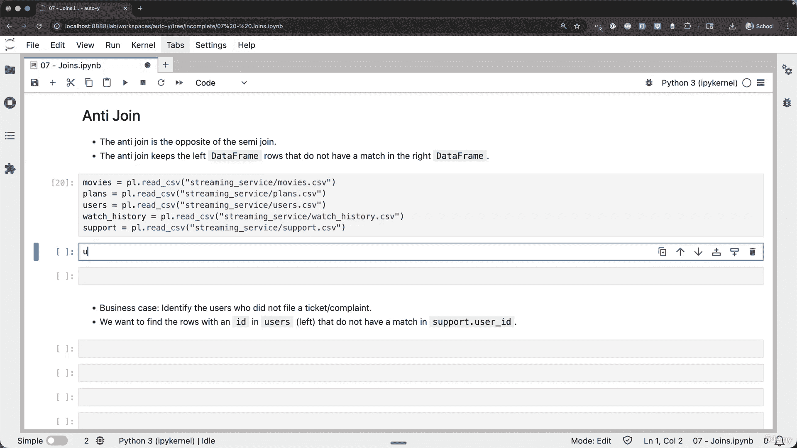

用数学公式来表示反连接就是：

\[
\text{left} \,\text{anti join}\, \text{right} = \{\, l \in \text{left} \mid l.\text{key} \notin \{\, r.\text{key} \mid r \in \text{right} \} \,\}
\]

换句话说，对左表中的每一行，检查它的连接键是否存在于右表的连接键集合中，如果不存在，就保留这一行。理解了这个概念，我们再来看看具体怎么写代码。

## 💻 动手实现反连接

光说不练假把式，我们马上到代码里看一下。首先，我们依然需要再次导入必要的库，并准备好数据。为了方便回忆，我先把 users 表和 support 表的前几行展示出来。下面是示例代码：

```python
import polars as pl

users = pl.read_csv("users.csv")
support = pl.read_csv("support.csv")

print(users.head())
print(support.head())
```

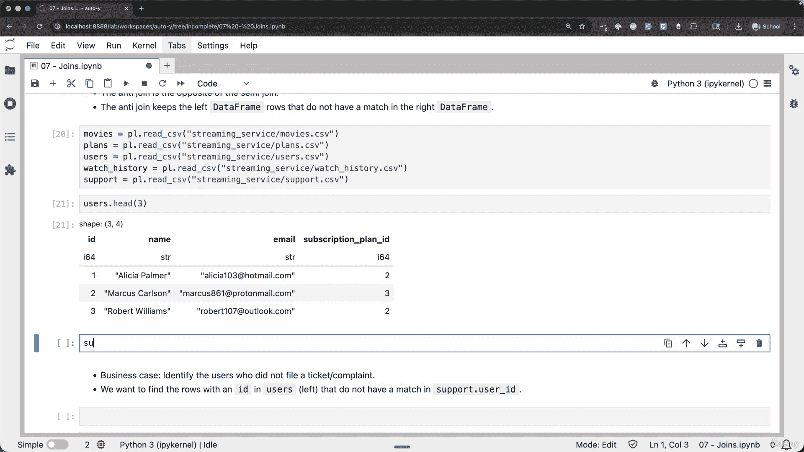

在上一节课里，我们使用半连接来找出那些提交了支持工单的用户，方法是检查 support 表的 user ID 列中是否存在这些用户的 ID。现在，我们想要关注的是相反的问题：哪些用户没有提交过工单或投诉。也就是说，我们想要的用户行，是那些 ID 不出现在 support 表的 user ID 列中的行。

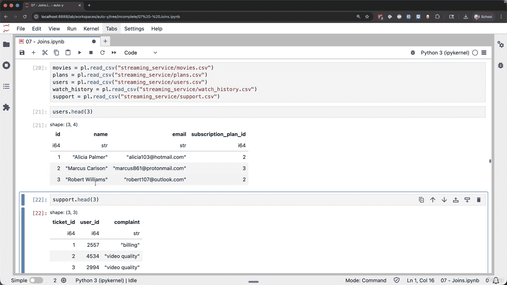

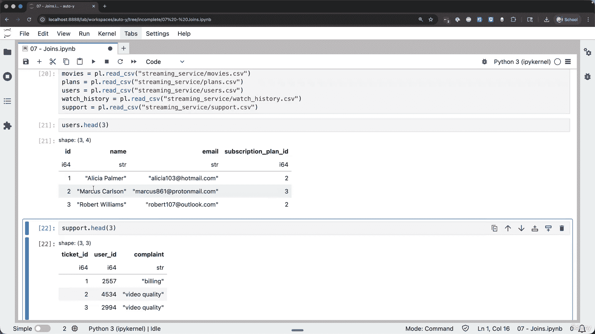

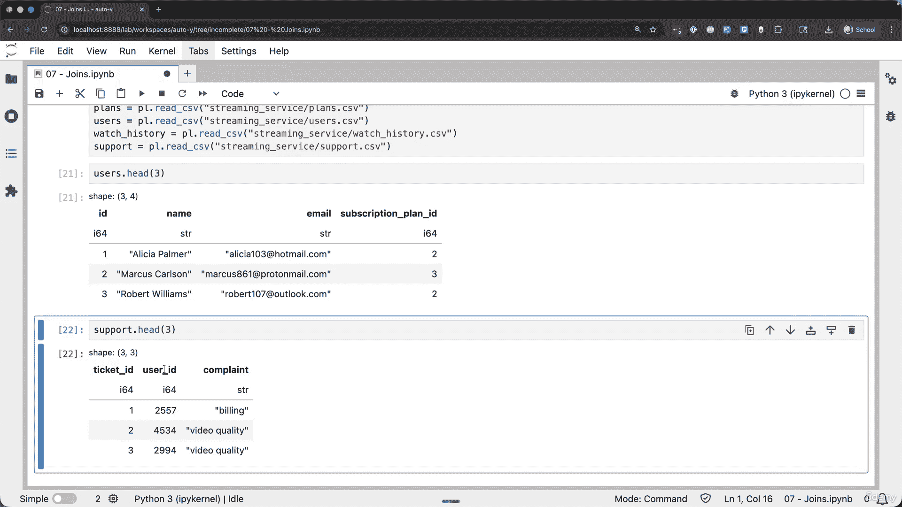

实现反连接的步骤非常简单，用下面几步就能搞定：

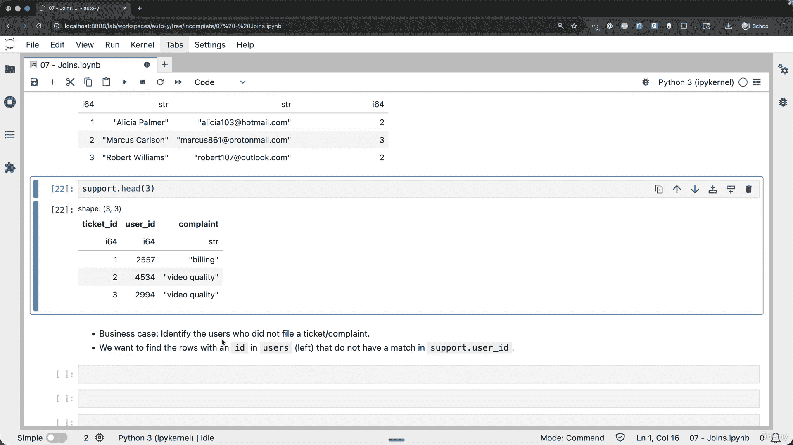

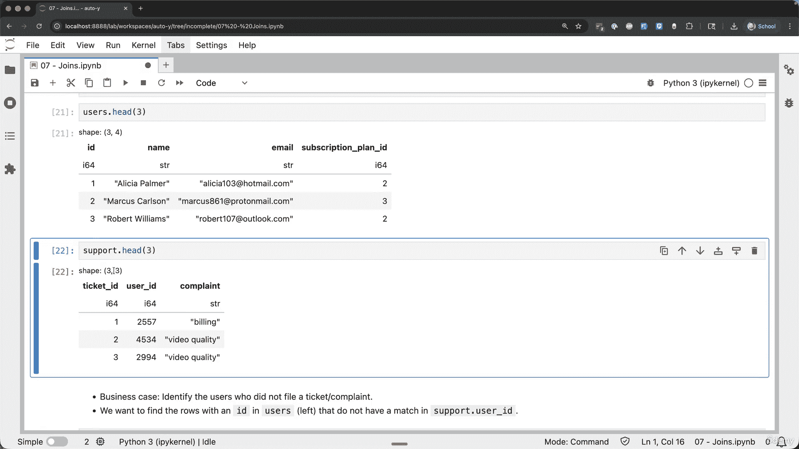

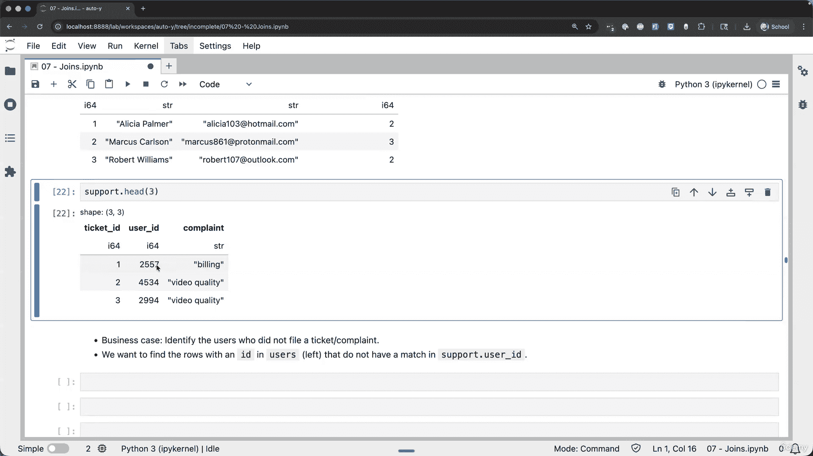

1. 以 users 表作为起始数据框，调用它的 join 方法。
2. 右表仍然选择 support 表。
3. 将 how 参数设置为 "anti"。
4. 分别指定 left_on 和 right_on，也就是两个表各自的连接键。

具体的代码是这样写的：

```python
result = users.join(
    support,
    left_on="id",
    right_on="user_id",
    how="anti"
)
```

在这里，left_on 指定的是 users 表里的 id 列，right_on 指定的是 support 表里的 user_id 列。执行完这段代码之后，我们会得到一个来自 users 表的行子集，里面只剩下那些在 support 表里找不到对应 ID 的用户。

## 📋 示例演示与说明

让我们用一个具体的例子来加深理解。假设 users 表中有一位叫 Alicia Palmer 的用户，她的 ID 是 1。如果 support 表的 user ID 列里从头到尾都没有出现过 1 这个值，那就说明这位用户没有提交过工单。那么，她的这一行数据就会出现在反连接的结果里。换句话说，结果表中所有用户都是在 support 表里没有任何关联记录的。

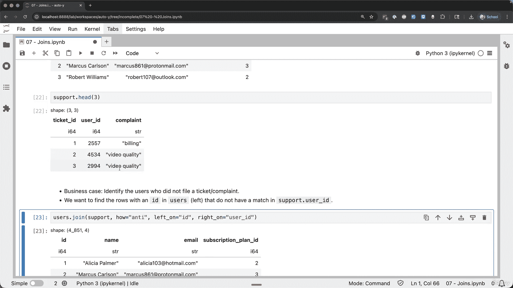

从本质上讲，反连接更像是一个过滤操作，而不是真正意义上的连接操作。因为我们最终得到的行数是减少的，我们是根据右表里不存在的键值来筛选左表中的原始行。这个操作可以帮助我们快速找到那些“缺失关联”的记录，在做数据清洗、用户画像分析的时候都非常有用。

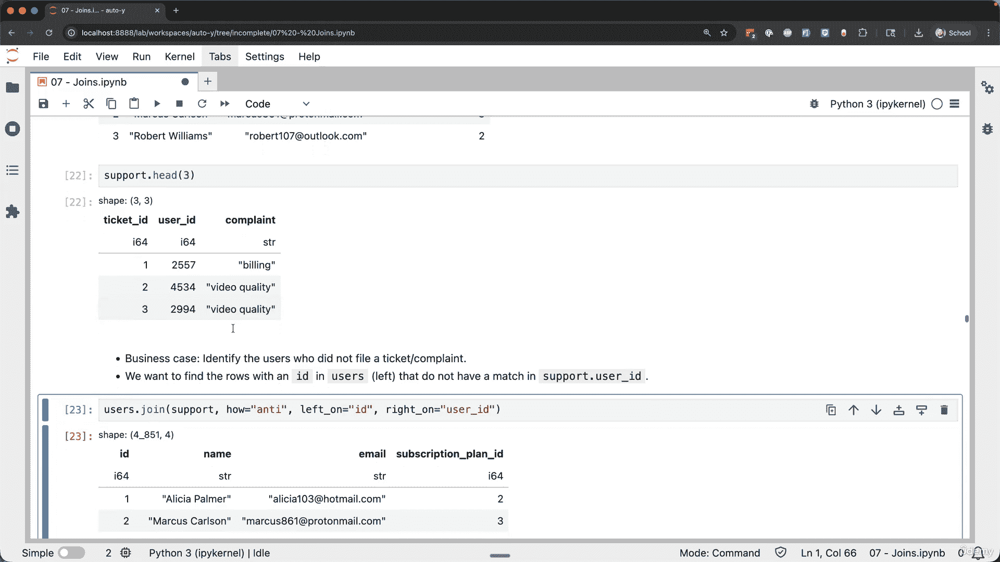

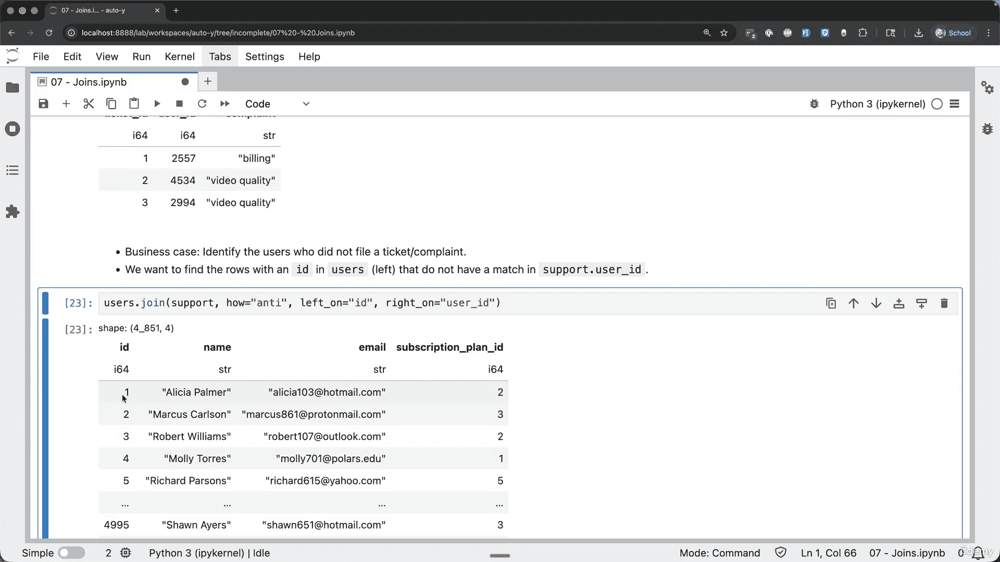

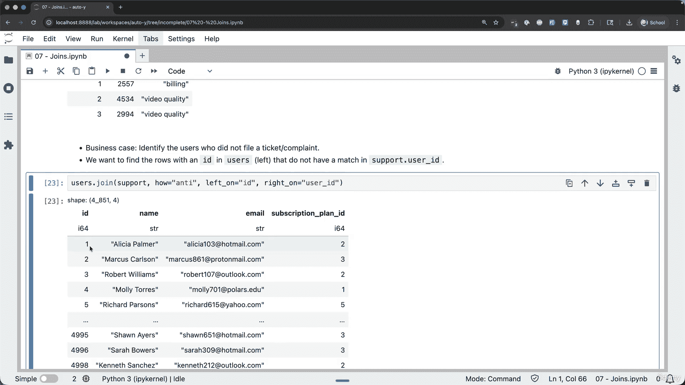

## 📝 总结

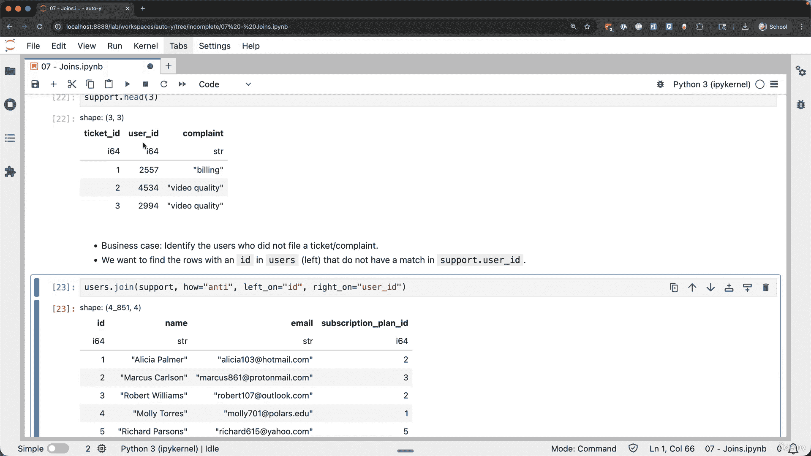

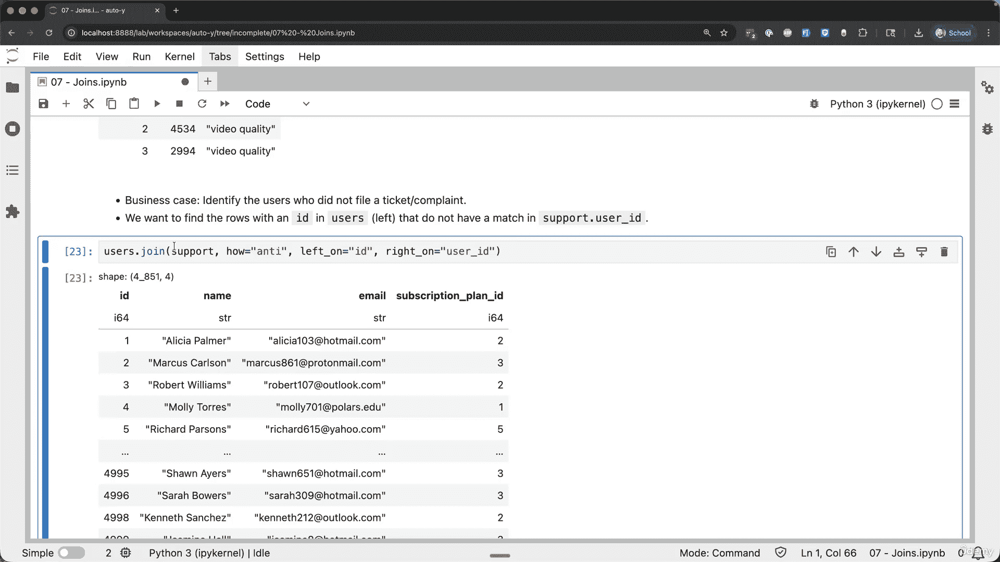

本节课我们一起学习了反连接（anti join）的概念和实现方法。反连接保留了左表中没有匹配值的行，而且不会把右表的其他列拼接过来。具体实现时，我们只需要把 join 方法的 how 参数设置为 "anti"，再指定好 left_on 和 right_on，就可以轻松筛选出那些没有关联记录的行。希望你现在已经理解了反连接和半连接之间的区别。本节课的内容就到这里，我们下个月见。

