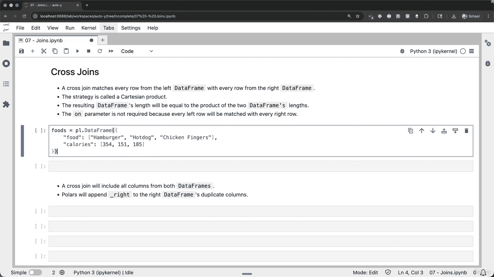
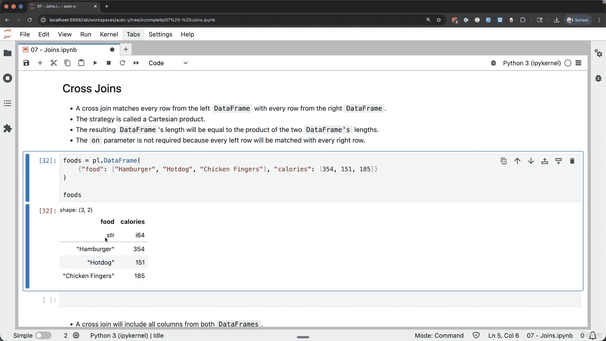
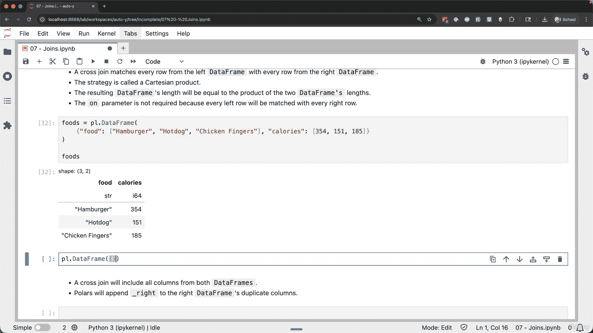
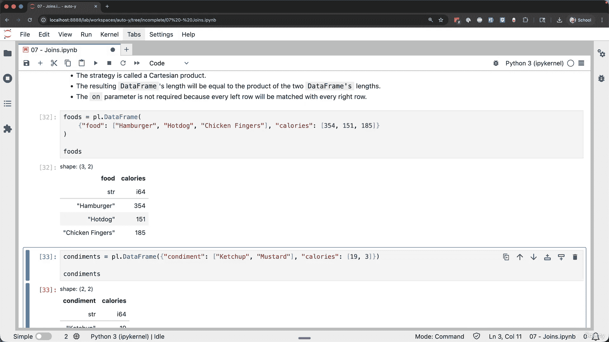
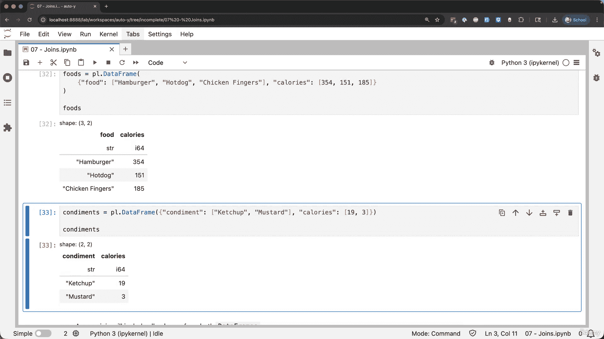
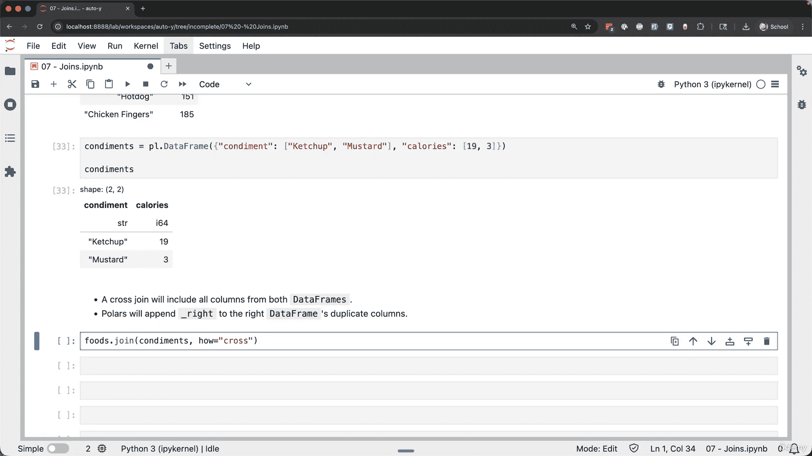
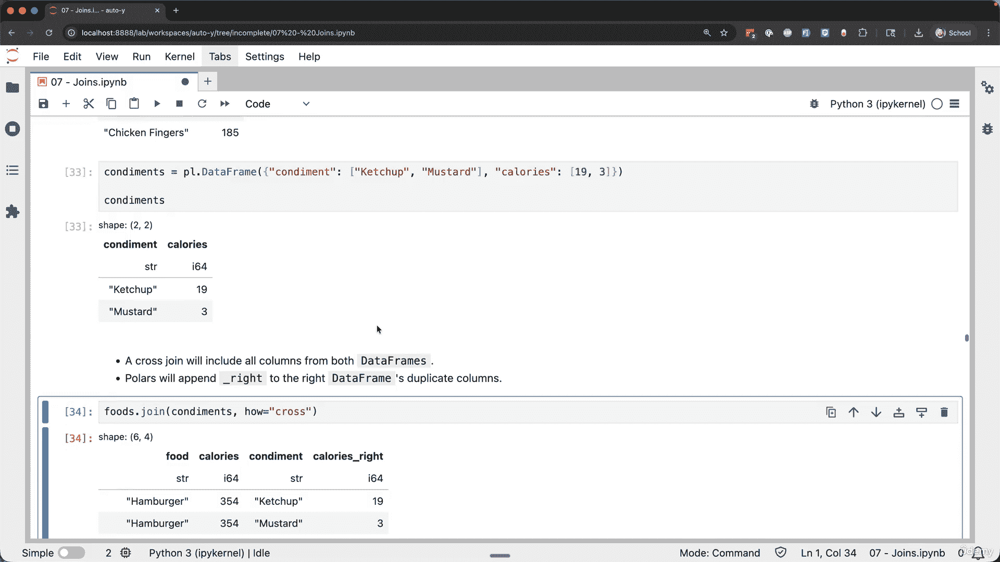
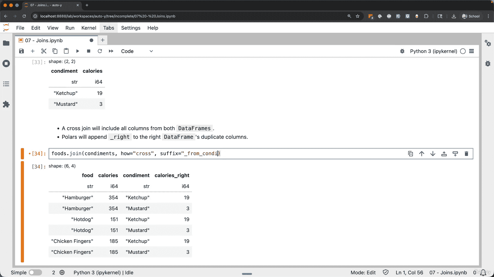
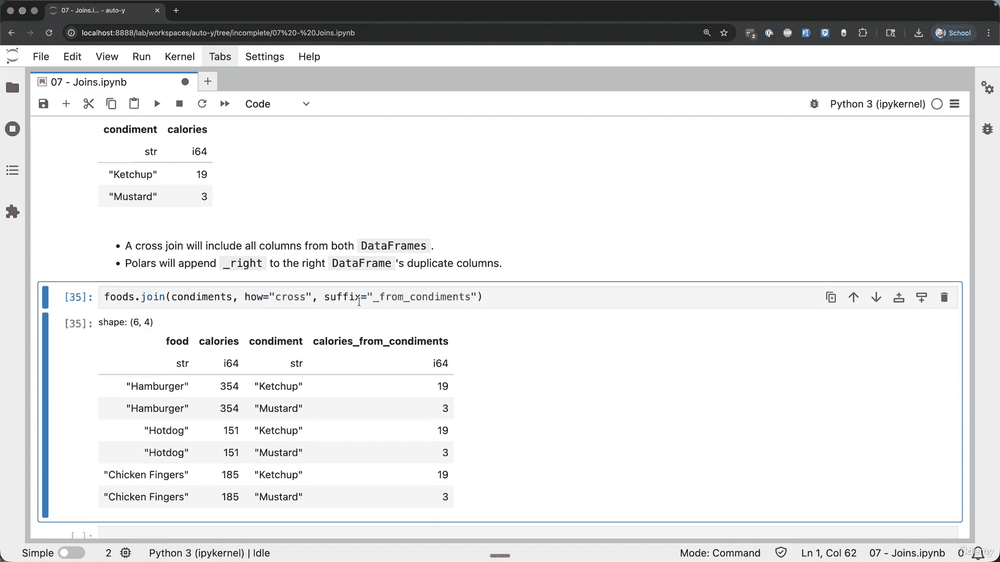

# 🧩 Polars 与 Python 数据分析：107：交叉连接与笛卡尔积

## 📖 Polars 与 Python 数据分析：107.0：课程概述

在本节课中我们将要学习 Polars 中的交叉连接（cross join），以及它为什么有时也被称为笛卡尔积。这个主题看起来简单，但它是理解多表组合、生成所有可能搭配方式的一个重要基础。我们会先从直观概念入手，再创建两个小数据框，最后用 `how="cross"` 把它们连接起来。你还会看到交叉连接为什么不需要 `on`、`left_on` 或 `right_on` 这类参数，以及当两个表出现同名列时，Polars 会怎样处理后缀。对于初学者来说，可以先把它理解成“把左表的每一行都和右表的每一行配一次”，这样后面的公式和代码就更容易看明白。

在了解整体安排后，本节中我们来看看交叉连接到底是什么，以及结果行数为什么由两个表的大小相乘得到。掌握了这个概念，后面创建示例数据和执行连接时就不会觉得突然。

## 🧠 Polars 与 Python 数据分析：107.1：交叉连接与笛卡尔积是什么

上一节我们说明了课程目标，本节中我们来看看交叉连接的基本含义。交叉连接会把左数据框的每一行与右数据框的每一行进行匹配或连接，也就是说，左表里任意一行都会和右表里任意一行组成一条新记录。这个过程中不存在“匹配成功才保留”的条件判断，所以从技术上说，这里甚至没有发生任何过滤，只是把左表每一个可能的行与右表每一个可能的行组合起来。

正因为如此，这种策略有时被称为两个数据集的笛卡尔积。结果数据框的长度等于第一个数据框的长度乘以第二个数据框的长度，因为结果包含了所有行的所有可能组合。换成更直白的说法，如果左表有 3 行，右表有 2 行，那么交叉连接后就会得到 6 行。用公式表示就是下面这样。

\[
|L \times R| = |L| \times |R|
\]

也可以用一段代码来表达同样的意思，其中 `left_df` 表示左数据框，`right_df` 表示右数据框。

```python
result_height = left_df.height * right_df.height
```

由此可知，概念本身并不复杂，真正需要注意的是数据量变大后组合数量会快速膨胀。接下来我们看看如何用一个小例子把这种组合关系落地。

## 🍔 Polars 与 Python 数据分析：107.2：创建示例数据框



上一节我们介绍了交叉连接和笛卡尔积的含义，本节中我们用一个简单例子来创建两个数据框。先创建一个新的数据框，使用数据框构造器并传入一个字典。字典的第一个键叫 `food`，值是一个列表，列表里放 `hamburger`、`hot dog` 和 `chicken fingers`。然后再给这个数据框增加一列，列名叫 `calories`，同样通过字典键提供，值也是一个列表，列表里放 `354`、`151` 和 `185`。最后把这个数据框赋值给变量 `foods`，并在下面输出 `foods`。





以下是创建 `foods` 数据框的代码。

```python
import polars as pl

foods = pl.DataFrame({
    "food": ["hamburger", "hot dog", "chicken fingers"],
    "calories": [354, 151, 185],
})

print(foods)
```

从输出可以看到数据框大致是什么样子：右边是三种食物，下面对应着它们各自的卡路里。这里一共有三行，也可以理解为三种可能的食物。

接着创建第二个数据框，这个数据框同样有两列。我们再次把字典传给构造器，第一列本来想叫 `condiments`，实际命名为单数形式 `condiment`。然后提供一个包含两个值的列表，也就是 `ketchup` 和 `mustard`。同样地，这个数据框里也要有一列 `calories`，给它一个包含两个值的列表，分别是 `19` 和 `3`。最后把这个数据框赋值给变量 `condiments`。现在我们就有了一个调味品数据框，可以看到它的结构大致如下。

以下是创建 `condiments` 数据框的代码。

```python
condiments = pl.DataFrame({
    "condiment": ["ketchup", "mustard"],
    "calories": [19, 3],
})

print(condiments)
```

到这里，两个小数据框就准备好了。下一节中我们来看看怎样把每一种食物和每一种调味品组合起来，并得到所有可能的搭配。



## 🔗 Polars 与 Python 数据分析：107.3：执行交叉连接



上一节我们创建了食物数据框和调味品数据框，本节中我们来看看怎样找出每一种食物与每一种调味品的所有可能组合或乘积。这里有三种可能的食物，也就是三行；这里有两种调味品，也就是两行。因此这两个集合的笛卡尔积会有六行，因为 `hamburger` 会分别匹配 `ketchup` 和 `mustard`，`hot dog` 同理，`chicken fingers` 也同理，三乘二应当得到六。

在代码里，我们取出 `foods` 数据框，调用 `join` 方法。从技术上说，这仍然是一种连接，因为我们仍然是在把两个数据框组合在一起，而右边的数据框是 `condiments`。这里的关键参数是 `how`，把它设置为 `cross` 就表示交叉连接。这个场景不需要 `on`、`left_on` 或 `right_on`，因为这里没有条件逻辑，也没有需要跨不同列去匹配的值，只是把左表每一行与右表每一行组合起来。

以下是执行交叉连接并查看结果的代码。

```python
result = foods.join(condiments, how="cross")

print(result)
```

这样就会得到左表每一行与右表每一行的匹配结果。`hamburger` 这一行在 `foods` 中只出现一次，但 `condiments` 数据框中有两个调味品，所以 `condiments` 里的两行都会和 `hamburger` 匹配；然后对 `foods` 中的三行重复完全相同的逻辑，于是得到所有可能的组合。假如你经营一家餐厅，想看看食物和调味品之间所有可能的混搭方式，这就是一个很直接的做法。

以下是所有可能组合的直观列表。

- `hamburger` 配 `ketchup`，食物热量 `354`，调味品热量 `19`
- `hamburger` 配 `mustard`，食物热量 `354`，调味品热量 `3`
- `hot dog` 配 `ketchup`，食物热量 `151`，调味品热量 `19`
- `hot dog` 配 `mustard`，食物热量 `151`，调味品热量 `3`
- `chicken fingers` 配 `ketchup`，食物热量 `185`，调味品热量 `19`
- `chicken fingers` 配 `mustard`，食物热量 `185`，调味品热量 `3`

和往常一样，我们还会把右数据框中的列带过来，在这个例子里就是 `condiments` 的列。Polars 会始终给重复列名加上下划线后缀，默认情况下右表的重复列会带 `_right` 这样的后缀。这个行为可以通过 `suffix` 参数修改。例如，我们可以把后缀设置为 `_from_condiments`，这样就能看清楚卡路里到底来自哪一边。同样的原则仍然成立：我们把右数据框的所有列都带过来，贴到、拼接或连接到 `foods` 数据框每一行的右侧，只不过现在得到的是两个数据框的所有可能组合或乘积。

以下是使用 `suffix` 参数给重复列改后缀的代码。

```python
result = foods.join(
    condiments,
    how="cross",
    suffix="_from_condiments",
)

print(result)
```





执行后，右表中与左表重名的 `calories` 列会显示为 `calories_from_condiments`，这样就能区分食物热量和调味品热量。到这里，交叉连接的核心用法就完整走了一遍。

## ✅ Polars 与 Python 数据分析：107.4：本节总结



上一节我们完成了交叉连接的代码演示，本节中我们对整节内容做一个收束。交叉连接会把左表的每一行与右表的每一行组合起来，结果行数等于左表行数乘以右表行数。它不需要 `on` 之类的匹配条件，因为它的目标不是筛选匹配行，而是生成所有可能的行组合。Polars 中通过 `join(..., how="cross")` 就能完成这个操作，遇到重复列名时可以用 `suffix` 参数调整后缀。

以下是本节需要记住的几个要点。

- 交叉连接会生成左表每一行与右表每一行的所有组合。
- 结果行数满足公式 \(|L \times R| = |L| \times |R|\)。
- 使用 `how="cross"` 时不需要 `on`、`left_on` 或 `right_on`。
- 重复列名默认会加后缀，并且可以用 `suffix` 参数修改。



本节课中我们一起学习了交叉连接与笛卡尔积的概念、结果行数公式、示例数据框的创建方法、`how="cross"` 的使用方式，以及重复列名的后缀处理。只要记住“左表每行配右表每行”这个直观画面，再结合公式和代码，就能比较轻松地理解并应用交叉连接。
