# 📊 Udemy - Polars 与 Python 数据分析：p08 108：按多列连接数据表

在本节课中，我们将学习当两张数据表需要同时按照多个列的值来匹配时，怎样在 Polars 中完成连接。实际工作里，库存系统和价格系统分开维护很常见，本节会用一个连锁店的例子，把库存数量和商品价格合并到同一张表里，并依次复习内连接、全连接、左连接、半连接和反连接在多列连接下的用法。

## 🗂️ Udemy - Polars 与 Python 数据分析：p08 108：场景说明——库存表与价格表

上一段我们明确了本节要解决的问题，本节中我们来看看具体的业务场景。假设我们经营一家连锁店，门店库存放在一个系统中管理，商品和价格放在另一个系统中管理，因此需要把两边信息按照门店和商品对应起来。这里先导入库存表，它位于嵌套的 store 目录中，文件名为 inventory.csv，读取后赋值给 `inventory` 数据帧，并查看输出以便记住它的结构。

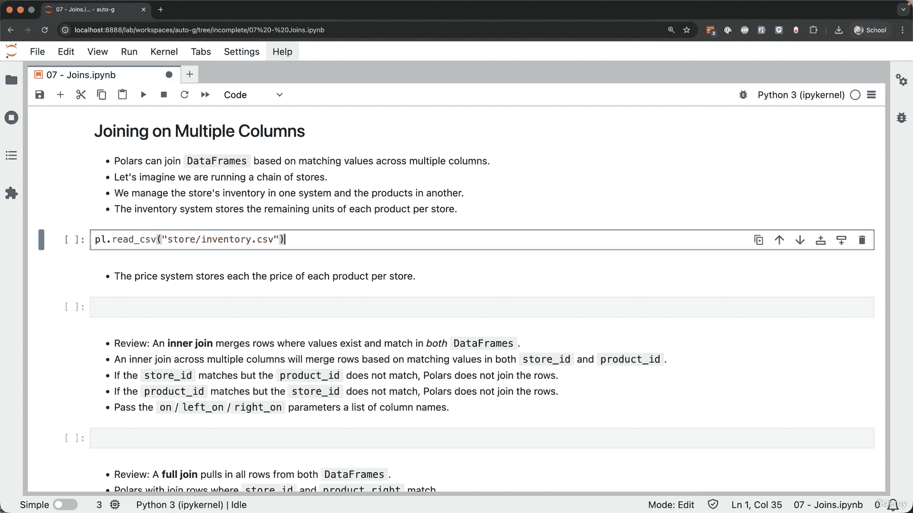

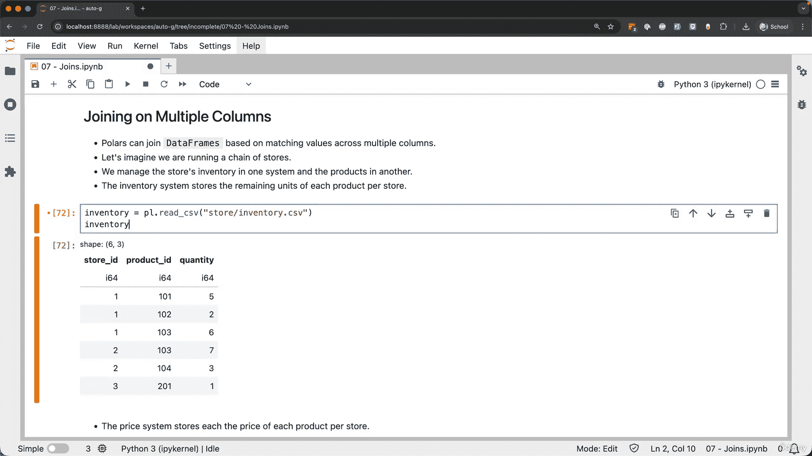

以下是库存表和价格表中需要关注的字段说明：

- 库存表：每一行包含 `product_id`、`store_id` 和 `quantity`，同一个商品可以出现在不同门店中，`quantity` 表示该门店中该商品的可用数量。
- 价格表：每一行包含 `store_id`、`product_id` 和 `price`，表示某个门店中某个商品的价格。
- 价格示例：门店 1 中商品 102 的价格是 10 美元，同一个商品在不同门店可能有不同价格。

下面的代码先读取两张表，并把结果分别保存到变量中，路径需要按实际文件位置调整：

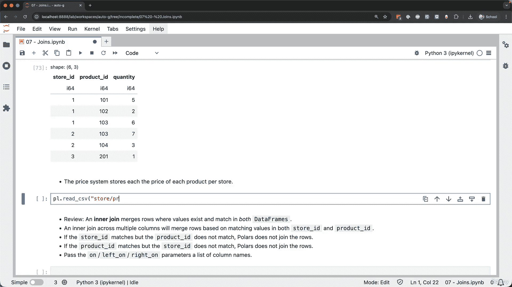

```python
import polars as pl

inventory = pl.read_csv("stores/inventory.csv")
prices = pl.read_csv("stores/prices.csv")

inventory
```

读取完库存表后，我们再次使用 `read_csv` 查看价格表，它的结构和库存表很相似，同样有 `store_id` 和 `product_id`，但多出的是该门店中该商品的价格。把价格表赋值给 `prices` 变量后，我们就可以把两张表连接起来，既查看门店中有哪些商品，也把该门店中的库存数量和价格放在一起。

## 🔗 Udemy - Polars 与 Python 数据分析：p08 108：多列内连接

上一节我们准备好了库存表和价格表，本节中我们来看看多列内连接。内连接会根据两张表中同时匹配的条件合并行，这里要同时匹配 `store_id` 和 `product_id`，可以写成下面这个匹配条件：

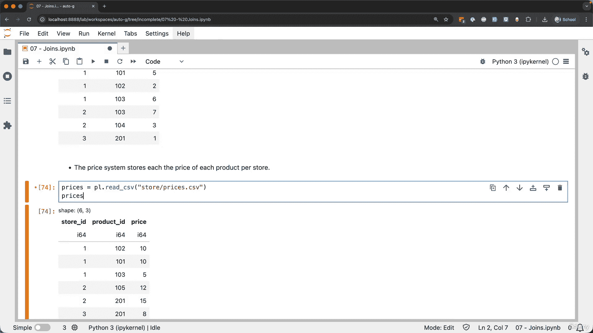

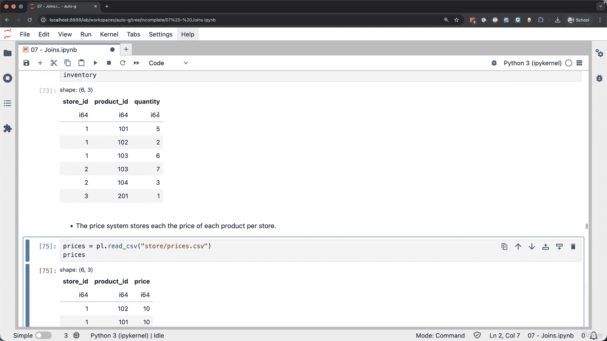

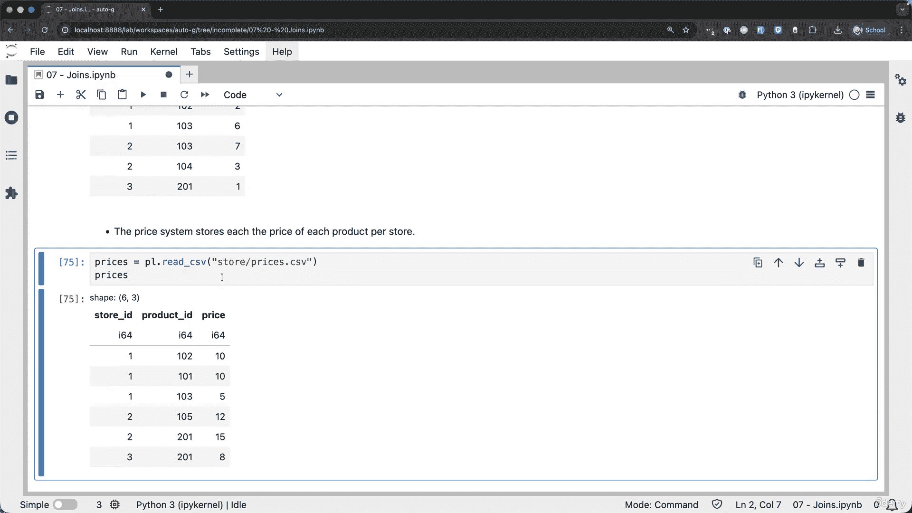

`匹配条件 = (inventory.store_id == prices.store_id) AND (inventory.product_id == prices.product_id)`

在 Polars 中，`on` 参数原本可以传一个字符串表示单列，现在改为传 Python 列表，列表告诉 Polars 要在多个列上寻找匹配。下面的代码从 `inventory` 出发，调用 `join` 方法，右表是 `prices`，连接方式指定为内连接，并在 `on` 参数中同时列出 `store_id` 和 `product_id`：

```python
inner_result = inventory.join(
    prices,
    how="inner",
    on=["store_id", "product_id"],
)
```

在这个场景中，两张表的连接列名称相同，所以直接用 `on` 即可。如果两张表的列名不同，可以使用 `left_on` 和 `right_on`，仍然传入列表，并且两个列表长度要一致，用来一一对应左右两边的连接列。

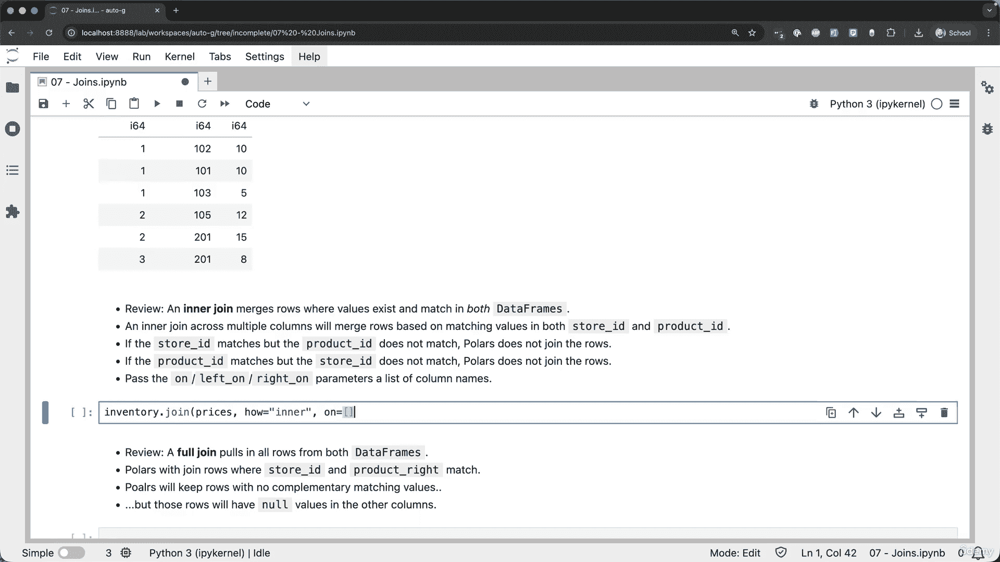

```python
inner_result = inventory.join(
    prices,
    how="inner",
    left_on=["store_id", "product_id"],
    right_on=["store_id", "product_id"],
)
```

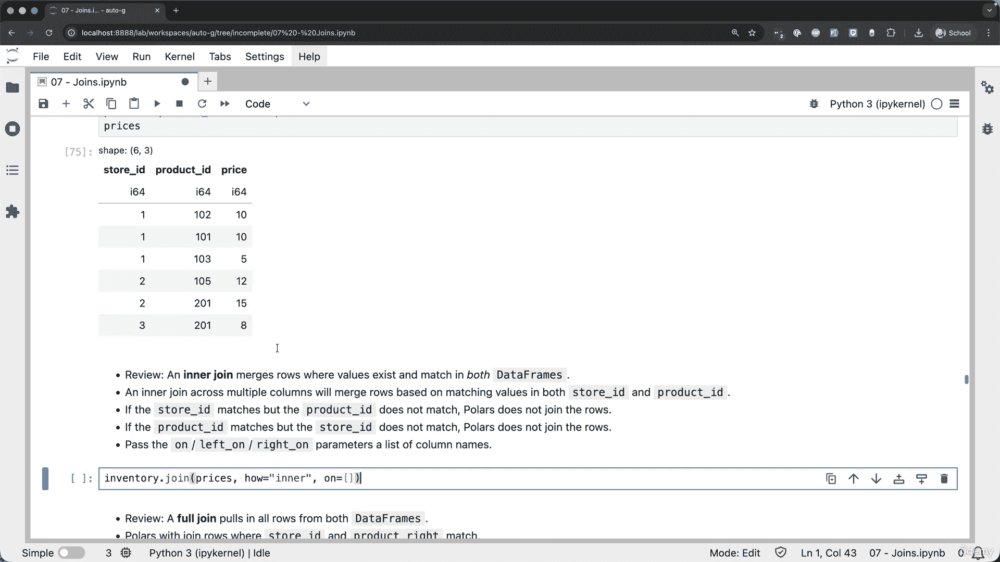

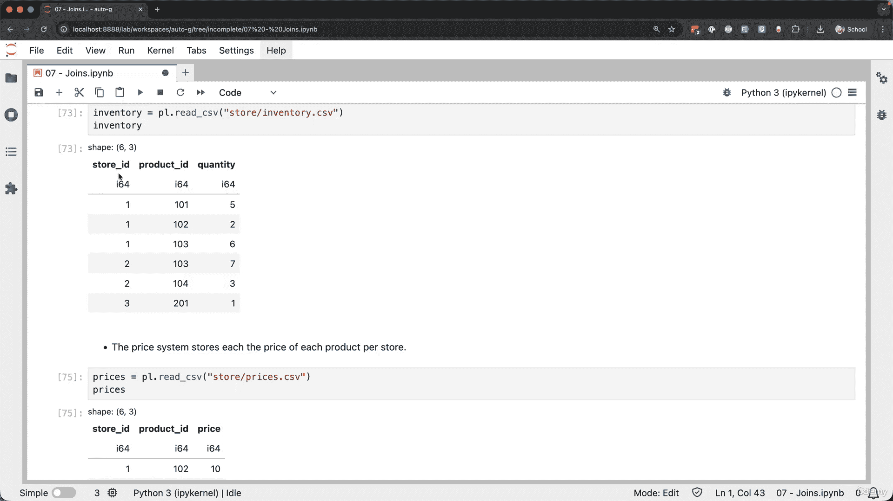

查看结果时，我们会看到一张数据帧，其中的行来自 `inventory` 和 `prices`，并且这些行的 `store_id` 和 `product_id` 在两张表中都能找到匹配。换句话说，如果某行的 `store_id` 在另一张表中能匹配，但 `product_id` 没有对应匹配，这一行就不会被连接进来；反过来，如果 `product_id` 能匹配，但 `store_id` 没有匹配，连接也不会发生。

以下是内连接结果需要理解的关键点：

- 只有 `store_id` 和 `product_id` 同时匹配的行才会保留。
- 结果会把库存表的 `quantity` 和价格表的 `price` 合并到同一张结果表中。
- 单列匹配不足以保留一行，多列连接要求所有指定列都匹配。

理解了内连接后，我们复制这段代码，继续看看它怎样套用到本节前面介绍过的其他连接方式上。

## 🧩 Udemy - Polars 与 Python 数据分析：p08 108：全连接

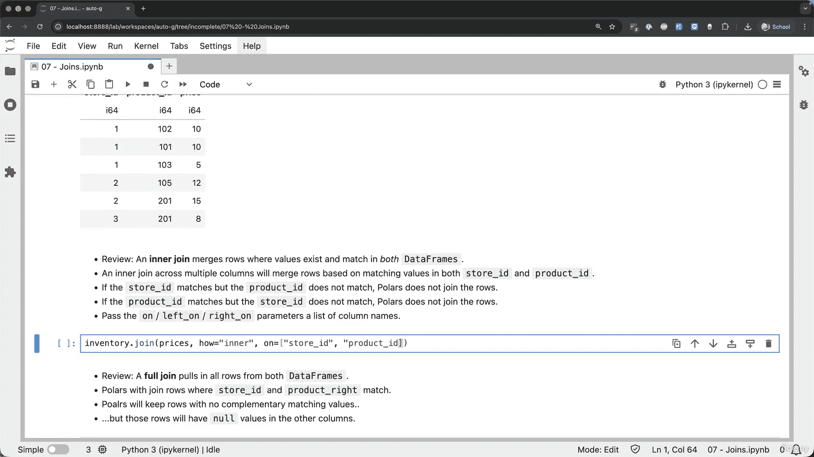

上一节我们介绍了只保留双方匹配行的内连接，本节中我们来看看全连接。全连接不要求所有行都完美匹配，它会保留两张表中的所有行，能匹配的地方就合并，不能匹配的地方就用空值补齐。下面的代码把连接方式改为 `full`，并给右表中可能重名的非连接列加上 `_from_prices` 后缀，方便识别列来自价格表：

```python
full_result = inventory.join(
    prices,
    how="full",
    on=["store_id", "product_id"],
    suffix="_from_prices",
)
```

查看结果时，我们会看到 `inventory` 和 `prices` 中所有行都出现在结果里。匹配上的行会把右表列拉进来，例如 `price` 来自 `prices`，`quantity` 来自 `inventory`。给右表列加后缀后，就能更清楚地知道哪些列来自价格表。

以下是全连接结果中常见的情况：

- 两边都匹配：合并为一行，库存数量和价格都出现。
- 左表有、右表没有：来自右表的列补空值。
- 右表有、左表没有：来自左表的列补空值。
- 全连接会尽量匹配，但仍保留两张表的所有行。

因此，全连接和内连接不同。内连接关注两张表的重叠部分，全连接则把所有行都拉进来，只在可能匹配的地方进行合并。理解了全连接后，我们继续看以左表为基准的左连接。

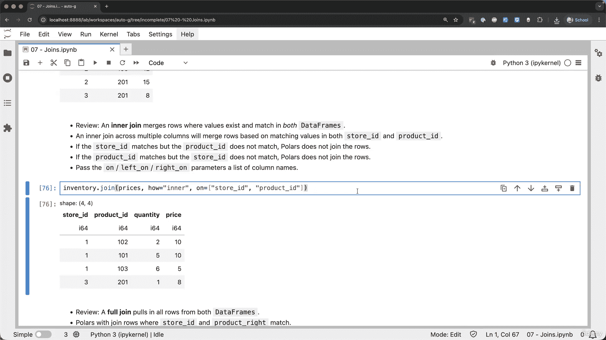

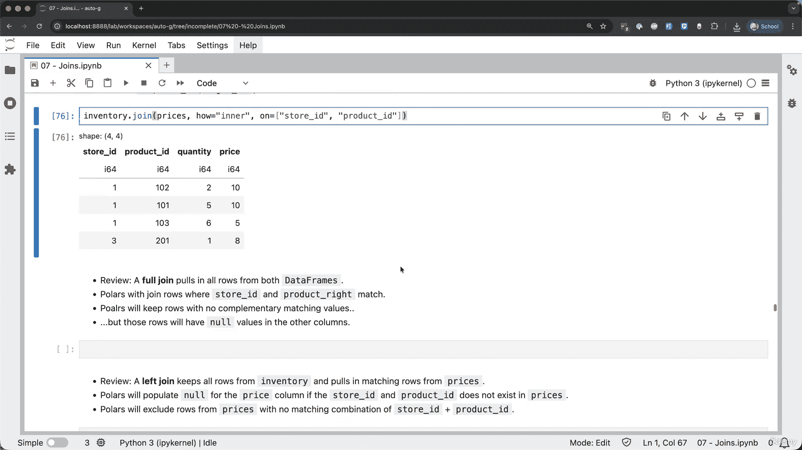

## ⬅️ Udemy - Polars 与 Python 数据分析：p08 108：左连接

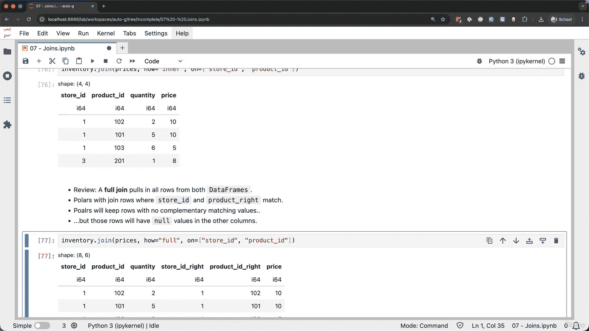

上一节我们介绍了保留所有行的全连接，本节中我们来看看左连接。左连接以左表为“事实基准”，这里左表是 `inventory`，所以库存表中的所有行都会保留，价格表中能匹配上的行会被拉进来。下面的代码把连接方式改为 `left`，仍然同时按照 `store_id` 和 `product_id` 匹配：

```python
left_result = inventory.join(
    prices,
    how="left",
    on=["store_id", "product_id"],
)
```

查看结果时，库存表的所有原始行都会保留。只要某个 `store_id` 和 `product_id` 在价格表中存在匹配，就会把对应的 `price` 列拉过来；如果库存表中的某个组合在价格表中没有匹配，那么来自价格表的列就会是空值。

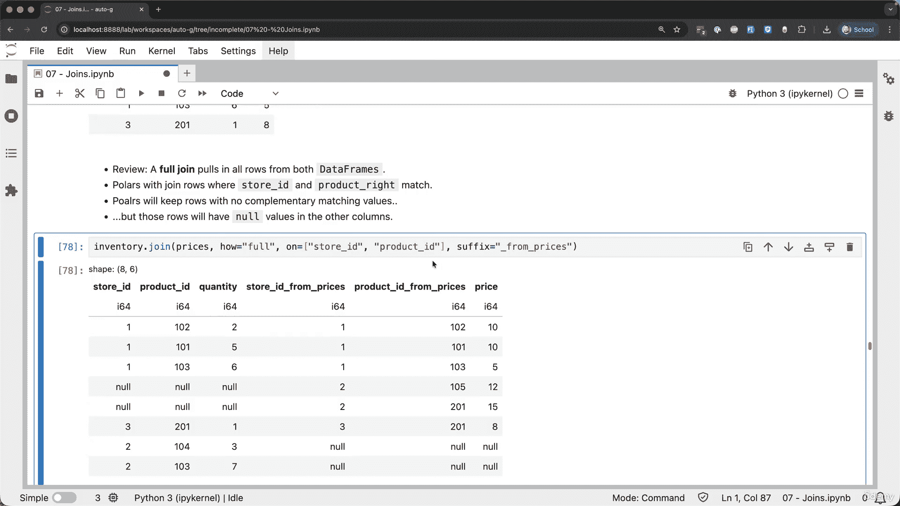

以下是左连接需要记住的要点：

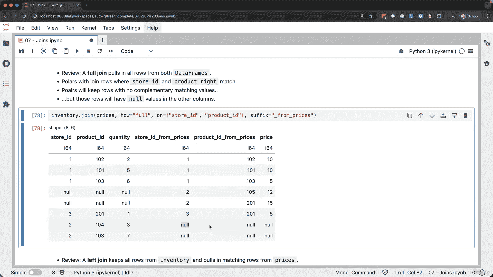

- 左表 `inventory` 的所有行都会保留。
- 右表 `prices` 中能匹配的行会被合并进来。
- 右表中没有匹配的行不会单独出现。
- 左表有、右表无匹配时，右表列为空值。

左连接适合“以库存为主，价格能补就补”的场景。接下来我们看一下半连接，它更像一种过滤操作，而不是把右表列合并进来。

## 🕵️ Udemy - Polars 与 Python 数据分析：p08 108：半连接

上一节我们介绍了保留左表所有行的左连接，本节中我们来看看半连接。半连接不算真正意义上的“合并列”，它更像过滤：只保留左表中那些在右表存在匹配的行，但不会把右表的列带进来。下面的代码把连接方式改为 `semi`：

```python
semi_result = inventory.join(
    prices,
    how="semi",
    on=["store_id", "product_id"],
)
```

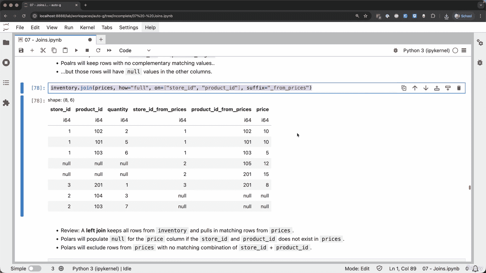

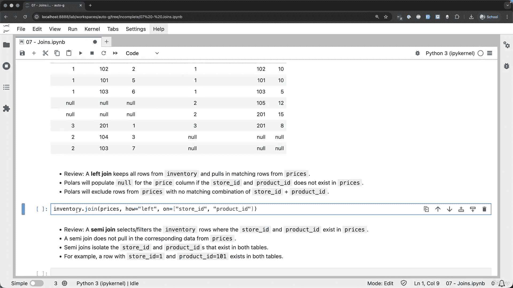

结果只会包含 `inventory` 表中的列，但行数会被过滤，只保留 `store_id` 和 `product_id` 在 `prices` 表中存在对应匹配的库存行。例如库存表中的门店 1、商品 101 确实存在于价格表中，但结果中不会出现价格表的 `price` 列。

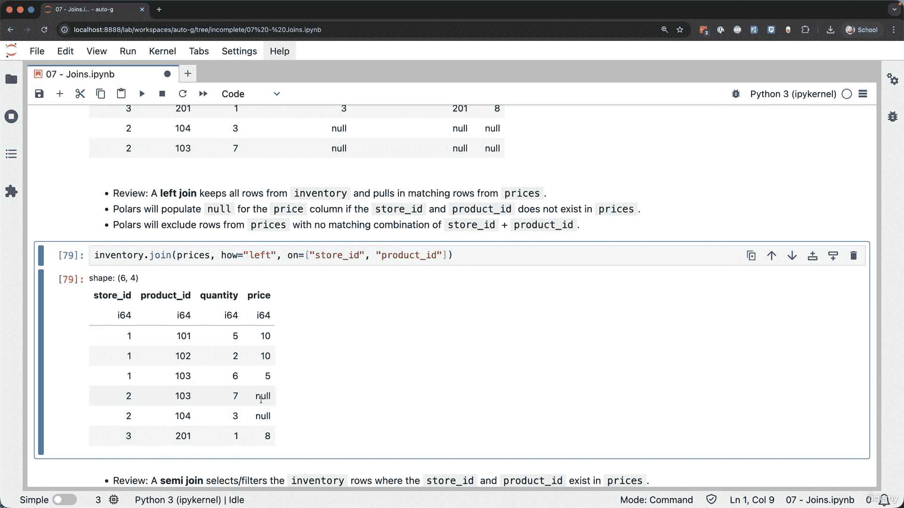

以下是半连接的核心特点：

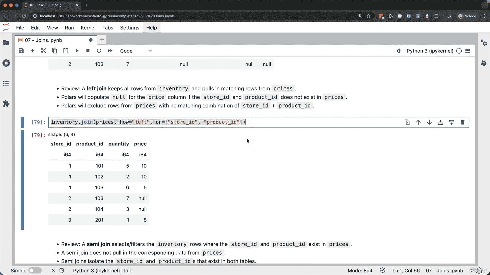

- 只返回左表的列。
- 只保留在右表中存在匹配的左表行。
- 不把右表的列合并进结果。
- 适合把另一张表当作过滤依据，但不需要另一张表的列。

如果只想用价格表来筛选“哪些库存商品在价格表中有记录”，半连接就可以完成这个任务。下面我们看它的反向操作：反连接。

## 🚫 Udemy - Polars 与 Python 数据分析：p08 108：反连接

上一节我们介绍了保留“存在匹配”的左表行的半连接，本节中我们来看看反连接。反连接同样是过滤操作，但它做的是反向筛选：只保留左表中那些在右表不存在匹配的行，并且也不会把右表列带进来。下面的代码把连接方式改为 `anti`：

```python
anti_result = inventory.join(
    prices,
    how="anti",
    on=["store_id", "product_id"],
)
```

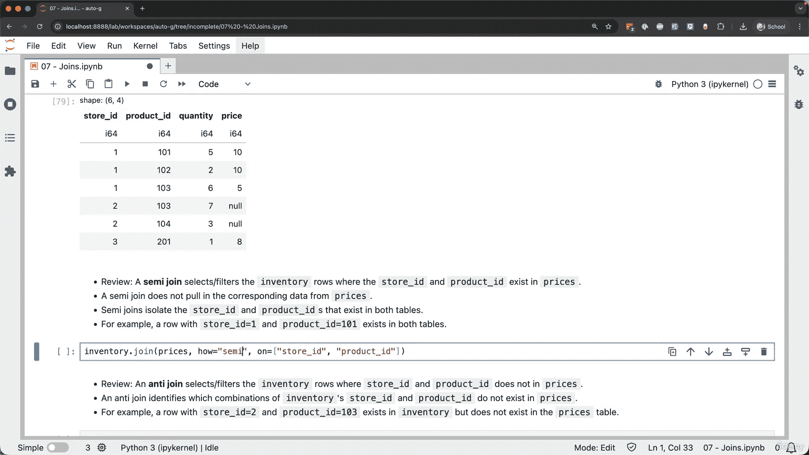

结果只会包含 `inventory` 表中的列，但它保留的是库存表里那些 `store_id` 和 `product_id` 在 `prices` 表中不存在的行。例如门店 2、商品 103 存在于库存表中，但不存在于价格表中，所以这个组合会被反连接保留下来。

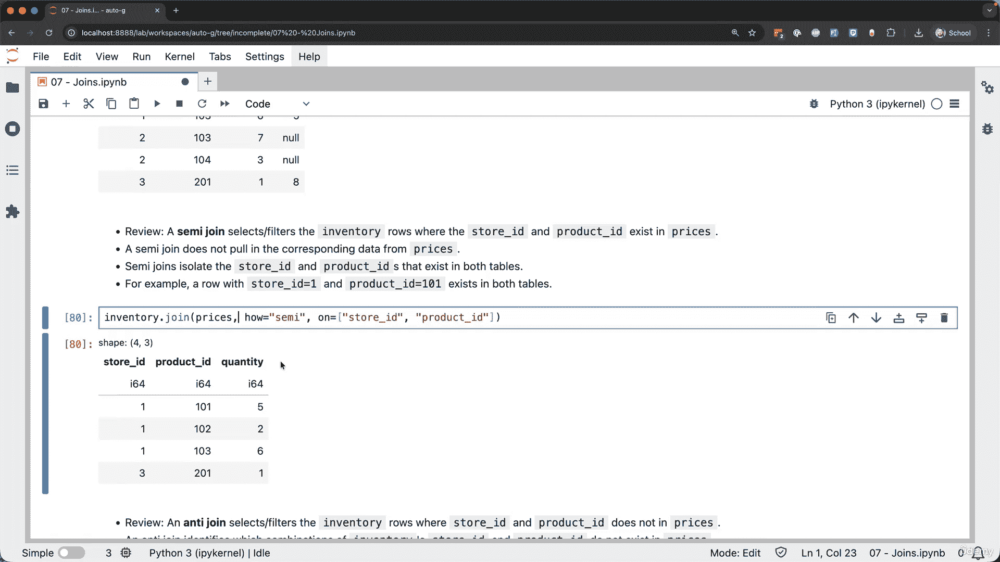

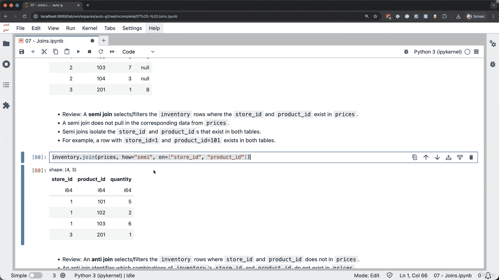

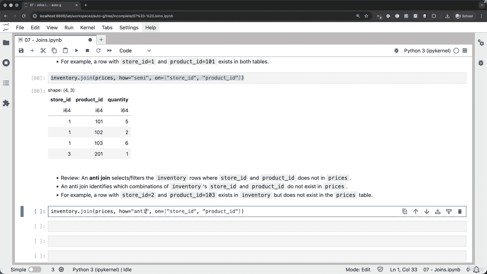

以下是半连接和反连接的区别：

- `semi` 半连接：看右表中是否存在匹配，保留匹配的左表行。
- `anti` 反连接：看右表中是否不存在匹配，保留不匹配的左表行。
- 两者都只返回左表列，都不合并右表列。

到这里，我们已经复习了常见的连接方式，也看到了 Polars 可以把它们直接应用到多列连接中。多列连接的关键不是只匹配一列，而是把需要匹配的列都放进 `on` 参数对应的列表中，按我们声明的多个列一起寻找匹配。

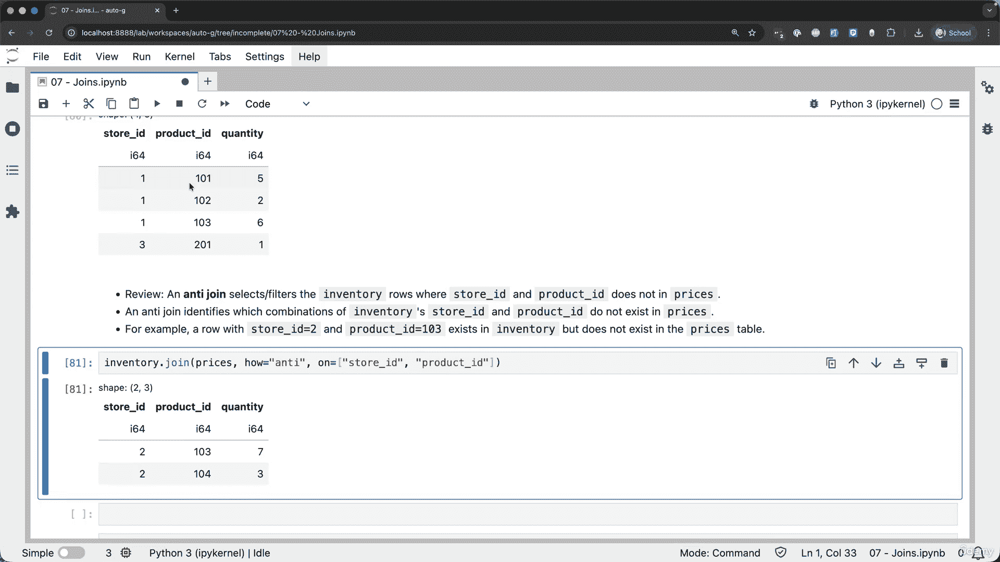

## ✅ Udemy - Polars 与 Python 数据分析：p08 108：本节总结

本节课中我们一起学习了在 Polars 中按多列连接数据表。我们先读取库存表和价格表，理解 `store_id` 与 `product_id` 需要同时匹配；然后使用 `on=["store_id", "product_id"]` 完成多列内连接；接着分别复习了全连接、左连接、半连接和反连接在多列连接下的行为和代码写法。

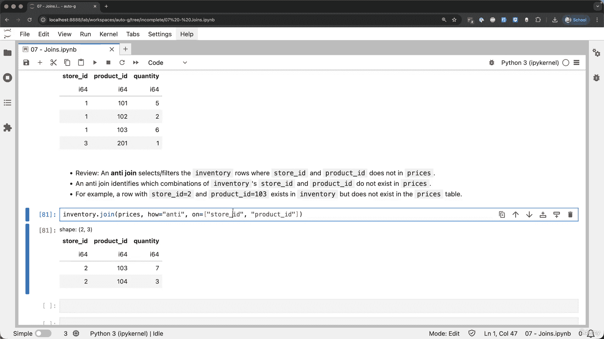

最后记住一个核心思路：多列连接就是把多个匹配条件放进列表中，连接方式和单列连接一样，只是匹配条件从一列变成了多列。掌握这一点后，库存、价格、订单等分属不同系统的数据，就可以按照业务需要的匹配规则灵活合并到一起。
