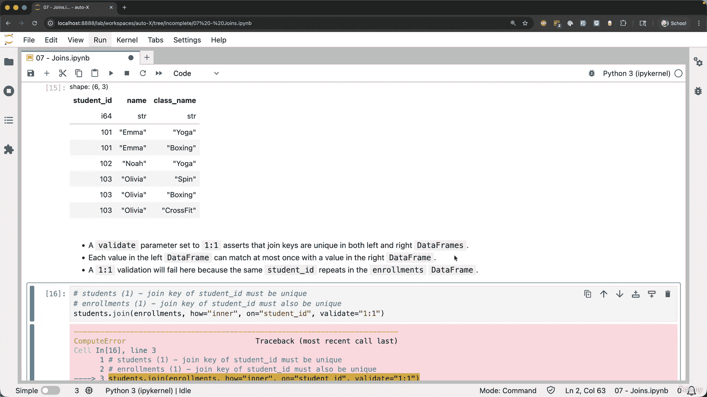
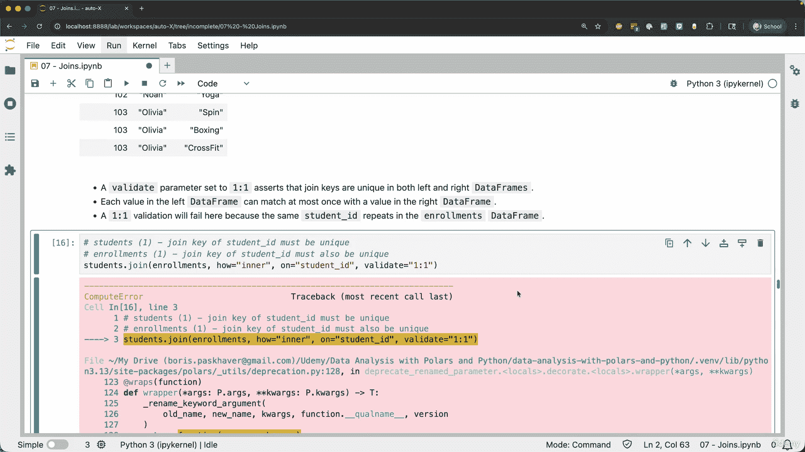
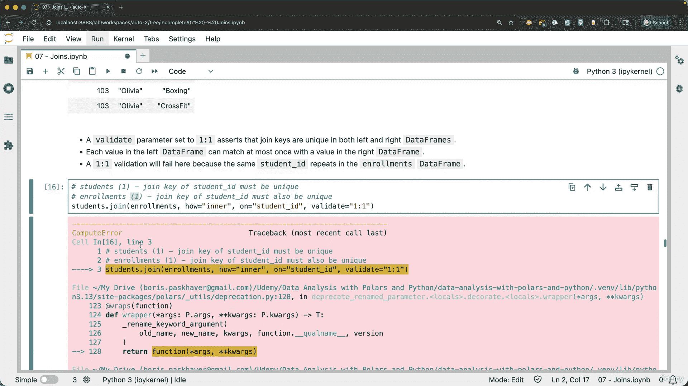
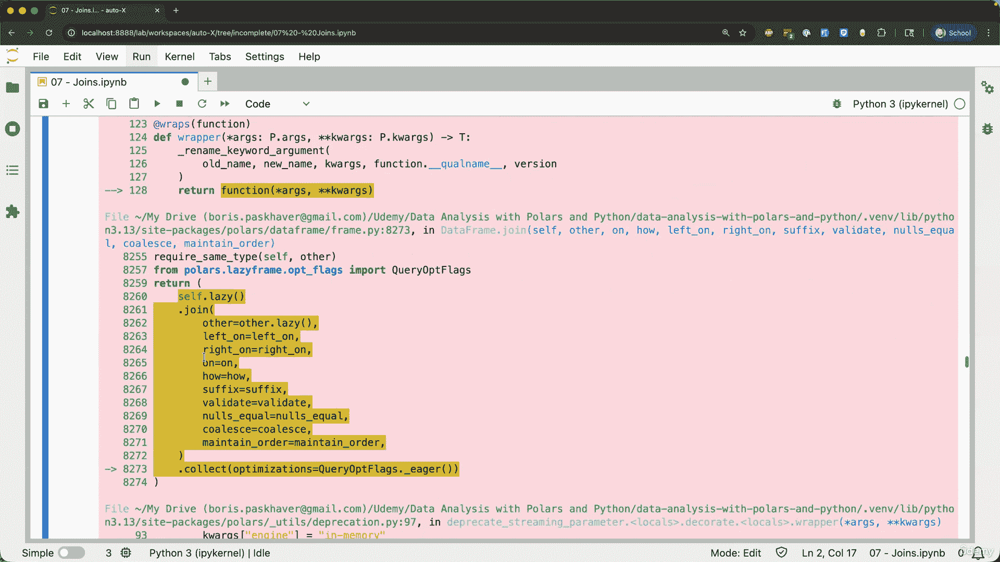
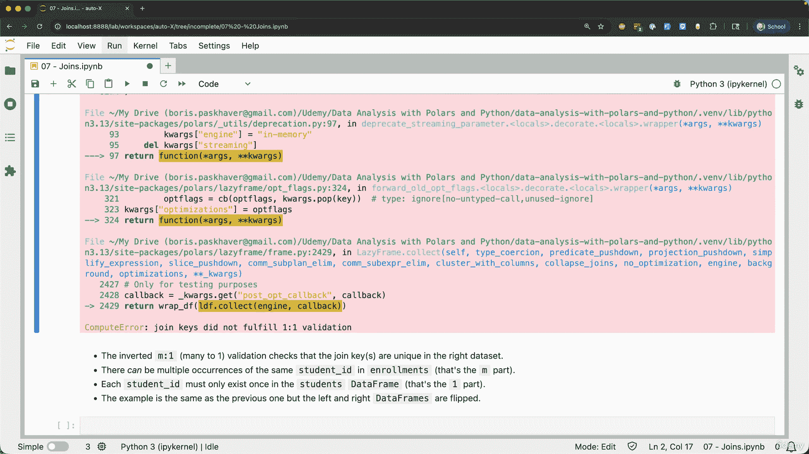
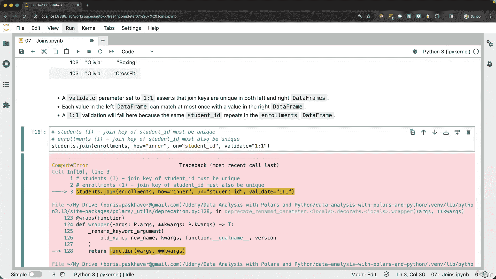
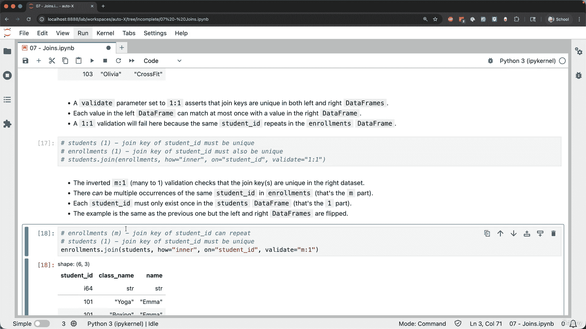
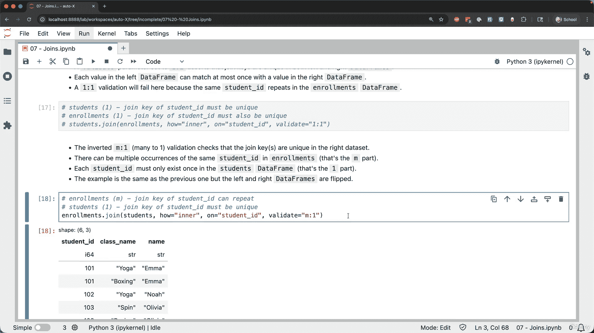

## Polars 与 Python 数据分析：109：validate 参数 🛡️

在本节课中，我们将要学习 Polars 的 `join` 方法中的一个可选参数：`validate` 参数。这个参数本身不会改变 `join` 方法的工作方式，它的作用是做安全检查，用来确认或验证我们对左、右两个 DataFrame 的某些假设是否成立。换句话说，普通的不带 `validate` 的 `join` 方法不会主动报错或抛出异常；一旦加上 `validate`，只要指定的条件没有被满足，就有可能出现异常或报错。如果发生这种情况，我们会在代码下方看到红色单元格。只有当我们传给 `validate` 的条件没有满足时，才会出现这种报错。接下来我们会用例子把这个概念讲清楚，因为例子比单纯解释更容易理解。

在上一段中我们说明了 `validate` 是一个安全检查参数，本节中我们来看看它到底在验证什么。`validate` 验证的是左、右两个 DataFrame 中连接键之间的关系。我们需要通过 `validate` 指定：连接键是恰好出现一次，还是可能出现多次；并且要分别对左表和右表指定。为了把这件事说清楚，可以先记住下面这个核心公式，它描述了 `validate` 参数的基本写法。

```text
validate = "<左表关系>:<右表关系>"
左表关系, 右表关系 ∈ {1, M}
1 表示连接键在该表中只出现一次
M 表示连接键在该表中可以出现多次（M 是 many 的缩写）
```

上面的公式会在后面的示例中反复出现，因此这里先建立一个整体印象。理解了这个公式之后，我们再进入具体数据示例，看看 Polars 在真实连接时如何根据这个参数做验证。

### Polars 与 Python 数据分析：109.1：准备两个示例数据集 📚

在上一节中我们介绍了 `validate` 参数的基本含义，本节中我们来看看本课要使用的两个新数据集。第一个数据集位于一个名为 `College` 的嵌套目录中，文件名是 `students.csv`。这个数据集是一个虚构学院里的学生集合，每个学生都有一个 ID 和一个姓名。这个数据集比较短，所以可以把它赋值给 `students` 变量，然后用 `head` 方法预览前几行。

这个学生数据集表示校园里的学生集合，因此每个学生 ID 在这个学生集合中应该只出现一次。下面列出读取和预览学生数据的代码，方便先建立直观认识。

```python
students = pl.read_csv("College/students.csv")
students.head()
```

接着我们来看第二个 DataFrame，它位于 `College` 文件夹里的一个配套文件中，文件名是 `enrollment.csv`。在这个数据集里，我们既有学生 ID，也有学生在学期中注册的课程。同一个学生，例如 ID 为 101 的 Emma，可以注册多门课程，所以这个学生的 ID 会随着每门课程重复出现多次。学生并不一定必须选多门课，也可以只选一门课，例如学生 1002 就是这种情况，但学生也可以选多门课。这里把这个 DataFrame 赋值给 `enrollments` 变量，同样用 `head` 方法预览前几行。

为了便于后续连接，下面列出读取和预览选课数据的代码。这样我们就有了左表 `students` 和右表 `enrollments` 两个数据集。

```python
enrollments = pl.read_csv("College/enrollment.csv")
enrollments.head()
```

### Polars 与 Python 数据分析：109.2：默认的 M:M 验证 🔗

在上一节中我们准备好了两个数据集，本节中我们来看看第一次连接以及默认的 `validate` 行为。下面我们执行第一次 `join`：取 `students`，调用 `join` 方法，把 `enrollments` 作为右表传进去。默认情况下，`how` 参数是内连接（inner join），这在本场景中完全合适，因为我们要保留同时出现在 `students` 和 `enrollments` 中的 ID。两个表的连接键列名都是 `student_id`，所以可以直接用 `on` 参数指定 `student_id`。这样会得到每个学生与他在该学期所选课程之间的映射关系。

默认情况下，我们不需要提供任何 `validate` 参数。如果查看文档中的定义，可以看到 `validate` 参数的默认值是 `M:M`。为了解释这个默认值到底在做什么，我们可以把这个默认值显式写出来。下面列出默认连接和显式写出 `validate="M:M"` 的代码。

```python
# 默认不写 validate
students.join(enrollments, on="student_id", how="inner")

# 显式写出默认值
students.join(enrollments, on="student_id", how="inner", validate="M:M")
```

执行上面的代码会得到完全相同的结果，可以看到这里得到的结果正是我们想要的结果。接下来解释这个看起来有点特殊的语法。首先要了解，冒号是左表指定与右表指定之间的分隔符。冒号左边描述左表的情况，冒号右边描述右表的情况。前面提到过，我们描述的是连接键之间的关系，所以冒号两侧其实都可以提供两个字符：字符 `1` 表示连接键在那个特定 DataFrame 中只出现一次；字母 `M` 表示连接键可以出现多次，因为 `M` 是 many 的缩写。

因此，当我们写 `M:M` 时，指定的是多对多关系。冒号左边的 `M` 对应左表 `students`，冒号右边的 `M` 对应右表 `enrollments`。建立多对多关系的意思是：同一个连接键在 `students` 中重复多次是可以的，也就是同一个学生 ID 重复出现并作为匹配依据时没有问题；同样，在右表 `enrollments` 中，连接键 `student_id` 出现多次也是可以的。这个默认验证实际上是最不严格的验证，因为它允许任意一个 DataFrame 中的连接键以任意次数存在：可以出现零次、一次或多次。它也是最宽松的验证，因为最灵活。接下来我们会看一个限制更严格的选项。

### Polars 与 Python 数据分析：109.3：使用 1:M 做更严格验证 ✅

上一节中我们看到了默认的 `M:M` 是最宽松的验证，本节中我们来看看如何把左表改成只允许连接键出现一次。回看前面介绍学生数据集时说过，每个学生 ID 在这个 DataFrame 中应该只出现一次。如果在连接中使用学生表，并且希望执行这个验证，就可以让 Polars 断言：用于与其他 DataFrame 匹配的学生 ID 在这个集合、这个表中只出现一次。因此可以把 `M` 换成数字 `1`，这个条件应该成立，也就是每个用于与 `enrollments` 合并的学生 ID 只出现一次。

下面复制前面的代码，把 `M:M` 改成 `1:M`。再次强调，冒号左边的值对应左表 `students`，所以这里表示学生表的连接键 `student_id` 不能重复，每个连接键只能出现一次。如果学生 ID 101 被用作与 `enrollments` 连接的基础，那么学生 ID 101 在 `students` 中只能出现一次。冒号右边的值对应右表 `enrollments`，这里指定 `M`，意思是 `enrollments` 中的连接键 `student_id` 可以重复多次，这是正确的，因为在选课数据中同一个学生可以在一个学期里选多门课。下面列出对应的连接代码。

```python
students.join(
    enrollments,
    on="student_id",
    how="inner",
    validate="1:M"
)
```

这段代码的 `join` 主体没有变化，只是增加了 `validate` 参数，也就是请求一个额外的安全检查：让 Polars 在实际执行连接之前验证连接键的关系。这里的条件是：连接键在 `students` 中必须唯一，但在 `enrollments` 中不必唯一。因为我们的验证条件得到满足，所以会得到和刚才完全相同的内连接 DataFrame，只不过现在是在真正完成连接之前多做了一次安全检查。

### Polars 与 Python 数据分析：109.4：用 1:1 触发验证错误 ⚠️

上一节中我们使用 `1:M` 得到了正确验证，本节中我们来看看什么情况下会遇到错误。这个错误会告诉我们：原来对连接键的假设可能不正确，从而让我们回到数据集，查明假设哪里有问题。这样就能在 `join` 方法制造“成功”的假象之前捕获错误，避免潜在重复连接那些本来不应该存在的记录。下面举例说明：复制代码，然后故意断言一个我们知道是错误的条件，唯一目的就是演示 Polars 中的错误长什么样。

我们把验证从 `1:M` 改成 `1:1`。再次说明，冒号左边的值作用于学生表，这里提供 `1`，表示学生表中的连接键 `student_id` 必须唯一。冒号右边指定 `enrollments` 的连接键关系，也使用 `1`，表示 `enrollments` 中的连接键 `student_id` 也必须唯一。这个条件对我们的数据集来说是错误的，因为同一个学生可以选多门课。但在某些连接场景中，这可能正是你想指定的关系：例如从一张表带入某个学生的信息，再从另一张表带入同一个学生的信息，并且连接键应该是一对一映射，因为每个 ID 在左表和右表中都只应该出现一次。`validate` 参数表达的就是你对数据的了解、对表之间连接键关系的了解，以及你想如何断言这种关系。

前面已经看到，`enrollments` 表中的 `student_id` 连接键并不唯一。因此 Polars 现在不会执行连接，因为它要提醒你：你对数据的假设可能有问题。你告诉它 `enrollments` 中的连接键 `student_id` 对每次匹配只应出现一次，但它发现这个连接键出现了多次，这会导致与左表 `students` 发生多次连接。向下滚动可以看到错误信息，Polars 会直接拒绝连接。下面是这段代码以及会出现的验证错误信息。

```python
students.join(
    enrollments,
    on="student_id",
    how="inner",
    validate="1:1"
)
```

> join keys did not fulfill the one-to-one validation





这个错误是一个安全检查，用来警告你：在连接之前对数据所做的假设是不正确的。它的价值在于提前暴露问题，而不是等到连接完成后才发现记录被重复匹配。





### Polars 与 Python 数据分析：109.5：交换左右表并使用 M:1 🔄





上一节中我们看到了 `1:1` 会触发验证错误，本节中我们来看最后一个例子，并交换两个 DataFrame 的顺序。先把上面的代码注释掉，避免它干扰后续示例。然后把数据帧顺序翻转：取 `enrollments`，把 `students` 连接进来。仍然做内连接，仍然使用双方共享的 `student_id` 连接。翻转顺序的唯一原因是：`validate` 参数要跟随左右表位置变化，应用正确的关系，因此现在需要反过来写。

现在冒号左边的值指左表，也就是现在的 `enrollments`。在 `enrollments` 中，同一个连接键 `student_id` 出现多次是可以接受的，因为一个学生在一个学期中可以选多门课。因此冒号左边提供 `M`，表示 `enrollments` 中的连接键 `student_id` 可以重复。相反，右表是 `students`，这里提供值 `1`，因为在学生表中，用于匹配的连接键 `student_id` 必须唯一；学生 ID 101 或 102 在 `students` 中只能出现一次。因此指定 `M:1` 表示：连接键在 `enrollments` 中允许重复，但在 `students` 中不允许重复。这个验证会得到满足，所以仍然会得到与之前交换两个表、并使用 `1:M` 时相同的结果。下面列出交换顺序后的代码。

```python
enrollments.join(
    students,
    on="student_id",
    how="inner",
    validate="M:1"
)
```

这个例子说明，冒号两侧都可以写 `M` 或 `1`，因此存在多种组合：多对多、一对一、一对多、多对一。你指定的是希望 Polars 在执行连接之前验证的关系。下面用公式总结这些组合。

```text
M:M  多对多
1:1  一对一
1:M  一对多
M:1  多对一
```

这种验证非常有用，因为它可以在连接之前断言原始表包含应有的约束，避免把本来不应该匹配的记录连接在一起。需要再次强调，`validate` 是验证和安全检查，它不会改变 `join` 方法本身的工作方式。

### Polars 与 Python 数据分析：109.6：本课总结 🧾





本节课中我们一起学习了 Polars 的 `join` 方法中的 `validate` 参数。这个参数不会改变连接的工作方式，而是作为安全检查，确认左表和右表的连接键关系是否符合我们的假设。我们学习了 `validate` 的写法是“左表关系:右表关系”，其中 `1` 表示连接键在该表中只出现一次，`M` 表示连接键在该表中可以出现多次。默认值是 `M:M`，也就是最宽松的多对多验证；使用 `1:M` 可以断言学生表中的连接键唯一，而选课表中的连接键可以重复；使用 `1:1` 则会因为选课表中的学生 ID 重复而触发验证错误。最后我们交换左右表，使用 `M:1` 验证了相反方向的关系。实际使用时，可以把 `validate` 当作连接前的一道安全检查，用来提前发现对数据关系的错误假设，避免产生不应该出现的重复连接。

