# 📊 Polars 与 Python 数据分析：110：join_asof 方法（一）

在本节课中，我们将要学习 `join_asof` 方法。它和普通 `join` 很像，都是把两个 DataFrame 按照一个或多个列中的匹配值合并起来。区别在于，`join_asof` 不要求两个值严格相等，而是按照接近程度进行匹配。可以把它理解成一种“近似连接”，特别适合时间序列数据。本篇会先解释 `join_asof` 的适用场景，再准备两个与网站运行状态有关的数据集，最后通过 `strategy` 参数观察 `backward`、`forward` 和 `nearest` 三种匹配方向。

## 🧭 为什么需要 join_asof

在概述中我们说明了 `join_asof` 是一种近似连接方法，本节来看看它具体解决什么问题。普通 `join` 通常要求两个列中的值严格相等，而 `join_asof` 允许两个值不完全相等，只要它们足够接近就可以连接。核心思想可以用下面的公式表示。

```text
匹配条件：|left_time - right_time| 尽可能小
```

当两个 DataFrame 都包含 datetime 列时，我们可能想根据这两个时间列中的值连接数据，但某些行之间并不存在完全相等的时间。例如，一行时间可能与另一行时间相差 5 分钟，也可能相差 1 个月，这时就可以按照接近程度把互补的行拉取到一起。允许的时间窗口或容差范围由业务决定，`join_asof` 关注的是“接近”，不是“严格相等”。以下是理解 `join_asof` 时需要注意的几个关键点。

- `join_asof` 和普通 `join` 一样，都用于合并两个 DataFrame。

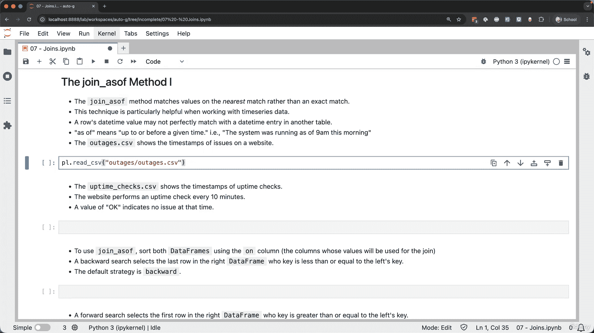

- `join_asof` 不要求连接键严格相等，而是根据两个值的接近程度匹配。

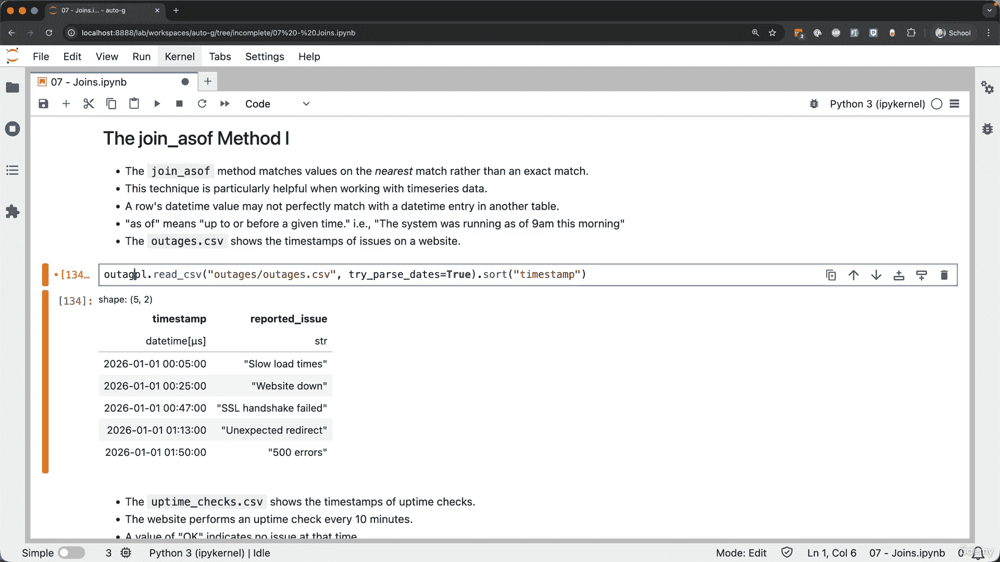

- 这种方法特别适合时间序列数据，例如两个表都带有 datetime 列，需要按时间寻找最近记录。

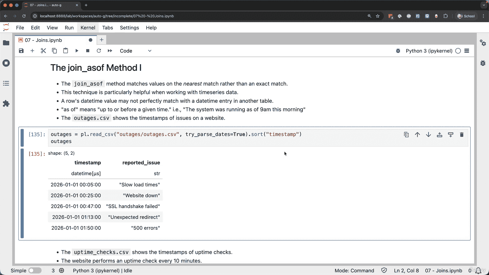

- 一行数据可以在另一行的 5 分钟范围内，也可以在 1 个月范围内，具体容忍窗口由业务规则决定。

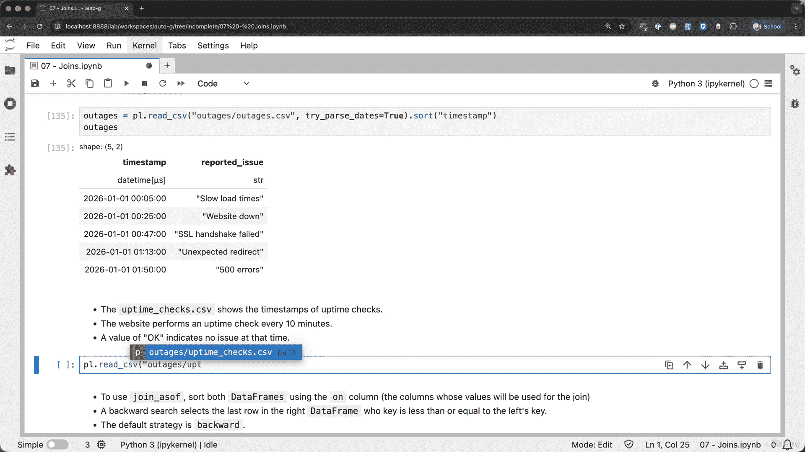

- 连接逻辑不是严格相等，而是接近程度。

理解了这些关键点后，本节最后说明 `join_asof` 的典型用途是处理时间序列中的近似匹配。接下来我们准备第一个数据集，用它观察网站宕机记录。

## 🗂️ 准备网站宕机数据

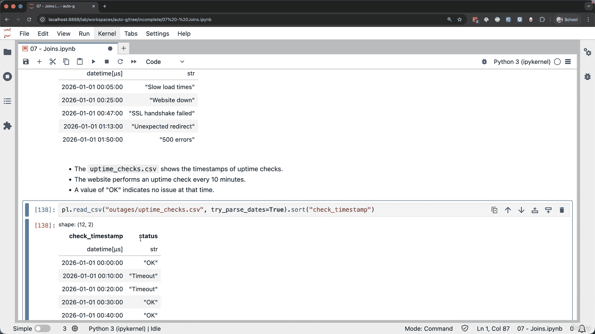

上一节说明了 `join_asof` 适合按时间接近程度连接数据，本节读取第一个数据集 `outages.csv`。假设我们正在运营一个网站，网站会不定期宕机，这种宕机事件称为 outage。数据中有一个 timestamp 列，记录网站随机宕机的时间，例如某小时的第 5 分钟、13:25 等，同时还包含与该次宕机相关的问题信息。读取数据后，第一件事是把 timestamp 列解析成 datetime 类型，并调用 `sort` 对 timestamp 列排序。

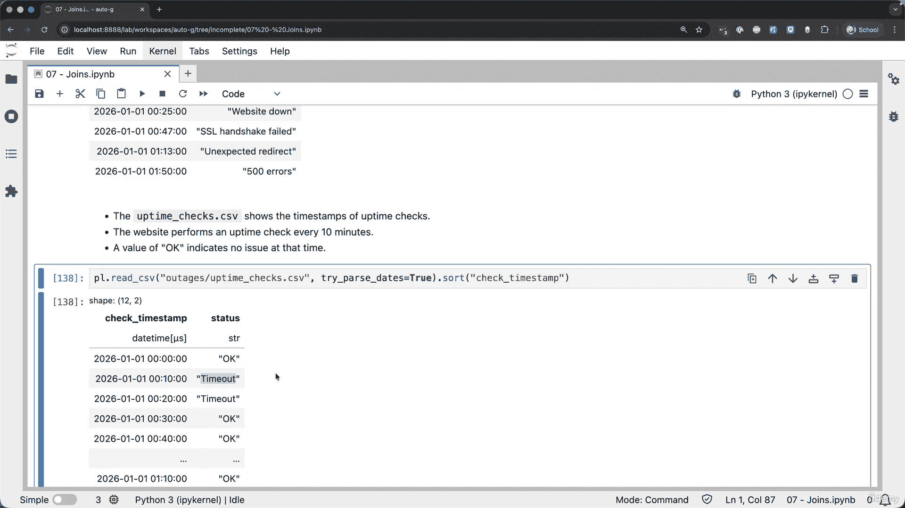

```python
import polars as pl

outages = (
    pl.read_csv("outages/outages.csv", try_parse_dates=True)
    .sort("timestamp")
)

outages
```

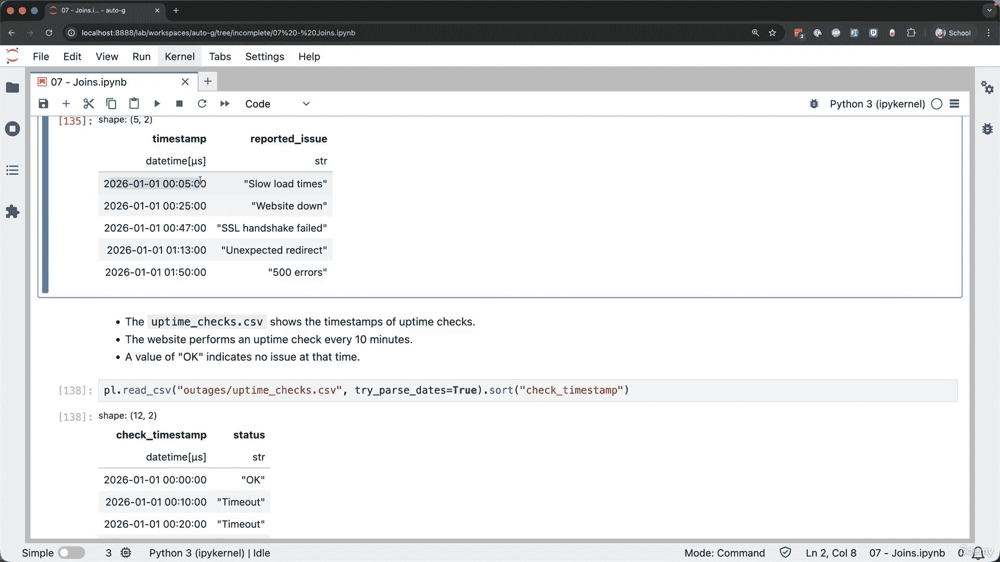

这里使用 `try_parse_dates=True`，因为 timestamp 是一种常见的时间存储格式，Polars 可以顺利把它转换成 timestamp 列或 datetime 列。在应用 `join_asof` 之前，确保参与连接的时间列已经排序非常重要，所以这里直接对 timestamp 列排序。排序后，所有行都按升序排列，最早的时间戳在前面，最晚的时间戳在后面。完成排序后，把结果赋值给 `outages` 变量并输出，可以看到网站宕机发生的时间以及对应问题。这个数据集准备完成后，下一节读取网站可用性检查数据。

## ⏱️ 准备网站可用性检查数据

上一节准备了网站宕机记录，本节读取第二个数据集 `uptime_checks.csv`。这个文件同样位于 outages 目录下。数据中也有一个与时间相关的列，但它一开始被解释为字符串列。处理方式与上一节类似，需要添加 `try_parse_dates=True`，并把 `check_timestamp` 列传给 `sort`，确保 DataFrame 按检查时间升序排列。

```python
uptime_checks = (
    pl.read_csv("outages/uptime_checks.csv", try_parse_dates=True)
    .sort("check_timestamp")
)

uptime_checks.head()
```

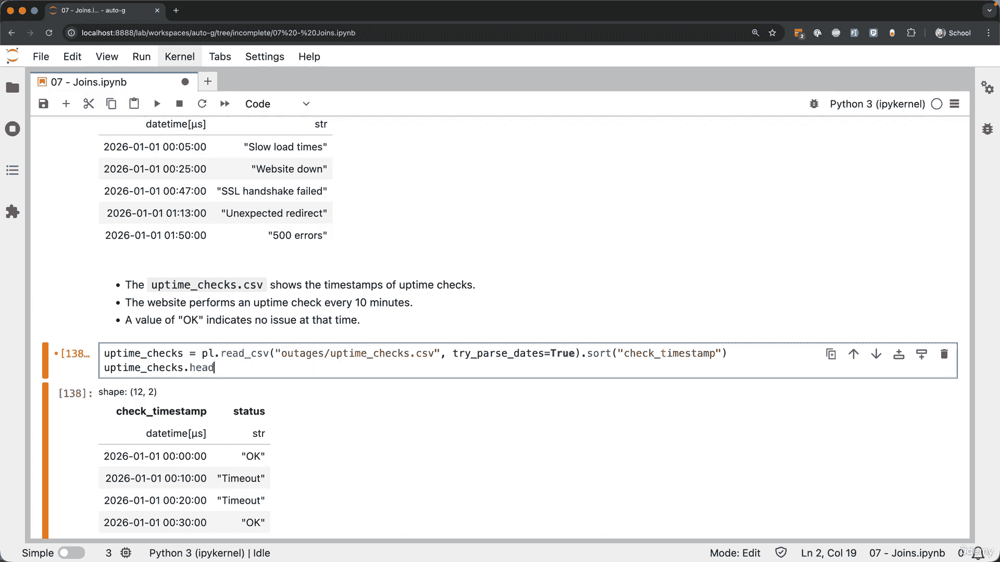

网站每 10 分钟运行一次 uptime check，用来验证网站是否正常运行。与前面随机、零散的宕机记录不同，这里的检查时间是固定的 10 分钟间隔，例如午夜、当天第 10 分钟、第 20 分钟，依此类推。每一行还包含网站状态，状态可能是 okay，也可能是 timing out，后者表示网站已经宕机。这里调用 `head()` 只是为了不把屏幕撑满，便于快速查看数据。两个数据集都准备好后，下一节开始使用 `join_asof` 进行连接。

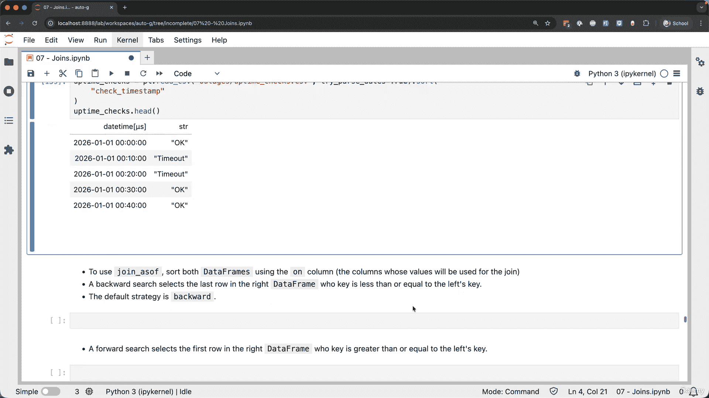

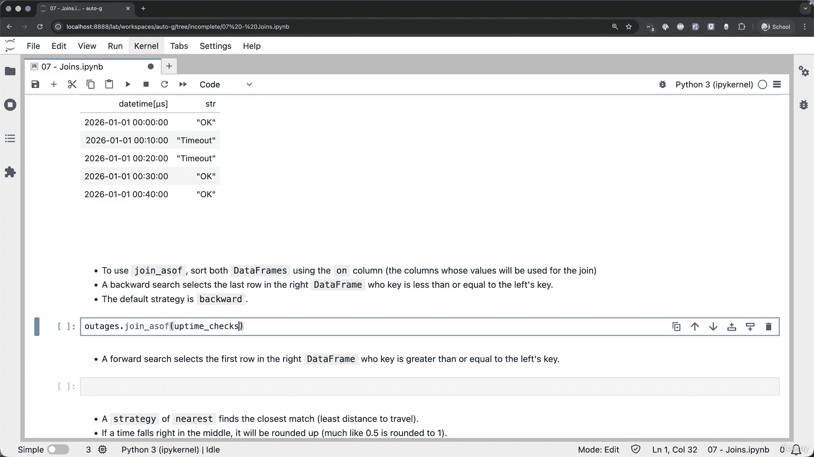

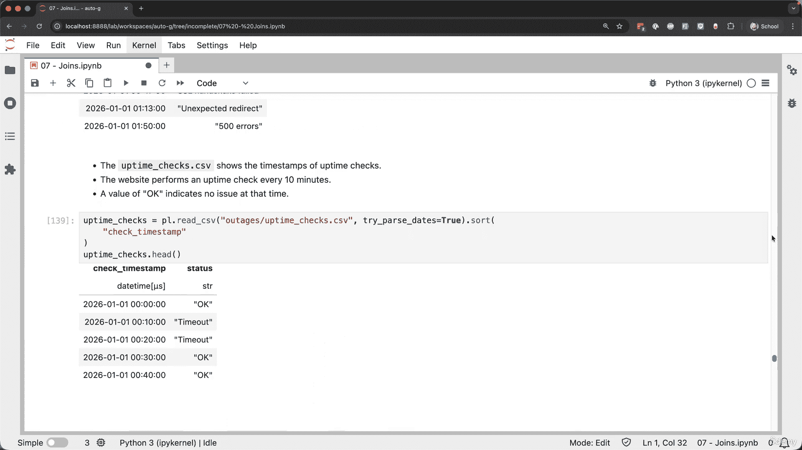

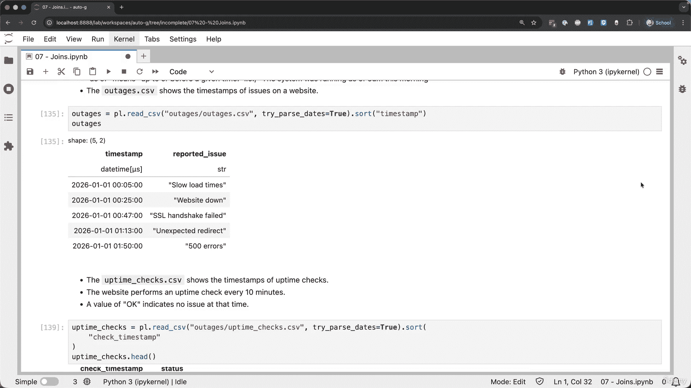

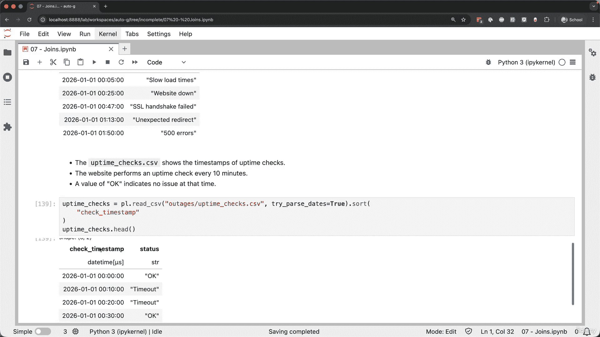

## 🔗 用 join_asof 匹配最近一次检查

上一节完成了两个时间序列数据集的读取和排序，本节进行实际连接。业务分析中常见的问题是：对于每一次宕机，例如当天第 5 分钟发生的宕机，需要检查最近一次 uptime check 中网站是否正常。换句话说，我们希望把这条宕机记录与它之前最近的一次检查记录连接起来。普通 `join` 无法完成这个任务，因为宕机时间与检查时间并不严格相等，两者相差的分钟数不同。`join_asof` 允许我们指定“向后移动，寻找足够接近的下一行”，从而让 Polars 把宕机行与午夜那次检查行连接起来。

```python
result_backward = outages.join_asof(
    uptime_checks,
    left_on="timestamp",
    right_on="check_timestamp",
    strategy="backward",
)

result_backward
```

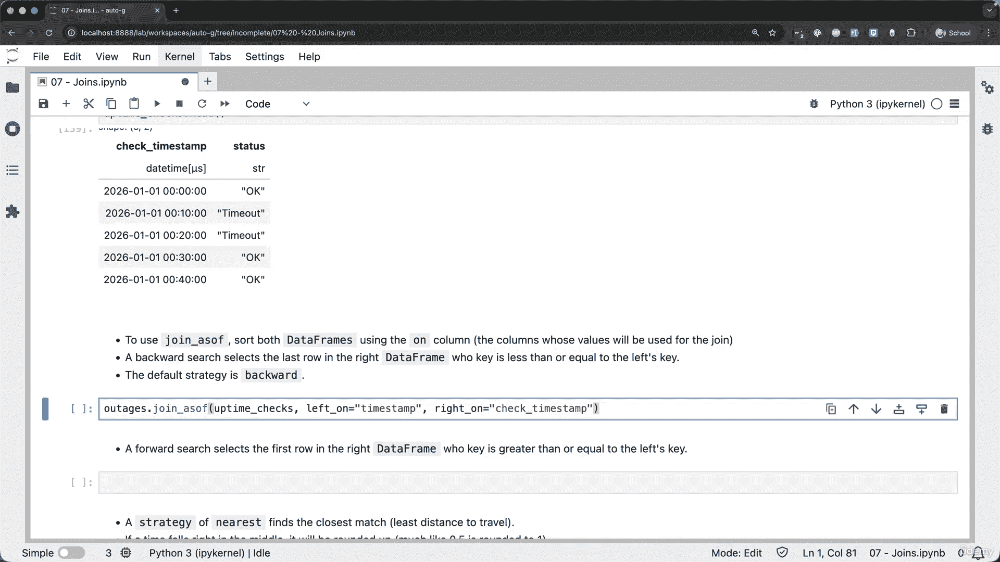

这里从左表 `outages` 开始，调用 `join_asof`，并把 `uptime_checks` 作为右表传入。这个方法接受与普通 `join` 相同的 `on`、`left_on` 和 `right_on` 参数。由于两个数据集的时间列名称不同，左表 `outages` 中的列名是 `timestamp`，右表 `uptime_checks` 中的列名是 `check_timestamp`，所以使用 `left_on="timestamp"` 和 `right_on="check_timestamp"` 指定连接键。连接后，对于 `outages` 中的每一行，Polars 不会在 `uptime_checks` 中寻找完全相等的时间，而是从当前时间向后回溯，找到最近的一个 10 分钟检查记录。例如，当天第 5 分钟发生宕机时，会向后找到午夜那次 uptime check，并把两行合并起来。结果中会出现来自 `uptime_checks` 的 status 列，因此可以看到午夜时网站状态正常，从而判断问题发生在午夜与第 5 分钟宕机之间。以下是连接结果中需要关注的几个点。

- 左表是 `outages`，右表是 `uptime_checks`。

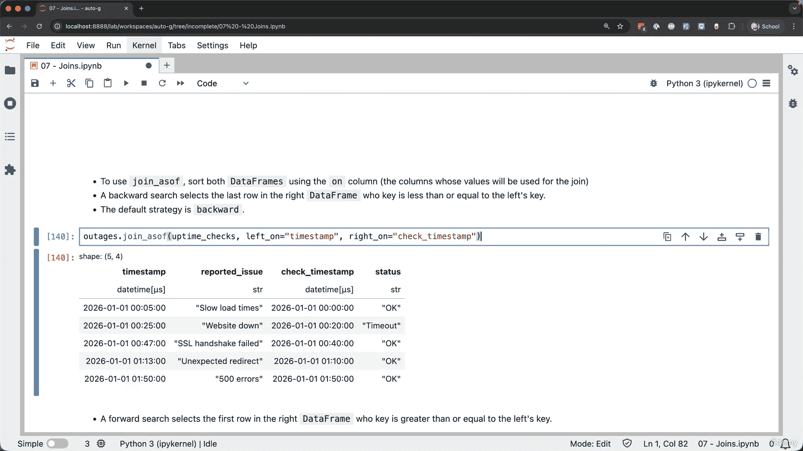

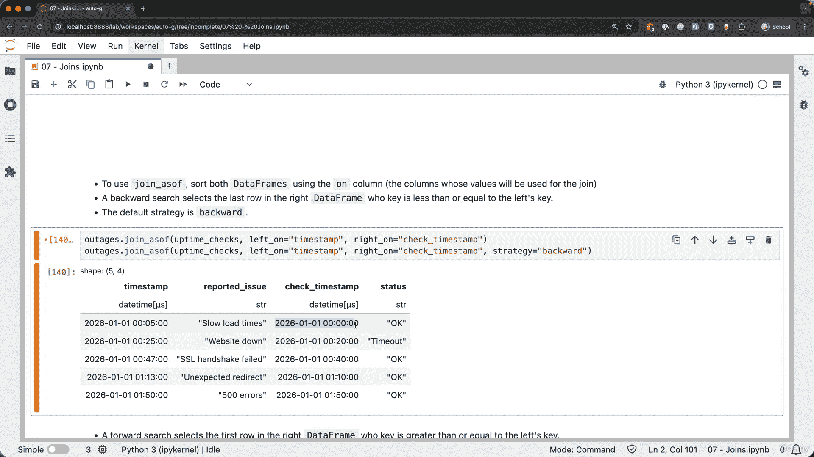

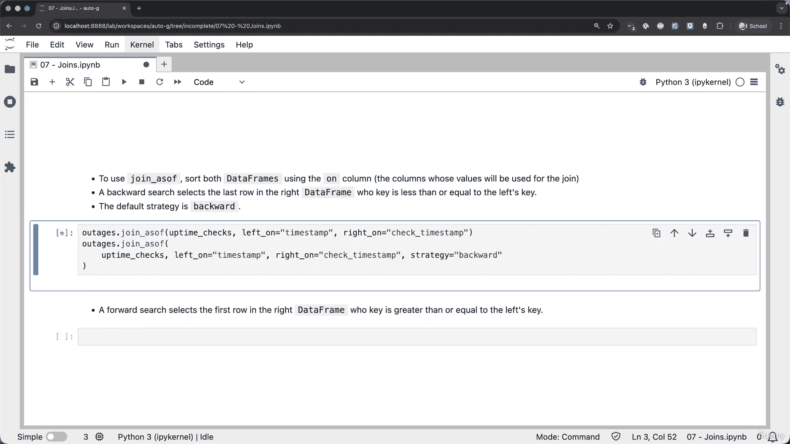

- `left_on` 使用左表的 `timestamp` 列，`right_on` 使用右表的 `check_timestamp` 列。

- 默认策略会从当前时间向后回溯，寻找最近的有效检查记录。

- 匹配到的 status 列可以帮助判断宕机发生前网站是否正常。

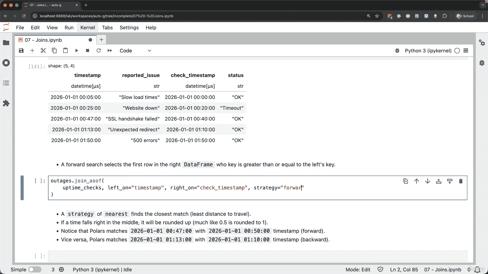

默认的 `backward` 策略会把匹配方向固定为向过去寻找。接下来我们看看如何改变搜索方向。

## 🎯 strategy 参数：backward、forward 与 nearest

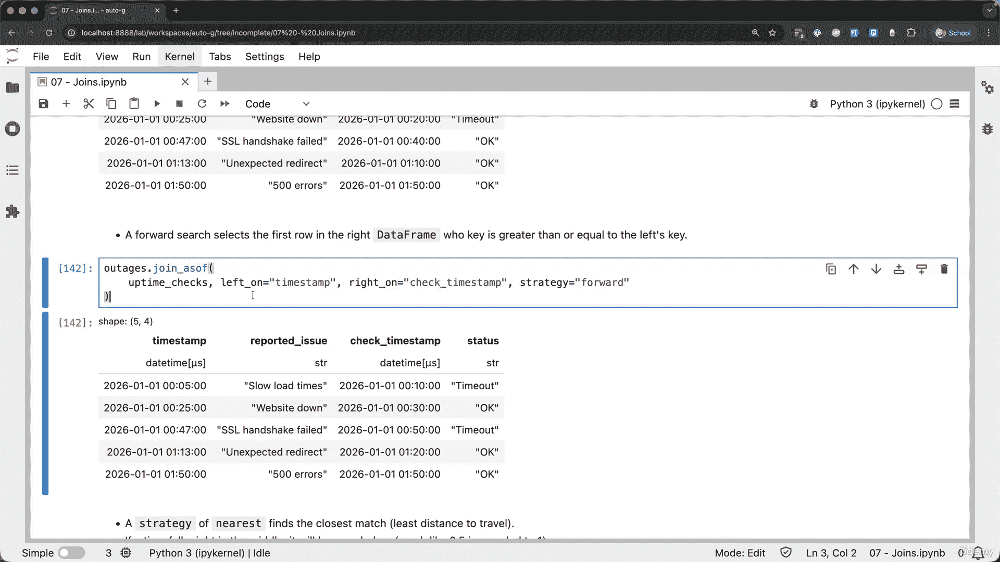

上一节使用默认策略完成了向后匹配，本节系统观察 `strategy` 参数。`strategy` 参数决定从当前行的时间出发，朝哪个方向寻找右表中最近的匹配行。默认值是 `backward`，意思是对于 `outages` 中每一行的 timestamp，从当前时刻向过去回溯，直到在 `uptime_checks` 中找到最近的有效行。Polars 会定位到时间上更早、位于当前时间之前的那条检查记录。与 `backward` 相对应的策略是 `forward`，它会让 Polars 从当前时间向未来寻找最近的匹配行。

```python
result_forward = outages.join_asof(
    uptime_checks,
    left_on="timestamp",
    right_on="check_timestamp",
    strategy="forward",
)

result_nearest = outages.join_asof(
    uptime_checks,
    left_on="timestamp",
    right_on="check_timestamp",
    strategy="nearest",
)
```

使用 `forward` 时，对于 `outages` 中同样的行，Polars 会向未来推进，直到找到 `uptime_checks` 中最近的检查记录。例如，当天第 5 分钟发生宕机时，会向前找到当天第 10 分钟的检查记录，此时可以看到网站状态为 timing out。两种策略的唯一区别，是搜索匹配行时相对于左表当前行时间的前进方向，其余连接逻辑完全相同。第三种策略是 `nearest`，它不固定向过去或向未来，而是直接寻找时间距离最近的那一行。例如，某次宕机发生在某小时第 47 分钟，uptime check 每 10 分钟一次，因此存在第 40 分钟和第 50 分钟两次检查。由于第 50 分钟与第 47 分钟只差 3 分钟，而第 40 分钟与第 47 分钟相差 7 分钟，`nearest` 会选择第 50 分钟的检查记录。反过来，如果宕机发生在凌晨 1:13，而检查时间有 1:10 和 1:20，Polars 会选择 1:10，因为它只差 3 分钟，比 1:20 的 7 分钟更近。这里也可能出现完全相等的情况，例如宕机发生在凌晨 1:50，而 uptime check 也正好在 1:50，这证明 `join_asof` 也接受相等匹配，只是两个值不必严格相等才能连接。以下是 `strategy` 参数的三种取值及其含义。

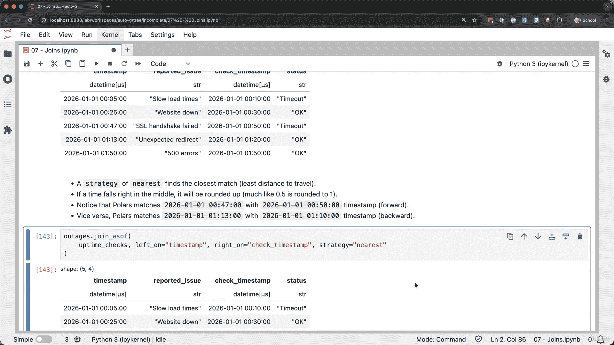

- `backward`：默认策略，从左侧当前时间向过去回溯，寻找右表中时间更早且最近的匹配行。

- `forward`：从左侧当前时间向未来推进，寻找右表中时间更晚且最近的匹配行。

- `nearest`：不限定方向，直接寻找右表中时间距离当前行最近的那一行。

最后需要说明，`strategy` 参数基于左表当前行的时间，决定向过去还是向未来寻找右表中的最近匹配行。右表是 `join_asof` 方法的第一个参数。这样 `join` 与 `join_asof` 的区别就清楚了。下一节课继续学习相关内容。

## ✅ 总结

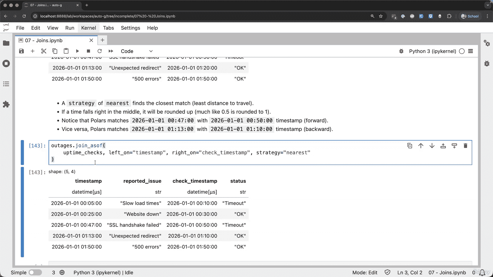

本节课中我们一起学习了 Polars 中的 `join_asof` 方法。我们了解到，`join_asof` 与普通 `join` 都用于合并两个 DataFrame，但 `join_asof` 不要求连接键严格相等，而是根据接近程度匹配记录，因此特别适合时间序列数据。我们还准备了 `outages` 和 `uptime_checks` 两个数据集，练习了时间列解析、排序，以及使用 `left_on` 和 `right_on` 完成近似连接。通过 `strategy` 参数，我们观察了 `backward`、`forward` 和 `nearest` 三种匹配方向，并理解了它们分别如何从左侧时间出发寻找右侧最近记录。下一节课继续学习 Polars 数据分析的相关内容。

