# 📊 Polars 与 Python 数据分析：111：join_asof 方法的容差参数

在本节课中，我们将要学习 `join_asof` 方法里的另一个实用参数：`tolerance`，也就是“容差”。这个参数用来限制时间匹配时允许的最大距离，避免 Polars 为了找到最近的时间点，把相隔很久的两条记录也连在一起。上一节我们介绍了 `join_asof` 的基本匹配思路，本节中我们来看看如何用一个时间窗口把匹配范围收紧，让结果更符合实际业务需求。

## 🎯 什么是 tolerance 容差参数

上一节我们介绍了 `join_asof` 可以按照时间方向寻找最近匹配，本节中我们来看看 `tolerance` 参数在其中起什么作用。`tolerance` 允许我们设置一个约束或边界，用来规定匹配在指定方向上最多可以搜索多远。换句话说，我们是在给时间匹配加一个窗口，只在这个窗口内寻找候选记录。默认情况下没有容差，这意味着无论向前还是向后搜索，Polars 都会直接找右表中最近的时间戳，不管它相差两分钟、十年，还是反方向相差两分钟、十五年，只要它是最近匹配，Polars 就会把它和当前行连接起来。用公式可以表示为下面这种匹配关系：

\[
\text{匹配成功} = \text{方向一致} \land |t_{\text{左表}} - t_{\text{右表}}| \le \text{tolerance}
\]

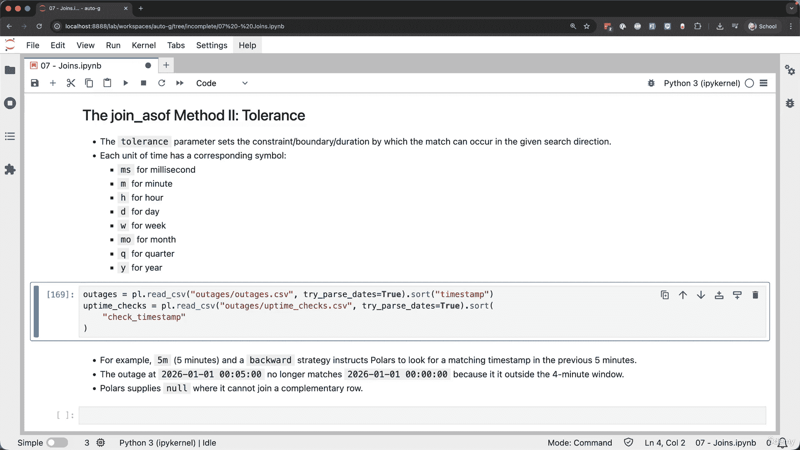

在默认没有设置 `tolerance` 时，可以把它理解为容差接近无穷大，所以 Polars 不关心时间差有多大。下面我们通过代码来看默认行为，再逐步加入容差限制。

## 🛠️ 默认无容差时的匹配行为

上一节我们了解了 `tolerance` 的基本含义，本节中我们先执行上一课里的代码，看看默认没有容差时会发生什么。我们会使用相同的 `outages` 数据框，调用 `join_asof` 方法，并把 `uptime_checks` 作为右表。左表使用的列名是 `timestamp`，右表使用的列名是 `check_timestamp`。默认搜索策略是向后搜索，也就是 `backward`，这里为了写得更明确，我们显式把 `strategy` 参数设置为字符串 `"backward"`。代码如下：

```python
outages.join_asof(
    uptime_checks,
    left_on="timestamp",
    right_on="check_timestamp",
    strategy="backward"
)
```

对于任意一条停电记录，Polars 会从这个时刻开始向时间更早的方向寻找，在 `uptime_checks` 数据框中找到下一个最近的时间匹配。这个匹配可能只相差五分钟，也可能相差五年，只要它是向后方向上最近的那条记录，默认情况下就会被连接上。默认没有容差时，Polars 不在乎两个时间点之间的间隔有多大，也不关心持续时间的差异，只要搜索方向是向后，并且右表中存在时间更早的对应行，它就会完成匹配。理解这个默认行为之后，我们就能明白为什么需要 `tolerance`：它可以把“无限远也能匹配”变成“只在一定窗口内匹配”。

## ⏱️ 设置 tolerance 为五分钟窗口

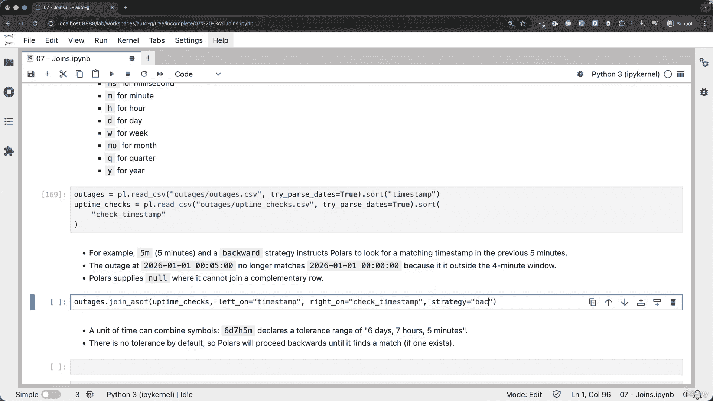

上一节我们看到默认匹配可能跨越很久，本节中我们来看看如何用 `tolerance` 设置一个五分钟的时间窗口。我们给 `tolerance` 参数传入一个字符串，这个字符串使用一套专门表示时间长度的符号语言。例如，`m` 代表分钟，`h` 代表小时，`mo` 代表月，其他单位也有对应符号。写法通常是一个整数后面跟一个单位符号，比如 `5m` 表示五分钟的时间窗口或边界。以下是常见时间单位符号的简单说明，方便初学者理解这种写法：

- `m`：分钟。
- `h`：小时。
- `d`：天。
- `mo`：月。

现在我们把调用改成带 `tolerance="5m"` 的版本，代码如下：

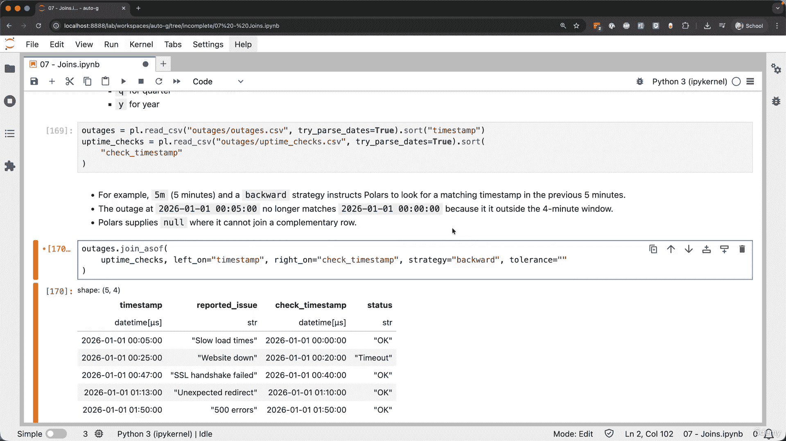

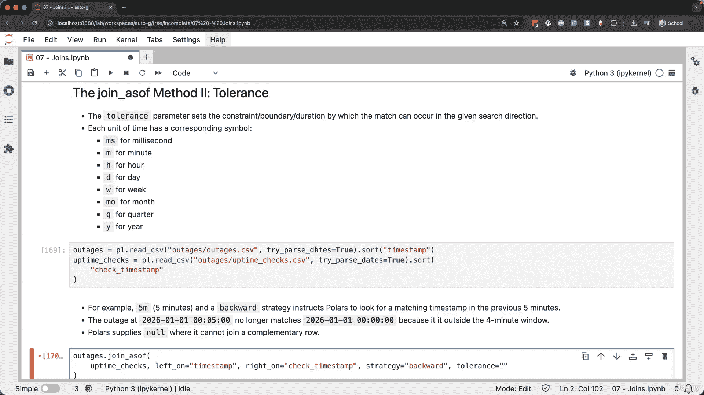

```python
outages.join_asof(
    uptime_checks,
    left_on="timestamp",
    right_on="check_timestamp",
    strategy="backward",
    tolerance="5m"
)
```

这里的含义是：对于左表中的任意时间戳，只向更早的方向看，并且只允许在五分钟范围以内寻找匹配。例如第一条记录的时间仍然落在五分钟边界内，所以 Polars 仍然可以把 `uptime_checks` 中的这一行和 `outages` 中的这一行连接起来。但是有些记录就不再匹配了，比如某条停电记录发生在整点后第 47 分钟，而右表里对应的检查记录发生在整点后第 40 分钟，两者相差 7 分钟。默认没有容差时，这条记录可以连上；设置五分钟容差后，从第 47 分钟往回推五分钟只能到第 42 分钟，第 40 分钟已经超出窗口，所以不再被视为匹配。结果集因此会发生变化，某些行在 `uptime_checks` 中找不到五分钟窗口内的对应记录，就不会有匹配行被连接进来。五分钟窗口的例子说明了容差的作用，接下来我们再把窗口收紧一点，看看结果会怎样变化。

## 🔍 把容差收紧到四分钟

上一节我们使用了五分钟容差，本节中我们把 `tolerance` 改成四分钟，继续观察匹配结果的变化。可以设置 `tolerance="4m"`，代码如下：

```python
outages.join_asof(
    uptime_checks,
    left_on="timestamp",
    right_on="check_timestamp",
    strategy="backward",
    tolerance="4m"
)
```

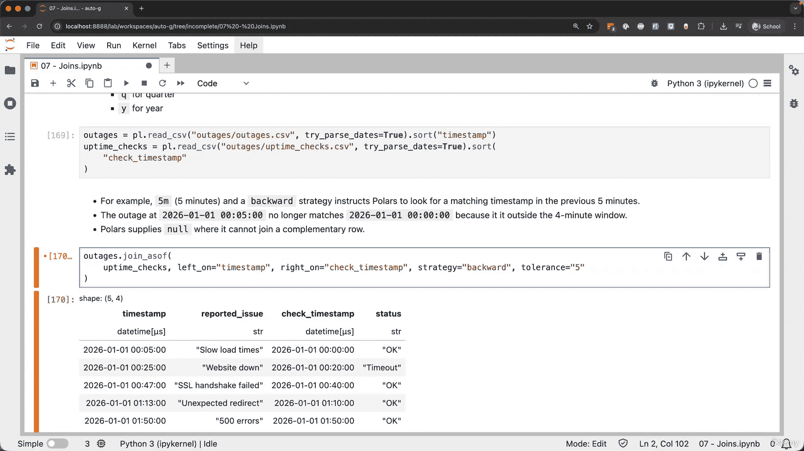

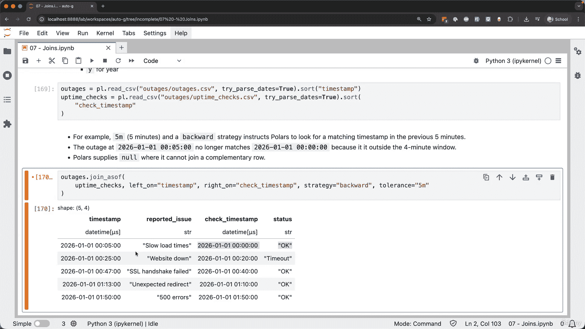

在这个例子里，有些记录之间正好相差五分钟，原先在五分钟容差下可以匹配，现在四分钟窗口装不下这个时间差，所以这些匹配会被移除。比如左表时间在整点后第 113 分钟，右表时间在整点后第 110 分钟，两者相差 3 分钟，仍然落在四分钟窗口内，因此还可以匹配。如果右表时间和左表时间完全相等，也当然可以匹配。真正被移除的是那些原先在五分钟窗口内连上、但时间差达到五分钟的记录，因为从当前时间往回推四分钟时，窗口里已经没有对应的 `uptime_checks` 匹配行。这个例子再次说明，`tolerance` 就是在给搜索范围加边界，边界越窄，能匹配上的记录就越少。理解单个时间单位后，我们还可以把多个单位组合起来使用，让容差窗口更灵活。

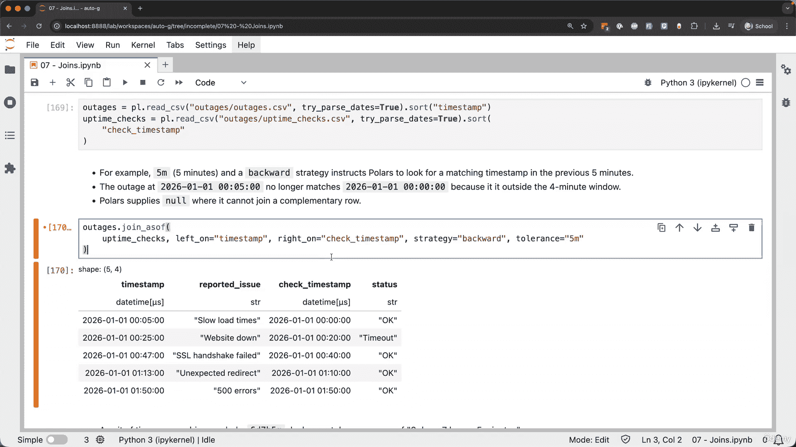

## 🧩 组合多个时间单位

上一节我们使用了一个单独的时间单位，本节中我们来看看 `tolerance` 如何组合多个时间单位。`tolerance` 并不只限于一个单位，我们可以把天、小时、分钟等值拼在一起。例如下面这个例子表示向后搜索六天、七小时、五分钟：

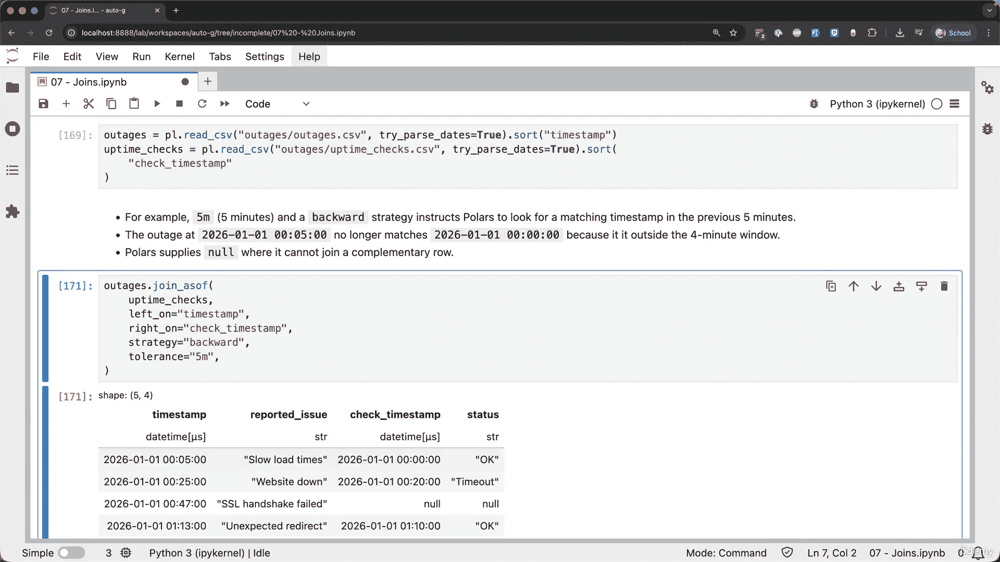

```python
outages.join_asof(
    uptime_checks,
    left_on="timestamp",
    right_on="check_timestamp",
    strategy="backward",
    tolerance="6d7h5m"
)
```

这个例子的窗口可以写成下面的公式：

\[
\text{tolerance} = 6\,\text{天} + 7\,\text{小时} + 5\,\text{分钟}
\]

因为窗口非常大，几乎每条记录都能找到对应匹配，所以这个例子主要是为了演示写法，而不是为了得到一个很严格的结果。它说明我们可以根据自己的业务需求，自由定制容差窗口的大小和组成方式。除了向后搜索，我们也可以把同样的原则用到向前搜索中，下一节就来演示向前搜索时的容差设置。

## ➡️ 向前搜索与容差

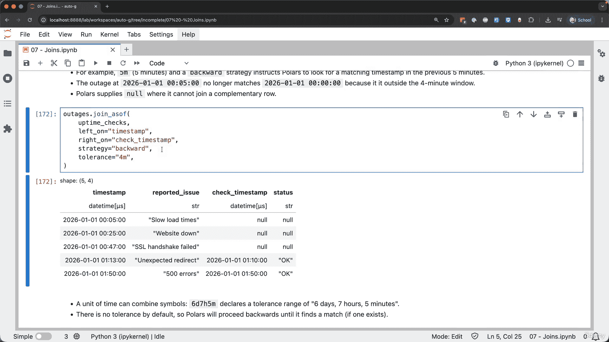

上一节我们演示了向后搜索和组合时间单位，本节中我们来看看向前搜索时如何使用 `tolerance`。如果设置 `strategy="forward"`，那么对于 `outages` 表中的任意时间戳，Polars 会在 `uptime_checks` 表中向时间更晚的方向寻找匹配，并且只在这个方向上的四分钟窗口内寻找。代码如下：

```python
outages.join_asof(
    uptime_checks,
    left_on="timestamp",
    right_on="check_timestamp",
    strategy="forward",
    tolerance="4m"
)
```

例如某条停电记录发生在整点后第 47 分钟，而 `uptime_checks` 中有一条记录发生在整点后第 50 分钟，两者相差 3 分钟，这个差值落在四分钟容差窗口内，所以可以完成连接。这个例子说明，容差参数不仅适用于向后搜索，也适用于向前搜索，核心原则都是限制时间差不能超过给定窗口。到这里，我们已经把 `tolerance` 的默认行为、单位写法、窗口收紧、单位组合和向前搜索都看了一遍，接下来做一个简单总结。

## 📝 总结

本节课中我们一起学习了 `join_asof` 方法的 `tolerance` 容差参数。我们知道了默认没有容差时，Polars 会一直寻找指定方向上最近的时间戳，不管时间差有多大；设置 `tolerance` 后，匹配就被限制在一个时间窗口内，只有时间差不超过容差的记录才会被连接。我们还学习了用 `"5m"`、`"4m"`、`"6d7h5m"` 这样的字符串表示时间窗口，并且可以把多个时间单位组合起来使用。最后我们演示了向后搜索和向前搜索两种方向下的容差匹配。可以用下面的公式概括本节课的核心：

\[
\text{匹配成功} = \text{搜索方向正确} \land \text{时间差} \le \text{tolerance}
\]

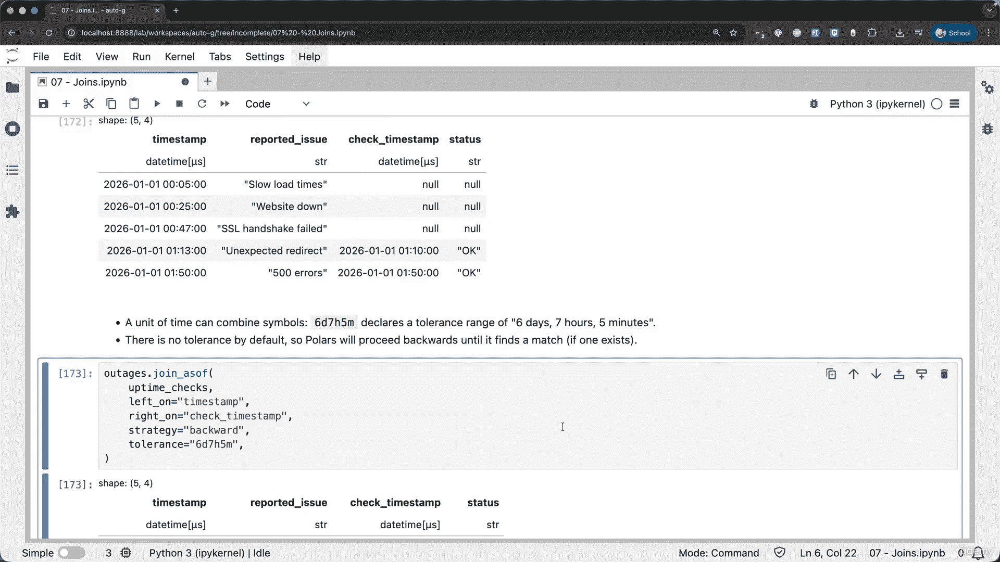

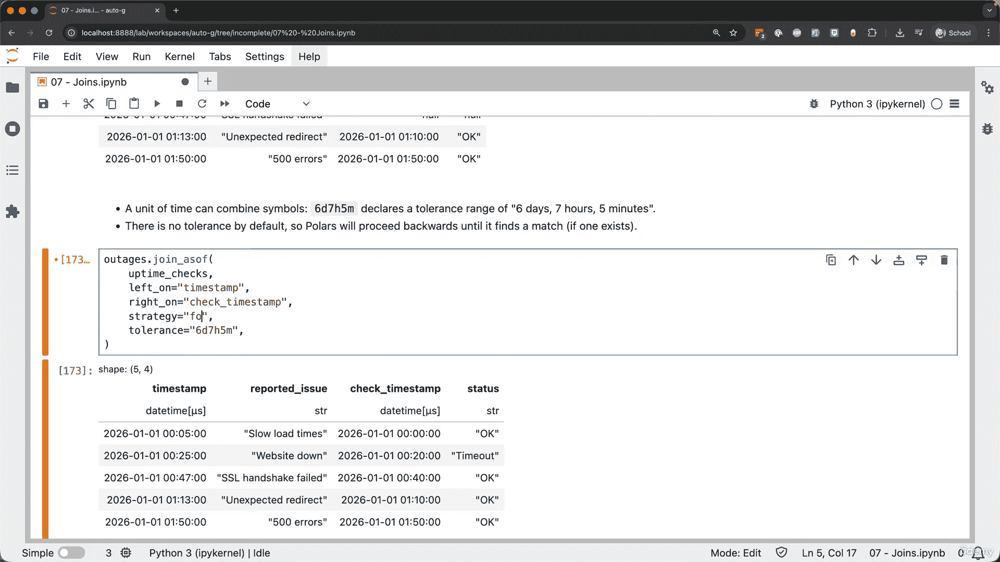

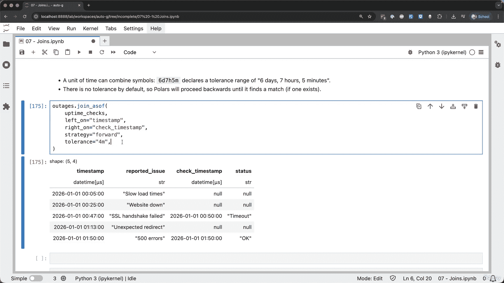

默认情况下，容差可以理解为无穷大，所以 Polars 不限制时间距离；设置容差后，时间距离就成为一个必须满足的条件。掌握这个参数后，就可以让 `join_asof` 的时间匹配更贴近真实业务中的时间窗口要求。

