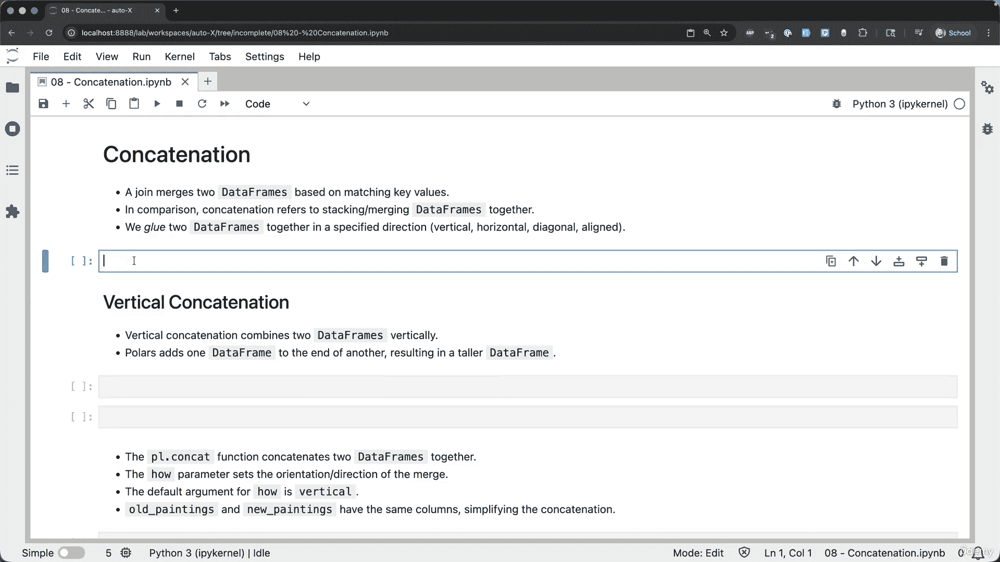
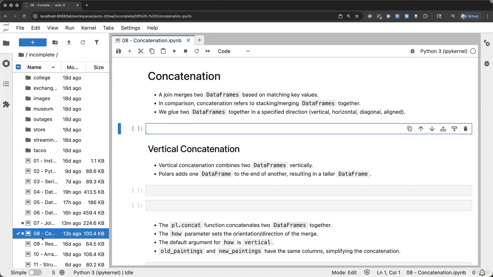
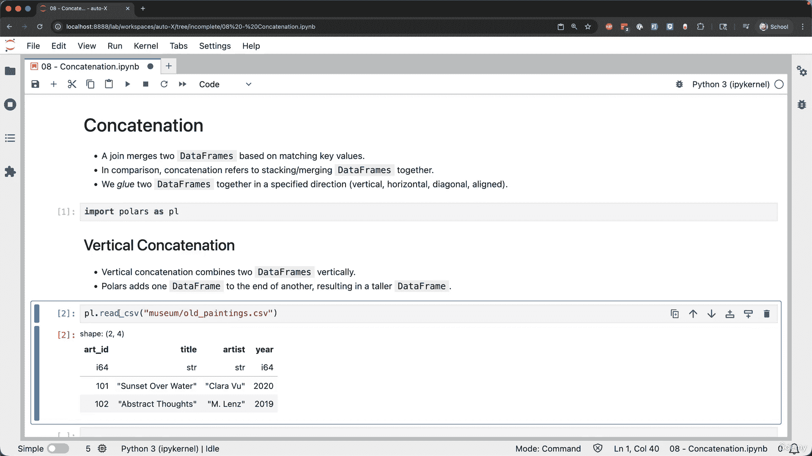
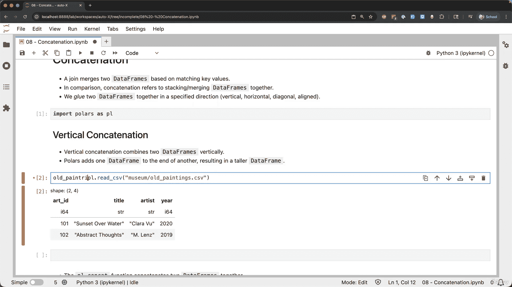
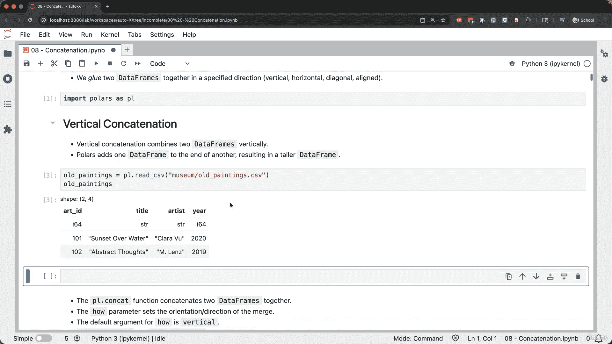
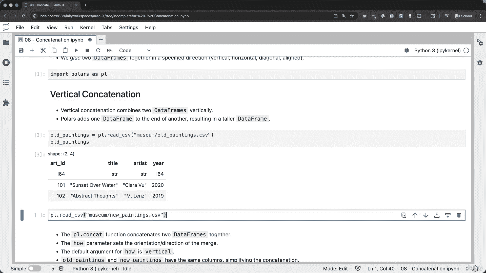
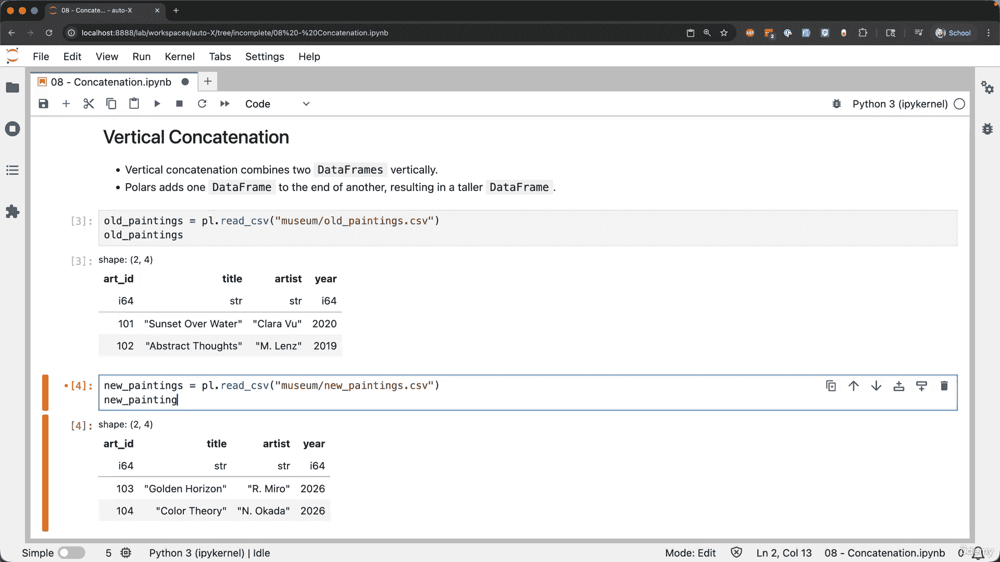
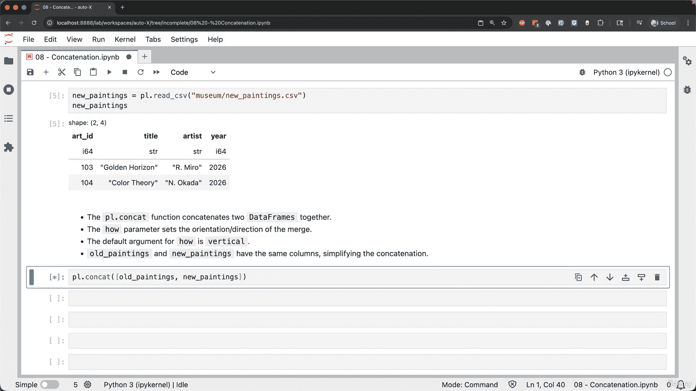
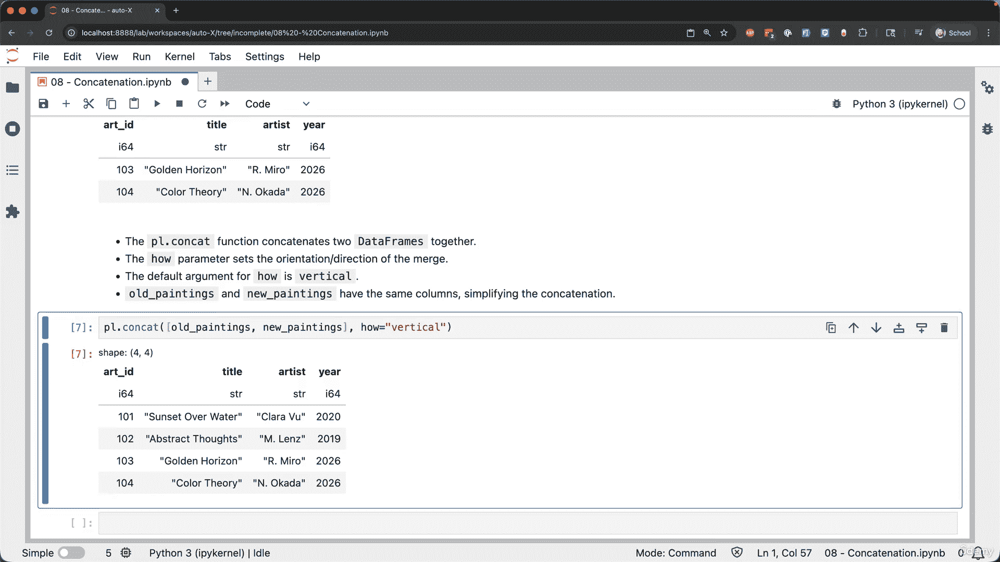

# 📥 Data Analysis with Polars and Python Part 2：第13讲：垂直拼接





欢迎来到课程的新章节，本节的主题是拼接（concatenation）。在本节课中，我们将学习 Polars 中一种非常重要的数据合并方式——垂直拼接。也许你在处理多个数据文件时，经常会遇到“这些文件里的数据本来就是一份完整的表，只是被拆成了几个部分”的情况。这个时候，拼接就派上用场了。

在上一节课程中，我们学习了连接（join）操作。连接操作是根据指定列中匹配的值，把两个 DataFrame 组合起来。但今天讲的拼接（concatenation）要比连接简单得多：它不需要任何匹配条件，只是把两个 DataFrame 直接堆叠在一起。你可以把拼接想象成用胶水把一个 DataFrame 粘到另一个 DataFrame 的末端，非常直观。

Polars 中的拼接可不止一种玩法。总共有以下几种常见的方向：

- 垂直拼接（vertical）：把第二个 DataFrame 的行追加到第一个 DataFrame 的末尾
- 水平拼接（horizontal）：把第二个 DataFrame 的列拼到第一个 DataFrame 的右边
- 对角拼接（diagonal）：把两个 DataFrame 的行和列都错位地拼接在一起

本节我们先聚焦垂直拼接。后面几个小节，我们再来看看水平拼接和对角拼接，以及它们各自的坑。

## 准备工作：导入 Polars 和数据集

我们先打开一个新的 Jupyter Notebook，文件名叫做 `0.8_concatenation`。老规矩，第一步是导入 Polars 库，并且给它起一个别名 `pl`。代码如下：

```python
import polars as pl
```



接下来，我们需要导入两个数据集。先来看第一个数据集：它位于一个名为 `museum` 的嵌套目录中，文件名是 `old_paintings.csv`。这个数据集的背景是这样的：假设我们运营着一家博物馆，而这个数据集正好记录了博物馆里现有的所有画作。每一幅画都有以下几个关键信息：



- 艺术 ID（art ID）
- 标题（title）
- 作者（artist）
- 创作年份（year）

我们先把这个 CSV 文件读进来，赋值给一个变量 `old_paintings`，然后预览一下：

```python
old_paintings = pl.read_csv("museum/old_paintings.csv")
old_paintings
```

从输出中可以看到，这个 DataFrame 非常简洁，只有两行数据。虽然数据量不大，但它足以作为我们演示拼接功能的例子。

接着，我们还需要第二个数据集。它也是一个 CSV 文件，同样放在 `museum` 文件夹里，名字叫做 `new_paintings.csv`。为什么要准备两个文件？你可以想象一下，也许我们博物馆的数据管理系统相当糟糕，导致数据被分成了两次导出，分别保存在两个文件里。第二个数据集里同样存放着画作，而且列名和第一个数据集完全一致。这里有一个细节：数据是从 art ID 为 103 的那幅画继续往下排的。也就是说，从语义上讲，这两份数据本来就是同一份画作目录，只不过被拆散到了两个列完全相同的文件里。我们把这份数据读进来，命名为 `new_paintings`，也预览一下：





```python
new_paintings = pl.read_csv("museum/new_paintings.csv")
new_paintings
```

既然两个文件拥有完全相同的列，而我们希望把它们合并成一份完整的数据，那么最自然的做法就是：把 `new_paintings` 中的每一行，原封不动地追加到 `old_paintings` 的最后面。

## 使用 pl.concat 进行垂直拼接

在 Polars 中，要实现这种“把行追加到末尾”的操作，我们需要用到它的顶层函数 `pl.concat`。注意，`concat` 是英文 `concatenate` 的缩写，这和我们在字符串拼接（比如把两个字符串首尾相接）中用的词一模一样。所以，这个函数的含义非常直白：把若干个 DataFrame 首尾相接。

使用 `pl.concat` 的时候，需要把所有要拼接的 DataFrame 放在一个列表里传给函数。列表的顺序，就是最终拼接结果的顺序。具体来说，如果我们希望 `old_paintings` 的行出现在前面，那就把它放在列表的第一位；然后，在列表的第二位放上 `new_paintings`，这样它的行就会自动接在 `old_paintings` 的行后面。下面是代码：

```python
pl.concat([old_paintings, new_paintings])
```

默认情况下，`pl.concat` 执行的就是垂直拼接。这一点由它的参数 `how` 控制，`how` 的默认值是字符串 `"vertical"`。所谓垂直拼接，正如我们刚才说的，是从行的视角出发，把第二个 DataFrame 的行追加到第一个 DataFrame 的末尾。请注意，整个过程中我们并没有像 join 那样指定任何匹配条件，纯粹是简单地把行堆叠上去。

为了让你更清楚地看到默认行为，下面两种写法其实是完全等价的：





```python
pl.concat([old_paintings, new_paintings])
pl.concat([old_paintings, new_paintings], how="vertical")
```

上面两行代码，无论你执行哪一行，得到的结果都会是一模一样的。如果你愿意，也可以把 `how="vertical"` 显式写出来，这样代码的意图会更清晰，别人一看就知道你做的是垂直拼接。

在这里，我们是一次性把所有数据集都准备好了，然后传入列表进行拼接。如果后面遇到某种情况：数据不是一次性全部到齐，而是分批到达的，那该怎么处理？这个问题我们将会在后面的章节中专门讨论，现在先记住 `pl.concat` 的基本用法即可。

## 小结



本节课中，我们一起学习了垂直拼接的基本概念和实际操作。我们从一个博物馆画作数据的例子出发，看到了两个列完全相同、但数据分散在不同文件中的 DataFrame。通过 `pl.concat` 函数，并利用它默认的 `how="vertical"` 参数，我们可以轻松地把 `new_paintings` 的行追加到 `old_paintings` 的末尾，从而将分散的数据合并成一份完整的目录。垂直拼接最大的特点就是不需要任何匹配逻辑，只按行的方向进行堆叠。下一节课，我们将继续学习与它互补的水平拼接，看看如何把两个 DataFrame 的列并排拼在一起。

