# 🧩 Polars与Python数据分析：第14节：水平拼接

## 📌 Polars与Python数据分析：第14节：课程概述

在本节课中我们将要学习水平拼接。上一节我们介绍了垂直拼接，垂直拼接是在数据框下面增加行，本节中我们来看看水平拼接，也就是把第二个数据框的列追加到第一个数据框的右侧。用大白话说，垂直拼接是让表变高，水平拼接是让表变宽，所以数据框不会增加高度，而是会增加宽度。

水平拼接的核心概念可以用下面这段代码表示。

```python
pl.concat([df1, df2], how="horizontal")
```

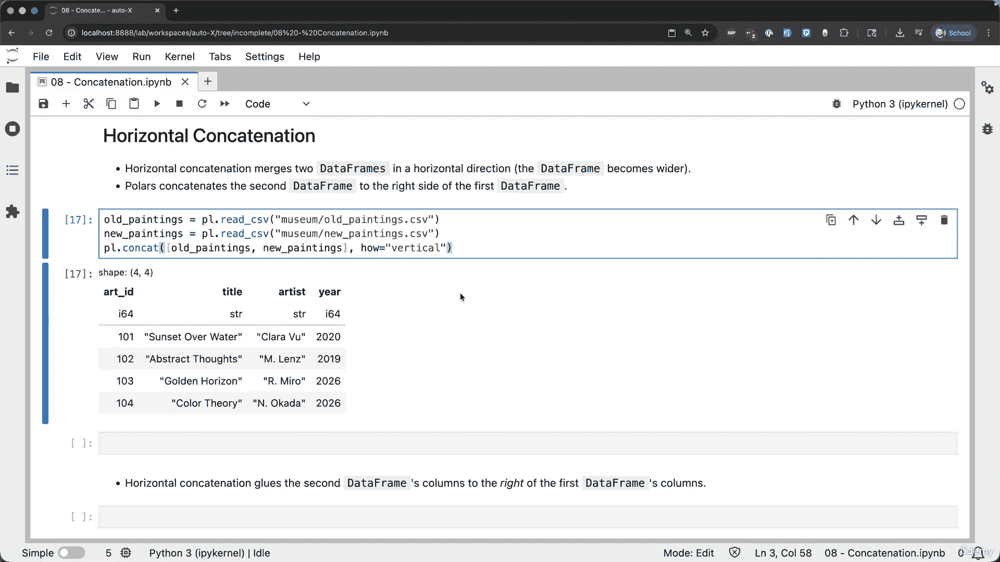

也可以把它理解成下面的式子：`水平拼接结果 = df1 的所有列 + df2 的所有列`，两边的列会按行位置一一对齐。

以下是水平拼接最核心的三个特点，先建立直观印象。

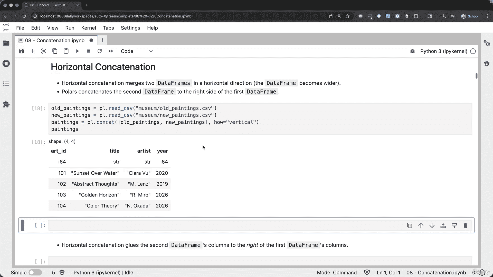

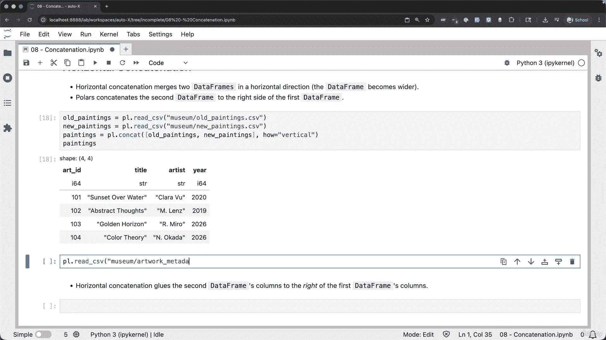

- 水平拼接会把第二个数据框的列追加到第一个数据框的右侧。
- 水平拼接增加的是列，不是行。
- 水平拼接不会让数据框变高，而是会让数据框变宽。

明白这些特点后，下面先把上一节得到的数据框准备好，作为水平拼接的左表。

## 🧱 Polars与Python数据分析：第14节：准备paintings数据框

上一节我们介绍了垂直拼接，本节中我们来看看如何把上一节的结果接到水平拼接流程里。这里使用上一节课末尾的代码。`paintings` 是 `old_paintings` 和 `new_paintings` 垂直拼接后得到的新的四行数据框，我们把这个结果赋值给 `paintings` 变量。

```python
paintings = pl.concat(
    [old_paintings, new_paintings],
    how="vertical",
)
```

把结果赋值给 `paintings` 后，可以在下面预览 `paintings`。这一步只是准备水平拼接的左表，接下来还需要引入第三个数据集，用来提供要粘到右侧的列。

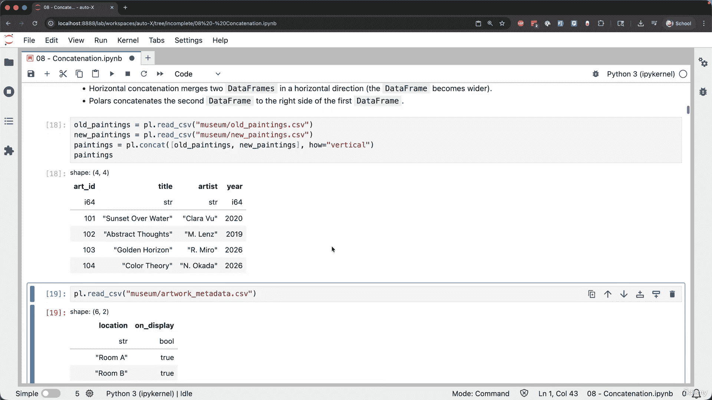

## 📂 Polars与Python数据分析：第14节：读取artwork metadata数据

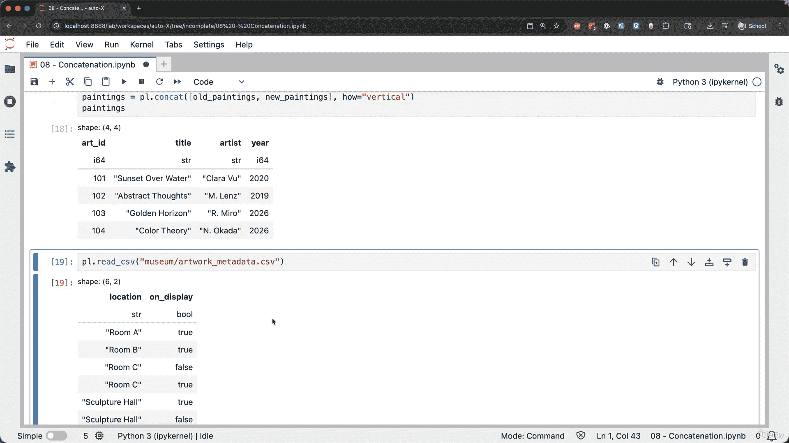

接下来引入第三个数据集，这个数据集也会放在 museum 目录中。下面使用读取 CSV 的函数访问 museum 目录，文件名为 `artworkmetadata.csv`。

```python
artwork_metadata = pl.read_csv("museum/artworkmetadata.csv")
artwork_metadata
```

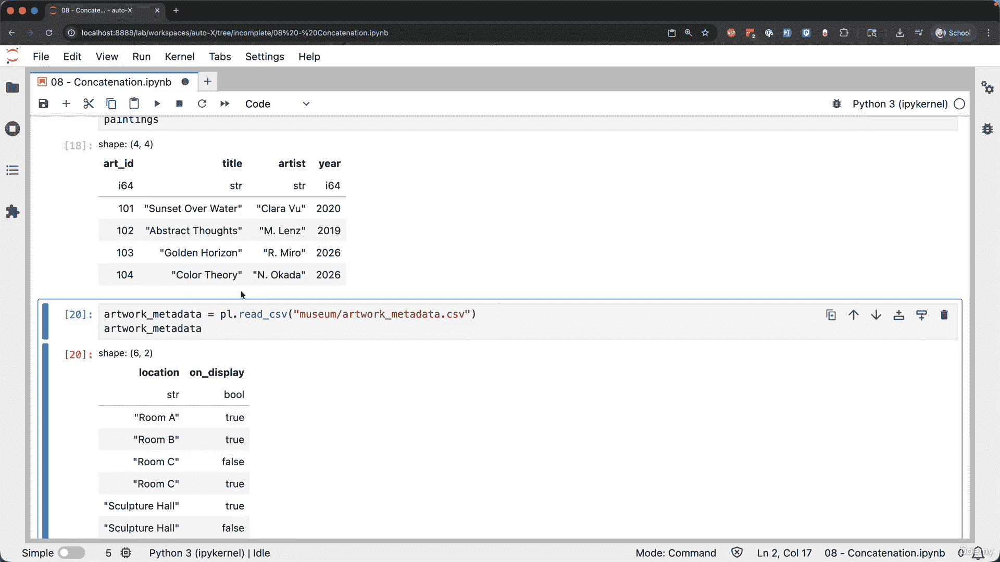

读取后可以看到它的结构。再次假设数据分散在多个数据集里。这个数据集有六行，可以假设前四行对应 `paintings` 中的四幅画。可以看到，这里的列和 `paintings` 的列完全不一样，其中有 `location` 和 `on display` 两列，表示画作所在位置以及博物馆当前是否展出。

假设我们想把这两列粘到 `paintings` 数据框的右侧。需要注意，这个数据集还有额外行，这个注意事项马上讨论。现在先把数据框赋值给 `artwork_metadata` 变量，并在下面预览。

```python
artwork_metadata = pl.read_csv("museum/artworkmetadata.csv")
artwork_metadata
```

有了左表 `paintings` 和右表 `artwork_metadata`，接下来看看水平拼接的语法。

## 🧮 Polars与Python数据分析：第14节：水平拼接语法

水平拼接的语法和垂直拼接一样，仍然使用 Polars 顶层的 `concat` 函数。仍然传入一个列表，列表里放要拼接的数据框，第一个是 `paintings`，第二个是 `artwork_metadata`。关键区别是：我们不想增加行，而是想增加列，所以必须调整 `how` 参数，把它设置为水平拼接。

```python
pl.concat(
    [paintings, artwork_metadata],
    how="horizontal",
)
```

这里的 `how="horizontal"` 就是核心开关。前面提到，`paintings` 有四行，而 `artwork_metadata` 有六行。为了让示例两边相等，可以先对 `artwork_metadata` 调用 `head` 方法，确保它也有四行，这样就能看到最简单的例子。

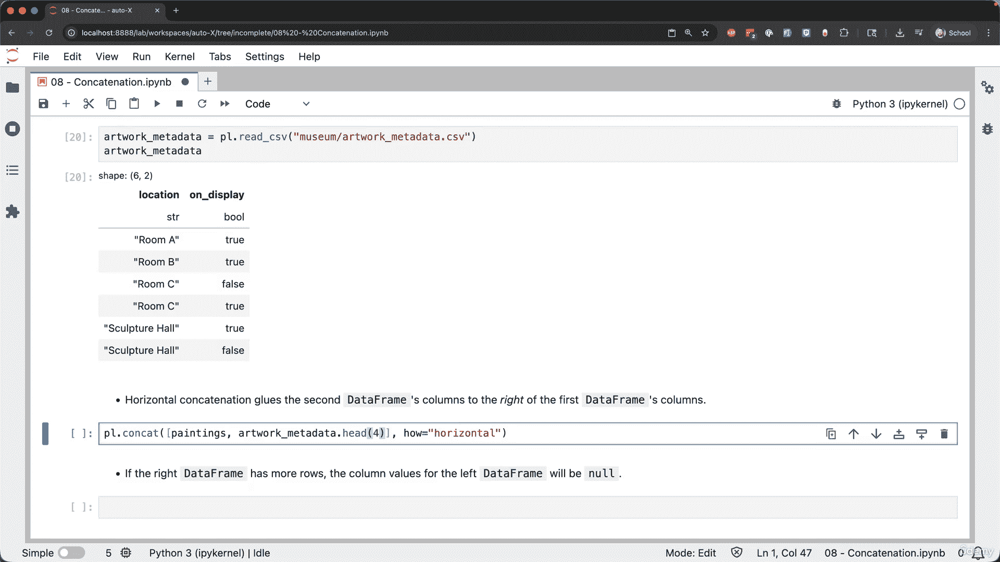

```python
pl.concat(
    [paintings, artwork_metadata.head(4)],
    how="horizontal",
)
```

这样就会把 `artwork_metadata` 中的 `location` 和 `on display` 两列粘到 `paintings` 右侧。语法清楚后，先看行数相等的情况。

## ✅ Polars与Python数据分析：第14节：行数相等的情况

先看最简单的例子：第二个数据框取前四行，两个数据框行数相等。结果就是把 `artwork_metadata` 的两列粘到 `paintings` 的右侧，行与行按位置对应。这就是最直观的水平拼接。

为了把行数匹配和不匹配的几种情况说清楚，可以把它们归纳成下面三类。

- 两个数据框行数相等：直接按行位置把右侧列粘过去。
- 第二个数据框行数更多：左侧数据框没有对应值的位置会补 `null`。
- 第二个数据框行数更少：右侧数据框没有对应值的位置会补 `null`。

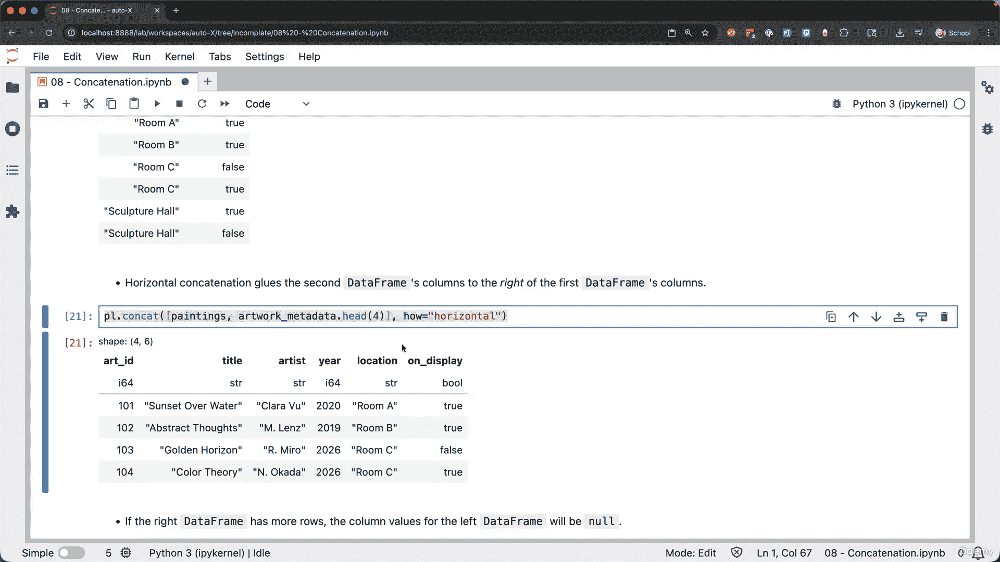

看完相等情况，接下来看第二个数据框行数更多时会怎样。

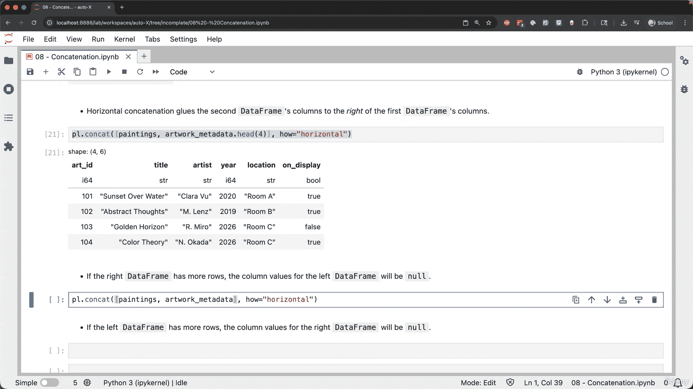

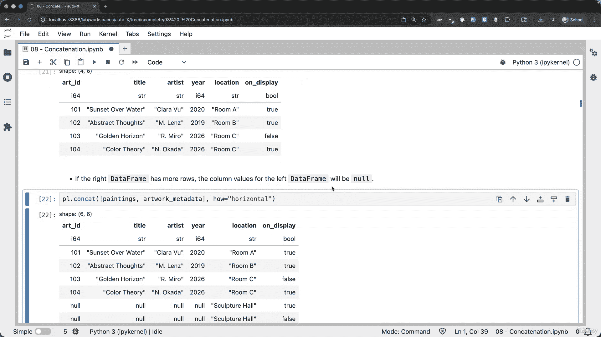

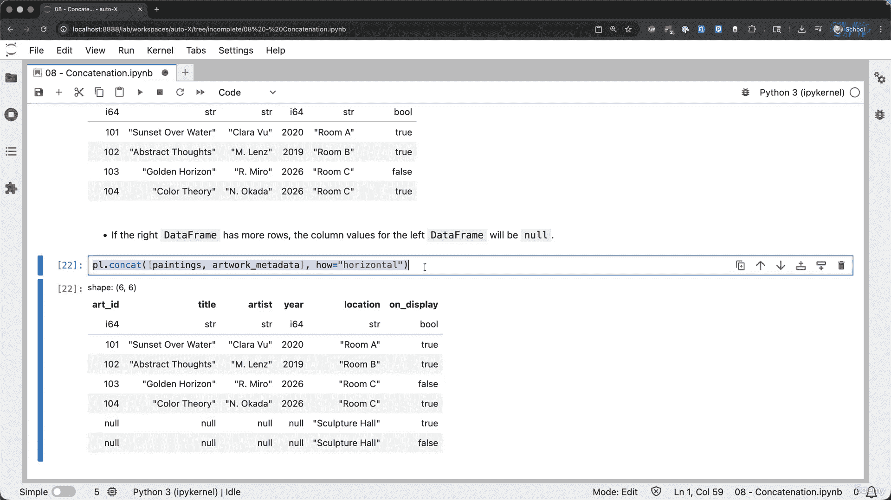

## ➕ Polars与Python数据分析：第14节：右侧数据框行数更多

下面复制完整代码到下面，代码保持完全一样，只去掉 `head` 方法中参数4的调用。现在第二个数据框 `artwork_metadata` 有更多行。会发生什么？它会按预期工作，仍然把 `location` 和 `on display` 两列加到 `paintings` 四列的右侧。但在最后，因为 `artwork_metadata` 有六行，而左侧 `paintings` 没有对应值，这些多出来的行在 `paintings` 前四列上会是 `null`。

```python
pl.concat(
    [paintings, artwork_metadata],
    how="horizontal",
)
```

可以用公式理解：`df1 行数 < df2 行数 -> df1 缺失列位置补 null`。这个情况看完，再反过来看第二个数据框行数更少的情况。

## ➖ Polars与Python数据分析：第14节：右侧数据框行数更少

复制代码到下面，假设第二个数据框，也就是要拼接列的数据框，行数比第一个数据框 `paintings` 少。这里调用 `head` 方法并传入参数2。现在 `paintings` 有四行，`artwork_metadata` 有两行。仍然把 `location` 和 `on display` 两列加到右侧，仍然是水平拼接。但现在 `paintings` 有额外行，所以对于新列 `location` 和 `on display`，Polars 会在没有对应值的位置替换成 `null`。

```python
pl.concat(
    [paintings, artwork_metadata.head(2)],
    how="horizontal",
)
```

这很直观：`df1 行数 > df2 行数 -> df2 缺失列位置补 null`。可以总结为：如果拼接结果因为行数或列数不匹配而缺少数据，Polars 会用 `null` 填充缺失数据。到这里，水平拼接就是把第二个数据框的列粘到第一个数据框右侧。

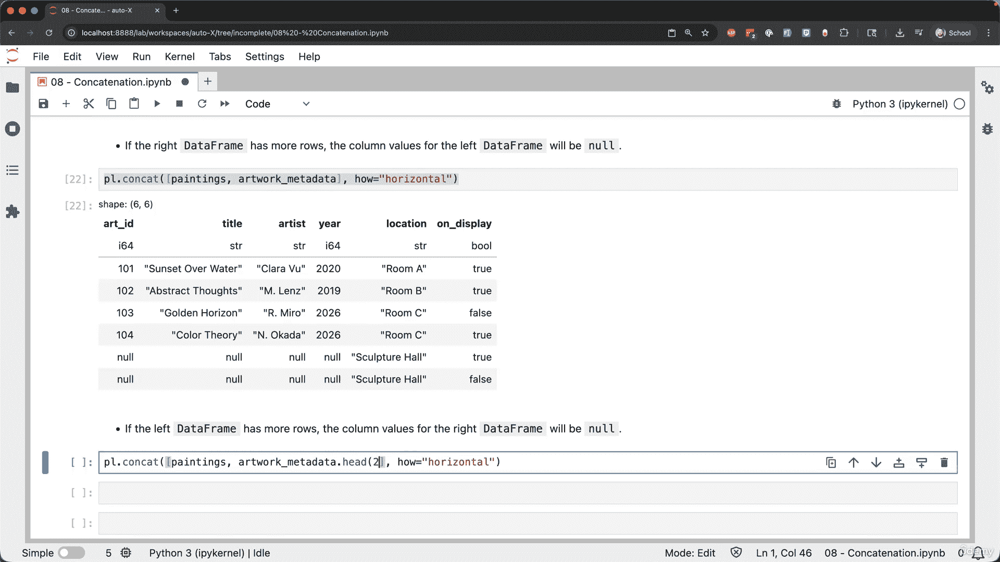

## 🧾 Polars与Python数据分析：第14节：课程总结

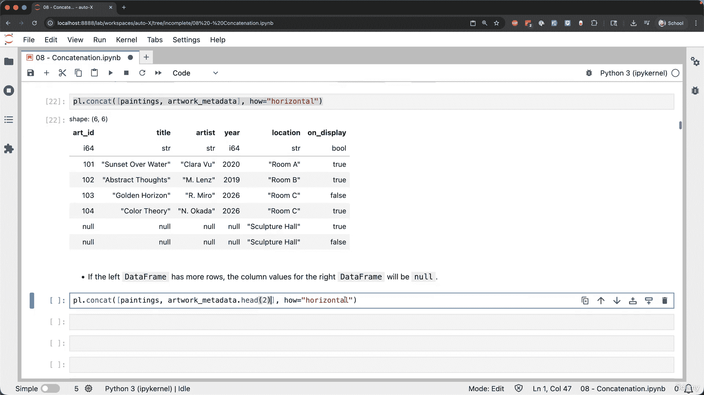

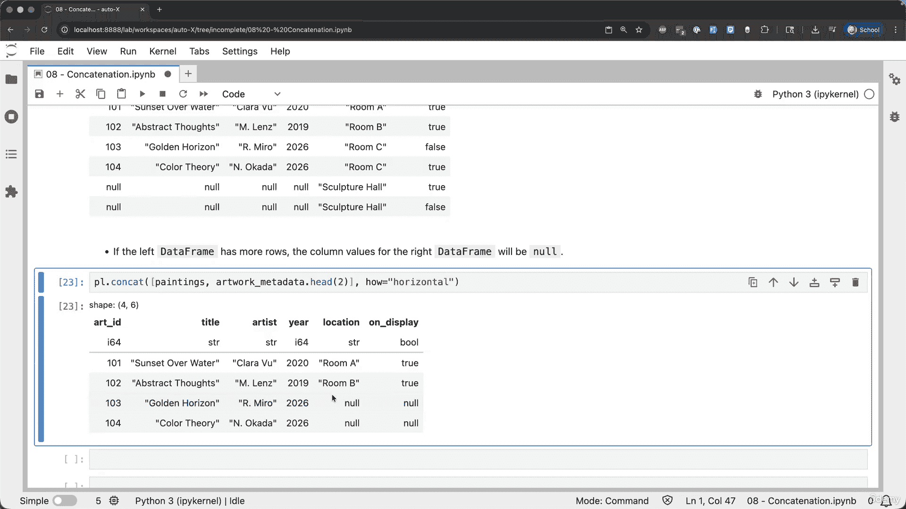

本节课中我们一起学习了水平拼接。水平拼接使用 `pl.concat([...], how="horizontal")`，它增加的是列而不是行，会让数据框变宽而不是变高。两个数据框行数相等时，列会按行位置一一对齐；第二个数据框行数更多时，左侧缺失的位置补 `null`；第二个数据框行数更少时，右侧新增列缺失的位置补 `null`。只要记住 `how="horizontal"` 这个关键参数，以及行数不匹配时 Polars 会用 `null` 填充缺失数据，就能看懂水平拼接的基本行为。
