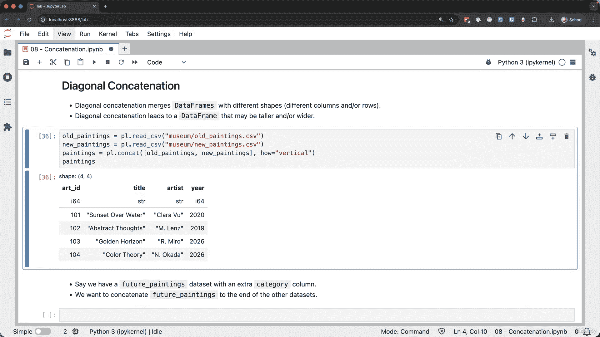
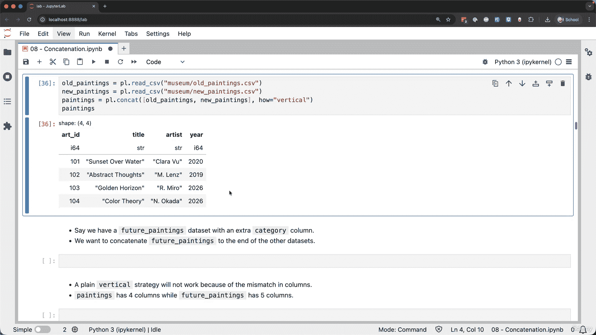
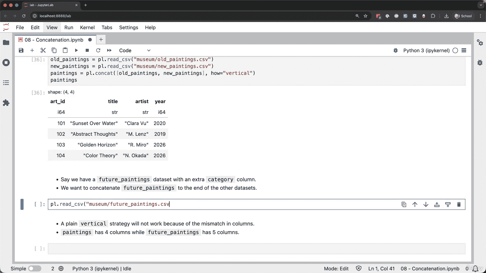
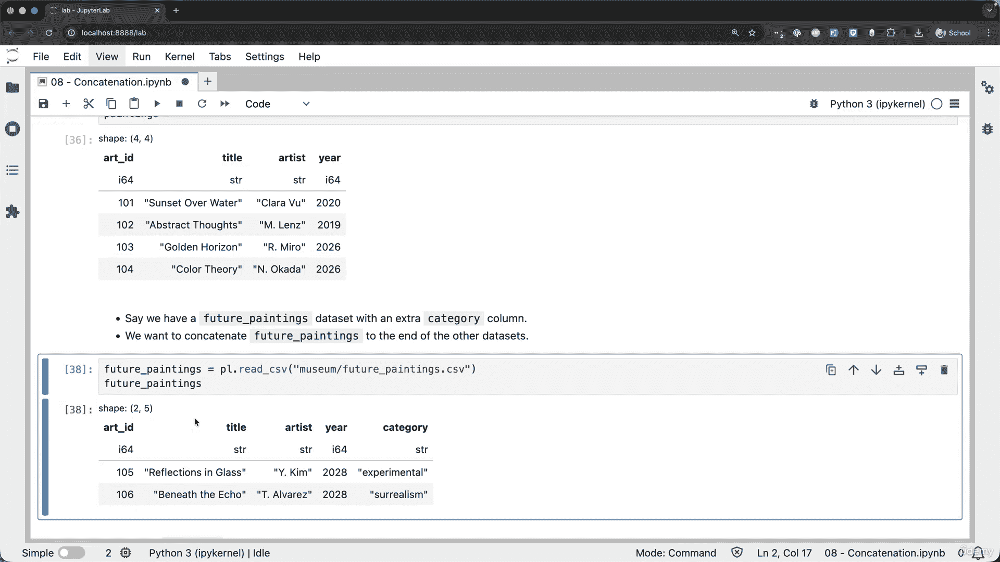
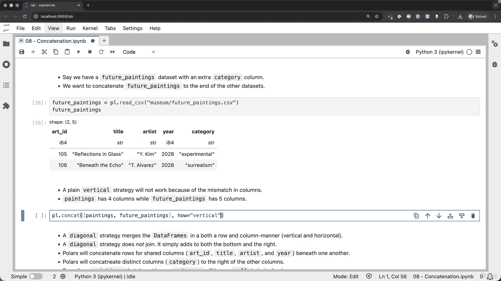
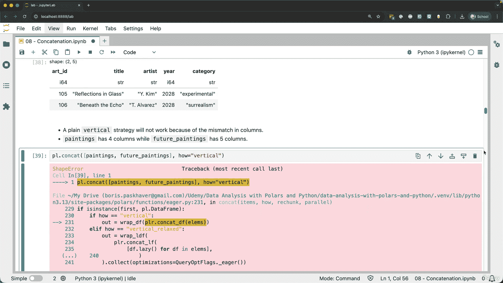
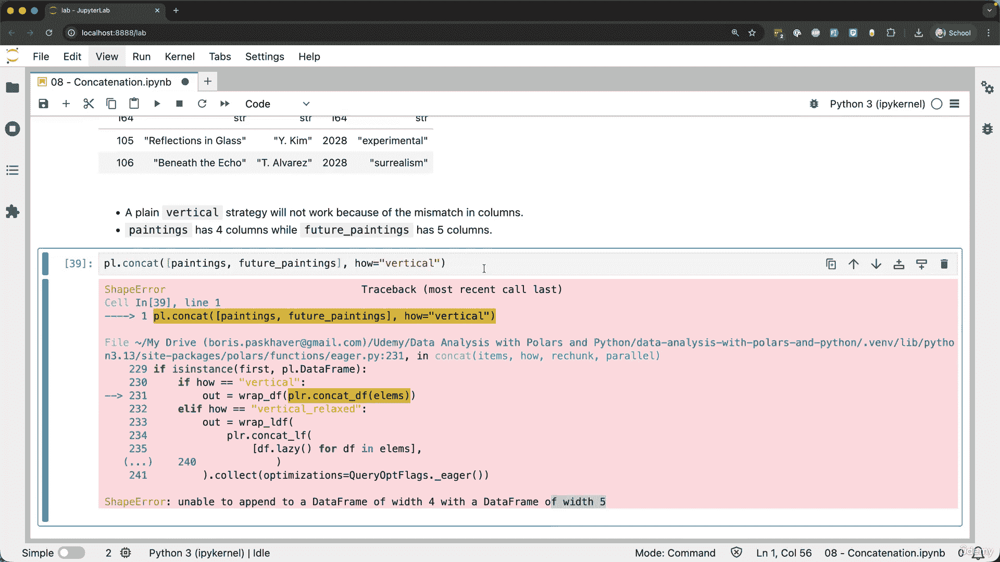
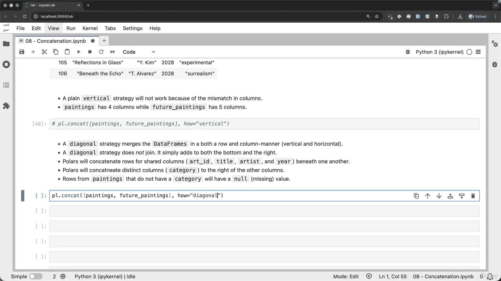
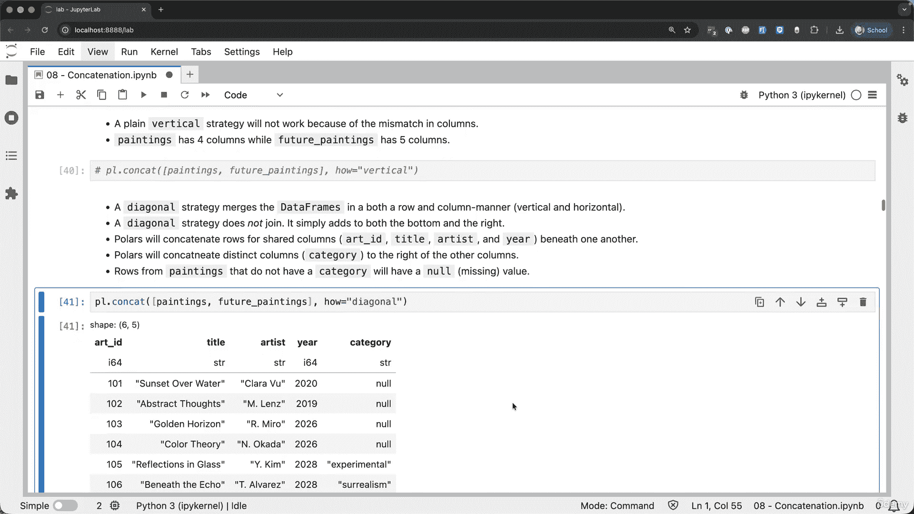
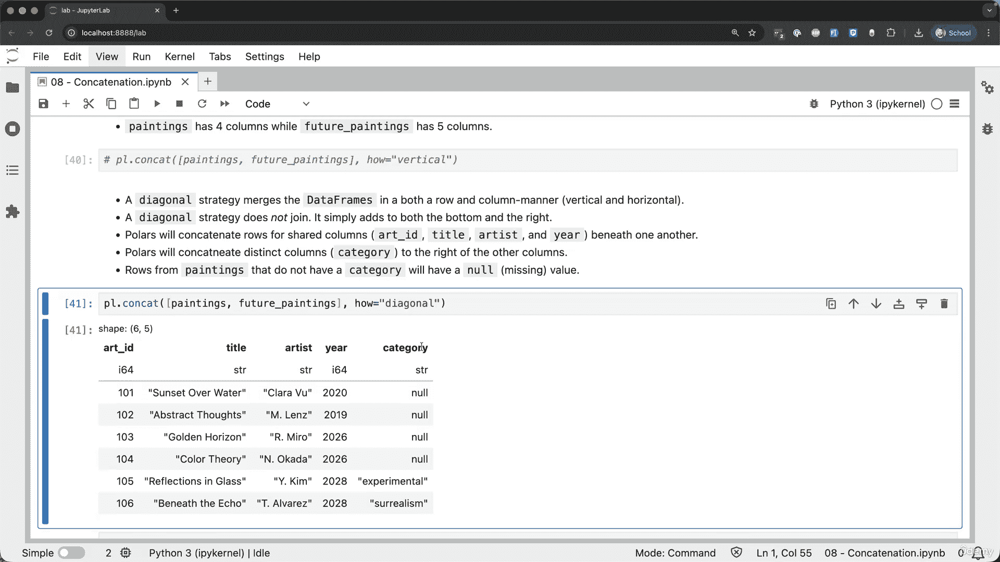

# 📊 Polars 与 Python 数据分析：第15节：对角拼接

## 🧭 Polars 与 Python 数据分析：第15节：本节概述

在本节课中我们将要学习 Polars 中的对角拼接。接下来要介绍的拼接选项是对角拼接。对角拼接在两个数据框形状不完全一致时很有帮助，例如一个数据框可能比另一个数据框多出一些列。下面我们从示例出发，观察对角拼接的使用方式和结果。





## 🖼️ Polars 与 Python 数据分析：第15节：示例背景

上一节我们使用了 paintings 数据框，本节中我们来看看一个新的场景。假设博物馆拿到一批新画作用于展出，这些画作列在另一个名为 future_paintings 的数据集中。为了把数据读进来，我们使用 read_csv 函数，在 museum 目录中读取 future_paintings.csv 文件。读取后查看数据可以发现，该数据集有四个与 paintings 一致的列：art ID、title、artist 和 year，同时还多出一个 category 列，而这个 category 列在 paintings 数据框中并不存在。我们把读入的数据框赋给新变量 future_paintings，并输出查看。



```python
future_paintings = pl.read_csv("museum/future_paintings.csv")

future_paintings
```

## ⚠️ Polars 与 Python 数据分析：第15节：垂直拼接失败



上面已经看到两个数据框列数不同，本节中我们来看看直接做普通垂直拼接会怎样。普通垂直拼接是把一个数据框的行追加到另一个数据框末尾。由于列不匹配，这种操作无法完成：paintings 有4列，future_paintings 有5列。下面用 concat 函数演示，列表里包含 paintings 和 future_paintings；how 参数默认是 vertical，这里显式写出 vertical 以展示问题。执行后会得到错误或异常，可以看到 shape error，表示两个数据框维度不匹配。Polars 提示 unable to append to a data frame of width four，意思是无法把数据追加到宽度为4列的数据框，也不能把它与宽度为5列的数据框组合。因此垂直拼接在这里不可行。

```python
pl.concat([paintings, future_paintings], how="vertical")
```

## 🔄 Polars 与 Python 数据分析：第15节：对角拼接策略





上一节我们看到垂直拼接因为列数不一致而失败，本节中我们来看看对角拼接。复制上面的代码并粘贴后，把 how 参数改成 diagonal，就得到对角拼接策略。对角拼接会同时按行方向和列方向合并数据框。可以把它理解为垂直拼接与水平拼接的组合：垂直是因为会在底部增加更多行，水平是因为会在右侧增加更多列。需要注意，这不是课程上一节介绍的 join，我们只是向底部和右侧添加内容。下面查看结果。



```python
pl.concat([paintings, future_paintings], how="diagonal")
```

核心关系可以写成：

```text
diagonal_concat = vertical_concat(shared_columns) + horizontal_concat(extra_columns)
```



## 🔍 Polars 与 Python 数据分析：第15节：结果解读

下面我们解读对角拼接的结果。对于 paintings 和 future_paintings 共享的四列，也就是 ID、title、artist 和 year，future_paintings 的两行会被追加到最底部对应的四列中。对于只存在于 future_paintings 而不存在于 paintings 的 category 列，该列会被拼接到右侧，也就是做水平拼接，因此第5行和第6行有 category 条目。由于 paintings 的行没有对应的 category 值，这些行在 category 列中会存储 null 值，也就是空值。结果是：末尾仍然添加了两行，很像垂直拼接；右侧又添加了 category 列，属于水平拼接。对角拼接就是这两者的组合，缺失的列值用 null 补齐。为了便于初学者记忆，可以写成：

```text
共享列：按行追加
额外列：按列追加
缺失值：补 null
```

## ✅ Polars 与 Python 数据分析：第15节：本节总结





本节课中我们一起学习了对角拼接。我们了解了它在两个数据框形状不一致时很有用，示例中 future_paintings 比 paintings 多出 category 列；普通垂直拼接会因为列数不同而失败；使用 `how="diagonal"` 可以同时按行和按列合并；共享列在底部追加行，额外列在右侧追加列，缺失值补 null；并且对角拼接不是 join，只是添加内容。掌握这些要点后，初学者可以把它记成“行也加、列也加，缺的补 null”。

