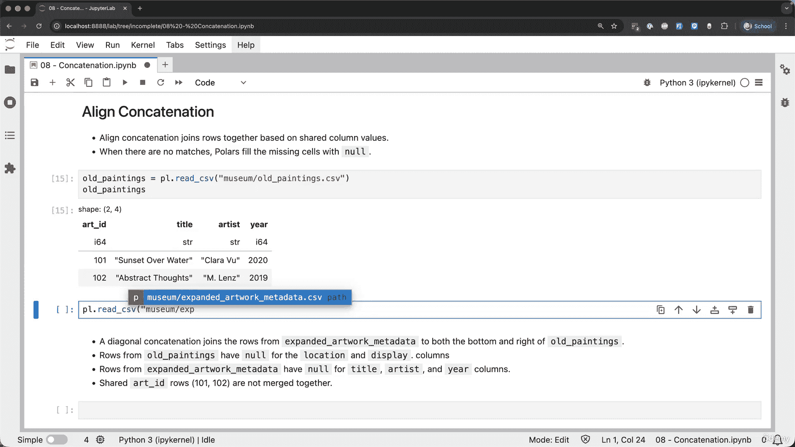

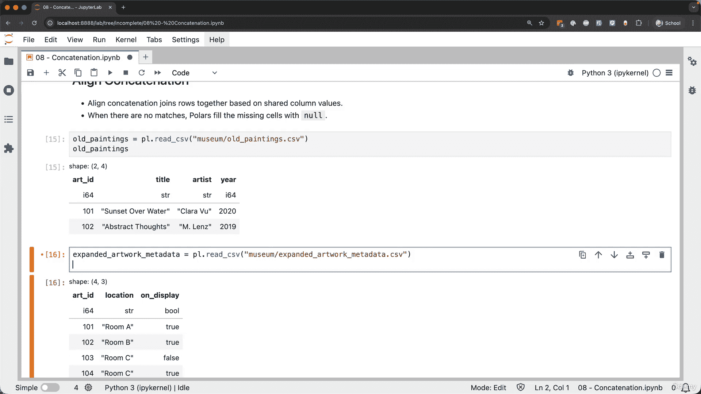

# 📊 Data Analysis with Polars and Python：116：对齐拼接（Align Concatenation）


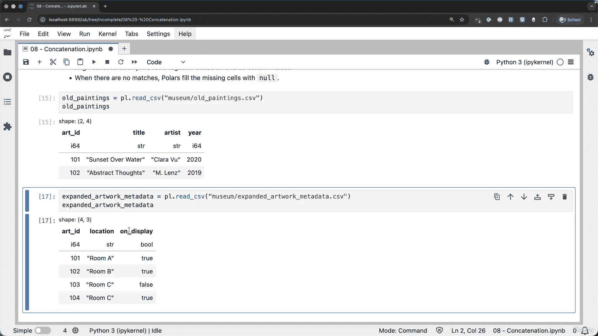

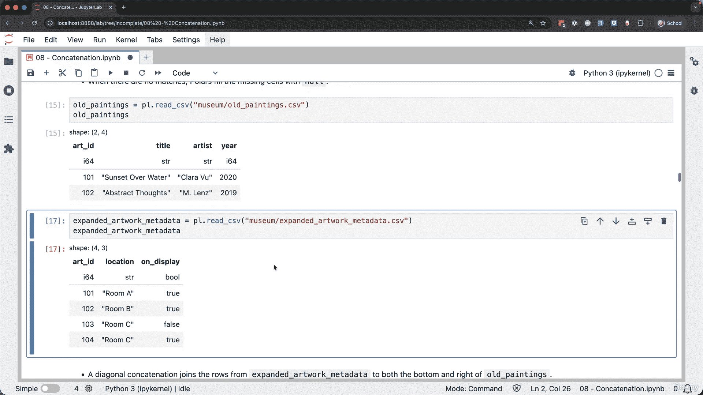

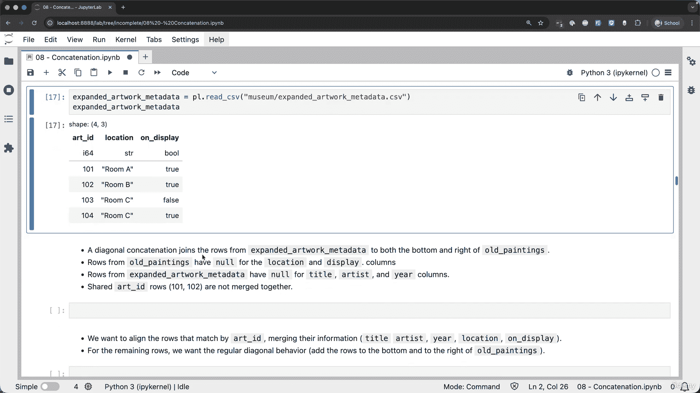

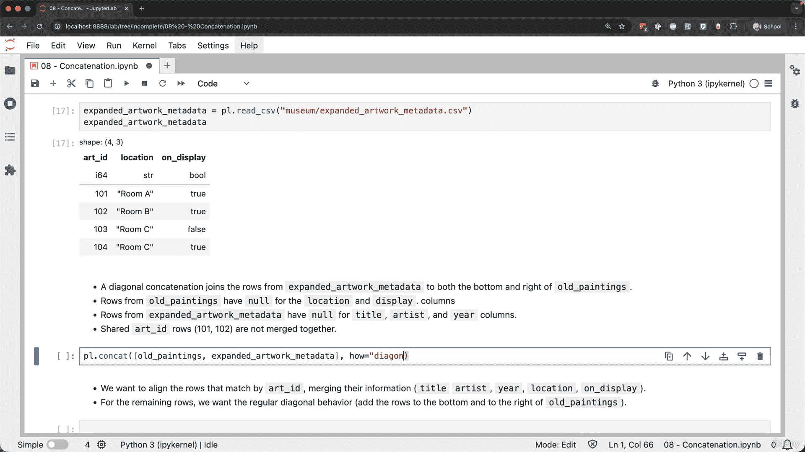

在本节课中我们将要学习 Polars 中一种很特别的拼接方式，叫作对对齐拼接。它会让人感觉既像拼接，又像连接，因为它在某些情况下会把两个数据框中匹配的行合并到一起。上一节我们介绍了普通拼接和对角拼接的基本用法，本节中我们来看看对齐拼接到底如何工作，以及它和对角拼接有什么区别。理解这个区别很重要，因为初学者很容易把“把数据粘在一起”和“把匹配的数据合并在一起”混为一谈。

  
## 🧭 概述：对齐拼接为什么值得单独讲


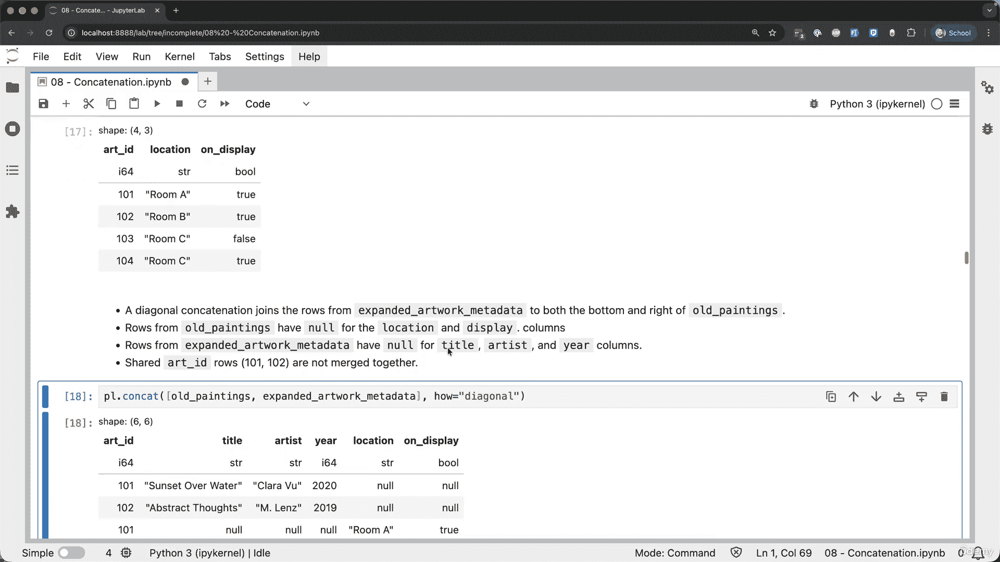

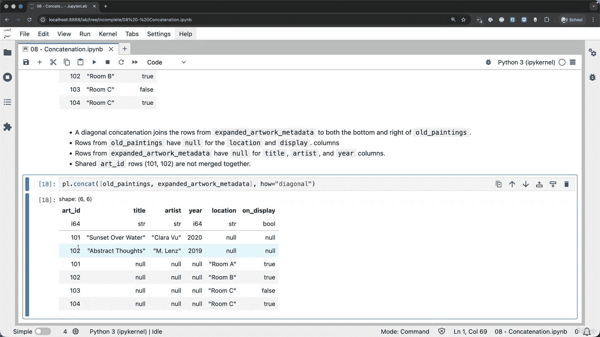

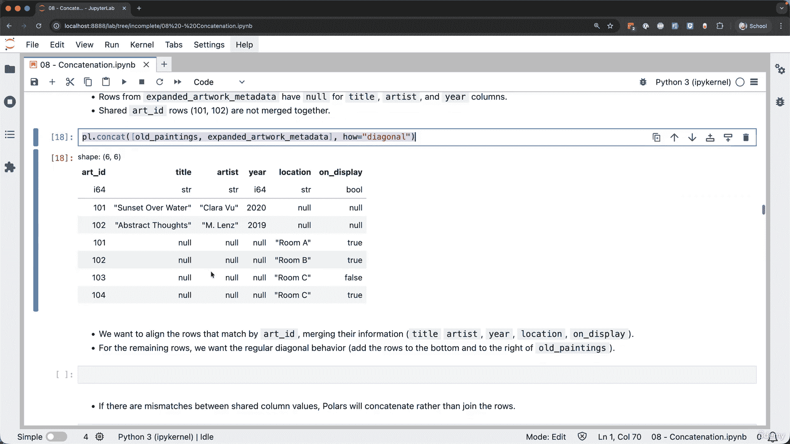

对齐拼接的第一印象是“它还是拼接”，因为当两个数据框没有完全匹配的共享列值时，它仍然会把行或列加到结果里。它和对角拼接相似的地方在于，它也可能同时增加行和列。它和连接相似的地方在于，只要共享列的值完全匹配，它就可能把对应的行合并起来，而不是简单地把两行堆在一起。接下来我们先从加载数据开始，一步一步观察它的行为。

  
## 📥 加载数据并观察共享列


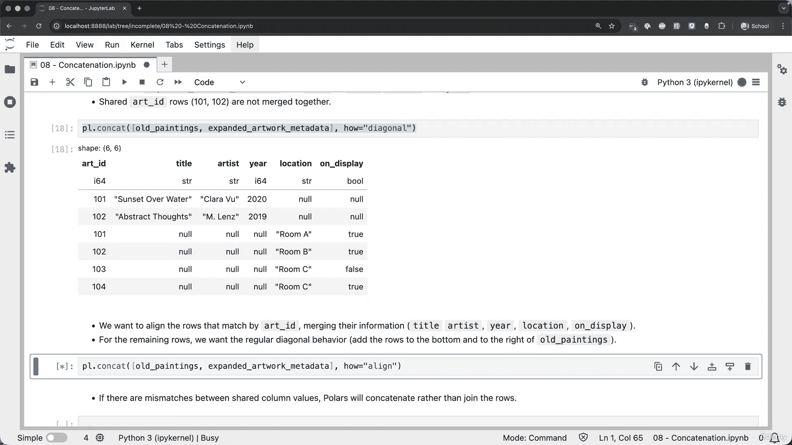

在上一节中我们已经接触过拼接函数，本节中我们先把两个数据框读进来。首先执行代码加载 `old_paintings` 数据框，并注意这个数据集一共有四列。然后加载下一个数据集，这个数据集同样位于 museum 目录中，文件名比较长，叫 `expanded_artwork_metadata.csv`。我们把这个文件导入后赋值给一个变量，变量名可以叫 `expanded_artwork_metadata`，这样后面写代码时更容易看懂。

  
下面是加载数据并查看列结构的示例代码，先建立直观印象。

  
```python
import polars as pl

old_paintings = pl.read_csv("museum/old_paintings.csv")
expanded_artwork_metadata = pl.read_csv("museum/expanded_artwork_metadata.csv")

print(old_paintings.columns)
print(expanded_artwork_metadata.columns)
```

  
在继续之前，我们需要特别注意两个数据框之间有哪些共同列。可以看到，唯一共享的列是 `art_id`，其他列都不一样。`old_paintings` 有 `title`、`artist` 和 `year` 三列，而 `expanded_artwork_metadata` 没有这三列；`expanded_artwork_metadata` 有 `location` 和 `on_display` 两列，而 `old_paintings` 没有这两列。这个列结构非常关键，因为对齐拼接能不能发生，取决于共享列的值是否完全匹配。

  
下面用列表说明两个数据集的共同列和不同列，方便后面观察拼接结果。

  
- 两个数据框共同拥有的列只有 `art_id`。
- `old_paintings` 独有 `title`、`artist`、`year`。
- `expanded_artwork_metadata` 独有 `location`、`on_display`。
- 其他列互不共享，因此后面判断是否合并行时，当前例子只会围绕 `art_id` 来比较。

  
看清列结构后，我们进入第一个实验：先用对角拼接看看会发生什么。这个实验可以帮助我们理解为什么默认的对角拼接不会自动合并重复的 `art_id`。

  
## 🔗 先看对角拼接的结果


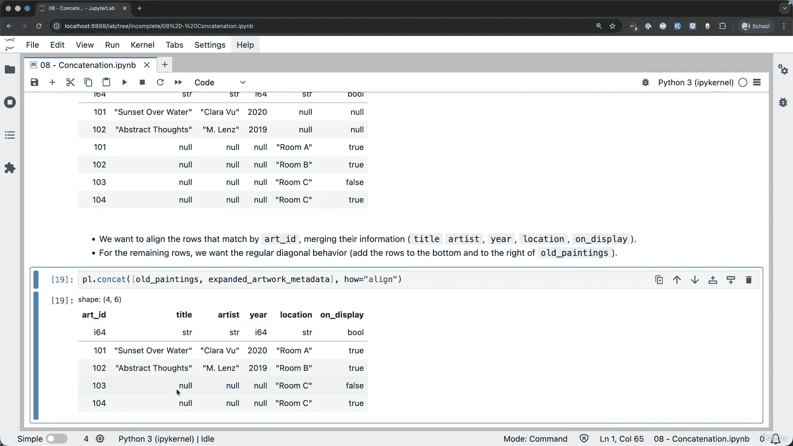

上一节我们介绍过对角拼接，本节中我们先复制类似写法，观察它的默认行为。使用 Polars 顶层的 `pl.concat` 函数，传入一个列表，列表里放 `old_paintings` 和 `expanded_artwork_metadata`，并把拼接类型指定为 `diagonal`。对角拼接的特点是按需要增加行和列，因此它会尽量把两个数据框拼在一起。

  
下面是对角拼接的代码示例。

  
```python
diagonal_result = pl.concat(
    [old_paintings, expanded_artwork_metadata],
    how="diagonal"
)

print(diagonal_result)
```

  
执行后会得到一个很有意思的结果：`expanded_artwork_metadata` 的四行会被直接粘到 `old_paintings` 的末尾。因为 `expanded_artwork_metadata` 没有 `title`、`artist`、`year` 这三列，所以这些位置会出现大量空值。反过来，`old_paintings` 没有 `location` 和 `on_display` 两列，所以对角拼接会把这两列加到右侧，这部分可以理解为水平拼接的部分。`expanded_artwork_metadata` 的行值会出现在这些新列中，而 `old_paintings` 的两行因为没有这些列，Polars 也会在这里补上空值。

  
这里最关键的观察点是 `art_id` 出现了重复值：一幅画是 101，另一行也是 101，本质上它们说的是同一幅画。我们当然希望把 `location` 里的 `room A` 和 `on_display` 里的 `true` 放到 101 这一行上，把 102 的数据也合并起来，然后对其余来自 `expanded_artwork_metadata` 的行继续完成垂直和水平方向的拼接。但是默认的对角拼接不会跟踪两个数据框之间哪些值是共享的，它只是把行和列粘到 `old_paintings` 的下方和右侧。

  
下面列出对角拼接在这个例子中的关键现象，帮助我们把问题看清楚。

  
- `expanded_artwork_metadata` 的四行被追加到 `old_paintings` 末尾。
- `expanded_artwork_metadata` 缺少 `title`、`artist`、`year`，所以这些列出现空值。
- `old_paintings` 缺少 `location`、`on_display`，所以这两列被加到右侧，旧数据对应位置为空值。
- `art_id` 为 101 和 102 的行出现重复，但没有被合并。
- 对角拼接只负责把行和列粘起来，不负责识别“这是同一幅画”。

  
看到这里，我们就明白对角拼接的局限了。接下来把同样的代码改成对齐拼接，看看 Polars 如何把匹配的行优雅地合并起来。

  
## 🧩 对齐拼接如何合并匹配行


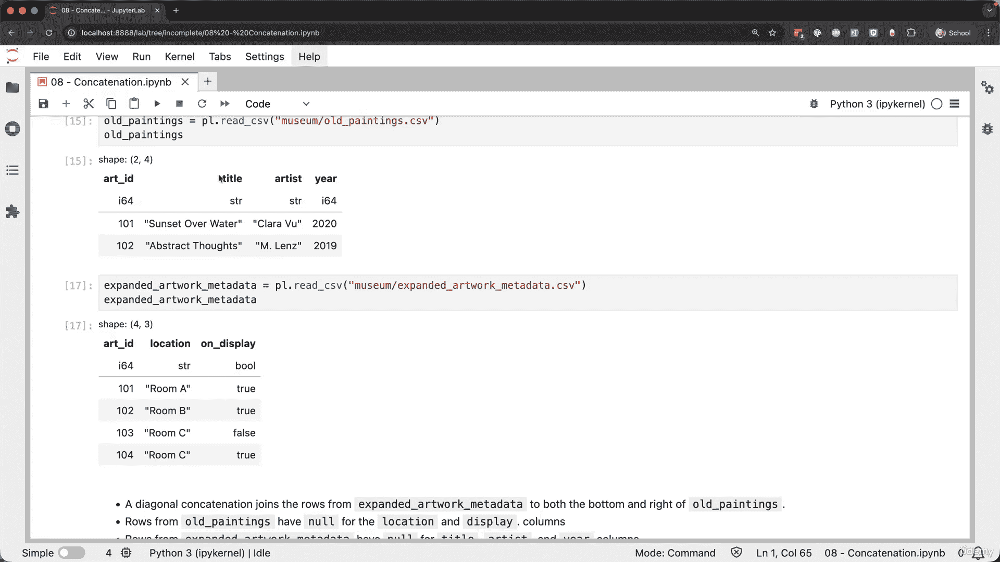

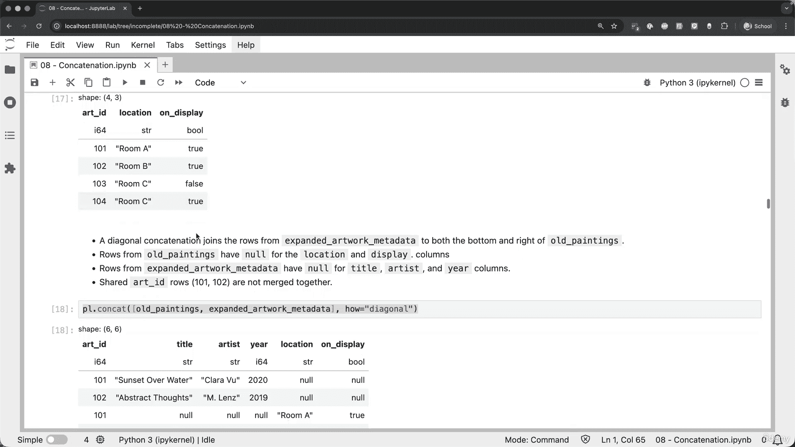

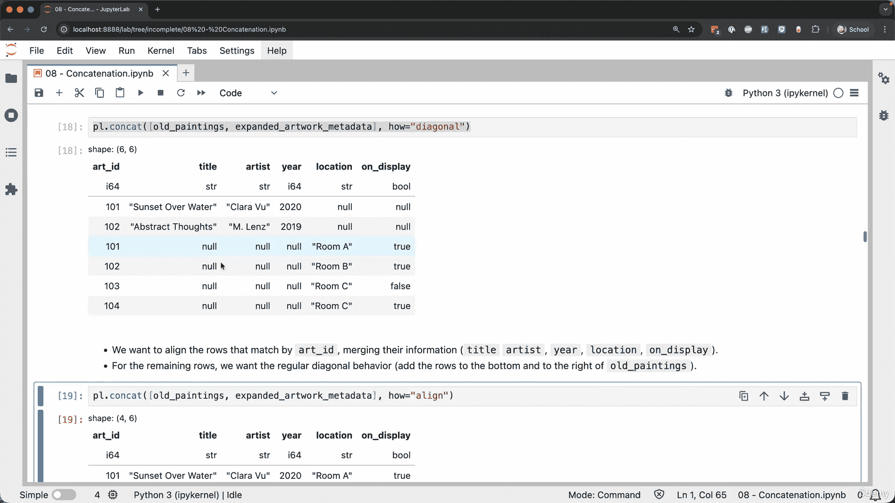

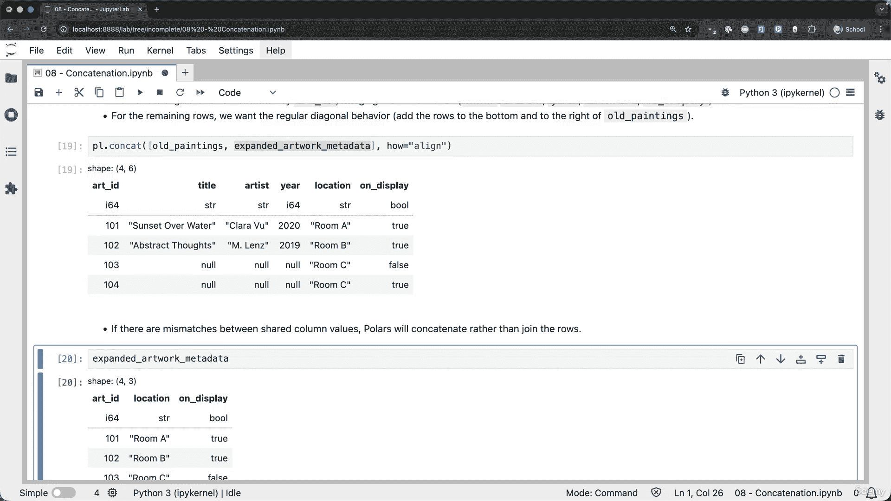

上一节我们看到对角拼接会产生重复的 `art_id`，本节中我们把拼接类型改成对齐拼接。复制上面的代码，把 `how` 参数改为 `align`。对齐拼接会表现得有点像连接，也有点像拼接，因此需要仔细观察结果。

  
下面是对齐拼接的代码示例。

  
```python
aligned_result = pl.concat(
    [old_paintings, expanded_artwork_metadata],
    how="align"
)

print(aligned_result)
```

  
执行后可以看到，Polars 会识别出 `art_id` 为 101 和 102 的行在两个数据框中都有匹配值。对于这些匹配行，Polars 会把 `old_paintings` 中的两行和 `expanded_artwork_metadata` 中的两行合并起来，把两边的信息组合在同一行里。`title`、`artist`、`year` 来自 `old_paintings`，`location` 和 `on_display` 来自 `expanded_artwork_metadata`，而 `art_id` 因为是共享值，所以不会重复显示。对于 `art_id` 为 103 和 104 的行，它们在 `old_paintings` 中没有对应匹配，因此这些行会出现大量空值。

  
下面用列表总结对齐拼接在这个例子中的表现。

  
- `art_id` 为 101 和 102 的行被合并，两个数据框的信息出现在同一行。
- `title`、`artist`、`year` 从 `old_paintings` 带入。
- `location`、`on_display` 从 `expanded_artwork_metadata` 带入。
- `art_id` 是共享列，匹配后不重复显示。
- `art_id` 为 103 和 104 的行没有互补匹配，因此相关列为空值。

  
对齐拼接的结果看起来很像连接，这就引出一个问题：Polars 是怎么知道该按哪些列来匹配的？下一节我们就来解释这个匹配规则。

  
## 📐 对齐拼接的匹配规则


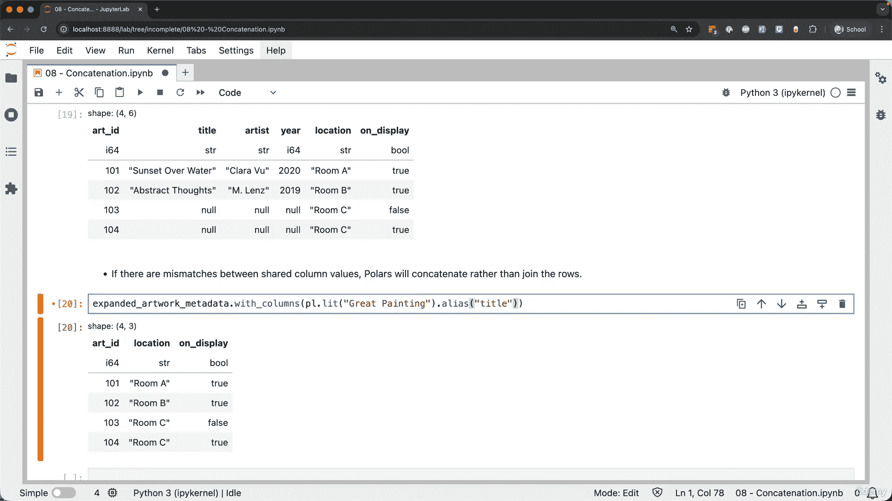

上一节我们看到对齐拼接会自动合并匹配行，本节中我们来看看它是如何决定“按什么列连接”的。平时手动调用连接方法时，我们通常会提供 `on`、`left_on` 或 `right_on` 这样的参数，明确指定用哪些列的值来连接。对齐拼接不需要我们手动指定这些参数，它会自动找出两个数据框之间的共享列，然后要求这些共享列在两边具有完全相同的值，才会合并对应的行。

  
可以用一个简单公式描述这个规则：设共享列集合为 \(S\)，只有当两个数据框在 \(S\) 中每一列的值都完全相等时，对应行才会被连接；否则就退化为普通拼接。用公式表示就是：对 \(S\) 中所有列 \(c\)，必须满足 \(df_1[c] = df_2[c]\)，才会执行行合并。当前例子中，共享列集合只有 `art_id`，所以 Polars 只用 `art_id` 来比较值。其他列不共享，因此不会参与当前例子的匹配判断。如果两个数据框有多个同名列，那么 Polars 会检查所有这些共享列，只有所有共享列的值都匹配，才会合并行；只要有一个共享列的值不匹配，Polars 就不会合并，而是直接拼接。

  
下面列出对齐拼接匹配规则的要点，便于初学者记住。

  
- 对齐拼接会自动寻找两个数据框的共享列。
- 所有共享列的值都必须完全一致，才会合并对应行。
- 当前例子中共享列只有 `art_id`，所以只按 `art_id` 比较。
- 如果有多个共享列，则要求每个共享列的值都匹配。
- 只要有一个共享列不匹配，就会退化为普通拼接。

  
理解规则之后，我们需要看一个不匹配的场景。下面构造一个共享列存在但不完全匹配的例子，观察对齐拼接如何退化成普通拼接。

  
## ⚠️ 当共享列不匹配时会发生什么


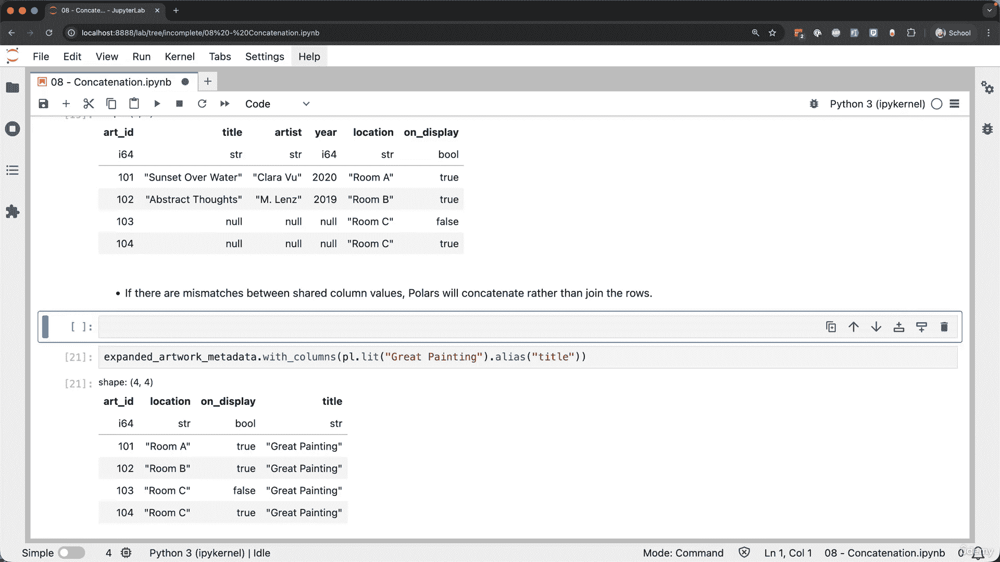

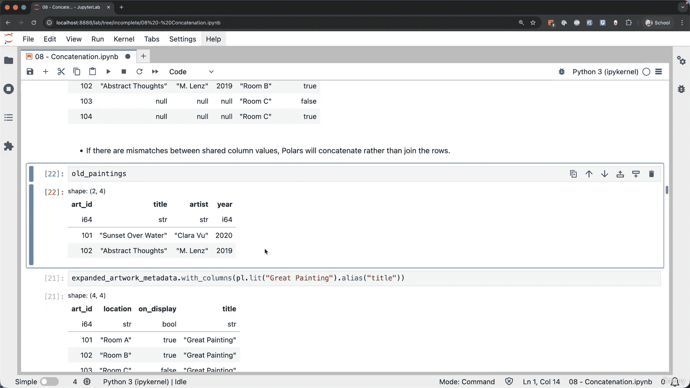

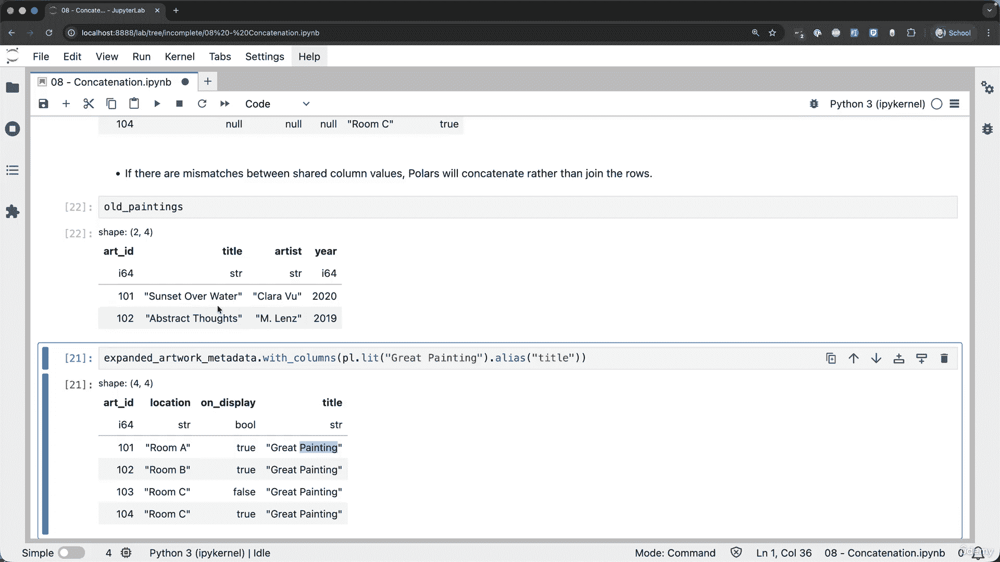

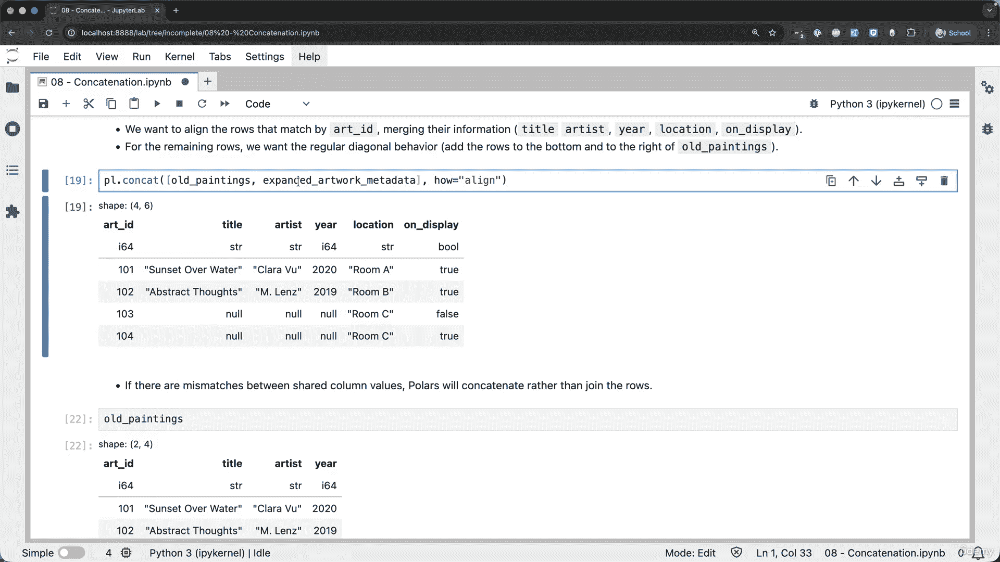

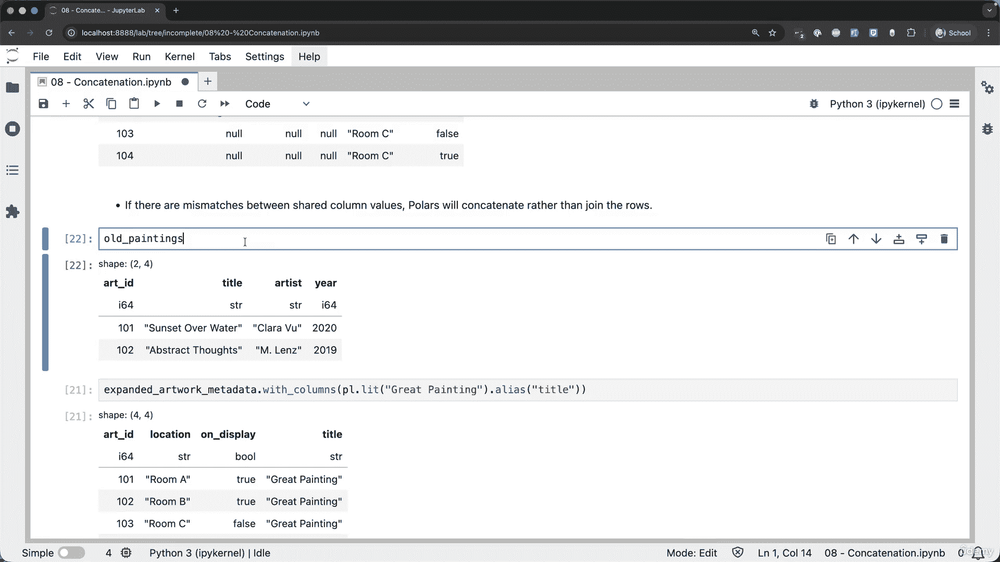

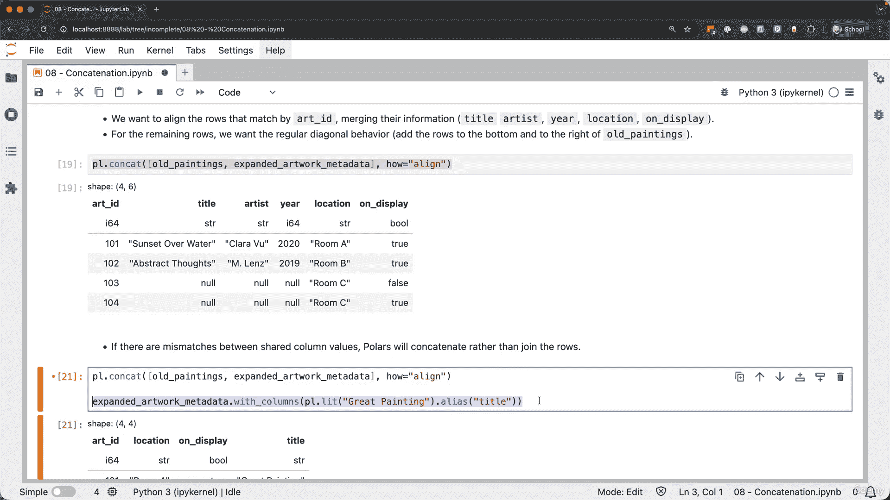

上一节说明了匹配规则，本节中我们构造一个会出现不匹配的场景。还是使用 `expanded_artwork_metadata`，但先对它做一点扩展：使用 `with_columns` 方法增加一列，并用 `pl.lit` 添加一个固定值。这个固定值可以叫 `great painting`，然后非常重要的一步是用 `alias` 方法把这一列命名为 `title`。这样 `expanded_artwork_metadata` 现在有四个列，并且和 `old_paintings` 共享两列：`art_id` 和 `title`。

  
下面是构造不匹配场景的代码示例。

  
```python
expanded_artwork_metadata_2 = expanded_artwork_metadata.with_columns(
    pl.lit("great painting").alias("title")
)

print(expanded_artwork_metadata_2)
```

  
现在问题来了：两个数据框共享 `art_id` 和 `title`，但它们不再在所有共享列上完全匹配。比如这里 `art_id` 是 101，那边 `art_id` 也是 101，但共享的 `title` 值不一致。`old_paintings` 中的标题是 `sunset over water`，而 `expanded_artwork_metadata_2` 中的标题是 `great painting`。因为共享列中存在不匹配，Polars 不会把这一行与另一行连接，而是直接执行拼接。前面那个例子能成功合并，是因为当时 `art_id` 是唯一共享列，并且其中的 101 和 102 在两个数据框中完全匹配，所以 Polars 能够合并它们。现在 `title` 这个共享列出现了不匹配，因此结果会变成普通拼接。

  
下面把前面的对齐拼接代码复制下来，只把第二个数据框替换成刚生成的 `expanded_artwork_metadata_2`，然后执行。

  
```python
aligned_result_2 = pl.concat(
    [old_paintings, expanded_artwork_metadata_2],
    how="align"
)

print(aligned_result_2)
```

  
执行后不再合并 `art_id` 为 101 和 102 的行，因为 `title` 列不匹配，所以这些行会被简单地逐行拼接在一起。来自 `expanded_artwork_metadata_2` 的行会显示 `great painting`，但因为 `old_paintings` 中没有匹配行，所以 `artist` 和 `year` 没有值可以带入，这里会补空值。反过来，来自 `old_paintings` 的值也没有办法从 `expanded_artwork_metadata_2` 中拉取 `location` 和 `on_display`，因为那个数据框中没有匹配行，所以这里同样会补空值。

  
下面梳理这个不匹配场景的关键结果，帮助初学者把逻辑串起来。

  
- 共享列从只有 `art_id` 变成了 `art_id` 和 `title` 两列。
- 101 和 101 虽然 `art_id` 相同，但 `title` 不同。
- 因为共享列没有全部匹配，所以 Polars 不合并行，而是普通拼接。
- 结果中 `great painting` 来自扩展后的数据框。
- `artist`、`year` 没有匹配来源，因此补空值。
- `location`、`on_display` 没有匹配来源，因此也补空值。

  
最开始 `old_paintings` 有两行，`expanded_artwork_metadata` 有四行，这个不匹配场景最后得到六行，正好是两个数据框行数之和。原因是没有机会基于共享列值来连接或对齐行，所以只能一行接一行地拼起来。由此可以理解，对齐拼接可以看成一种“有条件连接”的拼接：当所有共享列的值都完全匹配时，它才执行连接；只要共享列没有完美匹配，即使部分列匹配、其他列不匹配，Polars 也不会合并行，而是直接逐行拼接。这就是对齐拼接的核心行为。

  
## ✅ 总结


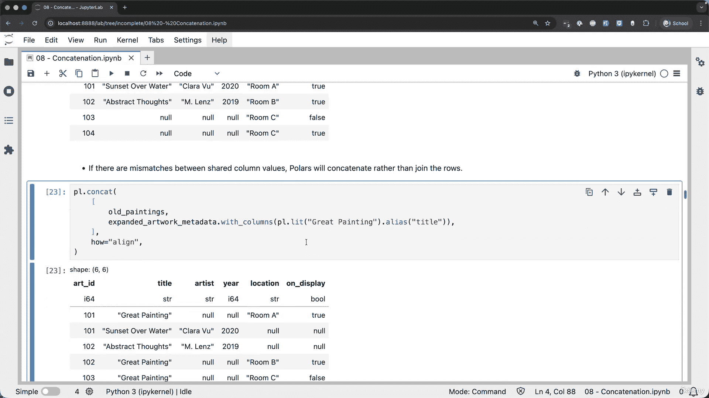

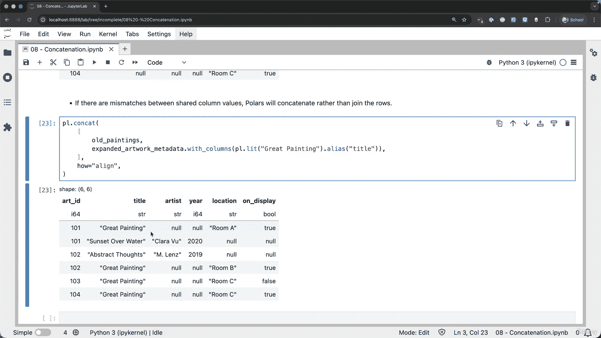

本节课中我们一起学习了 Polars 的对齐拼接。对齐拼接和对角拼接相似，都可能增加行和列，但它多了一层类似连接的能力：当两个数据框的共享列值完全匹配时，它会合并对应行；当共享列值不匹配时，它会退化成普通拼接。我们还看到对角拼接只负责把行和列粘在一起，不会自动合并重复的 `art_id`，而对齐拼接会自动寻找共享列，并要求所有共享列的值都匹配，才会执行行合并。最后通过构造 `title` 不匹配的场景，我们验证了对齐拼接在共享列不完全匹配时不会连接行，而是直接逐行拼接。

  
下面列出本节课最需要记住的几点，方便以后复习。

  
- 对齐拼接既像拼接，又像连接。
- 共享列值全部匹配时，对齐拼接会合并行。
- 共享列中任意一列不匹配，对齐拼接会退化为普通拼接。
- 对角拼接不会自动合并重复的共享值，只会粘行和列。
- 对齐拼接的匹配依据是两个数据框的共享列，当前例子中是 `art_id`。
- 判断结果行数时，可以看有没有发生匹配合并；没有合并时，行数通常是两个数据框行数之和。

