# 📊 Data Analysis with Polars and Python：第17节：宽松连接（Relaxed Concatenation）

在本节课中，我们将学习Polars中的宽松连接（Relaxed Concatenation）。这是`concat`函数`how`参数可以接受的另一类取值。之前我们已经了解过普通连接方式，现在要看看如何让Polars在类型不一致时也“通融”一下。默认情况下，Polars是非常严格的，要求列的数据类型完全一致才能连接。而宽松连接则允许我们在类型有差异时照样完成拼接，Polars会自动把列转换成一种能够兼容所有原始类型的“超类型”。接下来，我们从最基础的例子开始。

首先解释一下“宽松”这个词。这里所说的“宽松”和我们日常生活中说的“宽松”意思一样，就是“好说话”、“不严格”。具体到Polars里，它指的是对列类型之间一致性的要求。正常情况下，如果要连接的两个数据框有同名列，但数据类型不同，Polars会直接抛出一个错误。因为Polars默认是严格模式，它希望确保在连接操作执行之前，所有值的类型都是完全一样的。相比之下，宽松连接就不会触发错误。相反，Polars会通过把列转换为超类型的方式来修复类型不匹配的问题。稍后我们会详细讨论什么是超类型。

在开始动手之前，我们先准备好两个来自前面课程的数据框：`old_paintings`和`new_paintings`。这两个数据框共有四个列，而且目前四个列的数据类型都是完全一样的。我们来看一下。

```python
import polars as pl

old_paintings = pl.read_csv("old_paintings.csv")
new_paintings = pl.read_csv("new_paintings.csv")
```

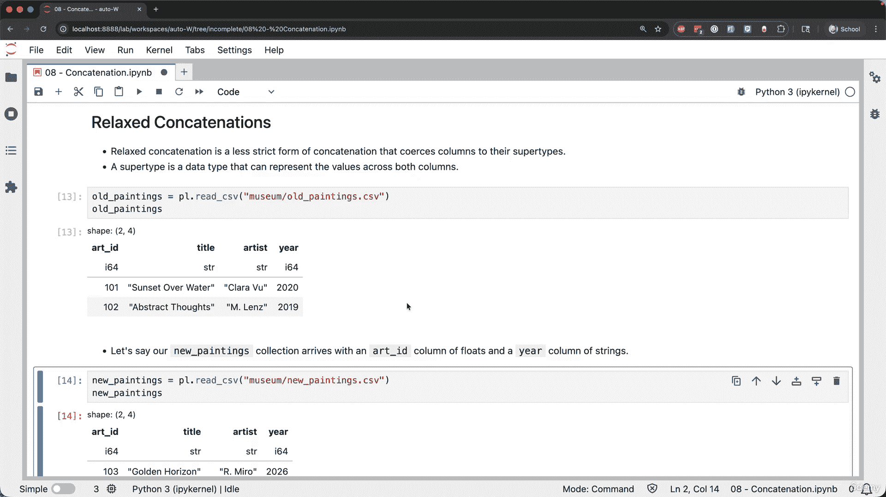

假设这两个数据框的数据类型碰巧不一样。这种情况其实很常见，因为数据可能来自不同的系统，或者是通过不同类型的导出文件导入的。为了模拟这个场景，我们可以给`read_csv`函数传入一个`schema_overrides`参数。这个参数允许我们告诉Polars，某些列请按不同的数据类型来读取。比如，我们可以把`art_id`列（原本是64位整数）指定为32位浮点数，把`year`列（原本是64位整数）指定为字符串类型。

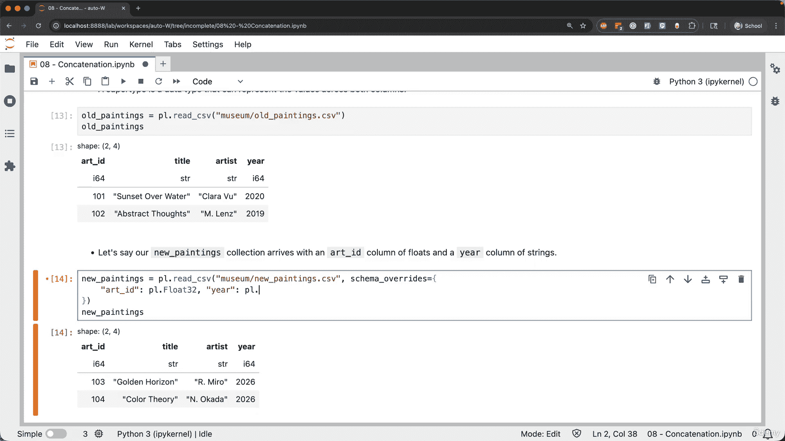

```python
old_paintings = pl.read_csv("old_paintings.csv")
new_paintings = pl.read_csv("new_paintings.csv", schema_overrides={
    "art_id": pl.Float32,   # 让 art_id 变成 32 位浮点数
    "year": pl.String       # 让 year 变成字符串
})
```

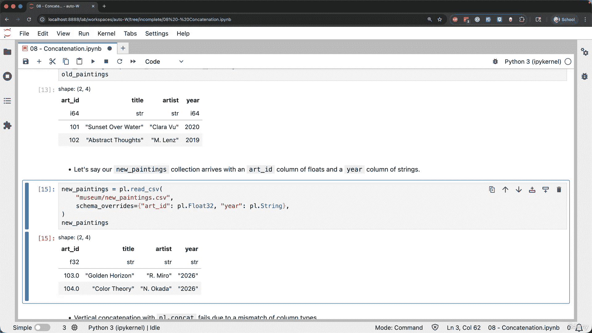

导入完成后，两个数据框仍然有完全相同的四个列，但`art_id`列和`year`列的数据类型已经不一致了。现在我们先试试普通的垂直连接，看看会发生什么。

```python
pl.concat([new_paintings, old_paintings], how="vertical")
```

运行后出现错误：

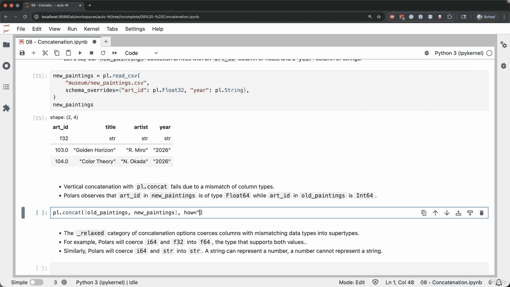

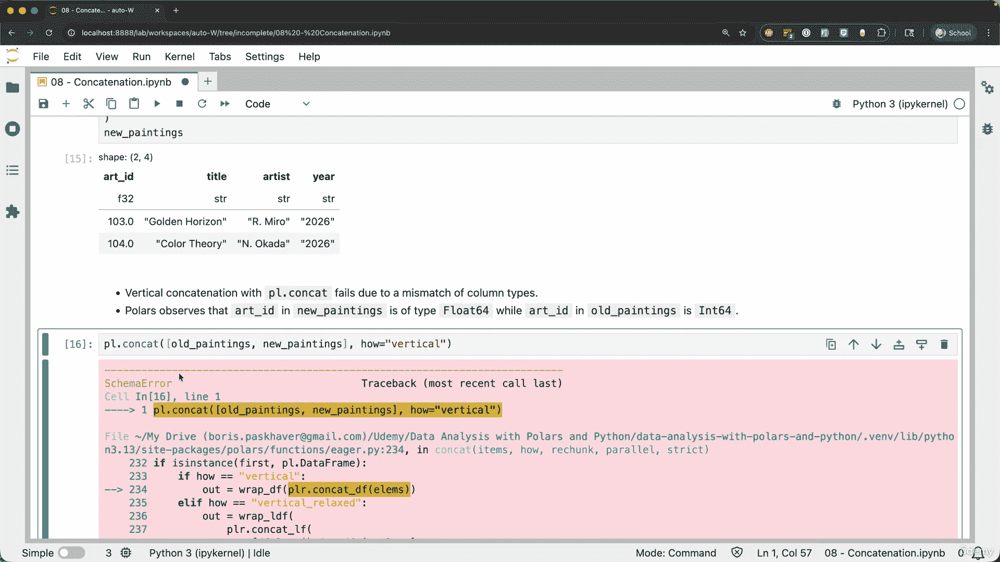

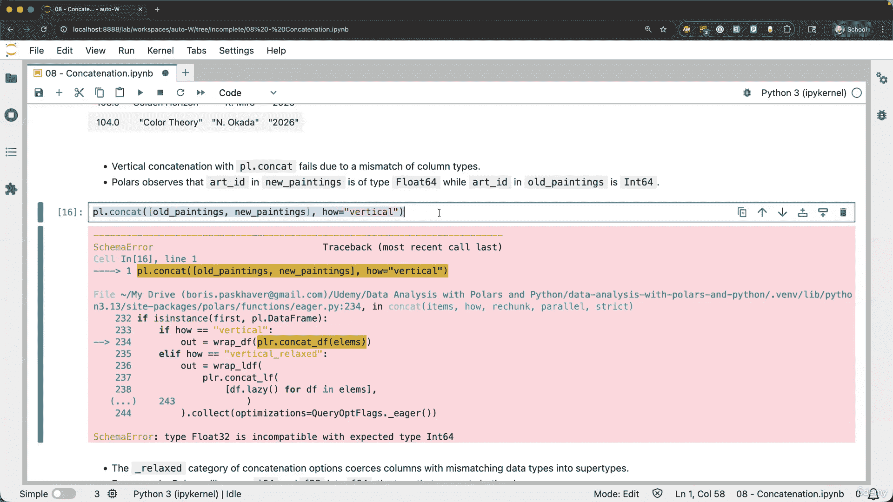

```
SchemaError: type Float32 is incompatible with the expected type Int64
```

这个错误专门指向`art_id`列。Polars无法协调“一个数据框的`art_id`列存整数，另一个存32位浮点数”这种矛盾，所以它不知道该怎样把两列合并成一列，于是抛出了错误，期望我们自己动手修复。

下面是另一种做法。我们把上面的代码复制下来，然后把`how`参数改为`vertical_relaxed`。注意，我们仍然是在做垂直连接，但这是一个“宽松”的垂直连接。

```python
pl.concat([new_paintings, old_paintings], how="vertical_relaxed")
```

这样Polars就不会再纠结于类型差异了，它会替我们修复不匹配问题。实际上，Polars会选择把其中一列或两列都转换为所谓的“超类型”。那么，什么是超类型呢？简单来说，超类型就是一种能够同时支持两种原始类型的类型。选择超类型的目标通常是避免任何形式的数据损失。这个过程其实是一种非常直观的逻辑思考：我们只需要想一想，哪种数据类型能够同时容纳这些不同的值。

为了帮助理解，我们来看一个基础例子。假设我们有一个整数`3`，还有一个浮点数`6.3`。如果想把这两个值都表示出来，该用哪种类型呢？对于`3`，我们可以把它当成整数`3`，也可以当成浮点数`3.0`。对于`6.3`，我们当然可以把它当成浮点数`6.3`，但如果要强行转成整数，就变成了`6`，这样一来就丢失了小数部分，也就是数据损失。所以，浮点数既能表示浮点值，也能表示等值的整数；而整数如果想表示浮点数，就一定会丢失一部分数据。因此，当Polars发现一个列是整数、另一个列是浮点数时，它会选择浮点数作为超类型，因为浮点数可以支持这两种值。

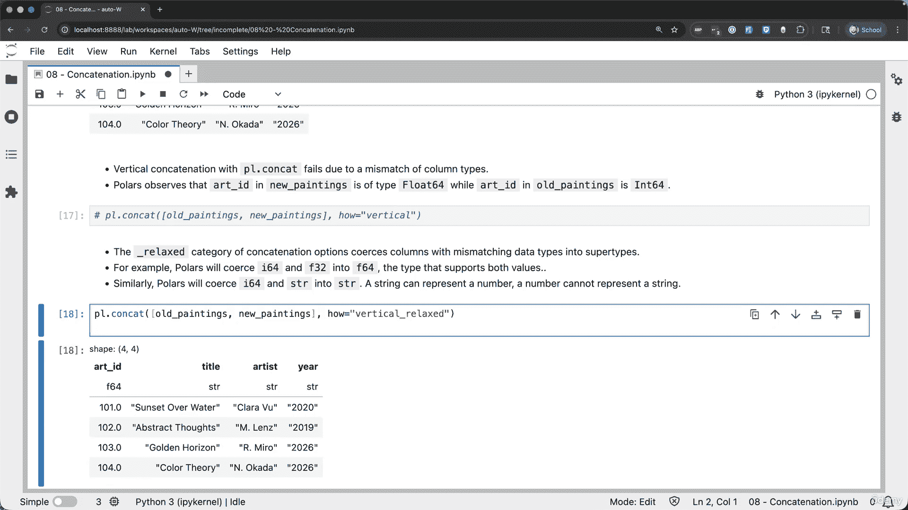

```python
# 超类型选择示例
# 整数 3 和浮点数 6.3 -> 浮点数（避免数据损失）
# I64, F32, F64 -> F64（因为 F64 能无损失表示所有值）
# 整数和字符串 -> 字符串（字符串能表示任何数字）
```

更有意思的是，在刚才的例子中，Polars选择的超类型并不是`new_paintings`里原本的32位浮点数，而是64位浮点数。也就是说，它实际上是第三种完全独立的数据类型，作为前两列的超类型。但关键点在于，我们不再看到错误了，Polars成功地把两个数据框连接在了一起。

接下来我们再展示一个稍复杂的例子。不过在开始之前，有一个地方需要说明一下：并不存在“水平宽松连接”这个方法，也就是`horizontal_relaxed`。这是因为水平连接是在右侧添加新的列，这些新列是全新的，不可能与左侧数据框的列重叠，所以根本不会出现类型不匹配的问题。因此，Polars没有提供对应的水平宽松连接方法。不过，有一种`diagonal_relaxed`方法，做的事情和宽松垂直连接很类似：它执行对角连接，并把所有数据类型不同的列转换成它们的超类型。

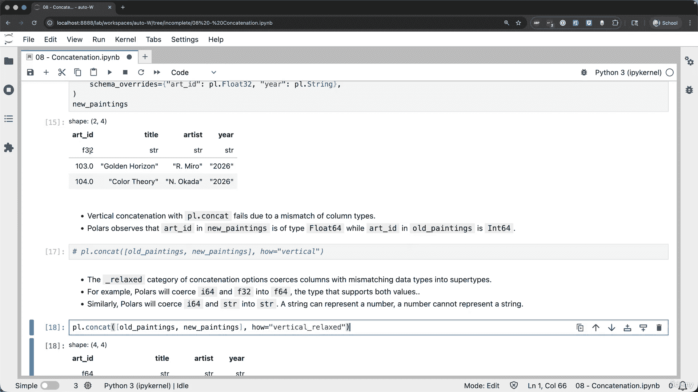

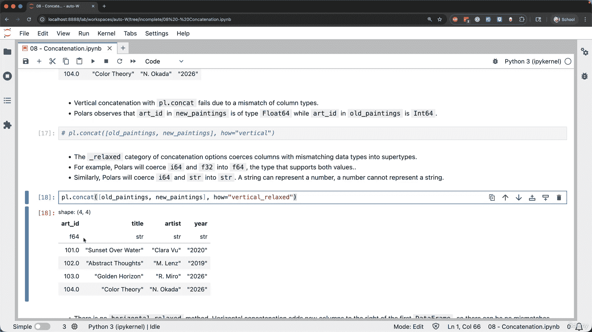

为了演示`diagonal_relaxed`，我们再导入一个数据集`future_paintings.csv`。这次我们让场景更有趣一点：把`art_id`列指定为64位浮点数。

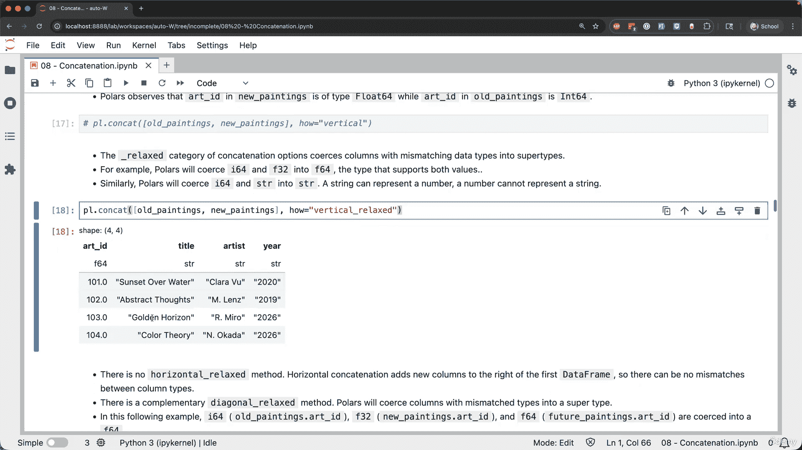

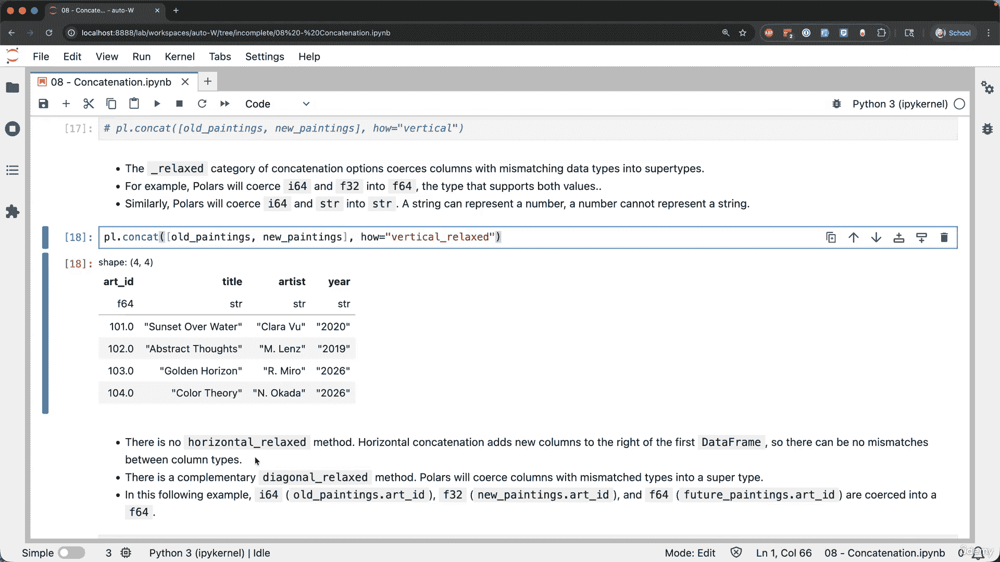

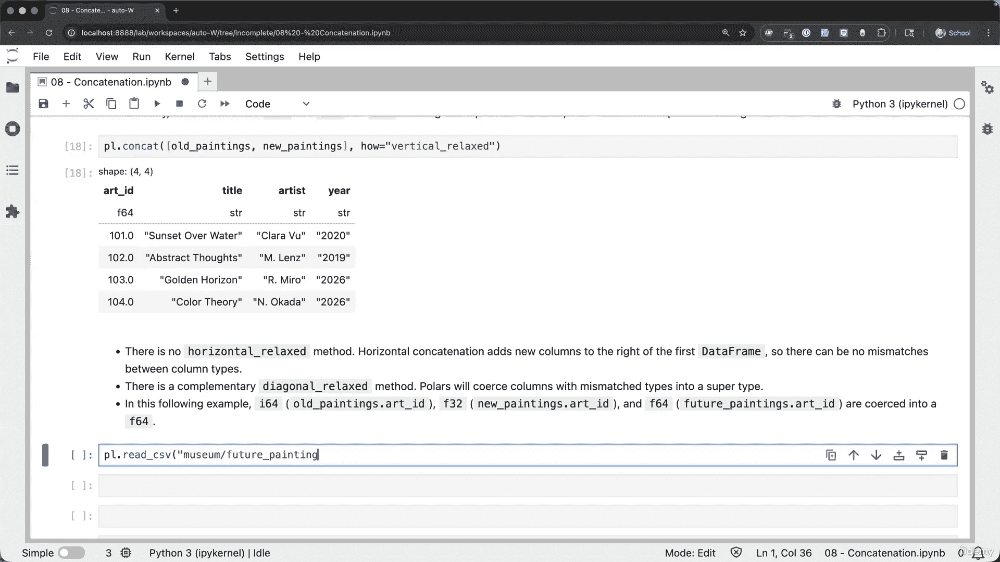

```python
future_paintings = pl.read_csv("future_paintings.csv", schema_overrides={
    "art_id": pl.Float64
})
```

导入之后，`future_paintings`的`art_id`列就是64位浮点数了。现在我们有三个数据框：`old_paintings`的`art_id`是64位整数，`new_paintings`的`art_id`是32位浮点数，`future_paintings`的`art_id`是64位浮点数。此外，`future_paintings`还多了一个`category`列，这是另外两个数据框没有的。因此，我们使用对角连接来把这三者拼接起来，把旧数据和新数据的行添加到下方，同时把`category`列添加到右侧。

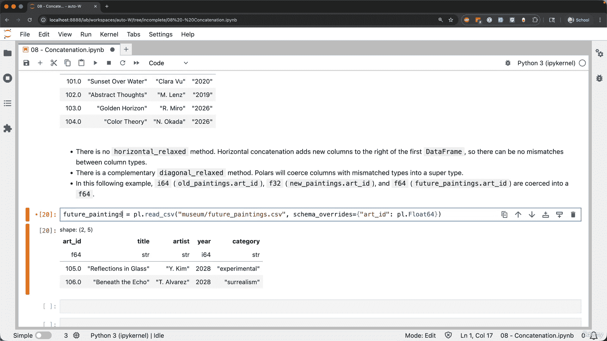

先试试普通的对角连接：

```python
pl.concat([old_paintings, new_paintings, future_paintings], how="diagonal")
```

这个操作会失败，因为`art_id`列存在类型不匹配，而且`year`列也还存在问题（之前在`new_paintings`中是字符串，在`old_paintings`中是整数）。所以我们需要使用对角宽松连接：

```python
pl.concat([old_paintings, new_paintings, future_paintings], how="diagonal_relaxed")
```

这样就能成功了。为什么超类型是64位浮点数呢？我们来分析一下。这三个数据框中，`art_id`分别有`I64`、`F32`和`F64`三种类型。整数无法表示浮点数，这我们已经说过了；那么Polars怎么在`F32`和`F64`之间选择超类型呢？答案是`F64`，因为64位浮点数在内存中的容量是32位浮点数的两倍，所以它能表示32位浮点数能表示的任何小数，反之则不行。32位浮点数只有32位内存，只有64位浮点数的一半，所以它无法拥有64位浮点数的精度。如果硬要把64位浮点数转换成32位浮点数，就会出现数据损失和精度损失。因此，64位浮点数能够无损失地表示这三种类型的值，自然就成为超类型。

再来看`year`列，之前有整数和字符串。Polars会选择字符串作为超类型，因为字符串可以表示任意数字，而数字却无法表示任意文本。这就是为什么`year`列会被转换成字符串类型的超类型。

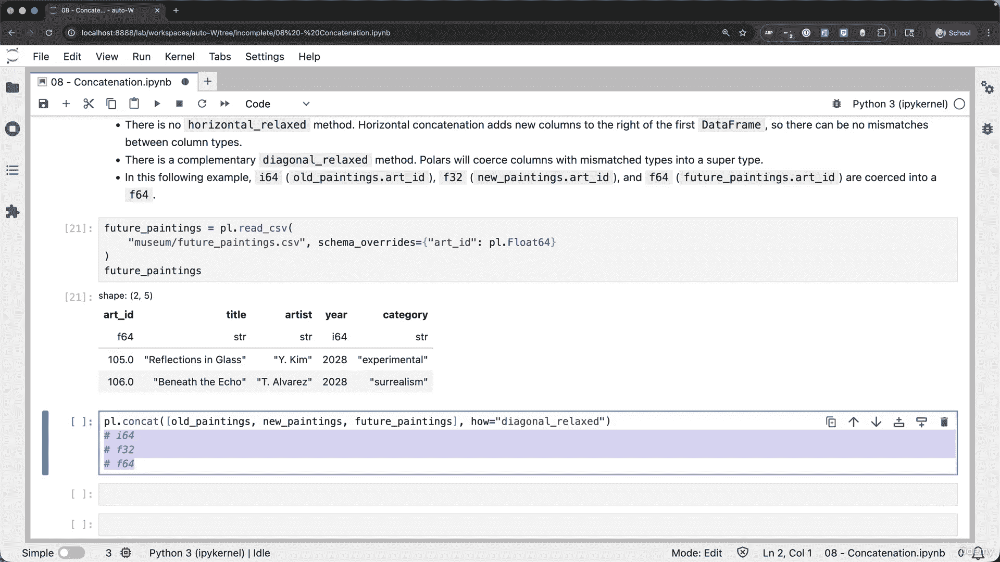

好了，这节课我们学习了宽松连接的概念。简单来说，宽松连接是传给`concat`函数`how`参数的一组特殊取值，对于垂直连接和对角连接，只需要在原来的关键字后面加上`_relaxed`后缀，就能告诉Polars“放轻松一点”，不要那么严格，替我们处理好类型不匹配的问题。Polars会把所有存在类型冲突的列统一转换为各自的超类型，从而避免数据丢失。总而言之，宽松连接有以下几个要点：

- 宽松连接是`how`参数的一种特殊取值，写法是在垂直或对角连接后面加`_relaxed`后缀。
- 宽松连接不会因为列类型不一致而报错，而是自动将冲突列转换为超类型。
- 超类型是能够无损失地表示所有原始类型的类型，例如`I64`和`F32`的超类型是`F64`。
- 水平连接不存在宽松版本，因为水平连接不会出现列类型重叠。

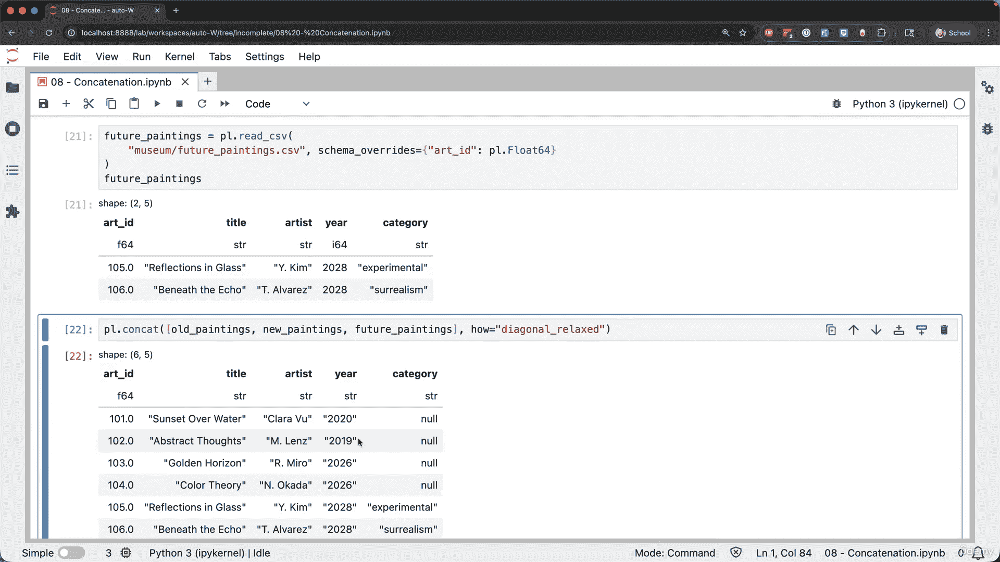

希望这个“偷懒”的小技巧能在你的数据处理工作中帮上忙。
