# Udemy - Data Analysis with Polars and Python Part 2：p18/118：Rechunking（重分块）🔄

在本节课中，我们将一起学习 Polars 中一个非常重要但容易被忽视的概念——重分块（rechunking）。我们不会去深入计算机科学的底层原理，而是从宏观层面理解它是什么，以及它为什么能显著提升 Polars 查询的速度。你将会看到重分块在数据拼接操作中经常出现，因此掌握它很有必要。

为了方便你快速了解这节课的内容，下面是本讲的几个要点：

- 什么是内存块（chunk），以及为什么要关注它。
- 为什么 CPU 读取同一块中的数据会更快。
- 通过一个自行车仓库的比喻来理解重分块的成本与收益。
- 如何用 `n_chunks` 方法查看数据分散情况。
- 在拼接时如何用 `rechunk` 参数来重分块，以及如何手动重分块。

接下来，我们先从最基本的概念开始。

## 1. 内存块与重分块的基础概念 🧩

当我们把一个 DataFrame 显示到屏幕上时，我们看到的是一张整齐的表格。在这张表格的背后，Polars 可能并没有把数据整整齐齐地放在同一个内存区域。实际上，DataFrame 的内容，也就是数据本身，甚至某一列的数据，都可能被存储在内存中的多个不同位置。换句话来说，数据是分散存在的。这些不同的内存位置，在 Polars 中就被称为“块”（chunk）。

那么，数据分散会带来什么问题呢？这就要从 CPU 说起了。CPU（中央处理器）是执行程序指令的核心部件。CPU 在读取数据时，如果数据都位于同一个块内，读取速度会更快。原因在于，同一个块内，连续两个值在内存中的距离更短，它们彼此靠得更近，所以从上一个值移动到下一个值所花费的时间更少。你可能偶尔会听到“连续”（contiguous）这个术语，它的意思就是“在内存中紧挨着”。当数据连续存放时，从一个位置到下一个位置、从一个值到下一个值的速度都会更快。

所谓重分块（rechunking），指的就是把多个内存块合并成一个块的过程。你可以想象成，Polars 程序把所有分散在不同位置的数据统一收集起来，然后集中放在同一个内存区域。当然，这个收集过程本身需要付出一定的计算成本：要把数据从多个地方归拢起来，当然要花费时间和计算力。但是，如果我们愿意先支付这笔前期投入，那么以后对数据的操作就会快得多，因为此时所有数据都已经待在同一个块里，彼此之间距离很近，后续访问也就更快了。

用公式来概括：

\[
\text{重分块前：每个列的数据可能分布在 } k \text{ 个块中（} k>1 \text{）}
\]

\[
\text{重分块后：每个列的数据都集中在 } 1 \text{ 个块中}
\]

这里的 \( k \) 越大，后续操作时 CPU 需要“跑”的地方就越多，速度自然就越慢。

## 2. 自行车仓库类比 🚲

为了让这个有点抽象的概念更具体，我们来打一个比方。假设你经营着一家销售自行车的公司，自行车存放在好几个仓库里。这些仓库就相当于计算机内存中的块，它们是存放商品的多个不同位置。如果一位顾客下单的自行车分散在多个仓库中，那么员工必须跑遍这些仓库，才能把订单里的自行车全部收集齐。数据分散在多个内存块时也是这样，取数据时需要跑好几个地方，耗费时间。

重分块就相当于：公司愿意花时间和人力，提前把散落在各个仓库的自行车集中到一个仓库里，甚至放到同一个仓库的同一个区域。这样一来，以后再有顾客下单，发货就会快很多，因为所有自行车都在一起，员工不用跑很远就能拿到货。

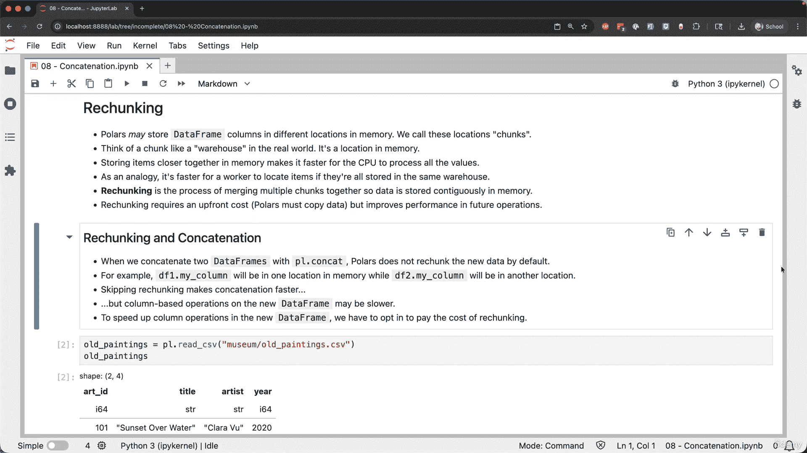

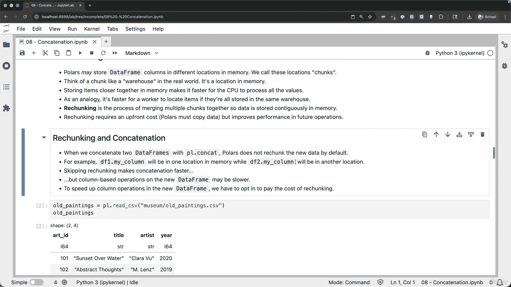

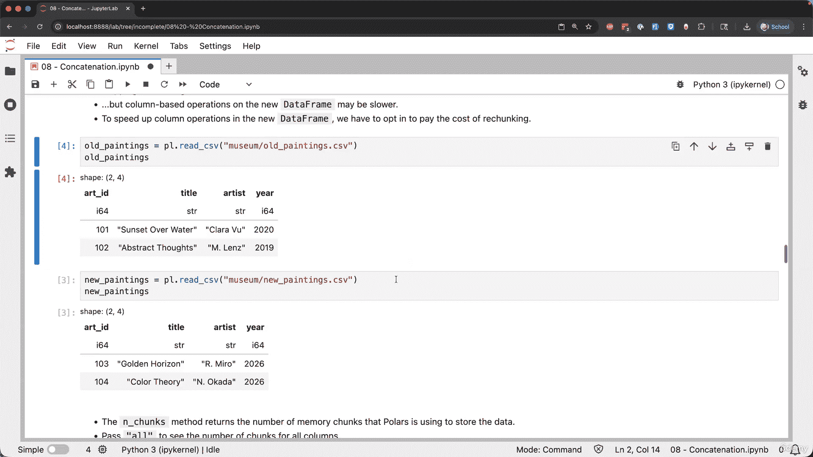

但请记住，这本质上是一笔投资。你必须先支付一笔前期成本，也就是先花时间把自行车全部收拢起来。虽然前期要付出一点代价，但之后就能享受到后续操作明显加速的收益。Polars 的重分块也是这个道理：先花一点时间整理数据，之后所有查询都会因此受益。

## 3. 在 Jupyter Notebook 中查看块数 🔍

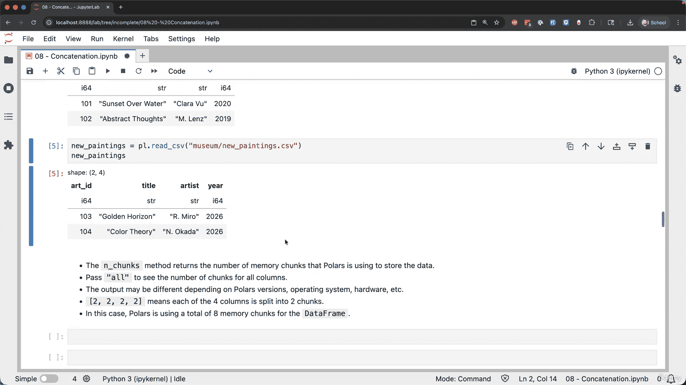

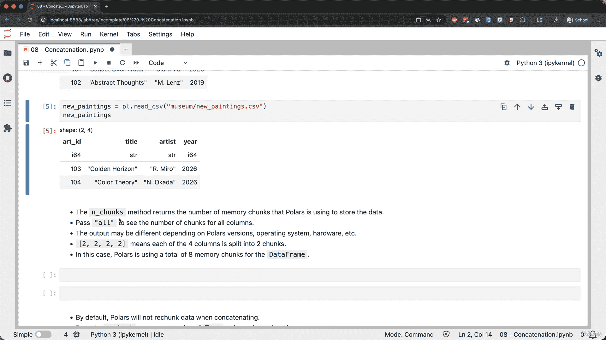

明白了原理之后，我们回到 Jupyter Notebook，看看重分块在实际代码中是怎么应用的。先重新执行导入代码，把数据加载进来。这里我们有两份数据：一份叫 old_paintings，另一份叫 new_paintings。在正式开始之前，先看一下这两份数据在内存中到底是怎么存放的。

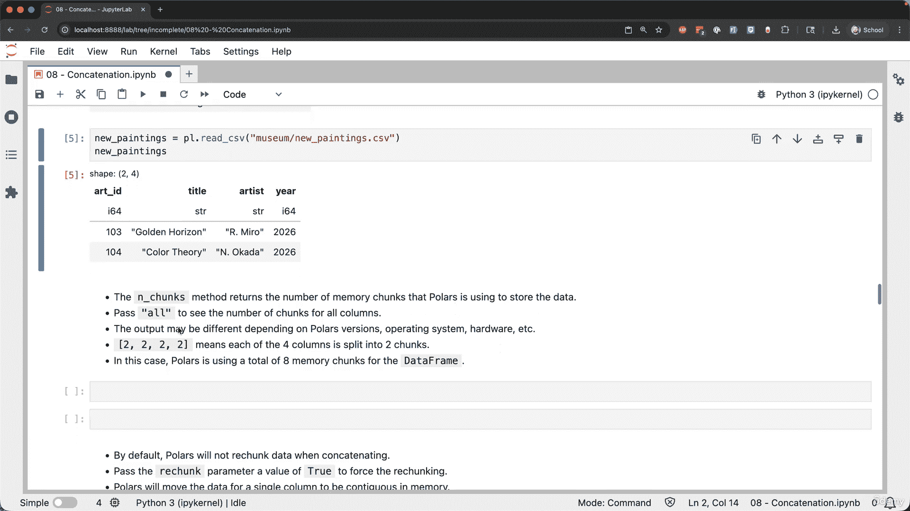

在 Polars 中，任何 DataFrame 都可以调用 `n_chunks` 方法，其中 `chunks` 是“块的数量”的缩写。这个方法会告诉你 Polars 把数据分散在多少个内存位置中。更厉害的是，它不仅能看到整个 DataFrame 的位置数量，还能精确到每一列。调用时只需要传入一个字符串参数 `"all"`，表示我们要查看所有列的情况。

下面是查看 old_paintings 各列块数的代码：

```python
old_paintings.n_chunks("all")
```

运行后，你可能会得到类似 `[2, 2, 2, 2]` 的列表。这个列表有四个数字，分别对应四列：id、title、artist 和 year。每个数字都表示该列的数据占用了几个块。所以这里的含义是：每一列的数据都被分散在两个不同的内存块里。需要说明的是，如果你在其他环境下得到不同的数字序列，完全正常。Polars 对数据在内存中的分配是一幕后的细节，它可能给某一列分配一个块，也可能分两个甚至更多。我们其实不需要太在意具体数量，但有一点必须理解：只要某个数字大于 1，就说明该列的数据被分散到了多个位置。

比如说，如果 artist 这一列的数据分散在两个位置，那么当我们要对这一列进行查询或操作时，Polars 和 CPU 就必须在两个位置之间来回奔波，而不能像数据集中在一个位置时那样，一次性把所有数据读完。这会带来额外的耗时。

接下来看看 new_paintings 的情况，代码也是一样的：

```python
new_paintings.n_chunks("all")
```

运行后，你会发现这份数据比较特殊，它的每一列都只存储在单个内存块中。所以返回值可能是 `[1, 1, 1, 1]`。不用较真具体数字，只要记住：大于 1 表示数据在多个内存位置，等于 1 则表示数据已经集中在同一个位置。

## 4. 拼接时的默认行为 🔗

那么，当我们把多个 DataFrame 拼接在一起时，会发生什么呢？默认情况下，Polars 不会未经允许就自动重分块。还记得吗？重分块是一个相对“昂贵”的过程。这里所说的“昂贵”，是从时间或计算量的角度来说的。虽然作为开发者或数据分析师，这些差异可能只是一瞬间的事，但相对于不重分块，把分散在多个位置的数据收集到一起，确实会多花一些时间。Polars 默认的策略是尽可能让当前操作保持快速，所以它不会主动去做一个会导致当前操作变慢的额外步骤。

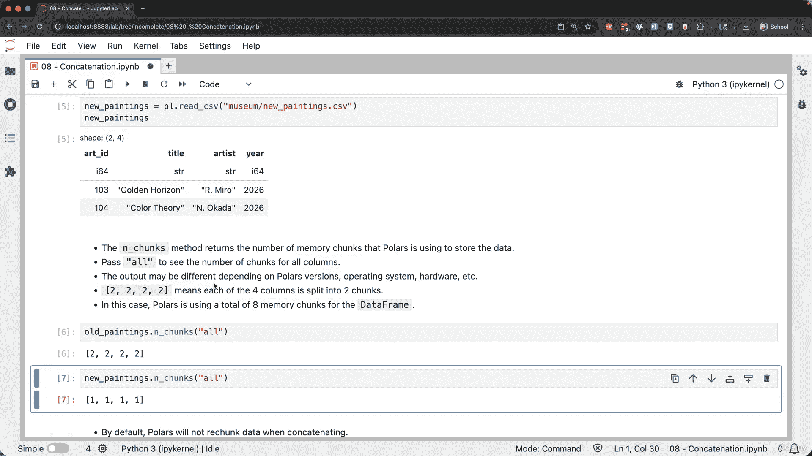

来看一个例子。使用 `pl.concat` 函数，把 old_paintings 和 new_paintings 传入一个列表，默认情况下会进行纵向拼接。为了更明确，我们也可以显式地加上 `how="vertical"`。执行这段代码，就会得到拼接后的 DataFrame。下面我们来看一下它各列的块数：

```python
combined_default = pl.concat([old_paintings, new_paintings], how="vertical")
combined_default.n_chunks("all")
```

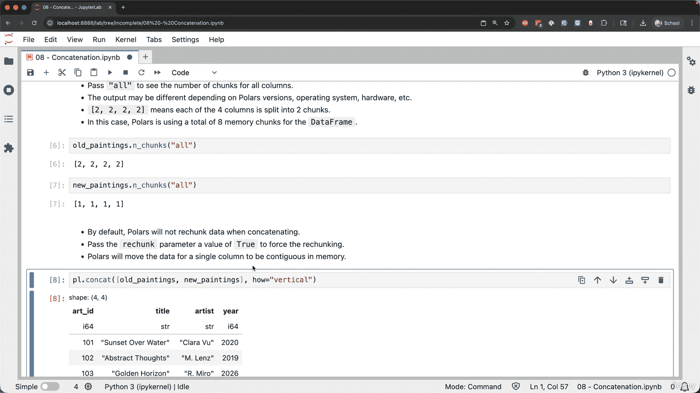

你会发现，结果可能是 `[3, 3, 3, 3]`。也就是说，默认情况下，Polars 并没有把数据汇总到单个内存位置，而是每列都被分散在三个块中。这说明，默认的拼接不会主动投资重分块。

在 `concat` 函数的参数中，有一个叫 `rechunk` 的参数，默认值为 `False`。所以，上面的写法其实等价于下面这行代码，也就是明确告诉 Polars“我不要重分块”：

```python
combined_explicit = pl.concat([old_paintings, new_paintings], how="vertical", rechunk=False)
```

这两个写法得到的结果是完完全全一样的。也就是说，如果你不做任何额外操作，Polars 就会默认保持数据分散，不会花时间去整理。

## 5. 使用 rechunk=True 或手动 rechunk 方法 🔧

现在你可能已经猜到了，如果我们把 `rechunk` 参数设置为 `True`，就会让 Polars 在拼接时投入时间和精力，把每列的数据都集中到一个内存块中。从技术上来说，这一行代码的平均执行时间会比上面那种默认写法要慢一点。但是，此后对这个结果 DataFrame 做的所有操作，无论是查询、过滤、连接还是其他计算，都会因为数据已经集中而变得更快。

下面是使用 `rechunk=True` 的写法：

```python
combined_rechunked = pl.concat([old_paintings, new_paintings], how="vertical", rechunk=True)
combined_rechunked.n_chunks("all")
```

运行之后，`n_chunks("all")` 会告诉我们，每一列的数据都已经集中在一个块里，所以结果会变成 `[1, 1, 1, 1]`。如果我们把这个 DataFrame 赋给一个变量，再对它执行操作，通常会比对未重分块的那个 DataFrame 操作更快。

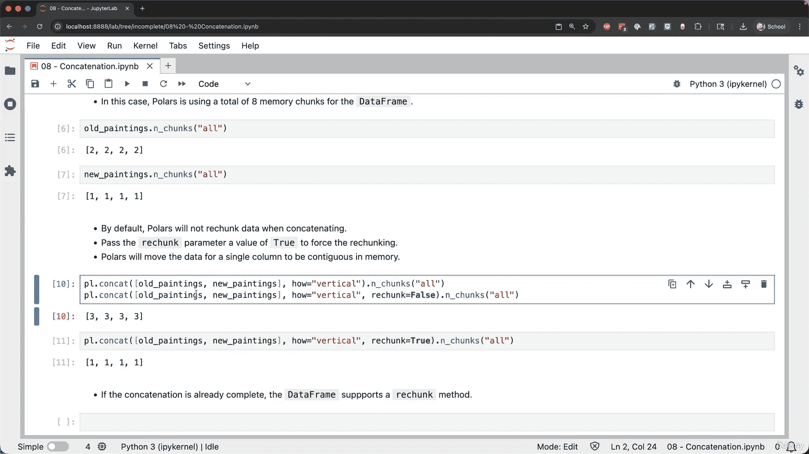

当然，如果数据只有四行，你很可能在肉眼上什么都感觉不到。这里所说的速度差异，可能只是零点几秒中的零点几秒。但是当数据集慢慢变大，例如达到几百万行、甚至几十亿行的时候，这种优化就值得认真考虑了。前期花一点时间重分块，后期就能在大规模查询中持续获得回报。

还有一种情况也需要掌握：假设我们已经完成了拼接，但拼接时没有设置 `rechunk=True`。比如，我们已经把拼接结果赋给了 `all_paintings` 变量。此时由于默认行为，这个 DataFrame 的每列数据很可能依然分散在三个块中。如果不想重新执行拼接，我们也可以直接对已有的 DataFrame 调用 `rechunk` 方法，手动完成重分块。

手动重分块的代码如下：

```python
all_paintings = pl.concat([old_paintings, new_paintings], how="vertical")
all_paintings.n_chunks("all")  # 可能得到 [3, 3, 3, 3]

all_paintings = all_paintings.rechunk()
all_paintings.n_chunks("all")  # 现在得到 [1, 1, 1, 1]
```

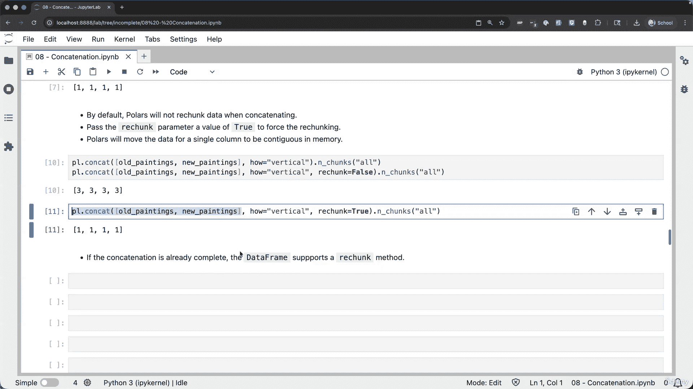

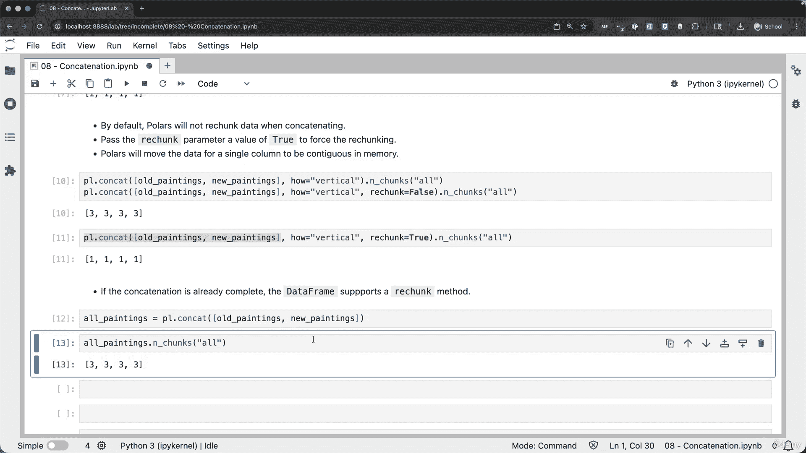

这里我们直接把重分块后的结果重新赋给 `all_paintings`，没有再保留旧版本，因为旧版本数据分散、效率较低，没有必要继续持有。执行之后，`all_paintings` 的每一列数据就都收拢到了单个内存块中。你可以再次调用 `n_chunks` 确认，这时看到的列表应该是 `[1, 1, 1, 1]`。

在接下来的课程中，我们还会实际对比两个内容完全相同的 DataFrame，其中一个做过重分块、另一个没有做过，然后在它们上面执行同样的查询，看看具体速度差异和效率差异。不过就今天而言，重分块的基础概念已经足够清楚了：重分块本质上就是先投入一些计算时间，把分散在多个内存位置的数据集中到一个块里，从而加速未来所有 Polars 查询。

## 总结 📌

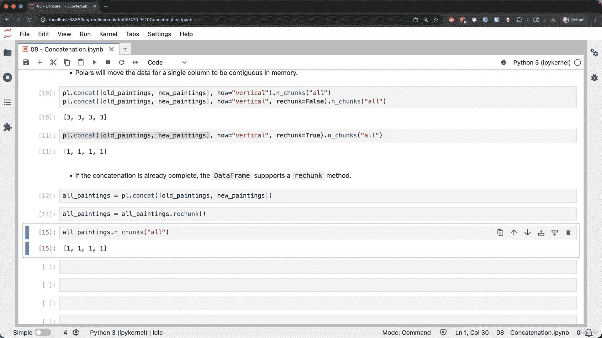

本节课中，我们一起学习了 Polars 中的重分块概念。我们从“内存块”这个基础概念入手，明白了 CPU 读取连续数据时速度更快，而数据一旦分散在多个块中，就会增加访问开销。接着，我们用自行车仓库的类比解释了为什么重分块值得投入：前期需要花费时间和计算资源，但后期查询会因此变快。我们还动手实践了如何用 `n_chunks("all")` 查看各列的块数，看到了默认拼接不会自动重分块，也学会了使用 `concat(..., rechunk=True)` 在拼接时重分块，以及用 `DataFrame.rechunk()` 在拼接之后手动重分块。希望你在处理大型数据集时，能记得利用重分块这个工具，让后续查询跑得更快。
