# 🐻 Polars 与 Python 数据分析：第19节：vstack 方法


在本节课中我们将学习 `vstack` 方法。到目前为止，在这一部分中我们一直使用同一种方法，也就是使用 Polars 顶层的 `concat` 函数，把两个或多个 DataFrame 拼接在一起。上一节我们介绍了 `concat` 的基本用法，本节中我们来看看当数据不能一次性全部拿到时，应该如何更灵活地完成拼接。


## 🧩 回顾 concat 函数及其局限


`concat` 函数的一个限制是：它假定你想合并或拼接的所有 DataFrame 都一次性可用。原因是这个函数期望你提供一个列表，把所有 DataFrame 都放进这个列表里。可是在现实中，并不总是能一次性拿到全部数据。某些真实场景中，你未必能同时拥有所有 DataFrame。


可以想象下面这个问题。假设电脑上有一个目录，里面有 100 个 CSV 文件，你想把它们全部导入并拼接在一起。比较符合 Python 编程习惯的做法是逐个循环这些文件，一次打开一个文件，然后把内容拼接到一个不断增长中的 DataFrame 末尾。你会先初始化一个空 DataFrame，打开第一个文件并把它的行加进去，再打开第二个文件并把它的行加进去，依此类推，类似一个 Python 循环。因此，`concat` 函数在这种场景下并不适用。针对这类情况，Polars 库提供了几种替代的拼接方式，本课要探索的第一种就是 `vstack` 方法。


## 🛠️ vstack 方法的基本用法


第一个重要区别是：`concat` 是一个函数，而 `vstack` 是已存在 DataFrame 上的一个方法。下面展示最简单的例子。假设有一个 `old_paintings` DataFrame，`vstack` 方法可以直接在它上面调用，这个方法接受第二个 DataFrame，也就是你想拼接到 `old_paintings` 末尾的那个 DataFrame。可以传入 `new_paintings`，然后会得到和上面使用 `concat` 完全相同的结果。


核心公式如下：

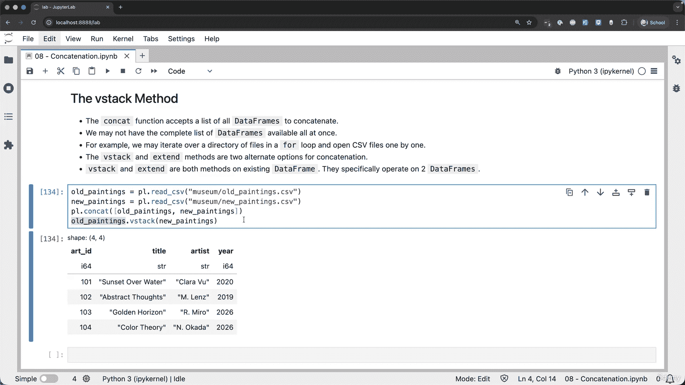

```python
result = old_paintings.vstack(new_paintings)
```


需要注意，`vstack` 方法不会修改任何一个原始 DataFrame。它只是取出这些行，把它们加到另一些行的后面，然后返回一个全新的 DataFrame。这里的区别在于，我们可以在一个 DataFrame 上调用 `vstack`，并把第二个 DataFrame 作为参数传进去。


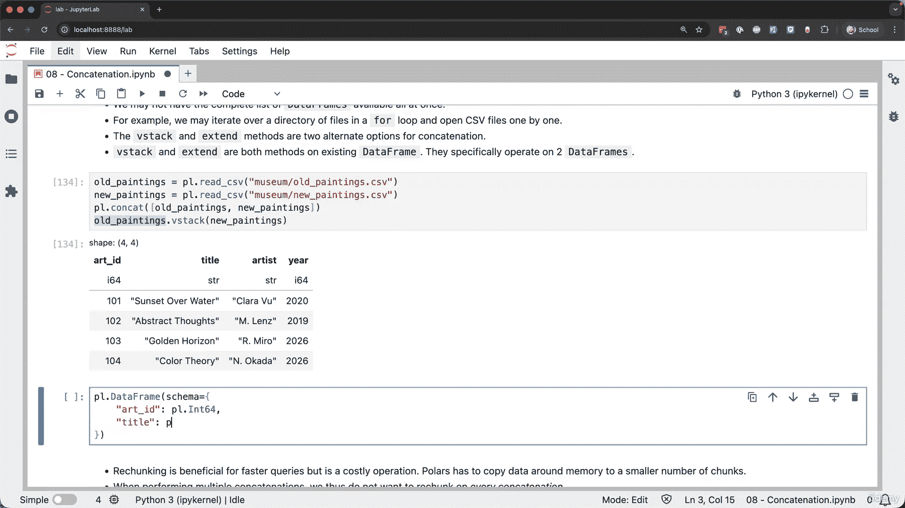

## 🔁 用 vstack 模拟逐个读取 100 个 CSV


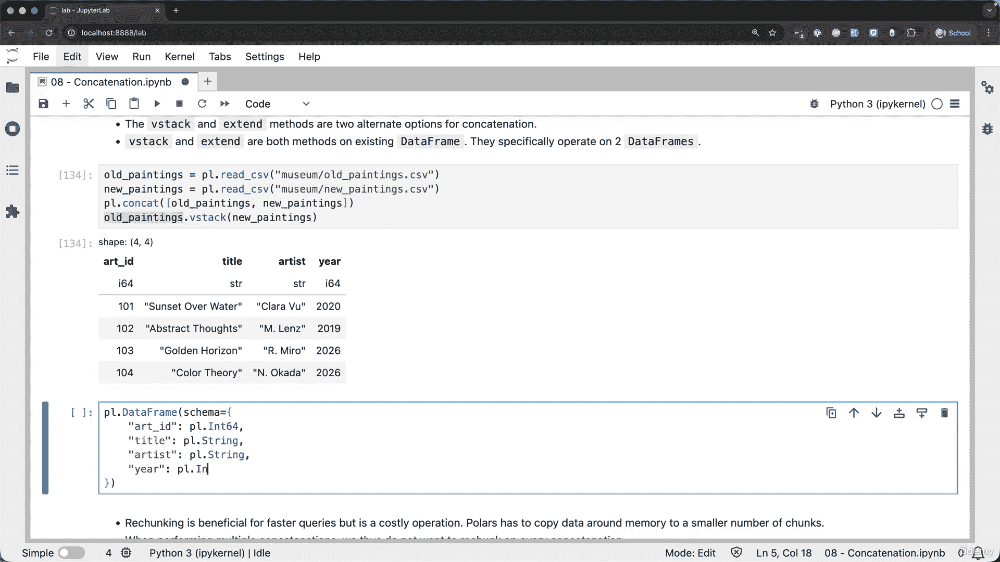

接下来看看如何用动态迭代解决刚才描述的问题。我们不会真的导入 100 个 CSV 文件，但会模拟一个非常相似的场景。首先创建一个空 DataFrame。可以使用 DataFrame 构造器，并把 `schema` 参数设置为一个字典。这个字典里提供四个键值对，分别对应四个列。提醒一下，键是列名，比如 `art_id`，值是对应的数据类型。`art_id` 需要是 64 位整数，所以指定 `int64`。然后需要 `title` 列，类型是字符串。还需要 `artist` 列，类型也是字符串。最后需要 `year` 列，类型是 `int64`。这样会生成一个空 DataFrame，但它具有这四列以及指定的数据类型。把这个 DataFrame 赋给变量 `df`，并在下面输出 `df`。


示例代码如下：

```python
import polars as pl

df = pl.DataFrame(
    schema={
        "art_id": pl.Int64,
        "title": pl.String,
        "artist": pl.String,
        "year": pl.Int64,
    }
)

print(df)
```


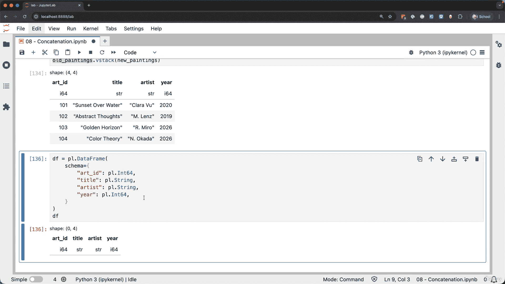

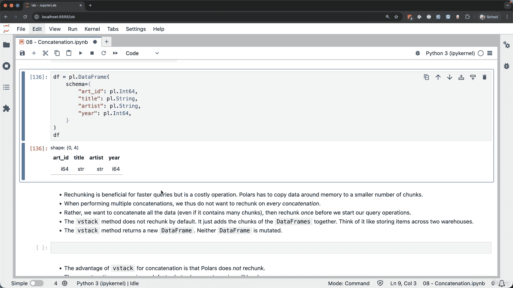

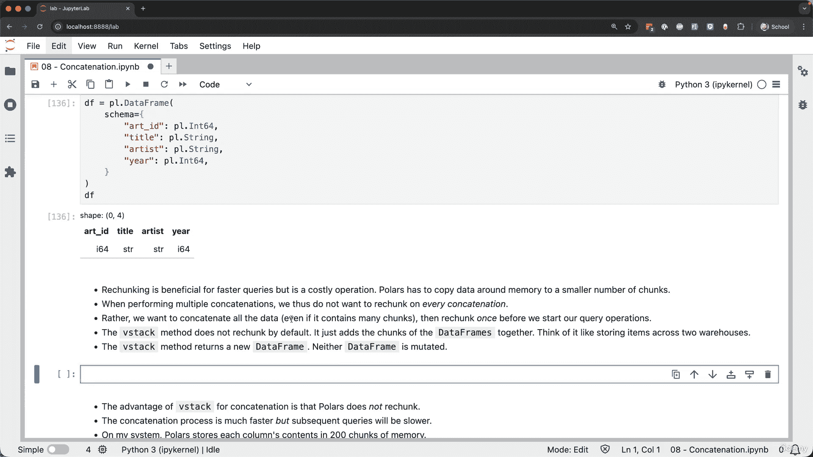

下面演示如何解决刚才提到的问题。如前所述，我们不会真的导入 100 个不同的 CSV 文件。我们并没有 100 个不同的 CSV 文件，但为了模拟类似场景，可以把同一个 DataFrame 导入 100 次。如果这段 Python 语法不熟悉，不用担心。这里使用一个 `for` 循环，写成 `for i in range(100):`，然后加上冒号和换行，指定一段会执行 100 次的代码块。这个循环会迭代 100 次，`i` 会记录当前循环到哪一次，但这里并不关心它。


对应的代码如下：

```python
for i in range(100):
    df = df.vstack(pl.read_csv("museum_old_paintings.csv"))
```


可以取上面的 `df`，在它上面调用 `vstack` 方法，并传入一个示例 DataFrame。示例 DataFrame 可以通过 `read_csv` 读取一个样例文件来生成，比如 `museum_old_paintings.csv`，然后把这些内容追加或拼接到 `df` 末尾。记住，`vstack` 不会原地修改 `df`，而是返回一个全新的 DataFrame。所以如果要在每次迭代结束时保留这次工作的结果，就需要把新的 DataFrame 重新赋值回 `df` 变量。


这段逻辑的工作方式如下。第一次迭代时，`df` 有 0 行。读取 CSV 内容后，会产生一个 2 行的 DataFrame。把这 2 行拼接到 `df` 末尾，就得到一个全新的 2 行 DataFrame，然后把 `df` 覆盖为这个新的 2 行 DataFrame。第二次迭代时，再次读取 2 行 DataFrame，把它加到已有的 2 行后面，现在得到一个 4 行 DataFrame，再把 `df` 变量覆盖掉。如此继续，每次迭代后 DataFrame 都会增加 2 行，行数依次是 2、4、6、8、10，依此类推。循环重复 100 次，最终应该得到一个 200 行的 DataFrame。执行后预览 `df`，确实可以看到它有 200 行。


## ⚡ 为什么 vstack 不自动 rechunk


`vstack` 用于拼接的主要优势，正是针对这类场景。因为 `vstack` 不会执行 `rechunk`。回忆一下，`rechunk` 的开销很大，因为它意味着 Polars 需要把分散的数据移动到内存中的单一位置，方便后续操作使用。完成所有拼接之后做一次 `rechunk` 是很好的做法，但在每个循环里都做就非常低效。


可以想象，如果 `vstack` 每次被调用都执行 `rechunk`，那么第一次迭代结束时会 `rechunk`，第二次迭代再加上两行后又会 `rechunk`，所有数据移动和复制都会发生。而下一轮迭代只会继续追加更多行，让上一次 `rechunk` 的目的失效，这显然非常低效。


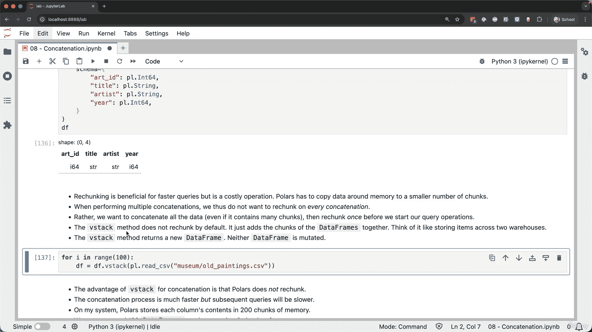

因此，`vstack` 很适合这种需要大量连续拼接的场景。通常希望 `vstack` 运行任意必要次数，然后在完整过程结束时只执行一次 `rechunk`。这里展示一下：拿这个 200 行的 DataFrame 调用 `n_chunks()` 方法，并传入 `"all"`，会看到四列中每一列在内存里实际占据 200 个 chunks。每列内容高度分散，这会导致后续操作效率很低。


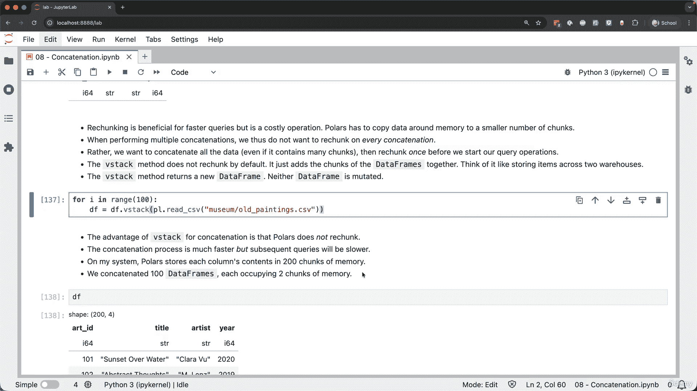

示例代码如下：

```python
print(df.n_chunks("all"))
```


## ⏱️ 用 %%timeit 观察性能差异


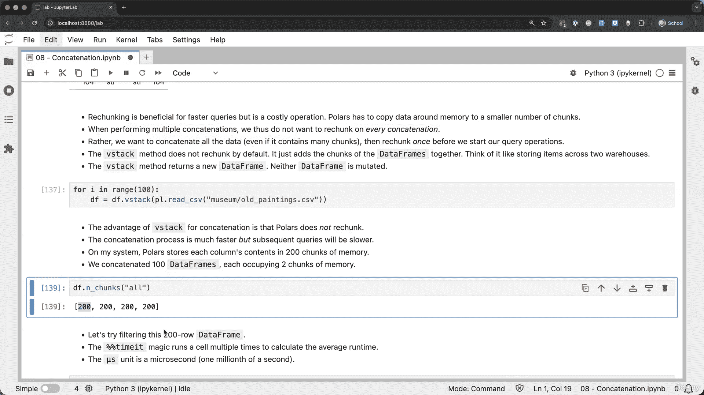

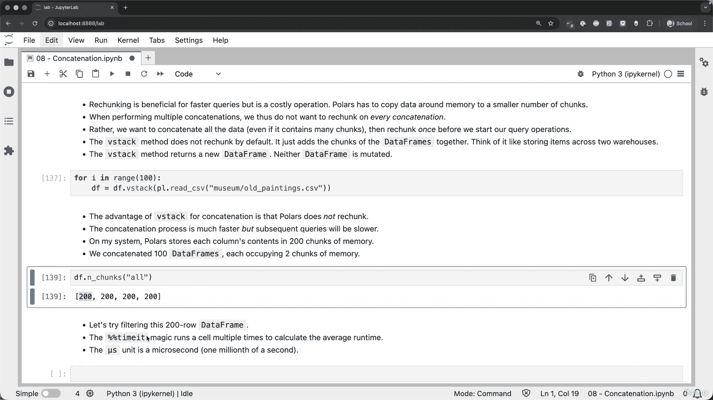

为了证明这一点，可以使用 Jupyter Notebook 中提供的特殊命令 `%%timeit`。这叫作 magic 命令，是我们可以放在单元格中的特殊语法。它会多次执行该单元格，可能执行上千次或更多，然后计算平均运行时间，也就是该单元格执行所需的平均时间。


先做一个非常简单的操作。取 `filter` 方法，目标是 `art_id` 列，筛选出值为 1002 的行。执行这个单元格，看起来几乎瞬间完成。但这里隐藏了很多复杂性，因为 `art_id` 列在内存中实际上有 200 个不同位置或 chunks，Polars 必须逐个导航过去。


在单元格中使用特殊 magic 命令，也就是两个百分号加 `timeit`，然后执行单元格。它不再产生普通输出，而是运行这段单元格代码一定次数。这里可以看到总共运行了 1000 次循环，并给出平均执行时间。这个单位是微秒，也就是百万分之一秒，但这个结果实际上非常低效。


示例代码如下：

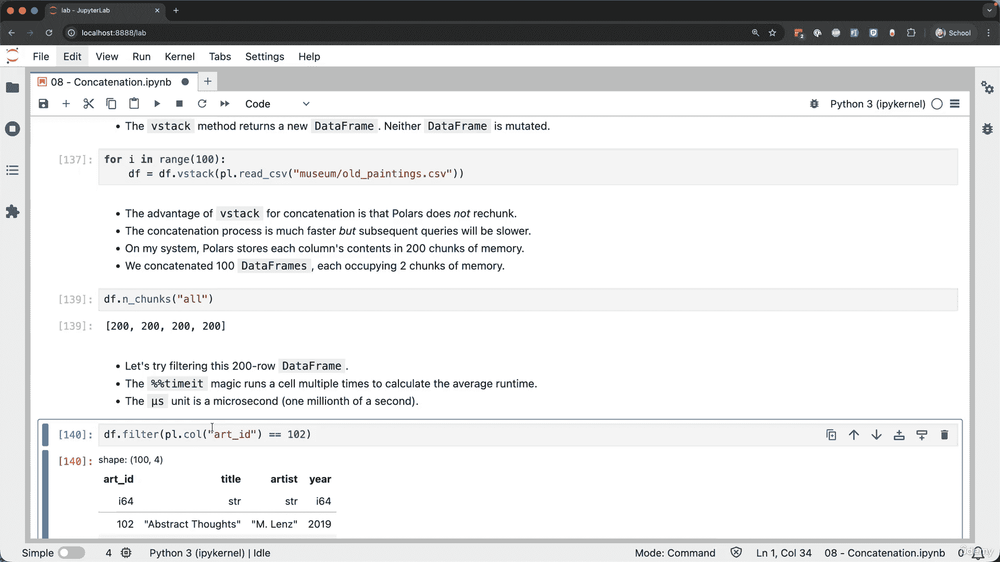

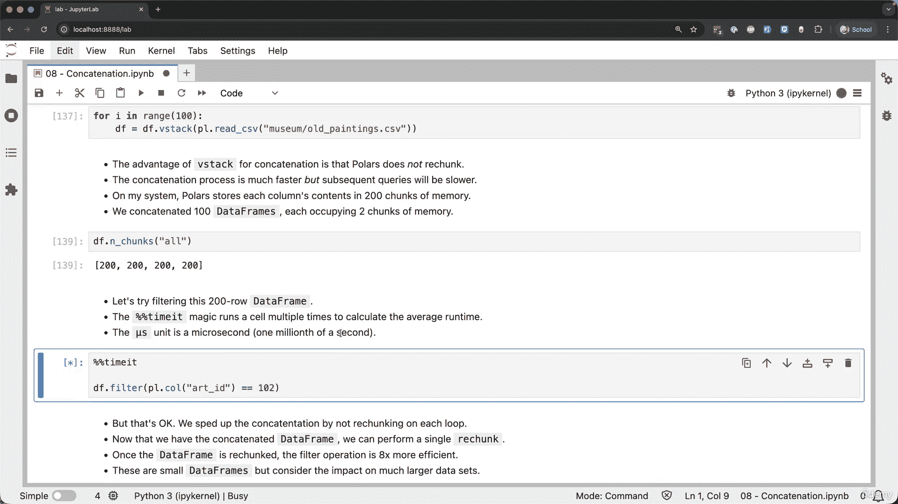

```python
%%timeit
df.filter(pl.col("art_id") == 1002)
```


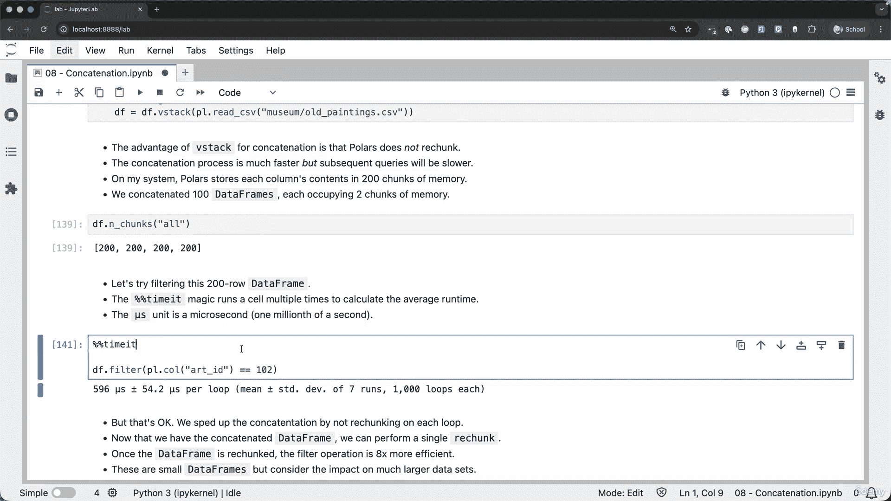

## 🚀 最后只做一次 rechunk


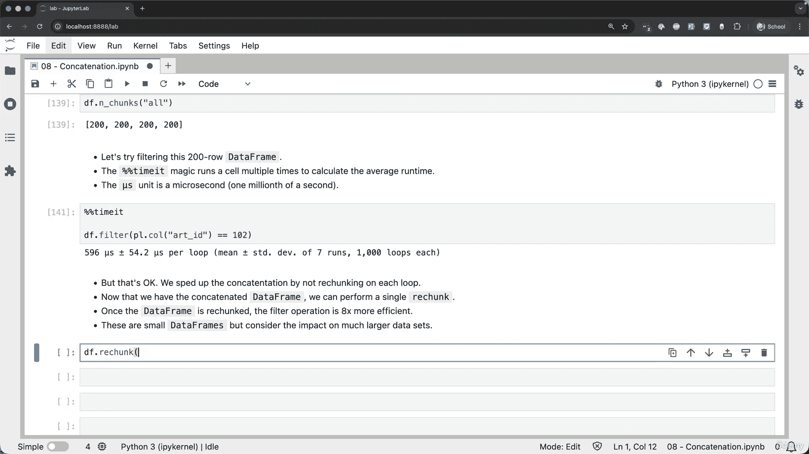

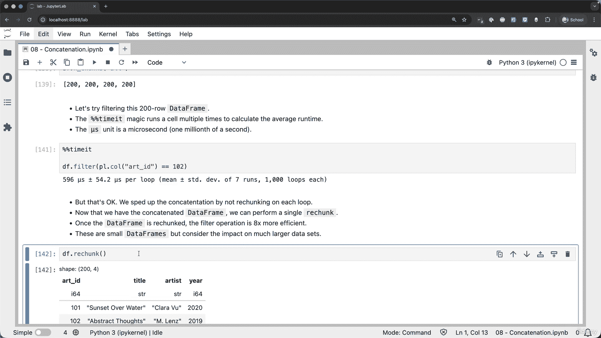

如前所述，动态拼接的关键思想是：完全可以接受 `vstack` 不在每次循环后执行 `rechunk`，这是好事。但完成所有连续多次拼接后，我们希望只执行一次 `rechunk`，付出这一次成本，从而获得后续更快查询的收益。


为了展示区别，取 `df`，它现在高度分块。调用 `rechunk` 方法，它会生成一个新的 DataFrame，每列中的所有数据都位于单一位置。把这个结果赋给新变量，比如 `rechunked`。下面重复完全相同的逻辑，把代码复制一份，但把 `df` 替换成 `rechunked`。


示例代码如下：

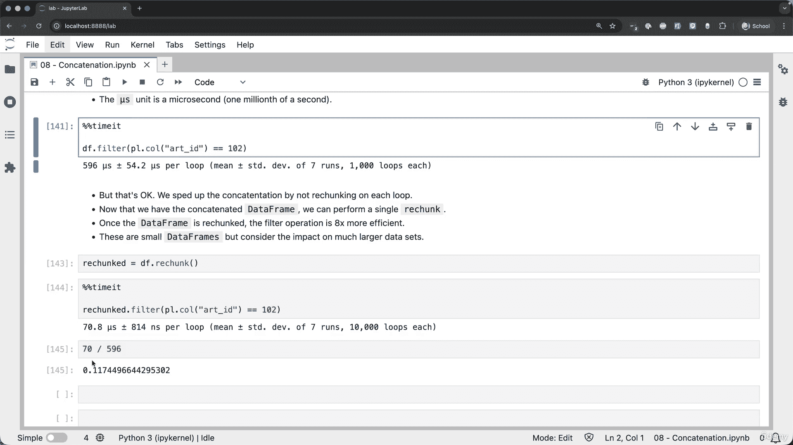

```python
rechunked = df.rechunk()

%%timeit
rechunked.filter(pl.col("art_id") == 1002)
```


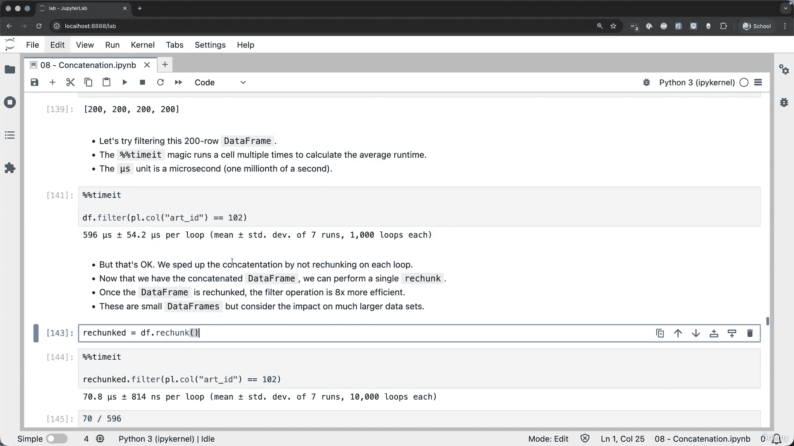

会看到评估时间差异很大。运行一定循环数后，可以看到它有时间实际执行 10000 次单元格，而之前只执行了 1000 次。现在只需要 70 微秒。比较这个 `filter` 操作相对另一个操作的耗时，这些时间单位都很小，对人类来说似乎都是瞬间完成，但仍然需要注意：最后只 `rechunk` 一次之后，这次耗时只有之前的 11%。当然，在只有 200 行的小 DataFrame 上，这不会带来明显差别。但可以想象，如果有数百万或数十亿行的 DataFrame，运行速度快 90% 是相当显著的。这就是为什么要执行 `rechunk`。


但是，不要在每次迭代后都执行 `rechunk`，那样很浪费。因为下一次迭代只会引入新 DataFrame 的新 chunk，并把它拼接到现有 DataFrame 末尾，从而丢弃之前所有的工作。


## ✅ 本节总结


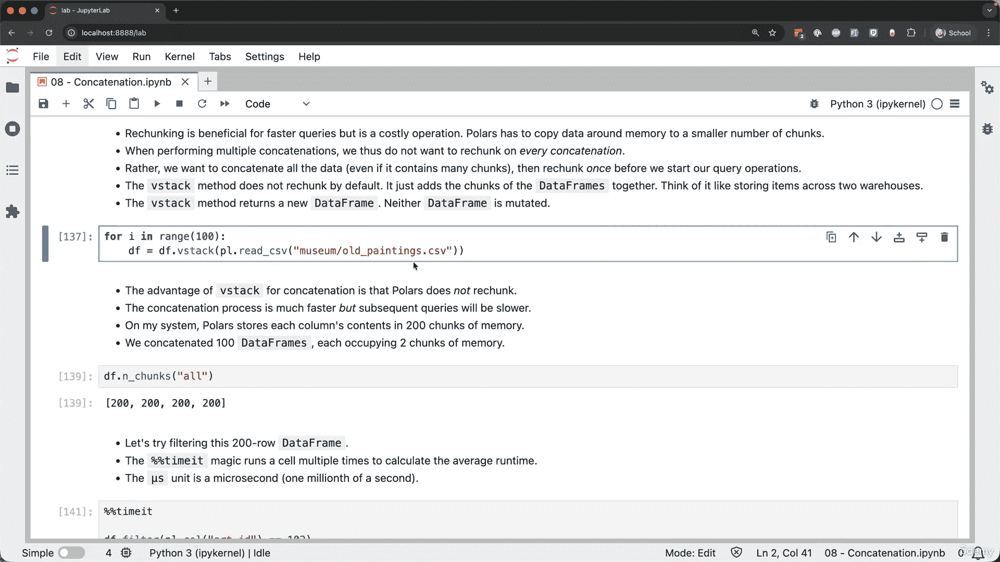

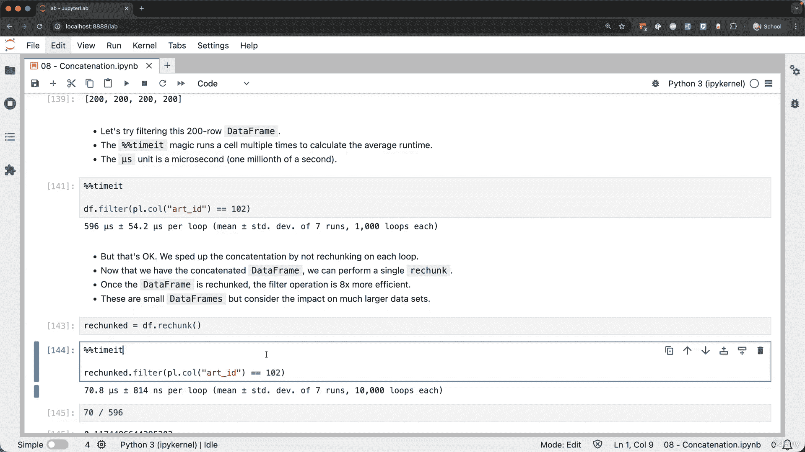

本节课我们一起学习了 `vstack` 方法。第一，它是在已有 DataFrame 上调用、并传入要拼接的新 DataFrame 的方法。第二，也许更重要的是，`vstack` 不会修改现有 DataFrame，也不会执行 `rechunk`。它返回一个全新的 DataFrame，这个 DataFrame 可能存储着对多个不同内存 chunks 的引用。因此，它还没有针对查询、过滤或任何操作进行优化，但它非常适合先执行多次连续拼接。拼接完成之后，再执行一次 `rechunk`，之后就能获得快速操作带来的好处。希望这些内容清楚，下节课见。

