# 📊 Polars与Python数据分析：第20节：extend 方法


在本节课中，我们将要学习 DataFrame 的第二种拼接方式 `extend`，并把它与上一节介绍的 `vstack` 进行对比。我们会重点理解两件事：第一，`extend` 可能会重新分块（rechunk），因此在循环中反复拼接并不合适；第二，`extend` 会原地修改已有的 DataFrame，而不是返回一个新的 DataFrame。随后我们会通过两个 CSV 文件的示例、循环拼接的反例、以及 `rechunk` 前后的查询计时实验，把这两个差异讲清楚，最后给出什么时候用 `extend`、什么时候用 `vstack` 的实用建议。


## 🧩 Polars与Python数据分析：第20.1节：extend 的定位与两大差异


上一节我们介绍了 `vstack` 的用法，本节中我们来看看 `extend` 的定位，以及它与 `vstack` 的两大区别。`extend` 是可以在 DataFrame 上调用的第二个拼接方法，调用方式看起来和 `vstack` 很像，但内部行为并不一样，所以不能简单地把它当成 `vstack` 的替代品来用。


理解 `extend` 时，可以先用一个简单的公式记住它的核心行为：`old_df.extend(new_df) -> 修改 old_df 本身`。也就是说，数据会被拼进去，但被拼接的那个 DataFrame 对象本身发生了变化，这一点和很多 Polars 操作“返回新对象”的风格不同。


下面先看 `extend` 与上一节 `vstack` 的两大区别，这两条会直接影响代码怎么写、循环怎么设计。


- 第一个区别是是否重新分块：上一节已经看到，`vstack` 不会重新分块；而 `extend` 可能会重新分块。重新分块意味着 Polars 要把内存中多个位置的数据移动到一个连续的位置，这个动作成本很高，所以在循环里反复 `extend` 通常不是好主意，循环中大量拼接一般应优先选择 `vstack`。
- 第二个区别是返回值与修改方式：`vstack` 会返回一个新的 DataFrame，所以上一节我们才需要反复把结果重新赋值回变量；`extend` 则是 Polars 库中很少见的、会真正原地修改已有 DataFrame 的方法。调用 `extend` 后，原 DataFrame 会被改变，而不是产生一个新 DataFrame 再返回。


这里容易让初学者困惑的一点是：调用 `extend` 时，它看起来也会返回 DataFrame，但返回的并不是一个新 DataFrame，而是被修改后的原 DataFrame。可以理解为方法为了调用方便，把原地修改过的原对象又返回出来了，所以不要误以为它像 `vstack` 一样产生了新对象。


## 🧪 Polars与Python数据分析：第20.2节：用两个 CSV 演示原地修改


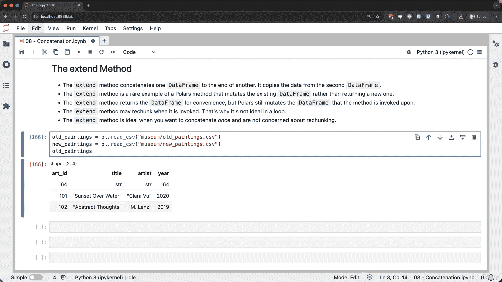

了解了原地修改这个关键点后，下面我们用两个 CSV 文件做一次实际拼接，看看 `extend` 在代码里到底怎么用。示例中会导入 `old_paintings` 和 `new_paintings` 两个 DataFrame，并先观察 `old_paintings` 当前的样子。


下面是导入两个 CSV 文件的基础代码，写法很直白，就是把两个文件分别读成 DataFrame。


```python
import polars as pl

old_paintings = pl.read_csv("old_paintings.csv")
new_paintings = pl.read_csv("new_paintings.csv")
```


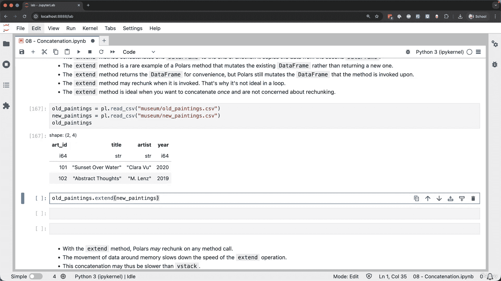

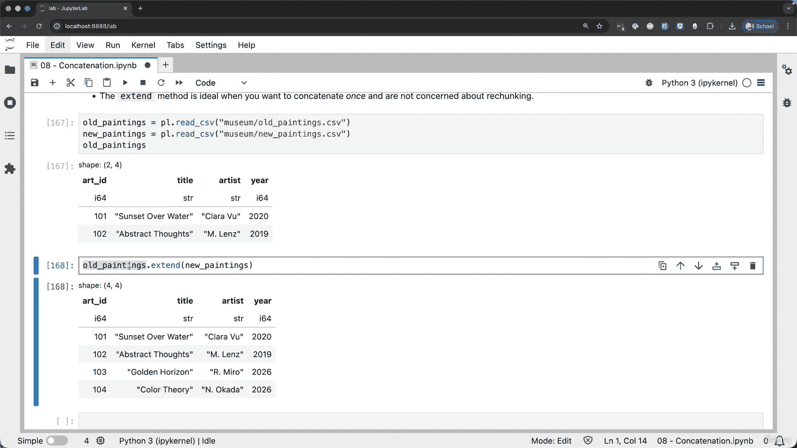

接下来，我们会对已有的 `old_paintings` 调用 `extend`，并把第二个 DataFrame `new_paintings` 传进去。这个 API 的语法和 `vstack` 基本一致，都是在一个 DataFrame 上调用拼接方法，然后把另一个要拼接的 DataFrame 作为参数传进去。


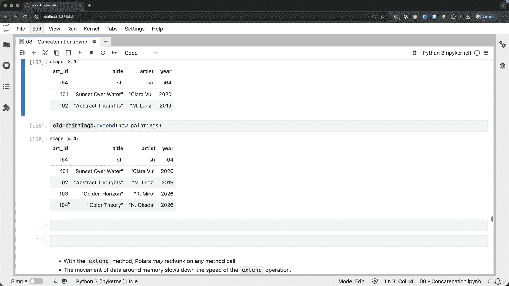

```python
old_paintings.extend(new_paintings)
```


虽然这个操作会返回一个四行的 DataFrame，但关键点是：`extend` 实际上修改了已有的 `old_paintings`。这种原地修改在 Polars 中并不常见，所以需要特别留意。


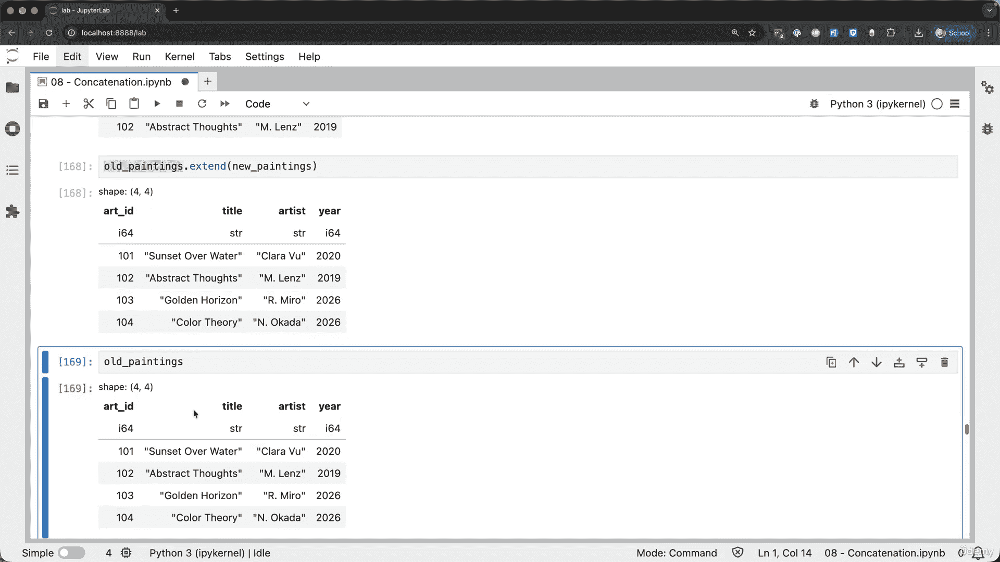

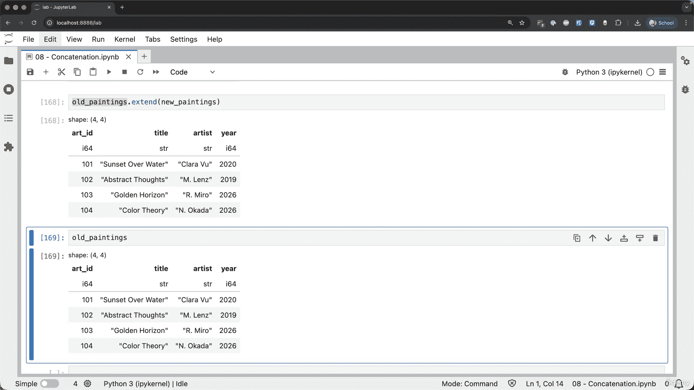

我们可以重新执行 `old_paintings` 来检查结果，会看到它确实已经被修改，现在包含四行数据。这就是 `extend` 与 `vstack` 的一个重要差异：`extend` 会原地修改，而且它可能重新分块，也可能不重新分块，行为并不是完全固定的。


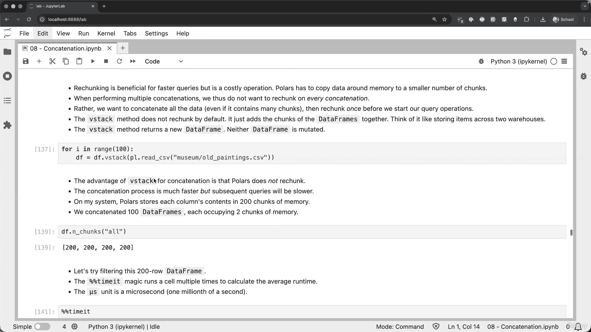

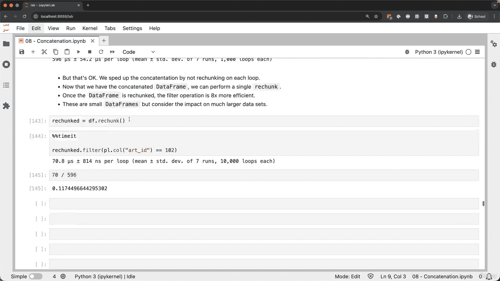

## ⚠️ Polars与Python数据分析：第20.3节：不要在循环里反复 extend


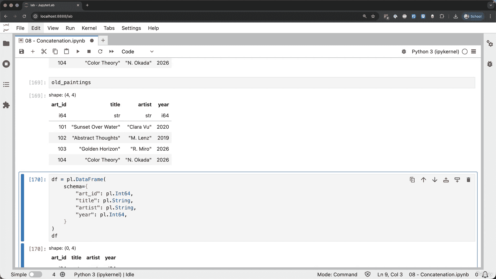

从实际拼接可以看到 `extend` 用起来很方便，但在循环中反复调用就要谨慎。为了说明这一点，我们回到上一节用过的思路：先创建一个空 DataFrame，然后看看为什么不建议在 100 次循环里不断调用 `extend`。


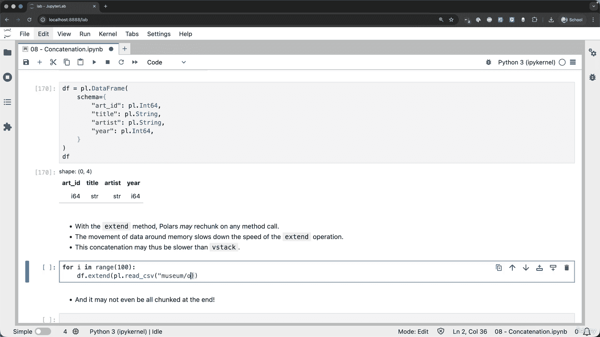

下面是创建空 DataFrame 的代码，这一步本身没有问题，问题出在后面的循环拼接方式。


```python
df = pl.DataFrame()
```


通常不建议写成下面这样：循环 100 次，每次都拿 `df` 去调用 `extend`，把某个 DataFrame 的内容拼进去。这里用 `old_paintings` 作为示例数据。


```python
for _ in range(100):
    df.extend(old_paintings)
```


在这个场景里，因为 `extend` 会原地修改已有的 `df`，所以不需要像 `vstack` 那样每次把返回值重新赋值回 `df`。不重新赋值也没有危害，因为每次迭代都会自动修改已有的 DataFrame。但问题在于，这个操作也可能重新分块；如果每次迭代结束都重新分块，就等于无意义地重新分块了 100 次，因为下一次循环还会继续增加行，数据又可能被拆到多个内存位置，而 Polars 是否会把它们收集到同一个新位置并没有稳定可预测的保证。


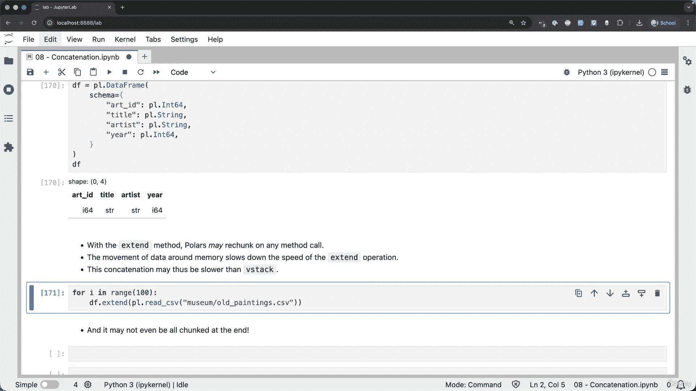

因此，如果要做循环拼接，一般应优先使用 `vstack`，等所有迭代都结束后再调用一次 `rechunk`。可以用一个简单的成本公式来理解：`循环内反复 rechunk 的成本 ≈ 循环次数 × 移动并重排数据的成本`，而 `循环结束后只 rechunk 一次的成本 ≈ 一次数据整理成本`，后者通常更划算。


下面是一个更合理的结构示意：循环中用 `vstack` 累积结果，循环结束后统一 `rechunk` 一次。


```python
df = pl.DataFrame()

for _ in range(100):
    df = df.vstack(old_paintings)

df = df.rechunk()
```


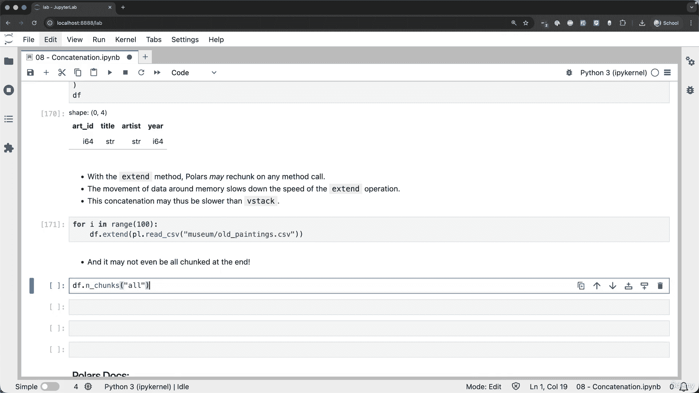

## ⏱️ Polars与Python数据分析：第20.4节：rechunk 对查询速度的影响


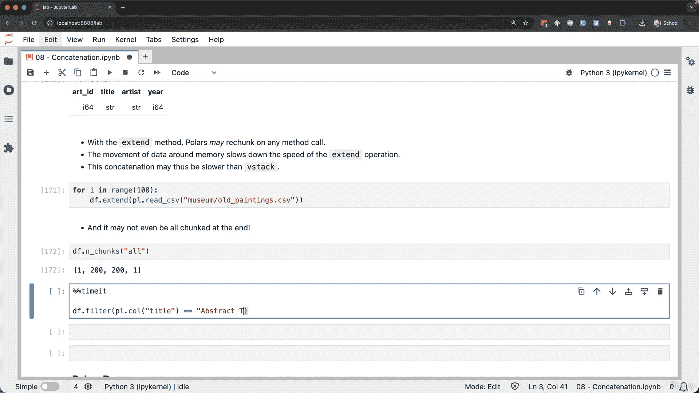

前面提到循环结束后调用 `rechunk`，本节通过计时实验看看它到底有什么效果。先看一个有意思的现象：对经过多次修改和潜在重新分块的 `df` 调用 `rechunk` 后，`art_id` 和 `year` 这两列的数据被 Polars 放进了单个连续的内存块，但 `title` 和 `artist` 并没有这样处理，所以对 `title` 和 `artist` 的操作通常会慢一些。


为了观察速度差异，我们使用 `%timeit` 单元格魔法，对 `title` 列做过滤，例如筛选 `title` 等于 `"Abstract Thoughts"` 的记录。这里 `title` 列的数据可能分散在大约 200 个块中，所以过滤操作需要访问多个内存位置。


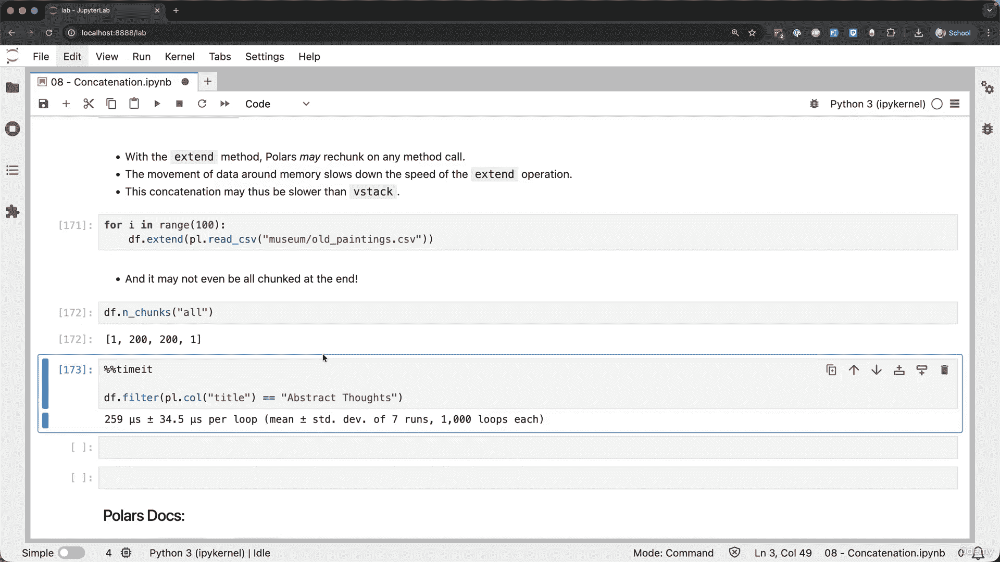

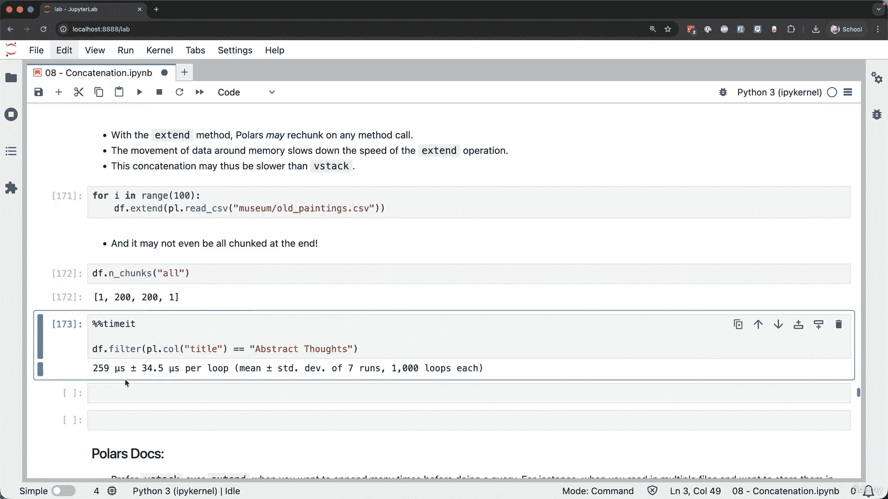

```python
%timeit df.filter(pl.col("title") == "Abstract Thoughts")
```


在这个示例中，`%timeit` 会多次运行这段代码，可以看到它运行了约 1000 次，单次耗时大约 259 微秒。这个数字本身不是重点，重点是它提供了一个基线，方便和重新分块后的结果对比。


接着，我们可以对 `df` 调用 `rechunk`，强制把每一列的数据都重新分块，让所有列的数据都存储在单个连续的内存块中。然后把结果重新赋值给 `rechunked`，再重复上面的过滤逻辑，只是把 `df` 换成 `rechunked`。


```python
rechunked = df.rechunk()

%timeit rechunked.filter(pl.col("title") == "Abstract Thoughts")
```


重新分块后，同样的过滤操作会明显更快，单次耗时大约 71 微秒，约为原来的四分之一。关键结论是：即使 `extend` 在某些情况下可能自动重新分块，它也不一定能做到完美重新分块，最后仍然需要我们手动调用一次 `rechunk`，才能让查询操作尽量快。


## 📚 Polars与Python数据分析：第20.5节：何时用 extend，何时用 vstack


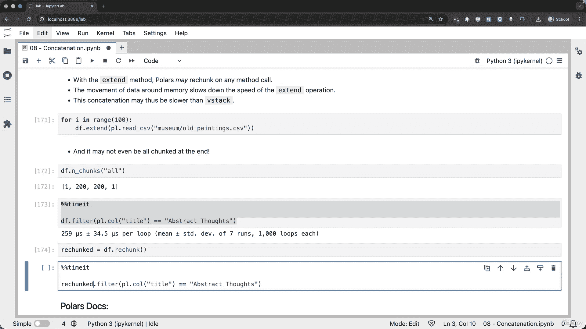

实验说明重新分块对查询速度影响明显，最后我们来看看官方文档给出的选择建议，以及在实际代码中应该如何取舍。Polars 文档对两个方法的使用场景有一个很清楚的总结，核心判断标准是：你是要多次拼接后再查询，还是只拼接一次就查询。


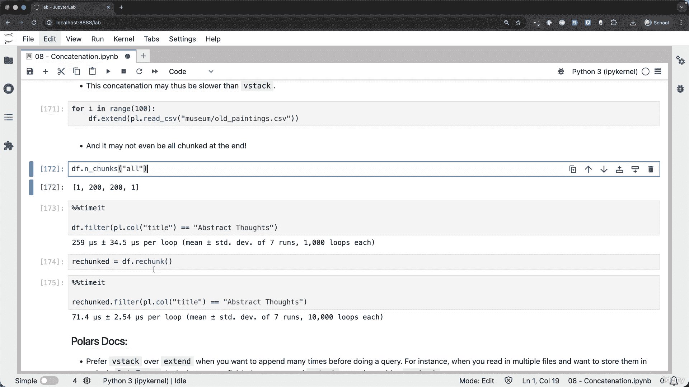

以下是原文中提到的选择标准，可以当作写代码时的检查清单。


- 当你要在查询前多次追加或拼接数据时，优先使用 `vstack`。例如动态导入 100 个 DataFrame，并在循环中依次拼接每个 DataFrame 的内容，这种场景应优先 `vstack`，因为它可以保证避免重新分块。
- 当你读取多个文件并希望把它们存进一个 DataFrame 时，可以在整个拼接序列结束后只调用一次 `rechunk`，这样后续查询就能在更整齐的内存布局上进行。
- 当你只是做一次追加，然后马上查询时，`extend` 可能比 `vstack` 更有优势。因为 `extend` 会原地修改已有 DataFrame，可能直接带来重新分块，底层也可能有一些优化来避免额外的数据复制。
- 当你只拼接一次，但并不是所有 DataFrame 都能同时拿到时，`extend` 也可能更合适，而且它可能无论如何都会帮你执行重新分块。


可以用一段简单的代码把建议落地：在所有拼接结束后统一整理一次数据，让每一列的数据都集中到单个内存块中。原文作者认为，这样的代码习惯值得保留，因为它能明显加快后续 Polars 操作的完成速度。


```python
final_df = final_df.rechunk()
```


## ✅ 总结


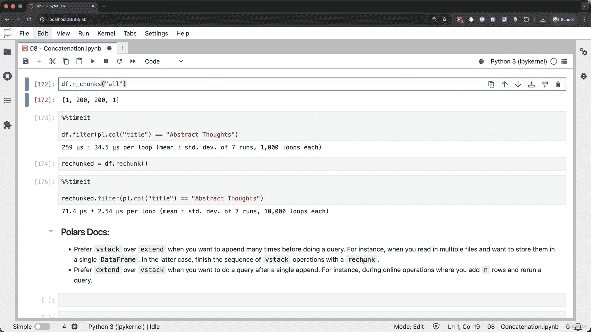

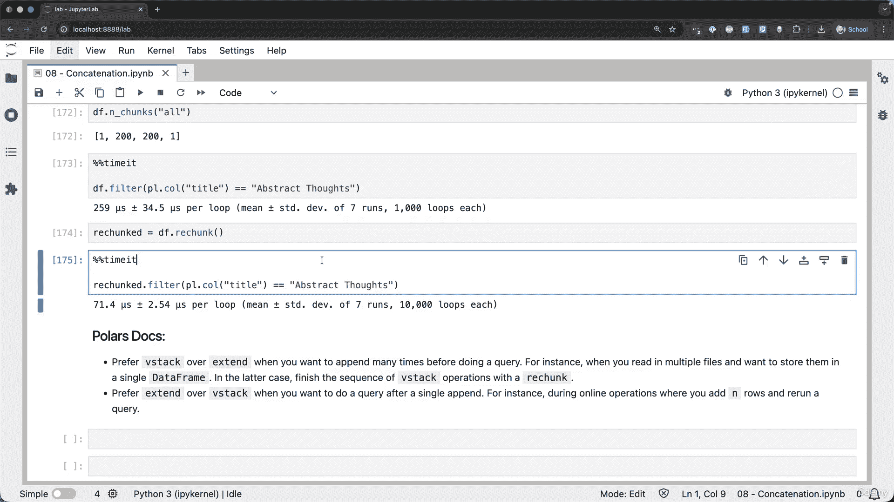

本节课中，我们一起学习了 Polars 中的 `extend` 方法。我们知道了 `extend` 会原地修改已有 DataFrame，并可能返回被修改后的原 DataFrame，而不是像 `vstack` 那样返回一个新 DataFrame；我们也知道了 `extend` 可能重新分块，因此在循环中大量拼接时应优先使用 `vstack`，等循环结束后再统一调用一次 `rechunk`。通过两个 CSV 的示例和 `%timeit` 计时实验，我们看到重新分块对查询速度有明显影响，也理解了什么时候适合用 `extend`、什么时候适合用 `vstack`。最后记住一个实用习惯：在所有拼接完成后调用一次 `rechunk`，让数据尽量集中到连续内存块中，后续查询会更顺畅。

