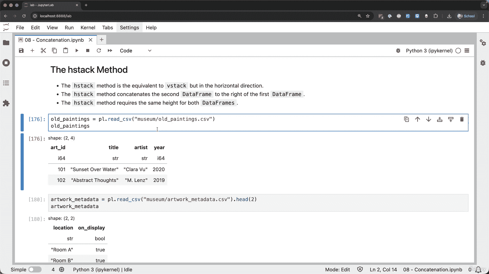
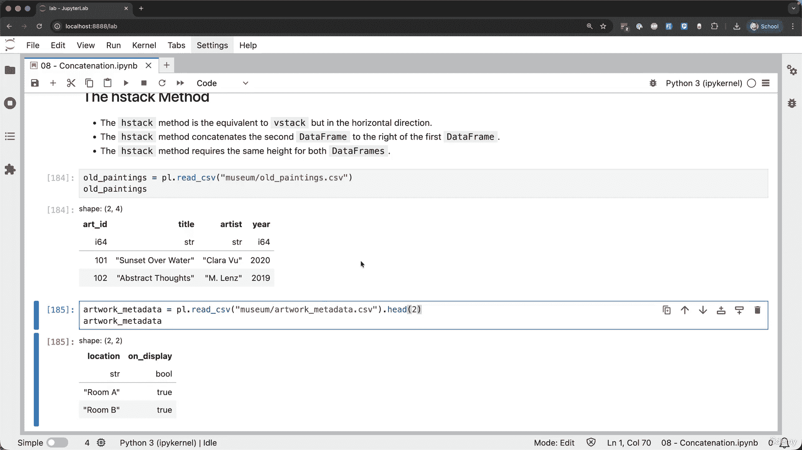
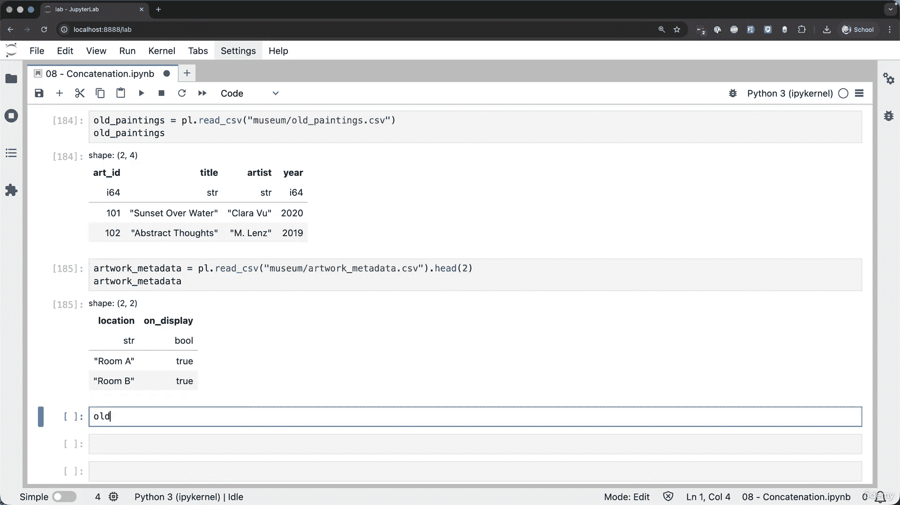
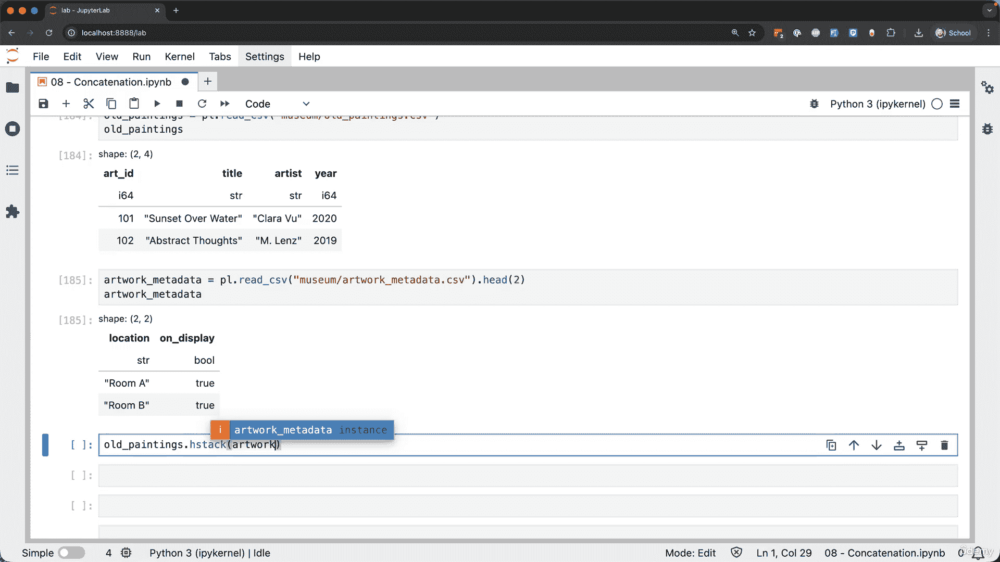
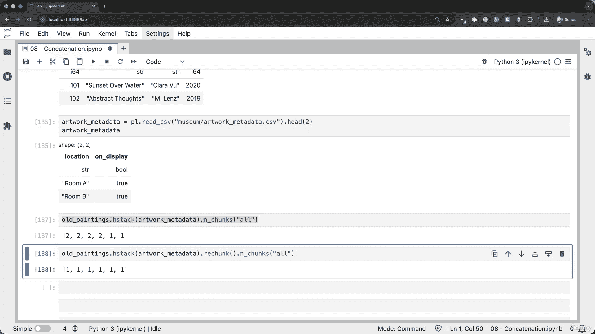

# 📊 Polars 与 Python 数据分析：121：hstack 方法

在本节课中，我们将要学习 Polars 中的 `hstack` 方法。这是一节简短课程，目标是补齐一个很常用的方法：水平堆叠。先说明它的定位：`hstack` 是 horizontal stack 的缩写，中文可以理解为水平堆叠；它与 `vstack` 方法平行，也是 `vstack` 的补充方法。上一节我们介绍了按行追加的思路，本节中我们来看看如何把另一张表按列拼到右侧。

`hstack` 很适合这样一种场景：你还没有把所有数据框都收集齐，但你已经有一个现成的数据框，并且想在它上面调用方法，再传入第二个数据框；第二个数据框可能在程序运行过程中动态到达。和 `vstack` 一样，`hstack` 不会替你自动重新分块，也就是不会自动执行 rechunk。下面先给出最核心的调用形式。

```python
df_result = df_left.hstack(df_right)
```

## 🧭 Polars 与 Python 数据分析：121.1：课程概述与 hstack 定位

前面我们已经明确，`hstack` 的核心作用是把列拼到右侧。这里再强调它的几个关键点：它是水平堆叠，是 `vstack` 的平行方法或补充方法；它适合数据框尚未全部收集完成的场景；它可以在已有数据框上调用，并传入一个可能动态到达的第二个数据框；它不会自动重新分块。为了让初学者更容易理解，可以把它想成“把两张表并排放在一起”，而不是“把一张表追加到另一张表下面”。下面的列表概括了本节要掌握的核心定位。

以下是 `hstack` 的定位要点：

- `hstack` 是 horizontal stack 的缩写，表示水平堆叠。
- 它与 `vstack` 方法平行，也是 `vstack` 的补充方法。
- 它适合尚未收集全部数据框的场景。
- 它会在现有数据框上调用，并传入第二个数据框。
- 第二个数据框可以在程序中动态到达。
- 与 `vstack` 一样，它不会自动执行 rechunk。



理解定位后，下一步需要准备示例数据。这里会执行导入代码，并准备两张表：`old paintings` 和 `artwork metadata`。为了让示例满足 `hstack` 的条件，还需要先做一个行数裁剪。

## 🧪 Polars 与 Python 数据分析：121.2：示例准备与同高条件

上一节我们说明了 `hstack` 的用途，本节中我们来看看示例准备。这里执行导入代码后，可以看到 `old paintings` 和 `artwork metadata` 两张数据框。代码中对其中一张表调用了 `head` 方法，并传入参数 `2`，从而生成一个两行的数据框。这样做的原因是：`hstack` 有一个硬性要求，参与水平堆叠的数据框必须高度相同，也就是行数必须相等。原因很直白：这个方法会把第二张表粘到第一张表的右侧，如果行数不同，就无法一一对齐。

可以用一个简单公式表示同高条件。

```python
df_left.height == df_right.height
```

也可以用更直白的方式理解：结果行数必须等于左表行数，也必须等于右表行数。



```text
结果行数 = 左表行数 = 右表行数
```



以下是示例准备的关键步骤：

- 执行导入代码，准备好 Polars 环境。
- 准备 `old paintings` 数据框。
- 准备 `artwork metadata` 数据框。
- 对数据框调用 `head(2)`，生成一个两行数据框。
- 确认参与 `hstack` 的两张表行数相等。
- 明确原因：`hstack` 会把数据粘到右侧，因此必须有一一对应的行。

完成准备后，就可以进入实际操作。接下来会在 `old paintings` 上调用 `hstack`，并把 `artwork metadata` 传进去，观察返回结果。

## 🛠️ Polars 与 Python 数据分析：121.3：调用 hstack 完成水平连接

前面已经准备好了同高数据框，本节中我们来看看如何调用 `hstack`。这里再次强调，`hstack` 与 `concat` 的一个关键区别是：你可以在一个现有数据框上直接调用这个方法。示例中会在 `old paintings` 上调用水平堆叠，也就是水平连接，并把 `artwork metadata` 作为参数传入。调用后会得到一个全新的数据框，它是一个独立且不同的数据框；原来的 `old paintings` 不会被修改。结果中会在右侧出现两个新列。和 `vstack` 一样，这里不会发生重新分块。

下面是调用 `hstack` 的核心代码。

```python
df_result = old_paintings.hstack(artwork_metadata)
```

以下是调用 `hstack` 时需要关注的行为：

- 与 `concat` 的关键区别是，可以在现有数据框上调用 `hstack`。
- 在 `old paintings` 上调用 `hstack`，就是执行水平连接。
- 把 `artwork metadata` 传入方法。
- 返回一个全新的数据框。
- 新数据框是独立且不同的对象。
- 原来的 `old paintings` 不会被修改。
- 结果右侧会出现两个新列。
- 与 `vstack` 一样，不会自动执行 rechunk。



得到新数据框后，还需要验证“没有自动 rechunk”这一点。接下来使用 chunks 检查来观察底层分块情况，并解释结果大于 1 的含义。

## 🔍 Polars 与 Python 数据分析：121.4：验证不自动 rechunk

上一节我们完成了水平连接，本节中我们来看看如何验证没有自动 rechunk。原文通过 chunks 检查来证明这一点，并传入 `all` 参数。核心判断是：如果结果大于 1，就说明数据没有存放在单一连续位置；这也意味着数据至少在每个列中仍然存放在两个内存位置，具体可能更多，取决于你水平堆叠或连接了多少个数据框。对初学者来说，可以把它理解为：虽然结果表看起来是一张表，但底层数据可能仍然分散在多个块中。

下面是检查分块数量的示例代码。

```python
df_result.n_chunks()
```

> 提示：原文提到传入 `all` 参数来检查 chunks；这里保留其意图，即查看分块数量是否大于 1。实际调用时请以所用 Polars 版本的 API 为准。

以下是验证不自动 rechunk 的要点：

- 使用 chunks 检查来证明数据没有自动重新分块。
- 原文示例中传入 `all` 参数。
- 如果检查结果大于 1，就说明数据没有存储在单一连续位置。
- 这说明数据至少在每个列中仍存放在两个内存位置。
- 如果堆叠或连接的数据框更多，内存位置可能更多。
- 具体位置数量取决于水平堆叠或连接的数据框数量。

验证完成后，还需要理解一个更重要的使用习惯：`hstack` 往往会在循环中多次顺序调用。接下来看看循环中的最佳实践，以及为什么最后要调用 `rechunk`。

## 🔁 Polars 与 Python 数据分析：121.5：循环中多次使用与最后 rechunk

前面我们验证了 `hstack` 不会自动 rechunk，本节中我们来看看实际使用中应该怎么做。关键思路是：你可能需要在序列中多次使用 `hstack`。例如，你在一个循环中水平连接 50 个数据框；此时应该动态地把结果重新赋值回主数据框，让这个主数据框充当完整的事实来源，或者充当所有列的最终集合。等整个迭代过程完成、所有连接都完成后，再在最后调用 `rechunk` 方法。这样 Polars 就能把每一列的数据聚合并收集到计算机内存中的单一位置，从而加速未来的查询操作。

下面是循环中动态赋值并在最后 rechunk 的伪代码。

```python
main_df = main_df.hstack(next_df)

# 循环中重复水平连接，并持续动态赋值回 main_df

main_df = main_df.rechunk()
```

以下是循环使用 `hstack` 的最佳实践：

- 关键思路是多次顺序使用 `hstack`。
- 例如在循环中水平连接 50 个数据框。
- 每次连接后动态重新赋值回主数据框。
- 主数据框充当完整的事实来源。
- 主数据框也充当所有列的最终集合。
- 等迭代过程全部完成后再处理分块。
- 等所有连接完成后，在最后调用 `rechunk` 方法。
- `rechunk` 会让 Polars 聚合并收集每列数据到单个内存位置。
- 这样做可以加速未来的查询操作。

完成以上步骤后，本节的核心内容就讲完了。`hstack` 是 `vstack` 的补充方法，适合把动态到达的数据框按列拼到现有数据框右侧，但要注意同高要求、不自动 rechunk，以及循环结束后手动调用 `rechunk`。

## ✅ Polars 与 Python 数据分析：121.6：总结



本节课中我们一起学习了 Polars 的 `hstack` 方法。我们明确了 `hstack` 是 horizontal stack 的缩写，是 `vstack` 的平行方法和补充方法；它适合尚未收集全部数据框时，在现有数据框上调用并传入第二个动态到达的数据框。我们通过示例看到，参与水平堆叠的数据框必须行数相同，因为方法会把第二张表粘到右侧。调用 `hstack` 会返回一个全新且独立的数据框，原数据框不会被修改，新列会出现在右侧。与 `vstack` 一样，`hstack` 不会自动 rechunk；可以通过 chunks 检查看到数据仍然分散在多个内存位置。最后我们强调，循环中多次水平连接时应动态赋值回主数据框，并在所有连接完成后调用 `rechunk`，让 Polars 把每列数据收集到单一内存位置，从而加速未来查询。以上就是 `hstack` 方法的核心内容，它是 `vstack` 方法的重要补充。

