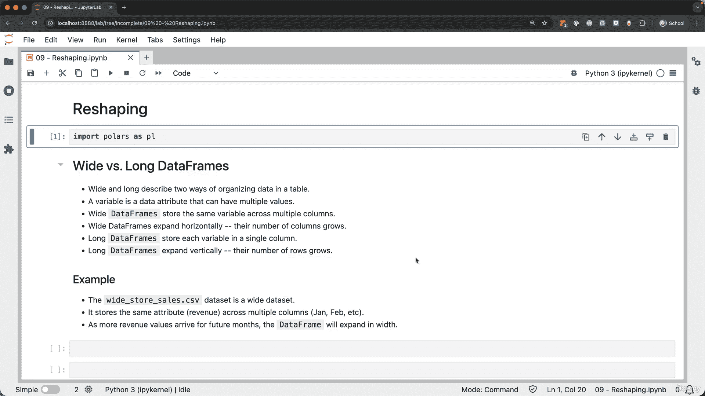
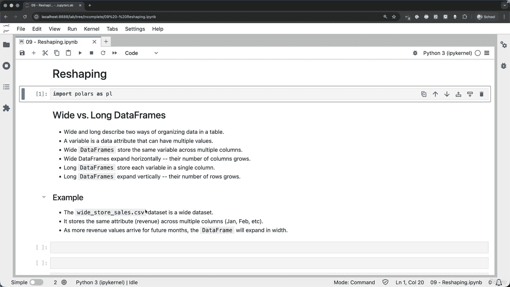
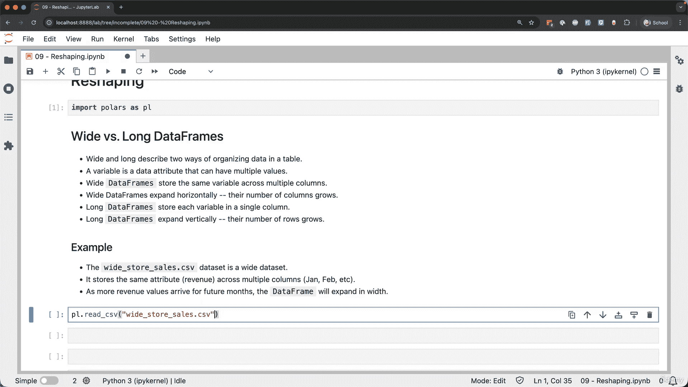
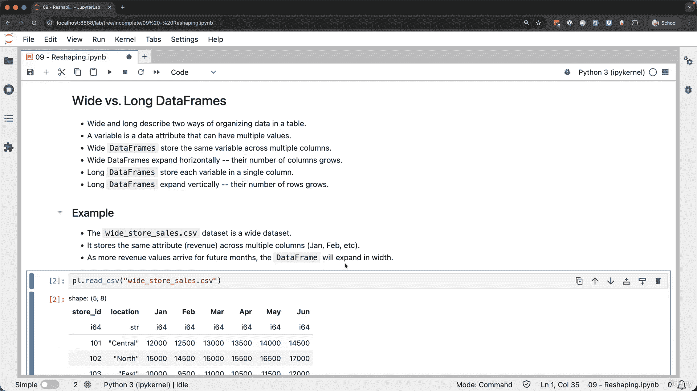
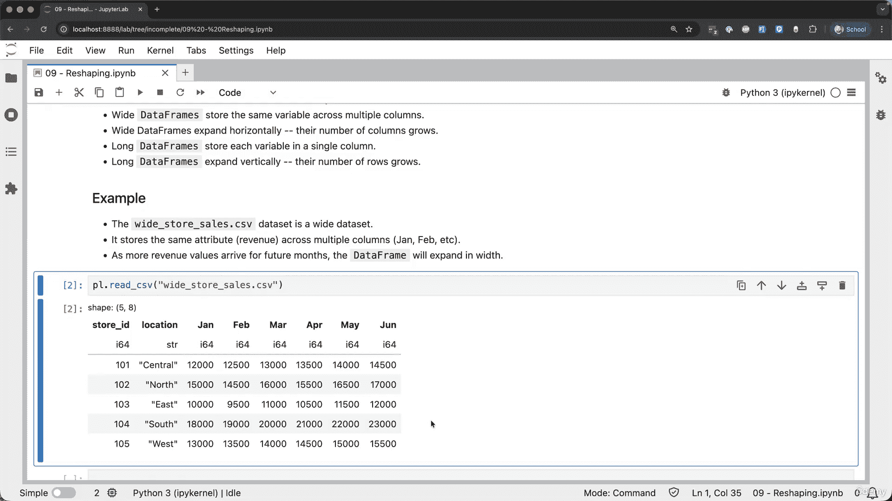

# 📊 Polars 与 Python 数据分析：第 122 节：宽表与长表数据框

## 🧭 Polars 与 Python 数据分析：第 122.1 节：本节概述

在本节课中我们将要学习 Polars 中“重塑”数据框的基本思路，并重点认识宽表与长表这两种常见的数据组织方式。我们会先说明重塑到底在做什么，再通过一个门店销售数据示例观察宽表的结构，最后解释宽表在什么场景下好用、在什么场景下可能带来麻烦。下一节课程标题是 Reshaping，也就是“重塑”，我们会探索如何操作或转换数据框，让它们变成各种不同的格式。

需要特别说明的是，重塑并不会改变数据框里实际存储的数据本身，它改变的是数据的形状或呈现方式。换句话说，你可以把重塑理解成转换数据框的布局，重新组织数据在不同行和列上的分布，从而用不同视角观察同一份基础数据集。下面的公式可以帮助理解这个核心区别：

\[
\text{重塑} \neq \text{修改数据值}；\quad \text{重塑} = \text{改变行列布局}
\]

## 📦 Polars 与 Python 数据分析：第 122.2 节：导入 Polars 并理解重塑

上一节我们说明了重塑是在改变布局而不是改变数据值，本节中我们来看看实际操作的起点，也就是导入 Polars。和往常一样，我们会新建一个 Jupyter Notebook，这一节使用的笔记本名称叫 `09 reshaping`，然后在其中导入 Polars，并使用 `as` 关键字给它指定别名 `pl`。对应的代码如下：

```python
import polars as pl
```

导入完成后，我们就可以展示同一份数据如何根据结构不同，被存储成几种不同的格式。一个很好的起点就是“宽表”和“长表”这两个概念，它们描述的是同一份表格数据的两种不同组织方式。这里的“宽”与“长”主要指当我们向数据框添加更多数据时，它会朝哪个方向扩展，这个方向会影响我们得到的是宽表还是长表。

## ↔️ Polars 与 Python 数据分析：第 122.3 节：宽表与长表的核心区别

上一节我们导入了 Polars，本节中我们来看看宽表和长表最核心的区别。宽表通常会向“宽度”方向扩展，也就是当我们添加更多数据时，会增加更多列；长表则会向“高度”方向扩展，也就是当我们添加更多数据时，会增加更多行。这个扩展方向是判断宽表与长表的重要依据，可以用下面的公式概括：





\[
\text{宽表}：新增数据 \Rightarrow 增加列；\quad \text{长表}：新增数据 \Rightarrow 增加行
\]

通常，当你把同一个变量存储在多个列里，而不是把它限制在单一列中时，就更可能得到宽表。这里说的“变量”，可以理解为你正在测量的东西，也就是每个观察对象会有所不同的那个量。因为同一个变量有更多取值时，宽表会把这些值放进额外的列里，所以数据框会越来越宽。以下是宽表常见的几个特征，可以帮助初学者快速识别：

- 同一个测量变量会分散在多个列中。
- 新增数据时往往增加列，而不是增加行。
- 适合人眼横向比较不同列之间的变化。

## 🏪 Polars 与 Python 数据分析：第 122.4 节：门店销售宽表示例

上一节我们介绍了宽表与长表的方向区别，本节中我们来看一个具体的宽表示例。我们使用 `read_csv` 函数读取名为 `wide_stores.csv` 的文件，这个数据集是一组虚构的门店销售数据，代码可以写成下面这样：





```python
df = pl.read_csv("wide_stores.csv")
df
```

查看数据后可以看到，每一家门店都有一个门店 ID，同时还有门店所在位置。门店 ID 和位置都可以描述为“所有值都包含在单一列中”的变量。也就是说，门店 ID 不会出现在数据集的其他列里，像 101 和 102 这样的值都是门店 ID 这个变量的取值，每一行对应一个不同的门店 ID；位置也是同样的道理，位置这个变量发生变化时，像 central、north 和 east 这样的不同取值都被限制在 `location` 这一列里。下一段我们会把这两列和剩下的六列做对比，从而更清楚地看到宽表的特点。

数据中剩下的六列代表一年中的一月到六月，这些列里存放的是销售额，也可以理解为收入或者售出的数量，具体含义并不影响结论。关键在于，这六列里的所有数字都代表同一个基础值、同一个单位或同一种测量，也就是销售额。但销售额并没有被限制在一个单独的 `sales` 列中，而是分散在多列里，所有值从根本上代表的是同一类东西。可以用下面的公式表示这种分散存储方式：

\[
\text{sales} = \{\text{Jan}, \text{Feb}, \text{Mar}, \text{Apr}, \text{May}, \text{Jun}\}\text{ 分散在多个列中}
\]

## 📈 Polars 与 Python 数据分析：第 122.5 节：宽表如何扩展及适用场景

上一节我们通过门店数据看到了销售额分散在多列中的宽表结构，本节中我们来看看这种宽表在新增数据时会如何扩展。假设明天我们拿到了今年剩余月份的数据，也就是七月到十二月的数据，那么我们向这个数据框添加数据的方式，就是继续在右侧增加列，例如增加 July、August、September 等列。类似地，如果我们想要下一年的数据，就需要再增加一个下一年的 January 列。我们不是在增加行数，而是在增加列数，因此宽表的扩展方向可以用下面的公式描述：

\[
\text{宽表扩展方向}：\text{列数} \uparrow；\quad \text{行数不变}
\]

这种宽表视图因为数据向宽度扩展，在某些场景下特别有帮助。例如，如果一位企业高管想查看某家门店逐月的销售额变化，看销售是上升还是下降，那么宽表可以是一种很有效的整合和存储方式，能把数据放在一张紧凑的表格里。但如果想执行某种计算，比如计算所有门店销售额的平均值，就会遇到麻烦，因为数据分散在多个列里，而且这些列具体有哪些可能会随数据集变化。如果明天拿到了七月的数字，那么计算平均销售额的代码就必须扩展，把新的 July 列也包含进去。

由于 Polars 针对列式或基于列的操作进行了优化，这种数据存储方式在某些情况下会带来问题。它在某些场景下很好用，在另一些场景下可能就不太方便。本节课的关键结论是，这个门店销售数据是一个宽表的例子，它不会在行数上扩展，而会在列数上扩展。下一节课我们会看看如何把这样的数据集转换成更高或更长的格式，也就是会在总行数上扩展的格式。以下是本示例中需要记住的要点，方便后续转换时对照：

- 宽表通过增加列来容纳更多同类测量值。
- 逐月横向查看趋势时，宽表很直观。
- 做跨列计算时，宽表可能需要不断修改代码以适配新增列。

## ✅ Polars 与 Python 数据分析：第 122.6 节：本节总结



本节课中我们一起学习了 Polars 中重塑的基本含义，以及宽表与长表数据框的核心区别。我们知道了重塑不会改变实际数据值，只会改变数据的形状和呈现方式；宽表通常在新增数据时增加列，长表通常在新增数据时增加行；同一变量分散在多个列中时，往往就是宽表。我们还通过 `wide_stores.csv` 看到了门店 ID、位置和按月分散的销售额，并讨论了宽表在逐月查看趋势时直观、在做跨列计算时可能需要调整代码的优缺点。下一节课我们将继续学习如何把这种宽表转换成长表，让数据在行数方向上扩展。
