# 🧩 Udemy - Data Analysis with Polars and Python part2：p23 / 123：用 unpivot 方法把宽 DataFrame 转换成长 DataFrame

在本节课中，我们将要学习如何使用 Polars 的 `unpivot` 方法，把一个“宽”DataFrame 转换成一个“长”DataFrame。宽表的特点是列多、行少，很多同类数据被分散在多个列里；长表则是把这些列标题变成某一列里的行值，让数据行数变多。这个转换最核心的思路可以先记成一个公式：`新行数 = 保留列组合数 × 待转换列数`。本节会先讲清楚宽表为什么“宽”，再手动推演转换过程，最后落到 Polars 的实际代码写法、快捷写法和自定义列名写法。

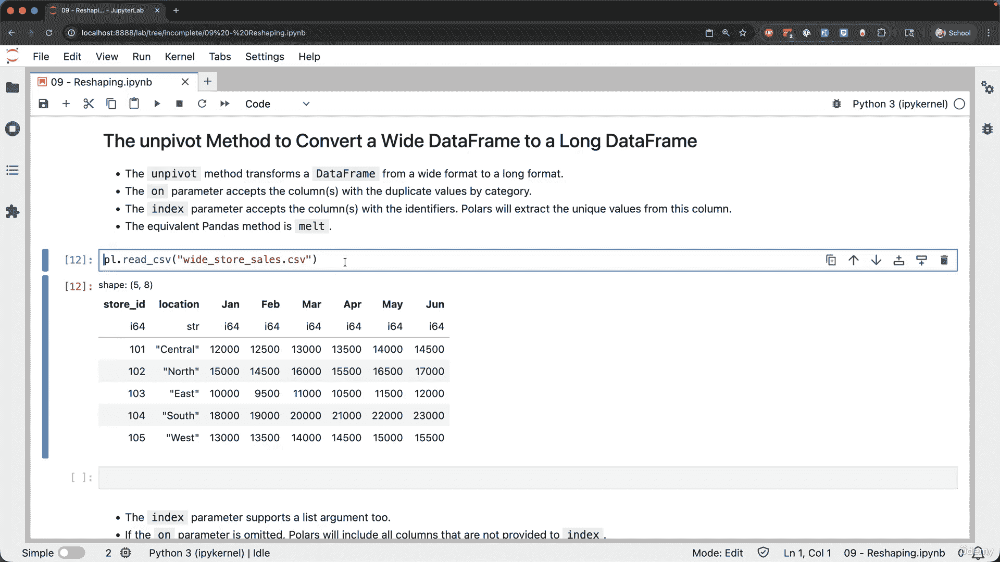

## 🧠 先理解宽表与长表

上一段我们知道了本节的目标是把宽表变长表，本节中我们来看看为什么需要这样转换，以及宽表里的数据到底“宽”在哪里。当前数据框里，`store ID` 和 `location` 这两列的值都只存在单独一列里，它们没有被拆散到多列中，所以这两列可以原样保留。真正被分散到六列里的，是销售数字这一种基础测量值，也就是同一个变量被拆到了 January、February、March、April、May、June 这六个月份列中。换句话说，`store ID` 和 `location` 是“每个店每个地点只出现一次”的信息，而销售额是“同一种数据被横向摊开在六个月份列里”的信息。

为了更直白地理解行数变化，可以看这样一个公式：`新行数 = 保留列组合数 × 待转换列数`。如果保留列有 5 种 `store ID` 和 `location` 的组合，待转换列有 6 个月份列，那么转换后的长表就是 `5 × 6 = 30` 行。这里先把这个数量关系放在心里，后面看到 30 行长表时就不会觉得突然。

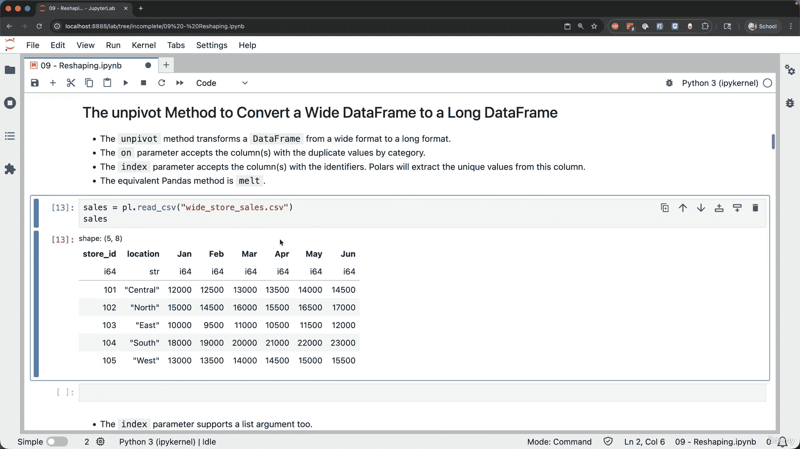

## 🛠️ 把 sales DataFrame 准备好

理解了宽表的结构之后，下一步先把上一课导入的数据框接过来，并赋值给一个变量，这样后面才能调用 `unpivot` 方法。这里把变量命名为 `sales`，并把数据框输出在下方。以下是准备数据框的代码示例：

```python
sales = ...  # 将上一课导入的 DataFrame 赋值给 sales
sales
```

变量准备好之后，先不要急着调用方法。调用 `unpivot` 之前，最好先手动推演一遍到底会发生什么，因为只有把“哪些列保留、哪些列被搬走、值去了哪里”想清楚，写代码时才知道每个参数在做什么。接下来我们就用文字把宽数据集变成长数据集的过程拆开来看。

## 🔍 手动推演 unpivot 到底做什么

现在要解决的问题是：怎样把这个宽数据集转换成一个行数会增加的长数据集。`store ID` 和 `location` 可以保持原位，因为它们各自的值都被收在单独一列里，不需要被拆开。我们需要处理的是销售额这种同一类测量值，它现在散布在六个列里。以下是手动推演时最关键的几步，按这个顺序看就很容易理解。

- 先保留 `store ID` 和 `location` 两列，想象第一行的 `store ID` 是 101，`location` 是 central。
- 从 January 列开始处理，把原来的列标题 `January` 搬到新行里，作为新列 `month` 的一个值，这样原来的列标题就变成了行值。
- 这个交叉点上的实际销售数字是 12000，把它放进新列 `sales`，用来表示月份与 `store ID`、`location` 交叉位置上的数值。
- 对 January 列剩下的值重复同样的逻辑。下一行可以是 `store ID` 为 102、`location` 为 north，`month` 仍然是 January，交叉位置的值是 15000。
- January 列一共有五个值，所以会生成五行。然后对 February、March、April、May、June 这些月份列重复完全相同的处理。
- 例如处理 February 时，仍然可以是 `store ID` 101、`location` central，但 `month` 变成 February，把 12500 移动到对应位置，然后继续处理 February 的所有值以及剩余月份。
- 因为一共有 5 个 `store ID` 和 `location` 的组合，又有 6 个月份列，所以新数据框是 30 行，也就是 `5 × 6 = 30`。
- 以后新增 `store ID`、`location` 或月份时，数据框会向“高度”方向扩展，也就是增加行数，而不是向“宽度”方向扩展增加列数。

这些步骤合起来，就是宽表变长表的基本逻辑：保留列继续保留，分散在多个列里的同类值被搬成行，列标题变成一个新列里的值，交叉点上的数字进入另一个新列。理解了这个过程之后，我们再来看 Polars 中实际的 `unpivot` 写法，就会发现代码只是把刚才的手动推演压缩成了几个参数。

## ⚙️ Polars 中 unpivot 的基本写法

上一节我们手动拆解了转换过程，本节中我们来看看 Polars 怎样用 `unpivot` 方法直接完成这件事。做法是对上面的 `sales` 数据框调用 `unpivot`，并传入两个核心参数。以下是 Polars 中把宽表转长表的基本代码：

```python
sales.unpivot(
    index=["store ID", "location"],
    on=["Jan", "Feb", "March", "April", "May", "June"],
)
```

这段代码里有两个关键参数，需要分别理解它们的作用。以下是两个核心参数的作用，只要把这两个参数对上号，基本写法就不会写错。

- `index` 参数接收一个字符串列表，用来指定要保留在原位的列。这里要保留的列就是 `store ID` 和 `location`。
- `on` 参数也接收一个列名列表，用来指定哪些列里存着分散的同类测量值。这里就是 Jan、Feb、March、April、May、June 这六个月份列。

运行后会得到一个 30 行的长数据框。对于每一个 `store ID` 和 `location` 的组合，原来的月份列标题会被移动到新的 `variable` 列里，成为该列中的值；而原来“月份列标题与 `store ID`、`location` 行值交叉位置”上的实际数据点，会出现在 `value` 列里。比如 January 的五个条目会对应长表中的五行；在数据框底部也会再次出现同样的五个 `store ID` 和 `location` 组合，但这五行对应的 `month` 是 June，数值来自 June 列。Polars 会先按列处理，先处理 January，再处理 February、March，直到把所有值都捕获进来，每个值占一行。

## 🚀 省略 on 的快捷写法

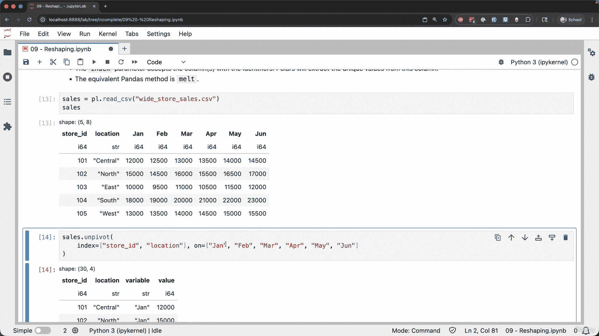

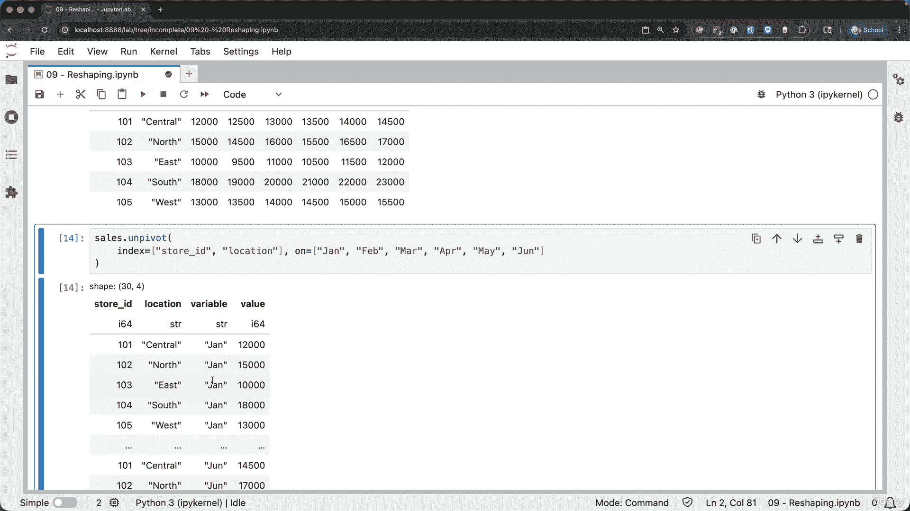

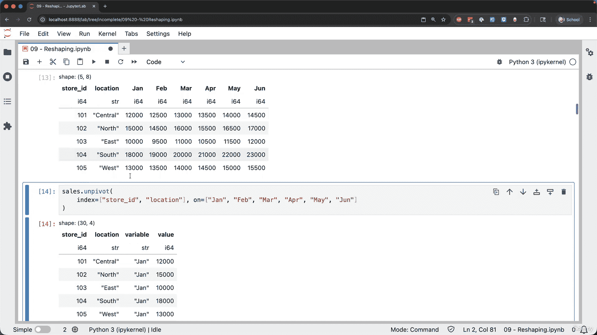

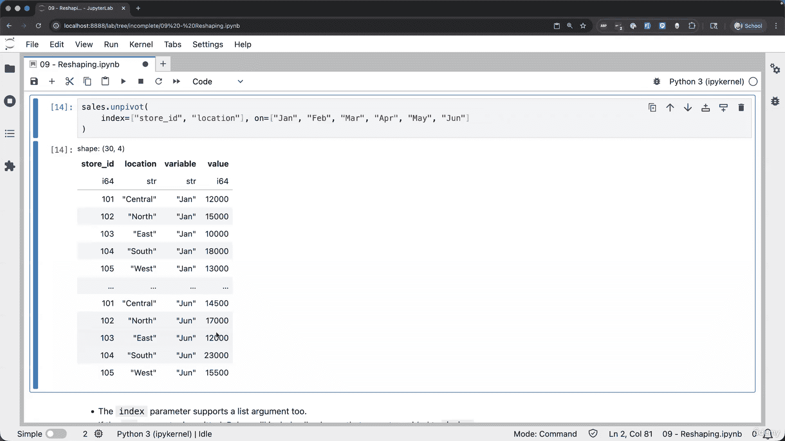

如果不想在 `on` 参数里手动写出所有列名，可以使用一种更短的写法。复制上面的示例代码后，只提供 `index` 参数，省略 `on` 参数，Polars 就会自动推断哪些列需要被转换。以下是这个快捷写法的代码示例：

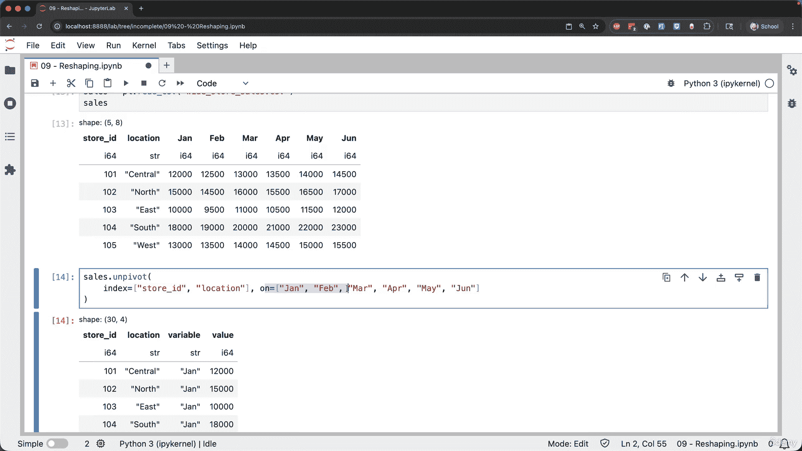

```python
sales.unpivot(index=["store ID", "location"])
```

这种写法会得到和前面完全相同的结果。以下是这个快捷写法的两个要点，理解之后就能放心省略 `on` 参数。

- 只传入 `index` 时，Polars 会假定除 `index` 中提到的列之外，所有剩余列都代表包含重复值的列。
- 在这里，Polars 会自动把六个月份列当成代表同一种测量值的列，并返回同样的 30 行长数据框。

在这个默认结果里，Polars 会自己选择列名：`variable` 用来存放原来的月份列标题，`value` 用来存放月份与 `store ID`、`location` 交叉位置上的值。默认列名虽然能用，但在实际分析中往往不够直观，所以下一步可以自定义这两个列名。

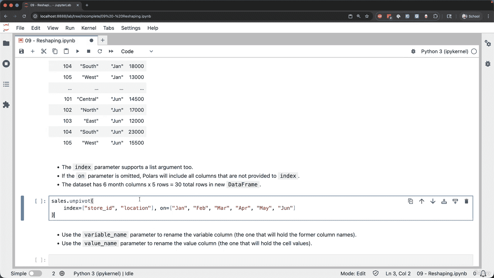

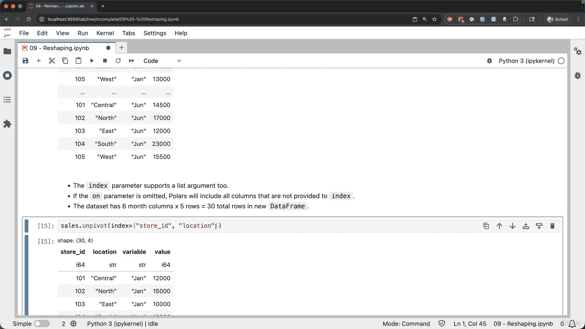

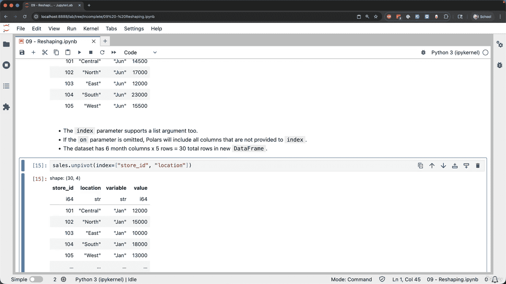

## 🏷️ 自定义 variable_name 和 value_name

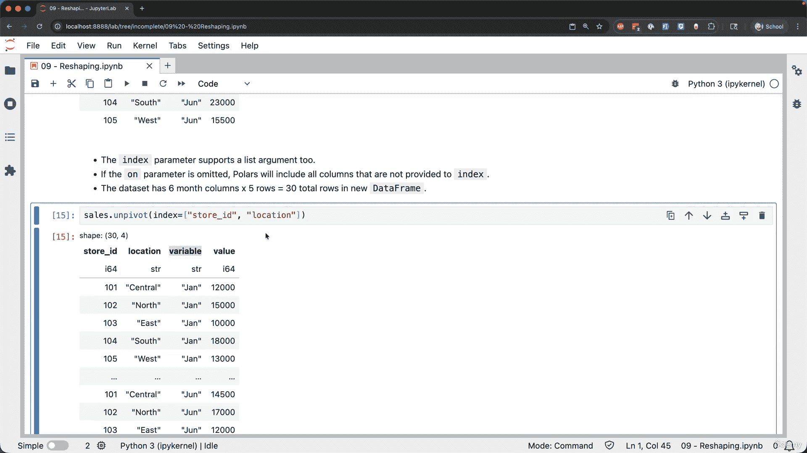

默认的 `variable` 和 `value` 这两个列名可以改得更符合业务含义。可以通过 `unpivot` 的额外参数来自定义它们。以下是自定义列名时的代码示例：

```python
sales.unpivot(
    index=["store ID", "location"],
    on=["Jan", "Feb", "March", "April", "May", "June"],
    variable_name="month",
    value_name="sales",
)
```

这里主要修改两个参数，它们分别控制两个新列的名字。以下是自定义列名时主要修改的两个参数，改完之后长表会更容易阅读。

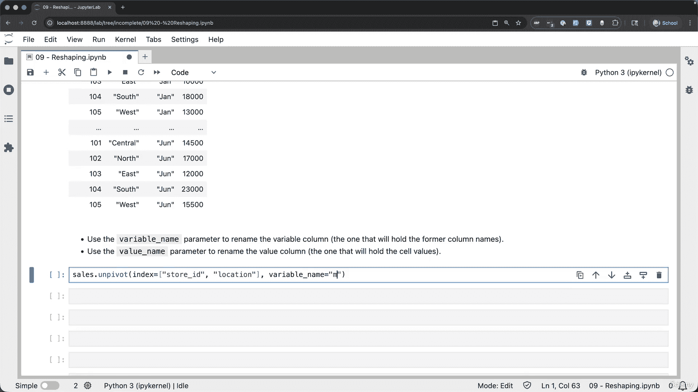

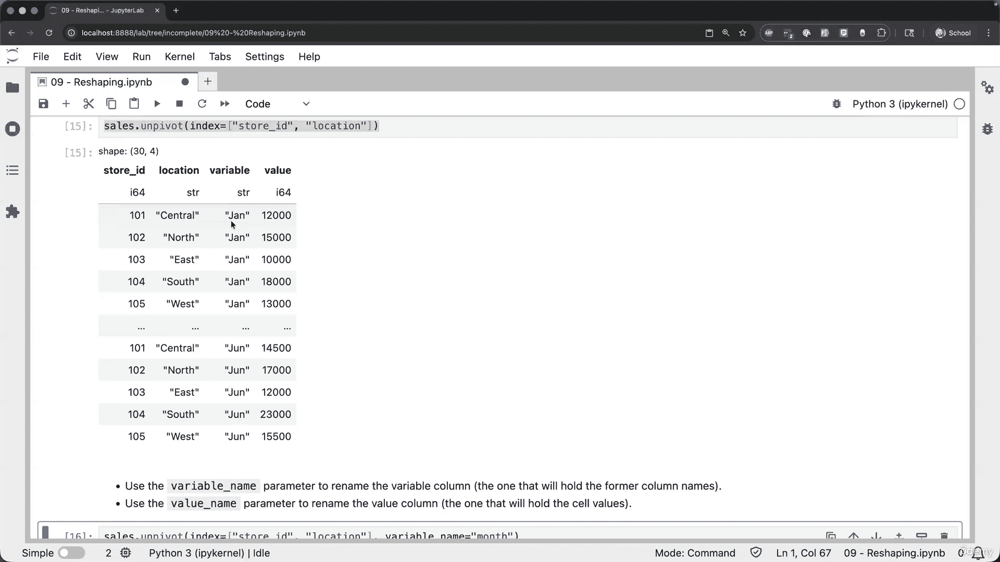

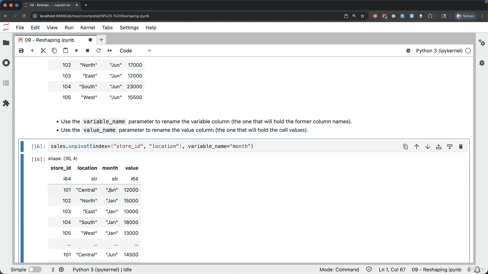

- `variable_name` 用来设置“存放原列标题”的列名。这里原来的列标题是月份，所以把它设为 `month`，原来的 `variable` 列名就会被替换成 `month`。
- `value_name` 用来设置“存放交叉数值”的列名。这些数字代表销售数字，我不太确定最准确的业务名称，所以暂时把它们叫作 `sales`。

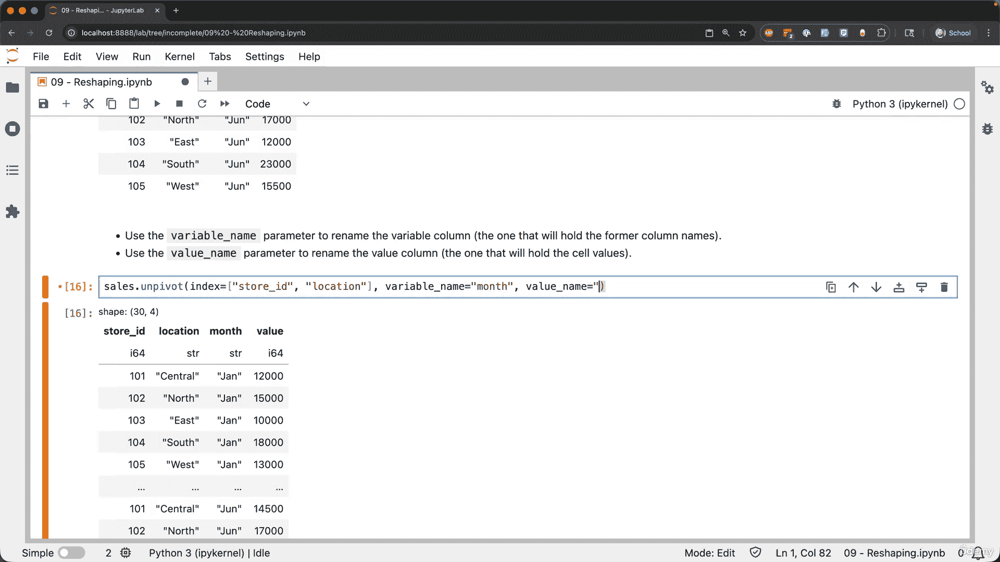

这样就能得到一个高表或长表，并且两个新列都有自定义列名。更重要的是，这里真正完成的事情是把宽数据框转换成了高数据框或长数据框。以后新增记录或新增条目时，数据框会向高度方向扩展；随着 `store ID`、`location` 和月份的组合或交叉越来越多，新数据会不断向下增加行数。

## ✅ 总结

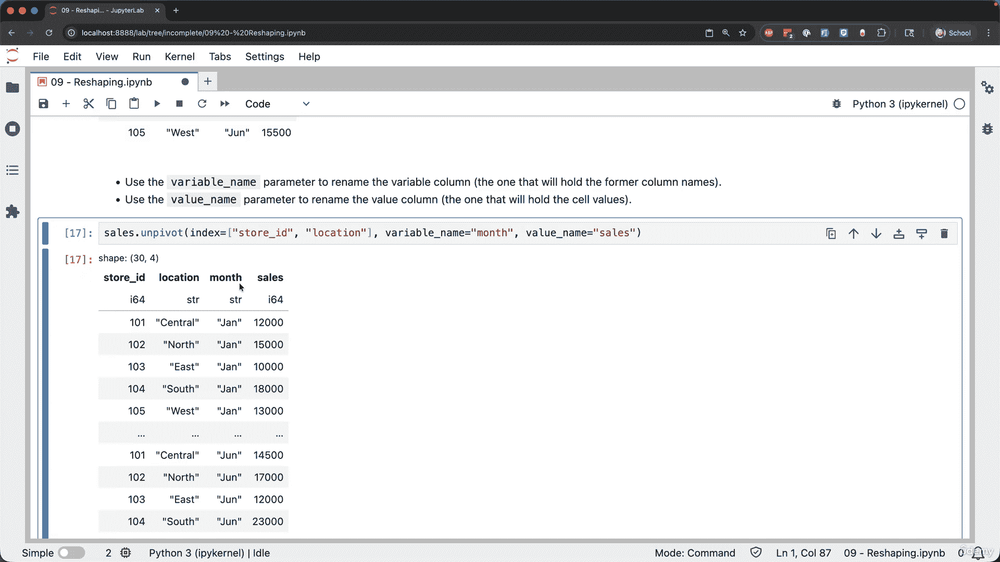

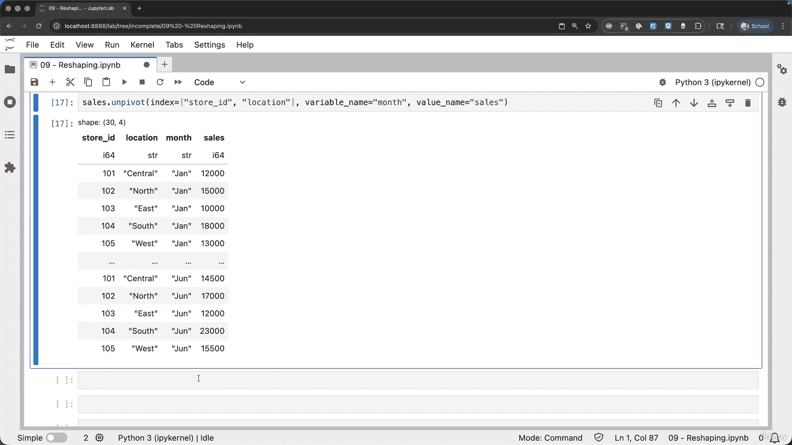

本节课中，我们一起学习了如何用 Polars 的 `unpivot` 方法把宽 DataFrame 转换成长 DataFrame。我们先用公式 `新行数 = 保留列组合数 × 待转换列数` 理解了行数变化，再用 `5 × 6 = 30` 的例子推演了转换结果；随后学习了 `index` 参数用来保留 `store ID` 和 `location`，`on` 参数用来指定六个月份列；接着学习了只传 `index`、省略 `on` 的快捷写法，以及用 `variable_name` 和 `value_name` 自定义新列名。最终的效果是把分散在多个列里的同类测量值搬成行，让数据框向高度方向扩展。这就是用 `unpivot` 把宽 DataFrame 转换成长 DataFrame 的完整做法。

