# 📊 Polars 与 Python 数据分析（第二部分）：24：用 pivot 方法把长表转成宽表

在本节课中，我们将要学习如何完成与上一节课相反的操作。上一节课处理的是把宽表变成长表，本节中我们来看看如何用 `pivot` 方法把长数据框转换成宽数据框。这个转换的核心目标是把原本纵向排列的明细数据，整理成更适合汇总查看的横向表格，让同一行集中展示一个对象的多项信息。

## 🧭 Polars 与 Python 数据分析（第二部分）：24.1：课程概述与数据准备

在上一节中，我们介绍了宽表与长表之间的转换思路，本节中我们来看看反向操作如何实现。首先需要导入一个新的数据集，文件名是 `studentgrades.csv`，并立刻把它赋值给一个变量，变量名直接叫 `grades`，然后在下方预览这个数据框。对应的代码如下：

```python
import polars as pl

grades = pl.read_csv("studentgrades.csv")
grades
```

这段代码完成两件事：第一，读取 `studentgrades.csv` 文件；第二，用 `grades` 变量保存读取结果，并通过 `grades` 显示预览内容。预览数据是后续理解长表和宽表差异的基础，因为只有先看清原始数据的形状，才能明白 `pivot` 到底改变了什么。完成数据导入和预览后，下一节我们会仔细看看这份数据到底长什么样。

## 📥 Polars 与 Python 数据分析（第二部分）：24.2：认识长表 studentgrades.csv

上一节我们完成了数据导入，本节中我们来看看 `studentgrades.csv` 的结构。这个数据集存储各种学生成绩，可以看到里面有学生名字，比如 Alice，有所在科目，还有考试分数。数据中一共有三个科目，分别是数学、历史和写作；每个学生可能都会有对应科目的分数，例如 Ethan 在这里没有分数，这也是一个很典型的示例。以下是这个数据集里最重要的几个字段：

- `student`：学生名字，例如 Alice、Bob、Charlie。
- `subject`：学生所在科目，例如数学、历史和写作。
- `score`：学生在对应科目上的考试分数。

除了字段本身，还需要理解这份数据的形状。它是一个高数据框，也就是长数据框，因为当增加更多学生和更多科目时，数据集会向下增长，高度会变大。如果希望得到更舒服的汇总视图，宽数据框会很有帮助；例如想知道 Alice 在每个科目上的表现，就可以把科目中的不同取值移动到各自独立的列中。换句话说，宽表会把同一类成绩测量值横向铺开到数学、历史、写作三列里，下面用公式概括这种形状差异：

```text
长表：增加学生或科目 -> 行数向下增长
宽表：把科目取值摊成列 -> 数据向右扩展
```

为了更直观地区分两种表的作用，可以记住下面这句话：

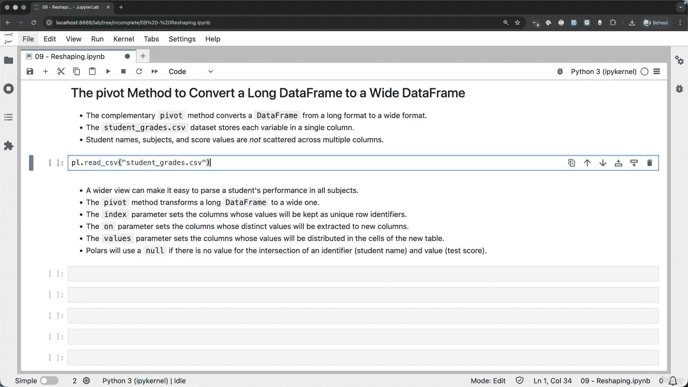

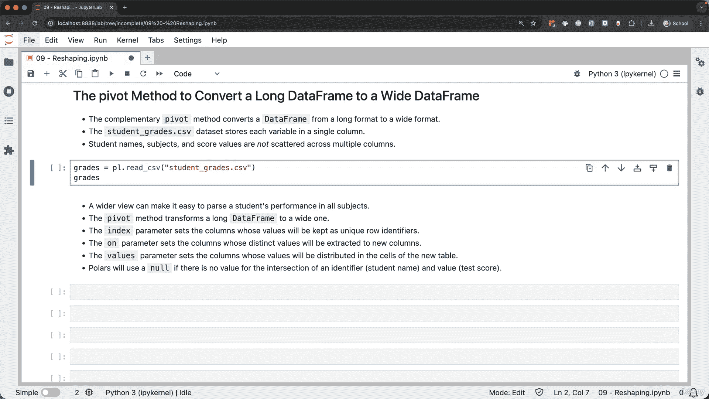

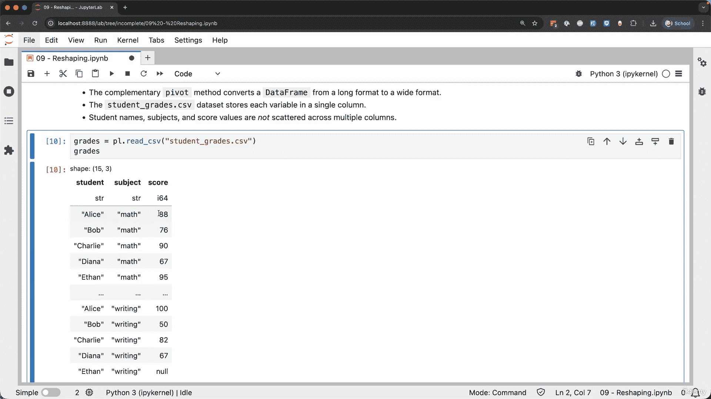

> 长表适合逐条记录明细，宽表适合做一目了然的汇总视图。

理解长表的结构之后，下一节我们进入正题，看看 `pivot` 方法如何把这种高表展开成宽表。

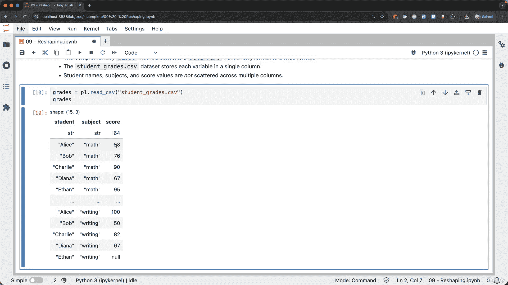

## 🔁 Polars 与 Python 数据分析（第二部分）：24.3：pivot 的核心思路与参数

上一节我们认识了长表的特点，本节中我们来看看 `pivot` 方法的核心思路。这里要拿 `grades` 数据框做与上一节相反的操作，`unpivot` 方法的补充操作就是 `pivot`，它会把高数据框展开成宽数据框。这里的关系可以用下面的公式表示：

```text
unpivot：宽表 -> 长表
pivot：长表 -> 宽表
```

`pivot` 的关键在于三个参数，它们分别控制行、列和数值。以下是这三个关键参数的简单说明：

- `index`：指定哪些列的值继续作为唯一的行标识。
- `on`：指定哪一列的值会被抽取出来，并移动成新的列名。
- `values`：指定原始数据框中哪一列的值要铺到新生成的列上。

这三个参数看起来简单，实际作用非常直接：`index` 决定结果表中每一行代表谁，`on` 决定结果表中有哪些新列，`values` 决定新列里填什么数。接下来我们先从 `index` 参数开始，把它在示例中的含义拆开说明。

## 🧱 Polars 与 Python 数据分析（第二部分）：24.4：index 参数保留学生行标识

上一节我们总览了三个参数，本节中我们详细看看 `index` 参数。`index` 用来描述哪些列的值仍然会保留为唯一的行标识，在这个例子中，希望学生名字像 Alice、Bob、Charlie 继续作为索引，这些值会作为结果表中的主标签出现，每个学生占一行。然后，再把考试分数按照科目分布到这些索引值对应的行上。以下是 `index` 参数的关键理解点：

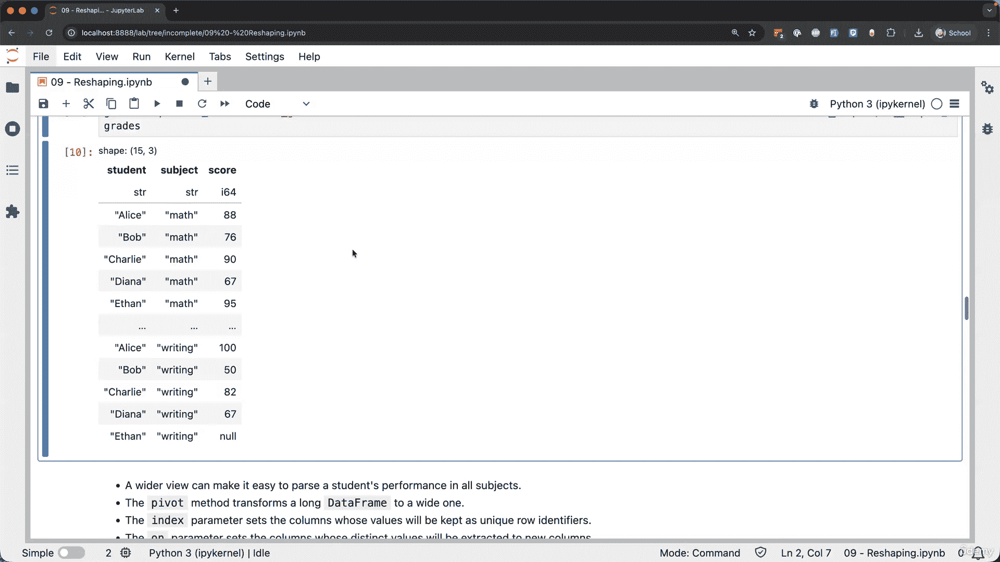

- `index="student"` 表示学生列不横向铺开。
- 学生名会继续作为结果表的行标签。
- 每个学生的成绩会围绕这一行重新组织。

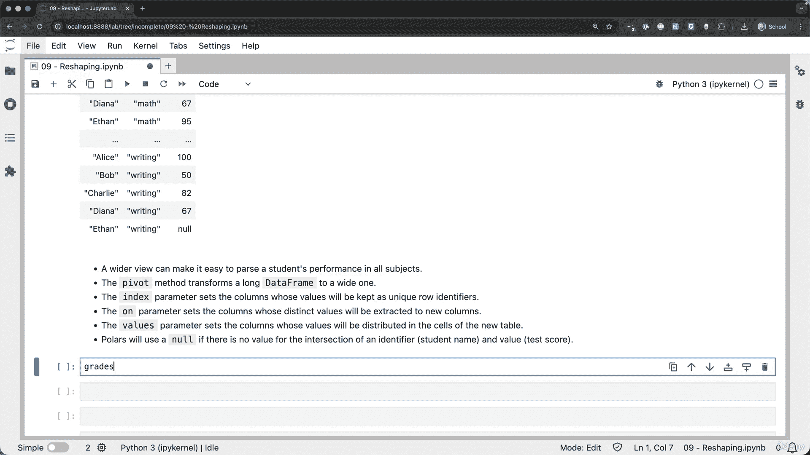

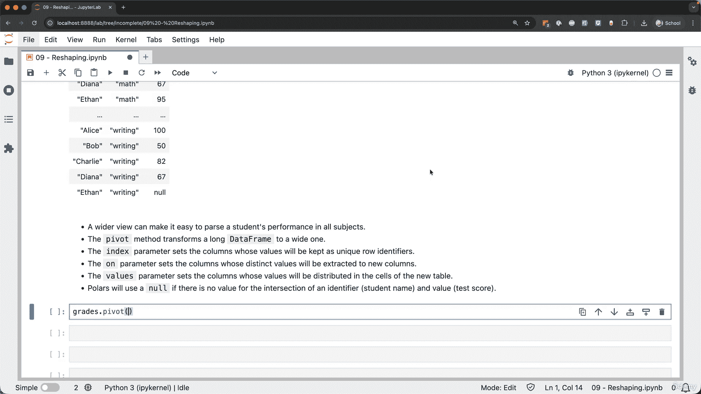

这里的关键点是：`index` 中指定的列，是不希望被展开到列上的列，而是要保留为结果数据框的主要标签或行。也就是说，`student` 这一列需要保留下来，让 Alice、Bob、Charlie 这些名字继续充当行的标识。完整调用可以先写成下面的形式：

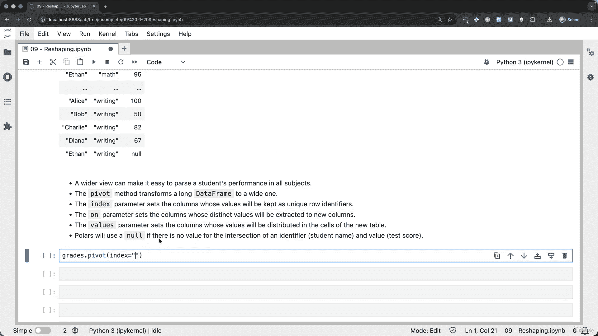

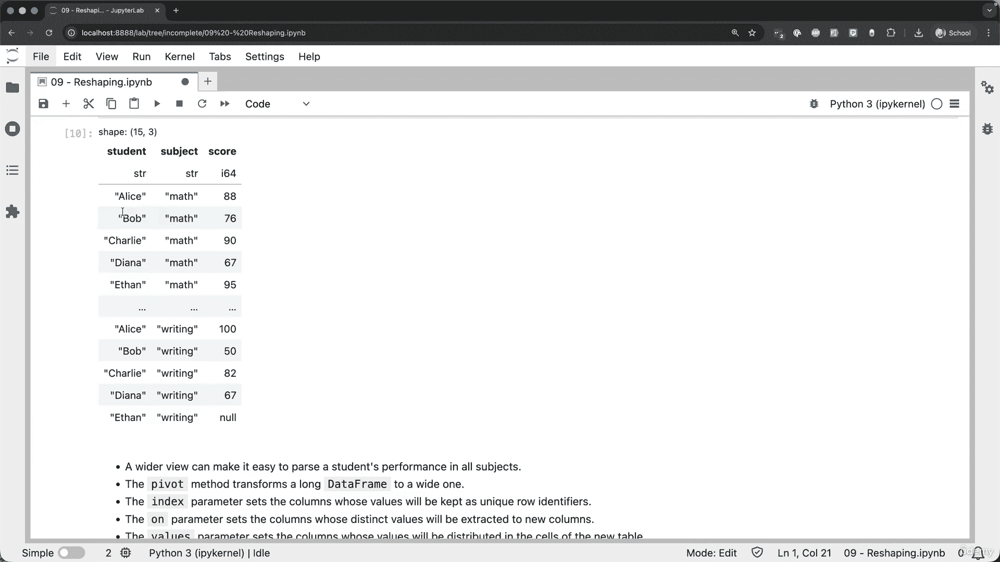

```python
wide_grades = grades.pivot(
    index="student",
    on="subject",
    values="score"
)
```

这段代码中，`index="student"` 对应刚刚说的行标识逻辑。理解 `index` 之后，下一节我们看看 `on` 参数如何把科目取值变成新列。

## 🏷️ Polars 与 Python 数据分析（第二部分）：24.5：on 参数把科目值变成列名

上一节我们说明了 `index` 如何保留学生行，本节中我们来看看 `on` 参数。`on` 参数会设置一列，这一列中的值会被抽取出来并移动成新的列；在这个例子里，要移动的是 `subject` 列中的值。指定的这一列中有多少个唯一值或不同值，它们在结果数据框中都会变成新的列。以下是 `on` 参数在这个例子中的直接效果：

- `on="subject"` 表示从科目列中提取列名。
- 科目列中的 `math`、`history`、`writing` 会分别成为新列。
- 科目列中有多少个不同取值，结果中就会增加多少个新列。

`on` 参数设置的是“值会变成各自列名”的那一列，因此这里再次把 `on` 设置为 `subject`。可以用下面的公式描述这个过程：

```text
unique(subject) = ["math", "history", "writing"] -> 新列 math、history、writing
```

到这里，列名来源已经明确。下一节我们看看最后一个参数 `values`，它负责把成绩填入这些新列。

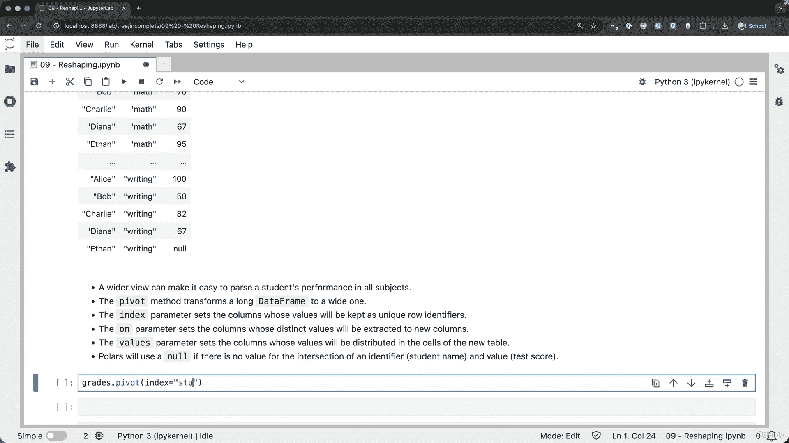

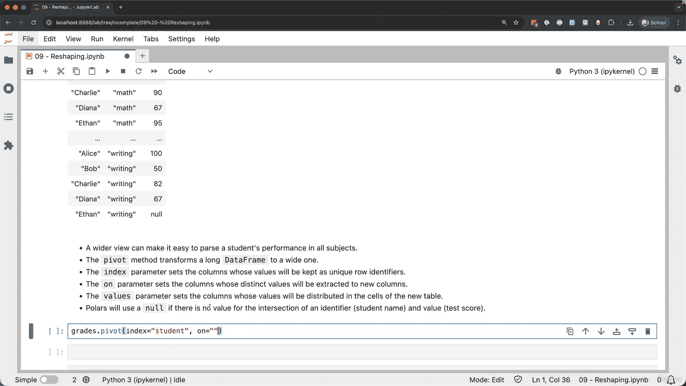

## 🔢 Polars 与 Python 数据分析（第二部分）：24.6：values 参数把成绩铺到新列

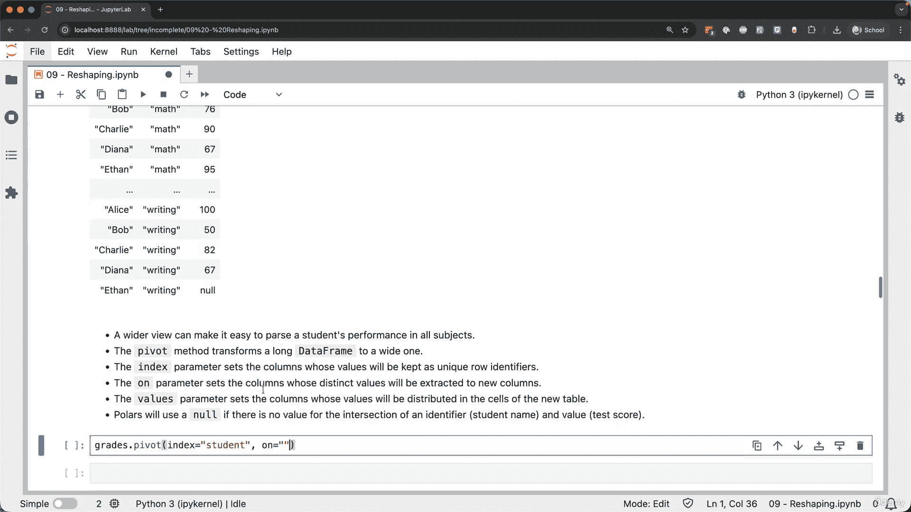

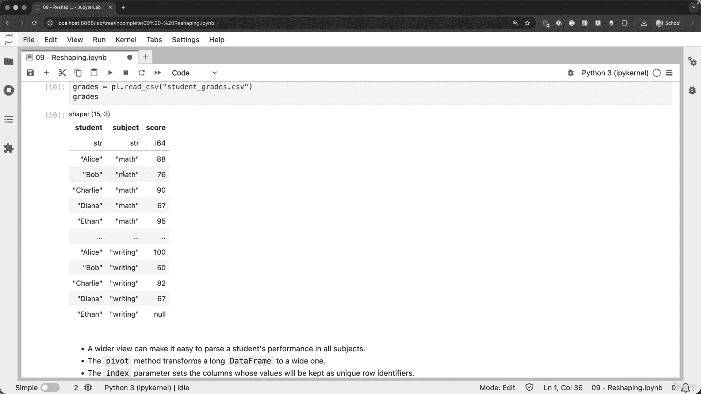

上一节我们让科目值变成了新列，本节中我们来看看 `values` 参数。`values` 用来设置原始数据框中的哪一列，其值会铺到为每个科目生成的新列上；这里仍然希望 `score` 列作为被展开的数值列，原文这里也把它称为需要聚合的值，因此这里指定 `score`。把三个参数合在一起看，它们的分工如下：

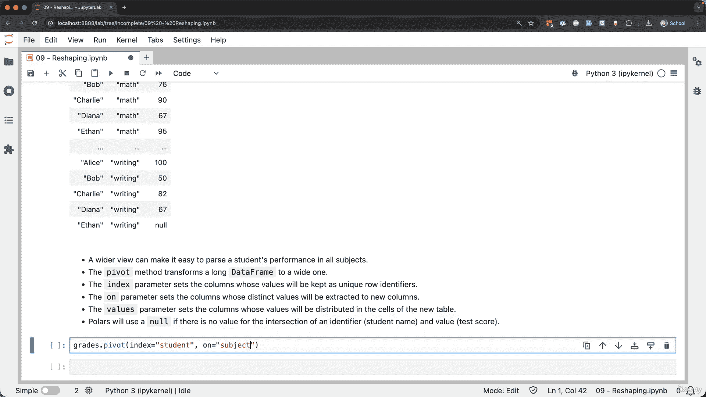

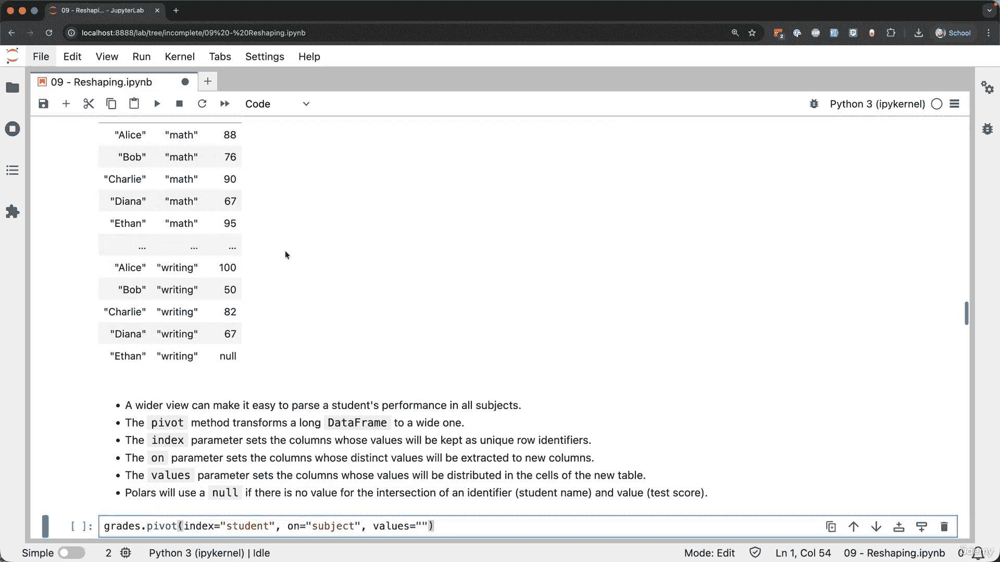

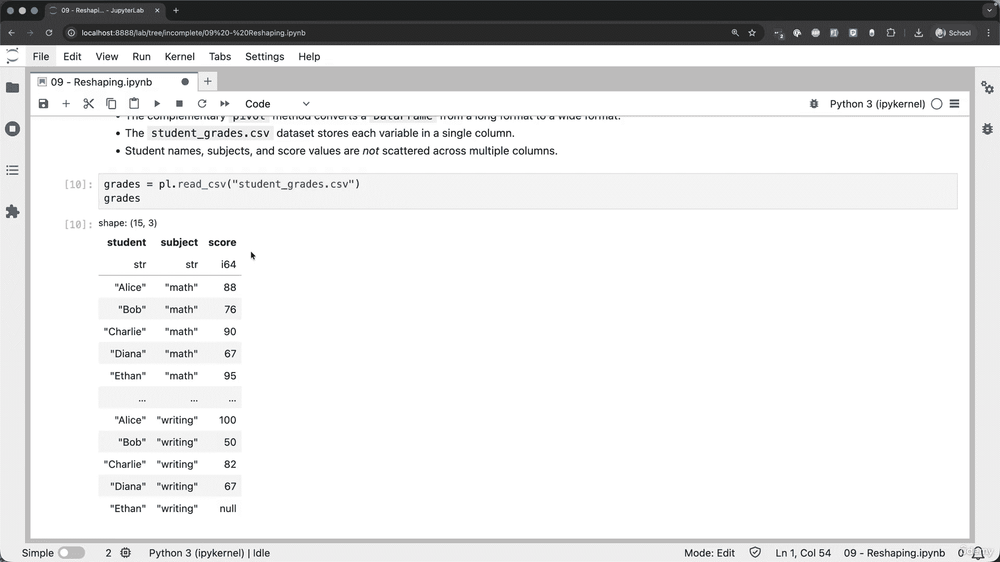

- `index="student"`：保留学生作为行标识。
- `on="subject"`：把科目取值变成新列名。
- `values="score"`：把成绩值填入对应的新列。

完整代码如下：

```python
wide_grades = grades.pivot(
    index="student",
    on="subject",
    values="score"
)
```

这段代码表达的就是前面说的逻辑：每个学生保留为一行，每个科目变成一列，成绩填入学生与科目的交叉位置。参数配合完成后，下一节我们看看结果表的形状，以及宽表在增加数据时如何扩展。

## 📐 Polars 与 Python 数据分析（第二部分）：24.7：查看宽表结果与增长方向

上一节我们完成了 `pivot` 调用，本节中我们来看看得到的结果。结果会和预期一致：对于 `student` 列中的每个唯一值，也就是每个学生，结果中都会有一行；原始 `grades` 数据框中 `subject` 列里的三个不同取值，也就是数学、历史、写作，已经被移动成三个独立的新列。原来 Alice 分散在三行里的成绩、Bob 分散在三行里的成绩，现在都被整理并收集到 Alice 的一行和 Bob 的一行中。从结果可以观察到以下变化：

- 每个学生只占一行。
- 每个科目各占一列。
- 成绩值填入学生和科目的交叉位置。
- 原本纵向分散的明细被整理成横向汇总视图。

这样就把数据移动成了另一种形状，现在可以更容易地查看 Alice 在所有不同科目上的表现。这也是 `pivot` 操作的一个典型例子，它接收长数据框或高数据框，并把它转换成宽数据框；当继续为 Alice 添加更多考试成绩时，数据框会向宽度扩展，而不是向高度扩展，可以用下面的公式概括：

```text
长表转宽表后：行数减少，列数增加
新增更多成绩时：数据框向宽度扩展，而不是向高度扩展
```

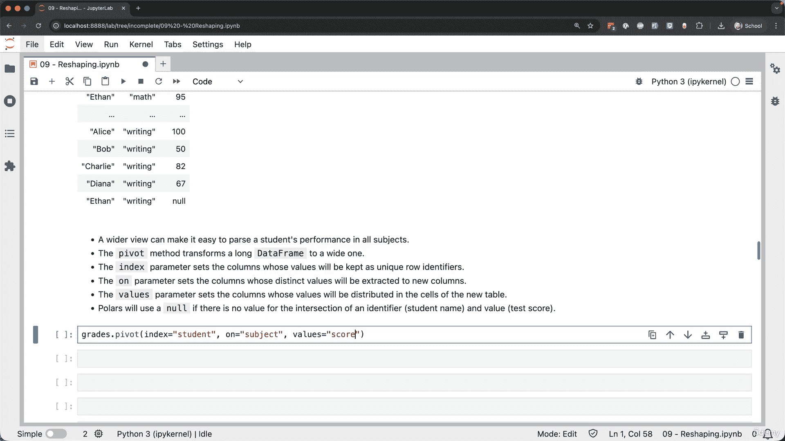

这就是 `pivot` 方法的核心效果。理解结果表的增长方向，有助于在实际分析中判断什么时候该用长表、什么时候该用宽表。

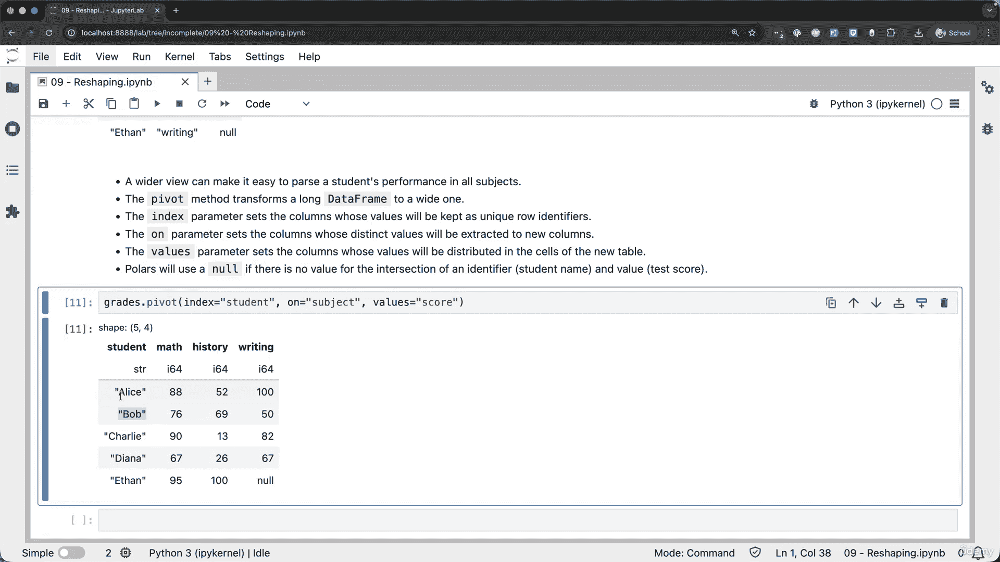

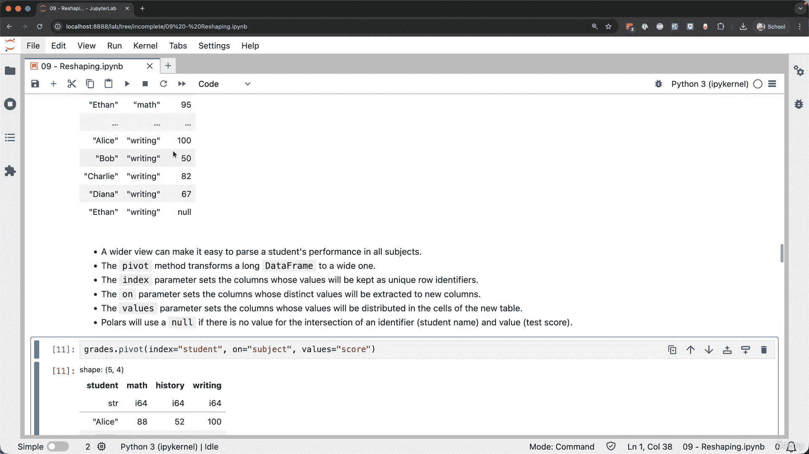

## ✅ Polars 与 Python 数据分析（第二部分）：24.8：本节总结

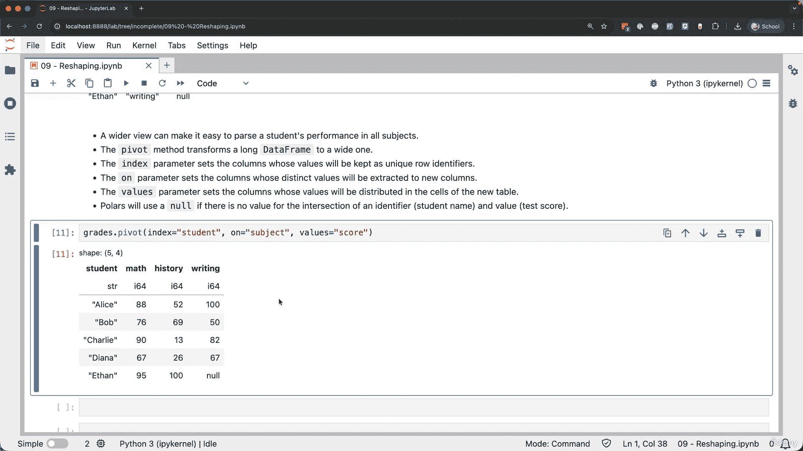

在本节课中，我们一起学习了如何用 `pivot` 方法把长数据框转换成宽数据框。我们先导入了 `studentgrades.csv` 并赋值给 `grades` 变量，然后认识了包含学生、科目和成绩的长表结构，接着用 `pivot` 与上一节的 `unpivot` 形成对照。具体来说，`index="student"` 保留学生作为行标识，`on="subject"` 把科目取值变成新列，`values="score"` 把成绩铺到新列中，最终得到每个学生一行、每个科目一列的宽表。宽表便于查看单个学生在多个科目上的表现，也会在新增成绩时向宽度扩展，而不是向高度扩展。以上就是本节课关于 `pivot` 方法的完整内容。
