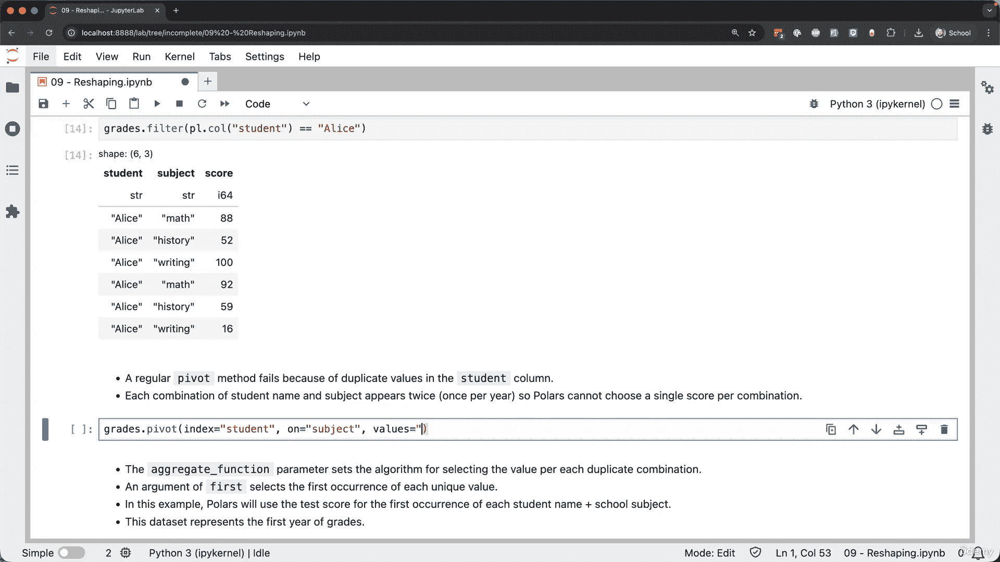
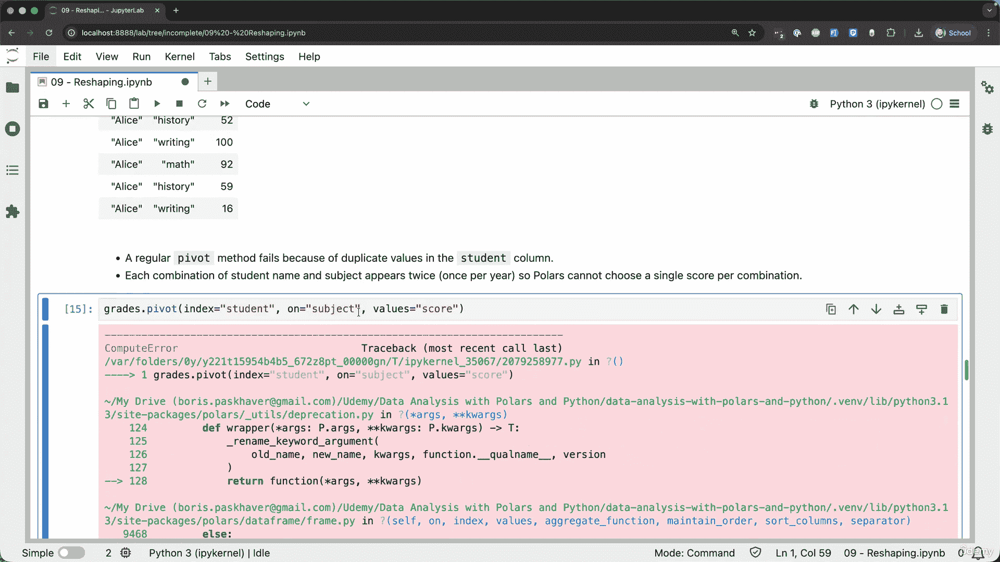
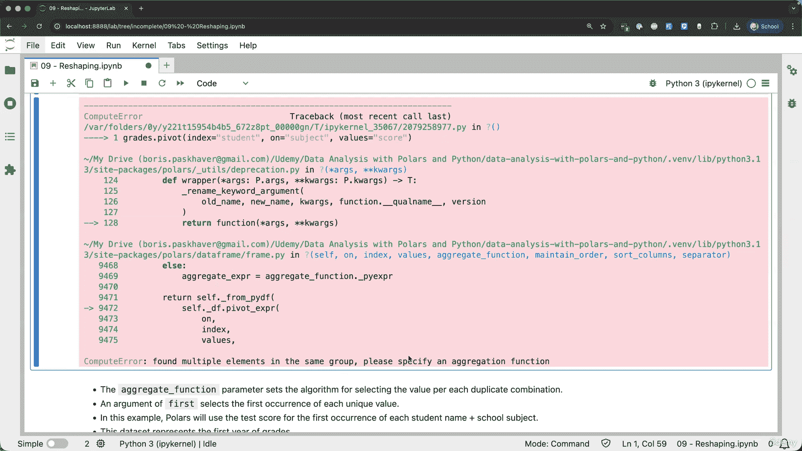
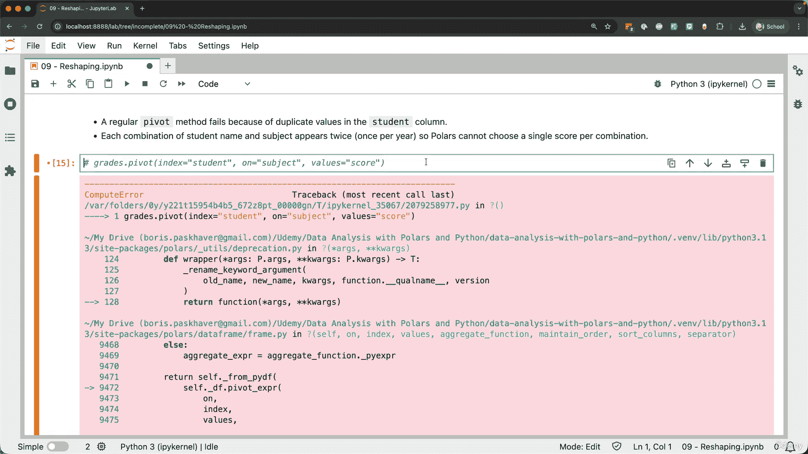
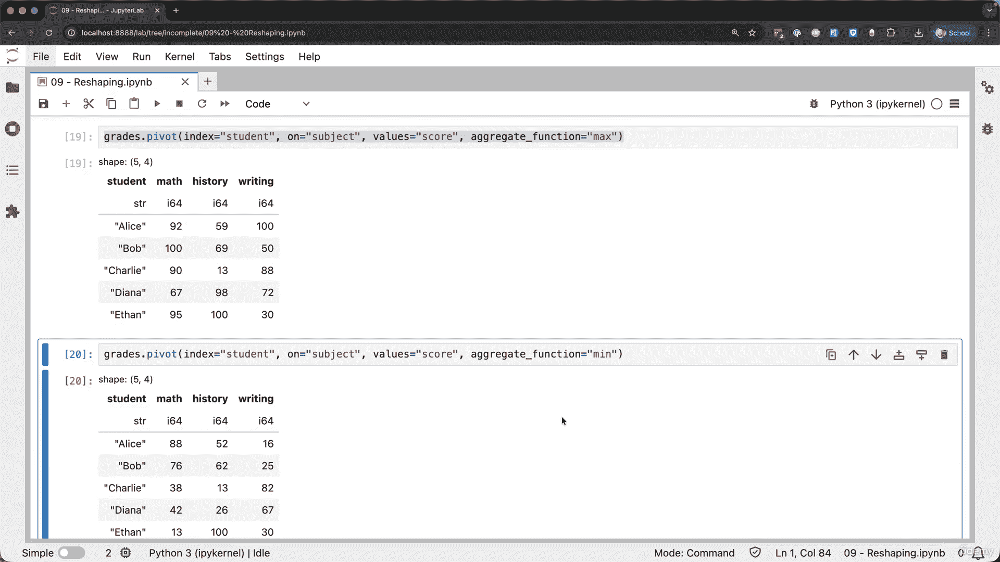

# 📊 Polars 与 Python 数据分析：第25节：数据透视表基础（一）


在本节课中我们将要学习数据透视表的基础知识。数据透视表这个概念在 Excel 或 Google Sheets 等电子表格软件中很常见，Polars 也能完成同样的目标。数据透视表的核心作用是重新塑造数据，把某一列或多列中的唯一值变成透视表中的新行或新列。它相对于上一课普通透视的优势在于，我们还能用平均值、求和等聚合函数对相应数值进行汇总。下面从简单例子开始，说明为什么需要数据透视表。


## 🧭 Polars 与 Python 数据分析：第25节：数据透视表的概念与作用


上一段我们提到了数据透视表的基本目标，本节中我们来看看它的核心概念。数据透视表会改变数据的形状，把长表中的某些唯一值展开成新列或新行，并用聚合逻辑填充交叉位置的值。可以用下面的公式表示这种变化。


\[
\text{长表} \xrightarrow{\text{pivot 透视}} \text{宽表}
\]


与上一课看到的普通透视相比，数据透视表多了一个关键能力：它不仅移动、组织和重塑数据，还能对交叉位置对应的多个值应用操作或函数。这个能力正是后面解决重复值问题的关键。


## 🧪 Polars 与 Python 数据分析：第25节：用学生成绩例子说明问题


上一节我们介绍了数据透视表的概念，本节中我们通过一个学生成绩例子看看为什么需要它。上一课使用过一个包含学生考试成绩的数据集，本课的数据集是这个数据集的扩展版本。先用 `read_csv` 函数读取文件 `student_grades_expanded.csv`，然后把结果赋值给变量 `grades`。


```python
import polars as pl

grades = pl.read_csv("student_grades_expanded.csv")
```


这个数据集的结构与上一课的数据集相同，包含学生、科目和考试分数，但它存储了每个学生跨两年的分数。也就是说，Alice 会有第一年的数学分数，也会有第二年的数学分数。每个学生和科目的组合都会出现两次。下面预览前三行，并用 `filter` 方法筛选 `student` 列中等于 Alice 的记录。


```python
grades.head(3)

grades.filter(
    pl.col("student") == "Alice"
)
```


筛选结果中可以看到 Alice 在三个科目上跨两年的分数，因此总共有六行。到这里，我们已经看到了重复组合的存在，这也为后面的报错和聚合函数埋下伏笔。


## ⚠️ Polars 与 Python 数据分析：第25节：直接透视为什么会报错


上一节我们看到 Alice 的每个科目都有两年分数，本节中我们来看看直接使用上一课的 `pivot` 方法会发生什么。尝试把长数据框转换为宽数据框时，会碰到一个错误。原因是 Polars 不知道某个给定列应该放哪个值。举例来说，透视时 Polars 会把数学变成新列，但 Alice 这一行的数学列应该存 88 还是 92 呢。因为 Polars 需要为 Alice 和数学列的交叉位置提供一个单一值，所以会报错。


下面应用与上一课完全相同的代码，把 `grades` 这个长数据框转换成宽数据框。索引是学生姓名，要提取为新列的列是 `subject` 列中的值，也就是数学、历史和写作，要展开到这些新科目列中的值是 `score`。




```python
grades.pivot(
    index="student",
    columns="subject",
    values="score"
)
```






这段代码会得到计算错误，Polars 会提示在同一个分组中发现了多个元素。对于 Alice 和某个科目的同一分组或组合，存在多个值。错误信息如下。




> Polars 报错：found multiple elements in the same group


解决方案也由错误信息给出：请指定一个聚合函数，告诉 Polars 使用什么逻辑来决定选哪一个值。我们并不局限于简单地说取第一个或取第二个，还可以更聪明地选择两个值的平均值。这正是数据透视表的优势：不仅移动、组织和重塑数值，还能对这些数值应用操作或函数。


## 🛠️ Polars 与 Python 数据分析：第25节：用聚合函数解决重复值


上一节我们看到了重复组合导致的报错，本节中我们来看看如何通过 `aggregate_function` 参数解决。先注释掉刚才的代码，再把它复制到下面，然后只增加一个参数 `aggregate_function`。这个参数是一个字符串，用来指定选择重复值时所使用的逻辑或算法。


```python
grades.pivot(
    index="student",
    columns="subject",
    values="score",
    aggregate_function="first"
)
```


下面是几个常见的聚合函数参数，它们都用于在出现重复组合时决定保留哪个值。使用这些参数后，Polars 就能为每个学生和科目的交叉位置填入一个确定的值。


- 使用 `first` 时，遇到学生和科目的重复组合，就取该分数的第一次出现。结果中 88、52 和 100 就是 Alice 在这些科目上的第一次出现值。回到原始数据或筛选后的 Alice 行，就是取数学、历史和写作的第一次出现，再把它们展开到新的数学、历史和写作列中。

- 使用 `last` 时，逻辑与 `first` 相反，取每个组合的最后一次出现。把函数替换为 `last` 后，Alice 的数学成绩会取原始 `grades` 数据集中的最后一次出现，也就是 92。

- 使用 `max` 时，可以取最大值。比如想查看 Alice 在两年中的最佳表现，就可以使用 `max` 函数。只要学生姓名和某个科目出现重复，而该科目已经被展开到列中，Polars 就优先取两个值中较大的那个最大值。

- 使用 `min` 时，可以取最小值。既然 `aggregate_function` 参数有 `max` 参数，也会有 `min` 参数。出现重复值时，`min` 会给出较小的出现值或较小的值。


在 `first`、`last`、`max` 和 `min` 这些例子中，我们都只是从两个值中选了一个。如果存在多次出现或多个重复值，比如有 10 年的学生数据，数据透视表仍然会从这些值中选一个存进去。下一课我们会看到如何应用更复杂的操作，比如对所有出现值求平均。


## ✅ Polars 与 Python 数据分析：第25节：本节总结




本节课中我们一起学习了 Polars 数据透视表的基础知识。我们了解了数据透视表如何把长表中的唯一值展开成新列或新行，也了解了它相对于普通透视的优势：可以对交叉位置的数值应用聚合函数。通过扩展版学生成绩数据集，我们看到了同一学生和科目组合出现多次时，直接透视会报错，因为 Polars 需要一个单一值。随后我们使用 `aggregate_function` 参数，并介绍了 `first`、`last`、`max` 和 `min` 这几种常见选择逻辑。下一课将继续学习更复杂的聚合操作，例如对重复值求平均。

