# Polars 与 Python 数据分析：第26课：透视表（二）更多聚合操作与视角切换 🧭

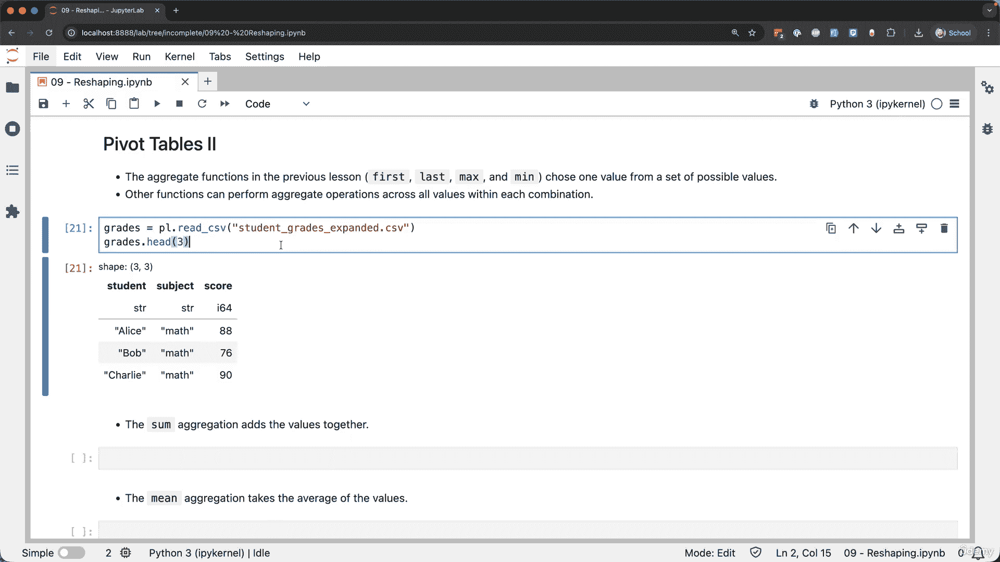

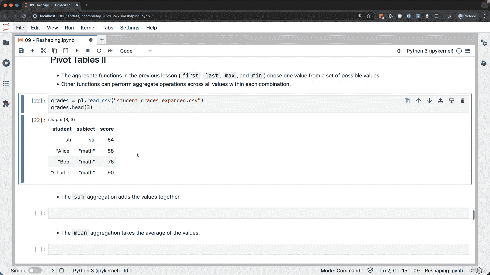

在本节课中我们将要学习在 Polars 中创建透视表时如何使用更多聚合操作，并且还会学习如何通过改变行和列来切换观察数据的视角。我们会先重新加载上一课使用的扩展学生成绩数据集，回顾基础 `pivot` 写法，再依次使用 `sum`、`mean` 和 `len` 作为聚合函数，最后把学生和科目在行与列上的位置对调。这样做的目的，是让同一份原始数据能够以更紧凑、更容易分析的形式呈现出来。

## Polars 与 Python 数据分析：第26课：重新导入数据与回顾基础透视表 🧰

上一节我们介绍了透视表的基本概念和基础写法，本节中我们来看看如何重新准备数据，并回顾 `pivot` 的核心参数。和往常一样，我们先重新执行上一课的导入代码，得到扩展后的学生成绩数据集，然后从 `grades` 这个数据对象开始操作。下面先展示基础透视代码，其中的聚合函数先用上一课见过的 `first` 作为示例。

```python
# 重新执行上一课的导入代码，得到扩展后的学生成绩数据
# grades = ...

pivot_base = grades.pivot(
    index="student",       # 新透视表的行标签
    on="subject",          # 用来生成新列名的列
    values="score",        # 用来做聚合计算的列
    aggregate_function="first"
)
```

上面这段代码会调用 `pivot` 方法，并重复上一课的基本思路：`index` 指定新透视表、新数据框中的行值，这里仍然是学生；`on` 参数指定哪个列的值要变成新透视表的列头，这里是科目；`values` 指定要对哪一列执行某种逻辑，这里仍然是成绩。用公式可以更直白地表示透视表在做的事情：

\[
行标签 = index列的去重值
\]

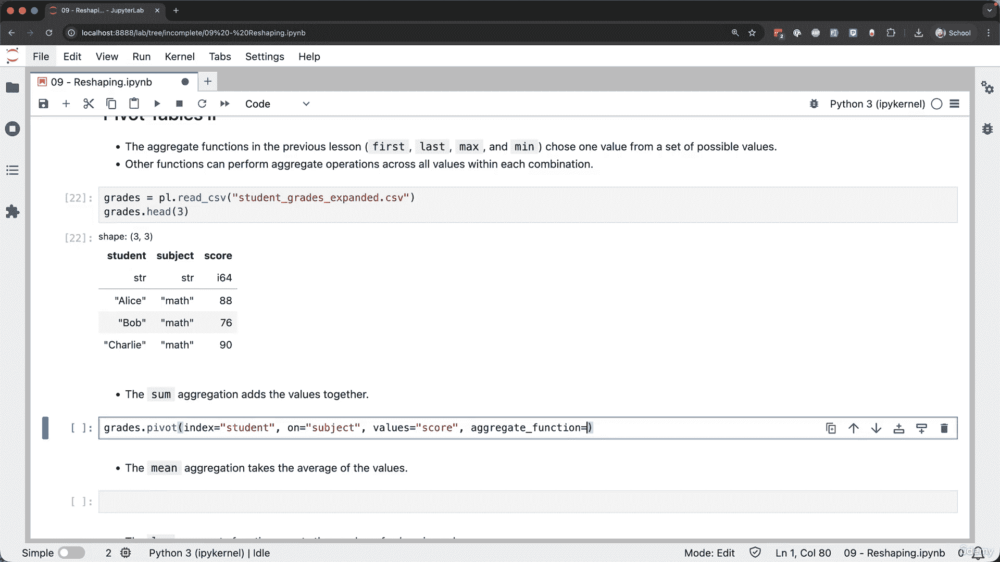

\[
列名 = on列的去重值
\]

\[
单元格值 = aggregate\_function(values列)
\]

以下是 `pivot` 中三个核心参数在本题里的作用，理解它们就能理解透视表的基本结构：

- **`index`**：指定新表中的行标签，这里用 `student`，所以每个学生占一行。
- **`on`**：指定哪些值变成新表中的列名，这里用 `subject`，所以科目会变成列。
- **`values`**：指定拿来计算单元格内容的列，这里用 `score`，所以单元格里放的是成绩聚合结果。

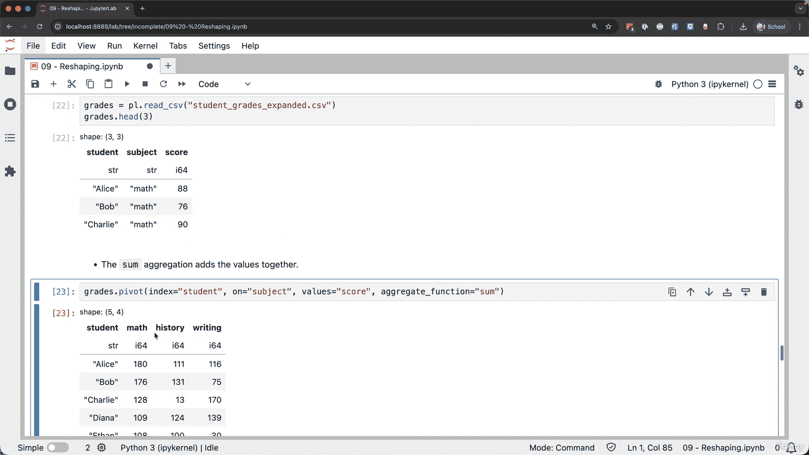

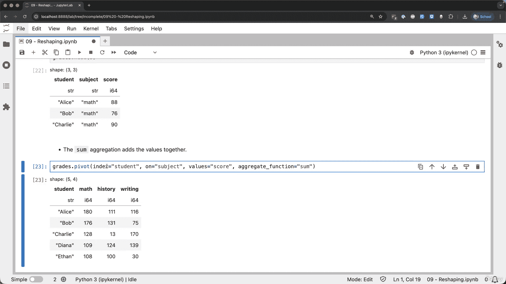

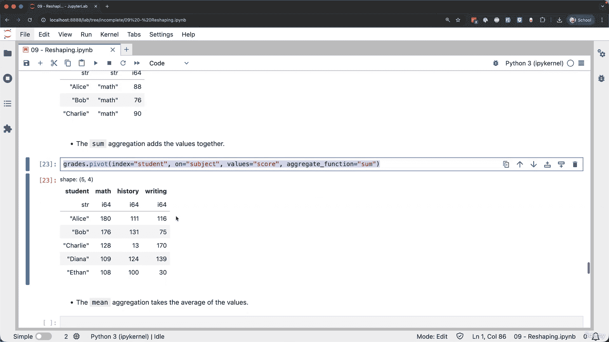

这里有一个关键提示：当同一个学生和同一个科目出现多条记录时，如果不指定聚合函数，Polars 不知道应该保留哪一条，因此会报错。上一课我们只是简单地选择第一条、最后一条或最大值，本节则会探索 `aggregate_function` 参数中更多有用的聚合方式。

> 提示：透视表本质上仍然是把“高表”变成“宽表”。`subject` 里重复出现的值会变成唯一的列名；当同一行标签下出现重复组合时，就需要用聚合函数把这些重复值合并成一个结果。

理解了基础参数之后，接下来我们看看第一个额外聚合操作：求和。

## Polars 与 Python 数据分析：第26课：使用 sum 聚合重复组合 ➕

上一节我们回顾了透视表的基本参数，本节中我们来看看如何使用 `sum` 把重复组合的成绩相加。以下是把聚合函数改成 `sum` 的代码示例，它会在每个学生和每个科目的交叉位置上计算成绩总和。

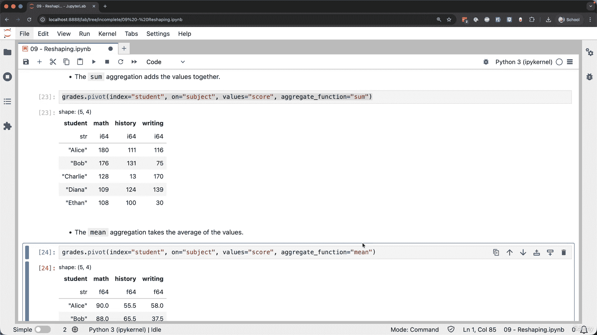

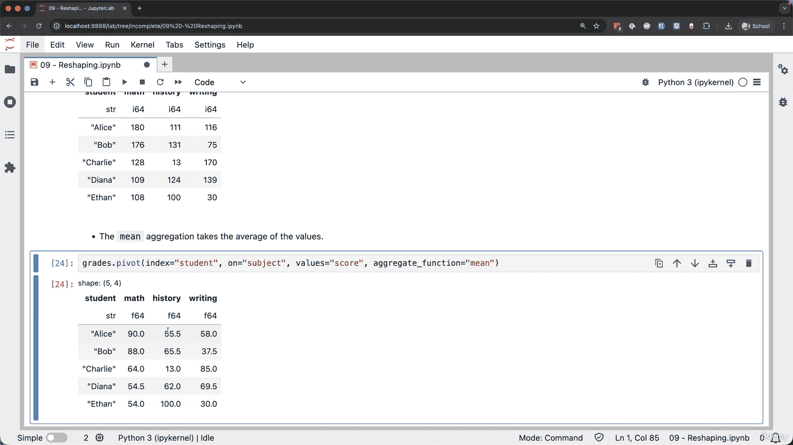

```python
pivot_sum = grades.pivot(
    index="student",
    on="subject",
    values="score",
    aggregate_function="sum"
)
```

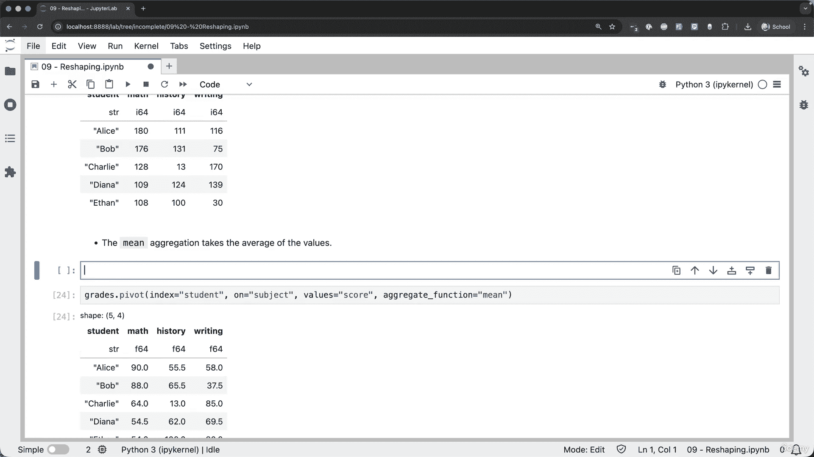

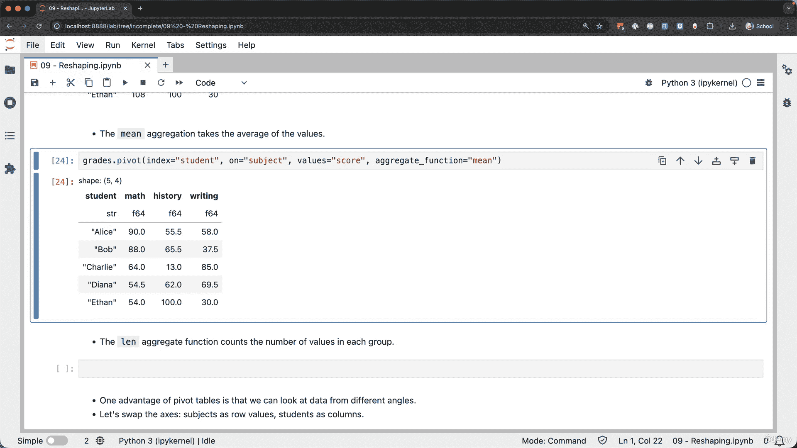

这段代码会把同一个学生、同一个科目下的多条成绩加在一起。例如 Alice 的数学有两条测试成绩，那么这两条成绩会相加，原本的两行数据会在数学列中合并成一个值。它从根本上仍然是把高表转换成宽表：`subject` 中反复出现的重复值变成了唯一的列名；当遇到同一行标签下的重复值时，就对每个“学生 + 科目”的组合取和。求和在这里不一定特别有意义，因为把两次考试成绩直接相加未必能说明学习表现，但它可以很好地演示聚合函数的作用。

理解了求和之后，我们接着看一个更常用、也更合理的聚合方式：求平均。

## Polars 与 Python 数据分析：第26课：使用 mean 求平均成绩 📊

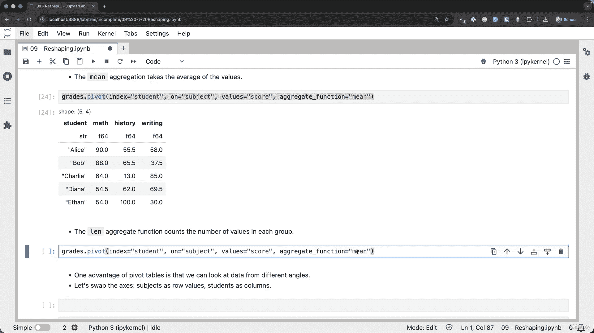

上一节我们用 `sum` 演示了重复值合并，本节中我们来看看如何用 `mean` 计算同一学生同一科目跨年份的平均成绩。以下是使用平均聚合的代码示例，它和上面的代码几乎一样，只是聚合函数换成了 `mean`。

```python
pivot_mean = grades.pivot(
    index="student",
    on="subject",
    values="score",
    aggregate_function="mean"
)
```

这段代码会对所有“学生 + 科目”的重复出现位置应用平均值。现在我们可以看到每个学生在每个科目上的平均表现，也能开始看到一个很直观的汇总视图。原始数据集行数比较多，总共有 30 行；经过透视表汇总后，我们得到一个 5 行 4 列的数据框，可以更清楚地查看每个学生在两年中的整体表现。透视表的价值就在这里：它帮助我们从行数较多的原始数据中提炼出一个紧凑的摘要视图。

看完平均值之后，我们继续看另一个常用的聚合函数：`len`，它用来统计每个组合出现了多少次。

## Polars 与 Python 数据分析：第26课：使用 len 统计每个组合出现次数 🔢

上一节我们使用 `mean` 得到了平均成绩，本节中我们来看看如何用 `len` 统计每个分组内的记录数量。以下是使用 `len` 作为聚合函数的代码示例，它统计每个“学生 + 科目”组合出现了多少次。

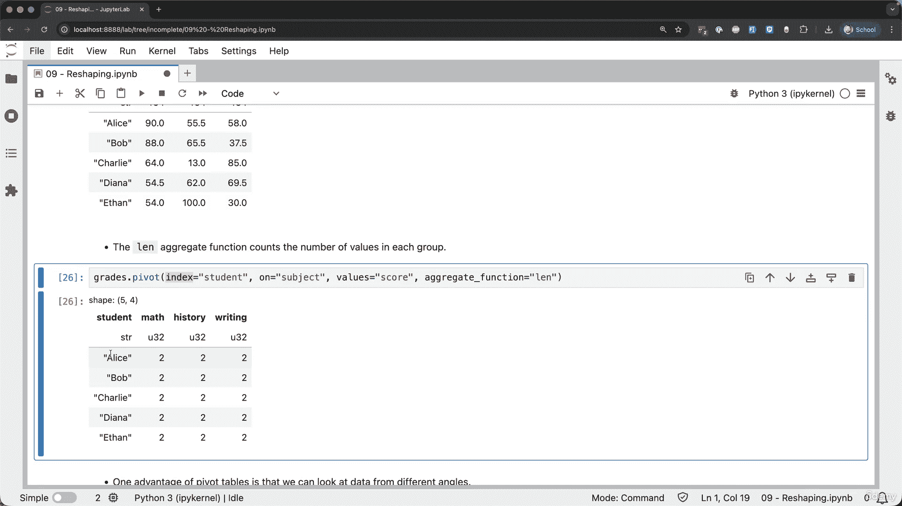

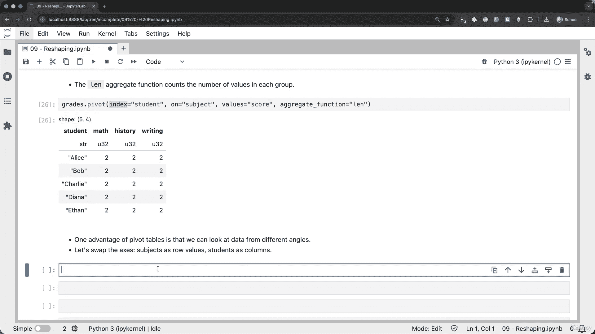

```python
pivot_len = grades.pivot(
    index="student",
    on="subject",
    values="score",
    aggregate_function="len"
)
```

`len` 会告诉我们每个分组中的出现次数。例如在学生为 Alice、科目为数学的组合里，它只会告诉我们这里有两条记录。这个数据集是一个方便演示的人造数据集，所有组合碰巧都出现相同的次数；如果某些学生读了更多年份、修了更多科目，那么这里就会看到不同的数值。它衡量的就是每个“学生 + 科目”组合的出现次数，也就是计数。

理解了计数之后，最后我们来看透视表一个很重要的优势：完全改变数据的展示视角。

## Polars 与 Python 数据分析：第26课：反转行列查看同一数据的不同视角 🔄

上一节我们使用 `len` 统计了组合次数，本节中我们来看看如何把行和列对调，从另一个角度观察同一份数据。透视表的一个优势在于，它可以重新塑造数据，让我们从不同视角查看同一份数据。之前创建透视表时，我们用 `student` 列作为 `index`，也就是用学生姓名生成行，再在这些行上对成绩做平均或计数；现在我们可以把展示方式完全翻转过来。以下代码把科目放到行上，把学生姓名放到列上，仍然对成绩求平均。

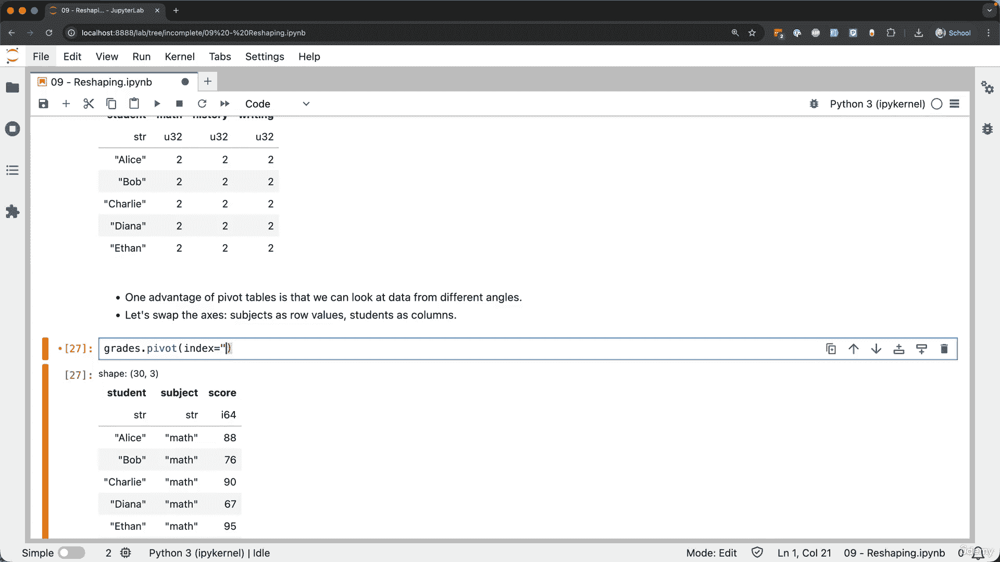

```python
pivot_by_subject = grades.pivot(
    index="subject",       # 现在行标签变成科目
    on="student",          # 现在列名变成学生姓名
    values="score",        # 仍然聚合成绩
    aggregate_function="mean"
)
```

在这段代码中，`index` 不再是学生姓名，而是科目，所以数学、历史、写作会各自占一行；`on` 参数改为学生姓名，用学生列中的不同值形成新的列头；`values` 仍然使用成绩列，用来填充行和列交叉位置上的值；最后的聚合函数仍然使用 `mean`。这样得到的是一个不同的透视表，底层数据还是同一份，但现在可以按每个学科查看每个学生在该学科中的平均成绩。结果更加紧凑，也更容易在较小的数据集中识别趋势。最初的 `grades` 数据框很适合以整齐的方式存储数据，但当我们想把它转换成便于分析、便于汇总查看的形式时，透视表就是一个非常合适的选择。

## Polars 与 Python 数据分析：第26课：总结 ✅

本节课中我们一起学习了透视表的更多聚合操作和视角切换方法。我们先重新加载扩展后的学生成绩数据，回顾了 `pivot` 中 `index`、`on`、`values` 和 `aggregate_function` 的基本用法；然后使用 `sum` 把重复组合的成绩相加，使用 `mean` 计算同一学生同一科目跨年份的平均成绩，使用 `len` 统计每个“学生 + 科目”组合的出现次数；最后通过交换 `index` 和 `on`，把科目放到行、学生放到列，从不同角度查看同一份数据。核心公式仍然是：

\[
透视表单元格 = 对values列按(index, on)分组后执行aggregate\_function
\]

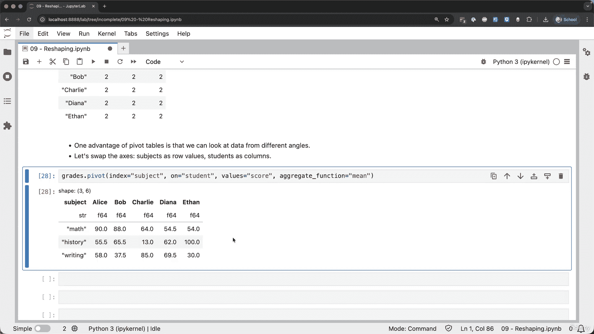

掌握这些内容后，就可以根据分析目标灵活选择聚合方式，并用透视表把原始数据整理成更直观的汇总视图。

